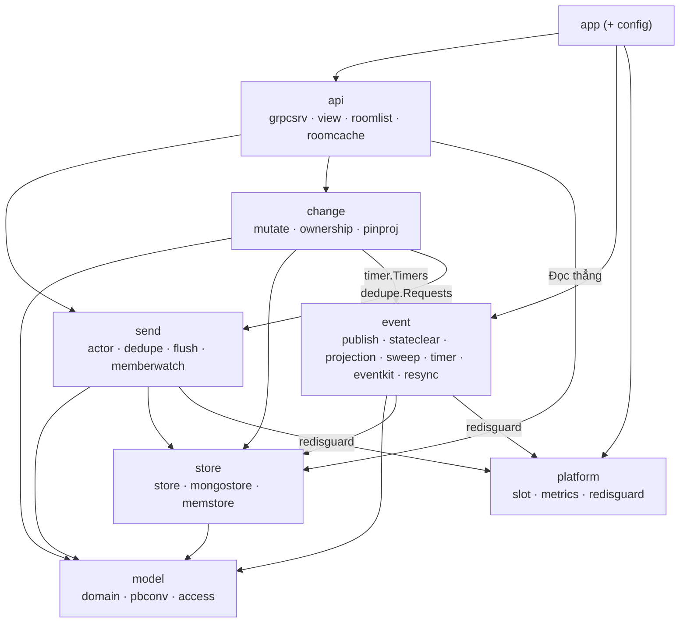

# chatim — Kiến trúc hệ thống (Single Source of Truth)

> Ngày cập nhật: 2026-10-16 · Trạng thái: **Nguồn sự thật duy nhất (SSOT)** cho toàn bộ quy chuẩn kiến trúc của `chatim`.
> Nhật ký 161 quyết định kỹ thuật: [docs/decision-log.md](./decision-log.md) (D1–D161).
> Đặc tả chi tiết 10 Module tính năng (How-It-Works & Flowcharts): [docs/modules/README.md](./modules/README.md).
> Lộ trình phát triển các Milestone: [docs/roadmap.md](./roadmap.md).

---

## 1. Tổng quan & Phạm vi

`chatim` là hạ tầng chat dùng chung (CPaaS nội bộ), multi-tenant về mặt logic: mỗi sản phẩm là một tenant, dữ liệu cô lập theo tenant id, mọi tenant dùng chung một bộ triển khai.

### 1.1 Phạm vi Phase 1
- `core`: room, member, message, tương tác, cấp seq, lưu trữ MongoDB, phát event NATS JetStream.
- `websocket`: giữ kết nối WebSocket (gws), đẩy event realtime (chưa xây).
- Room: DM (1-1), group ≤5K member, channel ~200K subscriber (chỉ admin post).
- Tin nhắn: gửi, sửa (có lịch sử), xoá cho mọi người / phía tôi, trả lời (quote), chuyển tiếp (forward).
- Tương tác: reaction, vị trí đọc + unread, typing, presence, thread, mention, ghim (pin), bookmark, đánh dấu chưa đọc.
- Ranh giới trách nhiệm:
  - Core cung cấp API dữ liệu (gửi, đọc, sửa, xoá, lịch sử, reaction, vị trí đọc…) và phát event.
  - Client lấy danh sách hội thoại thẳng từ Core; Core xếp danh sách theo tin mới nhất và đếm unread lúc đọc (M3, D120–D123).
  - Badge `@`, sync token, đa thiết bị: Mention App đảm nhiệm (đổi tên từ "Inbox/sync").

### 1.2 Ngoài phạm vi Phase 1 (Non-goals)
App auth / api / events / push / migrator, API import trong core, media, search, E2EE, webhook, voice/video, admin UI.

### 1.3 Mục tiêu quy mô (Scale)
- ~100K kết nối đồng thời (CCU).
- 5–10K tin/s lúc đỉnh điểm.
- Lưu trữ 5–20 tỷ tin nhắn sau 2 năm.

---

## 2. Yêu cầu & Cam kết dịch vụ (SLO)

### 2.1 Yêu cầu phi chức năng

| # | Yêu cầu |
|---|---|
| **A1** | **p99 Latency:** Ack gửi tin ≤ 30ms; tới người nhận online ≤ 100ms; trang 50 tin ở bất kỳ vị trí ≤ 20ms. |
| **A2** | **Tính bền vững & Thứ tự:** Đã ack = đã ghi `w:majority`. Thứ tự trong timeline giống nhau cho mọi người. Event giao ít nhất một lần: lệnh ghi doc kèm cờ `_state`, publish ngay sau ack, sweeper phát bù cờ còn sót (M3.1); id tự nhiên + version để người nhận bỏ trùng. |
| **A3** | **Tính sẵn sàng:** 99.95%, không điểm chết đơn lẻ: Core ≥ 2, WebSocket 2–3, Mongo rs 3 member, NATS 3 node, Redis Sentinel. |
| **A4** | **Lưu trữ:** Tin và lịch sử sửa giữ mãi mãi; stream `CHATIM_EVT` giữ 7 ngày. |
| **A5** | **Bảo mật:** JWT do app auth cấp; mTLS nội bộ; không mã hoá đầu cuối (no E2EE). |
| **A6** | **Hạn mức:** Text ≤ 16KB, meta ≤ 8KB, ≤ 50 mention, ≤ 10 tham chiếu đính kèm. |
| **A7** | **Quyền riêng tư:** Member đọc được lịch sử sửa của room; tenant có thể tắt. |

---

## 3. Nguyên tắc kiến trúc cốt lõi (Principles P1–P8)

Mọi thiết kế và dòng code trong `chatim` bắt buộc phải tuân thủ 8 nguyên tắc bất biến:

| # | Nguyên tắc | Diễn giải kỹ thuật |
|---|---|---|
| **P1** | **Fact là chân lý; projection là góc nhìn tạm** | Mọi thay đổi đều bắt đầu từ một fact bất biến (`messages`, `message_edits`, `pin_actions`). Bảng chiếu (projection) được cập nhật sau bằng CAS (`v < ver`). Lệch thì dựng lại từ fact. |
| **P2** | **Một lệnh ghi = một doc atomic** | Không transaction nhiều doc xuyên collection (trừ ngoại lệ duy nhất D100 đổi owner). Không retry nội bộ trong Core (D119): trượt CAS / contention trả `ErrRetryLater` (`UNAVAILABLE`) ngay, Client chịu trách nhiệm retry. |
| **P3** | **Core không fan-out theo người nhận** | Core phát event theo đối tượng dữ liệu (`room`, `member`, `message`). Core không giải phóng danh sách người nhận và không mở rộng nhóm mention. |
| **P4** | **Hiệu ứng phụ (Effect) phải hội tụ hoặc idempotent** | Effect hội tụ (event, projection, counter, dọn dẹp) chạy lại an toàn; effect không hội tụ (push, webhook) phải idempotent ở consumer theo event id. Lệnh tự publish ngay sau ack; cờ `_state` ghi cùng lệnh + sweeper trên slot 0 là đường bảo đảm (D141–D147). |
| **P5** | **Số đếm = `$inc` + Phiếu hẹn sinh tồn (Survivor Timer)** | Số đếm aggregate (`member_count`, `rx`, `rc`) cập nhật tức thời bằng `$inc` delta kèm phiếu hẹn sinh tồn (D111). Sửa sai = đếm lại tuyệt đối + CAS version khi phiếu bật. Không `$inc` trần không có phiếu. Giá trị theo người xem (unread) tính lúc đọc, không lưu. |
| **P6** | **Event ID tự nhiên + Version** | ID của event sinh từ khoá tự nhiên + version; consumer áp quy tắc "version cao hơn thì thắng"; không dùng số thứ tự liên tục toàn room. |
| **P7** | **Tin hệ thống là module riêng** | Tin hệ thống do module SysMsg sinh từ event với CID tất định `sys-{event_id}`; Core không tự ý tạo thêm tin nhắn ngầm. |
| **P8** | **Reconnect lấy trạng thái mới nhất** | Client sau khi mất kết nối sẽ tải lại snapshot mới nhất, không cố tua lại toàn bộ dòng event đã qua. |

---

## 4. Khung lớp dữ liệu (Data Class Framework)

> **Đường event chung cho mọi lớp (M3.1, D141–D160):** lệnh ghi doc kèm bit trong `_state` (+ `_state_at`) ở cùng lần ghi → ack → publish → sau PubAck xoá bit theo lô. Bit nào còn quá 15s (`SWEEP_MIN_AGE`) thì sweeper trên core giữ slot 0 dựng lại event từ doc hiện tại và phát bù. Projection (`room_activity`, `mention_reply_index`, `mention_read`) đọc một consumer `projections` trên `CHATIM_EVT` (chỉ core giữ slot 0, cửa sổ gom 3s), không delay cố định. Chi tiết: [Module 10](modules/10-feature-data-reconciliation-and-repair.md), [bản tóm tắt M3.1](plans/2026-10-16-m3-1-state-driven-events-summary.md).

> **Quy định bất di bất dịch:** Mọi tính năng mới bắt buộc phải map vào đúng một lớp dữ liệu dưới đây trước khi viết plan. Tính năng không khớp lớp nào thì phải dừng lại để thiết kế lớp mới (D61).

| Lớp | Ví dụ | Ghi | Event | Sửa lỗi (cờ `_state` + sweeper) |
|---|---|---|---|---|
| **Fact bất biến** | Tạo tin (`messages`), phiên bản nội dung (`message_edits`), lần ghim (`pin_actions`) | Insert theo khoá unique (khoá là CAS). Tạo dùng CID; sửa/xoá dùng `base_ver`; ghim ghi `pin_ver + 1` một lượt (D92, D119). | Id = khoá; insert mang bit 1 (`msg_created`, `msg_edited/deleted`, `msg_pinned/unpinned`). | Sweeper phát bù từ doc; với fact sửa/ghim, sweeper chạy lại `ApplyEdit`/fold ghim trước khi phát (D151). |
| **State có version (Projection)** | `messages` hiện tại, `rooms.pins`, `rooms.last_edit_at`, `mentions` theo đích, `reply_threads` | Lệnh ghi `set … where ver < v` từ fact; projection consumer (`room_activity`, `mention_reply_index`) ghi phần dẫn xuất từ event. Không bao giờ từ chối fact đã commit. `UpdateRoom` CAS `{_id, info_ver}` kèm bit 4. | Không event riêng (thuộc fact). `UpdateRoom` phát `room_updated`. | Sweeper áp lại projection từ fact rồi phát; projection consumer Nak giãn dần 5s/30s/2m/10m. |
| **Tập (target, user)** | `message_interactions` (reaction, bookmark, reply doc); `members` | Một ghi theo khoá unique `_id` + `ver`. Cùng giá trị giữ nguyên; gỡ/rời để lại tombstone `state = 2`. Lệnh owner = 1 transaction (D100). | Id `{target}-{user}-v{ver}`; bit trên doc, xoá có điều kiện `ver`; doc hiện tại thắng. | Sweeper phát lại doc hiện tại; chỉ trạng thái cuối được bảo đảm. |
| **Aggregate theo target** | Số emoji trên tin (`rx`), số trả lời (`rc`), `member_count` | `$inc` delta thực tế + Phiếu hẹn sinh tồn (D111). Số đếm lưu không kẹp (unclamped), kẹp lúc đọc. | `counts_changed`, `member_count_changed` (bit 2/4 trên `messages`, bit 2 trên `rooms`, xoá theo version). | Phiếu bật trên `CHATIM_TIMER`: consumer `timer-due` chạy `count_repair` / `member_count_repair` đếm lại + CAS version kèm bit. Vận hành qua `/app recount`. |
| **Giá trị theo người đọc** | Unread, cờ đã đọc mention, view ẩn/xoá, danh sách `ListMyRooms` | Không lưu kết quả; tính lúc đọc từ fact thưa (`hidden`), mốc `cleared_at` và cache đuôi room (D123, D137). | Unread/Danh sách: không event. Ẩn/Clear: `message_hidden`, `history_cleared`. | Sweeper phát lại trạng thái hiện tại; Client tải lại khi reconnect. |
| **Vị trí đọc** | `members.read_seq` + `read_ver`; cài đặt `preference_ver` | Cập nhật doc người đọc, không đụng `ver`: `MarkRead` nâng khi `read_seq < seq`, tăng `read_ver + 1`. `SetRoomPreferences` tăng `preference_ver + 1`. | `read_updated` không coalesce; `room_preferences_changed`. | Bit 2/8 trên `members`, xoá theo `read_ver`/`preference_ver`; sweeper phát lại trạng thái hiện tại; `mention_read` đọc lại `read_ver`. |
| **Sổ nhận chỗ** | `room_dms`: một room DM mỗi cặp user (D117) | Upsert `$setOnInsert` theo `_id` unique duy nhất; người tới sau nhận lại phòng đã có. Bước đảm bảo chạy lại an toàn. | Không event riêng; thuộc room/member tạo tương ứng. | Lần mở sau hoàn tất bước dở; số member qua phiếu hẹn sinh tồn. |
| **Ephemeral** | Typing, presence | Không lưu DB; truyền trực tiếp qua WebSocket ↔ NATS. | Subject `live.*.eph.*` | Mất khi rớt mạng, không cần phục hồi. |

---

## 5. Mô hình dữ liệu & Quy tắc Sharding

### 5.1 Các Collection chính trong MongoDB

Mọi collection dùng tên tiếng Anh đầy đủ (D96), ngoại trừ `messages` dùng tên ngắn để tiết kiệm bộ nhớ cache RAM của MongoDB.

Cờ event chờ phát (M3.1, D142–D149): 7 collection `messages`, `message_edits`, `message_interactions`, `pin_actions`, `members`, `hidden`, `rooms` có thêm hai field nội bộ `_state` (int32 bitmask, mỗi bit một event đã ghi DB nhưng chưa chắc vào NATS) và `_state_at` (lúc bật bit cũ nhất, `$min`; insert lấy giờ của doc, update lấy giờ server `$$NOW`). Hết bit thì cả hai field bị `$unset`, nên doc đã phát xong không tốn thêm byte. Mỗi collection có partial index `state_pending {_state_at: 1, _id: 1}` chỉ chứa doc còn `_state`. Proto không đọc hai field này. Bảng bit: [Module 10](modules/10-feature-data-reconciliation-and-repair.md#31-bit-theo-collection).

| Collection | Cấu trúc `_id` (Khoá nhị phân) | Lớp dữ liệu | Index phụ bắt buộc | Vai trò & Trạng thái |
|---|---|---|---|---|
| `messages` (clustered) | 24B `room│thread│seq` | Fact + Projection + Aggregate | **Không có index phụ** (ngoại lệ: partial `state_pending`, D148) | Toàn bộ tin nhắn (tên field ngắn: `f`, `x`, `ts`, `v`, `rx`, `rc`, `rp`, `fw`, `mt`, `ma`, `k`, `nu`, `m`). |
| `message_edits` (clustered) | 28B `room│thread│seq│ver` | Fact | `{room_id, created_at}` | Lịch sử sửa/xoá nội dung, dòng `ver 0` lưu bản gốc. |
| `pin_actions` (clustered) | 16B `room│pin_ver` | Fact | `{room_id, created_at}` | Fact các lần ghim/bỏ ghim tin nhắn. |
| `rooms` | 8B `int64` | Metadata + Projection + Aggregate | `{activity_bucket}`, `{created_at}` | Thông tin phòng, số thành viên, `last_edit_at`, `dm_key`. |
| `members` (clustered) | `room (8B)│user_id (≤64B)` | Tập + Vị trí đọc + Cài đặt | `{room_id, state, role, priority, joined_at, user_id}`, `{tenant, user_id, state, room_id, joined_at, cleared_at, read_seq, pinned_at, archived_at}` | Quản lý thành viên, quyền hạn, `read_seq`, `pinned_at`, `muted_until`. |
| `message_interactions` (clustered) | 24B `msg│kind(1B)│part` | Tập (D112) | `{message_key, kind, state, value, updated_at, actor_id}`, `{tenant, actor_id, kind, state...}` | Gộp reaction, bookmark và link doc trả lời. |
| `mentions` (clustered) | `msg│kind(1B)│target_id` | Projection theo đích (D115) | `{tenant, target, state, created_at, message_key}`, `{room_id, kind, created_at...}` | Hộp thư nhắc tên @mention cho user và group. |
| `room_dms` | `tenant│user_min│user_max` | Sổ nhận chỗ (D117) | Không có (`_id` unique duy nhất) | Chống race condition khi mở phòng DM song song. |
| `reply_threads` (clustered) | 24B `room│thread│seq` tin cha | Projection (D130) | `{room_id, last_reply_at, _id}` | Bảng tóm tắt thread và tin trả lời mới nhất. |
| `hidden` | `ObjectId` | Fact thưa | `{user_id, room_id, thread_root, seq}` unique | Danh sách tin ẩn theo từng người đọc. |
| `sweeper_state` | tên collection (`"messages"`…) | Vận hành (M3.1) | Không có | Mốc quét của sweeper mỗi collection `{checkpoint, updated_at}`, ghi `w:majority`, chỉ tiến. Thay `reconciler_state` (đã bỏ; DB cũ còn collection này thì xoá tay). |

### 5.2 Quy tắc Sharding & Clustered Keys (Shard-Ready)

> Core **không làm sharding** (owner 2026-10-17, D161). Các quy tắc dưới đây giữ cho đường shard mở; người triển khai tự chọn shard key và cấu hình theo nghiệp vụ của họ (số đo 2 shard để tham khảo: [open topics](plans/2026-10-15-m3-open-topics.md) §2).

1. **Khoá cụm (Clustered Index):** Toàn bộ collection lớn đều dùng Clustered Index trên `_id` với tiền tố `room_id`. Truy vấn khoảng trong một room là `SINGLE_SHARD`.
2. **Cấm Secondary Index trên `messages`:** Giữ kích thước working set của `messages` vừa vặn hoàn toàn trong RAM. Ngoại lệ duy nhất (M3.1, D148): partial index `{_state_at: 1, _id: 1}` chỉ chứa doc còn `_state` (event chờ phát), thường vài chục entry.
3. **Quy tắc Bounded Lookups (D139):**
   - **Tuyệt đối không gửi `_id: {$in: [...]}`** hoặc `$or` các phép bằng trên collection clustered. MongoDB 8.2 so sánh BinData theo độ dài trước giá trị, khiến `$in` biến thành Full Range Scan xuyên qua nhiều room.
   - Bắt buộc gom qua hàm `mongostore.boundedIDs`: Sắp xếp key theo thứ tự BinData, gộp các dải key liền kề thành `$or` các khoảng `{_id: {$gte, $lte}}`. Mỗi key kiểm tra đúng ≤ 2 docs.
4. **Không giao dịch phân tán (No Multi-doc Transactions):**
   - **Ngoại lệ duy nhất (D100):** Kế nhiệm Owner (Owner rời, nhường quyền) dùng 1 transaction duy nhất cập nhật `members` + `rooms.owners_ver`. Xung đột trả `ErrRetryLater` ngay, không retry nội bộ.

---

## 6. Kiến trúc Components & Bố cục Package `apps/core`

### 6.1 Sơ đồ kiến trúc Macro

```mermaid
flowchart TD
    Client["Client SDK (Web/Mobile)"]

    AppAuth["Auth App (JWT Issuer)"]
    AppEvents["Event Distribution / Webhooks"]
    AppPush["Push Notification Service"]

    subgraph Platform["Hạ tầng Nền tảng chatim"]
        AppWebsocket["App websocket (gws Gateway)"]
        AppCore["Core (Business Logic & Storage Engine)"]
        NATS[("NATS JetStream<br/>CHATIM_EVT, CHATIM_TIMER")]
        RedisState[("Redis State<br/>Slot soft-leases")]
        RedisDedupe[("Redis Dedupe<br/>CID, request_id")]
        MongoDB[("MongoDB Replica Set<br/>Clustered Collections")]
    end

    Client -.->|1. Lấy JWT| AppAuth
    Client <-->|2. WebSocket| AppWebsocket
    AppWebsocket -->|3. gRPC Unary theo Slot| AppCore
    AppCore -->|4. Ghi Fact & State kèm cờ _state| MongoDB
    AppCore <-->|5. Thuê Slot 1024| RedisState
    AppCore <-->|6. Bỏ trùng CID & request_id| RedisDedupe
    AppCore -->|7. Publish Event, xoá cờ sau PubAck| NATS
    NATS -->|8. Projection consumer, phiếu hẹn| AppCore
    AppCore -.->|9. Sweeper slot 0: quét cờ còn sót| MongoDB
    NATS -->|live.{t}.*.{rid}.>| AppWebsocket
    NATS -.->|Subscribe| AppPush
    NATS -.->|Subscribe| AppEvents
```

### 6.2 Phân cấp & Hướng phụ thuộc Packages (`apps/core`)

```
apps/core/
  main.go          os.Exit(app.Main(os.Args[1:]))
  itest/           Integration tests toàn diện với infra thật
  internal/
    app/           Wiring, vòng đời khởi động/tắt, CLI subcommand
    config/        Load và validate cấu hình lúc boot
    api/           grpcsrv, view pipeline, roomlist, roomcache
    model/         domain entities, pbconv, access policy
    send/          actor per room, dedupe batcher, flusher, memberwatch
    change/        mutate, ownership transaction, pinproj
    event/         publish async, stateclear, projection, sweep, timer, eventkit, resync
    store/         store interfaces, mongostore, memstore, storetest
    platform/      slot manager, metrics registry, redisguard
```



---

## 7. Hạ tầng, Vòng đời & Vận hành

### 7.1 Hạ tầng Lưu trữ & Message Bus
- **Hai cụm Redis độc lập (D44):**
  - `chatim-redis` (State): Chỉ dùng cho Slot Manager thuê 1024 slot (`noeviction`, AOF everysec).
  - `chatim-redis-dedupe` (Dedupe): Dùng cho CID dedupe và `request_id` (`allkeys-lru`, không lưu đĩa). Từ M3.1 không còn bitmap ack mark `chatim:evtack:*`; event chờ phát nằm trong `_state` trên doc.
- **NATS JetStream:**
  - `CHATIM_EVT`: Kênh phát live events 7 ngày, id tự nhiên, receiver bỏ trùng.
  - Một consumer durable `projections` trên `CHATIM_EVT` (lọc `evt.>`, ack từng tin, `MaxAckPending` = 4 × lô), chỉ core giữ slot 0 fetch (lô 8192, chờ 3s: cửa sổ 3s gom ghi `rooms` theo room để CPU Mongo ngang engine cũ), chia mỗi lô cho ba handler `room_activity`, `mention_reply_index`, `mention_read`; tin lỗi Nak riêng, giãn dần 5s/30s/2m/10m. Ba durable cũ bị xoá lúc khởi động.
  - `CHATIM_TIMER`: stream phiếu hẹn sinh tồn (WorkQueue, message schedule): phiếu đặt ở `timer.arm.*`, tới hạn sang `timer.due`, một consumer `timer-due` dùng chung (D152). Thay `CHATIM_WORK` (đã bỏ).
- **MongoDB:** Replica Set 3 node, `w:majority` cho mọi lệnh ghi bền vững.

### 7.2 Vòng đời Core (Lifecycle & Graceful Shutdown)
- **Thứ tự Boot:** Publisher → Hàng xoá cờ (`stateclear`) → Flusher → CID Batcher → Slot Router → Slot Manager → Consumer phiếu hẹn (`timer-due`) → Consumer `projections` → Sweeper (chỉ làm việc khi giữ slot 0) → Watchers (`memberwatch`, `roomcache.Watch`) → Mở cổng gRPC.
- **Thứ tự Dừng:** Bật `/readyz` false → Drain gRPC → Dừng Sweeper → Dừng Consumer projection → Dừng Consumer phiếu hẹn → Unsubscribe Watchers → Dừng Router → Flush CID Batcher → Flusher → Publisher → Xả hàng xoá cờ (1s; phần còn lại sweeper phát bù) → Nhả Slots → Đóng Clients (kế hoạch mặc định 29,7s trong `CORE_SHUTDOWN_BUDGET = 30s`; consumer projection có `PROJECTION_FETCH_WAIT` + 1s = 4s, consumer phiếu hẹn 500ms + 1s, vì lần fetch dở không huỷ được).
- **CLI Subcommands:** `/app resync` (bật lại cờ `_state` của doc trong khoảng để sweeper phát lại; sau khi purge stream phải chờ qua `EVT_STREAM_DUPLICATES`, D155) và `/app recount -room ID` (đếm lại `member_count`, CAS kèm bit 2, publish rồi xoá cờ).

### 7.3 Quy ước ghi DB ngoài core
- Mọi lần ghi bằng tay (mongosh) hay script migration lên 7 collection có event **phải tự bật** `_state` (đúng bit, xem Module 10 §3.1) và `_state_at` (giờ hiện tại, `$min`) trong cùng lệnh ghi. Không bật thì không có event nào được phát: từ M3.1 không còn change stream bắt các lần ghi này.
- Ví dụ sửa tay tên room: `updateOne({_id: 777}, [{$set: {name: "Mới", info_ver: {$add: ["$info_ver", NumberLong(1)]}, _state: {$bitOr: [{$ifNull: ["$_state", NumberInt(0)]}, NumberInt(4)]}, _state_at: {$min: [{$ifNull: ["$_state_at", "$$NOW"]}, "$$NOW"]}}}])`; sweeper phát `room_updated` trong khoảng 15–17s.
- Muốn phát lại cả một khoảng thì dùng `/app resync` thay vì tự bật cờ.

---

## 8. Cam kết đúng đắn (Guarantees & Detectors)

Mỗi cam kết hệ thống bắt buộc phải đi kèm với Detector đo lường trên Prometheus `/metrics` và Alert Rule cảnh báo (D76, D78). Tên metric đầy đủ có tiền tố `chatim_core_`; DM1 và SQ1 hiện chưa có detector:

| Mã | Cam kết hệ thống | Cơ chế bảo đảm | Metric đo lường & Cảnh báo |
|---|---|---|---|
| **CT1** | Không mất tin đã ack (`w:majority`), mỗi tin có `msg_created` | Flusher ghi nhóm `w:majority`, doc mang bit 1 trong `_state`; publish sau ack, xoá bit sau PubAck; sweeper slot 0 phát bù bit còn quá 15s | `event_pending_oldest_seconds{collection}`, `sweep_republished_total`, `sweep_passes_total`, `publish_dropped_total`<br/>Alert: `ChatimEventPendingStuck`, `ChatimSweeperIdle`, `ChatimEventsDropped` |
| **LK1** | Không lệch timeline giữa các user | Goroutine actor độc quyền mỗi room cấp monotonic seq; `_id` duy nhất (room│thread│seq) là CAS khi hai core cùng ghi | `room_yields_total` (actor nhường room khi đụng doc của core khác ở cùng seq)<br/>Alert: `ChatimSeqContention` |
| **RM1** | Mọi thay đổi (room, member, tin, tương tác) đều phát event, trạng thái cuối luôn tới | Bit ghi cùng lệnh; xoá có điều kiện version; sweeper dựng lại event từ doc hiện tại | `event_pending_oldest_seconds{collection}`, `sweep_publish_failures_total`, `sweep_failures_total`, `state_clear_dropped_total`<br/>Alert: `ChatimEventPendingStuck`, `ChatimSweeperIdle` |
| **PJ1** | Projection (danh sách hội thoại, chỉ mục mention, doc trả lời, `rc`, `reply_threads`, mention đã đọc) theo kịp event | Consumer `projections` (một durable, slot 0, ack từng tin) với 3 handler, không delay, ghi idempotent hoặc chặn version; lỗi Nak giãn dần 5s/30s/2m/10m | `projection_lag_seconds{projection}`, `projection_failures_total`, `projection_stuck_total`<br/>Alert: `ChatimProjectionLagging`, `ChatimProjectionFailing` |
| **CN1** | Số đếm (`rx`, `rc`, `member_count`) hội tụ về đúng | `$inc` + phiếu hẹn trên `CHATIM_TIMER`; phiếu bật thì đếm lại + CAS | `counter_repaired_total{counter}`, `timer_failures_total`<br/>Alert: `ChatimCounterRepairSurge`, `ChatimTimerFailing` |
| **DM1** | Mỗi cặp user chỉ có 1 room DM | Sổ nhận chỗ `room_dms` `$setOnInsert` theo `_id` | Chưa có detector (đúng nhờ `_id` duy nhất của `room_dms`, không có metric riêng) |
| **MB1-MB5** | Nhất quán danh sách thành viên & Quyền hạn | BulkWrite upsert + Transaction đổi owner + NATS `memberwatch` | `member_cache_forgets_total`, `counter_repaired_total{counter="members"}` |
| **SQ1** | Không tạo lỗ seq tùy tiện | Actor giữ dirty state khi gặp lỗi chưa rõ kết quả, nhớ lần ghi theo (user, cid) tới hết `CID_PENDING_TTL` | Chưa có detector (actor không xuất số lần dirty hay số lần ghi chưa rõ kết quả) |

### 8.1 Hợp đồng cho consumer event (D156)

Áp cho websocket (M4), Mention App và mọi consumer của `CHATIM_EVT`/`live.*`:
- **Ít nhất một lần, có thể lệch thứ tự.** Một event có thể tới hai lần (cùng id), và bản sweeper phát bù có thể tới sau event mới hơn. Ví dụ tin 46 tới trước, tin 45 do sweeper phát bù tới sau.
- **Bỏ trùng theo id event và version của doc.** Event đổi trạng thái mang version của doc (`ver`, `read_ver`, `pin_ver`, `info_ver`, `preference_ver`, `rx.v`/`rc.v`, `member_count_ver`): bản version lớn hơn thắng, bản nhỏ hơn hoặc bằng thì bỏ.
- **`msg_created`:** bỏ nếu đã có đúng seq đó; thấy lỗ (seq > seq cuối + 1) thì gọi `GetHistory` để lấp.
- **Không bao giờ** dùng luật "seq ≤ seq cuối đã thấy thì bỏ": tin phát bù sẽ mất.
- Chỉ trạng thái cuối của doc tập và số đếm được bảo đảm; event trung gian có thể không bao giờ được phát bù.
- Stream chỉ bỏ trùng trong `EVT_STREAM_DUPLICATES` (5 phút); bản phát lại sau đó (projection lỗi lâu, resync) phải được consumer bỏ theo luật trên.

---

## 9. Bản đồ 10 Module tính năng chi tiết

Toàn bộ chi tiết kỹ thuật vận hành (How-It-Works), sơ đồ Mermaid trình tự gọi lệnh, cấu trúc payload và mã lỗi từng tính năng được phân rã độc lập trong thư mục [`docs/modules/`](./modules/README.md):

| # | Module | Tài liệu chi tiết | Trọng tâm nghiệp vụ |
|---|---|---|---|
| **01** | Rooms, DMs & Channels | [01-feature-rooms-dms-and-channels.md](./modules/01-feature-rooms-dms-and-channels.md) | Mở chat 1-1, tạo nhóm ≤5K, kênh ~200K, sổ nhận chỗ `room_dms`. |
| **02** | Message Sending & Ordering | [02-feature-message-sending-and-ordering.md](./modules/02-feature-message-sending-and-ordering.md) | Actor per-room, monotonic seq, chống trùng CID 2 tầng (LRU RAM → Redis dedupe), Group Commit. |
| **03** | Message Edit & Delete | [03-feature-message-edit-delete-and-privacy.md](./modules/03-feature-message-edit-delete-and-privacy.md) | Fact `message_edits`, projection CAS `messages`, thu hồi và ẩn tin. |
| **04** | Reactions, Pins & Bookmarks | [04-feature-reactions-pins-and-bookmarks.md](./modules/04-feature-reactions-pins-and-bookmarks.md) | Survivor timers tự sửa sai số đếm, pin folding CAS hạn mức 50. |
| **05** | Membership & Roles | [05-feature-membership-roles-and-succession.md](./modules/05-feature-membership-roles-and-succession.md) | Thêm/xoá member, transaction kế nhiệm owner duy nhất, `memberwatch`. |
| **06** | Threads & Mentions | [06-feature-threads-replies-and-mentions.md](./modules/06-feature-threads-replies-and-mentions.md) | Trả lời trên timeline chính (`messages.rp {th, s}`), @mention indexing ngầm, `reply_threads`. |
| **07** | Read Receipts & Unread | [07-feature-read-receipts-and-unread-badge.md](./modules/07-feature-read-receipts-and-unread-badge.md) | Đánh dấu đã đọc/chưa đọc, unread tính lúc đọc từ đuôi room (đếm tới 100, cờ `approx`). |
| **08** | History & Reconnect Sync | [08-feature-history-retrieval-and-sync.md](./modules/08-feature-history-retrieval-and-sync.md) | Phân trang theo `seq` (`LATEST`/`OLDEST`/`BEFORE`/`AFTER`/`AROUND`), View pipeline che tin nhạy cảm. |
| **09** | Realtime Delivery & Ephemeral | [09-feature-realtime-delivery-and-ephemeral.md](./modules/09-feature-realtime-delivery-and-ephemeral.md) | WebSocket gws, dynamic interest routing NATS, typing/presence. |
| **10** | Reconciliation & Self-Healing | [10-feature-data-reconciliation-and-repair.md](./modules/10-feature-data-reconciliation-and-repair.md) | Cờ `_state` trên doc, xoá cờ sau PubAck, sweeper slot 0, consumer `projections` (3 handler), phiếu hẹn `CHATIM_TIMER`, resync/recount. |

---

## 10. Tra cứu Quyết định Kỹ thuật (Decision Log)

Mọi quyết định lựa chọn giải pháp kỹ thuật, đánh đổi (trade-offs), phương án bị loại bỏ (rejected alternatives) từ ngày đầu dự án đến Milestone M3.1 hiện tại được lưu trữ đầy đủ tại:
👉 **[Architecture Decision Records (D1–D161)](./decision-log.md)**
