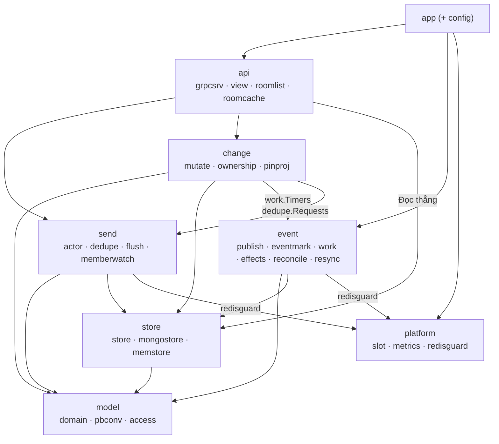

# chatim — Kiến trúc hệ thống (Single Source of Truth)

> Ngày cập nhật: 2026-10-16 · Trạng thái: **Nguồn sự thật duy nhất (SSOT)** cho toàn bộ quy chuẩn kiến trúc của `chatim`.
> Nhật ký 140 quyết định kỹ thuật: [docs/decision-log.md](./decision-log.md) (D1–D140).
> Đặc tả chi tiết 10 Module tính năng (How-It-Works & Flowcharts): [docs/modules/README.md](./modules/README.md).
> Lộ trình phát triển các Milestone: [docs/roadmap.md](./roadmap.md).

---

## 1. Tổng quan & Phạm vi

`chatim` là hạ tầng chat dùng chung (CPaaS nội bộ), multi-tenant về mặt logic: mỗi sản phẩm là một tenant, dữ liệu cô lập theo tenant id, mọi tenant dùng chung một bộ triển khai.

### 1.1 Phạm vi Phase 1
- `core`: room, member, message, tương tác, cấp seq, lưu trữ MongoDB, phát event NATS JetStream.
- `websocket`: giữ kết nối WebSocket (gws), đẩy event realtime (chưa xây).
- Room: DM (1-1), group ≤5K member, channel ~200K subscriber (chỉ admin post).
- Tin nhắn: gửi, sửa (có lịch sử), xoá cho mọi người / phía tôi, trả lời (quote), chuyển tiếp (forward).
- Tương tác: reaction, vị trí đọc + unread, typing, presence, thread, mention, ghim (pin), bookmark, đánh dấu chưa đọc.
- Ranh giới trách nhiệm:
  - Core cung cấp API dữ liệu (gửi, đọc, sửa, xoá, lịch sử, reaction, vị trí đọc…) và phát event.
  - Client lấy danh sách hội thoại thẳng từ Core; Core xếp danh sách theo tin mới nhất và đếm unread lúc đọc (M3, D120–D123).
  - Badge `@`, sync token, đa thiết bị: Mention App đảm nhiệm (đổi tên từ "Inbox/sync").

### 1.2 Ngoài phạm vi Phase 1 (Non-goals)
App auth / api / events / push / migrator, API import trong core, media, search, E2EE, webhook, voice/video, admin UI.

### 1.3 Mục tiêu quy mô (Scale)
- ~100K kết nối đồng thời (CCU).
- 5–10K tin/s lúc đỉnh điểm.
- Lưu trữ 5–20 tỷ tin nhắn sau 2 năm.

---

## 2. Yêu cầu & Cam kết dịch vụ (SLO)

### 2.1 Yêu cầu phi chức năng

| # | Yêu cầu |
|---|---|
| **A1** | **p99 Latency:** Ack gửi tin ≤ 30ms; tới người nhận online ≤ 100ms; trang 50 tin ở bất kỳ vị trí ≤ 20ms. |
| **A2** | **Tính bền vững & Thứ tự:** Đã ack = đã ghi `w:majority`. Thứ tự trong timeline giống nhau cho mọi người. Event best-effort, id tự nhiên để người nhận bỏ trùng; reconcile bù phần mất. |
| **A3** | **Tính sẵn sàng:** 99.95%, không điểm chết đơn lẻ: Core ≥ 2, WebSocket 2–3, Mongo rs 3 member, NATS 3 node, Redis Sentinel. |
| **A4** | **Lưu trữ:** Tin và lịch sử sửa giữ mãi mãi; stream `CHATIM_EVT` giữ 7 ngày. |
| **A5** | **Bảo mật:** JWT do app auth cấp; mTLS nội bộ; không mã hoá đầu cuối (no E2EE). |
| **A6** | **Hạn mức:** Text ≤ 16KB, meta ≤ 8KB, ≤ 50 mention, ≤ 10 tham chiếu đính kèm. |
| **A7** | **Quyền riêng tư:** Member đọc được lịch sử sửa của room; tenant có thể tắt. |

---

## 3. Nguyên tắc kiến trúc cốt lõi (Principles P1–P8)

Mọi thiết kế và dòng code trong `chatim` bắt buộc phải tuân thủ 8 nguyên tắc bất biến:

| # | Nguyên tắc | Diễn giải kỹ thuật |
|---|---|---|
| **P1** | **Fact là chân lý; projection là góc nhìn tạm** | Mọi thay đổi đều bắt đầu từ một fact bất biến (`messages`, `message_edits`, `pin_actions`). Bảng chiếu (projection) được cập nhật sau bằng CAS (`v < ver`). Lệch thì dựng lại từ fact. |
| **P2** | **Một lệnh ghi = một doc atomic** | Không transaction nhiều doc xuyên collection (trừ ngoại lệ duy nhất D100 đổi owner). Không retry nội bộ trong Core (D119): trượt CAS / contention trả `ErrRetryLater` (`UNAVAILABLE`) ngay, Client chịu trách nhiệm retry. |
| **P3** | **Core không fan-out theo người nhận** | Core phát event theo đối tượng dữ liệu (`room`, `member`, `message`). Core không giải phóng danh sách người nhận và không mở rộng nhóm mention. |
| **P4** | **Hiệu ứng phụ (Effect) phải hội tụ hoặc idempotent** | Effect hội tụ (event, projection, counter, dọn dẹp) chạy lại an toàn; effect không hội tụ (push, webhook) phải idempotent ở consumer theo event id. Fast path chạy ngay (best-effort); Reconciler Change Stream là đường bảo đảm. |
| **P5** | **Số đếm = `$inc` + Phiếu hẹn sinh tồn (Survivor Timer)** | Số đếm aggregate (`member_count`, `rx`, `rc`) cập nhật tức thời bằng `$inc` delta kèm phiếu hẹn sinh tồn (D111). Sửa sai = đếm lại tuyệt đối + CAS version khi phiếu bật. Không `$inc` trần không có phiếu. Giá trị theo người xem (unread) tính lúc đọc, không lưu. |
| **P6** | **Event ID tự nhiên + Version** | ID của event sinh từ khoá tự nhiên + version; consumer áp quy tắc "version cao hơn thì thắng"; không dùng số thứ tự liên tục toàn room. |
| **P7** | **Tin hệ thống là module riêng** | Tin hệ thống do module SysMsg sinh từ event với CID tất định `sys-{event_id}`; Core không tự ý tạo thêm tin nhắn ngầm. |
| **P8** | **Reconnect lấy trạng thái mới nhất** | Client sau khi mất kết nối sẽ tải lại snapshot mới nhất, không cố tua lại toàn bộ dòng event đã qua. |

---

## 4. Khung lớp dữ liệu (Data Class Framework)

> **Quy định bất di bất dịch:** Mọi tính năng mới bắt buộc phải map vào đúng một lớp dữ liệu dưới đây trước khi viết plan. Tính năng không khớp lớp nào thì phải dừng lại để thiết kế lớp mới (D61).

| Lớp | Ví dụ | Ghi | Event | Sửa lỗi / Reconcile |
|---|---|---|---|---|
| **Fact bất biến** | Tạo tin (`messages`), phiên bản nội dung (`message_edits`), lần ghim (`pin_actions`) | Insert theo khoá unique (khoá là CAS). Tạo dùng CID; sửa/xoá dùng `base_ver`; ghim ghi `pin_ver + 1` một lượt (D92, D119). | Id = khoá; change feed chỉ bắt insert. | Reconciler Change Stream bù đắp; Ack Mark trên Redis dedupe. |
| **State có version (Projection)** | `messages` hiện tại, `rooms.pins`, `rooms.last_edit_at`, `mentions` theo đích, `reply_threads` | Effect `set … where ver < v` từ fact. Không bao giờ từ chối fact đã commit. `UpdateRoom` CAS `{_id, info_ver}`. | Không event riêng (thuộc fact). `UpdateRoom` phát `room_updated`. | Reconciler áp lại Projection từ fact. |
| **Tập (target, user)** | `message_interactions` (reaction, bookmark, reply doc); `members` | Một ghi theo khoá unique `_id` + `ver`. Cùng giá trị giữ nguyên; gỡ/rời để lại tombstone `state = 2`. Lệnh owner = 1 transaction (D100). | Id `{target}-{user}-v{ver}`. Feed insert/update/replace; doc hiện tại thắng. | Worker phát lại doc hiện tại (`reaction_event`, `member_event`...). |
| **Aggregate theo target** | Số emoji trên tin (`rx`), số trả lời (`rc`), `member_count` | `$inc` delta thực tế + Phiếu hẹn sinh tồn (D111). Số đếm lưu không kẹp (unclamped), kẹp lúc đọc. | `counts_changed`, `member_count_changed`. | Phiếu bật: Worker `count_repair` / `member_count_repair` đếm lại + CAS version. Vận hành qua `/app recount`. |
| **Giá trị theo người đọc** | Unread, cờ đã đọc mention, view ẩn/xoá, danh sách `ListMyRooms` | Không lưu kết quả; tính lúc đọc từ fact thưa (`hidden`), mốc `cleared_at` và cache đuôi room (D123, D137). | Unread/Danh sách: không event. Ẩn/Clear: `message_hidden`, `history_cleared`. | Worker phát lại trạng thái; Client tải lại khi mất event hoặc reconnect. |
| **Vị trí đọc** | `members.read_seq` + `read_ver`; cài đặt `preference_ver` | Cập nhật doc người đọc, không đụng `ver`: `MarkRead` nâng khi `read_seq < seq`, tăng `read_ver + 1`. `SetRoomPreferences` tăng `preference_ver + 1`. | `read_updated` không coalesce; `room_preferences_changed`. | Feed bắt update; Worker phát lại trạng thái hiện tại. |
| **Sổ nhận chỗ** | `room_dms`: một room DM mỗi cặp user (D117) | Upsert `$setOnInsert` theo `_id` unique duy nhất; người tới sau nhận lại phòng đã có. Bước đảm bảo chạy lại an toàn. | Không event riêng; thuộc room/member tạo tương ứng. | Lần mở sau hoàn tất bước dở; số member qua phiếu hẹn sinh tồn. |
| **Ephemeral** | Typing, presence | Không lưu DB; truyền trực tiếp qua WebSocket ↔ NATS. | Subject `live.*.eph.*` | Mất khi rớt mạng, không cần phục hồi. |

---

## 5. Mô hình dữ liệu & Quy tắc Sharding

### 5.1 Các Collection chính trong MongoDB

Mọi collection dùng tên tiếng Anh đầy đủ (D96), ngoại trừ `messages` dùng tên ngắn để tiết kiệm bộ nhớ cache RAM của MongoDB.

| Collection | Cấu trúc `_id` (Khoá nhị phân) | Lớp dữ liệu | Index phụ bắt buộc | Vai trò & Trạng thái |
|---|---|---|---|---|
| `messages` (clustered) | 24B `room│thread│seq` | Fact + Projection + Aggregate | **Không có index phụ** | Toàn bộ tin nhắn (tên field ngắn: `f`, `x`, `ts`, `v`, `rx`, `rc`, `rp`, `fw`, `mt`, `ma`, `k`, `nu`, `m`). |
| `message_edits` (clustered) | 28B `room│thread│seq│ver` | Fact | `{room_id, created_at}` | Lịch sử sửa/xoá nội dung, dòng `ver 0` lưu bản gốc. |
| `pin_actions` (clustered) | 16B `room│pin_ver` | Fact | `{room_id, created_at}` | Fact các lần ghim/bỏ ghim tin nhắn. |
| `rooms` | 8B `int64` | Metadata + Projection + Aggregate | `{activity_bucket}`, `{created_at}` | Thông tin phòng, số thành viên, `last_edit_at`, `dm_key`. |
| `members` (clustered) | `room (8B)│user_id (≤64B)` | Tập + Vị trí đọc + Cài đặt | `{room_id, state, role, priority, joined_at, user_id}`, `{tenant, user_id, state, room_id, joined_at, cleared_at, read_seq, pinned_at, archived_at}` | Quản lý thành viên, quyền hạn, `read_seq`, `pinned_at`, `muted_until`. |
| `message_interactions` (clustered) | 24B `msg│kind(1B)│part` | Tập (D112) | `{message_key, kind, state, value, updated_at, actor_id}`, `{tenant, actor_id, kind, state...}` | Gộp reaction, bookmark và link doc trả lời. |
| `mentions` (clustered) | `msg│kind(1B)│target_id` | Projection theo đích (D115) | `{tenant, target, state, created_at, message_key}`, `{room_id, kind, created_at...}` | Hộp thư nhắc tên @mention cho user và group. |
| `room_dms` | `tenant│user_min│user_max` | Sổ nhận chỗ (D117) | Không có (`_id` unique duy nhất) | Chống race condition khi mở phòng DM song song. |
| `reply_threads` (clustered) | 24B `room│thread│seq` tin cha | Projection (D130) | `{room_id, last_reply_at, _id}` | Bảng tóm tắt thread và tin trả lời mới nhất. |
| `hidden` | `ObjectId` | Fact thưa | `{user_id, room_id, thread_root, seq}` unique | Danh sách tin ẩn theo từng người đọc. |
| `reconciler_state` | `"changes"` | Vận hành | Không có | Lưu Resume Token của Change Stream slot 0. |

### 5.2 Quy tắc Sharding & Clustered Keys (Shard-Ready)

1. **Khoá cụm (Clustered Index):** Toàn bộ collection lớn đều dùng Clustered Index trên `_id` với tiền tố `room_id`. Truy vấn khoảng trong một room là `SINGLE_SHARD`.
2. **Cấm Secondary Index trên `messages`:** Giữ kích thước working set của `messages` vừa vặn hoàn toàn trong RAM.
3. **Quy tắc Bounded Lookups (D139):**
   - **Tuyệt đối không gửi `_id: {$in: [...]}`** hoặc `$or` các phép bằng trên collection clustered. MongoDB 8.2 so sánh BinData theo độ dài trước giá trị, khiến `$in` biến thành Full Range Scan xuyên qua nhiều room.
   - Bắt buộc gom qua hàm `mongostore.boundedIDs`: Sắp xếp key theo thứ tự BinData, gộp các dải key liền kề thành `$or` các khoảng `{_id: {$gte, $lte}}`. Mỗi key kiểm tra đúng ≤ 2 docs.
4. **Không giao dịch phân tán (No Multi-doc Transactions):**
   - **Ngoại lệ duy nhất (D100):** Kế nhiệm Owner (Owner rời, nhường quyền) dùng 1 transaction duy nhất cập nhật `members` + `rooms.owners_ver`. Xung đột trả `ErrRetryLater` ngay, không retry nội bộ.

---

## 6. Kiến trúc Components & Bố cục Package `apps/core`

### 6.1 Sơ đồ kiến trúc Macro

```mermaid
flowchart TD
    Client["Client SDK (Web/Mobile)"]

    AppAuth["Auth App (JWT Issuer)"]
    AppEvents["Event Distribution / Webhooks"]
    AppPush["Push Notification Service"]

    subgraph Platform["Hạ tầng Nền tảng chatim"]
        AppWebsocket["App websocket (gws Gateway)"]
        AppCore["Core (Business Logic & Storage Engine)"]
        NATS[("NATS JetStream<br/>CHATIM_EVT, CHATIM_WORK")]
        RedisState[("Redis State<br/>Slot soft-leases")]
        RedisDedupe[("Redis Dedupe<br/>CID, request_id, ack marks")]
        MongoDB[("MongoDB Replica Set<br/>Clustered Collections")]
    end

    Client -.->|1. Lấy JWT| AppAuth
    Client <-->|2. WebSocket| AppWebsocket
    AppWebsocket -->|3. gRPC Unary theo Slot| AppCore
    AppCore -->|4. Ghi Fact & State| MongoDB
    AppCore <-->|5. Thuê Slot 1024| RedisState
    AppCore <-->|6. Bỏ trùng CID & Ack Mark| RedisDedupe
    AppCore -->|7. Publish Event| NATS
    MongoDB -.->|Change Stream| AppCore
    NATS -->|live.{t}.*.{rid}.>| AppWebsocket
    NATS -.->|Subscribe| AppPush
    NATS -.->|Subscribe| AppEvents
```

### 6.2 Phân cấp & Hướng phụ thuộc Packages (`apps/core`)

```
apps/core/
  main.go          os.Exit(app.Main(os.Args[1:]))
  itest/           Integration tests toàn diện với infra thật
  internal/
    app/           Wiring, vòng đời khởi động/tắt, CLI subcommand
    config/        Load và validate cấu hình lúc boot
    api/           grpcsrv, view pipeline, roomlist, roomcache
    model/         domain entities, pbconv, access policy
    send/          actor per room, dedupe batcher, flusher, memberwatch
    change/        mutate, ownership transaction, pinproj
    event/         publish async, eventmark, work queue, effects, reconcile, resync
    store/         store interfaces, mongostore, memstore, storetest
    platform/      slot manager, metrics registry, redisguard
```



---

## 7. Hạ tầng, Vòng đời & Vận hành

### 7.1 Hạ tầng Lưu trữ & Message Bus
- **Hai cụm Redis độc lập (D44):**
  - `chatim-redis` (State): Chỉ dùng cho Slot Manager thuê 1024 slot (`noeviction`, AOF everysec).
  - `chatim-redis-dedupe` (Dedupe): Dùng cho CID dedupe, `request_id`, và Bitmap Ack Marks (`allkeys-lru`, không lưu đĩa).
- **NATS JetStream:**
  - `CHATIM_EVT`: Kênh phát live events 7 ngày, id tự nhiên, receiver bỏ trùng.
  - `CHATIM_WORK`: Work stream phân thành 32 partition (`work.p0`..`work.p31`) cho các tác vụ bất đồng bộ (phiếu hẹn sinh tồn, lập chỉ mục mention, cập nhật thread).
- **MongoDB:** Replica Set 3 node, `w:majority` cho mọi lệnh ghi bền vững.

### 7.2 Vòng đời Core (Lifecycle & Graceful Shutdown)
- **Thứ tự Boot:** Publisher $
ightarrow$ Flusher $
ightarrow$ CID Batcher $
ightarrow$ Slot Router $
ightarrow$ Slot Manager $
ightarrow$ Workers $
ightarrow$ Reconciler $
ightarrow$ Watchers (`memberwatch`, `roomcache.Watch`) $
ightarrow$ Mở cổng gRPC.
- **Thứ tự Dừng:** Bật `/readyz` false $
ightarrow$ Drain gRPC $
ightarrow$ Dừng Reconciler $
ightarrow$ Dừng Workers $
ightarrow$ Unsubscribe Watchers $
ightarrow$ Dừng Router $
ightarrow$ Flush Batcher & Flusher $
ightarrow$ Nhả Slots $
ightarrow$ Đóng Clients (tổng ngân sách `CORE_SHUTDOWN_BUDGET = 26.2s`).
- **CLI Subcommands:** `/app resync` (quét oplog bù sự kiện) và `/app recount -room ID` (đối soát sửa số đếm).

---

## 8. Cam kết đúng đắn (Guarantees & Detectors)

Mỗi cam kết hệ thống bắt buộc phải đi kèm với Detector đo lường trên Prometheus `/metrics` và Alert Rule cảnh báo (D76, D78):

| Mã | Cam kết hệ thống | Cơ chế bảo đảm | Metric đo lường & Cảnh báo |
|---|---|---|---|
| **CT1** | Không mất tin đã ack (`w:majority`) | Write flusher nhóm `w:majority`; Reconciler bù đắp qua change feed sau 5s | `reconcile_republished_total`<br/>Alert: `ChatimRepublishSurge` |
| **LK1** | Không lệch timeline giữa các user | Goroutine actor độc quyền mỗi room cấp monotonic seq | `seq_gap_total`, `room_yields_total`<br/>Alert: `ChatimSeqContention` |
| **RM1** | Mọi thay đổi metadata room đều phát event | Fast-path + Worker phát lại trạng thái cuối | `reconcile_republished_total{effect}`<br/>Alert: `ChatimEffectDropping` |
| **DM1** | Mỗi cặp user chỉ có 1 room DM | Sổ nhận chỗ `room_dms` `$setOnInsert` unique | `redis_degraded{client}` |
| **MB1-MB5** | Nhất quán danh sách thành viên & Quyền hạn | BulkWrite upsert + Transaction đổi owner + NATS `memberwatch` | `member_watch_forgets_total`, `member_count_repair_total` |
| **SQ1** | Không tạo lỗ seq tùy tiện | Actor giữ dirty state khi gặp lỗi chưa rõ kết quả | `actor_dirty_total` |

---

## 9. Bản đồ 10 Module tính năng chi tiết

Toàn bộ chi tiết kỹ thuật vận hành (How-It-Works), sơ đồ Mermaid trình tự gọi lệnh, cấu trúc payload và mã lỗi từng tính năng được phân rã độc lập trong thư mục [`docs/modules/`](./modules/README.md):

| # | Module | Tài liệu chi tiết | Trọng tâm nghiệp vụ |
|---|---|---|---|
| **01** | Rooms, DMs & Channels | [01-feature-rooms-dms-and-channels.md](./modules/01-feature-rooms-dms-and-channels.md) | Mở chat 1-1, tạo nhóm ≤5K, kênh ~200K, sổ nhận chỗ `room_dms`. |
| **02** | Message Sending & Ordering | [02-feature-message-sending-and-ordering.md](./modules/02-feature-message-sending-and-ordering.md) | Actor per-room, monotonic seq, chống trùng CID 3 tầng, Group Commit. |
| **03** | Message Edit & Delete | [03-feature-message-edit-delete-and-privacy.md](./modules/03-feature-message-edit-delete-and-privacy.md) | Fact `message_edits`, projection CAS `messages`, thu hồi và ẩn tin. |
| **04** | Reactions, Pins & Bookmarks | [04-feature-reactions-pins-and-bookmarks.md](./modules/04-feature-reactions-pins-and-bookmarks.md) | Survivor timers tự sửa sai số đếm, pin folding CAS hạn mức 50. |
| **05** | Membership & Roles | [05-feature-membership-roles-and-succession.md](./modules/05-feature-membership-roles-and-succession.md) | Thêm/xoá member, transaction kế nhiệm owner duy nhất, `memberwatch`. |
| **06** | Threads & Mentions | [06-feature-threads-replies-and-mentions.md](./modules/06-feature-threads-replies-and-mentions.md) | Flat thread qua `root_seq`, @mention indexing ngầm, `reply_threads`. |
| **07** | Read Receipts & Unread | [07-feature-read-receipts-and-unread-badge.md](./modules/07-feature-read-receipts-and-unread-badge.md) | Đánh dấu đã đọc/chưa đọc, thuật toán đếm unread giới hạn 99+. |
| **08** | History & Reconnect Sync | [08-feature-history-retrieval-and-sync.md](./modules/08-feature-history-retrieval-and-sync.md) | Phân trang cursor `(room_id, seq)`, View pipeline lọc tin nhạy cảm. |
| **09** | Realtime Delivery & Ephemeral | [09-feature-realtime-delivery-and-ephemeral.md](./modules/09-feature-realtime-delivery-and-ephemeral.md) | WebSocket gws, dynamic interest routing NATS, typing/presence. |
| **10** | Reconciliation & Self-Healing | [10-feature-data-reconciliation-and-repair.md](./modules/10-feature-data-reconciliation-and-repair.md) | Oplog Change Stream Reconciler slot 0, Redis Bitmap Ack Marks, tự chữa lành. |

---

## 10. Tra cứu Quyết định Kỹ thuật (Decision Log)

Mọi quyết định lựa chọn giải pháp kỹ thuật, đánh đổi (trade-offs), phương án bị loại bỏ (rejected alternatives) từ ngày đầu dự án đến Milestone M3 hiện tại được lưu trữ đầy đủ tại:
👉 **[Architecture Decision Records (D1–D140)](./decision-log.md)**
