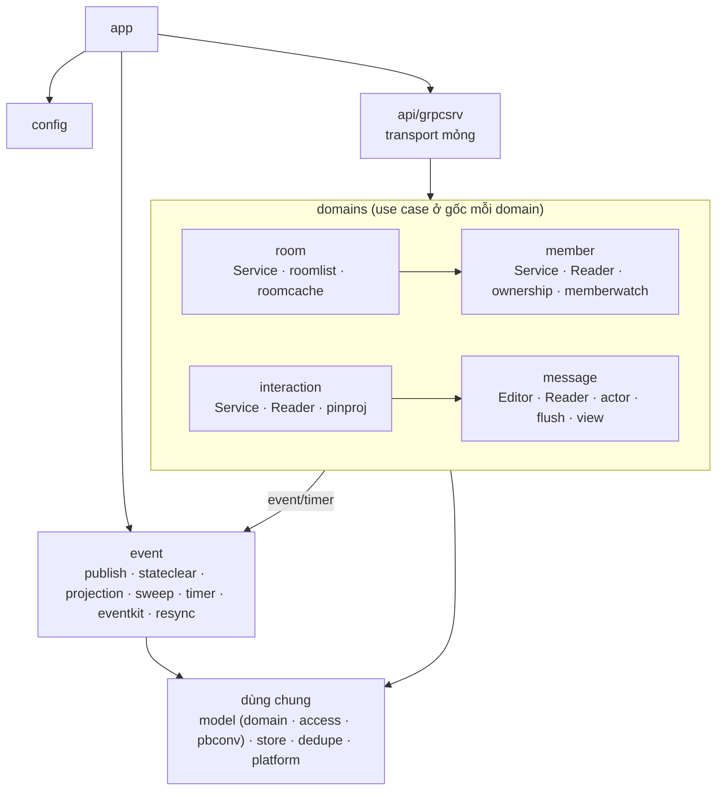

# chatim — Kiến trúc hệ thống (Single Source of Truth)

> Ngày cập nhật: 2026-10-17 · Trạng thái: **Nguồn sự thật duy nhất (SSOT)** cho toàn bộ quy chuẩn kiến trúc của `chatim`.
> Nhật ký quyết định kỹ thuật: [docs/decision-log.md](./decision-log.md). Danh mục event (chat phát gì, ai nhận gì): [docs/events.md](./events.md).
> Đặc tả chi tiết các Module tính năng (How-It-Works & Flowcharts): [docs/features/README.md](./features/README.md).
> Lộ trình phát triển các Milestone: [docs/roadmap.md](./roadmap.md).

---

## 1. Tổng quan & Phạm vi

`chatim` là hạ tầng chat dùng chung (CPaaS nội bộ), multi-tenant về mặt logic: mỗi sản phẩm là một tenant, dữ liệu cô lập theo tenant id, mọi tenant dùng chung một bộ triển khai.

### 1.1 Phạm vi Phase 1
- `chat`: room, member, message, tương tác, cấp seq, lưu trữ MongoDB, phát event NATS JetStream.
- `websocket`: giữ kết nối WebSocket (gws), kiểm token, chuyển lệnh tới chat (phần 1 đã xây trên `feat/m4`, D183–D188); đẩy event realtime: mỗi node đọc `CHATIM_EVT` và hộp thư `websocket.publish.{t}` (`CHATIM_WS`) bằng ordered consumer, lọc theo room trong RAM (phần 2 đã xây trên `feat/m4`, D189–D195). Từ phần gateway chỉ còn 12 lệnh ghi realtime (D198).
- `gateway`: HTTPS (Connect trên HTTP/1.1 và h2c, TLS ở load balancer) cho 22 lệnh tải dữ liệu và quản lý room (14 đọc, 8 quản lý), `GetClientConfig` và 7 lệnh của module media (4 lệnh upload M7 P1, `GetAttachmentURLs`, `ListUploads` M7 P2, `ListRoomFiles` M7.1 P2); kiểm Bearer JWT như websocket, gọi node chat bất kỳ trong sổ node sống ở Redis state (theo vòng, không chọn theo slot; D261), giới hạn theo user trên mỗi node; đã xây trên `feat/m4` (D197, D198). Đường của máy: ghi realtime và nhận event qua WebSocket, tải dữ liệu và quản lý qua HTTPS; thay đổi do HTTPS gây ra vẫn tới người khác qua event trên WebSocket.
- Room: DM (1-1), group ≤5K member. Channel ~200K subscriber (chỉ admin post) vào backlog (owner 2026-10-19, D178).
- Exit Phase 1: `chat` + `mention` + `websocket` + `gateway` đạt `prod-like validated`; go-live sau khi có `identity` (D178; hướng owner 2026-11-02 thay D209, [tóm tắt](plans/2026-10-19-phase1-exit-summary.md), [M6 PA](plans/2026-11-02-m6-pa-identity-doi-token-summary.md)).
- Tin nhắn: gửi, sửa (có lịch sử), xoá cho mọi người / phía tôi, trả lời (quote), chuyển tiếp (forward).
- Tương tác: reaction, vị trí đọc + unread, typing, presence, thread, mention, ghim (pin), bookmark, đánh dấu chưa đọc.
- Ranh giới trách nhiệm:
  - Chat cung cấp API dữ liệu (gửi, đọc, sửa, xoá, lịch sử, reaction, vị trí đọc…) và phát event.
  - Client lấy danh sách hội thoại thẳng từ Chat; Chat xếp danh sách theo tin mới nhất và đếm unread lúc đọc (M3, D120–D123).
  - Mention App (module nhúng `modules/mention`, D182; D162–D176, đã merge `main` PR #16, trước M4): ghi mention, `ListMentions`, thành viên nhóm và danh mục nhóm được tag, dữ liệu gợi ý `@nhóm` theo room, bung `@nhóm`/`@all` và gửi thông báo dạng gói `WsPublish` (nội dung một lần + danh sách người nhận) vào `websocket.publish.{t}` trên `CHATIM_WS` (D192); hiện chạy nhúng trong chat (chat chỉ import package công khai `modules/mention/mentionapp`; app đọc chat qua cổng `ChatReader` trong tiến trình); giữ nhúng (owner 2026-10-19, D177): chỉ tách khi có team, SLA, nhịp release hoặc nhu cầu scale riêng có số đo, hoặc database riêng + CDC, và khi tách thì app tự sở hữu dữ liệu, chỉ gọi chat qua API, không đọc chung bảng. Lọc tắt thông báo và giao tới máy thuộc app notification (websocket M4, `push` Phase 2). Dấu `@` trên danh sách hội thoại, sync token, đa thiết bị: làm sau.

### 1.2 Ngoài phạm vi Phase 1 (Non-goals)
Phase 2 (owner 2026-10-19, D179–D180; thứ tự và tập go-live owner 2026-10-25, D207): go-live `v1.0.0` cho một product mới cần M6 `identity` (owner 2026-11-02, thay IAM tự xây D209 và hướng Keycloak: chat không giữ danh tính; `identity` giữ issuer tin cậy theo tenant, đổi JWT do backend tenant ký lấy token chat 5 phút, bản sao user và nhóm, thu hồi; kiểm token nhúng trong websocket/gateway, không có verifier riêng, D211; store là database MongoDB riêng `chatim_identity` từ phase PM, D244) → M7 media qua presigned URL (field đính kèm trong chat) → M8 `notification` (+ push) → M9 `search` người/nhóm. Sau go-live: API cho hệ thống khác (nhóm route API key trong `gateway`; phần HTTPS cho máy đã ở Phase 1, D198) + webhook (worker riêng), policy quyền, tìm nội dung tin, `migrator`. Backlog: channel, sync token D74, đa thiết bị. Ngoài phạm vi: API import trong chat, E2EE, voice/video, admin UI. Xem [roadmap](./roadmap.md).

### 1.3 Mục tiêu quy mô (Scale)
- ~100K kết nối đồng thời (CCU).
- 5–10K tin/s lúc đỉnh điểm.
- Lưu trữ 5–20 tỷ tin nhắn sau 2 năm.
- Số thật về tải: §2.2.

---

## 2. Yêu cầu & Cam kết dịch vụ (SLO)

### 2.1 Yêu cầu phi chức năng

| # | Yêu cầu |
|---|---|
| **A1** | **p99 Latency:** Ack gửi tin ≤ 30ms; tới người nhận online ≤ 100ms; trang 50 tin ở bất kỳ vị trí ≤ 20ms. |
| **A2** | **Tính bền vững & Thứ tự:** Đã ack = đã ghi `w:majority`. Thứ tự trong timeline giống nhau cho mọi người. Event giao ít nhất một lần: lệnh ghi doc kèm cờ `_state`, publish ngay sau ack, sweeper phát bù cờ còn sót (M3.1); id tự nhiên + version để người nhận bỏ trùng. |
| **A3** | **Tính sẵn sàng:** 99.95%, không điểm chết đơn lẻ: Chat ≥ 2, WebSocket 2–3, Mongo rs 3 member, NATS 3 node, Redis Sentinel. |
| **A4** | **Lưu trữ:** Tin và lịch sử sửa giữ mãi mãi; stream `CHATIM_EVT` giữ 7 ngày. |
| **A5** | **Bảo mật:** JWT do app auth cấp; mTLS nội bộ; không mã hoá đầu cuối (no E2EE). |
| **A6** | **Hạn mức:** Text ≤ 16KB, meta ≤ 8KB, ≤ 50 mention, ≤ 10 tham chiếu đính kèm. |
| **A7** | **Quyền riêng tư:** Member đọc được lịch sử sửa của room; tenant có thể tắt. |

### 2.2 Số thật về tải (owner 2026-10-12, 2026-10-19, D181)

- 99% user ở dưới 200 room; 1% còn lại là user chủ chốt ở ~5.000 room, cần đọc nhanh và đủ. API đọc phải tính cỡ cho nhóm này, không đặt giới hạn cho họ.
- ~100K kết nối; các lần nối lại rải ra ít nhất một phút.
- ~5.000 `MarkRead`/s, 5% tin bị sửa, 1.000 room hoạt động cùng lúc.
- Trên dev, bench dừng ở 2K tin/s và load test dừng ở 10K kết nối; tốc độ production (100K kết nối) chỉ chạy trên prod-like.

---

## 3. Nguyên tắc kiến trúc cốt lõi (Principles P1–P8)

Mọi thiết kế và dòng code trong `chatim` bắt buộc phải tuân thủ 8 nguyên tắc bất biến:

| # | Nguyên tắc | Diễn giải kỹ thuật |
|---|---|---|
| **P1** | **Fact là chân lý; projection là góc nhìn tạm** | Mọi thay đổi đều bắt đầu từ một fact bất biến (`messages`, `message_edits`, `pin_actions`). Bảng chiếu (projection) được cập nhật sau bằng CAS (`v < ver`). Lệch thì dựng lại từ fact. |
| **P2** | **Một lệnh ghi = một doc atomic** | Không transaction nhiều doc xuyên collection (trừ ngoại lệ duy nhất D100 đổi owner). Không retry nội bộ trong Chat (D119): trượt CAS / contention trả `ErrRetryLater` (`UNAVAILABLE`) ngay, Client chịu trách nhiệm retry. |
| **P3** | **Chat không fan-out theo người nhận** | Chat phát event theo đối tượng dữ liệu (`room`, `member`, `message`). Chat không giải phóng danh sách người nhận và không mở rộng nhóm mention. |
| **P4** | **Hiệu ứng phụ (Effect) phải hội tụ hoặc idempotent** | Effect hội tụ (event, projection, counter, dọn dẹp) chạy lại an toàn; effect không hội tụ (push, webhook) phải idempotent ở consumer theo event id. Lệnh tự publish ngay sau ack; cờ `_state` ghi cùng lệnh + sweeper trên slot 0 là đường bảo đảm (D141–D147). |
| **P5** | **Số đếm = `$inc` + Phiếu hẹn sinh tồn (Survivor Timer)** | Số đếm aggregate (`member_count`, `rx`, `rc`) cập nhật tức thời bằng `$inc` delta kèm phiếu hẹn sinh tồn (D111). Sửa sai = đếm lại tuyệt đối + CAS version khi phiếu bật. Không `$inc` trần không có phiếu. Giá trị theo người xem (unread) tính lúc đọc, không lưu. |
| **P6** | **Event ID tự nhiên + Version** | ID của event sinh từ khoá tự nhiên + version; consumer áp quy tắc "version cao hơn thì thắng"; không dùng số thứ tự liên tục toàn room. |
| **P7** | **Tin hệ thống là module riêng** | Tin hệ thống do module SysMsg sinh từ event với CID tất định `sys-{event_id}`; Chat không tự ý tạo thêm tin nhắn ngầm. |
| **P8** | **Reconnect lấy trạng thái mới nhất** | Client sau khi mất kết nối sẽ tải lại snapshot mới nhất, không cố tua lại toàn bộ dòng event đã qua. |

---

## 4. Khung lớp dữ liệu (Data Class Framework)

> **Đường event chung cho mọi lớp (M3.1, D141–D160):** lệnh ghi doc kèm bit trong `_state` (+ `_state_at`) ở cùng lần ghi → ack → publish → sau PubAck xoá bit theo lô. Bit nào còn quá 15s (`SWEEP_MIN_AGE`) thì sweeper trên chat giữ slot 0 dựng lại event từ doc hiện tại và phát bù. Projection (`room_activity`, `reply_index`) đọc một consumer `projections` trên `CHATIM_EVT` (chỉ chat giữ slot 0, cửa sổ gom 3s), không delay cố định. Mention App đọc consumer riêng `mention` (queue group, mọi node chat) và ghi collection của nó; module media cũng vậy với consumer `media` (M7 P3). Chi tiết: [Module 10](features/10-feature-data-reconciliation-and-repair.md), [bản tóm tắt M3.1](plans/2026-10-16-m3-1-state-driven-events-summary.md).

> **Quy định bất di bất dịch:** Mọi tính năng mới bắt buộc phải map vào đúng một lớp dữ liệu dưới đây trước khi viết plan. Tính năng không khớp lớp nào thì phải dừng lại để thiết kế lớp mới (D61).

| Lớp | Ví dụ | Ghi | Event | Sửa lỗi (cờ `_state` + sweeper) |
|---|---|---|---|---|
| **Fact bất biến** | Tạo tin (`messages`), phiên bản nội dung (`message_edits`), lần ghim (`pin_actions`) | Insert theo khoá unique (khoá là CAS). Tạo dùng CID; sửa/xoá dùng `base_ver`; ghim ghi `pin_ver + 1` một lượt (D92, D119). | Id = khoá; insert mang bit 1 (`msg_created`, `msg_edited/deleted`, `msg_pinned/unpinned`). | Sweeper phát bù từ doc; với fact sửa/ghim, sweeper chạy lại `ApplyEdit`/fold ghim trước khi phát (D151). |
| **State có version (Projection)** | `messages` hiện tại, `rooms.pins`, `rooms.last_edit_at`, `reply_threads`; `mentions` theo đích (Mention App) | Lệnh ghi `set … where ver < v` từ fact; projection consumer (`room_activity`, `reply_index`) ghi phần dẫn xuất từ event; Mention App upsert `mentions` có điều kiện `message_ver` từ event tự đủ (D173). Không bao giờ từ chối fact đã commit. `UpdateRoom` CAS `{_id, info_ver}` kèm bit 4. | Không event riêng (thuộc fact). `UpdateRoom` phát `room_updated`. | Sweeper áp lại projection từ fact rồi phát; projection consumer Nak giãn dần 5s/30s/2m/10m. |
| **Tập (target, user)** | `message_interactions` (reaction, bookmark, reply doc); `members` | Một ghi theo khoá unique `_id` + `ver`. Cùng giá trị giữ nguyên; gỡ/rời để lại tombstone `state = 2`. Lệnh owner = 1 transaction (D100). | Id `{target}-{user}-v{ver}`; bit trên doc, xoá có điều kiện `ver`; doc hiện tại thắng. | Sweeper phát lại doc hiện tại; chỉ trạng thái cuối được bảo đảm. |
| **Aggregate theo target** | Số emoji trên tin (`rx`), số trả lời (`rc`), `member_count` | `$inc` delta thực tế + Phiếu hẹn sinh tồn (D111). Số đếm lưu không kẹp (unclamped), kẹp lúc đọc. | `counts_changed`, `member_count_changed` (bit 2/4 trên `messages`, bit 2 trên `rooms`, xoá theo version). | Phiếu bật trên `CHATIM_TIMER`: consumer `timer-due` chạy `count_repair` / `member_count_repair` đếm lại + CAS version kèm bit. Vận hành qua `/app recount`. |
| **Giá trị theo người đọc** | Unread, cờ đã đọc mention, view ẩn/xoá, danh sách `ListMyRooms` | Không lưu kết quả; tính lúc đọc từ fact thưa (`hidden`), mốc `cleared_at` và cache đuôi room (D123, D137). | Unread/Danh sách: không event. Ẩn/Clear: `message_hidden`, `history_cleared`. | Sweeper phát lại trạng thái hiện tại; Client tải lại khi reconnect. |
| **Vị trí đọc** | `members.read_seq` + `read_ver`; cài đặt `preference_ver` | Cập nhật doc người đọc, không đụng `ver`: `MarkRead` nâng khi `read_seq < seq`, tăng `read_ver + 1`. `SetRoomPreferences` tăng `preference_ver + 1`. | `read_positions`: chat gom theo room mỗi `READ_EVENT_WINDOW` (1s), mỗi user một dòng, tối đa 1.000 dòng mỗi event, id theo nội dung (D196); `room_preferences_changed`. | Bit 2/8 trên `members`, xoá theo `read_ver`/`preference_ver`; sweeper phát lại trạng thái hiện tại. |
| **Sổ nhận chỗ** | `room_dms`: một room DM mỗi cặp user (D117); `user_links` của `identity`: một id user mỗi (tenant, realm, `sub`) ([M6.1 P1](plans/2026-11-09-m6-1-p1-random-user-ids-summary.md)) | Upsert `$setOnInsert` theo `_id` unique duy nhất; người tới sau nhận lại phòng đã có. `user_links`: `InsertMany` theo `_id`, bên trùng `_id` đọc id của bên thắng (`readConcern: majority`, chưa thấy → 503). Bước đảm bảo chạy lại an toàn. | Không event riêng; thuộc room/member tạo tương ứng. | Lần mở sau hoàn tất bước dở; số member qua phiếu hẹn sinh tồn. |
| **Ephemeral** | Typing, presence | Không lưu DB, không qua chat (M4 phần 4). Typing: node websocket ↔ core NATS thường, bắn rồi quên (D199). Presence: khoá có hạn do node của người đó đóng dấu theo heartbeat trong Redis riêng `chatim-redis-presence`, người hỏi đọc mỗi heartbeat của mình (D200, D201). | Typing: subject `eph.{tenant}.{room}.typing`. Presence: khoá Redis `chatim:presence:{tenant}:{user}` `EX` 15s, không qua NATS | Mất khi rớt mạng, không cần phục hồi: máy tắt "đang gõ" sau 6s, khoá hết hạn thì offline. |
| **Cấu hình tin cậy** (`identity`; [M6 PA](plans/2026-11-02-m6-pa-identity-doi-token-summary.md), [PM](plans/2026-11-02-m6-pm-identity-mongodb-summary.md)) | Tenant (`tenants`), issuer của tenant (`trusted_issuers`: issuer → tenant, realm, trạng thái; realm mặc định = issuer, issuer mới khi đổi IdP mượn realm của issuer cũ), khoá công khai của issuer (`trusted_keys`: `kid`, EdDSA/ES256/RS256, trạng thái), khoá ký (`signing_keys`, doc nhận chỗ `signing_key_claims` `_id: "active"`) | Một lệnh CLI (`tenant-*`, `issuer-*`, `issuer-key-*`) = ghi một doc; khoá kiểm bằng `trust.ParsePublicJWK` trước khi ghi; kích hoạt khoá ký = một transaction, một lần. Tenant của token luôn lấy từ issuer, không từ claim. Không audit (bỏ ở PM, làm lại ở PB). | Không NATS. Change stream MongoDB trong mỗi replica đánh thức nạp lại trust (tenant, issuer, khoá) và danh sách thu hồi (tenant, `revoked_sessions`). | Nạp lại mỗi `IDENTITY_TRUST_RELOAD` (10s) làm lưới an toàn; nạp lỗi thì giữ bản cũ, tăng `trust_reload_errors_total`, alert `ChatimIdentityTrustStale`. |
| **Danh bạ identity** (`identity`; D230–D231, D245–D259, [PA](plans/2026-11-02-m6-pa-identity-doi-token-summary.md), [PM](plans/2026-11-02-m6-pm-identity-mongodb-summary.md), [M6.1 P1](plans/2026-11-09-m6-1-p1-random-user-ids-summary.md), [vận hành](apps/identity.md)) | Bản sao user của tenant (`users`: id do `identity` cấp ngẫu nhiên, `realm` và `sub` của tenant, tên, ảnh, trạng thái, nhóm trực tiếp `groups`, `ver`; `sub` không rời `identity`, token chat mang id), nhóm (`groups`, cây qua `ancestors`, `members_ver`) | JIT lúc đổi token: user đã có chỉ tra RAM theo tenant, realm, `sub`; user mới ghi liên kết `user_links` rồi user, mỗi bước gom lô `InsertMany` `w:majority` (D259), sửa hồ sơ ghi một doc với CAS trên giá trị đã thấy (trùng `_id` hay thua CAS thì vẫn cấp token); CLI `user-*` ghi một doc; `group-create`, `group-update` đổi cha, bước đánh dấu của `group-delete` và `user-groups` = một transaction, một lần (`tenants.group_tree_ver`, `groups.members_ver` làm hai lệnh cùng chỗ xung đột); `ver` chỉ tăng khi field hiện ra ngoài đổi. Xung đột → `unavailable`, không retry nội bộ. | Không NATS, không feed cho app khác (gỡ ở PM, M15; làm lại khi app đầu tiên cần). Mỗi replica đọc change stream MongoDB (`fullDocument: updateLookup`). | Mỗi replica nạp toàn bộ theo trang dưới suất `directory_load` (D231), rồi theo change stream từ vị trí đã ghi, chỉ nhận `ver` lớn hơn (D230); mất vị trí stream → nạp lại toàn bộ, bản RAM cũ vẫn phục vụ. |
| **Phiên upload** (module `media`, M7 P1–P3, [module 12](features/12-feature-media.md)) | `media_uploads`: một doc mỗi object S3 (`state` 1 `uploading`, 2 `uploaded`, 3 `aborted`, `ver`, cỡ khai, cỡ phần, số phần, `upload_id`, `dim`, `dur`, `hash`, `bucket`, `attached_at`, `retired_at`); cặp tin–file `media_message_files` (P3, khuôn `mentions`; `room_id`, `kind`, `sent_at` cho tệp của room, M7.1 P2) | `StartUpload` insert `w:majority` sau khi mở multipart (kèm `dim`, `dur`); `CompleteUpload`/`AbortUpload` CAS `{_id, state, ver}` với giờ `$$NOW` (`hash` ghi trong cùng lệnh sang `uploaded`); chuyển file CAS `{_id, ver}` đặt `bucket`, `attached_at`; cặp upsert `$setOnInsert` (+ `$set` ba field bất biến `room_id`, `kind`, `sent_at`), xoá tin → `state = 2`; `retired_at` đặt khi chưa có, gỡ khi có cặp mới; thua CAS → Nak hoặc đọc lại, không retry nội bộ | Không phát event; P3 đọc `msg_created`/`msg_deleted` qua consumer `media` | `CompleteUpload` gọi lại an toàn (`NoSuchUpload` → `HeadObject`); phiên mất doc do luật bucket huỷ sau 1 ngày; consumer `media` Nak theo bậc lùi, mọi lệnh idempotent, `/app resync` phát lại `msg_created` (MD2) |
| **Object ghi một lần** (S3, M7 P1–P3) | File trong bucket `processing`; file đã gắn tin được copy server-side sang `completed` cùng khoá rồi xoá bản cũ (P3) | Máy PUT từng phần bằng URL ký ghim `Content-Length`; server đóng phiên bằng ETag máy gửi rồi kiểm tổng cỡ | Không | Không có giá trị dẫn xuất; cỡ lệch → xoá object, phiên `aborted` |

---

## 5. Mô hình dữ liệu & Quy tắc Sharding

### 5.1 Các Collection chính trong MongoDB

Field mới ở mọi collection dùng tên ngắn đọc được hoặc viết tắt quen thuộc (`dim`, `dur`, `mime`, `hash`), không dùng mã 1–2 ký tự (owner 2026-11-07, thay một phần D96). Field đã có giữ tên cũ: các collection dùng tên tiếng Anh đầy đủ (D96), `messages` dùng tên 1–2 ký tự để tiết kiệm bộ nhớ cache RAM của MongoDB.

Cờ event chờ phát (M3.1, D142–D149): 7 collection `messages`, `message_edits`, `message_interactions`, `pin_actions`, `members`, `hidden`, `rooms` có thêm hai field nội bộ `_state` (int32 bitmask, mỗi bit một event đã ghi DB nhưng chưa chắc vào NATS) và `_state_at` (lúc bật bit cũ nhất, `$min`; insert lấy giờ của doc, update lấy giờ server `$$NOW`). Hết bit thì cả hai field bị `$unset`, nên doc đã phát xong không tốn thêm byte. Mỗi collection có partial index `state_pending {_state_at: 1, _id: 1}` chỉ chứa doc còn `_state`. Proto không đọc hai field này. Bảng bit: [Module 10](features/10-feature-data-reconciliation-and-repair.md#31-bit-theo-collection).

| Collection | Cấu trúc `_id` (Khoá nhị phân) | Lớp dữ liệu | Index phụ bắt buộc | Vai trò & Trạng thái |
|---|---|---|---|---|
| `messages` (clustered) | 24B `room│thread│seq` | Fact + Projection + Aggregate | **Không có index phụ** (ngoại lệ: partial `state_pending`, D148) | Toàn bộ tin nhắn (tên field ngắn: `f`, `x`, `ts`, `v`, `rx`, `rc`, `rp`, `fw`, `mt`, `ma`, `k`, `nu`, `m`; đính kèm `files: [{key, name, mime, size, dim, dur, hash}]`, M7 P2, bất biến khi sửa, `$unset` khi xoá). |
| `message_edits` (clustered) | 28B `room│thread│seq│ver` | Fact | `{room_id, created_at}` | Lịch sử sửa/xoá nội dung, dòng `ver 0` lưu bản gốc. |
| `pin_actions` (clustered) | 16B `room│pin_ver` | Fact | `{room_id, created_at}` | Fact các lần ghim/bỏ ghim tin nhắn. |
| `rooms` | 8B `int64` | Metadata + Projection + Aggregate | `{activity_bucket}`, `{created_at}` | Thông tin phòng, số thành viên, `last_edit_at`, `dm_key`. |
| `members` (clustered) | `room (8B)│user_id (≤64B)` | Tập + Vị trí đọc + Cài đặt | `{room_id, state, role, priority, joined_at, user_id}`, `{tenant, user_id, state, room_id, joined_at, cleared_at, read_seq, pinned_at, archived_at}` | Quản lý thành viên, quyền hạn, `read_seq`, `pinned_at`, `muted_until`. |
| `message_interactions` (clustered) | `msg (24B)│kind(1B)│part` | Tập (D112) | `{message_key, kind, state, value, updated_at, actor_id}`, `{tenant, actor_id, kind, state...}` | Gộp reaction, bookmark và link doc trả lời. |
| `mentions` (clustered) | `msg│kind(1B)│target_id` | Projection theo đích (D115, D164), Mention App ghi | `{tenant, target, state, created_at, message_key}`, `{room_id, kind, created_at, message_key}`, `{message_key}` | Chỉ mục @mention theo đích (user, nhóm, `@all`); `state` 1 còn, 2 đã gỡ. |
| `mention_rooms` | `room_id` | Mention App (D164) | Không có | `last_shared_mention_at` (`$max`) cho đường B của `ListMentions`; thay `rooms.last_shared_mention_at`. |
| `mention_user_groups` (clustered) | chuỗi `tenant│user` | Mention App (D167) | `{tenant, groups, user_id}` (multikey) | Đủ nhóm của một người, `ver` do hệ thống user/nhóm cấp. |
| `mention_groups` (clustered) | chuỗi `tenant│nhóm` | Mention App (D172) | Không có | Danh mục nhóm được tag (`name`, `state`, `ver`). |
| `room_dms` | `tenant│user_min│user_max` | Sổ nhận chỗ (D117) | Không có (`_id` unique duy nhất) | Chống race condition khi mở phòng DM song song. |
| `reply_threads` (clustered) | 24B `room│thread│seq` tin cha | Projection (D130) | `{room_id, last_reply_at, _id}` | Bảng tóm tắt thread và tin trả lời mới nhất. |
| `hidden` | `ObjectId` | Fact thưa | `{user_id, room_id, thread_root, seq}` unique | Danh sách tin ẩn theo từng người đọc. |
| `sweeper_state` | tên collection (`"messages"`…) | Vận hành (M3.1) | Không có | Mốc quét của sweeper mỗi collection `{checkpoint, updated_at}`, ghi `w:majority`, chỉ tiến. Thay `reconciler_state` (đã bỏ; DB cũ còn collection này thì xoá tay). |
| `media_uploads` (clustered) | chuỗi = khoá object `tenant/user/yyyymmdd/random` | Phiên upload (module `media`) | `{tenant_id, user_id, state, _id: -1}` (gallery của chính người upload) | Phiên upload nhiều phần (M7 P1); `bucket` (`processing`/`completed`, thiếu = `processing`), `attached_at`, `retired_at` (dấu không còn tin nào dùng, M7 P3); chỉ module `media` ghi. |
| `media_message_files` (clustered) | chuỗi `{khoá tin}\|{khoá file}` | Tập theo event của module (khuôn `mentions`, D115), module `media` ghi | `{tenant_id, message_key, state}`, `{file_key, state, message_key}`, `{tenant_id, room_id, kind, state, sent_at: -1, _id: -1}` (tệp của room) | Tin nào dùng file nào (M7 P3); `state` 1 còn, 2 tin đã xoá (xoá mềm, `deleted_at`); `room_id`, `kind` (`media`/`file`), `sent_at` cho `ListRoomFiles` (M7.1 P2). |

**Mã hoá khoá (`pkg/keys`):** các field uint64 ghi big-endian rồi nối liền, nên thứ tự byte trùng thứ tự số; một trang lịch sử bất kỳ, kể cả trang cũ nhất, là một range scan.
- `message_edits`: khoá tin cộng version uint32 (28B).
- `message_interactions`: khoá tin, một byte kind (1 reaction, 2 bookmark, 3 reply), rồi phần đuôi: byte của user (1..64B) hoặc `thread│seq` của tin trả lời (16B). Mọi khoá reply của một tin dài 41B nên `keys.InteractionReplyRange` (hai biên 41B) quét các reply theo seq; khoá reaction và bookmark dài ngắn khác nhau nên đếm và liệt kê qua index.
- `mentions`: khoá tin, một byte loại đích (1 user, 2 nhóm, 3 `@all`), rồi id đích (`@all` không có id, khoá 25B).
- `members` = `keys.Member(room, user)`: room 8B cộng byte user (1..64B). Mongo so BinData theo độ dài trước, nên không bao giờ quét khoảng `members` theo `_id`: theo room thì dùng index `room_id`, theo khoá cụ thể thì `_id` bằng hoặc `mongobound.IDs` (không bao giờ `_id $in`, D139).
- `room_dms` = chuỗi `tenant│user nhỏ│user lớn` (`│` là U+2502, nằm ngoài bộ ký tự của id; `domain.DirectKey`), cũng lưu ở `rooms.dm_key`.

### 5.2 Quy tắc Sharding & Clustered Keys (Shard-Ready)

> Chat **không làm sharding** (owner 2026-10-17, D161). Các quy tắc dưới đây giữ cho đường shard mở; người triển khai tự chọn shard key và cấu hình theo nghiệp vụ của họ (số đo 2 shard để tham khảo: [open topics](plans/2026-10-15-m3-open-topics.md) §2).

1. **Khoá cụm (Clustered Index):** Toàn bộ collection lớn đều dùng Clustered Index trên `_id` với tiền tố `room_id`; shard key tương lai là `{_id: 1}`. Truy vấn khoảng trong một room là `SINGLE_SHARD`. Lần thử hai shard ngày 2026-10-14 cho thấy điều này chỉ giữ một room trên một shard với khoá dài cố định (`messages`, `message_edits`, `pin_actions`, `reply_threads`); `members`, `message_interactions` và `mentions` kết thúc bằng một id dài 1–64 byte, BinData so độ dài trước nên chúng rải ra nhiều shard.
2. **Cấm Secondary Index trên `messages`:** Mọi truy vấn trên `messages` mang tiền tố room. Giữ kích thước working set của `messages` vừa vặn hoàn toàn trong RAM. Ngoại lệ duy nhất (M3.1, D148): partial index `state_pending {_state_at: 1, _id: 1}` chỉ chứa doc còn `_state` (event chờ phát), thường vài chục entry; khi đã shard, sweeper hỏi mọi shard. Collection fact nhỏ (`message_edits`, `pin_actions`) được có index `{room_id, created_at}` (D70).
3. **Quy tắc Bounded Lookups (D139):**
   - **Tuyệt đối không gửi `_id: {$in: [...]}`** hoặc `$or` các phép bằng trên `_id` (planner gộp chúng thành `$in`) tới collection clustered. MongoDB 8.2 so sánh BinData theo độ dài trước giá trị, khiến `$in` chạy thành một lần quét từ khoá nhỏ nhất tới khoá lớn nhất, xuyên qua nhiều room và nhiều độ dài khoá (20 room của bench: đọc 320.040 doc để lấy 100).
   - Bắt buộc gom qua hàm `mongobound.IDs`: Sắp xếp key theo thứ tự BinData, gộp các dải key liền kề thành `$or` các khoảng `{_id: {$gte, $lte}}`, một key thì dùng phép bằng. Mỗi key kiểm tra đúng ≤ 2 docs.
   - Điều kiện thêm đặt bên trong từng nhánh; không sort trên server (sort trong Go). Một sort hay một điều kiện nằm ngoài `$or` biến truy vấn thành `COLLSCAN`. Itest explain `bounded_lookup_integration_test.go` (`apps/chat/internal/store/mongostore`) canh mọi chỗ gọi.
4. **Không giao dịch phân tán (No Multi-doc Transactions):**
   - **Ngoại lệ duy nhất (D100):** lệnh chạm tới owner (owner rời, nhường quyền) chạy một transaction MongoDB trên các doc `members` của room và doc `rooms` (`$inc owners_ver`), chạy một lần. Xung đột trả `ErrRetryLater` (`UNAVAILABLE`) ngay, không retry nội bộ.
   - Không `$lookup` vào collection lớn. Tra điểm có giới hạn thì được; join không giới hạn thì không.
5. **Collection tương tác và mention:** `message_interactions` và `mentions` là clustered với `_id` mang tiền tố khoá tin, nên tương tác và mention của một tin nằm trên một shard dưới shard key `{_id: 1}`. Các index theo user, đích, room và resync của chúng (`{tenant, actor_id, …}`, `{tenant, target, …}`, `{room_id, kind, …}`, `{message_key}`, `{room_id, kind, updated_at}`) sẽ scatter-gather khi đã shard (D112, D115; thay `reactions` của D88). `room_dms` bảo đảm một DM mỗi cặp user chỉ nhờ `_id` (D117). `mentions` do Mention App ghi; `mention_user_groups`/`mention_groups` dùng `_id` chuỗi clustered (`tenant│user`, `tenant│group`) đọc qua các dải `mongobound.StringIDs`; `mention_rooms` là collection thường khoá theo room id, ở đó `_id $in` dùng được. `media_message_files` cũng có `_id` mang tiền tố khoá tin; index theo room `{tenant_id, room_id, kind, state, sent_at, _id}` của `ListRoomFiles` và `{file_key, …}` sẽ scatter-gather khi shard theo `_id`.
6. **`members`:** clustered với `_id` = room + user; "các room của một user" đọc qua index `{tenant, user_id, state, room_id, joined_at, cleared_at, read_seq, pinned_at, archived_at}` (không có collection `user_rooms`, D98), index này scatter-gather khi shard theo room.
7. **Cấu hình và bootstrap:** URI, read preference và write concern lấy từ cấu hình. Collection chỉ được tạo ở bước bootstrap; index chỉ đổi qua `/app indexes` (D191).

### 5.3 Ràng buộc schema và giới hạn đã biết

- `messages` cố ý không có collation mặc định, để `$sortArray` trong `AddReactionCounts` sắp `rx.c` đúng như `domain.SortReactionCounts` (D113). Thêm collation sẽ lặng lẽ làm lệch thứ tự `rx`.
- Kind byte trong `_id` của `message_interactions` (1 reaction, 2 bookmark, 3 reply): decoder (`keys.ParseInteraction`, dùng ở codec và sweeper) báo lỗi với kind lạ. Thêm kind mới thì mọi node chat phải có decoder đó trước khi có node chat nào ghi kind đó (deploy hai bước).
- `view.HideForViewer` so tin bị ẩn chỉ theo seq, bỏ thread: đúng khi mọi timeline là thread 0. Phải sửa trước khi có timeline thread ≠ 0.

---

## 6. Kiến trúc Components & Bố cục Package `apps/chat`

### 6.1 Sơ đồ kiến trúc Macro

```mermaid
flowchart TD
    Client["Client SDK (Web/Mobile)"]

    AppAuth["Auth App (JWT Issuer)"]
    AppEvents["Event Distribution / Webhooks"]
    AppPush["Push Notification Service"]
    AppMention["Mention App (nhúng trong chat)"]

    subgraph Platform["Hạ tầng Nền tảng chatim"]
        AppWebsocket["App websocket (gws, 12 lệnh ghi realtime)"]
        AppGateway["App gateway (HTTPS Connect, 22 lệnh đọc và quản lý, config, upload media)"]
        AppChat["Chat (Business Logic & Storage Engine)"]
        NATS[("NATS JetStream<br/>CHATIM_EVT, CHATIM_TIMER, CHATIM_WS")]
        RedisState[("Redis State<br/>Slot soft-leases")]
        RedisDedupe[("Redis Dedupe<br/>CID, request_id")]
        MongoDB[("MongoDB Replica Set<br/>Clustered Collections")]
    end

    Client -.->|1. Lấy JWT| AppAuth
    Client <-->|2. WebSocket| AppWebsocket
    AppWebsocket -->|3. gRPC Unary theo Slot| AppChat
    Client -->|2b. HTTPS Bearer JWT| AppGateway
    AppGateway -->|3b. gRPC Unary node chat bất kỳ, round robin| AppChat
    AppChat -->|4. Ghi Fact & State kèm cờ _state| MongoDB
    AppChat <-->|5. Thuê Slot 1024| RedisState
    AppChat <-->|6. Bỏ trùng CID & request_id| RedisDedupe
    AppChat -->|7. Publish Event, xoá cờ sau PubAck| NATS
    NATS -->|8. Projection consumer, phiếu hẹn| AppChat
    AppChat -.->|9. Sweeper slot 0: quét cờ còn sót| MongoDB
    NATS -->|live.{t}.*.{rid}.>| AppWebsocket
    NATS -.->|Subscribe| AppPush
    NATS -.->|"evt.*.mention.*.msg_created, msg_edited/deleted"| AppMention
    AppMention -.->|"WsPublish websocket.publish.{t}"| NATS
    NATS -.->|Subscribe| AppEvents
```

### 6.2 Phân cấp & Hướng phụ thuộc Packages (`apps/chat`)

```
apps/chat/
  main.go          os.Exit(app.Main(os.Args[1:]))
  itest/           Integration tests toàn diện với infra thật
  internal/
    app/           Wiring, vòng đời khởi động/tắt, CLI subcommand
    config/        Load và validate cấu hình lúc boot
    api/
      grpcsrv/     Transport mỏng: đọc caller, đổi proto <-> domain, gọi đúng một use case của domain
    message/       message.Editor (sửa, xoá, ẩn, kiểm tra reply và forward), message.Reader (GetHistory, GetMessages, lịch sử sửa)
      actor/       actor theo room: cấp seq, cid dedupe, ghi một lần
      flush/       gom insertMany nhiều room theo shard
      view/        pipeline đọc: gộp tin gửi lại, che tin đã xoá, ẩn theo người đọc
    interaction/   interaction.Service (react, bookmark, pin), interaction.Reader (reactions, pins, bookmarks, replies, threads)
      pinproj/     fold + CAS phép chiếu pin, dùng chung với sweeper
    member/        member.Service (thêm, xoá, rời, vai trò, priority, vị trí đọc, xoá lịch sử, room preferences), member.Reader (ListMembers)
      ownership/   luật owner thuần, chạy trong transaction đổi owner (D100)
      memberwatch/ quên cache member giữa các node chat qua NATS core
    room/          room.Service (CreateRoom, OpenDirectRoom, UpdateRoom)
      roomlist/    ListMyRooms, GetRooms: danh sách hội thoại sắp lúc đọc
      roomcache/   cache RAM room info, tail, snapshot thứ tự, watch quên cache
    dedupe/        cid và request_id trên Redis dedupe (batcher, LRU dự phòng)
    model/         dùng chung: domain (entity, luật), access (Policy, Checker), pbconv
    store/         dùng chung: store ports, mongostore, memstore, storetest
    event/         dùng chung: publish, stateclear, projection, sweep, timer, eventkit, resync
    platform/      dùng chung: slot manager, redisguard, testlog

modules/mention/
  mentionapp/      bề mặt công khai chat import: Config, Deps, New, Prepare, Run, Close, Register, Watch, Probes; cổng ChatReader
  internal/        config, domain, store (memstore, mongostore, storetest), plan, recipients, notify, consumer, groups, roomgroups, grpcsrv
```

Luật layout (D182): `apps/<x>` là chương trình có `main.go`; `modules/<x>` là module nghiệp vụ nhúng, một package công khai + `internal/`. Một phần chỉ thành module khi có collection riêng không ai khác ghi, phụ thuộc một chiều vào chat và nối qua event + port; domain của chat không đủ nên ở lại `apps/chat/internal`. `modules/mention/internal` không import `apps/chat/internal` (luật `internal/` của Go) và chỉ mở 4 collection của nó (test `owned_collections_test.go`); trong chat chỉ `app` và `config` import `mentionapp` (depguard `mention-module-entry`); phần dùng chung nằm ở `pkg/` (`jsconsume`, `mongobound`, `chatrpc`, `ids`, `keys`). Chat nối app trong `apps/chat/internal/app` (`mention_wiring.go`, `mention_chat_reader.go`).

Trong `apps/chat`, `main.go` chỉ gọi `app.Main`; itest toàn chat ở `apps/chat/itest` khởi động node chat bằng `app.Run`. Hướng import giữa các package do depguard trong `.golangci.yaml` giữ (luật ở `CLAUDE.md` §Architecture). Cả repo là một Go module `github.com/ivannguyendev/chatim` với một Dockerfile `deploy/docker/Dockerfile` (`ARG TARGET`).

Các app khác, `pkg/` và `tools/`:
- `apps/websocket`: `internal/{app,config,session,command}`; `apps/gateway`: `internal/{app,config,api,limit}`. Cả hai không có database.
- `apps/identity`: `internal/{app,config,api,admincmd,directory,exchange,guard,keyring,signing,store,trust}`, store duy nhất là `store/mongostore`, database MongoDB riêng `chatim_identity` (depguard `identity-boundaries`).
- `pkg/`: code dùng chung, không nghiệp vụ: `jsconsume` (pull source và bậc Nak), `mongobound` (tra `_id` có giới hạn), `chatrpc` (gọi chat: forwarder, định tuyến slot, header caller), `auth` (kiểm token, đồng bộ với identity), `ids`, `keys`, … (depguard `pkg-shared-only`). `pkg/wstest` là client websocket nhỏ chỉ cho test, e2e và `wsload` (D208, depguard `wstest-tests-only`); không bao giờ lớn thành SDK (D206).
- `tools/`: `chatcli`, `chatbench` và `tools/internal/route`, client gRPC định tuyến theo slot, retry giữ nguyên cid.



---

## 7. Hạ tầng, Vòng đời & Vận hành

Biến môi trường, cổng, metric và lệnh vận hành của từng app: [apps/chat.md](./apps/chat.md), [apps/websocket.md](./apps/websocket.md), [apps/gateway.md](./apps/gateway.md).

### 7.1 Hạ tầng Lưu trữ & Message Bus
- **Hai cụm Redis độc lập (D44):**
  - `chatim-redis` (State): Chỉ dùng cho Slot Manager thuê 1024 slot (`noeviction`, AOF everysec).
  - `chatim-redis-dedupe` (Dedupe): Dùng cho CID dedupe và `request_id` (`allkeys-lru`, không lưu đĩa). Từ M3.1 không còn bitmap ack mark `chatim:evtack:*`; event chờ phát nằm trong `_state` trên doc.
- **Redis presence của websocket (M4 phần 4, D200):** `chatim-redis-presence` chỉ giữ khoá online `chatim:presence:{tenant}:{user}` có hạn 15s (`noeviction`, không lưu đĩa); một primary, không Redis Cluster vì `MGET` nhiều khoá. Chat không dùng nó.
- **NATS JetStream:**
  - `CHATIM_EVT`: Kênh phát live events 7 ngày, id tự nhiên, receiver bỏ trùng.
  - Một consumer durable `projections` trên `CHATIM_EVT` (lọc `evt.>`, ack từng tin, `MaxAckPending` = 4 × lô), chỉ chat giữ slot 0 fetch (lô 8192, chờ 3s: cửa sổ 3s gom ghi `rooms` theo room để CPU Mongo ngang engine cũ), chia mỗi lô cho hai handler `room_activity`, `reply_index` (chỉ phần trả lời); tin lỗi Nak riêng, giãn dần 5s/30s/2m/10m. Các durable cũ (gồm `projection-mention_read`) bị xoá lúc khởi động.
  - Mention App (D170, D171, D173): `msg_created` của tin có mention phát ở `evt.{t}.mention.{rid}.msg_created`; consumer durable `mention` chỉ lọc 3 subject (tin có mention, `msg_edited`, `msg_deleted`), queue group: mọi node chat cùng kéo, không leader, lô 512/250ms, 8 worker mỗi node chat, `InProgress` mỗi 10s cho lô chậm; event tự đủ (`at` cho từng đích, `previous_mentions` trên sửa/xoá) nên xử lý lệch thứ tự vẫn đúng. Không có chỗ nào xử lý nối tiếp: thêm chat là thêm thông lượng.
  - `CHATIM_WS`: hộp thư của websocket `websocket.publish.{t}`, gói `WsPublish` (nội dung một lần + danh sách người nhận, D192); Mention App phát `mention_notified`/`mention_retracted` trên client JetStream riêng; giữ 24h, bỏ trùng 6 phút. `CHATIM_NOTIFY` (`notify.{t}.{kind}`) để dành cho app notification Phase 2. Chi tiết: [events.md](./events.md).
  - `CHATIM_TIMER`: stream phiếu hẹn sinh tồn (WorkQueue, message schedule): phiếu đặt ở `timer.arm.*`, tới hạn sang `timer.due`, một consumer `timer-due` dùng chung (D152). Thay `CHATIM_WORK` (đã bỏ).
- **MongoDB:** Replica Set 3 node, `w:majority` cho mọi lệnh ghi bền vững.

### 7.2 Vòng đời Chat (Lifecycle & Graceful Shutdown)
- **Thứ tự Boot:** Publisher → Hàng xoá cờ (`stateclear`) → Flusher → CID Batcher → Slot Router → Slot Manager → Consumer phiếu hẹn (`timer-due`) → Consumer `projections` → Consumer `mention` (Mention App, khi `MENTION_ENABLED`) → Sweeper (chỉ làm việc khi giữ slot 0) → Watchers (`memberwatch`, `roomcache.Watch`, watch tập nhóm theo room) → Mở cổng gRPC (`ChatService` và `MentionService`). Trước đó `prepare` chạy bootstrap của Mention App, tạo `CHATIM_WS` và consumer `mention`.
- **Thứ tự Dừng:** Bật `/readyz` false → Drain gRPC → Dừng Sweeper → Dừng Consumer projection, Consumer `mention` và Consumer `media` song song → Dừng Consumer phiếu hẹn → Unsubscribe Watchers → Dừng Router → Flush CID Batcher → Flusher → Publisher → Xả hàng xoá cờ (1s; phần còn lại sweeper phát bù) → Nhả Slots → Đóng Clients (kế hoạch mặc định 29,7s trong `APP_SHUTDOWN_BUDGET = 30s`; pha projection và `mention` dài `max(PROJECTION_FETCH_WAIT, MENTION_FETCH_WAIT)` + 1s = 4s, consumer phiếu hẹn 500ms + 1s, vì lần fetch dở không huỷ được).
- **CLI Subcommands:** `/app resync` (bật lại cờ `_state` của doc trong khoảng để sweeper phát lại; sau khi purge stream phải chờ qua `EVT_STREAM_DUPLICATES`, D155) và `/app recount -room ID` (đếm lại `member_count`, CAS kèm bit 2, publish rồi xoá cờ).

### 7.3 Quy ước ghi DB ngoài chat
- Mọi lần ghi bằng tay (mongosh) hay script migration lên 7 collection có event **phải tự bật** `_state` (đúng bit, xem Module 10 §3.1) và `_state_at` (giờ hiện tại, `$min`) trong cùng lệnh ghi. Không bật thì không có event nào được phát: từ M3.1 không còn change stream bắt các lần ghi này.
- Ví dụ sửa tay tên room: `updateOne({_id: 777}, [{$set: {name: "Mới", info_ver: {$add: ["$info_ver", NumberLong(1)]}, _state: {$bitOr: [{$ifNull: ["$_state", NumberInt(0)]}, NumberInt(4)]}, _state_at: {$min: [{$ifNull: ["$_state_at", "$$NOW"]}, "$$NOW"]}}}])`; sweeper phát `room_updated` trong khoảng 15–17s.
- Ghi fact sửa (`message_edits`) từ ngoài chat thì phải ghi luôn dòng `ver 0` (bản gốc): sweeper lấy `previous_mentions` của `msg_edited` từ fact `ver − 1`; thiếu dòng đó thì cờ ở lại mãi.
- Muốn phát lại cả một khoảng thì dùng `/app resync` thay vì tự bật cờ.

---

## 8. Cam kết đúng đắn (Guarantees & Detectors)

Mỗi cam kết hệ thống bắt buộc phải đi kèm với Detector đo lường trên Prometheus `/metrics` và Alert Rule cảnh báo (D76, D78). Cam kết mới phải có metric và luật alert (`deploy/prometheus/alerts.yml`) trong cùng PR. Metric nằm ở cổng admin của từng app, tên đầy đủ có tiền tố `chatim_chat_` (Mention App: `chatim_mention_`; các app khác: `chatim_websocket_`, `chatim_gateway_`, `chatim_identity_`); DM1 và SQ1 hiện chưa có detector:

| Mã | Cam kết hệ thống | Cơ chế bảo đảm | Metric đo lường & Cảnh báo |
|---|---|---|---|
| **CT1** | Không mất tin đã ack (`w:majority`), mỗi tin có `msg_created` | Flusher ghi nhóm `w:majority`, doc mang bit 1 trong `_state`; publish sau ack, xoá bit sau PubAck; sweeper slot 0 phát bù bit còn quá 15s | `event_pending_oldest_seconds{collection}`, `sweep_republished_total`, `sweep_passes_total`, `publish_dropped_total`<br/>Alert: `ChatimEventPendingStuck`, `ChatimSweeperIdle`, `ChatimEventsDropped` |
| **LK1** | Không lệch timeline giữa các user | Goroutine actor độc quyền mỗi room cấp monotonic seq; `_id` duy nhất (room│thread│seq) là CAS khi hai node chat cùng ghi | `room_yields_total` (actor nhường room khi đụng doc của node chat khác ở cùng seq)<br/>Alert: `ChatimSeqContention` |
| **RM1** | Mọi thay đổi (room, member, tin, tương tác) đều phát event, trạng thái cuối luôn tới | Bit ghi cùng lệnh; xoá có điều kiện version; sweeper dựng lại event từ doc hiện tại | `event_pending_oldest_seconds{collection}`, `sweep_publish_failures_total`, `sweep_failures_total`, `state_clear_dropped_total`<br/>Alert: `ChatimEventPendingStuck`, `ChatimSweeperIdle` |
| **PJ1** | Projection (danh sách hội thoại, doc trả lời, `rc`, `reply_threads`) theo kịp event | Consumer `projections` (một durable, slot 0, ack từng tin) với 2 handler, không delay, ghi idempotent hoặc chặn version; lỗi Nak giãn dần 5s/30s/2m/10m | `projection_lag_seconds{projection}`, `projection_failures_total`, `projection_stuck_total`<br/>Alert: `ChatimProjectionLagging`, `ChatimProjectionFailing` |
| **MN1** | Chỉ mục mention và thông báo theo kịp event, mọi thứ tự xử lý cho cùng kết quả | Consumer `mention` (queue group mọi node chat), ghi có điều kiện `message_ver`, tombstone cho đích bỏ, thông báo từ event tự đủ, chỉ khi event < 5 phút; lỗi Nak giãn dần | `chatim_mention_lag_seconds`, `failures_total`, `stuck_total`, `notify_failures_total`, `notify_skipped_total{reason}`<br/>Alert: `ChatimMentionLagging`, `ChatimMentionFailing` |
| **CN1** | Số đếm (`rx`, `rc`, `member_count`) hội tụ về đúng | `$inc` + phiếu hẹn trên `CHATIM_TIMER`; phiếu bật thì đếm lại + CAS | `counter_repaired_total{counter}`, `timer_failures_total`<br/>Alert: `ChatimCounterRepairSurge`, `ChatimTimerFailing` |
| **DM1** | Mỗi cặp user chỉ có 1 room DM | Sổ nhận chỗ `room_dms` `$setOnInsert` theo `_id` | Chưa có detector (đúng nhờ `_id` duy nhất của `room_dms`, không có metric riêng) |
| **MB1-MB5** | Nhất quán danh sách thành viên & Quyền hạn | BulkWrite upsert + Transaction đổi owner + NATS `memberwatch` | `member_cache_forgets_total`, `counter_repaired_total{counter="members"}` |
| **SQ1** | Không tạo lỗ seq tùy tiện | Actor giữ dirty state khi gặp lỗi chưa rõ kết quả, nhớ lần ghi theo (user, cid) tới hết `CID_PENDING_TTL` | Chưa có detector (actor không xuất số lần dirty hay số lần ghi chưa rõ kết quả) |
| **MD1** | Media lỗi (config, bucket, key, S3) không làm dừng chat; máy biết media có dùng được không | Module kiểm `HeadBucket` hai bucket lúc khởi động và định kỳ, chưa sẵn sàng thì `GetClientConfig` trả `media.enabled = false`, lệnh upload `UNAVAILABLE` | `chatim_media_ready`, `chatim_media_storage_operations_total{operation, result}`<br/>Alert: `ChatimMediaNotReady`, `ChatimMediaStorageErrors` |
| **MD2** | File đã gắn tin được chuyển sang `completed` trước khi luật 30 ngày của `processing` xoá nó | Consumer `media` trên `CHATIM_EVT` chuyển file khi `msg_created` có file; lỗi thì Nak theo bậc lùi, không retry nội bộ | `chatim_media_lag_seconds`, `chatim_media_stuck_total`, `chatim_media_moves_total{result}`, `chatim_media_dropped_total{reason}`<br/>Alert: `ChatimMediaLagging`, `ChatimMediaFailing` |

### 8.1 Hợp đồng cho consumer event (D156)

Áp cho websocket (M4), Mention App và mọi consumer của `CHATIM_EVT`/`live.*`:
- **Ít nhất một lần, có thể lệch thứ tự.** Một event có thể tới hai lần (cùng id), và bản sweeper phát bù có thể tới sau event mới hơn. Ví dụ tin 46 tới trước, tin 45 do sweeper phát bù tới sau.
- **Bỏ trùng theo id event và version của doc.** Event đổi trạng thái mang version của doc (`ver`, `read_ver`, `pin_ver`, `info_ver`, `preference_ver`, `rx.v`/`rc.v`, `member_count_ver`): bản version lớn hơn thắng, bản nhỏ hơn hoặc bằng thì bỏ.
- **`msg_created`:** bỏ nếu đã có đúng seq đó; thấy lỗ (seq > seq cuối + 1) thì gọi `GetHistory` để lấp.
- **Không bao giờ** dùng luật "seq ≤ seq cuối đã thấy thì bỏ": tin phát bù sẽ mất.
- Chỉ trạng thái cuối của doc tập và số đếm được bảo đảm; event trung gian có thể không bao giờ được phát bù.
- **Chỉ đăng ký đúng subject cần** ([events.md](./events.md)). `msg_created` của tin có mention nằm ở loại data `mention` (D170), của tin có file mà không mention ở loại `media` (owner 2026-11-08): ai lọc đúng `evt.*.message.*.msg_created` sẽ bỏ sót chúng.
- Stream chỉ bỏ trùng trong `EVT_STREAM_DUPLICATES` (5 phút); bản phát lại sau đó (projection lỗi lâu, resync) phải được consumer bỏ theo luật trên.

---

## 9. Bản đồ Module tính năng chi tiết

Toàn bộ chi tiết kỹ thuật vận hành (How-It-Works), sơ đồ Mermaid trình tự gọi lệnh, cấu trúc payload và mã lỗi từng tính năng được phân rã độc lập trong thư mục [`docs/features/`](./features/README.md):

| # | Module | Tài liệu chi tiết | Trọng tâm nghiệp vụ |
|---|---|---|---|
| **01** | Rooms, DMs & Channels | [01-feature-rooms-dms-and-channels.md](./features/01-feature-rooms-dms-and-channels.md) | Mở chat 1-1, tạo nhóm ≤5K, kênh ~200K, sổ nhận chỗ `room_dms`. |
| **02** | Message Sending & Ordering | [02-feature-message-sending-and-ordering.md](./features/02-feature-message-sending-and-ordering.md) | Actor per-room, monotonic seq, chống trùng CID 2 tầng (LRU RAM → Redis dedupe), Group Commit. |
| **03** | Message Edit & Delete | [03-feature-message-edit-delete-and-privacy.md](./features/03-feature-message-edit-delete-and-privacy.md) | Fact `message_edits`, projection CAS `messages`, thu hồi và ẩn tin. |
| **04** | Reactions, Pins & Bookmarks | [04-feature-reactions-pins-and-bookmarks.md](./features/04-feature-reactions-pins-and-bookmarks.md) | Survivor timers tự sửa sai số đếm, pin folding CAS hạn mức 50. |
| **05** | Membership & Roles | [05-feature-membership-roles-and-succession.md](./features/05-feature-membership-roles-and-succession.md) | Thêm/xoá member, transaction kế nhiệm owner duy nhất, `memberwatch`. |
| **06** | Threads & Mentions | [06-feature-threads-replies-and-mentions.md](./features/06-feature-threads-replies-and-mentions.md) | Trả lời trên timeline chính (`messages.rp {th, s}`), `reply_threads`; đích mention trên tin (chat) và Mention App (chỉ mục, nhóm, thông báo). |
| **07** | Read Receipts & Unread | [07-feature-read-receipts-and-unread-badge.md](./features/07-feature-read-receipts-and-unread-badge.md) | Đánh dấu đã đọc/chưa đọc, unread tính lúc đọc từ đuôi room (đếm tới 100, cờ `approx`). |
| **08** | History & Reconnect Sync | [08-feature-history-retrieval-and-sync.md](./features/08-feature-history-retrieval-and-sync.md) | Phân trang theo `seq` (`LATEST`/`OLDEST`/`BEFORE`/`AFTER`/`AROUND`), View pipeline che tin nhạy cảm. |
| **09** | Realtime Delivery & Ephemeral | [09-feature-realtime-delivery-and-ephemeral.md](./features/09-feature-realtime-delivery-and-ephemeral.md) | WebSocket gws, dynamic interest routing NATS, typing/presence. |
| **10** | Reconciliation & Self-Healing | [10-feature-data-reconciliation-and-repair.md](./features/10-feature-data-reconciliation-and-repair.md) | Cờ `_state` trên doc, xoá cờ sau PubAck, sweeper slot 0, consumer `projections` (2 handler), phiếu hẹn `CHATIM_TIMER`, resync/recount. |
| **11** | HTTPS Gateway | [11-feature-https-gateway.md](./features/11-feature-https-gateway.md) | App `gateway` (D198): 22 lệnh đọc và quản lý, `GetClientConfig` và 7 lệnh media (upload, URL tải, gallery, tệp của room) qua HTTPS (Connect), Bearer JWT, node chat bất kỳ round robin, giới hạn theo user, CORS.
| **12** | Media | [12-feature-media.md](./features/12-feature-media.md) | Module `media` (M7 P1–P2): upload nhiều phần thẳng lên S3 bằng URL ký, chia phần do server quyết, đóng phiên bằng ETag máy gửi, kiểm sẵn sàng thay vì chặn boot; đính kèm trong tin (field `files` của chat), URL tải ký sau khi chat kiểm quyền đọc tin, gallery file của chính mình, tệp của room theo tab (M7.1 P2), URL thumb suy từ khoá (thumb do Lambda của hạ tầng sinh) |

---

## 10. Tra cứu Quyết định Kỹ thuật (Decision Log)

Mọi quyết định lựa chọn giải pháp kỹ thuật, đánh đổi (trade-offs), phương án bị loại bỏ (rejected alternatives) từ ngày đầu dự án đến Mention App hiện tại được lưu trữ đầy đủ tại:
👉 **[Architecture Decision Records](./decision-log.md)**
