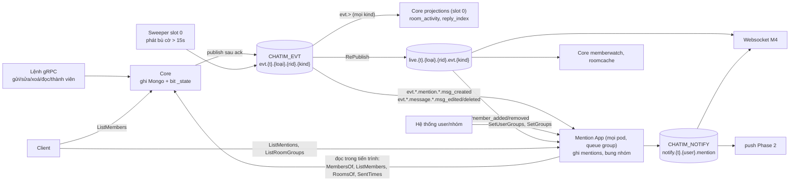

# chatim — Danh mục event

> Cập nhật: 2026-10-17. Có hai trạng thái:
> - **Hôm nay:** M3.1 đã xây trên `feat/m3.1`.
> - **Sau Mention App:** thiết kế D163–D173, chưa xây ([tóm tắt](plans/2026-10-17-mention-app-summary.md)).
>
> Tài liệu liên quan:
> - Nguồn sự thật cơ chế: [thiết kế](architecture.md) §8.1 (hợp đồng consumer) và [Module 10](modules/10-feature-data-reconciliation-and-repair.md) (cờ `_state`, sweeper, projection).
> - Quyết định: [Decision Log](decision-log.md) D104, D108, D141–D160, D163–D173.

Tài liệu này trả lời ba câu: core phát event gì, ở subject nào; ai nhận event nào; và app sau này nên đăng ký subject nào để chỉ nhận đúng data mình cần.

## 1. Stream và subject

| Stream | Subject | Ai phát | Ghi chú |
|---|---|---|---|
| `CHATIM_EVT` | `evt.{tenant}.{loại data}.{room}.{kind}` | core | Mọi thay đổi dữ liệu. `Nats-Msg-Id` = id event; stream bỏ bản trùng trong `EVT_STREAM_DUPLICATES` (5m) |
| (RePublish của `CHATIM_EVT`) | `live.{tenant}.{loại data}.{room}.evt.{kind}` | NATS, tự động | Bản phát lại trên core NATS cho realtime; không lưu |
| `CHATIM_TIMER` | `timer.arm.…`, `timer.due` | core | Phiếu hẹn sinh tồn (D111, D152), chỉ core dùng |
| `CHATIM_NOTIFY` (sau Mention App) | `notify.{tenant}.{user}.mention` | Mention App | Thông báo theo người (D168) |

`{loại data}` cho biết event thuộc doc nào (D108):
- `room`: thông tin chung của room.
- `member`: trạng thái của một người trong room.
- `message`: một tin.
- `mention` (sau Mention App, D170): `msg_created` của tin có mention, tách riêng để Mention App chỉ nhận tin cần xử lý.

Consumer đăng ký bằng wildcard (`evt.>`, `live.{t}.*.{rid}.>`) nhận cả `message` lẫn `mention`, không cần đổi gì.

Ví dụ: Lan gửi "chào cả nhà" vào room 777 của tenant `t1`.
- Event: `evt.t1.message.777.msg_created`, id `777-0-41`.
- Bản live: `live.t1.message.777.evt.msg_created`.
- Nếu tin là "@Minh xem giúp" thì sau Mention App subject thành `evt.t1.mention.777.msg_created`; id không đổi.

## 2. Core phát gì

Mọi event core phát đều đi cùng một khuôn (M3.1):
1. Lệnh ghi doc kèm bit `_state`.
2. Ack client.
3. Publish.
4. Xoá bit sau PubAck.

Nếu publish lỗi, sweeper trên core giữ slot 0 phát lại từ doc hiện tại sau 15s, với cùng id.

| Kind | Loại data | Id | Phát khi | Ai phát |
|---|---|---|---|---|
| `room_created` | `room` | `{room}-created` | `CreateRoom`, `OpenDirectRoom` | lệnh, sweeper |
| `room_updated` | `room` | `{room}-info-v{info_ver}` | `UpdateRoom` | lệnh, sweeper |
| `msg_pinned`, `msg_unpinned` | `room` | `{room}-p{pin_ver}` | `PinMessage`, `UnpinMessage` | lệnh, sweeper |
| `member_count_changed` | `room` | `{room}-members-v{member_count_ver}` | thêm/bớt người, sửa số | lệnh, phiếu hẹn, `/app recount`, sweeper |
| `member_added`, `member_removed`, `member_role_changed`, `member_priority_changed` | `member` | `{room}-mb-{user}-v{ver}` | lệnh thành viên | lệnh, sweeper |
| `read_updated` | `member` | `{room}-rd-{user}-v{read_ver}` | `MarkRead`, `MarkUnread` | lệnh, sweeper |
| `message_hidden` | `member` | `{room}-hd-{user}-{thread}-{seq}` | `HideMessage` lần đầu | lệnh, sweeper |
| `history_cleared` | `member` | `{room}-cl-{user}-{cleared_at ms}` | `ClearHistory` | lệnh, sweeper |
| `bookmark_changed` | `member` | `{room}-bm-{thread}-{seq}-{user}-v{ver}` | `SetBookmark` | lệnh, sweeper |
| `room_preferences_changed` | `member` | `{room}-pf-{user}-v{preference_ver}` | `SetRoomPreferences` (ghim, tắt thông báo, lưu trữ) | lệnh, sweeper |
| `msg_created` | `message`; `mention` nếu tin có mention (sau Mention App) | `{room}-{thread}-{seq}` | `SendMessage`, tin hệ thống, forward | lệnh, sweeper |
| `msg_edited`, `msg_deleted` | `message` | `{room}-{thread}-{seq}-v{ver}` | `EditMessage`, `DeleteMessage`; sau Mention App mang thêm `previous_mentions` (đích của phiên bản trước, D173) | lệnh, sweeper |
| `reaction_changed` | `message` | `{room}-{thread}-{seq}-{user}-n{số lần đổi}` | `ReactMessage` | lệnh, sweeper |
| `counts_changed` | `message` | `{room}-{thread}-{seq}-reactions-v{v}` hoặc `…-replies-v{v}` | đổi số reaction; đổi số trả lời | lệnh (reaction), projection reply (trả lời), phiếu hẹn (sửa số), sweeper |

## 3. Ai nhận gì

### Hôm nay (M3.1)

| Người nhận | Cách nhận | Kind xử lý | Làm gì |
|---|---|---|---|
| Core `projections` → `room_activity` | durable `projections`, `evt.>`, chỉ core giữ slot 0, lô 8192/3s | `msg_created`, `msg_edited`, `msg_deleted`, `reaction_changed`, `msg_pinned`, `msg_unpinned`, `member_added`, `member_removed`, `member_role_changed`, `member_priority_changed`, `bookmark_changed`, `room_updated`, `room_preferences_changed` | `rooms.last_seq`, `last_message_at`, `last_change_at`, `activity_bucket`, `last_edit_at` |
| Core `projections` → `mention_reply_index` | như trên | `msg_created`, `msg_edited`, `msg_deleted` | doc trả lời, `rc`, `reply_threads`, doc `mentions`, `rooms.last_shared_mention_at` |
| Core `projections` → `mention_read` | như trên | `read_updated` | đổi doc mention sang `state 3` |
| Core `memberwatch` (mọi core) | core NATS `live.*.member.*.evt.{kind}` | `member_removed`, `member_role_changed` | quên cache thành viên của actor |
| Core `roomcache.Watch` (mọi core) | core NATS `live` | `room_updated`, `member_count_changed` | quên cache thông tin room |

Kind không handler nào giữ (`room_created`, `counts_changed`, `member_count_changed`, `message_hidden`, `history_cleared`) vẫn tới `projections` vì nó lọc `evt.>`; consumer chỉ ack. Sau Mention App, `read_updated` cũng thuộc nhóm này.

### Sau Mention App (D163–D173, chưa xây)

| Người nhận | Cách nhận | Kind xử lý | Làm gì |
|---|---|---|---|
| Core `projections` → `room_activity` | không đổi | không đổi | không đổi |
| Core `projections` → `reply_index` (đổi tên từ `mention_reply_index`) | không đổi | `msg_created`, `msg_edited`, `msg_deleted` | chỉ phần trả lời: doc trả lời, `rc`, `reply_threads` |
| `mention_read` | bỏ (D165) | | |
| Mention App, cache gợi ý nhóm (mọi core, D172) | core NATS `live.*.member.*.evt.{kind}` | `member_added`, `member_removed` | quên tập nhóm theo room (room ≤ 5.000 người) |
| **Mention App** | durable `mention`, queue group: mọi pod/core cùng kéo, mỗi event tới một pod, lô 512/250ms mỗi pod, lọc đúng 3 subject: `evt.*.mention.*.msg_created`, `evt.*.message.*.msg_edited`, `evt.*.message.*.msg_deleted` | 3 kind đó | ghi `mentions`, `mention_rooms`; bung `@nhóm`/`@all`; phát `mention_notified`/`mention_retracted` |
| Websocket M4 (chưa xây) | core NATS `live.{t}.*.{rid}.>` theo room đang xem; `notify.{t}.{user}.>` theo user đang kết nối | mọi kind; thông báo | đẩy realtime; lọc room tắt thông báo |
| App `push` Phase 2 | durable trên `CHATIM_NOTIFY` | `mention_notified`, `mention_retracted` | APNs/FCM cho máy offline; lọc room tắt thông báo |

Tin không có mention không tới Mention App. Ví dụ ở 2.000 tin/s, nếu 5% tin có mention, Mention App nhận khoảng 100 event/s cộng các lần sửa/xoá, thay vì 2.000.

## 4. Thông báo (sau Mention App)

| Kind | Id | Khi nào | Nội dung chính |
|---|---|---|---|
| `mention_notified` | `{room}-{thread}-{seq}-{user}-m{message_ver}` | tin mới có mention; sửa tin thêm đích | room, loại room, thread, seq, người gửi, đích làm người này được báo (user/nhóm/`@all`), bản chụp tin |
| `mention_retracted` | `{room}-{thread}-{seq}-{user}-r{message_ver}` | sửa tin bỏ đích; xoá tin | room, thread, seq, `message_ver`, lý do (sửa/xoá) |

Người nhận:

| Đích | Ai nhận |
|---|---|
| `@user` | người đó, nếu còn trong room |
| `@nhóm` | người có nhóm đó trong `mention_user_groups.groups` và còn trong room |
| `@all` trong DM/group | từng thành viên |
| `@all` trong channel | không gửi riêng từng người |

Luôn bỏ người gửi, và mỗi người chỉ nhận một thông báo cho mỗi phiên bản tin. Mention App không xét tắt thông báo (D168). `@nhóm` chỉ được báo khi nhóm có trong danh mục `mention_groups` với `state 1` (D172).

Chỉ gửi khi event mới hơn 5 phút (`MENTION_NOTIFY_MAX_AGE`, D169).

## 5. Hợp đồng cho người nhận (D156)

- Event tới ít nhất một lần; sweeper có thể phát lại một event cũ sau event mới hơn.
- Bỏ trùng theo id event và theo version của doc (`ver`, `read_ver`, `pin_ver`, `info_ver`, `preference_ver`, `rx.v`/`rc.v`, `member_count_ver`, `message_ver`); version lớn hơn thắng.
- `msg_created`:
  - seq đã thấy → bỏ;
  - seq > seq cuối + 1 → gọi `GetHistory` lấp lỗ;
  - không bao giờ "bỏ nếu seq ≤ seq cuối".
- Chỉ trạng thái cuối của doc tập hợp hoặc bộ đếm được bảo đảm; event trung gian có thể mất.
- Thông báo: bỏ trùng theo id; với cùng tin, thông báo hoặc lệnh gỡ có `message_ver` lớn hơn thắng. Mention App xử lý song song (queue group), nên `m0`, `r1`, `m2` có thể tới theo thứ tự bất kỳ.
- Sau Mention App, mỗi đích trong tin có `at` (giờ đích xuất hiện) và `msg_edited`/`msg_deleted` mang `previous_mentions`; người nhận không cần đọc lại lịch sử để biết đích nào mới thêm hay bị bỏ (D173).
- App mới chỉ đăng ký đúng subject mình cần. Luật này ghi rõ ở đây vì `msg_created` có mention nằm ở loại data `mention`: ai lọc đúng `evt.*.message.*.msg_created` sẽ bỏ sót tin có mention.

## 6. Sơ đồ (sau Mention App)

