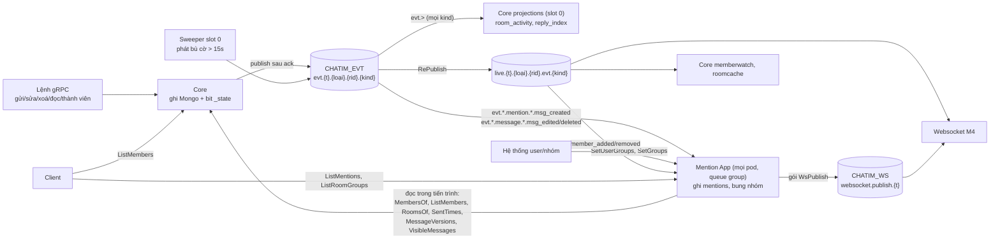

# chatim — Danh mục event

> Cập nhật: 2026-10-17. Trạng thái: Mention App đã merge `main` (PR #16), D162–D176 ([tóm tắt](plans/2026-10-17-mention-app-summary.md)).
>
> Tài liệu liên quan:
> - Nguồn sự thật cơ chế: [thiết kế](architecture.md) §8.1 (hợp đồng consumer) và [Module 10](modules/10-feature-data-reconciliation-and-repair.md) (cờ `_state`, sweeper, projection).
> - Quyết định: [Decision Log](decision-log.md) D104, D108, D141–D160, D162–D176.

Tài liệu này trả lời ba câu: core và Mention App phát event gì, ở subject nào; ai nhận event nào; và app sau này nên đăng ký subject nào để chỉ nhận đúng data mình cần.

## 1. Stream và subject

| Stream | Subject | Ai phát | Ghi chú |
|---|---|---|---|
| `CHATIM_EVT` | `evt.{tenant}.{loại data}.{room}.{kind}` | core | Mọi thay đổi dữ liệu. `Nats-Msg-Id` = id event; stream bỏ bản trùng trong `EVT_STREAM_DUPLICATES` (5m) |
| (RePublish của `CHATIM_EVT`) | `live.{tenant}.{loại data}.{room}.evt.{kind}` | NATS, tự động | Bản phát lại trên core NATS cho realtime; không lưu |
| `CHATIM_TIMER` | `timer.arm.…`, `timer.due` | core | Phiếu hẹn sinh tồn (D111, D152), chỉ core dùng |
| `CHATIM_WS` | `websocket.publish.{tenant}` | Mention App (Phase 1); app notification (Phase 2) | Hộp thư của websocket: gói `WsPublish` (một nội dung + danh sách người nhận). `Nats-Msg-Id` = `WsPublish.id`; giữ 24h, bỏ trùng 6 phút; cấu hình chung trong `pkg/wspublish` (`MENTION_WS_PUBLISH_STREAM`, `MENTION_WS_PUBLISH_ROOT`) |
| `CHATIM_NOTIFY` (Phase 2, chưa tạo) | `notify.{tenant}.{kind}` | các app | Hộp thư của app notification Phase 2; Mention App chuyển sang bằng config `MENTION_WS_PUBLISH_ROOT` |

`{loại data}` cho biết event thuộc doc nào (D108):
- `room`: thông tin chung của room.
- `member`: trạng thái của một người trong room.
- `message`: một tin.
- `mention` (D170): `msg_created` của tin có mention (`mt` khác rỗng hoặc `ma`), tách riêng để Mention App chỉ nhận tin cần xử lý.

Consumer đăng ký bằng wildcard (`evt.>`, `live.{t}.*.{rid}.>`) nhận cả `message` lẫn `mention`, không cần đổi gì.

Ví dụ: Lan gửi "chào cả nhà" vào room 777 của tenant `t1`.
- Event: `evt.t1.message.777.msg_created`, id `777-0-41`.
- Bản live: `live.t1.message.777.evt.msg_created`.
- Nếu tin là "@Minh xem giúp" thì subject là `evt.t1.mention.777.msg_created`; id không đổi.

## 2. Core phát gì

Mọi event core phát đều đi cùng một khuôn (M3.1):
1. Lệnh ghi doc kèm bit `_state`.
2. Ack client.
3. Publish.
4. Xoá bit sau PubAck.

Nếu publish lỗi, sweeper trên core giữ slot 0 phát lại từ doc hiện tại sau 15s, với cùng id.

| Kind | Loại data | Id | Phát khi | Ai phát |
|---|---|---|---|---|
| `room_created` | `room` | `{room}-created` | `CreateRoom`, `OpenDirectRoom` | lệnh, sweeper |
| `room_updated` | `room` | `{room}-info-v{info_ver}` | `UpdateRoom` | lệnh, sweeper |
| `msg_pinned`, `msg_unpinned` | `room` | `{room}-p{pin_ver}` | `PinMessage`, `UnpinMessage` | lệnh, sweeper |
| `member_count_changed` | `room` | `{room}-members-v{member_count_ver}` | thêm/bớt người, sửa số | lệnh, phiếu hẹn, `/app recount`, sweeper |
| `member_added`, `member_removed`, `member_role_changed`, `member_priority_changed` | `member` | `{room}-mb-{user}-v{ver}` | lệnh thành viên | lệnh, sweeper |
| `read_updated` | `member` | `{room}-rd-{user}-v{read_ver}` | `MarkRead`, `MarkUnread` | lệnh, sweeper |
| `message_hidden` | `member` | `{room}-hd-{user}-{thread}-{seq}` | `HideMessage` lần đầu | lệnh, sweeper |
| `history_cleared` | `member` | `{room}-cl-{user}-{cleared_at ms}` | `ClearHistory` | lệnh, sweeper |
| `bookmark_changed` | `member` | `{room}-bm-{thread}-{seq}-{user}-v{ver}` | `SetBookmark` | lệnh, sweeper |
| `room_preferences_changed` | `member` | `{room}-pf-{user}-v{preference_ver}` | `SetRoomPreferences` (ghim, tắt thông báo, lưu trữ) | lệnh, sweeper |
| `msg_created` | `message`; `mention` nếu bản chụp tin có mention | `{room}-{thread}-{seq}` | `SendMessage`, tin hệ thống, forward | lệnh, sweeper |
| `msg_edited`, `msg_deleted` | `message` | `{room}-{thread}-{seq}-v{ver}` | `EditMessage`, `DeleteMessage`; mang `previous_mentions` (đích của phiên bản trước, D173) | lệnh, sweeper |
| `reaction_changed` | `message` | `{room}-{thread}-{seq}-{user}-n{số lần đổi}` | `ReactMessage` | lệnh, sweeper |
| `counts_changed` | `message` | `{room}-{thread}-{seq}-reactions-v{v}` hoặc `…-replies-v{v}` | đổi số reaction; đổi số trả lời | lệnh (reaction), projection reply (trả lời), phiếu hẹn (sửa số), sweeper |

## 3. Ai nhận gì

| Người nhận | Cách nhận | Kind xử lý | Làm gì |
|---|---|---|---|
| Core `projections` → `room_activity` | durable `projections`, `evt.>`, chỉ core giữ slot 0, lô 8192/3s | `msg_created`, `msg_edited`, `msg_deleted`, `reaction_changed`, `msg_pinned`, `msg_unpinned`, `member_added`, `member_removed`, `member_role_changed`, `member_priority_changed`, `bookmark_changed`, `room_updated`, `room_preferences_changed` | `rooms.last_seq`, `last_message_at`, `last_change_at`, `activity_bucket`, `last_edit_at` |
| Core `projections` → `reply_index` (trước là `mention_reply_index`) | như trên | `msg_created`, `msg_deleted` | chỉ phần trả lời: doc trả lời, `rc`, `reply_threads` |
| Core `memberwatch` (mọi core) | core NATS `live.*.member.*.evt.{kind}` | `member_removed`, `member_role_changed` | quên cache thành viên của actor |
| Core `roomcache.Watch` (mọi core) | core NATS `live` | `room_updated`, `member_count_changed` | quên cache thông tin room |
| Mention App, watch tập nhóm theo room (mọi core, D172) | core NATS `live.*.member.*.evt.{kind}` | `member_added`, `member_removed` | quên tập nhóm của room (cache gợi ý `@nhóm`) |
| **Mention App** | durable `mention`, queue group: mọi pod/core cùng kéo, mỗi event tới một pod, lô 512/250ms mỗi pod, 8 worker, lọc đúng 3 subject: `evt.*.mention.*.msg_created`, `evt.*.message.*.msg_edited`, `evt.*.message.*.msg_deleted` | 3 kind đó | ghi `mentions`, `mention_rooms`; bung `@nhóm`/`@all`; phát gói `WsPublish` `mention_notified`/`mention_retracted` vào `websocket.publish.{t}` |
| Websocket M4 | ordered consumer trên `CHATIM_EVT` và trên `CHATIM_WS` (`websocket.publish.>`) | mọi kind; gói `WsPublish` | đẩy realtime tới máy đang online; không biết thông báo là gì |
| App notification + push Phase 2 (chưa xây) | hộp thư `notify.{t}.{kind}` | thông báo | lọc tắt thông báo; `WsPublish` vào `websocket.publish.{t}` cho người online, APNs/FCM cho người offline |

Projection `mention_read` đã bỏ (D165); core vẫn xoá durable cũ `projection-mention_read` lúc khởi động.

Kind không handler nào giữ (`room_created`, `counts_changed`, `member_count_changed`, `message_hidden`, `history_cleared`, `read_updated`) vẫn tới `projections` vì nó lọc `evt.>`; consumer chỉ ack.

Tin không có mention không tới Mention App. Bench 2.000 tin/s với 5% tin có mention: Mention App nhận khoảng 100 event/s cộng các lần sửa/xoá, thay vì 2.000.

**Sweeper phát lại `msg_created` sau khi tin đổi:** sweeper dựng event từ doc tin hiện tại. Nếu tin đã bị xoá, hoặc đã sửa bỏ hết đích, bản chụp không còn đích nên event đi loại data `message` và không tới Mention App. Đúng ý: Mention App học thay đổi đó từ `previous_mentions` của `msg_edited`/`msg_deleted`.

## 4. Thông báo

| Kind | Id | Khi nào | Nội dung chính |
|---|---|---|---|
| `mention_notified` | `{room}-{thread}-{seq}-m{message_ver}-{đích}`, đích `u:{id}`, `g:{id}` hoặc `all` | tin mới có mention; sửa tin thêm đích | room, loại room, thread, seq, `message_ver`, `ts`, đích làm nhóm người này được báo (`MENTION_KIND_USER`/`GROUP`/`ALL`), bản chụp tin |
| `mention_retracted` | `{room}-{thread}-{seq}-r{message_ver}-{edited\|deleted}` | sửa tin bỏ đích; xoá tin | room, thread, seq, `message_ver`, lý do `EDITED`/`DELETED` |

Gói `WsPublish` (`ws_publish.proto`, subject `{MENTION_WS_PUBLISH_ROOT}.{tenant}`, mặc định `websocket.publish.{tenant}`): `id`, `tenant`, `kind` (`mention`), `notification` (nội dung một lần, `user` để trống), `targets.users`, `part`/`parts`. Người nhận cùng đích (cùng nội dung) gom một nhóm; rút lại gom theo lý do. Mỗi nhóm sắp xếp user tăng dần rồi chia trang `MENTION_NOTIFY_TARGETS_PAGE` (1.000, tối đa 10.000; mỗi gói < 100KB, dưới giới hạn 1MB của NATS). `WsPublish.id` = `Nats-Msg-Id` = id thông báo + `-p{part}-` + 8 ký tự hex đầu của sha256 danh sách user của trang: chạy lại cùng thành viên thì stream bỏ trùng; thành viên đổi thì trang đổi có id mới, không ai bị sót, ai nhận lại thì máy bỏ trùng theo `Notification.id`. Một gói lỗi PubAck → Nak cả event.

Proto `Notification` (`notifications.proto`). Loại room channel hiện ghi `ROOM_TYPE_UNSPECIFIED` (proto chưa có giá trị channel). `MENTION_KIND_ALL` chỉ dùng trên thông báo; core từ chối nó ở đầu vào (`@all` gửi bằng cờ `mention_all`).

Người nhận:

| Đích | Ai nhận |
|---|---|
| `@user` | người đó, nếu còn trong room |
| `@nhóm` | người có nhóm đó trong `mention_user_groups.groups` và còn trong room |
| `@all` trong DM/group | từng thành viên |
| `@all` trong channel hoặc loại room lạ | không gửi riêng từng người |

Luôn bỏ người gửi, và mỗi người chỉ có trong một gói (một đích) cho mỗi phiên bản tin. Mention App không xét tắt thông báo (D168). `@nhóm` chỉ được báo khi nhóm có trong danh mục `mention_groups` với `state 1` (D172).

Chỉ gửi khi event mới hơn 5 phút (`MENTION_NOTIFY_MAX_AGE`, D169), và khi tin chưa có phiên bản mới hơn phiên bản của event.

## 5. Hợp đồng cho người nhận (D156)

- Event tới ít nhất một lần; sweeper có thể phát lại một event cũ sau event mới hơn.
- Bỏ trùng theo id event và theo version của doc (`ver`, `read_ver`, `pin_ver`, `info_ver`, `preference_ver`, `rx.v`/`rc.v`, `member_count_ver`, `message_ver`); version lớn hơn thắng.
- `msg_created`:
  - seq đã thấy → bỏ;
  - seq > seq cuối + 1 → gọi `GetHistory` lấp lỗ;
  - không bao giờ "bỏ nếu seq ≤ seq cuối".
- Chỉ trạng thái cuối của doc tập hợp hoặc bộ đếm được bảo đảm; event trung gian có thể mất.
- Thông báo: bỏ trùng theo `Notification.id`; với cùng tin, thông báo hoặc lệnh gỡ có `message_ver` lớn hơn thắng. Mention App xử lý song song (queue group), nên `m0`, `r1`, `m2` có thể tới theo thứ tự bất kỳ.
- Mỗi đích trong tin có `at` (giờ đích xuất hiện, `MentionTarget.at`, `Message.mention_all_at`) và `msg_edited`/`msg_deleted` mang `previous_mentions`; người nhận không cần đọc lại lịch sử để biết đích nào mới thêm hay bị bỏ (D173).
- App mới chỉ đăng ký đúng subject mình cần. Luật này ghi rõ ở đây vì `msg_created` có mention nằm ở loại data `mention`: ai lọc đúng `evt.*.message.*.msg_created` sẽ bỏ sót tin có mention.

## 6. Sơ đồ

