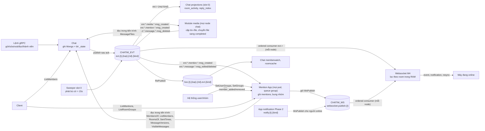

# chatim — Danh mục event

> Cập nhật: 2026-11-08 (loại data `media` cho `msg_created` có file, §1; consumer `media`, M7 P3, §3; `Message.attachments` trong event tin, M7 P2, §5; §8 feed danh bạ của `identity`, tên cũ `iam`, M6 phần 3a, PA). Trạng thái: Mention App đã merge `main` (PR #16), D162–D176 ([tóm tắt](plans/2026-10-17-mention-app-summary.md)); websocket M4 phần 2 (nhận và đẩy event, gói `WsPublish`) xây trên `feat/m4`, D189–D195 ([tóm tắt](plans/2026-10-21-m4-2-nhan-va-day-event-summary.md)); M4 phần 3 (`read_positions` thay `read_updated`), D196–D197 ([tóm tắt](plans/2026-10-22-m4-3-da-doc-va-da-xem-summary.md)); M4 phần 4 (đang gõ và online, tín hiệu riêng của websocket, §7), D199–D201 ([tóm tắt](plans/2026-10-24-m4-4-typing-va-online-summary.md)).
>
> Tài liệu liên quan:
> - Nguồn sự thật cơ chế: [thiết kế](architecture.md) §8.1 (hợp đồng consumer) và [Module 10](features/10-feature-data-reconciliation-and-repair.md) (cờ `_state`, sweeper, projection).
> - Quyết định: [Decision Log](decision-log.md) D104, D108, D141–D160, D162–D176, D189–D197, D199–D201.

Tài liệu này trả lời ba câu: chat và Mention App phát event gì, ở subject nào; ai nhận event nào; và app sau này nên đăng ký subject nào để chỉ nhận đúng data mình cần.

## 1. Stream và subject

| Stream | Subject | Ai phát | Ghi chú |
|---|---|---|---|
| `CHATIM_EVT` | `evt.{tenant}.{loại data}.{room}.{kind}` | chat | Mọi thay đổi dữ liệu. `Nats-Msg-Id` = id event; stream bỏ bản trùng trong `EVT_STREAM_DUPLICATES` (5m) |
| (RePublish của `CHATIM_EVT`) | `live.{tenant}.{loại data}.{room}.evt.{kind}` | NATS, tự động | Một luật RePublish duy nhất, nguồn `evt.*.*.*.*`. Bản phát lại trên core NATS cho các watcher của chat và Mention App; không lưu. Websocket không dùng (đọc thẳng `CHATIM_EVT`, §3.1) |
| `CHATIM_TIMER` | `timer.arm.…`, `timer.due` | chat | Phiếu hẹn sinh tồn (D111, D152), chỉ chat dùng |
| `CHATIM_WS` | `websocket.publish.{tenant}` | Mention App (Phase 1); app notification (Phase 2); app khác muốn đẩy tới máy online | Hộp thư của websocket (D192): gói `WsPublish` (một nội dung + danh sách người nhận). `Nats-Msg-Id` = `WsPublish.id`; file, giữ 24h, bỏ trùng 6 phút, bản sao `EVT_STREAM_REPLICAS`; cấu hình chung trong `pkg/wspublish`, bên phát và websocket cùng `CreateOrUpdateStream` (`WS_PUBLISH_STREAM`/`_ROOT`, `WS_PUBLISH_STREAM`/`_ROOT`) |
| `CHATIM_NOTIFY` (Phase 2, chưa tạo) | `notify.{tenant}.{kind}` | các app | Để dành cho hộp thư của app notification Phase 2 (lọc tắt thông báo, push); Mention App chuyển sang bằng config `WS_PUBLISH_ROOT`. Websocket không nghe `notify.*` |

Tín hiệu đang gõ và online không phải event dữ liệu, không vào stream nào ở bảng trên: xem §7. Thay đổi danh bạ của `identity` cũng không đi qua stream: xem §8.

`{loại data}` cho biết event thuộc doc nào (D108):
- `room`: thông tin chung của room.
- `member`: trạng thái của một người trong room.
- `message`: một tin.
- `mention` (D170): `msg_created` của tin có mention (`mt` khác rỗng hoặc `ma`), tách riêng để Mention App chỉ nhận tin cần xử lý.
- `media` (owner 2026-11-08): `msg_created` của tin có đính kèm (`attachments` khác rỗng) mà không có mention, tách riêng để consumer `media` không phải nhận mọi tin. Mention đi trước: tin vừa có mention vừa có file đi `mention`. Tin đã xoá không còn đính kèm và tin hệ thống không được kèm file, nên cả hai đi `message`. Không thêm field nào vào tin; chat chọn loại data từ `Message` trong event (`publish.subjectFor`, cùng hàm cho lệnh, sweeper và `/app resync`).

Consumer đăng ký bằng wildcard (`evt.>`, `live.{t}.*.{rid}.>`) nhận cả `message`, `mention` lẫn `media`, không cần đổi gì. Mọi thứ của một room là `live.{t}.*.{rid}.>`. Chat không có subject theo user và không chọn người nhận (P3); payload mang `user` để app phân phối tự định tuyến. Kind lạ không được publish (`publish.subjectFor` từ chối).

Ví dụ: Lan gửi "chào cả nhà" vào room 777 của tenant `t1`.
- Event: `evt.t1.message.777.msg_created`, id `777-0-41`.
- Bản live: `live.t1.message.777.evt.msg_created`.
- Nếu tin là "@Minh xem giúp" thì subject là `evt.t1.mention.777.msg_created`; id không đổi.
- Nếu tin chỉ kèm ảnh (không mention) thì `evt.t1.media.777.msg_created`; "@Minh xem ảnh" kèm ảnh vẫn là `mention`.

## 2. Chat phát gì

Mọi event chat phát đều đi cùng một khuôn (M3.1):
1. Lệnh ghi doc kèm bit `_state`.
2. Ack client.
3. Publish.
4. Xoá bit sau PubAck.

Nếu publish lỗi, sweeper trên chat giữ slot 0 phát lại từ doc hiện tại sau 15s, với cùng id.

| Kind | Loại data | Id | Phát khi | Ai phát |
|---|---|---|---|---|
| `room_created` | `room` | `{room}-created` | `CreateRoom`, `OpenDirectRoom` | lệnh, sweeper |
| `room_updated` | `room` | `{room}-info-v{info_ver}` | `UpdateRoom` | lệnh, sweeper |
| `msg_pinned`, `msg_unpinned` | `room` | `{room}-p{pin_ver}` | `PinMessage`, `UnpinMessage` | lệnh, sweeper |
| `member_count_changed` | `room` | `{room}-members-v{member_count_ver}` | thêm/bớt người, sửa số | lệnh, phiếu hẹn, `/app recount`, sweeper |
| `member_added`, `member_removed`, `member_role_changed`, `member_priority_changed` | `member` | `{room}-mb-{user}-v{ver}` | lệnh thành viên | lệnh, sweeper |
| `read_positions` | `member` | `{room}-rp-{16 hex đầu sha256 các dòng "user:read_seq:read_ver" nối bằng "\n", sắp theo user}` | `MarkRead`, `MarkUnread`: chat gom theo room mỗi `READ_EVENT_WINDOW` (1s), mỗi user một dòng (`read_ver` lớn nhất), tối đa 1.000 dòng mỗi event, không `actor` (D196) | hàng gom `event/readbatch`; sweeper (một dòng từ doc) |
| `message_hidden` | `member` | `{room}-hd-{user}-{thread}-{seq}` | `HideMessage` lần đầu | lệnh, sweeper |
| `history_cleared` | `member` | `{room}-cl-{user}-{cleared_at ms}` | `ClearHistory` | lệnh, sweeper |
| `bookmark_changed` | `member` | `{room}-bm-{thread}-{seq}-{user}-v{ver}` | `SetBookmark` | lệnh, sweeper |
| `room_preferences_changed` | `member` | `{room}-pf-{user}-v{preference_ver}` | `SetRoomPreferences` (ghim, tắt thông báo, lưu trữ) | lệnh, sweeper |
| `msg_created` | `message`; `mention` nếu bản chụp tin có mention; không mention mà có đính kèm thì `media` | `{room}-{thread}-{seq}` | `SendMessage`, tin hệ thống, forward | lệnh, sweeper |
| `msg_edited`, `msg_deleted` | `message` | `{room}-{thread}-{seq}-v{ver}` | `EditMessage`, `DeleteMessage`; mang `previous_mentions` (đích của phiên bản trước, D173) | lệnh, sweeper |
| `reaction_changed` | `message` | `{room}-{thread}-{seq}-{user}-n{số lần đổi}` | `ReactMessage` | lệnh, sweeper |
| `counts_changed` | `message` | `{room}-{thread}-{seq}-reactions-v{v}` hoặc `…-replies-v{v}` | đổi số reaction; đổi số trả lời | lệnh (reaction), projection reply (trả lời), phiếu hẹn (sửa số), sweeper |

## 3. Ai nhận gì

| Người nhận | Cách nhận | Kind xử lý | Làm gì |
|---|---|---|---|
| Chat `projections` → `room_activity` | durable `projections`, `evt.>`, chỉ chat giữ slot 0, lô 8192/3s | `msg_created`, `msg_edited`, `msg_deleted`, `reaction_changed`, `msg_pinned`, `msg_unpinned`, `member_added`, `member_removed`, `member_role_changed`, `member_priority_changed`, `bookmark_changed`, `room_updated`, `room_preferences_changed` | `rooms.last_seq`, `last_message_at`, `last_change_at`, `activity_bucket`, `last_edit_at` |
| Chat `projections` → `reply_index` (trước là `mention_reply_index`) | như trên | `msg_created`, `msg_deleted` | chỉ phần trả lời: doc trả lời, `rc`, `reply_threads` |
| Chat `projections` → `avatar_users` (M7.1 P3) | như trên | `member_added`, `member_removed` của nhóm (`room_type` của event) | `rooms.avatar_users`, `rooms.avatar_ver` |
| Chat `memberwatch` (mọi node chat) | core NATS `live.*.member.*.evt.{kind}` | `member_removed`, `member_role_changed` | quên cache thành viên của actor |
| Chat `roomcache.Watch` (mọi node chat) | core NATS `live` | `room_updated`, `member_count_changed` | quên cache thông tin room |
| Mention App, watch tập nhóm theo room (mọi node chat, D172) | core NATS `live.*.member.*.evt.{kind}` | `member_added`, `member_removed` | quên tập nhóm của room (cache gợi ý `@nhóm`) |
| **Mention App** | durable `mention`, queue group: mọi pod/chat cùng kéo, mỗi event tới một pod, lô 512/250ms mỗi pod, 8 worker, lọc đúng 3 subject: `evt.*.mention.*.msg_created`, `evt.*.message.*.msg_edited`, `evt.*.message.*.msg_deleted` | 3 kind đó | ghi `mentions`, `mention_rooms`; bung `@nhóm`/`@all`; phát gói `WsPublish` `mention_notified`/`mention_retracted` vào `websocket.publish.{t}` |
| **Media** (module `modules/media`, M7 P3, [module 12 §8](features/12-feature-media.md#8-chuyển-file-đã-gắn-tin-sang-completed-p3)) | durable `media`, mọi node chat cùng kéo (mỗi event tới một node), chỉ kéo khi media sẵn sàng, nhận liên tục (mỗi lần kéo một nửa `MaxAckPending` 1024), mỗi event một goroutine và Ack ngay khi xong, tối đa 1024 event chưa Ack mỗi node, event của cùng một tin chạy lần lượt; lọc đúng 3 subject: `evt.*.media.*.msg_created`, `evt.*.mention.*.msg_created` (tin vừa mention vừa có file nằm ở đây), `evt.*.message.*.msg_deleted` | `msg_created` (chỉ khi có `attachments`; tin `mention` không file Ack ngay), `msg_deleted` | ghi `media_message_files`, `media_uploads.bucket/attached_at/retired_at`; copy file và thumb `processing` → `completed`. Xong hoặc bỏ (tin, upload không còn) → Ack; event hỏng → Term; file còn `uploading` → Nak chờ theo bậc lùi; lỗi S3, Mongo, CAS → Nak theo bậc lùi, không retry nội bộ |
| Websocket M4 (mọi node, §3.1) | mỗi node hai ordered consumer: `CHATIM_EVT` filter `evt.>` và `CHATIM_WS` filter `websocket.publish.>`, bắt đầu ở seq cuối + 1 | 19 kind của bảng §3.1 (gồm `read_positions`); gói `WsPublish` | đẩy realtime tới máy đang nối vào node đó; không biết thông báo là gì |
| App notification + push Phase 2 (chưa xây) | hộp thư `notify.{t}.{kind}` | thông báo | lọc tắt thông báo; `WsPublish` vào `websocket.publish.{t}` cho người online, APNs/FCM cho người offline |

### 3.1. Websocket nhận gì (M4 phần 2, D189–D195)

Mỗi node websocket một kết nối NATS, hai **ordered consumer** (không durable, `InactiveThreshold` 30s): `CHATIM_EVT` filter `evt.>` và `CHATIM_WS` filter `websocket.publish.>`. Node bắt đầu ở seq cuối của stream + 1; lỡ tin thì thư viện tự tạo lại consumer từ số cuối đã giao, tin tới đúng thứ tự. Trễ từ 2 phút trở lên theo giờ lưu (hoặc consumer mất, stream tạo lại) = node coi như khởi động lại (D195): bỏ đoạn cũ, tạm ngừng đẩy cho mọi người trên node, nạp lại từ chat (`ListMyRoomIDs`: room đang ở và `left` kèm `ver`) theo `WS_RELOAD_RATE` người/giây, nạp xong người nào thì gửi `resync` cho máy của người đó. Nạp lỗi → `load_failed`, máy tự xin nạp lại bằng `load_rooms` (server không tự nạp lại). Room/thành viên chỉ nạp lúc login hoặc lúc khởi động lại; giữa hai lần đó node cập nhật trong RAM theo `member_added`/`member_removed`, và dấu "đã rời" từ `left` chặn một `member_added` cũ do sweeper phát bù. Hộp thư `CHATIM_WS` nhảy riêng không tạm ngừng ai: thông báo của đoạn bỏ qua mất (vẫn có trong `ListMentions`). Subject `evt.{t}.{loại}.{room}.{kind}` được đọc thẳng (không qua `live.*`); tenant lấy từ subject; mọi khoá người là (tenant, user).

| Kind | Loại data | Ai trên node nhận |
|---|---|---|
| `msg_created` | `message`, `mention`, `media` | mọi thành viên room đang online (mức thành viên) |
| `msg_edited`, `msg_deleted` | `message` | mọi thành viên room đang online |
| `room_created`, `room_updated` | `room` | mọi thành viên room đang online (`room_created` thường tới trước khi node biết thành viên nên không ai nhận; máy lấy room khi nhận `member_added` của mình) |
| `member_added`, `member_removed` | `member` | chính người đó và kết nối đang mở room; node cập nhật danh sách room của người đó theo `ver` lớn hơn thắng (`member_added` có `ver` ≤ dấu đã rời bị bỏ); bị xoá thì gửi event trước, rồi `room_closed{removed}` |
| `member_role_changed`, `member_priority_changed` | `member` | kết nối đang mở room (`open_room`) |
| `member_count_changed`, `msg_pinned`, `msg_unpinned` | `room` | kết nối đang mở room |
| `reaction_changed`, `counts_changed` | `message` | kết nối đang mở room |
| `message_hidden`, `history_cleared`, `bookmark_changed`, `room_preferences_changed` | `member` | chỉ chủ nhân (mọi kết nối của (tenant, user) đó) |
| `read_positions` | `member` | kết nối đang mở room (mức mở) cộng mọi kết nối của từng user có tên trong `entries` mà danh sách room trong RAM còn room đó và không tạm ngừng; mỗi kết nối nhận một lần (D196) |
| kind khác | — | không ai; bỏ và đếm `events_dropped_total{reason="unknown_kind"}` (mặc định chặn, để event riêng tư mới không lọt) |

Event đi xuống máy nguyên bytes trong `ServerFrame.event` (field 21), mã hoá một lần mỗi node. Gói `WsPublish` từ `CHATIM_WS`: tenant gói phải bằng tenant subject, `kind` là một token; nội dung đi trong `ServerFrame.notification` (field 22) tới từng người trong `targets.users` đang sẵn sàng trên node (tên trùng chỉ gửi một lần); người khác bỏ qua. Máy áp event theo hợp đồng §5 (đặc tả client ở [Module 09 §11](features/09-feature-realtime-delivery-and-ephemeral.md); repo không còn SDK mẫu, D206).

Projection `mention_read` đã bỏ (D165); chat vẫn xoá durable cũ `projection-mention_read` lúc khởi động.

Kind không handler nào giữ (`room_created`, `counts_changed`, `member_count_changed`, `message_hidden`, `history_cleared`, `read_positions`) vẫn tới `projections` vì nó lọc `evt.>`; consumer chỉ ack.

Tin không có mention không tới Mention App. Bench 2.000 tin/s với 5% tin có mention: Mention App nhận khoảng 100 event/s cộng các lần sửa/xoá, thay vì 2.000.

Tin text thường không tới consumer `media`: nó chỉ nhận `msg_created` loại `media` và `mention` cùng `msg_deleted`.

**Thứ tự triển khai loại data `media`:** websocket trước, chat sau. Websocket cũ coi `media` là loại data lạ của `msg_created`, bỏ và đếm `events_dropped_total{reason="malformed"}`, nên máy không nhận tin có file cho tới khi websocket mới chạy. Khi chat chạy lần lượt từng node, node mới đầu tiên khởi động đổi filter của durable `media` (`CreateOrUpdateConsumer` sửa filter tại chỗ, không tạo lại durable); tin có file gửi qua node cũ trong lúc đó vẫn đi `message`, consumer `media` không nhận nên file của tin đó ở lại `processing`. Xong đợt triển khai và qua cửa sổ bỏ trùng 5 phút thì chạy `/app resync -from <lúc bắt đầu> -to <lúc xong>`: sweeper phát lại `msg_created` qua `publish.subjectFor` mới nên tin có file đi `media`.

**Sweeper phát lại `msg_created` sau khi tin đổi:** sweeper dựng event từ doc tin hiện tại. Nếu tin đã bị xoá, hoặc đã sửa bỏ hết đích, bản chụp không còn đích nên event đi loại data `message` và không tới Mention App (tin đã xoá cũng không còn đính kèm nên không đi `media`; consumer `media` học việc xoá từ `msg_deleted`). Đúng ý: Mention App học thay đổi đó từ `previous_mentions` của `msg_edited`/`msg_deleted`.

## 4. Thông báo

| Kind | Id | Khi nào | Nội dung chính |
|---|---|---|---|
| `mention_notified` | `{room}-{thread}-{seq}-m{message_ver}-{đích}`, đích `u:{id}`, `g:{id}` hoặc `all` | tin mới có mention; sửa tin thêm đích | room, loại room, thread, seq, `message_ver`, `ts`, đích làm nhóm người này được báo (`MENTION_KIND_USER`/`GROUP`/`ALL`), bản chụp tin |
| `mention_retracted` | `{room}-{thread}-{seq}-r{message_ver}-{edited\|deleted}` | sửa tin bỏ đích; xoá tin | room, thread, seq, `message_ver`, lý do `EDITED`/`DELETED` |

Gói `WsPublish` (`ws_publish.proto`, subject `{WS_PUBLISH_ROOT}.{tenant}`, mặc định `websocket.publish.{tenant}`): `id`, `tenant`, `kind` (`mention`), `notification` (nội dung một lần, `user` để trống), `targets.users`, `part`/`parts`. Người nhận cùng đích (cùng nội dung, gom theo khoá đích, không theo `at`, khớp `Notification.id`; nhóm giữ `at` sớm nhất) gom một nhóm; rút lại gom theo lý do. Mỗi nhóm sắp xếp user tăng dần rồi chia trang `MENTION_NOTIFY_TARGETS_PAGE` (1.000, tối đa 5.000; mỗi gói < 100KB, trần 5.000 vẫn dưới 1MB kể cả khi `max_payload` của NATS bị hạ). `WsPublish.id` = `Nats-Msg-Id` = id thông báo + `-p{part}-` + 16 ký tự hex đầu của sha256 danh sách user của trang: chạy lại cùng thành viên thì stream bỏ trùng; thành viên đổi thì trang đổi có id mới, không ai bị sót, ai nhận lại thì máy bỏ trùng theo `Notification.id`. Một gói lỗi PubAck → Nak cả event.

Proto `Notification` (`notifications.proto`). Loại room channel hiện ghi `ROOM_TYPE_UNSPECIFIED` (proto chưa có giá trị channel). `MENTION_KIND_ALL` chỉ dùng trên thông báo; chat từ chối nó ở đầu vào (`@all` gửi bằng cờ `mention_all`).

Người nhận:

| Đích | Ai nhận |
|---|---|
| `@user` | người đó, nếu còn trong room |
| `@nhóm` | người có nhóm đó trong `mention_user_groups.groups` và còn trong room |
| `@all` trong DM/group | từng thành viên |
| `@all` trong channel hoặc loại room lạ | không gửi riêng từng người |

Luôn bỏ người gửi, và mỗi người chỉ có trong một gói (một đích) cho mỗi phiên bản tin. Mention App không xét tắt thông báo (D168). `@nhóm` chỉ được báo khi nhóm có trong danh mục `mention_groups` với `state 1` (D172).

Chỉ gửi khi event mới hơn 5 phút (`MENTION_NOTIFY_MAX_AGE`, D169), và khi tin chưa có phiên bản mới hơn phiên bản của event.

## 5. Hợp đồng cho người nhận (D156)

- Event tới ít nhất một lần; sweeper có thể phát lại một event cũ sau event mới hơn.
- Bỏ trùng theo id event và theo version của doc (`ver`, `read_ver`, `pin_ver`, `info_ver`, `preference_ver`, `rx.v`/`rc.v`, `member_count_ver`, `message_ver`); version lớn hơn thắng.
- `msg_created`:
  - seq đã thấy → bỏ;
  - seq > seq cuối + 1 → gọi `GetHistory` lấp lỗ;
  - không bao giờ "bỏ nếu seq ≤ seq cuối".
- Chỉ trạng thái cuối của doc tập hợp hoặc bộ đếm được bảo đảm; event trung gian có thể mất.
- Thông báo: bỏ trùng theo `Notification.id`; với cùng tin, thông báo hoặc lệnh gỡ có `message_ver` lớn hơn thắng. Mention App xử lý song song (queue group), nên `m0`, `r1`, `m2` có thể tới theo thứ tự bất kỳ.
- `msg_created`, `msg_edited`, `msg_deleted` mang `Message` đầy đủ nên có `Message.attachments` (đính kèm: khoá, tên, loại, cỡ, `dim`, `dur`, `hash`; không có URL, máy xin URL qua `MediaService.GetAttachmentURLs`, [module 12](features/12-feature-media.md)). Sửa tin không đổi đính kèm; `msg_deleted` có `attachments` rỗng. Không có event riêng cho file; `msg_created` có file mà không mention đi loại data `media` (§1). Projection và Mention App bỏ qua field này, consumer `media` chỉ dùng nó để biết `msg_created` có file rồi đọc lại tin từ chat (§3).
- Mỗi đích trong tin có `at` (giờ đích xuất hiện, `MentionTarget.at`, `Message.mention_all_at`) và `msg_edited`/`msg_deleted` mang `previous_mentions`; người nhận không cần đọc lại lịch sử để biết đích nào mới thêm hay bị bỏ (D173).
- App mới chỉ đăng ký đúng subject mình cần. Luật này ghi rõ ở đây vì `msg_created` có mention nằm ở loại data `mention`: ai lọc đúng `evt.*.message.*.msg_created` sẽ bỏ sót tin có mention và tin có file (loại `media`).

## 6. Sơ đồ

## 7. Tín hiệu riêng của websocket (M4 phần 4, D199–D201)

Không phải event của chat: không ghi Mongo, không vào JetStream, không có id, không bỏ trùng, không phát lại. Mất là mất; máy tự sửa ở tín hiệu sau.

| Tín hiệu | Ở đâu | Ai phát | Ai nhận | Ghi chú |
|---|---|---|---|---|
| Đang gõ | core NATS `eph.{tenant}.{room}.typing`, nội dung `TypingSignal{origin, tenant, room_id, user_id, stopped}` (`proto/chatim/v1/ws_ephemeral.proto`) | node websocket của người gõ, sau khi đã đẩy cho người đang mở room trên chính node | mọi node websocket qua subscription `eph.*.*.typing`; mỗi node bỏ tin của chính `origin` mình và đẩy `ServerFrame.typing` cho kết nối đang mở room, trừ máy của người gõ | Bắn rồi quên, không chờ (D199). Ví dụ: Lan gõ trong room 7001 của tenant `acme` → `eph.acme.7001.typing` |
| Online | **không qua NATS**: khoá Redis `chatim:presence:{tenant}:{user}` = `1`, `EX` 15s, trong Redis riêng `chatim-redis-presence` | node websocket của người đó đóng dấu theo heartbeat | node của người hỏi đọc bằng `MGET` ở mỗi heartbeat của người hỏi, trả `ServerFrame.presence` cả danh sách | Còn khoá là online, mất khoá là offline; không ai xoá khoá của người khác (D200, D201) |

## 8. Thay đổi danh bạ của `identity` (không NATS)

Feed danh bạ HTTP `GET /internal/v1/directory/changes` (D227) đã gỡ ở phase PM (owner 2026-11-02, D257) vì chưa app nào dùng; đường đó giờ trả 404. Làm lại khi app đầu tiên cần (Mention 3b, M8 hoặc M9), theo nhu cầu của app đó, dạng request thường trả ngay trên một kết nối keep-alive, không giữ request chờ thay đổi (`.memory/http-between-services-plain-keepalive.md`). Bên trong, mỗi replica `identity` theo dõi danh bạ bằng change stream của MongoDB ([docs/apps/identity.md](apps/identity.md)); đó không phải event cho app khác. `identity` vẫn không dùng NATS (D219).
