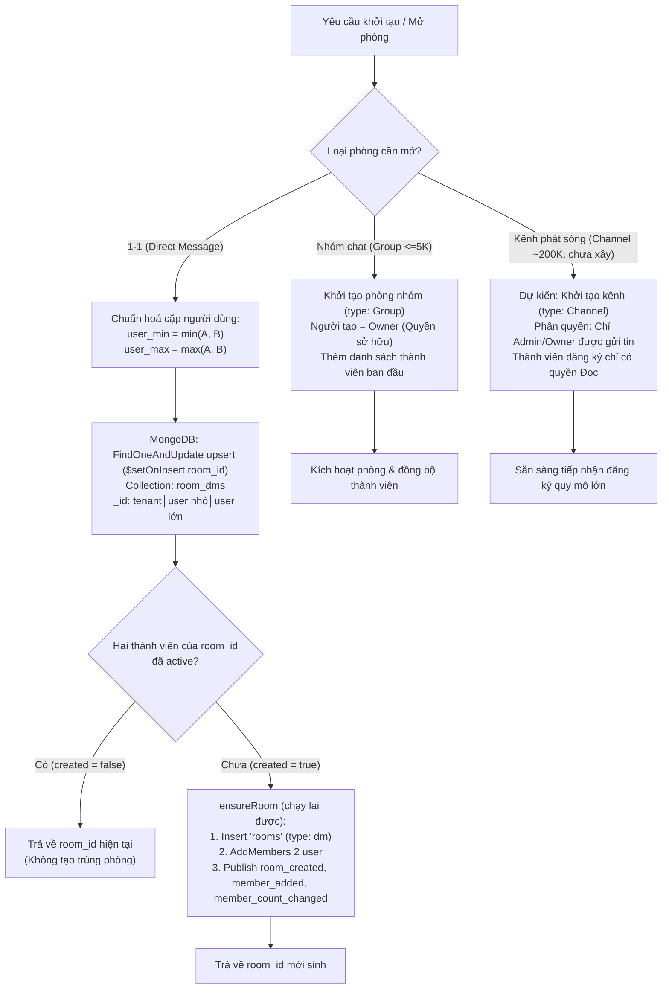
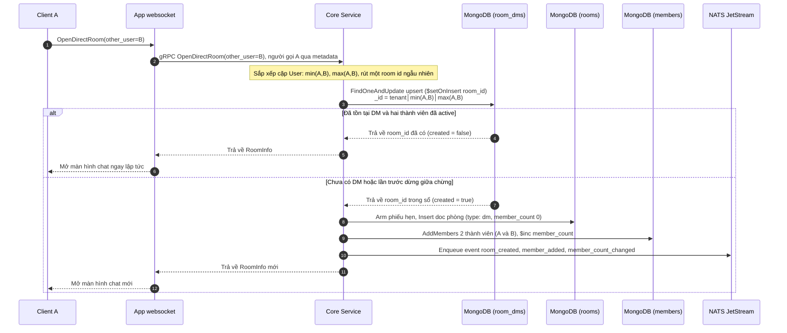

# Module 01: Hội thoại — Phòng chat, DM & Kênh phát sóng

> **Mục tiêu module:** Quản lý không gian giao tiếp giữa các người dùng, bao gồm trò chuyện cá nhân 1-1 (Direct Message), nhóm chat cộng tác (Group Chat ≤5,000 thành viên) và kênh thông báo quy mô lớn (Channel ~200,000 người theo dõi).

---

## 1. Các Use Case nghiệp vụ (Business Use Cases)

| Mã Use Case | Tên Use Case | Tác nhân | Mô tả & Kết quả kỳ vọng |
|---|---|---|---|
| **UC-ROOM-01** | **Mở trò chuyện 1-1 (Direct Message)** | Người dùng A | Mở cuộc trò chuyện với Người dùng B. Nếu phòng DM giữa hai người đã tồn tại từ trước, trả về phòng cũ; nếu chưa có, tạo phòng mới. Không bao giờ tạo thành 2 phòng riêng biệt cho cùng một cặp người dùng. |
| **UC-ROOM-02** | **Tạo nhóm chat (Group Chat)** | Người dùng A | Khởi tạo một nhóm làm việc mới với danh sách thành viên ban đầu, tên nhóm, ảnh đại diện và quyền hạn mặc định (Người tạo là Owner). Hỗ trợ quy mô nhóm lên tới 5,000 thành viên. |
| **UC-ROOM-03** | **Tạo kênh phát sóng (Channel)** | Quản trị viên | *(Yêu cầu Phase 1, chưa xây: proto `RoomType` hiện chỉ có `ROOM_TYPE_DM` và `ROOM_TYPE_GROUP`.)* Tạo kênh tin tức/thông báo tập trung cho tổ chức. Hỗ trợ tới ~200,000 người theo dõi. Chỉ quản trị viên (Admin/Owner) được phép gửi tin; người theo dõi chỉ có quyền đọc. |
| **UC-ROOM-04** | **Cập nhật thông tin phòng** | Owner / Admin | `UpdateRoom` đổi tên phòng và ảnh đại diện (`avatar`) của nhóm; phòng DM không đổi được (`FailedPrecondition`). |

---

## 2. Luồng hoạt động chi tiết (How It Works)

### 2.1. Cây quyết định Phân giải & Khởi tạo Phòng (Room Resolution Flow)

Trước khi đi vào tuần tự chi tiết, sơ đồ khối dưới đây thể hiện logic rẽ nhánh khi phân giải hoặc tạo mới các loại phòng (DM, Nhóm chat, Kênh phát sóng):



### 2.2. Luồng mở phòng chat 1-1 (OpenDirectRoom — Sổ nhận chỗ DM)

Trò chuyện 1-1 là trường hợp đặc biệt dễ xảy ra xung đột khi cả hai người dùng A và B cùng bấm "Nhắn tin" cho nhau tại cùng một thời điểm:



---

## 3. Cơ chế bảo đảm tính đúng đắn (Guarantees & Mechanisms)

### 3.1. Sổ nhận chỗ DM tất định (DM Deterministic Reservation)
- **Vấn đề cần giải quyết:** Nếu kiểm tra bằng câu lệnh `Find` rồi mới `Insert`, khi hai người cùng nhắn tin cho nhau ở 2 node Core khác nhau, cả hai đều thấy "chưa có phòng" và cùng tạo ra 2 phòng DM riêng biệt (Split-room).
- **Cơ chế bảo đảm:**
  - Chuẩn hoá cặp định danh: Luôn sắp xếp `min(user_a, user_b)` và `max(user_a, user_b)`.
  - Sử dụng collection sổ nhận chỗ `room_dms` với `_id` là chuỗi `tenant│user nhỏ│user lớn` (`│` là U+2502, `domain.DirectKey`), cũng lưu ở `rooms.dm_key` (D117).
  - Áp dụng toán tử atomic `$setOnInsert` trong một lệnh `FindOneAndUpdate` upsert (trả doc sau khi ghi):
    - Người tới trước: Insert bản ghi đặt chỗ với room id vừa rút.
    - Người tới sau: Doc đã có, câu lệnh không sửa đổi gì và trả về `room_id` mà người tới trước đã ghi. Hai upsert đụng nhau ở `_id` → `UNAVAILABLE`, client gọi lại.
  - Cả hai thành viên đã active → `{room, created: false}`; ngược lại chạy `ensureRoom` → `{room, created: true}`.
  - **Khả năng tự hồi phục (Self-healing):** Nếu node Core bị sập nguồn ngay sau khi đặt chỗ trong `room_dms` mà chưa kịp tạo doc trong `rooms` hay `members`, lần gọi `OpenDirectRoom` tiếp theo của bất kỳ ai trong hai người sẽ chạy lại `ensureRoom` và làm nốt bước dở dang. Room id trong sổ đã bị phòng khác chiếm → `Repoint` CAS sang id mới và trả `UNAVAILABLE`.

### 3.2. Bỏ vòng thử lại nội bộ (No Internal Retries — Nguyên tắc R1)
- Room id do core rút ngẫu nhiên một lần cho mỗi `CreateRoom` (client không chỉ định id, D118). Nếu id đã bị phòng khác chiếm hoặc xảy ra xung đột tương tranh (CAS trượt), hoặc cùng `request_id` đang chạy ở core khác:
  - **Cơ chế:** Core **không bao giờ** chạy vòng lặp `for { retry... }` nội bộ.
  - **Hành vi:** Lập tức huỷ lệnh và trả mã lỗi gRPC `codes.Unavailable` để client tự backoff và gọi lại với cùng `request_id`. Điều này giúp ngăn chặn tình trạng goroutine bị kẹt, nghẽn thread pool của server dưới tải cao.

### 3.3. Phân bổ và định tuyến theo Slot (Slot Hashing & Routing)
- **Cơ chế:** Mọi phòng chat khi được tạo ra đều được gán cố định vào một trong 1024 Soft Slots:
  $$\text{SlotID} = \text{mix64}(\text{room\_id}) \pmod{1024}$$
- Quyền ghi của phòng thuộc về node Core đang nắm giữ hợp đồng thuê (Lease) của Slot đó. App websocket khi gửi các lệnh tạo tin nhắn hay thay đổi cấu hình phòng sẽ định tuyến thẳng đến Core đang sở hữu slot tương ứng.

---

## 4. Kỹ thuật & Công nghệ triển khai (Technologies)

### 4.1. Cấu trúc lưu trữ MongoDB

#### Collection `room_dms` (Sổ nhận chỗ DM)
```javascript
// Uniqueness chỉ qua _id (không index unique phụ)
{
  "_id": "t1│usr_1001│usr_2002", // tenant│user nhỏ│user lớn (│ = U+2502, luôn sắp xếp)
  "room_id": NumberLong("8492049201948201"),
  "created_at": ISODate("2026-10-10T10:00:00Z")
}
```

#### Collection `rooms` (Thông tin phòng chat)
```javascript
{
  "_id": NumberLong("8492049201948201"), // room_id (ngẫu nhiên 63-bit, khác 0)
  "tenant": "t1",
  "type": "group",                      // "dm" | "group"
  "name": "Đội ngũ Kỹ thuật",           // Đối với Group
  "avatar": "https://cdn.example.com/a.png",
  "info_ver": NumberLong(2),            // CAS của UpdateRoom (tên, avatar)
  "created_by": "usr_1001",
  "created_at": ISODate("2026-10-10T10:00:00Z"),
  "updated_at": ISODate("2026-10-10T10:00:00Z"),
  "updated_by": "usr_1001",
  "pin_ver": NumberLong(0),             // Version danh sách ghim (kèm mảng pins)
  "owners_ver": NumberLong(1),          // Tăng mỗi transaction đổi owner
  "member_count": 42,                   // Bộ đếm phái sinh
  "member_count_ver": NumberLong(42),   // Version bộ đếm thành viên
  "last_seq": NumberLong(10045),        // Hoạt động phòng (projection room_activity)
  "last_message_at": ISODate("2026-10-10T10:05:00Z")
  // còn: dm_key (DM), last_change_at, last_edit_at, activity_bucket, _state/_state_at (mốc mention chung nằm ở mention_rooms của Mention App)
}
```

### 4.2. Giao thức gRPC & API
- `OpenDirectRoom(other_user)`: Mở hoặc lấy phòng 1-1, trả `{room, created}`.
- `CreateRoom(type, name, members, request_id)`: Tạo phòng nhóm (`type = DM` → `INVALID_ARGUMENT`) kèm `request_id` bắt buộc để chống gửi lại (idempotent request).
- `GetRooms(room_ids)` / `ListMyRooms`: Lấy thông tin phòng kèm trạng thái của người gọi (Module 07, 08).
- `UpdateRoom(room_id, name?, avatar?)`: Cập nhật thông tin phòng; client không gửi version, core CAS trên `info_ver` đọc được, trượt → `UNAVAILABLE` (D133).

### 4.3. Hợp đồng Mã lỗi gRPC (Error Matrix)

| Mã lỗi gRPC | Tên lỗi domain | Tình huống kích hoạt | Hành vi Client SDK yêu cầu |
|---|---|---|---|
| `InvalidArgument` | `ERR_INVALID_PEER` | Cố tình mở DM với chính mình (`user_A == user_B`). | Không retry; hiển thị thông báo không thể tự nhắn tin. |
| `InvalidArgument` | `ERR_INVALID_ROOM_TYPE` | `CreateRoom` với loại DM hoặc loại không hợp lệ, hoặc thiếu `request_id`. | Không retry; sửa mã nguồn client. |
| `Unavailable` | `ERR_ROOM_ID_TAKEN` | Room id core vừa rút đã bị phòng khác chiếm (hiếm gặp), hoặc cùng `request_id` đang chạy. | Có retry; gọi lại với cùng `request_id`, core rút id mới. |
| `Unavailable` | `ERR_DATABASE_UNAVAILABLE` | Cụm MongoDB đang bầu Primary mới hoặc mất kết nối. | Có retry; Client tự động backoff và gọi lại sau 1–2s. |

---

## 5. Hạn chế kỹ thuật & Đánh đổi (Limitations & Trade-offs)

1. **Kênh phát sóng (Channel ~200K):**
   - *Hạn chế:* Không hỗ trợ mọi người cùng thảo luận tự do như nhóm chat thông thường. Chỉ cho phép Admin/Owner gửi tin; người theo dõi chỉ nhận stream một chiều.
   - *Lý do đánh đổi:* Nhóm chat hai chiều 200,000 thành viên sẽ gây bùng nổ cấp số nhân (Write & Fanout Amplification) khi mỗi tin nhắn gửi đi phải tính toán unread và đẩy thông báo cho 200,000 kết nối đồng thời.
2. **Quy mô nhóm chat thông thường (Group Chat ≤5,000):**
   - *Hạn chế:* 5,000 thành viên là mục tiêu quy mô của nhóm hai chiều; code không đặt trần tổng, chỉ giới hạn mỗi lệnh thêm theo `MEMBER_BATCH_MAX` (500).
   - *Lý do đánh đổi:* Đảm bảo các tác vụ kiểm tra quyền hạn, đếm unread và phát sóng sự kiện thay đổi thành viên diễn ra trong ngân sách độ trễ p99 ≤100ms.
3. **Phân bổ Slot cố định (1024 Slots):**
   - *Hạn chế:* Số lượng slot là 1024 cố định từ khi boot hệ thống. Nếu có 1 phòng cực kỳ hot, tải của phòng đó sẽ dồn vào node Core giữ slot chứa phòng đó (không tự băm nhỏ 1 phòng ra nhiều Core).

---

## 6. Phụ thuộc kỹ thuật & Bán kính sự cố (Dependencies & Blast Radius)

| Thành phần phụ thuộc | Mục đích phụ thuộc | Ứng xử khi thành phần gặp sự cố (Failure Behavior) |
|---|---|---|
| **MongoDB Replica Set** | Lưu trữ chính (`rooms`, `room_dms`) | Nếu MongoDB failover hoặc mất kết nối: Lệnh tạo phòng trả `UNAVAILABLE` ngay lập tức. Client cần đợi 1–3s để cụm Mongo bầu Primary mới. |
| **Redis State (Slot Lease)** | Định tuyến và xác định quyền sở hữu phòng | Nếu Redis State sập: Core mất lease sẽ không nhận lệnh ghi phòng mới; chuyển sang chế độ an toàn (Safe mode) để chống split-brain. |
| **NATS JetStream** | Phát sự kiện `room_created` cho App websocket | Nếu NATS tạm thời quá tải: Lệnh tạo phòng trên MongoDB vẫn commit thành công; doc `rooms` (bit 1, 2) và các doc `members` sáng lập (bit 1) giữ cờ `_state`, sweeper slot 0 phát bù `room_created`, `member_added`, `member_count_changed` sau khoảng 15–17s (Module 10). |

### 6.1. Chỉ số Sức khoẻ Vận hành & Cảnh báo SRE (Key Metrics & Alerts)

Chưa có metric đếm số phòng tạo mới, số lần `room_dms` chặn DM trùng hay số lần mất slot. Các metric thực có liên quan:

- **`chatim_core_event_pending_oldest_seconds{collection="rooms"}`** (và `{collection="members"}`): Tuổi cờ chờ phát cũ nhất của `room_created`, `member_count_changed`, `room_updated`, `member_added`.
  - *Luật cảnh báo (`ChatimEventPendingStuck`):* cờ cũ nhất > 60s trong 5 phút.
- **`chatim_core_counter_repaired_total{counter="members"}`:** Phiếu hẹn sửa lại `member_count` sau khi tạo phòng/thêm người dở dang.
  - *Luật cảnh báo (`ChatimCounterRepairSurge`):* > 1 lần/giây trong 10 phút.
- **`chatim_core_room_yields_total`:** Số lần actor nhường room vì đụng doc của core khác ở cùng seq (dấu hiệu quyền slot lệch).
  - *Luật cảnh báo (`ChatimSeqContention`):* > 10 lần trong 5 phút.
- **`chatim_core_room_watch_forgets_total`:** Số room mà core quên cache thông tin phòng sau `room_updated`/`member_count_changed`.
