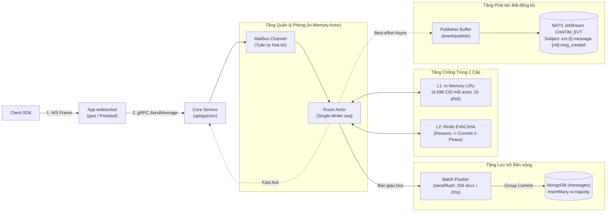
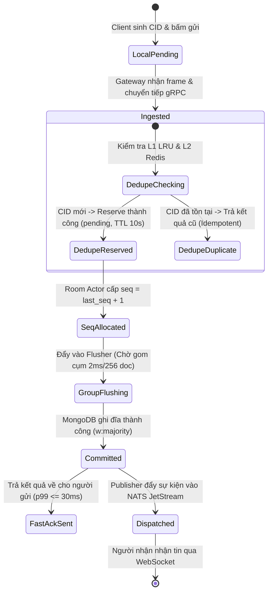

# Module 02: Tin nhắn — Gửi tin & Thứ tự Timeline

> **Mục tiêu module:** Tiếp nhận tin nhắn từ người dùng, chống gửi trùng lặp tuyệt đối khi mạng chập chờn, cấp số thứ tự liên tục (monotonic sequence) để đảm bảo mọi người trong phòng thấy cùng một thứ tự hiển thị, và trả phản hồi cực nhanh (p99 ≤30ms).

---

## 1. Các Use Case nghiệp vụ (Business Use Cases)

| Mã Use Case | Tên Use Case | Tác nhân | Mô tả & Kết quả kỳ vọng |
|---|---|---|---|
| **UC-MSG-01** | **Gửi tin nhắn thông thường** | Thành viên | Gửi tin nhắn văn bản (kèm liên kết media, tệp đính kèm hoặc metadata). Tin nhắn được lưu trữ vĩnh viễn và phát tán tức thì tới những người đang online. |
| **UC-MSG-02** | **Đảm bảo thứ tự Timeline** | Tất cả thành viên | Tất cả mọi người trong phòng chat (kể cả người gửi và người nhận) đều thấy các tin nhắn sắp xếp theo **cùng một thứ tự duy nhất** trên màn hình. Không có hiện tượng tin nhắn nhảy lộn xộn. |
| **UC-MSG-03** | **Chống gửi trùng tin (Deduplication)** | Client SDK | Khi người dùng gửi tin nhưng mạng bị nghẽn (không nhận được ack phản hồi) và SDK tự động gửi lại nhiều lần với cùng một `cid` (Client Message ID), hệ thống chỉ ghi nhận và lưu **đúng 1 bản tin duy nhất**, không bao giờ sinh ra tin nhắn bị nhân đôi. |
| **UC-MSG-04** | **Phản hồi gửi tin cực nhanh (Fast Ack)** | Client SDK | Người gửi nhận được xác nhận (Ack thành công kèm `seq` và `created_at`) trong vòng ≤30ms (p99) ngay khi tin đã an toàn trong cơ sở dữ liệu. |

---

## 2. Luồng hoạt động chi tiết (How It Works)

### 2.1. Sơ đồ Khối Kiến trúc Pipeline Gửi tin (Send Pipeline Architecture)

Kiến trúc xử lý gửi tin nhắn được tách lớp nghiêm ngặt nhằm cân bằng giữa thông lượng cực cao (High Throughput) và an toàn dữ liệu tuyệt đối (Data Durability):



### 2.2. Vòng đời Trạng thái Tin nhắn (Message State Lifecycle)

Mỗi tin nhắn khi đi từ máy người gửi đến cơ sở dữ liệu và các người nhận trải qua các trạng thái rõ ràng:



### 2.3. Luồng xử lý Pipeline Gửi tin (Sequence Diagram)

Pipeline gửi tin được tối ưu hoá theo mô hình gom nhóm (Batching) và phản hồi nhanh (Fast Ack):

```mermaid
sequenceDiagram
    autonumber
    participant Client as Client SDK
    participant GW as App websocket
    participant Core as Core (api/grpcsrv)
    participant Actor as Room Actor (send/actor)
    participant Dedupe as Redis Dedupe (EVALSHA)
    participant Flush as Flusher (send/flush)
    participant Mongo as MongoDB (messages)
    participant Pub as Publisher (event/publish)
    participant NATS as NATS JetStream

    Client->>GW: Gửi tin (room_id, cid="c-123", text="Xin chào")
    GW->>Core: gRPC SendMessage
    Core->>Actor: Đẩy vào hàng đợi Mailbox của Actor phòng

    Note over Actor,Dedupe: 1. Kiểm tra chống trùng (Reserve Phase)
    Actor->>Dedupe: Reserve(cid) qua Redis Lua (gom batch nhiều phòng)
    Dedupe-->>Actor: Hợp lệ (New CID)

    Note over Actor: 2. Cấp số thứ tự độc quyền: seq = last_seq + 1
    Actor->>Flush: Bàn giao Doc {room_id, seq, cid, text}

    Note over Flush,Mongo: 3. Ghi dữ liệu đồng loạt (Group Commit)
    Flush->>Mongo: insertMany(ordered: false, w: majority)
    Mongo-->>Flush: Ghi thành công

    Flush-->>Actor: Xác nhận đã ghi đĩa
    Actor-->>Core: Xác nhận hoàn tất
    Core-->>GW: Trả gRPC Response (seq)
    GW-->>Client: Trả Ack cho người gửi (p99 ≤ 30ms)

    Note over Actor,NATS: 4. Phát tán bất đồng bộ & Cam kết CID
    par Phát tán sự kiện (Best-effort)
        Actor->>Pub: Enqueue event msg_created
        Pub->>NATS: PublishMsgAsync(CHATIM_EVT)
    and Cam kết chống trùng (Commit Phase)
        Actor->>Dedupe: Commit(cid) (chuyển trạng thái sang Committed)
    end
```

---

## 3. Cơ chế bảo đảm tính đúng đắn (Guarantees & Mechanisms)

### 3.1. Single-Writer per Room (Mô hình Actor)
- **Vấn đề cần giải quyết:** Nếu nhiều người cùng bấm gửi tin vào 1 phòng chat tại cùng 1 mili-giây trên nhiều luồng khác nhau, làm sao cấp số thứ tự `seq` tăng dần liên tục mà không bị nhảy cóc (gap) hoặc tranh chấp khoá (lock contention)?
- **Cơ chế bảo đảm:**
  - Mỗi phòng chat đang hoạt động được quản lý bởi **duy nhất một Goroutine Actor** trong bộ nhớ của node Core nắm giữ Slot.
  - Mọi yêu cầu gửi tin vào phòng đó đều xếp hàng tuần tự qua một kênh Go channel (Mailbox).
  - Actor là người duy nhất nắm giữ biến `current_seq` trong RAM. Việc cấp `seq = current_seq + 1` diễn ra trong 0 microsecond mà không cần gọi câu lệnh khoá phân tán nặng nề nào.

### 3.2. Cơ chế chống trùng 2 tầng + lọc lúc đọc (Deduplication)
- **Cơ chế:** Để đảm bảo tính Idempotency khi Client retry, hệ thống áp dụng bộ lọc 2 tầng khi ghi và một bước lọc khi đọc:
  1. **Tầng 1 — In-Memory LRU Cache:** Mỗi actor phòng giữ tới 4,096 `cid` đã ack (10 phút) trong RAM để trả lại ack cũ ngay cho các gói tin gửi lặp.
  2. **Tầng 2 — Redis Dedupe (Chu trình 2 pha Reserve-Commit, khoá `chatim:cid:{room}:{user}:{cid}`):**
     - **Pha 1 (Reserve):** Đặt chỗ CID bằng Redis Lua Script (`dedupe.Batcher` gom nhiều phòng vào một `EVALSHA`), trạng thái pending `p:{core}` với `CID_PENDING_TTL` 10 giây. CID đang pending ở core khác → từ chối `UNAVAILABLE` (đếm `cid_pending_elsewhere_total`); đã `Committed` → trả kết quả cũ ngay lập tức.
     - **Pha 2 (Commit):** Sau ack, CID được chuyển sang trạng thái `Committed` (`c:{seq}:{ms}`) với `CID_COMMITTED_TTL` 15 phút.
  3. **Không có unique index theo `cid` trên MongoDB:** `messages` không có index phụ (chỉ partial `state_pending`); `_id` (room│thread│seq) chỉ chặn hai lần ghi cùng seq. Nếu Redis lỗi, `redisguard` cho dedupe chạy chỉ với LRU; một bản trùng lọt qua (gửi lại sang core khác) bị `view.CollapseRetried` ẩn khi đọc theo (người gửi, cid).

### 3.3. Nhóm ghi đồng loạt (Group Commit / Batch Flusher)
- Thay vì mỗi tin nhắn gọi một lệnh `InsertOne` xuống MongoDB làm quá tải IOPS đĩa:
  - Actor đẩy doc vào hàng đợi của **Flusher**.
  - Flusher gom các tin nhắn từ nhiều phòng chat khác nhau trong một cửa sổ cực ngắn (`FLUSH_WINDOW` 2ms hoặc `FLUSH_MAX_BATCH` 256 doc) và thực thi **một lệnh duy nhất**:
    $$\text{insertMany}(\text{ordered} = \text{false}, w = \text{"majority"})$$
  - Cơ chế này giúp hệ thống đạt throughput 5,000 – 10,000 tin/giây mà vẫn bảo đảm độ an toàn dữ liệu trên cả 3 node MongoDB Replica Set.

### 3.4. Fast Ack & Publish bất đồng bộ có bảo đảm (M3.1)
- **Nguyên tắc:** Trả Ack cho người gửi ngay sau khi Mongo ghi nhận `w:majority`. Không bắt người gửi phải chờ đến khi tin được phát tán qua NATS JetStream.
- Doc tin được insert kèm cờ `_state: 1` (`msg_created` chờ phát) trong cùng lệnh `insertMany`. Sau ack, publisher phát `msg_created` bất đồng bộ; PubAck về thì hàng xoá cờ tắt bit theo lô (2s sau đích đầu, các khoảng `_id` liền nhau thành một `UpdateMany`, khoá lẻ `UpdateOne`).
- Nếu Core tắt đột ngột trước khi phát, hoặc NATS từ chối, doc còn cờ và **sweeper trên core giữ slot 0 (Module 10)** phát bù `msg_created` với đúng id sau khoảng 15–17s. Giao ít nhất một lần; stream bỏ bản trùng theo id.

### 3.5. Hợp đồng Snapshot & Xử lý Đến lệch thứ tự (Out-of-order Resilience — Quy tắc R6/R7)
- **Vấn đề thực tế mạng di động:** Do NATS JetStream và kết nối mạng di động, Client SDK có thể nhận được sự kiện `msg_edited` (sửa tin) **trước khi** nhận được sự kiện `msg_created` (tạo tin ban đầu).
- **Cơ chế bảo đảm:**
  - Mọi sự kiện phát tán qua NATS đều mang **toàn bộ Snapshot hiện tại của tin nhắn** kèm phiên bản `ver`.
  - Client SDK áp dụng quy tắc: *"Phiên bản `ver` cao hơn luôn thắng"*.
  - Nếu nhận được `msg_edited` cho một tin nhắn chưa có trên màn hình, Client SDK lưu snapshot này vào bộ nhớ và hiển thị trực tiếp. Khi sự kiện `msg_created` (bản gốc, `ver: 0`) đến sau, Client so sánh thấy phiên bản hiện tại đã là `ver: 1` nên sẽ bỏ qua gói tin cũ một cách an toàn.

---

## 4. Kỹ thuật & Công nghệ triển khai (Technologies)

### 4.1. Cấu trúc bảng MongoDB Clustered Collection `messages`

Để tối ưu hoá đọc ghi theo trình tự thời gian, collection `messages` được cấu hình dạng **Clustered Index**:

Tên field trong `messages` là tên ngắn (ngoại lệ duy nhất của luật tên tiếng Anh đầy đủ); room, thread và seq chỉ nằm trong `_id`:

```javascript
{
  "_id": BinData(0, "...24 bytes..."), // room (8B) │ thread_root (8B) │ seq (8B), Big-Endian
  "t": "t1",                            // tenant
  "f": "usr_1001",                      // người gửi
  "k": 1,                               // kind: 1 text, 2 system
  "x": "Nội dung tin nhắn trao đổi",    // text
  "c": "client-uuid-generated-123",     // cid (Client Message ID chống trùng)
  "ts": ISODate("2026-10-10T10:05:00.123Z"), // thời điểm gửi
  "m": BinData(0, "..."),               // meta ≤ 8KB (chỉ khi có)
  "nu": true,                           // skip_unread (chỉ khi true)
  "v": 2,                               // version nội dung (chỉ sau khi sửa/xoá)
  "d": true,                            // đã xoá cho mọi người (chỉ khi true)
  "ea": ISODate("..."),                 // lúc sửa cuối
  "rx": { "c": [ { "e": "👍", "n": 3 }, { "e": "❤️", "n": 1 } ], "v": 4 }, // tóm tắt reaction
  "rc": { "n": 0, "v": 0 },             // số tin trả lời còn sống
  "_state": 1, "_state_at": ISODate("...") // cờ event chờ phát (chỉ khi còn bit)
  // còn: rp (reply), fw (forward), mt / ma (mention)
}
```

- **Khoá chính Clustered `_id`:** Ghép 8 byte `room_id`, 8 byte `thread_root` và 8 byte `seq`. Dữ liệu của cùng một phòng chat nằm liền kề nhau trên ổ đĩa SSD, giúp việc đọc phân trang lịch sử tin nhắn đạt hiệu năng tối đa (p99 ≤20ms cho 50 tin).
- **Không có index chống trùng theo `cid`:** index phụ duy nhất là partial `state_pending {_state_at: 1, _id: 1}` (D148).

### 4.2. Kỹ thuật Redis Lua Script (CID Dedupe)
- Sử dụng lệnh `EVALSHA` gọi trước mã SHA1 của script Lua trên Redis để kiểm tra và đặt chỗ CID nguyên tử, tránh round-trip mạng nhiều lần giữa Core và Redis.
- Khi Redis gặp sự cố, thành phần `platform/redisguard` tự động kích hoạt chế độ bảo vệ (cooldown circuit breaker), bypass tầng Redis và chỉ dùng LRU trong RAM để hệ thống không bị gián đoạn; trong lúc đó bản trùng gửi lại qua core khác có thể được ghi (alert `ChatimRedisDegraded`) và được ẩn khi đọc.

### 4.3. Hợp đồng Mã lỗi gRPC (Error Matrix)

| Mã lỗi gRPC | Tên lỗi domain | Tình huống kích hoạt | Hành vi Client SDK yêu cầu |
|---|---|---|---|
| `InvalidArgument` | `ERR_PAYLOAD_TOO_LARGE` | Văn bản gửi vượt quá 16KB hoặc metadata > 8KB. | Không retry; hiển thị thông báo tin nhắn quá dài. |
| `InvalidArgument` | `ERR_INVALID_CID` | Mã `cid` gửi lên rỗng, quá dài hoặc chứa ký tự ngoài `[A-Za-z0-9_-]` (ví dụ dấu `:`). | Không retry; sửa cách sinh CID trên Client. |
| `ResourceExhausted` | `domain.ErrBusy` | Mailbox actor của phòng (`ACTOR_MAILBOX` 1024) hoặc hàng flusher đầy. | Có retry; Client backoff jitter rồi gọi lại với cùng `cid`. |
| `Unavailable` | `ERR_SLOT_UNAVAILABLE` | Node Core vừa mất quyền sở hữu slot hoặc MongoDB đang failover bầu cử Primary. | Có retry; Client tự động backoff jitter (50ms–200ms) và gọi lại. |
| `PermissionDenied` | `ERR_NOT_IN_ROOM` | Người gửi không phải là thành viên hợp lệ của phòng chat. | Không retry; chặn ô nhập tin nhắn trên giao diện. |

---

## 5. Hạn chế kỹ thuật & Đánh đổi (Limitations & Trade-offs)

1. **Nút thắt cổ chai phòng chat siêu nóng (Hot-Room Bottleneck):**
   - *Hạn chế:* Do mỗi phòng chat chỉ có 1 Goroutine Actor xử lý tuần tự, thông lượng tối đa của một phòng chat đơn lẻ bị giới hạn ở mức **~5,000 tin/giây**.
   - *Đánh đổi:* Chấp nhận giới hạn này để đổi lấy tính đúng đắn tuyệt đối về thứ tự `seq` mà không cần đến các thuật toán đồng thuận phức tạp (như Paxos/Raft trên từng phòng).
2. **Không đảm bảo đồng hồ vật lý toàn cục giữa các phòng khác nhau:**
   - *Hạn chế:* Hệ thống chỉ đảm bảo thứ tự `seq` tăng dần và nhất quán giữa các người dùng **trong cùng một phòng chat**. Thứ tự giữa tin nhắn của Phòng A và Phòng B không có quan hệ nhân quả toàn cục.
3. **Giới hạn kích thước gói tin (Payload Quota):**
   - Độ dài văn bản tối đa: **16 KB**.
   - Dữ liệu metadata tối đa: **8 KB**.
   - Số lượng tệp/tham chiếu đính kèm tối đa: **10 tệp** (yêu cầu A6; core chưa có trường đính kèm riêng, chỉ có `meta` ≤ 8KB).

---

## 6. Phụ thuộc kỹ thuật & Bán kính sự cố (Dependencies & Blast Radius)

| Thành phần phụ thuộc | Mục đích phụ thuộc | Ứng xử khi thành phần gặp sự cố (Failure Behavior) |
|---|---|---|
| **MongoDB Clustered Collection** | Lưu trữ tin vĩnh viễn (`messages`) | Nếu Mongo Replica Set mất kết nối hoặc quá tải: Pipeline flush bị nghẽn, Actor từ chối nhận thêm tin và trả `UNAVAILABLE` cho Client. |
| **Redis Dedupe Instance** | Lưu trữ tạm CID để chống trùng nhanh | Nếu Redis Dedupe bị chậm hoặc ngắt kết nối: `redisguard` kích hoạt mạch ngắt. Hệ thống bỏ qua Redis và chỉ chống trùng bằng LRU trong RAM; bản trùng gửi lại qua core khác có thể lọt và được `view.CollapseRetried` ẩn khi đọc. Không chết dịch vụ. |
| **NATS JetStream (CHATIM_EVT)** | Kênh phát tán sự kiện tin mới | Nếu NATS quá tải: Fast-path publish thất bại nhưng Core vẫn trả Ack thành công cho người gửi. Doc giữ cờ `_state`; sweeper slot 0 phát bù sau khoảng 15–17s (hoặc khi NATS sống lại). |
| **Platform Slot Manager** | Đảm bảo duy nhất 1 Core sở hữu phòng | Nếu Core bị mất hợp đồng thuê Slot: Actor của phòng tự động từ chối các lệnh gửi tin mới (`AfterLose`), hoàn tất các tin đang ghi dở rồi giải phóng tài nguyên. |

### 6.1. Chỉ số Sức khoẻ Vận hành & Cảnh báo SRE (Key Metrics & Alerts)

Core chưa xuất metric độ trễ flush/ack, số lần bắt trùng theo tầng hay độ sâu mailbox; độ trễ ack p50/p99 hiện đo bằng `corebench` (`make poc TOOL=corebench`). Các metric thực có liên quan:

- **`chatim_core_redis_degraded{client="cid_dedupe"}`:** 1 khi client Redis dedupe đang ở chế độ suy giảm.
  - *Luật cảnh báo (`ChatimRedisDegraded`):* = 1 trong 1 phút (có thể lọt bản trùng giữa các core).
- **`chatim_core_cid_pending_elsewhere_total`:** Lệnh gửi bị từ chối vì cid đang pending ở core khác (cửa sổ trùng CD3).
  - *Luật cảnh báo (`ChatimCIDPendingElsewhere`):* tăng trong 5 phút.
- **`chatim_core_cid_settle_dropped_total`:** Lệnh Commit/Abort cid bị batcher bỏ.
  - *Luật cảnh báo (`ChatimCIDSettleDropped`):* tăng trong 5 phút.
- **`chatim_core_room_yields_total`:** Actor nhường phòng khi đụng seq của core khác.
  - *Luật cảnh báo (`ChatimSeqContention`):* > 10 lần trong 5 phút.
- **`chatim_core_grpc_load_shed_total`:** Lệnh gRPC bị bộ giới hạn in-flight từ chối (`UNAVAILABLE`).
- **`chatim_core_publish_dropped_total{reason}`:** Event rơi trước khi JetStream ack (sweeper phát bù).
  - *Luật cảnh báo (`ChatimEventsDropped`):* tăng liên tục 10 phút.
- **`chatim_core_event_pending_oldest_seconds{collection="messages"}`:** Tuổi cờ `msg_created` chờ phát cũ nhất.
  - *Luật cảnh báo (`ChatimEventPendingStuck`):* > 60s trong 5 phút.
