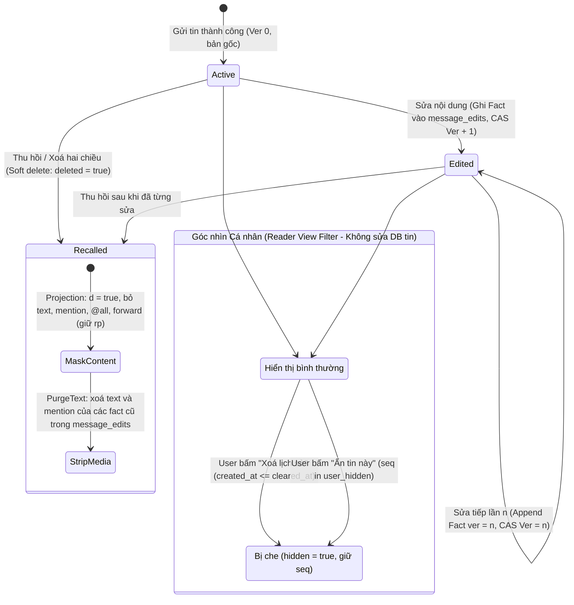
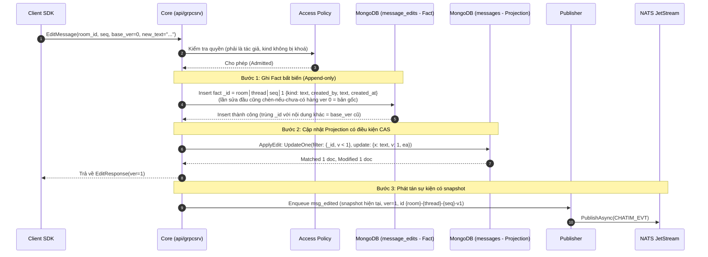

# Module 03: Tin nhắn — Chỉnh sửa, Thu hồi & Quyền riêng tư

> **Mục tiêu module:** Cho phép người dùng chỉnh sửa nội dung tin nhắn (lưu lại toàn bộ lịch sử sửa đổi để minh bạch), thu hồi/xoá tin nhắn đối với mọi người trong phòng, hoặc ẩn tin nhắn và xoá sạch lịch sử trò chuyện cục bộ chỉ cho riêng mình (bảo đảm quyền riêng tư).

---

## 1. Các Use Case nghiệp vụ (Business Use Cases)

| Mã Use Case | Tên Use Case | Tác nhân | Mô tả & Kết quả kỳ vọng |
|---|---|---|---|
| **UC-EDIT-01** | **Chỉnh sửa tin nhắn** | Tác giả tin nhắn | Sửa đổi nội dung văn bản của tin nhắn đã gửi. Mọi thành viên trong phòng đều nhận được nội dung mới và nhãn "(đã chỉnh sửa)". |
| **UC-EDIT-02** | **Xem lịch sử chỉnh sửa** | Thành viên trong phòng | Xem lại các phiên bản nội dung trước đây của tin nhắn kèm mốc thời gian sửa đổi (Audit Trail), ngăn chặn hành vi sửa tin để gian lận thông tin. |
| **UC-EDIT-03** | **Xoá tin nhắn cho mọi người (Thu hồi)** | Tác giả (policy mặc định, D86) | Thu hồi tin nhắn khỏi phòng chat. Tin nhắn hiển thị thành "Tin nhắn đã bị xoá" đối với tất cả thành viên trong phòng. |
| **UC-EDIT-04** | **Ẩn tin nhắn phía tôi (Hide for me)** | Thành viên bất kỳ | Ẩn một tin nhắn cụ thể trên thiết bị của tôi (chỉ tôi không thấy, những người khác trong phòng vẫn thấy bình thường). |
| **UC-EDIT-05** | **Xoá lịch sử trò chuyện phía tôi (Clear history)** | Thành viên bất kỳ | Xoá toàn bộ tin nhắn từ một thời điểm trở về trước trên giao diện của tôi. Các tin nhắn mới gửi sau đó vẫn hiển thị bình thường. |

---

## 2. Luồng hoạt động chi tiết (How It Works)

### 2.1. Vòng đời Trạng thái & Cơ chế Che chắn Riêng tư (Message State & Privacy Machine)

Mô hình trạng thái dưới đây làm rõ cách hệ thống xử lý giữa việc **bảo tồn sự thật lịch sử (Fact)**, **chiếu bản hiển thị chung (Projection)** và **che chắn góc nhìn riêng tư (Privacy Masking)**:



### 2.2. Luồng Sửa tin nhắn (Fact & Projection Pattern)

Hệ thống tách biệt việc **Ghi nhận sự thật (Fact)** và **Chiếu ra bản hiển thị (Projection)**:



---

## 3. Cơ chế bảo đảm tính đúng đắn (Guarantees & Mechanisms)

### 3.1. Mô hình Fact & Projection (Nguyên tắc P2)
- **Vấn đề cần giải quyết:** Nếu ghi đè trực tiếp lên bảng `messages`, khi nhiều thao tác sửa diễn ra đồng thời hoặc hệ thống gặp sự cố, dữ liệu lịch sử sẽ bị mất vĩnh viễn và không thể đối soát.
- **Cơ chế bảo đảm:**
  - **Fact (Sự thật bất biến):** Mọi lần sửa đổi đều được chèn thành một document mới trong collection `message_edits` với `ver = base_ver + 1`; lần sửa đầu chèn thêm hàng `ver 0` giữ bản gốc. Document không bao giờ bị xoá; chỉ khi tin bị xoá thì text và mention của các fact cũ bị dọn (`PurgeText`).
  - **Projection (Bản chiếu hiện tại):** Bảng `messages` chỉ đóng vai trò là bản chiếu (View Projection) trạng thái mới nhất để phục vụ việc đọc nhanh.
  - **Tự phục hồi Projection:** Nếu sau khi ghi Fact vào `message_edits`, máy chủ Core bị crash trước khi cập nhật bảng `messages`: fact mang cờ `_state: 1` nên **sweeper slot 0 (Module 10)** thấy nó sau khoảng 15–17s, chạy lại `ApplyEdit` (idempotent, chỉ áp khi `v < ver`; xoá tin thì dọn text) rồi mới phát `msg_edited`/`msg_deleted` với snapshot đã áp (D151).

### 3.2. Chống ghi đè tranh chấp bằng Optimistic CAS (Check-And-Set)
- Khi client gửi lệnh sửa, client **bắt buộc phải gửi kèm `base_ver`** (phiên bản mà client đang nhìn thấy).
- CAS nằm ở `_id` của fact: lệnh chèn `message_edits` với `_id = room│thread│seq│(base_ver + 1)` (28 byte). `_id` duy nhất nên chỉ một lệnh thắng cho mỗi version.
- Nếu có hai người (hoặc hai thiết bị) cùng sửa một tin nhắn tại cùng một thời điểm:
  - Người thứ nhất hoàn tất -> version nâng lên `base_ver + 1`.
  - Người thứ hai gửi lệnh với `base_ver` cũ -> chèn trùng `_id`. Fact trùng cùng tác giả, cùng kind, cùng text (và cùng tập mention) là lần gửi lại của chính lệnh đó → thành công; khác nội dung → `codes.FailedPrecondition` (`domain.ErrVersionConflict`), client tải lại phiên bản mới nhất rồi mới thử lại. Core không chạy vòng lặp retry nội bộ.
- Projection `ApplyEdit` chỉ ghi khi `messages.v < ver`, nên áp lại (sweeper) không bao giờ lùi version.

### 3.3. Dữ liệu theo người đọc: Fact thưa & Mốc thời gian (Sparse Fact View)
- **Ẩn tin nhắn phía tôi (UC-EDIT-04):**
  - Không sửa bất kỳ trường nào trên document `messages` gốc (để không ảnh hưởng tới người khác).
  - Upsert một bản ghi nhỏ vào collection `hidden` `{user_id, room_id, thread_root, seq}` (unique index trên bộ bốn này, `$setOnInsert created_at`); lần ẩn đầu phát `message_hidden`, ẩn lại không ghi gì.
- **Xoá lịch sử phía tôi (UC-EDIT-05):**
  - Không xoá bất kỳ tin nhắn nào trong database.
  - Chỉ cập nhật một trường thời gian duy nhất trên document thành viên của người đó:
    $$\text{members.cleared\_at} = \max(\text{cũ}, \text{giờ server})$$
- Khi người dùng đọc lịch sử tin nhắn, **Reader View Pipeline (Module 08)** đánh dấu `hidden = true` và bỏ nội dung các tin có `created_at <= cleared_at` hoặc nằm trong bảng `hidden`; tin vẫn giữ `seq` và version nên timeline không có lỗ.

---

## 4. Kỹ thuật & Công nghệ triển khai (Technologies)

### 4.1. Cấu trúc lưu trữ MongoDB

#### Collection `message_edits` (Audit Log các lần sửa)
```javascript
{
  "_id": BinData(0, "..."),            // Clustered key 28B: room│thread_root│seq│ver (uint32)
  "room_id": NumberLong("8492049201948201"),
  "tenant": "t1",
  "kind": 1,                           // 1 sửa text, 2 xoá, 3 bản gốc (hàng ver 0)
  "created_by": "usr_1001",
  "text": "Nội dung sau khi đã sửa đổi", // bị xoá khi tin bị xoá (PurgeText)
  "created_at": ISODate("2026-10-10T10:08:00Z"),
  "mention_targets": [ { "k": "user", "i": "usr_B" } ], // đủ tập mention của phiên bản
  "mention_all": false
}
```

#### Collection `hidden` (Danh sách tin ẩn theo người dùng)
```javascript
{
  // _id do Mongo sinh; uniqueness qua index unique {user_id, room_id, thread_root, seq}
  "user_id": "usr_1001",
  "room_id": NumberLong("8492049201948201"),
  "thread_root": NumberLong(0),
  "seq": NumberLong(10042),
  "created_at": ISODate("2026-10-10T10:10:00Z")
}
```

### 4.2. Chính sách Phân quyền `access.Policy`
- Mọi yêu cầu sửa/xoá đều phải đi qua `access.Admit` (kiểm tra còn là thành viên không) và `access.Allow`:
  - **Sửa tin:** Mặc định chỉ tác giả (`sender_id == caller_id`) mới được sửa.
  - **Thu hồi tin:** Mặc định cũng chỉ tác giả (`access.DefaultPolicy`, D86); quyền Owner/Admin xoá tin người khác chờ module policy theo vai trò (Phase 2).
  - **Khoá loại tin (`MESSAGE_LOCKED_KINDS`):** Danh sách tên kind (`text`, `system`) bị cấm sửa/xoá kể cả với tác giả; mặc định rỗng (không khoá gì), tên lạ là lỗi khi boot (D87).

### 4.3. Hợp đồng Mã lỗi gRPC (Error Matrix)

| Mã lỗi gRPC | Tên lỗi domain | Tình huống kích hoạt | Hành vi Client SDK yêu cầu |
|---|---|---|---|
| `FailedPrecondition` | `ERR_CAS_VERSION_MISMATCH` | `base_ver` client gửi lên không khớp với phiên bản hiện tại trên server (đã có người sửa trước). | Không retry mù; Client tải lại snapshot mới nhất rồi cho người dùng quyết định sửa đè hay huỷ. |
| `PermissionDenied` | `ERR_NOT_MESSAGE_AUTHOR` | Người dùng không phải tác giả của tin nhắn nhưng cố tình gọi lệnh sửa. | Không retry; hiển thị thông báo "Bạn chỉ có thể sửa tin nhắn của chính mình". |
| `PermissionDenied` | `ERR_MESSAGE_KIND_LOCKED` | Tin nhắn thuộc loại bị khoá chỉnh sửa (`MESSAGE_LOCKED_KINDS`). | Không retry; ẩn nút sửa trên giao diện. |
| `NotFound` | `ERR_MESSAGE_NOT_FOUND` | Tin nhắn cần sửa/thu hồi không tồn tại trong phòng. | Không retry; đồng bộ lại giao diện. |
| `FailedPrecondition` | `domain.ErrMessageDeleted` / `domain.ErrHasReplies` | Sửa/xoá tin đã bị xoá; xoá tin còn tin trả lời sống. | Không retry; tải lại snapshot. |
| `Unavailable` | `ERR_MUTATE_RETRY_LATER` | Xung đột ghi đồng thời hoặc MongoDB Replica Set đang failover. | Có retry; Client tự động backoff và gọi lại. |

---

## 5. Hạn chế kỹ thuật & Đánh đổi (Limitations & Trade-offs)

1. **Độ trễ cập nhật Projection:**
   - *Hạn chế:* Tồn tại một khoảng thời gian cực ngắn (vài phần triệu giây) giữa lúc ghi Fact vào `message_edits` và cập nhật Projection `messages`.
   - *Đánh đổi:* Chấp nhận độ trễ này để đổi lấy tính an toàn dữ liệu: không bao giờ mất lịch sử kiểm toán ngay cả khi máy chủ sập nguồn giữa chừng.
2. **Quyền riêng tư vs Kiểm toán tuân thủ (Audit Compliance):**
   - *Hạn chế:* Khi người dùng chọn "Xoá tin nhắn cho mọi người", core xoá text khỏi `messages` và khỏi mọi fact trong `message_edits` (`PurgeText`), nhưng các event `msg_created`/`msg_edited` đã phát trước đó vẫn mang text và còn trong stream `CHATIM_EVT` tới hết `EVT_STREAM_MAX_AGE` (mặc định 7 ngày).
   - *Đánh đổi:* Hiện chưa có cấu hình tenant để event không mang text; event luôn mang snapshot hiện tại của tin.

---

## 6. Phụ thuộc kỹ thuật & Bán kính sự cố (Dependencies & Blast Radius)

| Thành phần phụ thuộc | Mục đích phụ thuộc | Ứng xử khi thành phần gặp sự cố (Failure Behavior) |
|---|---|---|
| **MongoDB Clustered Collection** | Lưu Fact `message_edits` và Projection `messages` | Nếu MongoDB lỗi ghi CAS: Lệnh sửa/xoá trả lỗi `UNAVAILABLE`. Trạng thái tin nhắn giữ nguyên, không xảy ra tình trạng dữ liệu nửa vời. |
| **Model Access Policy** | Thẩm định quyền sửa/xoá | Nếu cache quyền bị cũ (chưa nhận event kick thành viên): Sẽ kiểm tra trực tiếp doc `members` trên DB để đảm bảo không ai bị thu hồi quyền mà vẫn sửa được tin. |
| **Sweeper slot 0 (Module 10)** | Áp lại Fact sang Projection và phát bù event khi lệnh dừng giữa chừng | Nếu core chết giữa fact và projection: Client đọc `messages` thấy bản cũ khoảng 15–17s cho tới khi sweeper áp lại; projection còn chậm thì sweeper giữ cờ và thử ở lượt sau. |

### 6.1. Chỉ số Sức khoẻ Vận hành & Cảnh báo SRE (Key Metrics & Alerts)

Chưa có metric đếm số lần sửa, xoá hay số lần lệch `base_ver`. Metric thực có liên quan:

- **`chatim_core_event_pending_oldest_seconds{collection="message_edits"}`:** Tuổi fact sửa/xoá cũ nhất còn cờ chờ phát (sweeper đo).
  - *Luật cảnh báo (`ChatimEventPendingStuck`):* cờ cũ nhất > 60s trong 5 phút.
