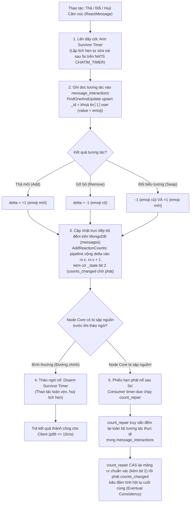
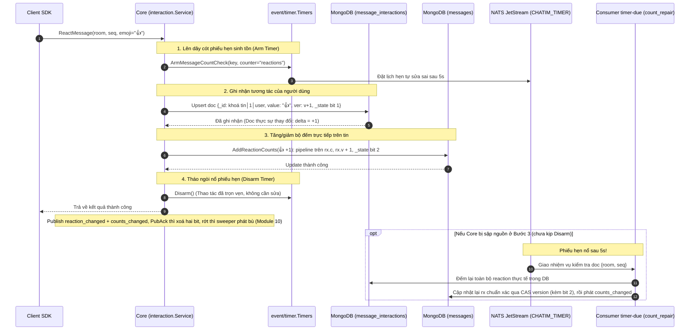
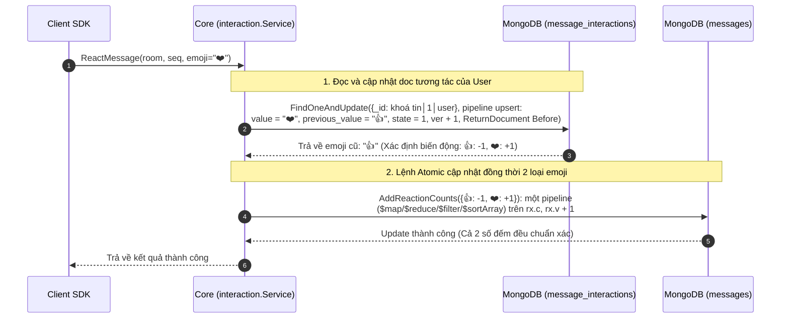

# Module 04: Tương tác — Thả cảm xúc, Ghim & Đánh dấu tin

> **Mục tiêu module:** Hỗ trợ các tương tác phong phú trên tin nhắn bao gồm thả biểu tượng cảm xúc (Reaction) kèm bộ đếm tổng hợp, ghim các thông báo quan trọng lên đầu phòng chat (Pinning), và lưu trữ tin nhắn cá nhân (Bookmarks).

---

## 1. Các Use Case nghiệp vụ (Business Use Cases)

| Mã Use Case | Tên Use Case | Tác nhân | Mô tả & Kết quả kỳ vọng |
|---|---|---|---|
| **UC-INT-01** | **Thả biểu tượng cảm xúc (Reaction)** | Thành viên | Thả một biểu tượng cảm xúc (như 👍, ❤️, 😂) vào tin nhắn. Mỗi thành viên chỉ có **tối đa một emoji** trên một tin nhắn tại một thời điểm (thả emoji mới sẽ tự động đổi emoji cũ). |
| **UC-INT-02** | **Gỡ biểu tượng cảm xúc** | Người đã thả | Bấm lại vào emoji đang chọn để gỡ bỏ cảm xúc. Bộ đếm tương ứng tự động giảm xuống. |
| **UC-INT-03** | **Xem tổng hợp và danh sách Reaction** | Mọi thành viên | Xem số lượng đếm gộp theo từng loại emoji trên tin nhắn (`rx.c`: `[{e: "👍", n: 5}, {e: "❤️", n: 2}]`) và mở danh sách xem chi tiết ai đã thả biểu tượng nào (`GetReactions`). |
| **UC-INT-04** | **Ghim tin nhắn lên đầu phòng (Pin message)** | Admin / Member | Ghim tin nhắn quan trọng để mọi người trong phòng dễ chú ý. Hỗ trợ danh sách tối đa 50 tin ghim. Bỏ ghim (Unpin) khi hết hạn thông báo. |
| **UC-INT-05** | **Đánh dấu tin nhắn cá nhân (Bookmark)** | Thành viên bất kỳ | Lưu tin nhắn vào mục "Tin nhắn đã lưu" của riêng mình để xem lại sau. Tương tác này hoàn toàn riêng tư, người khác không nhìn thấy. |

---

## 2. Luồng hoạt động chi tiết (How It Works)

### 2.1. Cây quyết định Đột biến Cảm xúc & Cơ chế Tự phục hồi (Survivor Timers Flow)

Sơ đồ khối dưới đây trực quan hoá cách hệ thống bảo đảm tính toàn vẹn của bộ đếm cảm xúc `rx` mà không cần transaction đa tài liệu, bao gồm cả kịch bản tự phục hồi khi node xử lý bị sập nguồn:



### 2.2. Luồng Thả cảm xúc & Cơ chế Phiếu hẹn sinh tồn (Survivor Timers)

Để bộ đếm `rx` trên tin nhắn luôn chuẩn xác mà không cần transaction đa tài liệu, hệ thống sử dụng cơ chế **Ghi nguyên tử + Lên dây cót phiếu hẹn**:



### 2.3. Luồng Đổi Biểu tượng Cảm xúc (Change Reaction: 👍 sang ❤️)

Khi người dùng đã thả `👍` và bấm chọn sang `❤️`, hệ thống phải bảo đảm cập nhật cả 2 loại emoji một cách nguyên tử:



> [!NOTE]
> **Số đếm ≤ 0:** Delta lưu không kẹp (D113): `rx.c[].n` có thể tạm ≤ 0 khi hai `$inc` tới lệch thứ tự. Lúc đọc, `domain.SettleReactions` bỏ các emoji có `n ≤ 0` và gắn cờ "chưa ổn"; khi phiếu hẹn bật, `count_repair` đếm lại và ghi đè `rx` bằng CAS trên `rx.v`. Không có tiến trình `$unset` nền.

---

## 3. Cơ chế bảo đảm tính đúng đắn (Guarantees & Mechanisms)

### 3.1. Lớp dữ liệu Tập `(target, user)` & Tombstone (Nguyên tắc D112)
- Cả **Reaction** và **Bookmark** đều thuộc lớp tập hợp: một người dùng chỉ có một trạng thái trên một mục tiêu (Target).
- Toàn bộ tương tác này được gom chung vào collection clustered `message_interactions` với cấu trúc khoá (không băm):
  $$\text{\_id} = \text{khoá tin (24B)} \,│\, \text{kind (1 reaction, 2 bookmark, 3 reply)} \,│\, \text{user id (1..64B)}$$
- Khi người dùng gỡ reaction hoặc bỏ bookmark:
  - Hệ thống **không xoá bản ghi** (xoá vật lý làm mất lịch sử và lỗi các hệ thống đồng bộ).
  - Hệ thống ghi đè trạng thái sang **Tombstone** (`state = 2`, **giữ** `value` để biết emoji nào cần trừ) và tăng số đếm phiên bản `ver = ver + 1`.
  - Thả lại đúng emoji đang có: `$cond` giữ doc nguyên từng byte (không oplog, không event); lệnh vẫn đặt rồi gỡ phiếu hẹn.

### 3.2. Đếm trực tiếp `$inc` kết hợp Phiếu hẹn sinh tồn (Survivor Timers D111 / D113)
- **Vấn đề cần giải quyết:** Nếu mỗi lần thả reaction đều phải quét toàn bộ collection để `COUNT(*)` rồi ghi lại số lượng (Recount), database sẽ bị nghẽn IOPS khi có hàng nghìn reaction mỗi giây. Ngược lại, nếu chỉ dùng `$inc`, nếu server crash giữa chừng thì số đếm sẽ vĩnh viễn bị lệch (Drift counter).
- **Cơ chế bảo đảm:**
  - **Đường bình thường (Fast-path):** Khi ghi bản ghi tương tác thành công, nếu thực sự có thay đổi, Core cộng delta vào `rx.c` bằng một update pipeline (`AddReactionCounts`, `rx.v + 1`) ngay trên document `messages`.
  - **Bảo hiểm sinh tồn (Slow-path Insurance):** Trước khi ghi, Core bật một "phiếu hẹn" trên NATS JetStream. Nếu lệnh `$inc` thành công, phiếu hẹn được tháo ngòi (`Disarm`). Nếu Core crash trước khi kịp `$inc`, phiếu hẹn trên `CHATIM_TIMER` nổ sau 5s và consumer `timer-due` chạy `count_repair` đếm lại để đưa số lượng về chuẩn xác tuyệt đối.
  - **Event bảo đảm tới:** doc reaction mang bit 1 (`reaction_changed`), `$inc rx` bật bit 2 trên tin (`counts_changed`); mỗi bit chỉ được xoá sau PubAck và khi version còn bằng, nếu không sweeper slot 0 phát bù trạng thái hiện tại (Module 10).

### 3.3. Cơ chế gấp nếp Ghim tin nhắn (Pin Projection Folding D92)
- **Ghim tin:** Mọi thao tác ghim hay bỏ ghim được ghi thành các Fact bất biến vào `pin_actions` với `pin_ver` tăng dần đơn điệu.
- Bảng hiển thị ghim tại `rooms.pins` là bản chiếu (Projection) được sinh ra bằng cách gấp nếp (Fold) các hành động từ `pin_actions`.
- **Bảo đảm hạn mức `PIN_LIMIT = 50`:** `pin_actions` dùng `_id = room│pin_ver` liền nhau (dense), lệnh fold `rooms.pins/pin_ver` với các fact sau nó rồi chỉ chèn đúng một fact `pin_ver + 1`, nên số tin ghim đang hoạt động không bao giờ vượt quá 50 tin (ghim thứ 51 → `FailedPrecondition`).
- **Tự phục hồi (M3.1):** fact ghim mang cờ `_state: 1`. Lệnh chỉ phát `msg_pinned`/`msg_unpinned` khi `Project` thành công; `Project` lỗi (thua CAS hay lỗi DB) thì lệnh trả lời bằng bản fold tại chỗ, không phát và giữ cờ. Thua CAS hoặc core chết trước khi phát thì sweeper slot 0 fold + CAS lại rồi mới phát (D151, event trễ ~15–17s); thua CAS lần nữa thì giữ cờ cho lượt sau. Cờ chỉ mất sau PubAck của event, nên `rooms.pins` luôn bắt kịp sổ `pin_actions`; ghim không cần phiếu hẹn vì `Project` là fold lại từ sổ, chạy lại bao nhiêu lần cũng ra một kết quả.

---

## 4. Kỹ thuật & Công nghệ triển khai (Technologies)

### 4.1. Cấu trúc bảng MongoDB Clustered Collection `message_interactions`

```javascript
{
  "_id": BinData(0, "..."),            // Clustered Key: khoá tin (24B) │ kind byte │ user id
  "message_key": BinData(0, "..."),    // khoá tin room│thread│seq (24B)
  "room_id": NumberLong("8492049201948201"),
  "tenant": "t1",
  "kind": "reaction",                  // reaction | bookmark | reply
  "actor_id": "usr_1001",
  "value": "👍",                       // emoji (reaction); giữ nguyên khi tombstone
  "previous_value": "❤️",              // emoji trước lần đổi gần nhất
  "state": 1,                          // 1: Active, 2: Tombstone (đã gỡ)
  "ver": NumberLong(3),                // Version của tương tác này
  "created_at": ISODate("2026-10-10T10:10:00Z"),
  "updated_at": ISODate("2026-10-10T10:15:00Z")
}
```

- **Index:** `{message_key, kind, state, value, updated_at: -1, actor_id}` (đếm lại, danh sách người thả), `{tenant, actor_id, kind, state, updated_at: -1, message_key: -1}` (`ListBookmarks`), `{room_id, kind, updated_at}` (resync).

### 4.2. Cấu trúc Danh sách Ghim trong Collection `rooms`

```javascript
// Bảng rooms lưu danh sách pins đã được chiếu (Projection)
{
  "_id": NumberLong("8492049201948201"),
  "pin_ver": NumberLong(12),           // Version ghim hiện tại
  "pins": [
    {
      "thread_root": NumberLong(0),
      "seq": NumberLong(10042),
      "pinned_by": "usr_1001",
      "pinned_at": ISODate("2026-10-10T10:15:00Z"),
      "pin_ver": NumberLong(12)        // pin_ver của fact đã ghim tin này
    }
  ]
}
```

### 4.3. Danh mục Emoji cố định & API
- Hệ thống quy định danh sách emoji hợp lệ qua cấu hình `REACTION_EMOJIS` (ví dụ: `👍`, `❤️`, `😂`, `😮`, `😢`, `🙏`). Client SDK gọi `GetReactionSettings` lúc khởi động để lấy danh sách emoji này.
- Mọi emoji nằm ngoài danh sách đều bị Core từ chối ngay tại tầng API với mã lỗi `codes.InvalidArgument`.

### 4.4. Hợp đồng Mã lỗi gRPC (Error Matrix)

| Mã lỗi gRPC | Tên lỗi domain | Tình huống kích hoạt | Hành vi Client SDK yêu cầu |
|---|---|---|---|
| `InvalidArgument` | `ERR_INVALID_EMOJI` | Emoji gửi lên không nằm trong danh sách `REACTION_EMOJIS`. | Không retry; hiển thị thông báo emoji không hợp lệ. |
| `NotFound` | `ERR_MESSAGE_NOT_FOUND` | Tin nhắn cần thả reaction hoặc ghim không tồn tại trong phòng. | Không retry; loại bỏ tin nhắn khỏi màn hình nếu cần. |
| `FailedPrecondition` | `domain.ErrTooManyPins` | Phòng đã có đủ 50 tin ghim (`PIN_LIMIT`), không thể ghim thêm. | Không retry; báo người dùng gỡ bớt tin ghim cũ. |
| `FailedPrecondition` | `domain.ErrMessageDeleted` | Ghim tin đã xoá, thả reaction mới hoặc bookmark `on` trên tin đã xoá (gỡ reaction, bỏ ghim, bookmark `off` vẫn được). | Không retry; đồng bộ lại tin. |
| `Unavailable` | `ERR_CAS_PIN_CONFLICT` | Hai lệnh ghim cùng chèn một `pin_ver` (trùng `_id` trong `pin_actions` với fact khác), hoặc không đặt được phiếu hẹn. | Có retry; Client tự động backoff jitter và gọi lại. |
| `PermissionDenied` | `ERR_NOT_IN_ROOM` | Người gọi đã bị kick khỏi phòng hoặc chưa tham gia. | Không retry; yêu cầu người dùng gia nhập phòng. |

---

## 5. Hạn chế kỹ thuật & Đánh đổi (Limitations & Trade-offs)

1. **Giới hạn 1 Emoji / Người dùng / Tin nhắn:**
   - *Hạn chế:* Một người không thể vừa thả "👍" vừa thả "❤️" trên cùng một tin nhắn (thả ❤️ sẽ thay thế 👍).
   - *Lý do đánh đổi:* Đơn giản hoá mô hình dữ liệu tập `(target, user)`, triệt tiêu rủi ro một user spam hàng chục reaction lên 1 tin làm phình to document.
2. **Hạn mức Ghim tối đa 50 tin (`PIN_LIMIT = 50`):**
   - *Hạn chế:* Khi danh sách ghim đã đủ 50 tin, yêu cầu ghim tin thứ 51 sẽ bị từ chối trừ khi quản trị viên gỡ bớt tin cũ.
   - *Lý do đánh đổi:* Giữ kích thước document `rooms` nhỏ gọn (<4KB), không làm suy giảm hiệu năng khi tải thông tin phòng.
3. **Không hỗ trợ Reaction ẩn danh:**
   - Mọi lượt reaction đều gắn kèm `user_id` để đảm bảo tính minh bạch và phục vụ việc truy vấn danh sách người thả cảm xúc.

---

## 6. Phụ thuộc kỹ thuật & Bán kính sự cố (Dependencies & Blast Radius)

| Thành phần phụ thuộc | Mục đích phụ thuộc | Ứng xử khi thành phần gặp sự cố (Failure Behavior) |
|---|---|---|
| **MongoDB Clustered Collection** | Lưu `message_interactions` và `pin_actions` | Nếu MongoDB lỗi ghi CAS: Lệnh thả reaction/ghim trả `UNAVAILABLE`. Trạng thái cảm xúc giữ nguyên, client tự backoff và gọi lại. |
| **NATS JetStream (CHATIM_TIMER)** | Lưu trữ Phiếu hẹn sinh tồn (Survivor Timers) | Nếu không đặt được phiếu: lệnh trả `UNAVAILABLE` trước khi ghi gì, client gọi lại. Phiếu đã đặt sống qua restart NATS. |
| **Consumer `timer-due` (`count_repair`)** | Tự động cân bằng lại bộ đếm khi có sự cố | Nếu consumer bị chậm trễ: Bộ đếm reaction trên tin nhắn có thể lệch 1-2 đơn vị trong một khoảng thời gian ngắn, nhưng danh sách chi tiết từng người thả trong `message_interactions` luôn chính xác. |

### 6.1. Chỉ số Sức khoẻ Vận hành & Cảnh báo SRE (Key Metrics & Alerts)

- **`chatim_core_counter_repaired_total{counter="reactions"}`:** Bộ đếm tổng số lần `count_repair` phải can thiệp để sửa lệch số reaction.
  - *Ngưỡng bình thường:* Gần như bằng 0 trong điều kiện vận hành ổn định.
  - *Luật cảnh báo (`ChatimCounterRepairSurge`):* Khi tốc độ sửa sai `> 1 lần/giây` kéo dài 10 phút, cảnh báo Core đang bị crash đột ngột hoặc mạng giữa Core và MongoDB gặp tình trạng nghẽn nặng.
- **`chatim_core_timer_failures_total`**, **`chatim_core_timer_dropped_total`:** Phiếu hẹn đã bật nhưng sửa lỗi (đưa lại) hoặc bị bỏ (tin không còn, payload hỏng).
  - *Luật cảnh báo (`ChatimTimerFailing`):* `timer_failures_total` tăng trong 15 phút.
- **`chatim_core_event_pending_oldest_seconds{collection="message_interactions"}`** (và `pin_actions`, `messages`): Tuổi cờ `reaction_changed`/`bookmark_changed`, `msg_pinned`/`msg_unpinned`, `counts_changed` chờ phát.
  - *Luật cảnh báo (`ChatimEventPendingStuck`):* > 60s trong 5 phút.
- Chưa có metric đếm số lần ghim/bỏ ghim.
