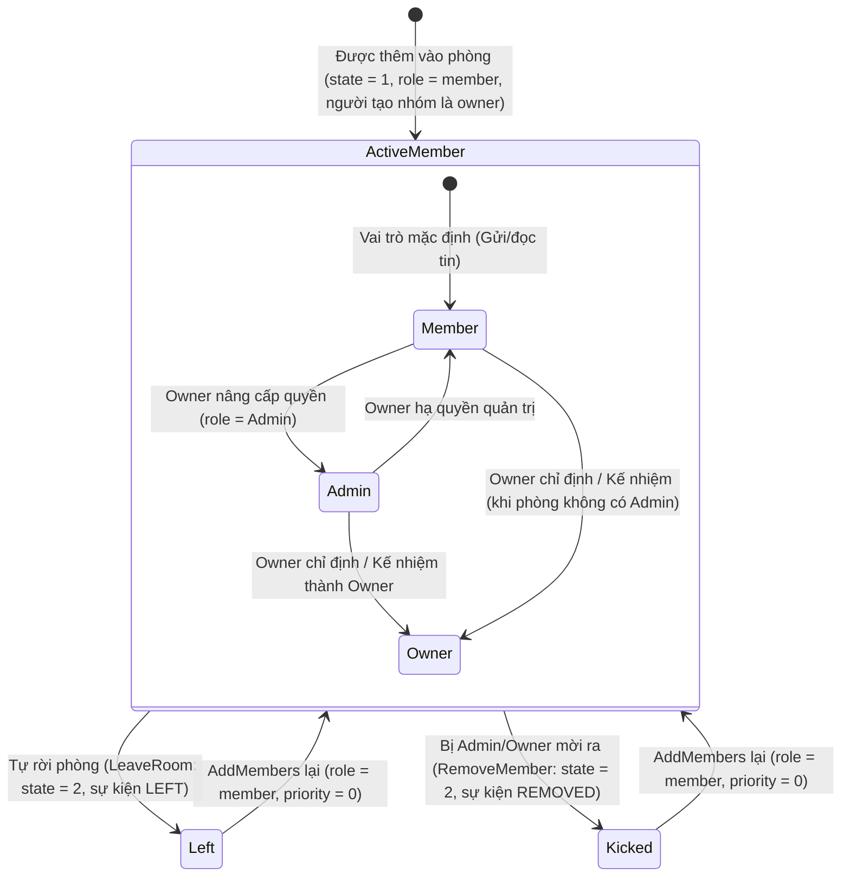
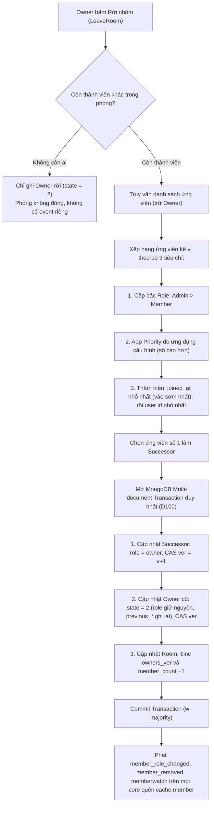
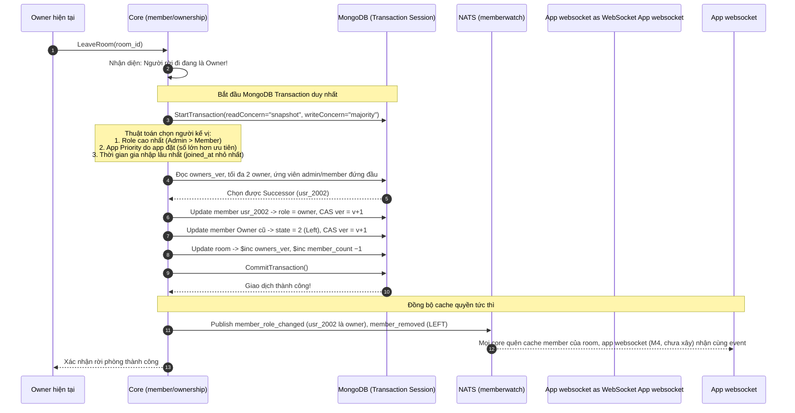

# Module 05: Thành viên — Quản lý Thành viên, Phân quyền & Kế nhiệm Owner

> **Mục tiêu module:** Quản lý vòng đời thành viên trong phòng chat (thêm, xoá, rời phòng), kiểm soát vai trò và quyền hạn (Owner, Admin, Member), đồng thời bảo đảm tính liên tục của phòng chat bằng thuật toán tự động kế nhiệm Owner thông qua giao dịch nguyên tử.

---

## 1. Các Use Case nghiệp vụ (Business Use Cases)

| Mã Use Case | Tên Use Case | Tác nhân | Mô tả & Kết quả kỳ vọng |
|---|---|---|---|
| **UC-MBR-01** | **Thêm thành viên vào nhóm** | Owner / Admin | Mời một hoặc nhiều người dùng vào nhóm chat cùng lúc. Nếu người dùng đã có trong nhóm từ trước, yêu cầu được bỏ qua an toàn mà không làm lỗi hay nhân đôi dữ liệu. |
| **UC-MBR-02** | **Thành viên tự rời phòng (Leave room)** | Thành viên | Người dùng tự nguyện rút khỏi nhóm chat. Người dùng không còn nhận được tin nhắn mới và không thể gửi tin vào phòng này nữa. |
| **UC-MBR-03** | **Xoá thành viên khỏi phòng (Kick member)** | Owner / Admin | Quản trị viên truất quyền và mời một thành viên ra khỏi nhóm chat. Thành viên bị xoá lập tức bị ngắt kết nối nhận tin realtime của phòng đó. |
| **UC-MBR-04** | **Thay đổi vai trò (Role Assignment)** | Owner | Thăng cấp thành viên lên Quản trị viên (Admin) hoặc hạ cấp về Thành viên thường (Member). |
| **UC-MBR-05** | **Kế nhiệm Owner khi rời phòng (Succession)** | Owner rời phòng | Khi Owner của nhóm quyết định rời nhóm, hệ thống **bắt buộc và tự động** tìm kiếm thành viên ưu tú nhất để trao lại quyền Owner, đảm bảo nhóm chat không bao giờ bị rơi vào trạng thái "vô chủ". |

---

## 2. Luồng hoạt động chi tiết (How It Works)

### 2.1. Máy trạng thái Vòng đời & Quyền hạn Thành viên (Membership Lifecycle & Roles)

Vòng đời thành viên và việc chuyển đổi cấp bậc trong phòng chat được kiểm soát chặt chẽ bởi máy trạng thái:



### 2.2. Cây quyết định Kế nhiệm Owner (Succession Selection Flow)

Sơ đồ khối dưới đây trực quan hoá thuật toán tìm kiếm người kế vị và cam kết giao dịch đa tài liệu khi Owner rời phòng:



### 2.3. Luồng Kế nhiệm Owner (Sequence Diagram)

Việc chuyển giao quyền sở hữu nhóm là tác vụ nhạy cảm cao, yêu cầu tính toàn vẹn tuyệt đối trên nhiều document cùng lúc:



---

## 3. Cơ chế bảo đảm tính đúng đắn (Guarantees & Mechanisms)

### 3.1. Thêm thành viên an toàn và Chống lặp (BulkWrite with `request_id` D99)
- **Vấn đề:** Khi mời 50 người cùng lúc, nếu mạng bị ngắt giữa chừng và client gọi lại lệnh thêm thành viên, làm sao không kích hoạt tăng số lượng đếm thành viên (`member_count`) sai lệch?
- **Cơ chế bảo đảm:**
  - Client gửi kèm `request_id` duy nhất cho mỗi thao tác.
  - Sử dụng lệnh `BulkWrite` với pipeline cập nhật có điều kiện (`$cond`):
    - Nếu member đã tồn tại và đang hoạt động (`state == 1`): Bỏ qua (No-op, doc giữ nguyên từng byte).
    - Nếu member chưa có: Chèn mới với `state = 1`.
    - Nếu member trước đây đã rời nhóm (`state == 2`): Kích hoạt lại (`state = 1`, `role = member`, `priority = 0`, `read_seq = max(cũ, seq cuối)`, giữ `cleared_at`).
  - Hệ thống đếm chính xác số lượng document **thực sự thay đổi trạng thái** để chỉ tăng bộ đếm `member_count` đúng bằng số lượng đó kết hợp với **Phiếu hẹn sinh tồn (Survivor Timers D111)**.
  - Chống lặp qua `dedupe.Requests` (`chatim:req:{room}:{user}:{request_id}`, LRU RAM + Redis, giữ `CID_COMMITTED_TTL` 15 phút và chỉ khi Redis còn khoá): đã xong → đọc lại và trả những người còn active do chính request này thêm; đang chạy ở core khác → `UNAVAILABLE`; mới → đặt phiếu → một `BulkWrite(ordered:false)` các upsert pipeline → quên cache member của actor → `$inc member_count` bằng `UpsertedCount + ModifiedCount` → gỡ phiếu → mỗi người một `member_added`, rồi `member_count_changed`.

#### Đường thường và quyền mặc định (D101)
- **Policy mặc định:** owner làm mọi thứ; admin thêm người và xoá người vai `member`; chỉ owner đổi vai và đặt `priority`; ai cũng rời được. Policy được hỏi **trước** khi lộ ra người đích có tồn tại hay không (đích không có hoặc đã rời được đưa vào policy như một `member` giả).
- **Đường thường** (đích không phải owner, không nâng lên owner): một `UpdateOne` CAS trên `ver` của đích (`ApplyMember`); trượt CAS → `UNAVAILABLE` ngay. Xoá/rời một doc active thì đặt phiếu trước và `$inc −1` sau.
- **Ai được đổi `member_count`:** chỉ `Rooms.Create`, `$inc` trong lệnh (theo số doc thật sự đổi trạng thái), transaction owner, consumer `member_count_repair` và `/app recount`; mỗi nơi bật bit 2 trên `rooms`. `$inc` lỗi thì ghi log, phiếu còn đặt, lệnh vẫn thành công; đặt phiếu lỗi → `UNAVAILABLE` trước mọi lần ghi. `MEMBER_COUNT_CHECK_DELAY` (5s) phải lớn hơn `CORE_REQUEST_DEADLINE`.

### 3.2. Thuật toán Kế nhiệm Owner tất định (Owner Succession Algorithm)
- Nhóm chat không bao giờ tồn tại trạng thái không có chủ (Orphan group) hoặc có 2 chủ (Split-owner).
- Khi Owner rời nhóm mà không chỉ định trước người kế vị, thuật toán tự động lựa chọn ứng viên theo thứ tự ưu tiên giảm dần:
  1. **Vai trò (Role):** Ưu tiên Admin trước Member thông thường.
  2. **Độ ưu tiên do ứng dụng đặt (`priority`):** Giá trị số nguyên do nghiệp vụ gán (ví dụ: cấp bậc trong công ty).
  3. **Thâm niên trong nhóm (`joined_at`):** Người gia nhập nhóm sớm nhất sẽ được chọn nếu các tiêu chí trên bằng nhau; cuối cùng là user id nhỏ nhất.
- Toàn bộ bước đổi vai trò của người mới, ghi người cũ rời và `$inc rooms.owners_ver` (điểm xung đột chung) được khoá chặt trong **một MongoDB Transaction duy nhất** (D100; phòng không có trường `owner_id`; ngoại lệ duy nhất của toàn hệ thống `chatim`, vi phạm nguyên tắc "chỉ ghi đơn doc" để đổi lấy tính an toàn tuyệt đối).
- Nếu có xung đột giao dịch (Transaction Conflict): Core trả mã lỗi `codes.Unavailable` ngay lập tức, không retry nội bộ.
- Cách chạy: `ownership.Affects` chọn đường owner → `OwnerChanges.ChangeOwners` chạy một transaction bằng `StartTransaction`/`CommitTransaction` (không bao giờ `WithTransaction`, chỉ một lần thử): đọc `owners_ver`, các doc, tối đa 2 owner và ứng viên admin/member đứng đầu; hàm thuần `ownership.Plan` ghi người kế vị trước rồi tới đích, mỗi doc một CAS trên `ver`; `$inc owners_ver` và số member nằm cùng một lần update doc `rooms`. Đường này không dùng phiếu hẹn. `LeaveRoom` trả `new_owner`; `member_removed` không mang người kế vị. memstore cho cùng ngữ nghĩa.

#### Ca biên đặc biệt: Owner là thành viên duy nhất còn lại (không có ứng viên)
Khi phòng chỉ còn đúng 1 người (chính là Owner) và người này bấm "Rời phòng":
- `ownership.Successor` không tìm được ứng viên, nên transaction chỉ ghi Owner chuyển sang `state = 2 (Left)` và `$inc owners_ver`, `member_count −1`.
- Phòng không bị đóng hay lưu trữ: `rooms` không có trường trạng thái, không có event `room_archived`. Bất biến "nhóm còn member active thì luôn có owner active" vẫn đúng vì nhóm không còn ai. Không còn member active nên không ai gọi được lệnh thành viên trên phòng đó nữa (mọi lệnh kiểm membership trước).
- Owner tự hạ quyền khi là owner cuối thì bị từ chối `FailedPrecondition` (`domain.ErrLastOwner`).

### 3.3. Cơ chế Quên Cache tức thời (`memberwatch` D106)
- Để tối ưu hiệu năng, actor gửi tin trên mỗi core lưu cache member của room trong RAM (generation + TTL 10s, không cache phủ định; D106, D110).
- Khi một người bị kick hoặc bị hạ quyền:
  - Core phát `member_removed` hoặc `member_role_changed` lên `CHATIM_EVT`; stream RePublish sang NATS core `live.{t}.member.{rid}.evt.{kind}`. Core thực hiện lệnh tự quên cache của mình ngay (`Router.ForgetMembers`).
  - `member/memberwatch` trên mọi core subscribe NATS core `{live}.*.member.*.evt.member_removed` và `….member_role_changed`, lấy room id từ token thứ 4 của subject và quên cache member của room đó. NATS core không phát lại, nên event lạc thì cache tự hết hạn sau TTL 10s. Lệnh gửi tin tiếp theo của người bị kick sẽ bị từ chối ngay lập tức tại tầng xác thực quyền `access.Policy`.

---

## 4. Kỹ thuật & Công nghệ triển khai (Technologies)

### 4.1. Cấu trúc bảng MongoDB Clustered Collection `members`

```javascript
{
  "_id": BinData(0, "..."),            // Clustered Key: {room_id, user_id}
  "room_id": NumberLong("8492049201948201"),
  "user_id": "usr_2002",
  "tenant": "t1",
  "role": "admin",                     // owner | admin | member
  "priority": 100,                     // Trọng số ưu tiên kế nhiệm
  "state": 1,                          // 1: Active, 2: Left / Kicked (Tombstone, không bao giờ xoá)
  "joined_at": ISODate("2026-10-10T10:00:00Z"),
  "ver": NumberLong(3),                // Version cập nhật trạng thái member
  "read_seq": NumberLong(10040),       // Vị trí đã đọc mới nhất
  "read_ver": NumberLong(15),          // Version vị trí đọc
  "cleared_at": ISODate("1970-01-01T00:00:00Z") // Mốc thời gian xoá lịch sử
}
```

- Doc còn có `previous_role`, `previous_state`, `previous_priority`, `request_id`, `updated_at`, `updated_by`, `last_change_at` (và từ M3 `pinned_at`, `muted_until`, `archived_at`, `preference_ver`).
- **Index đếm/owner/kế nhiệm:** `{room_id, state, role, priority: -1, joined_at, user_id}`.
- **Index danh sách phòng của User:** `{tenant, user_id, state, room_id, joined_at, cleared_at, read_seq, pinned_at, archived_at}` (phủ `RoomsOf`) giúp truy vấn cực nhanh: *"Người dùng này đang tham gia những phòng chat nào?"*.

### 4.2. Bộ đếm thành viên trên `rooms`
- Biến đếm `member_count` trên collection `rooms` được cập nhật qua toán tử nguyên tử `$inc: {member_count: delta}` đi kèm `member_count_ver`.
- Nếu có nghi ngờ lệch số, quản trị viên có thể chạy `/app recount -room ID [-dry-run]` để đếm lại thành viên đang active (`state = 1`), CAS trên `member_count_ver` và phát `member_count_changed`.

### 4.3. Hợp đồng Mã lỗi gRPC (Error Matrix)

| Mã lỗi gRPC | Tên lỗi domain | Tình huống kích hoạt | Hành vi Client SDK yêu cầu |
|---|---|---|---|
| `Unavailable` | `ERR_TRANSACTION_CONFLICT` | Xung đột giao dịch khi kế nhiệm Owner (WriteConflict do nhiều lệnh đổi role/leave cùng lúc). | Có retry; Client tự động backoff và thử lại sau 50–200ms. |
| `PermissionDenied` | `ERR_INSUFFICIENT_ROLE` | Người gọi không phải Owner/Admin nhưng cố tình kick thành viên hoặc thăng chức. | Không retry; hiển thị thông báo "Bạn không có quyền thực hiện". |
| `NotFound` | `ERR_MEMBER_NOT_FOUND` | Thành viên cần thao tác không tồn tại trong phòng. | Không retry; cập nhật lại danh sách thành viên trên UI. |
| `FailedPrecondition` | `domain.ErrDirectRoom` / `domain.ErrLastOwner` | Lệnh thành viên trên phòng DM; owner cuối tự hạ quyền. | Không retry; ẩn thao tác trên UI. |
| `InvalidArgument` | `domain.ErrTooManyMembers` | Một lệnh `AddMembers`/`CreateRoom` có hơn `MEMBER_BATCH_MAX` (mặc định 500, cấu hình 2..1000) người sau khi bỏ trùng; input sai. | Không retry; chia nhỏ danh sách. |
| `PermissionDenied` | `domain.ErrNotMember` / `access.ErrDenied` | Người gọi không active, policy từ chối, người chưa từng là thành viên gọi rời phòng. | Không retry. |
| `NotFound` | `domain.ErrMemberNotFound` | Xoá người chưa từng là thành viên; đổi vai/priority của đích không active. | Không retry. |
| `OK` (`changed = false`) | — | Xoá một tombstone, rời phòng lần hai, đặt đúng vai/priority hiện có. | Không cần làm gì. |

---

## 5. Hạn chế kỹ thuật & Đánh đổi (Limitations & Trade-offs)

1. **Khả năng xung đột giao dịch khi đổi Owner:**
   - *Hạn chế:* Nếu tại thời điểm Owner rời nhóm, nhóm đang diễn ra việc thay đổi role ồ ạt, MongoDB Transaction có thể bị lỗi `WriteConflict`.
   - *Đánh đổi:* Chấp nhận trả mã lỗi `UNAVAILABLE` để client thử lại thay vì dùng cơ chế khoá phân tán phức tạp gây nguy cơ deadlock.
2. **Chi phí lan toả khi xoá thành viên ở nhóm lớn:**
   - *Hạn chế:* Khi kick một thành viên khỏi nhóm 5,000 người, App websocket (M4, chưa xây) phải ngắt subscription của user đó đối với phòng. Quá trình này diễn ra bất đồng bộ qua NATS.
3. **Quy mô nhóm (mục tiêu ≤ 5,000 member):**
   - Code không đặt trần tổng số thành viên; chỉ giới hạn mỗi lệnh thêm theo `MEMBER_BATCH_MAX` (500). Con số 5,000 là mục tiêu quy mô của nhóm hai chiều (kiến trúc §1.1), không phải giới hạn cứng. Kênh lớn (channel) chưa xây.

---

## 6. Phụ thuộc kỹ thuật & Bán kính sự cố (Dependencies & Blast Radius)

| Thành phần phụ thuộc | Mục đích phụ thuộc | Ứng xử khi thành phần gặp sự cố (Failure Behavior) |
|---|---|---|
| **MongoDB Replica Set (Transactions)** | Đảm bảo nguyên tử khi đổi Owner | Nếu cụm MongoDB không hỗ trợ transaction (ví dụ standalone) hoặc đang bầu lại Primary: Thao tác đổi Owner sẽ bị huỷ bỏ để tránh tạo ra nhóm vô chủ. |
| **NATS core (`memberwatch`, subject `live.*`)** | Lan toả thông báo huỷ cache quyền | Nếu NATS bị nghẽn hoặc event lạc: Cache member trên một số Core có thể bị trễ tối đa bằng TTL của cache RAM (10 giây), sau đó cache tự hết hạn và đọc lại từ DB. |
| **Consumer `timer-due` (`member_count_repair`, `CHATIM_TIMER`)** | Tự động cân bằng lại số đếm member (CAS `member_count_ver` kèm cờ `_state` bit 2 rồi phát `member_count_changed`) | Giúp bảo đảm số lượng thành viên hiển thị trên giao diện không bao giờ bị sai lệch vĩnh viễn ngay cả khi server bị sập nguồn đột ngột. |

### 6.1. Chỉ số Sức khoẻ Vận hành & Cảnh báo SRE (Key Metrics & Alerts)

Chưa có metric cho số lần kế nhiệm owner hay số transaction owner xung đột (transaction không để lại trạng thái nửa vời; xung đột trả `UNAVAILABLE` cho client).

- **`chatim_core_member_cache_forgets_total`:** Số room mà core này quên cache member sau `member_removed`/`member_role_changed`.
- **`chatim_core_member_watch_malformed_total`:** Event member bị bỏ qua vì subject không có room id hợp lệ (không có alert).
- **`chatim_core_counter_repaired_total{counter="members"}`:** Số lần phiếu hẹn sửa lại `member_count`.
  - *Luật cảnh báo (`ChatimCounterRepairSurge`):* > 1 lần/giây trong 10 phút.
- **`chatim_core_timer_failures_total`:** Phiếu hẹn đã bật nhưng sửa lỗi, đưa lại để thử sau.
  - *Luật cảnh báo (`ChatimTimerFailing`):* tăng trong 15 phút.
