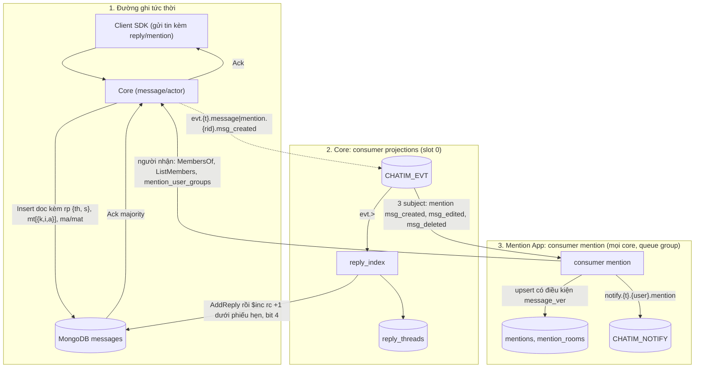

# Module 06: Thảo luận — Luồng trao đổi (Thread), Trích dẫn & Đề cập (@)

> **Mục tiêu module:** Nâng cao trải nghiệm giao tiếp nhóm thông qua việc trả lời tin nhắn có trích dẫn (Quote Reply), theo dõi các cuộc thảo luận phụ theo luồng (Thread), nhắc tên thành viên (@mention), tổng hợp hộp thư "Tôi được nhắc tới" và gửi thông báo cho người được nhắc.

> **Ai giữ phần nào:**
> - **Core:** trả lời (doc trả lời, `rc`, `reply_threads`, projection `reply_index`), đích mention trên tin (`mt`/`ma` kèm giờ `at`), kiểm hợp lệ và phát event.
> - **Mention App** (`apps/mention`, chạy nhúng trong core, D162–D176): chỉ mục `mentions`, `ListMentions`, nhóm của từng người, danh mục nhóm được tag, dữ liệu gợi ý `@nhóm`, thông báo theo người trên `CHATIM_NOTIFY`.
>
> Xem [tóm tắt Mention App](../plans/2026-10-17-mention-app-summary.md) và [danh mục event](../events.md).

---

## 1. Các Use Case nghiệp vụ (Business Use Cases)

| Mã Use Case | Tên Use Case | Tác nhân | Mô tả & Kết quả kỳ vọng |
|---|---|---|---|
| **UC-THRD-01** | **Trả lời tin nhắn có trích dẫn (Quote Reply)** | Thành viên | Trả lời một tin nhắn cụ thể. Tin trả lời hiển thị một đoạn trích ngắn của tin nhắn gốc để người đọc dễ dàng nắm bắt ngữ cảnh thảo luận. |
| **UC-THRD-02** | **Theo dõi luồng trao đổi (Thread)** | Thành viên | Mở xem toàn bộ các tin nhắn trao đổi xoay quanh một tin nhắn gốc (Root message). Tin nhắn gốc hiển thị huy hiệu đếm số lượng phản hồi (`rc`: "5 câu trả lời"). |
| **UC-THRD-03** | **Đề cập thành viên (@mention)** | Người gửi | Gõ `@tên` để nhắc một hoặc nhiều người, `@all` cho cả phòng, hoặc `@nhóm` (nhóm do hệ thống user/nhóm khai báo với Mention App). Client gợi ý từ `ListMembers` (core) và `ListRoomGroups` (Mention App). |
| **UC-THRD-04** | **Hộp thư "Tôi được nhắc tới" (Mentions Inbox)** | Người nhận | Mở tab cá nhân xem các tin gần đây mình được nhắc trong mọi room đang ở (`ListMentions` của `MentionService`), mỗi tin một lần, kèm cờ đã đọc. |
| **UC-THRD-05** | **Thông báo khi được nhắc** | Người nhận | Nhận `mention_notified` khi được nhắc (kể cả qua nhóm hoặc `@all` trong DM/group), `mention_retracted` khi tin bị sửa bỏ đích hoặc bị xoá. App notification (websocket M4, `push` Phase 2) giao tới máy. |
| **UC-THRD-06** | **Chuyển tiếp tin nhắn (Forward)** | Thành viên | Chuyển tiếp một tin nhắn từ phòng này sang một phòng khác kèm nhãn "Được chuyển tiếp". |

---

## 2. Luồng hoạt động chi tiết (How It Works)

### 2.1. Sơ đồ khối: đường gửi tin và hai consumer độc lập

Đường gửi tin chỉ ghi tin (kèm con trỏ trả lời và đích mention) rồi ack. Phần trả lời và phần mention chạy sau, ở hai consumer khác nhau:



### 2.2. Gửi tin trả lời có mention (Sequence Diagram)

```mermaid
sequenceDiagram
    autonumber
    participant Client as Client SDK
    participant Core as Core (message/actor)
    participant Msgs as MongoDB (messages)
    participant Evt as NATS (CHATIM_EVT)
    participant RI as Projection reply_index
    participant MA as Mention App (consumer mention)
    participant Ments as MongoDB (mentions)
    participant Notify as NATS (CHATIM_NOTIFY)

    Client->>Core: SendMessage(reply_to=10010, mentions=[user usr_B], text="@usr_B xem giúp")
    Core->>Msgs: Insert {_id: room│0│10045, rp: {th: 0, s: 10010}, mt: [{k: "user", i: "usr_B", a: 10:20:00}]}
    Msgs-->>Core: OK (bit 1 trong _state)
    Core-->>Client: Ack seq=10045
    Core->>Evt: msg_created 10045 trên evt.t1.mention.{rid}.msg_created

    par Phần trả lời (core, slot 0, lô ≤ 8192 / 3s)
        Evt->>RI: msg_created 10045
        RI->>Msgs: AddReply rồi $inc rc +1 trên tin 10010 (bit 4), counts_changed
    and Phần mention (một core bất kỳ, lô ≤ 512 / 250ms)
        Evt->>MA: msg_created 10045
        MA->>Ments: upsert user:usr_B state 1, created_at = at, message_ver 0
        MA->>Core: MembersOf(room, [usr_B])
        MA->>Notify: mention_notified {room}-0-10045-usr_B-m0
        MA-->>Evt: Ack sau PubAck
    end
    Note over RI,MA: Lỗi thì Nak giãn dần 5s/30s/2m/10m; event cũ hơn 5 phút chỉ ghi mention, không báo
```

### 2.3. Sửa và xoá tin có mention

- Core đóng dấu giờ cho từng đích (`at`): gửi tin thì mọi đích lấy giờ gửi; sửa tin thì đích giữ nguyên giữ giờ cũ, đích mới thêm lấy giờ của lần sửa (D166). Fact sửa trong `message_edits` lưu đích kèm `at`; fact xoá giữ đích của phiên bản bị xoá.
- `msg_edited`/`msg_deleted` mang `previous_mentions` = đích của phiên bản ngay trước (lệnh lấy từ tin trước khi đổi; sweeper lấy từ fact `ver − 1` hoặc fact xoá).
- Mention App ghi: đích hiện tại → `state 1`; đích trong `previous_mentions` không còn → tombstone `state 2` (kể cả chưa có doc). Mọi lần ghi chỉ thắng khi `message_ver` của doc ≤ phiên bản của event, nên mọi thứ tự xử lý cho cùng doc cuối.
- Thông báo tính từ chính event: `mention_notified` (`…-m{ver}`) cho người nhận của đích hiện tại trừ người nhận của đích trước; `mention_retracted` (`…-r{ver}`, `EDITED`/`DELETED`) cho phần ngược lại.

Ví dụ: Minh đã đọc room 777 tới tin 120 (gửi 10:03). 10:10 Lan sửa tin 120 thêm `@Minh`. Doc mention mang 10:10, nên `ListMentions` của Minh hiện mục này **chưa đọc**, và Minh nhận `…-m1`. Lan sửa lần nữa bỏ `@Minh`: Minh nhận `…-r2`, mục biến mất.

### 2.4. `ListMentions` (Mention App)

1. `RoomsOf(user)` của core: room đang ở, `joined_at`, `cleared_at`, `read_seq`; since của room = `max(joined_at, cleared_at)`.
2. Đường A: `user:{caller}` trên index `{tenant, target, state, created_at, message_key}`, chỉ `state 1`.
3. Đường B: chỉ qua room của người gọi; `mention_rooms.last_shared_mention_at` theo lô 1.000 room → room có gì mới sau since → lô 200 room, một `find` `$or` (`all`; `group` + nhóm người gọi gửi mà đang `state 1` trong danh mục) → SORT_MERGE → dừng sớm.
4. Gộp, bỏ trùng theo khoá tin; mỗi source tối đa 3 vòng mỗi trang, trang có thể ngắn kèm `next`.
5. Đã đọc: giờ mention ≤ giờ gửi của tin tại `read_seq` (`SentTimes`, lô ≤ 200 khoá). Tenant trong `MENTION_HIDE_READ_TENANTS` bỏ mục đã đọc.
6. Nội dung: `Authorize(read_history)` theo room + `VisibleMessages` (view của core: tin đã xoá, bị ẩn hoặc trước `cleared_at` bị bỏ).
7. Lưới an toàn: chỉ giữ mục khi tin hiện tại còn đích đó; và **mỗi tin một mục trên mọi trang** (D174): bỏ mục nếu tin có đích khác chạm tới người xem với `at` mới hơn.

Trang 20 mục (0 → 20, lớn hơn → `INVALID_ARGUMENT`); store hoặc core lỗi → `UNAVAILABLE`.

### 2.5. Nhóm và gợi ý `@nhóm`

- `SetUserGroups([{user, groups, ver}])`: mỗi người một doc `mention_user_groups` chứa **đủ** nhóm của người đó; chỉ nhận `ver` lớn hơn; chuyển nhóm là một lần ghi (D167).
- `SetGroups([{id, name, active, ver}])`: danh mục nhóm được tag `mention_groups`; `active = false` → `state 2`. Nhóm ngoài danh mục hoặc `state 2`: vẫn ghi doc mention, không báo, không hiện (D172).
- Bung `@nhóm` khi gửi thông báo: đọc một trang `ListMembers` 1.000 dòng; dưới 1.000 thì tra nhóm của chính những người đó, đủ 1.000 thì quét index `{tenant, groups, user_id}` theo trang + `MembersOf` (D175).
- `ListRoomGroups(room)` (cần `read_members`): nhóm `state 1` có người trong room, kèm tên. Tập theo room giữ trong RAM; room ≤ 5.000 người dựng ngay, quên khi có `member_added`/`member_removed` hoặc sau 60s; room lớn hơn dựng ở nền, lần đầu trả cả danh mục với `filtered = false`.

---

## 3. Cơ chế bảo đảm tính đúng đắn (Guarantees & Mechanisms)

### 3.1. Cấu trúc Phân cấp Phẳng (Flat Hierarchy — Không tạo Room con)
- **Vấn đề cần giải quyết:** Nhiều hệ thống chat tạo một "Sub-room" riêng biệt cho mỗi Thread, dẫn đến bùng nổ số lượng room, vỡ cấu trúc đánh số thứ tự `seq` và gây phức tạp trong việc tính toán unread.
- **Cơ chế bảo đảm:**
  - Tin nhắn trong Thread vẫn nằm **trực tiếp trên timeline chính của phòng chat** (`thread_root = 0`) như một tin nhắn bình thường (D114).
  - Tin trả lời mang một con trỏ `messages.rp {th, s}` tới tin cha cùng room (`th` luôn 0). `reply_to` kèm `thread_root ≠ 0` bị từ chối `INVALID_ARGUMENT`.
  - Projection `reply_index` ghi một doc trả lời vào `message_interactions` với `_id = khoá tin cha│3│thread│seq` (41 byte), rồi `$inc rc +1` trên tin cha dưới phiếu hẹn. `GetReplies` quét dải `keys.InteractionReplyRange` của tin cha theo thứ tự seq (bỏ tombstone) rồi `Find $in` các tin trả lời; `ListThreads` đọc projection `reply_threads` (D130).

### 3.2. Trích dẫn tính lúc đọc (`reply_preview`)
- Doc tin trả lời **không lưu** bản sao nội dung tin cha; chỉ lưu con trỏ `rp`.
- `GetHistory` và `GetMessages` gắn `reply_preview {seq, sender, text, deleted, hidden}` lúc đọc: tin cha có sẵn trong trang thì dùng luôn, thiếu thì một `Find` theo khoá cho cả trang, rồi qua `MaskDeleted` + `HideForViewer` của người đọc.
- Hệ quả: tin cha bị sửa thì trích dẫn hiện nội dung mới; tin cha bị xoá hoặc bị người đọc ẩn/clear thì trích dẫn còn `seq`, `sender` và cờ `deleted`/`hidden`, không còn text. Tin trả lời mà chính nó bị xoá hoặc bị ẩn thì không có `reply_preview`.

### 3.3. Chỉ mục mention không phụ thuộc thứ tự (D171, D173)
- Consumer `mention` là queue group: mọi core cùng kéo, nên event của cùng một tin có thể được xử lý song song và lệch thứ tự.
- Event tự đủ thông tin (`at` từng đích, `previous_mentions`), mọi upsert có điều kiện `message_ver`, tombstone ghi cả khi chưa có doc và lấy `at` của đích làm `created_at`. Test chạy đủ 24 hoán vị {gửi, sửa bỏ, sửa thêm lại, xoá} trên memstore và Mongo cho cùng doc cuối.
- Khoá doc mention duy nhất (D115):
  $$\text{\_id} = \text{khoá tin (24B)} \,│\, \text{loại đích (1 user, 2 group, 3 all)} \,│\, \text{id đích (không có với @all)}$$
- Nhận lại event nhiều lần không nhân đôi mention; thông báo trùng id bị `CHATIM_NOTIFY` bỏ trong 6 phút; event cũ hơn 5 phút không gửi thông báo.

### 3.4. Sweeper phát lại
- `msg_created` được dựng lại từ doc tin hiện tại: tin đã xoá hoặc đã sửa bỏ hết đích thì đi loại data `message` và không tới Mention App; app đã học thay đổi từ `msg_edited`/`msg_deleted`.
- Lệnh sửa gặp fact trước đã bị lệnh xoá chen vào dọn chữ (`ErrPreviousPurged`): lệnh vẫn thành công, không enqueue, sweeper phát bù từ cờ.

---

## 4. Kỹ thuật & Công nghệ triển khai (Technologies)

### 4.1. Các trường dữ liệu liên kết trên Document `messages`

Tên field trong `messages` là tên ngắn (ngoại lệ duy nhất của luật tên tiếng Anh đầy đủ):

```javascript
{
  "_id": BinData(0, "..."),            // Clustered Key 24B: room│thread_root│seq (big-endian)
  "rp": { "th": NumberLong(0), "s": NumberLong(10010) },  // tin cha được trả lời (thread 0)
  "mt": [ { "k": "user", "i": "usr_B", "a": ISODate("2026-10-10T10:20:00Z") },
          { "k": "group", "i": "sales", "a": ISODate("2026-10-10T10:25:00Z") } ], // đích mention, a = giờ đích xuất hiện (ms)
  "ma": true,                          // có @all (chỉ ghi khi true)
  "mat": ISODate("2026-10-10T10:20:00Z"), // giờ của @all
  "rc": { "n": NumberLong(5), "v": NumberLong(7) }        // số trả lời còn sống + version (chỉ trên tin cha)
}
```

### 4.2. Doc trả lời trong `message_interactions`

```javascript
{
  "_id": BinData(0, "..."),            // khoá tin cha (24B) │ 3 │ thread (8B) │ seq (8B) = 41B
  "message_key": BinData(0, "..."),    // khoá tin cha
  "room_id": NumberLong("8492049201948201"),
  "tenant": "t1",
  "kind": "reply",
  "actor_id": "usr_A",                 // người gửi tin trả lời
  "reply_seq": NumberLong(10045),
  "state": 1,                          // 1 còn, 2 tombstone (tin trả lời bị xoá)
  "ver": NumberLong(1),
  "created_at": ISODate("2026-10-10T10:20:00Z"),
  "updated_at": ISODate("2026-10-10T10:20:00Z")
}
```

### 4.3. Collection của Mention App

`mentions` (clustered, Mention App ghi):

```javascript
{
  "_id": BinData(0, "..."),            // khoá tin (24B) │ loại đích (1 user, 2 group, 3 all) │ id đích
  "message_key": BinData(0, "..."),
  "room_id": NumberLong("8492049201948201"),
  "tenant": "t1",
  "kind": "user",                      // user | group | all
  "target": "user:usr_B",              // user:{id}, group:{id} hoặc all:{room}
  "thread_root": NumberLong(0),
  "seq": NumberLong(10045),
  "sender_id": "usr_1001",
  "state": 1,                          // 1 còn, 2 đã gỡ (sửa bỏ đích / tin bị xoá)
  "message_ver": NumberLong(0),        // phiên bản tin của lần ghi cuối
  "created_at": ISODate("2026-10-10T10:20:00Z"), // at của đích (ms)
  "updated_at": ISODate("2026-10-10T10:20:00Z")
}
```

- **Index:** `{tenant, target, state, created_at: -1, message_key: -1}` (đường A), `{room_id, kind, created_at: -1, message_key: -1}` (đường B), `{message_key: 1}` (đích hiện có của một tin).
- `mention_rooms {_id: room, tenant, last_shared_mention_at}`: mốc `$max` của `@all`/`@nhóm` cho đường B.
- `mention_user_groups {_id: "t1│usr_B", tenant, user_id, groups: [...], ver, updated_at, updated_by}` (clustered `_id` chuỗi, index `{tenant, groups, user_id}`).
- `mention_groups {_id: "t1│sales", tenant, group_id, name, state, ver, updated_at, updated_by}` (clustered `_id` chuỗi).

### 4.4. Thông báo `CHATIM_NOTIFY`

Subject `notify.{t}.{user}.mention`, proto `Notification{id, tenant, user, room_id, room_type, thread_root, seq, message_ver, ts, oneof}`:
- `mention_notified {message, target}`: id `{room}-{thread}-{seq}-{user}-m{message_ver}`; `target` theo ưu tiên user > nhóm > `@all` (`MENTION_KIND_ALL`).
- `mention_retracted {reason}`: id `…-r{message_ver}`.
- Người nhận: `@user` còn trong room; thành viên nhóm còn trong room; `@all` trong DM/group mọi thành viên; `@all` trong channel (hoặc loại room lạ) không gửi riêng; luôn bỏ người gửi. Mute do app notification lọc.

### 4.5. Hợp đồng Mã lỗi gRPC (Error Matrix)

| Mã lỗi gRPC | Tên lỗi domain | Tình huống kích hoạt | Hành vi Client SDK yêu cầu |
|---|---|---|---|
| `InvalidArgument` | `ERR_TOO_MANY_MENTIONS` | Sau khi bỏ trùng còn hơn `MENTION_TARGETS_MAX` (50) đích, hoặc gửi hơn 4 × giới hạn trước khi bỏ trùng, id đích sai dạng, hoặc `MENTION_KIND_ALL` trong danh sách đích. | Không retry; yêu cầu người dùng giảm bớt số người tag; `@all` gửi bằng cờ `mention_all`. |
| `InvalidArgument` | `errReplyInThread` | `reply_to` kèm `thread_root ≠ 0`. | Không retry; chỉ trả lời tin trên timeline chính. |
| `NotFound` | `domain.ErrMessageNotFound` | Tin cha được reply không tồn tại trong phòng (người gọi phải là member, nếu không là `PermissionDenied`). | Không retry; loại bỏ ngữ cảnh reply trên UI. |
| `FailedPrecondition` | `domain.ErrHasReplies` | Xoá tin cha khi còn tin trả lời sống. | Không retry; xoá các tin trả lời trước. |
| `InvalidArgument` | (Mention App) | `ListMentions` `limit` > 20; `SetUserGroups`/`SetGroups` quá 1.000 mục, id sai, `ver` 0, mục trùng, tên nhóm rỗng. | Không retry; sửa request. |
| `PermissionDenied` / `NotFound` | (Mention App) | `ListRoomGroups` thiếu `read_members`; room không có hoặc khác tenant. | Không retry. |
| `Unavailable` | (Mention App) | Store của app hoặc đọc core lỗi. | Retry; gửi lại `SetUserGroups`/`SetGroups` cùng request là an toàn (`ver`). |

---

## 5. Hạn chế kỹ thuật & Đánh đổi (Limitations & Trade-offs)

1. **Không có cây phân nhánh (No Nested Tree):**
   - *Hạn chế:* Mỗi tin trả lời chỉ trỏ tới đúng một tin cha trên timeline chính. `GetReplies` chỉ liệt kê trả lời trực tiếp của một tin, không dựng cây cấp 2, cấp 3.
   - *Lý do đánh đổi:* Giữ mô hình truy vấn phẳng, đơn giản hoá giao diện và loại bỏ truy vấn đệ quy.
2. **Hạn mức Đề cập (Mention Quota):**
   - Tối đa **50 đích mention** (`MENTION_TARGETS_MAX`, sau khi bỏ trùng) mỗi tin; `@all` là cờ riêng, không tính vào 50.
3. **Độ trễ xuất hiện trong Hộp thư Mention:** consumer `mention` gom lô ≤ 250ms; bench 2K tin/s: trễ đỉnh 0,48–0,68s.
4. **Thông báo dựa trên thành viên lúc xử lý:** người rời nhóm giữa lúc tạo tin và lúc sửa tin có thể không nhận lệnh gỡ; `ListMentions` không còn hiện mục đó (lưới an toàn).
5. **NATS chết quá 5 phút:** mention trong khoảng đó vẫn được ghi nhưng không có thông báo (`MENTION_NOTIFY_MAX_AGE`).
6. **Gợi ý `@nhóm` và danh mục có thể cũ:** gợi ý tới 60s (room thường) hoặc 10 phút (channel); `SetGroups` có hiệu lực trên pod khác sau tối đa 60s.

---

## 6. Phụ thuộc kỹ thuật & Bán kính sự cố (Dependencies & Blast Radius)

| Thành phần phụ thuộc | Mục đích phụ thuộc | Ứng xử khi thành phần gặp sự cố (Failure Behavior) |
|---|---|---|
| **MongoDB Clustered Collection** | Lưu tin nhắn kèm con trỏ Thread và đích mention | Nếu MongoDB lỗi ghi: Tin nhắn trả lời bị từ chối như tin nhắn thường; tính toàn vẹn của thread được bảo toàn. |
| **NATS JetStream (`CHATIM_EVT`)** | Đưa việc đếm trả lời và chỉ mục mention ra nền | Tin vẫn gửi thành công; `rc`, `reply_threads`, tab "Tôi được nhắc tới" và thông báo trễ tới khi hàng đợi xả xong. |
| **Projection `reply_index`** | Doc trả lời, `rc`, `reply_threads` | Idempotent (doc trả lời chèn một lần theo `_id`, `rc` dưới phiếu hẹn): nhận lại event không sai bộ đếm. |
| **Mention App (consumer `mention`, `CHATIM_NOTIFY`)** | Chỉ mục mention và thông báo | Core không phụ thuộc app: tin vẫn gửi bình thường. Mention đuổi kịp khi app chạy lại (`DeliverAll`); thông báo cũ hơn 5 phút bị bỏ. `MENTION_ENABLED=false` tắt hẳn app. |

### 6.1. Chỉ số Sức khoẻ Vận hành & Cảnh báo SRE (Key Metrics & Alerts)

Phần trả lời (consumer `projections`, nhãn `projection="projections"`):

- **`chatim_core_projection_lag_seconds`:** tuổi event cũ nhất trong lô gần nhất (0 khi rảnh). *Cảnh báo `ChatimProjectionLagging`:* > 10s trong 5 phút.
- **`chatim_core_projection_failures_total`**, **`_dropped_total`**, **`_stuck_total`**. *Cảnh báo `ChatimProjectionFailing`:* `projection_stuck_total` tăng trong 15 phút.
- **`chatim_core_counter_repaired_total{counter="replies"}`:** phiếu hẹn sửa lại `rc`. *Cảnh báo `ChatimCounterRepairSurge`:* > 1 lần/giây trong 10 phút.

Phần mention (Mention App):

- **`chatim_mention_lag_seconds`:** tuổi event cũ nhất trong lô gần nhất. *Cảnh báo `ChatimMentionLagging`:* `max` > 10s trong 5 phút.
- **`chatim_mention_failures_total`**, **`_dropped_total`**, **`_stuck_total`**. *Cảnh báo `ChatimMentionFailing`:* `stuck_total` tăng trong 15 phút. Lỗi gửi thông báo kéo dài cũng lộ ra ở đây.
- **`chatim_mention_notified_total`**, **`_retracted_total`**, **`_notify_failures_total`**, **`_notify_skipped_total{reason="stale"|"superseded"}`**.
- **`chatim_mention_room_groups_hits_total`**, **`_misses_total`**, **`_rebuild_failures_total`**, **`_watch_forgets_total`**, **`_watch_malformed_total`** (đo tốc độ, không cảnh báo).
