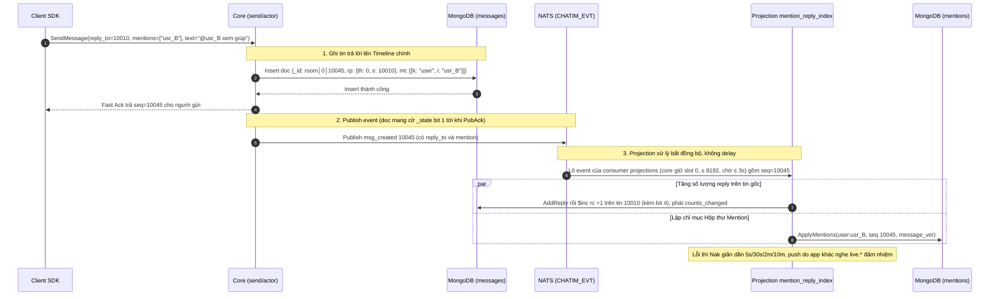

# Module 06: Thảo luận — Luồng trao đổi (Thread), Trích dẫn & Đề cập (@)

> **Mục tiêu module:** Nâng cao trải nghiệm giao tiếp nhóm thông qua việc trả lời tin nhắn có trích dẫn (Quote Reply), theo dõi các cuộc thảo luận phụ theo luồng (Thread), nhắc tên thành viên (@mention), và tổng hợp hộp thư "Tôi được nhắc tới".

---

## 1. Các Use Case nghiệp vụ (Business Use Cases)

| Mã Use Case | Tên Use Case | Tác nhân | Mô tả & Kết quả kỳ vọng |
|---|---|---|---|
| **UC-THRD-01** | **Trả lời tin nhắn có trích dẫn (Quote Reply)** | Thành viên | Trả lời một tin nhắn cụ thể. Tin trả lời hiển thị một đoạn trích ngắn của tin nhắn gốc để người đọc dễ dàng nắm bắt ngữ cảnh thảo luận. |
| **UC-THRD-02** | **Theo dõi luồng trao đổi (Thread)** | Thành viên | Mở xem toàn bộ các tin nhắn trao đổi xoay quanh một tin nhắn gốc (Root message). Tin nhắn gốc hiển thị huy hiệu đếm số lượng phản hồi (`rc`: "5 câu trả lời"). |
| **UC-THRD-03** | **Đề cập thành viên (@mention)** | Người gửi | Gõ `@tên_thành_viên` để nhắc đích danh một hoặc nhiều người trong tin nhắn (hoặc `@all` để thông báo cho toàn bộ phòng, hoặc nhắc một nhóm `group:{id}` do app khác quản lý; core không bung nhóm). |
| **UC-THRD-04** | **Hộp thư "Tôi được nhắc tới" (Mentions Inbox)** | Người nhận | Mở tab cá nhân xem danh sách tất cả các tin nhắn gần đây mà mình được người khác tag tên trong toàn bộ hệ thống, giúp không bị bỏ sót công việc. |
| **UC-THRD-05** | **Chuyển tiếp tin nhắn (Forward)** | Thành viên | Chuyển tiếp một tin nhắn từ phòng này sang một phòng khác kèm nhãn "Được chuyển tiếp". |

---

## 2. Luồng hoạt động chi tiết (How It Works)

### 2.1. Sơ đồ Khối Kiến trúc Xử lý Hai luồng Độc lập (Dual-Path Architecture)

Để đảm bảo việc trả lời tin nhắn và gắn thẻ `@mention` không làm suy giảm thời gian phản hồi cực nhanh (p99 $\le$ 30ms) của luồng gửi tin chính, hệ thống bóc tách hoàn toàn luồng ghi nhận tức thời và luồng bóc tách chỉ mục bất đồng bộ:

```mermaid
flowchart TD
    Client["Client SDK (Gửi tin kèm reply/mention)"] --> Core["Core Service (send/actor)"]

    %% Luồng nhanh
    subgraph FastPath["1. Luồng Ghi Tức Thời (Fast-Path Timeline)"]
        Core -->|Insert doc kèm rp {th, s} và mt/ma| MongoMsg[("MongoDB (messages)<br/>Timeline chính")]
        MongoMsg -->|Ack majority| Core
        Core -->|Fast Ack <= 30ms| Client
    end

    %% Luồng bất đồng bộ
    subgraph AsyncPath["2. Luồng Bóc Tách & Chỉ Mục Ngầm (Async Indexing)"]
        Core -.->|Publish msg_created| EvtQ[("NATS JetStream<br/>Stream: CHATIM_EVT")]
        EvtQ --> Worker["Projection consumer<br/>(mention_reply_index, dùng chung mọi core)"]

        Worker -->|Việc 1: doc trả lời + bộ đếm reply| IncReply["AddReply rồi $inc rc +1<br/>dưới phiếu hẹn, kèm cờ _state bit 4"]
        IncReply --> MongoMsg

        Worker -->|Việc 2: Lập chỉ mục Hộp thư Mention| MentBox[("MongoDB (mentions)<br/>Hộp thư nhắc tên người dùng")]

        Worker -->|Việc 3: reply_threads| Threads[("MongoDB (reply_threads)")]
    end
```

### 2.2. Luồng Trả lời tin nhắn & Bóc tách Mention bất đồng bộ (Sequence Diagram)

Hệ thống thiết kế theo kiến trúc **Tách rời đường gửi tin tức thời và đường lập chỉ mục tìm kiếm**:



---

## 3. Cơ chế bảo đảm tính đúng đắn (Guarantees & Mechanisms)

### 3.1. Cấu trúc Phân cấp Phẳng (Flat Hierarchy — Không tạo Room con)
- **Vấn đề cần giải quyết:** Nhiều hệ thống chat tạo một "Sub-room" riêng biệt cho mỗi Thread, dẫn đến bùng nổ số lượng room, vỡ cấu trúc đánh số thứ tự `seq` và gây phức tạp trong việc tính toán unread.
- **Cơ chế bảo đảm:**
  - Tin nhắn trong Thread vẫn nằm **trực tiếp trên timeline chính của phòng chat** (`thread_root = 0`) như một tin nhắn bình thường (D114).
  - Tin trả lời mang một con trỏ `messages.rp {th, s}` tới tin cha cùng room (`th` luôn 0). `reply_to` kèm `thread_root ≠ 0` bị từ chối `INVALID_ARGUMENT`.
  - Projection `mention_reply_index` ghi một doc trả lời vào `message_interactions` với `_id = khoá tin cha│3│thread│seq` (41 byte), rồi `$inc rc +1` trên tin cha dưới phiếu hẹn. Khi người dùng bấm "Xem Thread", `GetReplies` quét dải `keys.InteractionReplyRange` của tin cha theo thứ tự seq (bỏ tombstone) rồi `Find $in` các tin trả lời; `ListThreads` đọc projection `reply_threads` (D130).

### 3.2. Trích dẫn tính lúc đọc (`reply_preview`)
- Doc tin trả lời **không lưu** bản sao nội dung tin cha; chỉ lưu con trỏ `rp`.
- `GetHistory` và `GetMessages` gắn `reply_preview {seq, sender, text, deleted, hidden}` lúc đọc: tin cha có sẵn trong trang thì dùng luôn, thiếu thì một `Find` theo khoá cho cả trang, rồi qua `MaskDeleted` + `HideForViewer` của người đọc.
- Hệ quả: tin cha bị sửa thì trích dẫn hiện nội dung mới; tin cha bị xoá hoặc bị người đọc ẩn/clear thì trích dẫn còn `seq`, `sender` và cờ `deleted`/`hidden`, không còn text. Tin trả lời mà chính nó bị xoá hoặc bị ẩn thì không có `reply_preview`.

### 3.3. Lập chỉ mục Mention bất đồng bộ & Idempotent (Async Mentions Indexing)
- **Cơ chế:** Việc phát hiện ai được nhắc tên và cập nhật hộp thư cá nhân được tách hoàn toàn khỏi luồng gửi tin chính (Fast-path).
- Projection `mention_reply_index` (consumer durable trên `CHATIM_EVT`, M3.1, Module 10):
  - Đọc `reply_to` và danh sách mention **từ chính event** `msg_created`/`msg_edited`/`msg_deleted`, không đọc lại tin.
  - Event bảo đảm tới nhờ cờ `_state` + sweeper, nên projection dựng từ event là đủ.
  - Ghi vào collection clustered `mentions` một doc mỗi đích, khoá duy nhất (D115):
    $$\text{\_id} = \text{khoá tin (24B)} \,│\, \text{loại đích (1 user, 2 group, 3 all)} \,│\, \text{id đích (không có với @all)}$$
  - Upsert theo `_id` và chỉ ghi khi `message_ver` của event ≥ của doc, nên nhận lại event nhiều lần không nhân đôi mention; đích bị bỏ khi sửa hoặc tin bị xoá → `state 2`.

---

## 4. Kỹ thuật & Công nghệ triển khai (Technologies)

### 4.1. Các trường dữ liệu liên kết trên Document `messages`

Tên field trong `messages` là tên ngắn (ngoại lệ duy nhất của luật tên tiếng Anh đầy đủ):

```javascript
{
  "_id": BinData(0, "..."),            // Clustered Key 24B: room│thread_root│seq (big-endian)
  "rp": { "th": NumberLong(0), "s": NumberLong(10010) },  // tin cha được trả lời (thread 0)
  "mt": [ { "k": "user", "i": "usr_B" }, { "k": "group", "i": "sales" } ], // đích mention
  "ma": true,                          // có @all (chỉ ghi khi true)
  "rc": { "n": NumberLong(5), "v": NumberLong(7) }        // số trả lời còn sống + version (chỉ trên tin cha)
}
```

### 4.2. Doc trả lời trong `message_interactions`

```javascript
{
  "_id": BinData(0, "..."),            // khoá tin cha (24B) │ 3 │ thread (8B) │ seq (8B) = 41B
  "message_key": BinData(0, "..."),    // khoá tin cha
  "room_id": NumberLong("8492049201948201"),
  "tenant": "t1",
  "kind": "reply",
  "actor_id": "usr_A",                 // người gửi tin trả lời
  "reply_seq": NumberLong(10045),
  "state": 1,                          // 1 còn, 2 tombstone (tin trả lời bị xoá)
  "ver": NumberLong(1),
  "created_at": ISODate("2026-10-10T10:20:00Z"),
  "updated_at": ISODate("2026-10-10T10:20:00Z")
}
```

### 4.3. Cấu trúc Collection `mentions` (Hộp thư "Tôi được nhắc tới")

```javascript
{
  "_id": BinData(0, "..."),            // khoá tin (24B) │ loại đích (1 user, 2 group, 3 all) │ id đích
  "message_key": BinData(0, "..."),
  "room_id": NumberLong("8492049201948201"),
  "tenant": "t1",
  "kind": "user",                      // user | group | all
  "target": "user:usr_B",              // user:{id}, group:{id} hoặc all:{room}
  "thread_root": NumberLong(0),
  "seq": NumberLong(10045),
  "sender_id": "usr_1001",
  "state": 1,                          // 1 còn, 2 đã gỡ (sửa bỏ đích / tin bị xoá), 3 còn và đã đọc (chỉ doc user:)
  "message_ver": NumberLong(0),        // version tin đã áp
  "created_at": ISODate("2026-10-10T10:20:00Z"),
  "updated_at": ISODate("2026-10-10T10:20:00Z")
}
```

- **Index:** `{tenant, target, state, created_at: -1, message_key: -1}` (Đường A, mention theo tên mình), `{room_id, kind, created_at: -1, message_key: -1}` (Đường B, `@all`/nhóm qua room mình đang ở), `{room_id, target, thread_root, seq}` (`mention_read`), `{message_key: 1}` (đích hiện có của một tin).

### 4.4. Hợp đồng Mã lỗi gRPC (Error Matrix)

| Mã lỗi gRPC | Tên lỗi domain | Tình huống kích hoạt | Hành vi Client SDK yêu cầu |
|---|---|---|---|
| `InvalidArgument` | `ERR_TOO_MANY_MENTIONS` | Sau khi bỏ trùng còn hơn `MENTION_TARGETS_MAX` (50) đích, hoặc gửi hơn 4 × giới hạn trước khi bỏ trùng, hoặc id đích sai dạng. | Không retry; yêu cầu người dùng giảm bớt số người tag. |
| `InvalidArgument` | `errReplyInThread` | `reply_to` kèm `thread_root ≠ 0`. | Không retry; chỉ trả lời tin trên timeline chính. |
| `NotFound` | `domain.ErrMessageNotFound` | Tin cha được reply không tồn tại trong phòng (người gọi phải là member, nếu không là `PermissionDenied`). | Không retry; loại bỏ ngữ cảnh reply trên UI. |
| `FailedPrecondition` | `domain.ErrHasReplies` | Xoá tin cha khi còn tin trả lời sống. | Không retry; xoá các tin trả lời trước. |

---

## 5. Hạn chế kỹ thuật & Đánh đổi (Limitations & Trade-offs)

1. **Không có cây phân nhánh (No Nested Tree):**
   - *Hạn chế:* Mỗi tin trả lời chỉ trỏ tới đúng một tin cha trên timeline chính. Trả lời một tin trả lời chỉ tạo liên kết mới tới tin đó; `GetReplies` chỉ liệt kê trả lời trực tiếp của một tin, không dựng cây cấp 2, cấp 3 như diễn đàn Reddit.
   - *Lý do đánh đổi:* Giữ mô hình truy vấn phẳng, đơn giản hoá giao diện di động và loại bỏ hoàn toàn các câu truy vấn đệ quy làm tê liệt cơ sở dữ liệu.
2. **Hạn mức Đề cập (Mention Quota):**
   - Giới hạn tối đa **50 đích mention** (`MENTION_TARGETS_MAX`, sau khi bỏ trùng) trong một tin nhắn duy nhất; `@all` là cờ riêng, không tính vào 50.
   - Ngăn chặn các cuộc tấn công spam làm quá tải dịch vụ thông báo đẩy (Push Notification Amplification).
3. **Độ trễ xuất hiện trong Hộp thư Mention:**
   - Tin nhắn hiển thị trên timeline phòng chat tức thì, nhưng có thể mất tới ~3s trước khi xuất hiện trên tab "Tôi được nhắc tới" của người được tag (do xử lý bất đồng bộ qua consumer `projections`, cửa sổ gom lô ≤ 3s).

---

## 6. Phụ thuộc kỹ thuật & Bán kính sự cố (Dependencies & Blast Radius)

| Thành phần phụ thuộc | Mục đích phụ thuộc | Ứng xử khi thành phần gặp sự cố (Failure Behavior) |
|---|---|---|
| **MongoDB Clustered Collection** | Lưu tin nhắn kèm con trỏ Thread | Nếu MongoDB lỗi ghi: Tin nhắn trả lời bị từ chối như tin nhắn thường; tính toàn vẹn của thread được bảo toàn. |
| **NATS JetStream (`CHATIM_EVT`, consumer `projections`)** | Đưa việc xử lý mention ra nền | Nếu consumer bị ứ đọng hoặc NATS gián đoạn: Tin nhắn trả lời vẫn gửi thành công, người trong phòng vẫn thấy tin; chỉ có tab "Tôi được nhắc tới" và thông báo đẩy bị trễ cho tới khi hàng đợi xả xong. |
| **Projection `mention_reply_index`** | Lập chỉ mục mention và đếm reply | Projection được thiết kế hoàn toàn Idempotent (doc trả lời chèn một lần theo `_id`, mention theo `message_ver`, `rc` dưới phiếu hẹn): có thể retry nhiều lần mà không sợ sai lệch bộ đếm `rc` hoặc nhân đôi bản ghi mention. |

### 6.1. Chỉ số Sức khoẻ Vận hành & Cảnh báo SRE (Key Metrics & Alerts)

Chưa có metric đếm số tin trả lời hay số mention được lập chỉ mục. Projection `mention_reply_index` chạy trong consumer chung `projections`, nên metric gắn nhãn theo consumer, không theo từng handler:

- **`chatim_core_projection_lag_seconds{projection="projections"}`:** Tuổi event cũ nhất trong lô gần nhất của consumer (0 khi rảnh).
  - *Luật cảnh báo (`ChatimProjectionLagging`):* > 10s trong 5 phút.
- **`chatim_core_projection_failures_total`**, **`chatim_core_projection_dropped_total`**, **`chatim_core_projection_stuck_total`** (cùng nhãn `projection="projections"`).
  - *Luật cảnh báo (`ChatimProjectionFailing`):* `projection_stuck_total` tăng trong 15 phút (giao lại từ lần thứ 6).
- **`chatim_core_counter_repaired_total{counter="replies"}`:** Số lần phiếu hẹn sửa lại `rc`.
  - *Luật cảnh báo (`ChatimCounterRepairSurge`):* > 1 lần/giây trong 10 phút.
