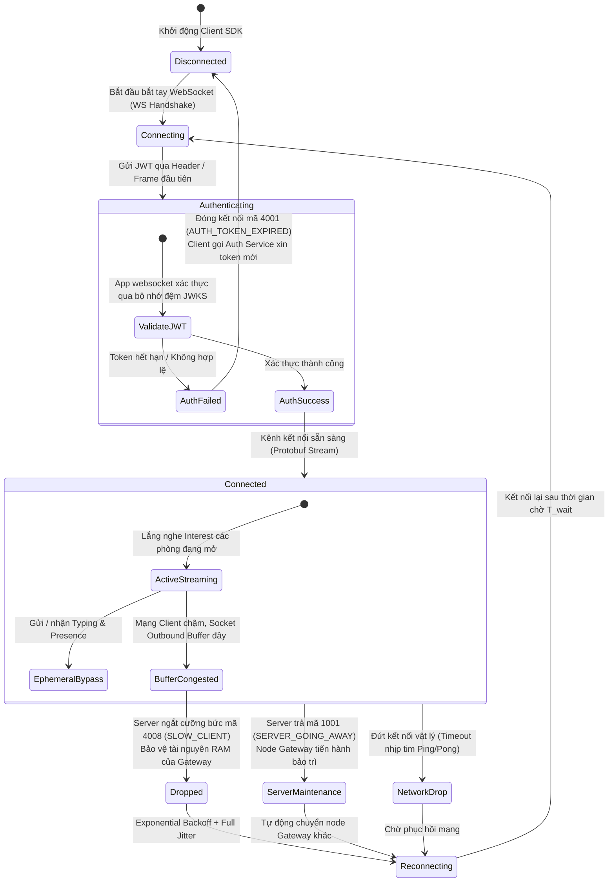

# Module 09: Thời gian thực — Phân phối Realtime & Tín hiệu tức thời (Typing/Presence)

> **Trạng thái:** App `websocket` (M4) **chưa xây**. Phần core đã có: event trên `CHATIM_EVT` và RePublish sang NATS core `live.{t}.{loại dữ liệu}.{rid}.evt.{kind}` (D108), hợp đồng consumer D156 (§3.5). Phần còn lại của module này là thiết kế dự kiến.
>
> **Mục tiêu module:** Đẩy các thông điệp và biến động dữ liệu đến người dùng đang online với độ trễ siêu thấp (p99 ≤100ms) qua kết nối WebSocket hai chiều, hỗ trợ các tương tác sinh động tức thời như "Đang gõ..." (Typing Indicator) và trạng thái trực tuyến (Presence) mà không làm suy giảm hiệu năng cơ sở dữ liệu.

---

## 1. Các Use Case nghiệp vụ (Business Use Cases)

| Mã Use Case | Tên Use Case | Tác nhân | Mô tả & Kết quả kỳ vọng |
|---|---|---|---|
| **UC-RT-01** | **Nhận tin nhắn & biến động tức thì (Realtime Push)** | Người dùng online | Khi có ai đó gửi tin nhắn, sửa tin, thả reaction hay đổi tên nhóm, giao diện của tôi lập tức cập nhật theo thời gian thực (độ trễ ≤100ms) mà không cần phải bấm tải lại. |
| **UC-RT-02** | **Hiển thị "Đang nhập tin nhắn..." (Typing Indicator)** | Người gửi | Khi tôi bắt đầu gõ bàn phím, những người khác đang mở phòng chat đó sẽ nhìn thấy thông báo *"Ivan Nguyen đang nhập tin..."*. Khi tôi dừng gõ vài giây, thông báo tự động biến mất. |
| **UC-RT-03** | **Trạng thái Trực tuyến (Presence)** | Hệ thống | Hiển thị dấu chấm xanh báo hiệu bạn bè đang Online, Vắng mặt (Away) hoặc Ngoại tuyến (Offline). |
| **UC-RT-04** | **Tin nhắn hệ thống tự động (System Messages)** | Hệ thống | Khi có các biến cố như thêm thành viên, đổi chủ nhóm hay ghim tin nhắn, một tin nhắn thông báo dạng hệ thống sẽ tự động xuất hiện trên timeline của mọi người. |

---

## 2. Luồng hoạt động chi tiết (How It Works)

### 2.1. Kiến trúc Cổng App websocket & Phân phối qua NATS Interest Routing

Hệ thống App websocket đóng vai trò làm lá chắn kết nối tập trung (Connection Hub) cho hàng trăm nghìn Client:

```mermaid
flowchart TD
    ClientA["Client A (Người gửi)"]
    ClientB["Client B (Đang mở phòng 101)"]
    ClientC["Client C (Không mở phòng 101)"]

    subgraph WebsocketLayer["Cụm App websocket (WebSocket gws)"]
        GW1["App websocket Node 1<br/>(Giữ kết nối Client A & B)"]
        GW2["App websocket Node 2<br/>(Giữ kết nối Client C)"]
    end

    subgraph EventBus["Hạ tầng NATS JetStream"]
        NATSLive["NATS Core Pub/Sub (RePublish từ CHATIM_EVT)<br/>Subject: live.tenant1.*.101.>"]
        NATSEph["NATS Ephemeral Bus (dự kiến)<br/>Subject: live.tenant1.eph.101.>"]
    end

    subgraph CoreLayer["Cụm Core Service"]
        CoreSrv["Core Service (Lưu trữ MongoDB)"]
    end

    %% Luồng gửi tin chính thức
    ClientA -- "1. Gửi tin (WS Frame)" --> GW1
    GW1 -- "2. gRPC SendMessage" --> CoreSrv
    CoreSrv -- "3. Commit Mongo & Publish" --> NATSLive

    %% Phân phối Realtime theo mối quan tâm
    NATSLive -- "4. Phân phối theo phòng" --> GW1
    GW1 -- "5. Push tin nhắn tức thời" --> ClientB

    %% Luồng gõ bàn phím (Bỏ qua DB hoàn toàn)
    ClientA -. "Gõ bàn phím (Typing)" .-> GW1
    GW1 -. "Bypass Core: Publish trực tiếp" .-> NATSEph
    NATSEph -. "Broadcast tức thì" .-> GW1
    GW1 -. "Hiển thị 'Đang gõ...'" .-> ClientB

    %% Client C không đăng ký phòng 101 nên không nhận
    NATSLive -. "Không chuyển vì không có Interest" .x GW2
```

### 2.2. Vòng đời Kết nối WebSocket & Cơ chế Xử lý Mã lỗi (Connection Lifecycle & Close Codes)

Để đảm bảo hàng trăm nghìn kết nối đồng thời hoạt động ổn định và tự phục hồi khi có sự cố, Client SDK vận hành theo máy trạng thái kết nối có tích hợp xử lý mã đóng (Close Codes):



---

## 3. Cơ chế bảo đảm tính đúng đắn (Guarantees & Mechanisms)

### 3.1. Định tuyến theo mối quan tâm động (Dynamic Interest-Based Routing D108)
- **Vấn đề cần giải quyết:** Nếu mỗi tin nhắn đều phát tán (Broadcast) bừa bãi cho toàn bộ 100,000 kết nối WebSocket, server App websocket sẽ cạn kiệt băng thông mạng trong vài giây (Broadcast Storm).
- **Cơ chế bảo đảm:**
  - Client chỉ nhận sự kiện của **những phòng chat mà người đó đang thực sự mở xem trên màn hình**.
  - Khi người dùng bấm vào xem Phòng 101, App websocket đăng ký lắng nghe (Subscribe) chủ đề trên NATS:
    $$\text{live}.\{\text{tenant\_id}\}.*.\{\text{room\_101}\}.>$$
  - Khi người dùng thoát khỏi phòng hoặc chuyển sang phòng khác, App websocket lập tức huỷ đăng ký (Unsubscribe). Nhờ đó, lưu lượng mạng phân phối luôn được tối ưu hoá chính xác theo nhu cầu thực tế.

### 3.2. Đường truyền tắt cho Tín hiệu tạm thời (Ephemeral Bypass — Tiết kiệm 100% DB IOPS)
- **Vấn đề:** Các tín hiệu như "Đang gõ tin" (Typing) hay "Nhịp tim trực tuyến" (Presence Ping) diễn ra liên tục hàng nghìn lần mỗi giây nhưng không có giá trị lưu trữ lâu dài. Nếu ghi các tín hiệu này vào MongoDB, cơ sở dữ liệu sẽ sập ngay lập tức vì quá tải ghi đĩa.
- **Cơ chế bảo đảm:**
  - Toàn bộ gói tin Ephemeral được gán chủ đề riêng (dự kiến): `live.*.eph.*`.
  - App websocket nhận gói tin từ Client sẽ **bỏ qua hoàn toàn dịch vụ Core và MongoDB**, đẩy thẳng trực tiếp vào kênh phân phối siêu tốc của NATS.
  - Các tín hiệu này chỉ sống trong vài giây trong bộ nhớ RAM và tự động tiêu biến. Nếu người dùng rớt mạng, tín hiệu mất đi một cách tự nhiên mà không để lại bất kỳ rác dữ liệu nào trong cơ sở dữ liệu.

### 3.3. Kỹ thuật Phân tán Không cấp phát bộ nhớ (Zero-Allocation Fanout)
- Trong một phòng chat lớn có 5,000 người đang online cùng lúc:
  - Khi App websocket nhận được một sự kiện tin nhắn từ NATS, App websocket thực hiện **mã hoá nhị phân định dạng Protobuf đúng 1 lần duy nhất** vào một bộ đệm dùng chung (Shared Buffer Pool).
  - Sau đó, con trỏ của bộ đệm này được gửi trực tiếp vào các kết nối socket của 5,000 người dùng mà không tạo thêm 5,000 bản sao chuỗi trong bộ nhớ RAM. Kỹ thuật này giúp App websocket đạt hiệu năng cực đại với mức tiêu thụ RAM tối thiểu.

### 3.4. Sinh tin nhắn hệ thống tất định (Deterministic SysMsg CID, D132)
- Khi có các sự kiện hệ thống (như Ghim tin, Thêm thành viên):
  - Một app SysMsg ngoài core (chưa xây) lắng nghe sự kiện từ NATS và gọi `SendMessage(kind = system, skip_unread, meta)` với mã định danh tất định:
    $$\text{cid} = \text{"sys-"}\{\text{event\_id}\}$$
  - Core chỉ cung cấp đường gửi: tin `system` bỏ kiểm membership, không cho link hay mention (D132).
  - Nhờ cơ chế chống trùng CID (Module 02), ngay cả khi có 2 node cùng xử lý sự kiện này trong cửa sổ `CID_COMMITTED_TTL` (15 phút), chỉ có đúng 1 tin nhắn hệ thống được ghi vào phòng chat.

### 3.5. Hợp đồng chống trùng và lấp lỗ (D156, bắt buộc cho websocket M4)
- Từ M3.1 event được giao **ít nhất một lần** (cờ `_state` + sweeper, Module 10) và bản phát bù có thể tới **sau** event mới hơn. Ví dụ: client nhận tin 46 trước, vài giây sau sweeper phát bù tin 45.
- Bỏ trùng theo id event; với event đổi trạng thái, so version của doc (`ver`, `read_ver`, `pin_ver`, `info_ver`, `preference_ver`, `rx.v`/`rc.v`, `member_count_ver`): bản lớn hơn thắng.
- `msg_created`: đã có đúng seq đó thì bỏ; thấy lỗ (seq > seq cuối + 1) thì gọi `GetHistory` để lấp. **Không bao giờ** bỏ theo luật "seq ≤ seq cuối đã thấy", vì như vậy tin 45 ở ví dụ trên sẽ mất.
- Chi tiết: [kiến trúc §8.1](../architecture.md).

---

## 4. Kỹ thuật & Công nghệ triển khai (Technologies)

### 4.1. Thư viện Go WebSocket `gws` hiệu năng cao
- App websocket sử dụng thư viện `github.com/lxzan/gws` được viết riêng cho Go để tối ưu hoá khả năng chịu tải cao:
  - Hỗ trợ quản lý hàng trăm nghìn kết nối đồng thời với lượng goroutine tối thiểu.
  - Tích hợp chuẩn nén gói tin `permessage-deflate`.
  - Quản lý bộ đệm theo cơ chế tái sử dụng `sync.Pool`, triệt tiêu áp lực dọn rác của Go Garbage Collector (GC Pauses).

### 4.2. Định dạng Gói tin Protobuf Nhị phân
- Toàn bộ dữ liệu trao đổi giữa Client và App websocket qua WebSocket đều được đóng gói dưới dạng nhị phân **Protocol Buffers (Protobuf)** thay vì văn bản JSON.
- Giúp giảm từ **40% – 60% kích thước gói tin** truyền trên mạng di động 4G/5G, tiết kiệm pin cho thiết bị và tăng tốc độ giải mã.

### 4.3. Hợp đồng Mã lỗi Kết nối & WebSocket Close Codes

| Mã Close Code | Ý nghĩa kỹ thuật | Tình huống kích hoạt | Hành vi Client SDK yêu cầu |
|---|---|---|---|
| `4001` | `AUTH_TOKEN_EXPIRED` | Mã JWT của người dùng đã hết hạn hoặc không hợp lệ. | Không reconnect ngay; Client gọi Auth Service xin token mới rồi mới kết nối lại. |
| `4008` | `SLOW_CLIENT_BUFFER_FULL` | Kết nối mạng của Client quá chậm, hàng đợi đệm của App websocket bị đầy. | Có reconnect; Client đóng socket, dọn dẹp hàng đợi và kết nối lại sau backoff jitter. |
| `1001` | `SERVER_GOING_AWAY` | Node App websocket đang thực hiện bảo trì hoặc khởi động lại (Graceful shutdown). | Có reconnect; Client tự động chuyển sang kết nối tới node App websocket khác qua DNS/Load Balancer. |

---

## 5. Hạn chế kỹ thuật & Đánh đổi (Limitations & Trade-offs)

1. **Ứng xử với Khách hàng Mạng chậm (Slow Client Handling):**
   - *Hạn chế:* Nếu kết nối internet của người dùng quá yếu, hàng đợi gửi gói tin (Socket Outbound Buffer) trên App websocket bị đầy:
   - *Đánh đổi:* Để bảo vệ App websocket không bị cạn kiệt RAM, App websocket sẽ chủ động **đóng kết nối (Force Disconnect)** của client đó. Khi mạng ổn định, Client sẽ kết nối lại và kích hoạt quy trình đồng bộ trạng thái (Module 08).
2. **Không bảo đảm sống sót của Ephemeral:**
   - Các tín hiệu Typing và Presence không có cơ chế gửi lại khi mất gói tin (Best-effort unacknowledged). Nếu rớt mạng, client chỉ đơn giản là không thấy báo đang gõ.
3. **Chế độ Xoá chặt cho Tenant đặc thù (Privacy Strict Mode):**
   - Chưa có: event core phát luôn mang snapshot hiện tại kèm nội dung văn bản; chưa có cấu hình tenant để event chỉ chứa metadata và ID.

---

## 6. Phụ thuộc kỹ thuật & Bán kính sự cố (Dependencies & Blast Radius)

| Thành phần phụ thuộc | Mục đích phụ thuộc | Ứng xử khi thành phần gặp sự cố (Failure Behavior) |
|---|---|---|
| **Cụm NATS Core Pub/Sub** | Truyền tải dữ liệu thời gian thực | Nếu NATS cluster bị nghẽn: Người dùng vẫn gửi được tin (do Core ghi Mongo thành công), nhưng tin nhắn mới đến các người nhận khác sẽ bị trễ; event chưa vào JetStream được sweeper slot 0 phát bù khi NATS sống lại (Module 10). |
| **Auth Service (JWKS Endpoint)** | Xác thực mã JWT khi mở kết nối | App websocket cache danh sách khoá công khai JWKS trong bộ nhớ. Nếu Auth Service sập, các kết nối đang mở vẫn hoạt động bình thường, kết nối mới vẫn vào được trong suốt thời gian cache còn hiệu lực. |
| **Core Service (gRPC Unary)** | Xử lý các lệnh gửi/sửa từ App websocket | App websocket gọi Core qua gRPC theo bảng phân bổ Slot. Nếu một node Core bị lỗi, App websocket sẽ tự động định tuyến lệnh sang node Core kế nhiệm. |

### 6.1. Chỉ số Sức khoẻ Vận hành & Cảnh báo SRE (Key Metrics & Alerts)

> **Dự kiến, chưa xây:** các metric và alert dưới đây là thiết kế cho app `websocket` (M4); chưa có trong code và chưa có trong `deploy/prometheus/alerts.yml`.

- **`chatim_websocket_connected_clients`:** Tổng số lượng kết nối WebSocket đang hoạt động đồng thời (CCU).
- **`chatim_realtime_delivery_latency_seconds`:** Độ trễ từ lúc tin được ghi vào DB đến khi Client nhận được frame WebSocket.
  - *Ngưỡng SLA:* p99 ≤ 100ms.
  - *Luật cảnh báo dự kiến (`ChatimDeliveryLatencyHigh`, chưa có):* Cảnh báo nếu p99 > 100ms trong 3 phút liên tục.
- **`chatim_websocket_slow_clients_dropped_total`:** Số lượng kết nối client bị App websocket ngắt cưỡng bức do nghẽn buffer.
