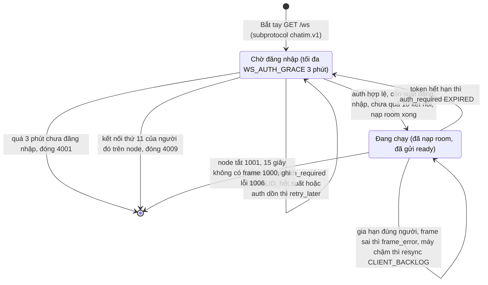

# Module 09: Thời gian thực — Phân phối Realtime & Tín hiệu tức thời (Typing/Presence)

> **Trạng thái:** App `websocket` (M4) **đã xây đủ 5 phần** trên `feat/m4`; từ phần gateway (D198) websocket chỉ còn 12 lệnh ghi realtime, lệnh đọc và quản lý room đi HTTPS qua app `gateway` ([module 11](./11-feature-https-gateway.md)): kết nối, token, chuyển lệnh tới core (phần 1, [§7](#7-giao-thức-kết-nối-m4-phần-1-đã-xây), D183–D188); nhận và đẩy event, gói thông báo `WsPublish` (phần 2, [§8](#8-nhận-và-đẩy-event-m4-phần-2-đã-xây), D189–D195); đã đọc/đã xem (phần 3, [§9](#9-đã-đọc-và-đã-xem-m4-phần-3-đã-xây), D196–D197); đang gõ và online (phần 4, [§10](#10-đang-gõ-và-online-m4-phần-4-đã-xây), D199–D201); giữ kết nối, chống bão và vận hành (phần 5, D202–D206), với đặc tả đầy đủ cho client ở [§11](#11-đặc-tả-cho-client-m4-phần-5). Chỗ nào khác §7–§11 thì §7–§11 đúng.
>
> **Mục tiêu module:** Đẩy các thông điệp và biến động dữ liệu đến người dùng đang online với độ trễ siêu thấp (p99 ≤100ms) qua kết nối WebSocket hai chiều, hỗ trợ các tương tác sinh động tức thời như "Đang gõ..." (Typing Indicator) và trạng thái trực tuyến (Presence) mà không làm suy giảm hiệu năng cơ sở dữ liệu.

---

## 1. Các Use Case nghiệp vụ (Business Use Cases)

| Mã Use Case | Tên Use Case | Tác nhân | Mô tả & Kết quả kỳ vọng |
|---|---|---|---|
| **UC-RT-01** | **Nhận tin nhắn & biến động tức thì (Realtime Push)** | Người dùng online | Khi có ai đó gửi tin nhắn, sửa tin, thả reaction hay đổi tên nhóm, giao diện của tôi lập tức cập nhật theo thời gian thực (độ trễ ≤100ms) mà không cần phải bấm tải lại. |
| **UC-RT-02** | **Hiển thị "Đang nhập tin nhắn..." (Typing Indicator)** | Người gửi | Khi tôi bắt đầu gõ bàn phím, những người khác đang mở phòng chat đó sẽ nhìn thấy thông báo *"Ivan Nguyen đang nhập tin..."*. Khi tôi dừng gõ vài giây, thông báo tự động biến mất. |
| **UC-RT-03** | **Trạng thái Trực tuyến (Presence)** | Hệ thống | Hiển thị dấu chấm xanh báo hiệu bạn bè đang Online, Vắng mặt (Away) hoặc Ngoại tuyến (Offline). |
| **UC-RT-04** | **Tin nhắn hệ thống tự động (System Messages)** | Hệ thống | Khi có các biến cố như thêm thành viên, đổi chủ nhóm hay ghim tin nhắn, một tin nhắn thông báo dạng hệ thống sẽ tự động xuất hiện trên timeline của mọi người. |

---

## 2. Luồng hoạt động chi tiết (How It Works)

### 2.1. Kiến trúc Cổng App websocket & Phân phối qua NATS Interest Routing

Hệ thống App websocket đóng vai trò làm lá chắn kết nối tập trung (Connection Hub) cho hàng trăm nghìn Client:

### 2.2. Vòng đời Kết nối WebSocket & Cơ chế Xử lý Mã lỗi (Connection Lifecycle & Close Codes)

Từ phần 5 (D202–D205) server **giữ kết nối** khi token sai hoặc hết hạn, frame sai, máy nhận chậm hay node hết suất đăng nhập; mỗi kết nối chỉ có hai trạng thái phía server. Hành vi client (nối lại, gia hạn token, gửi lại `open_room`) là đặc tả ở [§11](#11-đặc-tả-cho-client-m4-phần-5).

---

## 3. Cơ chế bảo đảm tính đúng đắn (Guarantees & Mechanisms)

### 3.1. Định tuyến theo mối quan tâm, lọc trong RAM (D189)
- **Vấn đề cần giải quyết:** Nếu mỗi tin nhắn đều phát tán cho toàn bộ 100.000 kết nối WebSocket, node websocket cạn băng thông trong vài giây; còn đăng ký NATS theo từng room thì bão kết nối lại sinh hàng triệu lần sub/unsub và node không thấy room mới.
- **Cơ chế bảo đảm (đã xây, chi tiết §8):**
  - Mỗi node đọc **toàn bộ** event của `CHATIM_EVT` bằng một ordered consumer, rồi lọc trong RAM theo bảng (tenant, user) → room. Tải NATS chỉ phụ thuộc số event và số node, không phụ thuộc số máy.
  - Hai mức: **thành viên** (mọi room của người đó, nạp bằng `ListMyRoomIDs`) nhận cái làm danh sách hội thoại đổi (tin mới/sửa/xoá, đổi tên room); **đang mở** (`open_room`) nhận thêm react, ghim, số thành viên, đổi vai trò. Event riêng (ẩn tin, xoá lịch sử, bookmark, cài đặt hội thoại, vị trí đọc) chỉ tới chủ nhân.
  - `open_room`/`close_room` chỉ đổi bảng trong RAM, không đụng NATS.

### 3.2. Đường truyền tắt cho Tín hiệu tạm thời (Ephemeral Bypass — Tiết kiệm 100% DB IOPS)
- **Vấn đề:** Các tín hiệu như "Đang gõ tin" (Typing) hay "Nhịp tim trực tuyến" (Presence Ping) diễn ra liên tục hàng nghìn lần mỗi giây nhưng không có giá trị lưu trữ lâu dài. Nếu ghi các tín hiệu này vào MongoDB, cơ sở dữ liệu sẽ sập ngay lập tức vì quá tải ghi đĩa.
- **Cơ chế bảo đảm (đã xây ở phần 4, chi tiết §10):**
  - App websocket nhận tín hiệu từ máy và **bỏ qua hoàn toàn core và MongoDB**.
  - **Đang gõ** đi qua core NATS thường (không JetStream) trên subject `eph.{tenant}.{room}.typing`, bắn rồi quên (D199). Node nào cũng nhận và đẩy cho người đang mở room.
  - **Online** không đi qua NATS: mỗi người online là một khoá có hạn `chatim:presence:{tenant}:{user}` trong Redis riêng `chatim-redis-presence`, do node của người đó đóng dấu theo heartbeat (D200). Người hỏi nhận câu trả lời đọc từ Redis ở mỗi heartbeat của mình (D201).
  - Không có gì để dọn: tín hiệu gõ mất thì máy tự tắt sau 6 giây, khoá online hết hạn thì Redis tự xoá.

### 3.3. Mã hoá một lần, dùng chung cho mọi kết nối
- Trong một phòng chat lớn có 5.000 người đang online cùng lúc:
  - Node ghép bytes `Event` nhận từ NATS vào `ServerFrame` **đúng một lần** (`apps/websocket/internal/frame`, ghép thẻ field + độ dài bằng `protowire`, không giải mã lại), chỉ khi có ít nhất một người nhận.
  - Cùng một slice được xếp vào hàng ghi của 5.000 kết nối, không có 5.000 bản sao. Frame dùng chung không bao giờ bị sửa hay trả về pool (an toàn hơn pool, GC dọn khi kết nối cuối ghi xong).

### 3.4. Sinh tin nhắn hệ thống tất định (Deterministic SysMsg CID, D132)
- Khi có các sự kiện hệ thống (như Ghim tin, Thêm thành viên):
  - Một app SysMsg ngoài core (chưa xây) lắng nghe sự kiện từ NATS và gọi `SendMessage(kind = system, skip_unread, meta)` với mã định danh tất định:
    $$\text{cid} = \text{"sys-"}\{\text{event\_id}\}$$
  - Core chỉ cung cấp đường gửi: tin `system` bỏ kiểm membership, không cho link hay mention (D132).
  - Nhờ cơ chế chống trùng CID (Module 02), ngay cả khi có 2 node cùng xử lý sự kiện này trong cửa sổ `CID_COMMITTED_TTL` (15 phút), chỉ có đúng 1 tin nhắn hệ thống được ghi vào phòng chat.

### 3.5. Hợp đồng chống trùng và lấp lỗ (D156, bắt buộc cho websocket M4)
- Từ M3.1 event được giao **ít nhất một lần** (cờ `_state` + sweeper, Module 10) và bản phát bù có thể tới **sau** event mới hơn. Ví dụ: client nhận tin 46 trước, vài giây sau sweeper phát bù tin 45.
- Bỏ trùng theo id event; với event đổi trạng thái, so version của doc (`ver`, `read_ver`, `pin_ver`, `info_ver`, `preference_ver`, `rx.v`/`rc.v`, `member_count_ver`): bản lớn hơn thắng.
- `msg_created`: đã có đúng seq đó thì bỏ; thấy lỗ (seq > seq cuối + 1) thì gọi `GetHistory` để lấp. **Không bao giờ** bỏ theo luật "seq ≤ seq cuối đã thấy", vì như vậy tin 45 ở ví dụ trên sẽ mất.
- Chi tiết: [kiến trúc §8.1](../architecture.md).

---

## 4. Kỹ thuật & Công nghệ triển khai (Technologies)

### 4.1. Thư viện Go WebSocket `gws` hiệu năng cao
- App websocket sử dụng thư viện `github.com/lxzan/gws` được viết riêng cho Go để tối ưu hoá khả năng chịu tải cao:
  - Hỗ trợ quản lý hàng trăm nghìn kết nối đồng thời với lượng goroutine tối thiểu.
  - Hỗ trợ nén `permessage-deflate`, nhưng **tắt ở phần 1** (D185): nén tốn CPU khi có 100K kết nối. Phần 5 không đổi: vẫn tắt, bật hay không quyết khi PoC prod-like có số đo.
  - Quản lý bộ đệm theo cơ chế tái sử dụng `sync.Pool`, triệt tiêu áp lực dọn rác của Go Garbage Collector (GC Pauses).

### 4.2. Định dạng Gói tin Protobuf Nhị phân
- Toàn bộ dữ liệu trao đổi giữa Client và App websocket qua WebSocket đều được đóng gói dưới dạng nhị phân **Protocol Buffers (Protobuf)** thay vì văn bản JSON.
- Giúp giảm từ **40% – 60% kích thước gói tin** truyền trên mạng di động 4G/5G, tiết kiệm pin cho thiết bị và tăng tốc độ giải mã.
- **Không có kênh JSON** (D185 bỏ phần "JSON debug" của D17): frame chữ nhận `frame_error{UNSUPPORTED}` và bị bỏ, kết nối giữ (D205); debug bằng `corecli` hoặc client test `pkg/wstest`.

### 4.3. Hợp đồng Mã lỗi Kết nối & WebSocket Close Codes

Bảng mã đóng đầy đủ nằm ở [§7.4](#74-mã-đóng), hành vi client ở [§11](#11-đặc-tả-cho-client-m4-phần-5). Tóm tắt các mã client hay gặp:

| Mã | Khi nào | Client làm gì |
|---|---|---|
| `1001` | Node websocket đang tắt (deploy) | Nối lại sau 0–60 giây ngẫu nhiên (sang node khác qua LB) |
| `1000` | 15 giây không có frame nào | Nối lại sau 0–3 giây; kiểm nhịp heartbeat |
| `4001` | Chờ đăng nhập quá 3 phút | Lấy token mới rồi mới nối lại |
| `4009` | Kết nối thứ 11 của người đó trên node (D204) | Chờ 30–60 giây rồi nối lại |

Token sai hay hết hạn, frame sai, máy nhận chậm và hết suất đăng nhập **không còn đóng kết nối** (D202–D205): server trả `auth_required`, `frame_error`, `resync{CLIENT_BACKLOG}` hoặc `retry_later`. Mã 4002, 4008, 1003 và 1008 không còn dùng.

---

## 5. Hạn chế kỹ thuật & Đánh đổi (Limitations & Trade-offs)

1. **Ứng xử với Khách hàng Mạng chậm (Slow Client Handling):**
   - *Hạn chế:* Nếu kết nối internet của người dùng quá yếu, hàng đợi gửi gói tin (Socket Outbound Buffer) trên App websocket bị đầy:
   - *Đánh đổi:* RAM mỗi kết nối có trần `WS_SEND_QUEUE` (256 frame) và `WS_SEND_QUEUE_BYTES` (1MB), nhưng từ phần 5 (D205) App websocket **không đóng** kết nối chậm nữa (bỏ 4008): event không vào hàng thì ngừng đẩy cho kết nối đó, hàng xuống dưới một nửa thì gửi `resync{CLIENT_BACKLOG}` rồi đẩy tiếp; máy tải lại trạng thái qua HTTPS (Module 08). Đổi lại máy mất các event trong lúc nợ (đã có `resync` báo). Một lần ghi lỗi hoặc quá `WS_WRITE_TIMEOUT` (10s) vẫn cắt thẳng socket (máy thấy 1006). Không có ngân sách byte toàn node; RAM do `GOMEMLIMIT` giữ. Chi tiết §8.5.
2. **Không bảo đảm sống sót của Ephemeral:**
   - Các tín hiệu Typing và Presence không có cơ chế gửi lại khi mất gói tin (Best-effort unacknowledged). Nếu rớt mạng, client chỉ đơn giản là không thấy báo đang gõ.
3. **Chế độ Xoá chặt cho Tenant đặc thù (Privacy Strict Mode):**
   - Chưa có: event core phát luôn mang snapshot hiện tại kèm nội dung văn bản; chưa có cấu hình tenant để event chỉ chứa metadata và ID.

---

## 6. Phụ thuộc kỹ thuật & Bán kính sự cố (Dependencies & Blast Radius)

| Thành phần phụ thuộc | Mục đích phụ thuộc | Ứng xử khi thành phần gặp sự cố (Failure Behavior) |
|---|---|---|
| **NATS JetStream (`CHATIM_EVT`, `CHATIM_WS`)** | Nhận event và gói thông báo (hai ordered consumer mỗi node) | Lần khởi động đầu cần NATS (không có thì node không sẵn sàng và thoát). Mất NATS sau đó: lệnh vẫn chạy, `/readyz` vẫn true, gauge `nats_connected` = 0; nối lại thì thư viện đọc tiếp từ số cuối, không mất tin; trễ quá 2 phút thì nhảy tới hiện tại + nạp lại + `resync` rải 60s (D190). Event chưa vào JetStream được sweeper slot 0 phát bù (Module 10). |
| **File JWKS (khoá công khai)** | Xác thực JWT khi mở kết nối và khi gia hạn | Phần 1: file JWKS nạp một lần lúc khởi động (`WS_JWT_KEYS_FILE`), không gọi dịch vụ nào lúc kiểm token; file sai thì node không khởi động. Xoay khoá bằng rolling restart (D183). `iam` Phase 2 sẽ phát JWKS. |
| **Redis state** | Đọc bảng slot để chọn core (chỉ đọc) | Redis chết: node giữ bảng slot đang có và mọi kết nối gRPC tới core; lần nạp không thấy core nào cũng không đóng kết nối (D186). Lúc khởi động node chờ bảng slot rồi mới bật `/readyz`. |
| **Core `ListMyRoomIDs`** | Danh sách room đang ở và đã rời của người dùng khi login và khi nạp lại sau một lần nhảy (D195) | Tối đa `WS_ROOM_IDS_INFLIGHT` (64) lần gọi đang chạy mỗi node, nạp lại theo `WS_RELOAD_RATE`; lỗi thì gửi `load_failed` cho mọi kết nối của người đó, máy tự xin nạp lại (`load_rooms`) hoặc nối lại. |
| **Core NATS (`eph.*.*.typing`, phần 4)** | Chuyển tín hiệu đang gõ giữa các node (D199) | Bắn rồi quên: mất NATS thì người cùng node vẫn thấy, node khác không thấy (đếm `typing_relay_failures_total`); không gửi lại, máy tự tắt "đang gõ" sau 6 giây. |
| **Redis presence `chatim-redis-presence` (phần 4)** | Khoá online `chatim:presence:{tenant}:{user}` có hạn `WS_PRESENCE_TTL` (D200, D201) | Một primary, không Cluster (`MGET` nhiều khoá), không lưu đĩa, `noeviction`. Node không chờ nó lúc khởi động và `/readyz` không phụ thuộc nó (gauge `presence_redis_up`). Lỗi ghi: người trên node đó hiện offline ở mọi nơi tới khi node ghi lại được. Lỗi đọc: không gửi `presence`, máy giữ trạng thái đang thấy. Redis khởi động lại hoặc bị xoá sạch: một số người hiện offline tối đa ~10s rồi node đóng dấu lại. |
| **Core Service (gRPC Unary)** | Xử lý mọi lệnh của máy | App websocket gọi Core qua gRPC theo bảng slot, hạn `CORE_REQUEST_DEADLINE` (5s), **không tự gửi lại** (luật không retry nội bộ). Core lỗi `UNAVAILABLE` thì app trả nguyên mã cho máy và kích làm mới bảng slot (gom, ≥ 250ms một lần); máy gửi lại cùng `cid`/`request_id` và lần sau đi đúng core mới. |

### 6.1. Chỉ số Sức khoẻ Vận hành & Cảnh báo SRE (Key Metrics & Alerts)

> **Đã có từ phần 1** (trên `/metrics` cổng admin, tiền tố `chatim_websocket_`): `connections`, `unauthenticated_connections` (gauge; từ phần 5 là số kết nối đang chờ đăng nhập), `auth_failures_total{reason}` (phần 5 thay bằng `auth_total{result}`), `closes_total{code}` (chỉ mã do server đóng; nhãn 1000 gồm cả hết hạn heartbeat), `commands_rejected_total{reason=rate|inflight|unimplemented|shutdown}`, `unknown_frames_total`, `commands_total{command,code}`, histogram `core_call_seconds{command}`.
>
> **Thêm ở phần 2:** feed `nats_connected`, `nats_reconnects_total`, `consumer_lag_seconds{stream}` (tuổi tin vừa giao theo giờ lưu), `consumer_behind_seconds{stream}` (từ lúc watchdog thấy consumer sau đuôi stream, 0 khi kịp), `consumer_pending{stream}`, `consumer_resets_total{stream}`, `consumer_stale_skipped_total{stream}`, `catchup_jumps_total{stream}`, `catchup_jump_suppressed_total{stream}`, `catchup_jump_failures_total{stream}`, `fanout_queue_depth`, `fanout_handler_panics_total`, `events_unknown_total`, `events_dropped_at_stop_total`; bảng quan tâm `interest_users`, `interest_room_pairs`, histogram `room_ids_load_seconds`, `room_ids_load_failures_total`, `open_room_rejected_total`, `users_suspended`, `reloads_total`, histogram `reload_seconds`, `reload_failures_total`, `resyncs_total{reason}`, `events_delivered_total{level}`, `events_dropped_total{reason}`; gói `publish_packets_total`, `publish_delivered_total`, `publish_dropped_total{reason}`; hàng ghi `send_queue_bytes`. Luật alert cho websocket thêm ở phần 5 (bên dưới).
>
> **Thêm ở phần 4:** typing `typing_received_total`, `typing_delivered_total`, `typing_relay_failures_total`, `typing_dropped_total{reason=rate|not_member|malformed|queue_full|send_full}`; presence `presence_redis_up`, `presence_stamps_total`, `presence_stamp_failures_total`, `presence_stamp_pending`, `presence_reads_total`, `presence_read_failures_total`, `presence_cached_users`, histogram `presence_read_seconds`, `presence_answers_total`, `presence_watch_truncated_total`, `presence_watching_connections`, `presence_answer_dropped_total{reason=send_full|busy}`. Alert (node mất Redis presence) để phần 5.
>
> **Thêm ở phần 5:** đăng nhập `auth_total{result=ok|invalid|expired|rate|throttled|user_limit}` (lý do chi tiết chỉ ở log mức debug), `auth_required_total{reason="expired"}` (kết nối đang chạy về chờ vì token hết hạn), `unauth_over_cap_total` (về chờ khi đã vượt `WS_UNAUTH_MAX`); frame `frame_errors_total{reason=unsupported|invalid|rate}`, `send_dropped_total{kind=response|control}`; `closes_total{code}` có thêm 4009, bỏ 4002/4008/1003/1008. Histogram `event_delivery_seconds` (bảng quan tâm): mỗi event đi qua `Route` và tới ít nhất một kết nối trên node cho một mẫu, giá trị = lúc frame đã vào hàng gửi − giờ lưu JetStream (`StoredAt`); tính cả lúc đang đuổi theo, bỏ qua event không có giờ lưu; bucket 5ms..30s, có mốc 0,1s. Ví dụ: event lưu lúc 10:00:00.000, frame vào hàng gửi lúc 10:00:00.040 thì mẫu là 0,04s.
>
> **Luật alert websocket và gateway** (`deploy/prometheus/alerts.yml`, nhóm `chatim-websocket-gateway-health`):
>
> | Luật | Điều kiện | Mức | Ý nghĩa |
> |---|---|---|---|
> | `ChatimWebsocketNATSDown` | `chatim_websocket_nats_connected == 0` trong 1 phút | critical | Node mất NATS, máy trên node không nhận event hay thông báo tới khi nối lại |
> | `ChatimWebsocketBehind` | `chatim_websocket_consumer_behind_seconds > 30` trong 2 phút (theo `stream`) | warning | Consumer nằm sau đuôi stream quá 30s, event tới máy trễ |
> | `ChatimWebsocketJumpSuppressed` | `increase(chatim_websocket_catchup_jump_suppressed_total[10m]) > 0` | warning | Node lại trễ quá xa ngay trong thời gian chờ giữa hai lần nhảy, đang đọc lại backlog cũ thay vì nhảy |
> | `ChatimWebsocketReloadFailing` | tổng `increase` 5 phút của `reload_failures_total` và `room_ids_load_failures_total` theo `instance` > 10, trong 5 phút | warning | Nạp room liên tục lỗi, người dùng nhận `load_failed` và không có event (xem `ListMyRoomIDs` của core) |
> | `ChatimWebsocketDeliverySlow` | p99 của `chatim_websocket_event_delivery_seconds` theo `instance` (rate 5 phút) > 0,1s trong 5 phút | warning | Vượt ngưỡng p99 ≤ 100ms từ giờ lưu tới lúc frame vào hàng gửi |
> | `ChatimPresenceRedisDown` | `chatim_websocket_presence_redis_up == 0` trong 1 phút | warning | Node không tới được Redis presence: người trên node hiện offline ở mọi nơi, máy không nhận `presence` |
> | `ChatimWebsocketAuthRateLimited` | tỉ lệ `chatim_websocket_auth_total{result="rate"}` trên mọi `auth_total` theo `instance` (rate 10 phút) > 10% trong 10 phút | warning | Hơn 10% lần login trên node bị bộ giới hạn login của node trả `retry_later`: đang có cơn kết nối lại, hoặc `WS_AUTH_RATE`/`WS_AUTH_BURST` quá thấp cho node. Ví dụ: 10 phút có 50.000 auth, 6.000 bị `rate` (12%) thì báo |
> | `ChatimWebsocketTokenExpiredSurge` | `increase(chatim_websocket_auth_required_total{reason="expired"}[10m])` theo `instance` > 1000 | warning | Hơn 1.000 kết nối đang chạy trên node quay về chờ vì token hết hạn trong 10 phút: client không gia hạn token kịp. Ngưỡng tuỳ số người dùng trên node, chỉnh theo quy mô thật |
> | `ChatimGatewayCoreUnavailable` | tỉ lệ `chatim_gateway_commands_total{code="Unavailable"}` trên mọi lệnh (rate 5 phút) > 5% trong 5 phút | warning | Core chết, quá tải hoặc gateway không tới được core |
>
> **Thiết kế cũ, không xây:** `chatim_websocket_connected_clients` chính là gauge `chatim_websocket_connections`; `chatim_realtime_delivery_latency_seconds` thay bằng `chatim_websocket_event_delivery_seconds` và luật `ChatimWebsocketDeliverySlow` (đo tới lúc frame vào hàng gửi trên node, không tới lúc máy nhận; ngưỡng vẫn p99 ≤ 100ms); `chatim_websocket_slow_clients_dropped_total` không cần vì máy chậm không bị đóng (D205): xem `resyncs_total{reason="client_backlog"}` và `send_dropped_total`.

### 6.2. Vận hành (phần 5)

- **NTP bắt buộc** trên node websocket, gateway và bên ký token. Token chỉ cho lệch giờ `WS_JWT_LEEWAY` (30s) ở `exp` và `nbf`; đồng hồ lệch hơn thì token đúng bị coi là hết hạn hoặc chưa hiệu lực, và hẹn giờ hết hạn của kết nối lệch theo. Dấu hiệu: `auth_total{result="expired"}` hoặc `ChatimWebsocketTokenExpiredSurge` tăng vọt ngay sau một lần đổi giờ.
- **Deploy từng node:** dừng một node (máy trên đó nhận 1001 và nối lại sang node khác trong 0–60 giây theo §11), chờ node mới `healthy` (`/readyz` true), rồi mới tới node kế. Dừng nhiều node một lúc dồn cả số máy vào ít node: bộ giới hạn đăng nhập trả `retry_later` nhiều hơn (`ChatimWebsocketAuthRateLimited`) và người dùng chờ lâu hơn.
- Chuỗi dừng của một node không đổi (§7.6).

---

## 7. Giao thức kết nối (M4 phần 1, đã xây)

> Xây trên `feat/m4` (commit `4363410`…`ae11be4`), theo [tóm tắt phần 1](../plans/2026-10-20-m4-1-ket-noi-va-lenh-summary.md); quyết định D183–D188 ở [decision log §17.7](../decision-log.md). Code: `apps/websocket` (app), `pkg/jwtverify` (kiểm token), `pkg/coreroute` (chọn core, không retry), `proto/chatim/v1/ws.proto` (frame), `pkg/wstest` (client test cho test và e2e, thay `pkg/wsclient` từ phần 5, D206). Phần 5 đổi §7.2–§7.4 và §7.6 (D202–D205).

### 7.1. Mở kết nối

- Máy gọi `GET /ws` (cổng `WS_ADDR`, mặc định `:8080`; dev: `ws://127.0.0.1:8081/ws`) với subprotocol bắt buộc **`chatim.v1`**. Thiếu subprotocol → HTTP 400.
- Header HTTP phải tới trong 5 giây và ≤ 16KB (chặn máy gửi header chậm).
- Số kết nối đang chờ đăng nhập (§7.3) mỗi node ≤ `WS_UNAUTH_MAX` (10.000), giữ chỗ lúc bắt tay rồi mới kiểm; vượt → HTTP 503. Kết nối đang chạy quay về chờ (token hết hạn) không bị đóng dù vượt trần, chỉ đếm `unauth_over_cap_total`. Node đang tắt cũng trả 503.
- Cổng admin `WS_ADMIN_ADDR` (`:9090`, không publish ra ngoài): `/livez`, `/readyz` (true khi đã có bảng slot và hai consumer NATS đã chạy; mất NATS sau đó không đổi), `/metrics`.

### 7.2. Frame

- Mọi frame là **nhị phân protobuf** (D185): máy gửi `ClientFrame`, app gửi `ServerFrame`. Frame chữ → `frame_error{UNSUPPORTED}`, frame bị bỏ, kết nối giữ (D205). Không có kênh JSON, chưa bật nén.
- `ClientFrame` (oneof): `auth{token}` (10), `heartbeat{}` (11), `request{id, oneof request}` (12); phần 2: `open_room{room_id}` (20), `close_room{room_id}` (21), `load_rooms{}` (22, xin nạp lại danh sách room sau `load_failed`, D195); phần 4: `typing{room_id, stopped}` (23), `watch_presence{user_ids}` (24, thay cả danh sách hỏi online).
- `ServerFrame` (oneof): `response{id, code, message, oneof result}` (10); phần 2: `ready{}` (20), `event` (21, message `Event`), `notification` (22, message `Notification`), `resync{reason}` (23), `room_closed{room_id, reason}` (24), `load_failed{retry_after_ms}` (25, nạp danh sách room lỗi; kết nối vẫn giữ, D195); phần 4: `typing{room_id, user_id, stopped}` (26, message `TypingNotice`), `presence{entries[{user_id, online}]}` (27, cả danh sách hỏi); phần 5: `retry_later{retry_after_ms}` (28, D203), `auth_required{reason}` (29, `MISSING`/`INVALID`/`EXPIRED`, D202), `frame_error{reason}` (30, `UNSUPPORTED`/`INVALID`/`RATE`, D205). Ý nghĩa ở §8, §10 và §11.3.
- Số field 10–19 dành cho phần 1, 20–39 cho phần 2–5 (event, vị trí đọc, typing, online, resync, đăng nhập, lỗi frame); chỉ thêm, không đổi số cũ.
- `open_room` khi người dùng chưa nạp xong (trước `ready`, đang tạm ngừng, sau `load_failed`) bị bỏ qua, không trả lời; máy chỉ mở room sau `ready`/`resync` (§8.2).
- Frame loại app chưa biết (máy mới hơn app) bị bỏ qua và đếm ở `unknown_frames_total` ở cả hai trạng thái, không đóng kết nối. Frame không giải mã được → `frame_error{INVALID}`, frame bị bỏ, kết nối giữ (D205).

### 7.3. Token, chờ đăng nhập, heartbeat

Từ phần 5 (D202–D204) kết nối có hai trạng thái phía server, **chờ đăng nhập** và **đang chạy**; bảng đầy đủ và hành vi client ở §11.2.

1. Kết nối mới ở trạng thái chờ. Không còn mốc "phải `auth` trong 5 giây" (bỏ `WS_AUTH_TIMEOUT` và mã 4002): kết nối còn heartbeat được chờ tới `WS_AUTH_GRACE` (3 phút, tính từ lúc vào trạng thái chờ), quá thì đóng **4001**.
2. Máy gửi `auth{token}`. Token là JWT `EdDSA` (Ed25519), khoá chọn theo `kid` trong file JWKS; kiểm `iss`, `aud`, `sub` (user), `tid` (tenant), `exp`, `nbf` (lệch giờ 30s). Sai → `auth_required{INVALID}` (đã hết hạn → `auth_required{EXPIRED}`), kết nối ở lại trạng thái chờ (D202). Máy chỉ thấy lý do thô; lý do chi tiết vào log mức debug, metric `auth_total{result}`; token không bao giờ vào log.
3. Token hợp lệ đi tiếp theo thứ tự: (tenant, user) phải trùng lần đăng nhập đầu của kết nối, nếu đã có (khác → `auth_required{INVALID}`); còn suất đăng nhập của node (D203; hết → `retry_later{5–30s}`); người đó chưa có 10 kết nối trên node (D204; có rồi → đóng **4009**, không gọi core); rồi nạp room như §8.1 và gửi `ready` (nạp lỗi → `load_failed`). Mỗi kết nối đang chờ được `auth` tối đa 1 lần/giây; `auth` dồn hơn nhận `retry_later{1000}` mà không kiểm token.
4. **Khi chờ:** `request` → `response{UNAUTHENTICATED, "authentication required"}`, không gọi core; `open_room`, `close_room`, `load_rooms`, `typing`, `watch_presence` → `auth_required{lý do lần trước}` (`MISSING` nếu chưa từng gửi token), tối đa 1 lần/giây; không event, thông báo, typing, `presence`; không đóng dấu online.
5. **Gia hạn trong kết nối:** trước khi hết hạn, máy gửi lại `auth` với token mới cùng `sub` và `tid`; không qua giới hạn đăng nhập, không có frame trả lời khi thành công. Token sai, đã hết hạn hay của người khác → `auth_required{INVALID}`, kết nối chạy tiếp bằng token đang có. Một kết nối không bao giờ đổi người; muốn đổi người thì mở kết nối mới.
6. **Hết hạn khi đang chạy** (`exp + 30s`): node gỡ kết nối khỏi bảng quan tâm, bỏ danh sách hỏi online, về trạng thái chờ, gửi `auth_required{EXPIRED}` và bắt đầu hẹn giờ 3 phút. Lệnh đã nhận trước đó chạy bằng danh tính lúc nhận và vẫn được trả lời. Token mới → nạp room lại → `ready`.
7. **Heartbeat:** máy gửi `heartbeat` mỗi 5–10 giây (client test `pkg/wstest` gửi mỗi 5 giây). Mọi frame của máy đều tính là còn sống ở cả hai trạng thái: heartbeat, lệnh, `auth`, và cả WebSocket ping (app trả pong). 15 giây (`WS_HEARTBEAT_TIMEOUT`) không có frame nào → app đóng (mã 1000).

Ví dụ: token 15 phút của Lan phát lúc 10:45, hết hạn 11:00. Máy chọn mốc ngẫu nhiên trong 70–85% thời hạn, ví dụ 10:56, lấy token mới và gửi `auth`; kết nối chạy tiếp, không có frame trả lời. Nếu máy quên, 11:00:30 node gửi `auth_required{EXPIRED}` và Lan tạm không nhận tin; máy gửi token mới trên cùng kết nối, nhận `ready`, gửi lại `open_room` và `watch_presence`, tải lại qua HTTPS. Tới 11:03:30 vẫn chưa có token mới thì node đóng 4001.

### 7.4. Mã đóng

Từ phần 5 (D205) server chỉ còn đóng ở các trường hợp dưới. Thời gian chờ trước khi nối lại ở §11.4.

| Mã | Khi nào | Máy làm gì |
|---|---|---|
| `1000` | 15 giây không có frame nào (kết nối chết) | Nối lại sau 0–3 giây; kiểm lại nhịp heartbeat |
| `1001` | Node đang tắt (deploy) | Nối lại sau 0–60 giây ngẫu nhiên, sang node khác qua LB |
| `1002` | Lỗi giao thức WebSocket ở tầng gws (frame sai chuẩn) | Sửa client; nối lại có backoff |
| `1006` (máy tự thấy) | App cắt socket không gửi close frame: một lần ghi lỗi hoặc quá `WS_WRITE_TIMEOUT` (10 giây) | Nối lại sau 0–3 giây như mất mạng |
| `1009` | Frame lớn hơn `WS_FRAME_MAX` (128KB): gws từ chối ngay từ phần đầu frame, không đọc tiếp được | Sửa client (chia nhỏ lệnh) |
| `1011` | Lỗi lạ (panic) khi xử lý kết nối này; chỉ kết nối này bị đóng, node vẫn chạy | Nối lại có backoff |
| `1013` | Node đang đóng bảng quan tâm (lúc tắt). `ListMyRoomIDs` lỗi không đóng mà gửi `load_failed` (D195) | Nối lại có backoff |
| `4001` | Ở trạng thái chờ đăng nhập quá `WS_AUTH_GRACE` (3 phút) | Lấy token mới rồi mới nối lại |
| `4009` | Kết nối thứ 11 của cùng người trên node, ngay sau `auth` hợp lệ (D204) | Chờ 30–60 giây rồi nối lại; kiểm xem máy nào mở quá nhiều kết nối |
| `4003` | Tenant của token bị admin khoá (M6 phần 2) | **Không tự nối lại**; báo "tổ chức đã bị khoá" và chỉ nối lại khi người dùng thao tác (đăng nhập lại) |

**Không còn dùng** (giữ ở đây để client cũ và người đọc docs cũ biết thay bằng gì):

| Mã cũ | Trước phần 5 | Từ phần 5 |
|---|---|---|
| `4002` | Không gửi `auth` trong 5 giây (`WS_AUTH_TIMEOUT`) | Không có mốc 5 giây; chờ tới 3 phút rồi mới đóng 4001 |
| `4001` khi token sai, hết hạn hay gia hạn khác người | Đóng ngay | `auth_required{INVALID\|EXPIRED}`, giữ kết nối |
| `1003` | Frame chữ | `frame_error{UNSUPPORTED}`, bỏ frame |
| `1008` | Frame không giải mã được; frame khác `auth` khi chưa auth; `auth`/heartbeat/ping quá tốc độ | `frame_error{INVALID}`; `auth_required` (lệnh: `UNAUTHENTICATED`); `frame_error{RATE}` |
| `4008` | Hàng ghi quá 1MB hoặc 256 frame (D194) | Ngừng đẩy rồi `resync{CLIENT_BACKLOG}` khi hàng dưới một nửa (§8.5) |
| `1013` khi node quá tải đăng nhập (dự kiến ở phần 1) | Chưa xây | `retry_later{5–30s}`, giữ kết nối (D203) |

### 7.5. Lệnh và câu trả lời

- Máy gửi `request{id, <một lệnh>}`; app trả `response{id, code, message, result}` với cùng `id`. `id` do máy đặt; app không kiểm trùng. `code` là mã gRPC (0 = OK). Result số N đi với request số N.
- **Danh sách cho phép 12 lệnh ghi realtime** (D198, `corecall.Realtime()`; trước phần gateway là 34 lệnh, D184, D196): `SendMessage`, `EditMessage`, `DeleteMessage`, `HideMessage`, `ReactMessage`, `PinMessage`, `UnpinMessage`, `SetBookmark`, `MarkRead`, `MarkUnread`, `ClearHistory`, `SetRoomPreferences`. 22 lệnh đọc và quản lý (`ListMyRooms`, `GetHistory`, `CreateRoom`, `AddMembers`...) đi HTTPS qua `gateway` ([module 11](./11-feature-https-gateway.md)); gửi qua WebSocket thì nhận `UNIMPLEMENTED` "request not supported" như lệnh không biết, đếm `commands_rejected_total{reason="unimplemented"}`, không đóng kết nối; proto `ClientRequest` giữ đủ field. Không bao giờ có: `ListMyRoomIDs` (chỉ websocket gọi), `SetUserGroups`, `SetGroups` (hệ thống user/nhóm gọi).
- Field app không biết bị bỏ ở mọi tầng, không bao giờ tới core. `SendMessage` chỉ nhận `kind` mặc định hoặc `TEXT`; `kind` khác, `skip_unread` hay `meta` → `INVALID_ARGUMENT`. Lệnh rỗng (máy mới hơn app) → `UNIMPLEMENTED`, không đóng kết nối.
- Tenant và user gửi tới core (`x-chatim-tenant`, `x-chatim-user`) **chỉ lấy từ token**.
- Chọn core (D186): cả 12 lệnh đều có `room_id` → core đang giữ slot của room (`room_id` sai dạng → `INVALID_ARGUMENT` "invalid room_id"). Không có core sống → `UNAVAILABLE`. Phần chuyển lệnh chung (chép field biết, caller từ token, hạn, ánh xạ lỗi, bộ đếm) nằm trong `pkg/corecall`, dùng chung với gateway.
- Một lần gọi, hạn `CORE_REQUEST_DEADLINE` (5s). **App không tự gửi lại**; gặp `UNAVAILABLE` thì kích làm mới bảng slot rồi trả lỗi; máy gửi lại cùng `cid`/`request_id`.
- **Lời lỗi** (D184): giữ lời của core cho `INVALID_ARGUMENT`, `NOT_FOUND`, `FAILED_PRECONDITION`, `PERMISSION_DENIED`, `ALREADY_EXISTS`, `RESOURCE_EXHAUSTED`; câu cố định cho `UNAVAILABLE` ("core unavailable, retry later"), `DEADLINE_EXCEEDED` ("core did not answer in time"), `CANCELED` ("request canceled"), `UNIMPLEMENTED` ("request not supported"); mã khác → "request failed". Lời gốc chỉ vào log.
- **Thứ tự** (D187, D196): các `SendMessage`, `MarkRead` và `MarkUnread` của cùng kết nối vào cùng room chạy lần lượt theo thứ tự nhận. Một `SendMessage` lỗi `UNAVAILABLE`, `DEADLINE_EXCEEDED` hoặc `CANCELED` thì các lệnh đang chờ phía sau của room đó trả cùng lỗi ngay, không gọi core; `MarkRead`/`MarkUnread` lỗi thì không quét hàng (lệnh phía sau vẫn chạy); máy gửi lại theo đúng thứ tự. Kết nối đóng → bỏ các lần đang chờ. Lệnh khác chạy song song.

Ví dụ: máy gửi `request{id 17, SendMessage{room "77", cid "c-9", text "Ok anh"}}` rồi ngay sau đó `request{id 18, SendMessage{room "77", cid "c-10", text "Mai gặp"}}`. App gọi core cho id 17 trước; nếu core trả `UNAVAILABLE`, id 18 nhận `UNAVAILABLE` luôn mà không gửi, máy gửi lại 17 rồi 18 với cùng cid nên không sinh tin trùng và không đảo thứ tự.

### 7.6. Giới hạn mỗi kết nối

| Giới hạn | Mặc định | Vượt thì |
|---|---|---|
| Tốc độ frame (`WS_COMMAND_RATE`, `WS_COMMAND_BURST`), tính cả `auth`, `heartbeat`, ping; kiểm trước khi giải mã | 50/s, dồn 100 | Lệnh: `response` `RESOURCE_EXHAUSTED` "too many requests", không gọi core. Frame khác và ping: bỏ (ping không có pong), `frame_error{RATE}`, không đóng |
| `auth` khi đang chờ đăng nhập | 1 lần/giây | `retry_later{1000}`, không kiểm token |
| `auth_required` và `frame_error` gửi về máy | 1 lần/giây mỗi loại | Phần dư không gửi (vẫn đếm `frame_errors_total`) |
| Lệnh đang chạy + đang chờ (`WS_COMMAND_INFLIGHT`) | 32 | `RESOURCE_EXHAUSTED` "too many requests in flight" |
| Cỡ frame (`WS_FRAME_MAX`) | 128KB | Đóng 1009 |
| Hàng đợi gửi (`WS_SEND_QUEUE`, ≥ 2), một goroutine ghi mỗi kết nối | 256 frame | Không đóng (D205): event → ngừng đẩy, `resync{CLIENT_BACKLOG}` khi hàng dưới một nửa; `ready`/`load_failed` → gửi lại đúng frame đó; `response` và frame điều khiển → bỏ, đếm `send_dropped_total` (§8.5) |
| Byte chờ ghi (`WS_SEND_QUEUE_BYTES`, ≥ `WS_FRAME_MAX`) | 1MB | Như hàng đợi gửi đầy |
| Hạn mỗi lần ghi (`WS_WRITE_TIMEOUT`) | 10s | Cắt socket (máy thấy 1006) |

Khi node tắt: `/readyz` false → chờ `WS_DRAIN_DELAY` (2s) → thôi nhận kết nối mới → lệnh mới nhận `UNAVAILABLE` "server shutting down, retry later", lệnh đang chạy vẫn được trả lời (trong `CORE_REQUEST_DEADLINE`) → dừng feed (≤ 2s: dừng hai consumer, xả worker, đóng NATS) → đóng mọi kết nối 1001 (≤ 1s); cả quá trình trong `WS_SHUTDOWN_BUDGET` (15s), mặc định 2 + 5 + 2 + 1 = 10s.

---

## 8. Nhận và đẩy event (M4 phần 2, đã xây)

> Xây trên `feat/m4` (commit `2b3c6c9`…`ec75155`), theo [tóm tắt phần 2](../plans/2026-10-21-m4-2-nhan-va-day-event-summary.md); quyết định D189–D195 ở [decision log §17.8](../decision-log.md); subject và bảng người nhận ở [events.md §3.1](../events.md). Code: `apps/websocket/internal/feed` (hai ordered consumer, worker theo room, watchdog, nhảy tới hiện tại), `apps/websocket/internal/interest` (bảng quan tâm, định tuyến, nạp lại, gói `WsPublish`), `apps/websocket/internal/frame` (ghép bytes), `pkg/wspublish` (khuôn hộp thư). Client áp event theo D156 (§3.5, §11.5).

### 8.1. Sau khi auth: `ready`

1. Auth xong (lần đầu, hoặc đăng nhập lại trên cùng kết nối sau `auth_required`, §7.3), node đăng ký kết nối vào bảng quan tâm theo (tenant, user). Người đã có kết nối khác trên node dùng chung danh sách room, không gọi core lại.
2. Người mới: node gọi core `ListMyRoomIDs` (tối đa `WS_ROOM_IDS_INFLIGHT` lần cùng lúc mỗi node), ghi mốc seq stream lúc bắt đầu gọi; core trả room đang ở (`rooms`) và room đã rời (`left`, kèm `ver`). Node ghi dấu "đã rời" từ `left` trước, rồi áp event thành viên tới trong lúc gọi theo `ver` lớn hơn thắng; `member_added` có `ver` ≤ dấu đã rời bị bỏ (D195). Lỗi → `load_failed` (§8.4), kết nối vẫn giữ.
   Danh sách room chỉ nạp từ core lúc login hoặc lúc node "khởi động lại" (§8.4); giữa hai lần đó node tự cập nhật trong RAM theo `member_added`/`member_removed`.
3. Xong thì gửi **`ready{}`**. Trước `ready` máy chưa nhận event nào; sau `ready` máy nên gọi `ListMyRooms` để có trạng thái đầy đủ (event chỉ báo cái mới).

Ví dụ: Lan nối lúc stream ở seq 5.000; trong lúc node hỏi core, Lan bị xoá khỏi Kho HCM (seq 5.003). Danh sách core trả có thể còn Kho HCM hoặc không; node áp event seq 5.003 sau (vì > 5.000), nên kết quả luôn là "không còn Kho HCM". Sau đó sweeper phát bù một `member_added` cũ (`ver 1`) của Lan: `left` đã ghi Kho HCM ở `ver 2`, nên node bỏ nó.

### 8.2. Mở và đóng room

- **`open_room{room_id}`**: nhận thêm react, ghim, số thành viên, đổi vai trò của room đó. Gửi khi người đó chưa nạp xong (trước `ready`, đang tạm ngừng, sau `load_failed`) thì node bỏ qua: không trả lời, không giữ gì; máy mở lại các room đang xem sau `ready`/`resync`. Room đang chờ `member_added` cũng bị bỏ khi người đó bị tạm ngừng. Room chưa có trong danh sách (ví dụ vừa `CreateRoom`, `member_added` chưa tới) thì chờ tối đa `WS_OPEN_PENDING` (10s); tới hạn vẫn không phải thành viên → **`room_closed{room_id, NOT_MEMBER}`**. `room_id` sai dạng cũng nhận `room_closed{NOT_MEMBER}`.
- **`close_room{room_id}`**: luôn được, không trả lời.
- Bị xoá khỏi room: máy nhận `member_removed` của mình trước, rồi **`room_closed{room_id, REMOVED}`** nếu đang mở; sau đó không nhận gì của room đó nữa.

### 8.3. Event và thông báo

- **`event`** mang nguyên bytes `Event` core phát (node không giải mã lại, trừ event loại `member` để biết người nào). Ai nhận kind nào: [events.md §3.1](../events.md). Máy áp theo hợp đồng D156 (§3.5): bỏ trùng theo id, version lớn hơn thắng, lỗ seq `msg_created` thì gọi `GetHistory`.
- **`notification`** mang `Notification` từ gói `WsPublish` mà app phát vào `websocket.publish.{tenant}` (D192). Websocket chỉ đẩy cho người có tên trong `targets.users` và đang nối vào node; máy bỏ trùng theo `Notification.id`. Mất thông báo lúc rớt mạng thì vẫn thấy trong `ListMentions`. Phase 1 server không lọc room đang tắt thông báo: máy tự ẩn (D193).

### 8.4. Đọc stream và đuổi theo

- Mỗi node hai ordered consumer (`CHATIM_EVT` `evt.>`, `CHATIM_WS` `websocket.publish.>`), bắt đầu ở seq cuối + 1. Lỡ tin (mạng chập, NATS restart) thì thư viện tự đọc lại từ số cuối đã giao, đúng thứ tự, không mất tin.
- Tin có giờ lưu cũ hơn 5s = đang đuổi theo: đọc tối đa `WS_REPLAY_RATE` (20.000/s).
- **Trễ từ `WS_REPLAY_MAX_AGE` trở lên (2m, đo bằng giờ JetStream lưu tin)**, watchdog thấy consumer đứng yên, hoặc stream bị tạo lại = **node coi như khởi động lại** (D195): bỏ đoạn cũ, đọc tiếp từ hiện tại, và **ngay lúc đó tạm ngừng mọi người trên node**: không event, không thông báo, máy mới của họ chưa nhận `ready`. Node nạp lại từ core từng người với tốc độ `WS_RELOAD_RATE` (1.000 người/giây mỗi node), thứ tự: máy đang chờ `ready` → người đang mở room → còn lại (máy mới đưa người đó lên đầu). Nạp xong: máy chưa `ready` nhận `ready`, máy đã `ready` nhận **`resync{LAG_TOO_OLD}`** (hoặc `CONSUMER_LOST`), rồi nhận tin bình thường. Máy nhận `resync` thì tải lại danh sách hội thoại và room đang mở (`ListMyRooms`, `GetHistory`). Nhảy lần hai giữa chừng thì mọi người lại tạm ngừng.
- **Nạp lỗi** (lúc login hay sau nhảy) → node gửi **`load_failed{retry_after_ms}`** tới mọi kết nối của người đó, giữ kết nối, người đó vẫn tạm ngừng (không event, không `ready`; lệnh vẫn chạy), và **server không làm gì thêm, không tự nạp lại** (owner 2026-10-22, đúng luật không retry nội bộ). **Máy quyết định**: gửi **`load_rooms`** để xin nạp lại, hoặc ngắt và kết nối lại (login nạp lại). `retry_after_ms` chỉ là gợi ý. `load_rooms` xếp một lần nạp lên đầu hàng (vẫn theo `WS_RELOAD_RATE`; gửi trùng khi đang chờ thì bỏ); thành công → `ready` cho máy chưa từng `ready`, `resync` cho máy đã `ready`; lỗi → `load_failed` lần nữa. Client nên gửi `load_rooms` sau gợi ý cộng jitter (§11.3); e2e (`WSFeed.Run` trong `tools/corecli`) làm đúng như vậy.
- Hộp thư `CHATIM_WS` nhảy riêng: không tạm ngừng ai, không `resync`; thông báo `@` của đoạn bỏ qua mất (vẫn có trong `ListMentions`).
- Watchdog mỗi 5s phát hiện consumer đứng yên khi stream có tin mới; hai lần nhảy vì trễ cách nhau ít nhất `WS_REPLAY_MAX_AGE` (giờ node lệch NATS thì không nhảy liên tục, chỉ đếm `catchup_jump_suppressed_total`).
- **Vận hành:** `WS_REPLAY_MAX_AGE` nên lớn hơn thời gian nạp lại cả node (số người trên node / `WS_RELOAD_RATE`; ví dụ 33.000 người / 1.000 = 33s < 2m). Ngắn hơn thì node có thể nhảy lần nữa khi chưa nạp xong lần trước, người cuối hàng chờ lâu hơn. Theo dõi `users_suspended`, `reload_seconds`, `reload_failures_total`, `room_ids_load_seconds_count` (số lần gọi `ListMyRoomIDs`).

| Chuyện xảy ra | Websocket làm gì | Máy thấy |
|---|---|---|
| Mạng chập 10 giây | Thư viện đọc lại từ số cuối (diễn tập: đuổi kịp 3–5s) | Tin tới trễ, không mất, không `resync`; người bị xoá trong lúc chập nhận `member_removed` rồi `room_closed`, không gì thêm |
| Node bị cắt khỏi NATS 3 phút | Khởi động lại: tạm ngừng mọi người, nạp lại theo `WS_RELOAD_RATE` (diễn tập: 3 người, nạp trung bình 16ms) | Một `resync` sau khi người đó được nạp lại; người bị xoá trong lúc cắt không nhận thêm gì của nhóm |
| NATS restart | Đọc tiếp (JetStream cũng dừng nên không có lỗ) | Không gì |

### 8.5. Máy nhận chậm

Từ phần 5 (D205) node **không đóng** máy chậm (bỏ 4008); cơ chế `resync{CLIENT_BACKLOG}` có từ phần 2 cho lúc đuổi theo nay dùng cho mọi lúc.

- Event luôn được gửi thử: không vào hàng ghi (quá `WS_SEND_QUEUE` 256 frame hoặc `WS_SEND_QUEUE_BYTES` 1MB) thì node ghi nợ và ngừng đẩy event, thông báo cho kết nối đó. Khi hàng xuống dưới **một nửa** cả hai giới hạn, node gửi **`resync{CLIENT_BACKLOG}`** rồi đẩy tiếp từ event live kế tiếp. Máy tải lại như mọi `resync`; thông báo bị bỏ trong lúc nợ vẫn có trong `ListMentions`.
- Lúc node đang đuổi theo stream, kết nối đang nợ chờ tới khi feed đuổi kịp mới nhận `resync` và event lại (không cắt kết nối, vì nối lại sẽ gọi `ListMyRooms` đắt đúng lúc node đang trễ).
- **Frame trạng thái không bao giờ mất im lặng:** `ready` hoặc `load_failed` không vào hàng thì chính frame đó được gửi lại khi hàng vơi (người chưa nạp xong không bao giờ nhận `CLIENT_BACKLOG` thay cho `ready`); `resync` khác hoặc `room_closed` không vào hàng thì thành `resync{CLIENT_BACKLOG}`.
- `response` và frame điều khiển (`auth_required`, `retry_later`, `frame_error`, pong) không vào hàng thì bị bỏ, đếm `send_dropped_total{kind=response|control}`, không đóng; lệnh đó tự quá hạn phía máy (kết quả chưa rõ, §11.4).
- **Giới hạn đã biết:** frame nợ (`resync` hoặc frame trạng thái) chỉ được gửi khi kết nối có lần giao kế tiếp hoặc khi node nhận một event live bất kỳ; không có hẹn giờ.

Ví dụ: máy của Hùng vào thang máy, không đọc socket trong lúc nhóm Kho HCM có 300 tin. Hàng ghi của Hùng đầy; node ngừng đẩy cho Hùng. Ra khỏi thang máy, máy đọc hết hàng; ở event live kế tiếp trên node, node thấy hàng của Hùng dưới một nửa, gửi `resync{CLIENT_BACKLOG}`; máy Hùng tải lại qua HTTPS rồi nhận tin mới bình thường, kết nối không bị đóng lần nào.

### 8.6. Giới hạn đã biết

- Một node nhận toàn bộ event: ổn tới ~10 node; quá thì chia node theo tenant.
- `left` không giới hạn: ~26 byte mỗi dòng, giới hạn nhận gRPC 4MB ≈ 160K nhóm đã rời mỗi người; quá thì lần nạp lỗi và máy nhận `load_failed` (ngoài use case, chấp nhận). RAM websocket ~30 byte mỗi dấu đã rời.
- Sau một lần nhảy, người dùng chờ tới lượt nạp lại (tối đa số người trên node / `WS_RELOAD_RATE`) mới nhận tin tiếp.
- Quyền NATS riêng cho websocket ở M5 (chặn go-live): tới lúc đó ai vào được NATS là giả được gói đẩy tới người dùng.

## 9. Đã đọc và đã xem (M4 phần 3, đã xây)

> Xây trên `feat/m4`, theo [tóm tắt phần 3](../plans/2026-10-22-m4-3-da-doc-va-da-xem-summary.md); quyết định D196–D197 ở [decision log §17.9](../decision-log.md).

- **Đường đi:** máy gửi `request{MarkRead{room_id, seq}}` (lệnh thứ 34) hoặc `MarkUnread`; websocket chuyển tới core theo hàng (kết nối, room) như `SendMessage`. Core ghi doc `members` một lần mỗi lệnh, trả `read_seq`/`read_ver` ngay, rồi đưa vị trí vào hàng gom `event/readbatch`.
- **Gom ở core:** mỗi `READ_EVENT_WINDOW` (1s) core phát một event `read_positions` mỗi room có người đọc, mỗi user một dòng (`read_ver` lớn nhất), tối đa 1.000 dòng mỗi event; id theo nội dung. Sau PubAck mọi cờ bit 2 có tên trong event được xoá; core chết thì sweeper phát `read_positions` một dòng từ doc (~15s).
- **Ai nhận:** kết nối đang mở room, cộng mọi kết nối của từng user có tên trong `entries` mà room còn trong danh sách RAM và không tạm ngừng; mỗi kết nối nhận một lần. Ví dụ: Lan đọc nhóm "Kho" trên điện thoại; máy tính của Lan (không mở nhóm) và Minh (đang mở nhóm) nhận; Hùng (thành viên, không mở nhóm) không nhận.
- **Client (đặc tả §11.5, D206):** SDK ở repo client giãn `MarkRead` tối đa 1 lần/giây mỗi room (lần đầu của room đang yên gửi ngay, sau đó seq lớn nhất đang chờ); `MarkUnread` huỷ `MarkRead` đang chờ của room rồi mới gửi (không bao giờ có `MarkRead` cũ đi sau nó); gửi phần chờ trước `close_room`; chờ trả lời mọi `MarkRead` đang gửi rồi mới tải danh sách hội thoại qua HTTPS (D198) để unread đúng; áp `read_positions` theo (room, user) `read_ver` lớn hơn. Repo này không còn `pkg/wsclient`; e2e gọi `MarkRead` bằng `pkg/wstest` `Call` và chờ `response` trước `ListMyRooms`.
- **Độ trễ:** e2e qua websocket-1 đo A → B 353ms (cửa sổ 1s).

## 10. Đang gõ và online (M4 phần 4, đã xây)

> Xây trên `feat/m4`, theo [tóm tắt phần 4](../plans/2026-10-24-m4-4-typing-va-online-summary.md); quyết định D199–D201 ở [decision log §17.11](../decision-log.md). Code: `apps/websocket/internal/typing` (nhận, đẩy, chuyển giữa node), `apps/websocket/internal/presence` (đóng dấu, đọc, bộ đệm), `apps/websocket/internal/session` (frame, giới hạn, danh sách hỏi), `proto/chatim/v1/ws.proto` và `ws_ephemeral.proto` (`TypingSignal`). Giãn nhịp và tự tắt là việc của client (§11.5). Không đụng core, Mongo hay JetStream.

### 10.1. Frame

| Frame | Số | Nội dung |
|---|---|---|
| `ClientFrame.typing` | 23 | `room_id`, `stopped` |
| `ClientFrame.watch_presence` | 24 | `user_ids[]`: thay cả danh sách hỏi của kết nối, tối đa `WS_PRESENCE_WATCH_MAX` (200) |
| `ServerFrame.typing` | 26 | `TypingNotice{room_id, user_id, stopped}` |
| `ServerFrame.presence` | 27 | `entries[{user_id, online}]`: cả danh sách hỏi, theo thứ tự đã gửi |

Tin giữa các node `TypingSignal{origin, tenant, room_id, user_id, stopped}` nằm trong `ws_ephemeral.proto`, không phải frame của máy.

### 10.2. Đang gõ (D199)

Ví dụ: Lan ở `websocket-1`, Nam cùng node, Hòa ở `websocket-2`; Nam và Hòa đang mở nhóm Kho HCM, Châu là thành viên nhưng không mở.

1. Máy Lan gửi `typing{Kho HCM}`, tối đa một lần mỗi 3 giây mỗi room khi còn gõ (đặc tả client §11.5).
2. `websocket-1` qua giới hạn frame chung, rồi `WS_TYPING_RATE` 2/s, `WS_TYPING_BURST` 4 mỗi kết nối; kiểm Lan là thành viên đang sống của room trong bảng RAM (chưa `ready`, không là thành viên, id room sai thì bỏ và đếm, không trả lời, không đóng kết nối).
3. Node đẩy ngay `typing` cho Nam (đang mở room trên node), không cho máy nào của Lan, rồi phát `TypingSignal` lên `eph.{tenant}.{room}.typing` (core NATS, không chờ). Phát lỗi thì người cùng node vẫn thấy, chỉ đếm.
4. `websocket-2` nhận qua subscription `eph.*.*.typing` (hàng `WS_TYPING_QUEUE`, giới hạn chờ của thư viện `WS_TYPING_PENDING_MSGS` + 64MB), bỏ tin có `origin` của chính tiến trình mình, đẩy cho Hòa. Châu không nhận.
5. Mọi frame `typing` vào hàng gửi bằng `Offer`: chỉ khi hàng còn dưới một nửa `WS_SEND_QUEUE` frame và `WS_SEND_QUEUE_BYTES`; không thì bỏ (`send_full`), không đóng kết nối và không tính là nợ (§8.5).
6. Máy Hòa hiện "đang gõ" mỗi lần nhận, tắt khi nhận `stopped`, khi thấy `msg_created` của Lan trong room, hoặc sau 6 giây không có tín hiệu mới. Máy Lan chỉ gửi `stopped` khi trước đó đã gửi `typing`; gửi tin thì kết thúc gõ của room đó mà không cần `stopped` (§11.5). e2e (`WSFeed.Run`, `TypingView`) theo cùng luật.

### 10.3. Online (D200, D201)

- **Một luật:** khoá `chatim:presence:{tenant}:{user}` = `1` còn thì online, mất thì offline. Hạn `WS_PRESENCE_TTL` 15s.
- **Đóng dấu:** sau auth và trên mọi frame đã auth (heartbeat, ping, pong; máy gửi heartbeat mỗi 5–10s), chỉ khi kết nối đang chạy (không ở trạng thái chờ đăng nhập, §7.3), node đánh dấu người đó chờ ghi, mỗi người tối đa một lần mỗi `WS_PRESENCE_STAMP_EVERY` 2s (nhiều máy cùng người ghi một lần). Mỗi `WS_PRESENCE_FLUSH` 1s node ghi `SET … EX` theo lô `WS_PRESENCE_BATCH` 500 trong pipeline, hạn `WS_PRESENCE_REDIS_TIMEOUT` 500ms tính cả lần thử lại; lô lỗi đầu tiên dừng lượt, người chưa ghi chờ lượt sau. Người không có frame quá TTL bị bỏ khỏi RAM. Không ai xoá hay sửa khoá của người khác; nối lại sau 3 giây không làm khoá mất.
- **Hỏi:** `watch_presence` thay danh sách hỏi (bỏ id sai và trùng, giữ 200 người đầu) và được trả ngay; sau đó mỗi heartbeat hay ping của người hỏi có danh sách khác rỗng được trả **cả danh sách** trong một frame `presence`, cả trước `ready`. Danh sách mất theo kết nối và mất khi kết nối về trạng thái chờ đăng nhập; máy gửi lại sau mọi `ready` (§11.5).
- **Đọc:** người đọc thấy online trong `WS_PRESENCE_CACHE` 5s qua lấy từ bộ đệm RAM (chia shard) của node; còn lại một `MGET`. Kết quả offline không bao giờ giữ. Lượt ghi mỗi giây cũng xoá mục bộ đệm cũ hơn 5s.
- **Một lần trả mỗi kết nối:** đang có lần trả chạy thì lần mới bị bỏ (`busy`); hàng gửi quá nửa thì bỏ (`send_full`); Redis lỗi thì không gửi gì. Lần sau gửi kết quả mới, nên không máy nào kẹt ở trạng thái cũ.
- **Ai xem được:** mọi người cùng tenant (tenant từ token).
- **Thời gian thấy:** online ở heartbeat kế của người xem (≤ ~9s); offline 10–30s sau lần đóng dấu cuối (TTL 15s, cộng tối đa 5s bộ đệm và một nhịp heartbeat). Chưa có "xem lần cuối".

### 10.4. Cấu hình

`WS_TYPING_RATE` (2), `WS_TYPING_BURST` (4), `WS_TYPING_QUEUE` (8192), `WS_TYPING_PENDING_MSGS` (65536); `WS_PRESENCE_REDIS_ADDR` (`chatim-redis-presence:6379`), `WS_PRESENCE_REDIS_DB` (0), `WS_PRESENCE_REDIS_PASSWORD[_FILE]`, `WS_PRESENCE_REDIS_TIMEOUT` (500ms), `WS_PRESENCE_REDIS_POOL` (64), `WS_PRESENCE_TTL` (15s), `WS_PRESENCE_STAMP_EVERY` (2s), `WS_PRESENCE_FLUSH` (1s), `WS_PRESENCE_BATCH` (500, ≤ 1000), `WS_PRESENCE_CACHE` (5s, < TTL), `WS_PRESENCE_WATCH_MAX` (200). Luật khởi động: `WS_PRESENCE_STAMP_EVERY + 10s + 2 × WS_PRESENCE_FLUSH + WS_PRESENCE_REDIS_TIMEOUT < WS_PRESENCE_TTL` và `WS_PRESENCE_TTL ≤ WS_HEARTBEAT_TIMEOUT + WS_PRESENCE_STAMP_EVERY` (với mặc định `WS_HEARTBEAT_TIMEOUT ≥ 13s`). Bảng đầy đủ ở README.

### 10.5. Vòng đời

- Khởi động: subscription typing bật sau khi feed chạy; bộ đóng dấu chạy sau feed và không chờ Redis presence.
- Tắt: dừng typing ngay trước feed; dừng bộ đóng dấu (không ghi lượt cuối) và đóng client Redis presence sau bước đóng kết nối. Khoá của người trên node tự hết hạn.

### 10.6. Khi có sự cố

| Chuyện | Người dùng thấy |
|---|---|
| Node chết đột ngột (e2e: `docker kill -s KILL websocket-2`) | người trên node đó offline sau 10–30s, trừ ai đã nối sang node khác |
| Node khởi động lại ngay | không có gì phải dọn |
| Máy mất mạng mà không đóng kết nối | offline sau 10–30s |
| Redis presence lỗi đọc | chấm xanh đứng yên tới khi Redis về |
| Một node không ghi được Redis presence | người trên node đó hiện offline ở mọi nơi tới khi nối lại (alert `ChatimPresenceRedisDown`) |
| Redis presence khởi động lại hoặc bị xoá sạch | một số người offline tối đa ~10s rồi tự online lại |
| Mất một tin NATS typing | dòng "đang gõ" không hiện hoặc tắt sau 6 giây |

### 10.7. Kiểm thử

- Unit: typing chỉ từ thành viên sống tới người đang mở room, không về máy của người gõ, bỏ khi quá nhanh hoặc hàng quá nửa; đóng dấu, gom lô, dừng lượt ở lô lỗi, bỏ người im; trả cả danh sách, bộ đệm chỉ giữ online, một lần trả mỗi kết nối. Test giãn 3s và tự tắt 6s của `pkg/wsclient` bỏ cùng SDK ở phần 5 (D206); e2e `TypingView` giữ luật tự tắt 6s. Itest Redis thật cho bộ đóng dấu.
- e2e phase 11 (hai node, `corecli e2e ws-ephemeral` và `ws-ephemeral-kill`): A ở node 1 gõ, B ở node 2 đang mở nhóm thấy trong 1s, C không mở và máy thứ hai của A không thấy, `typing{stopped}` tới B; D ngoài nhóm gõ thì không ai thấy; B xem [A, D]: A online, D offline trong 35s sau khi đóng; A nối lại sau 3s không bao giờ offline trong 20s; `kill -9 websocket-2` thì người ở đó offline trên máy xem ở node 1; log `websocket-2` không chứa token nào của phase 11.

## 11. Đặc tả cho client (M4 phần 5)

> Xây trên `feat/m4` (commit `2fec916`…`2810525`), theo [tóm tắt phần 5](../plans/2026-10-24-m4-5-noi-lai-van-hanh-summary.md); quyết định D202–D206 ở [decision log §17.12](../decision-log.md). **Repo chatim chỉ là server** (D206): SDK ReactJS ở repo khác làm đúng mục này. Mục này viết theo hai giọng: **server bảo đảm** điều gì, và **client phải** làm gì. Client làm sai thì server chặn bằng giới hạn và lỗi theo từng frame (§11.6), không cần client tự giác. Code phía server: `apps/websocket/internal/session` (`auth.go`, `waiting.go`, `frame_errors.go`, `writer.go`), `apps/websocket/internal/interest/backlog.go`. `pkg/wstest` chỉ là client test cho test và e2e, không phải SDK mẫu.

### 11.1. Mở kết nối

- Client gọi `GET /ws` với subprotocol **`chatim.v1`**; mọi frame là **nhị phân protobuf** (`ClientFrame` lên, `ServerFrame` xuống, `proto/chatim/v1/ws.proto`), không JSON, không nén.
- Bắt tay: thành công → kết nối ở trạng thái **chờ đăng nhập**; thiếu subprotocol → HTTP 400; node đang tắt hoặc đã có `WS_UNAUTH_MAX` (10.000) kết nối đang chờ → HTTP 503. Header phải tới trong 5 giây và ≤ 16KB.
- Client phải gửi `heartbeat` mỗi 5–10 giây suốt đời kết nối, ở cả hai trạng thái. Mọi frame (heartbeat, `auth`, lệnh, WebSocket ping) đều tính là còn sống; 15 giây không có frame nào thì server đóng 1000.
- Server bảo đảm: tenant và user của mọi lệnh **chỉ lấy từ token**, không bao giờ từ frame.

### 11.2. Hai trạng thái của kết nối

| | Chờ đăng nhập | Đang chạy |
|---|---|---|
| Vào khi | Mới mở kết nối; token hết hạn khi đang chạy | `auth` hợp lệ, còn suất đăng nhập, chưa quá 10 kết nối, nạp room xong (`ready`) |
| Event, thông báo, `typing`, `presence` | Không nhận | Nhận (sau `ready`) |
| Đóng dấu online | Không | Có, trên mọi frame |
| `request` | `response{UNAUTHENTICATED, "authentication required"}`, không gọi core | Chuyển tới core (12 lệnh ghi realtime, §7.5) |
| `open_room`, `close_room`, `load_rooms`, `typing`, `watch_presence` | `auth_required{lý do lần trước}`, tối đa 1 lần/giây | Chạy |
| `auth` | Đăng nhập, tối đa 1 lần/giây mỗi kết nối | Gia hạn, phải cùng người |
| Hết thời | Quá `WS_AUTH_GRACE` (3 phút) → đóng 4001 | `exp + 30s` → về chờ, `auth_required{EXPIRED}` |

Đăng nhập (đang chờ, gửi `auth`), server kiểm theo thứ tự:
1. `auth` thứ hai trong cùng 1 giây → `retry_later{1000}`, không kiểm token.
2. Token sai → `auth_required{INVALID}`; token đã hết hạn → `auth_required{EXPIRED}`. Vẫn chờ.
3. Kết nối đã từng đăng nhập bằng (tenant, user) khác → `auth_required{INVALID}`. Danh tính ghim theo kết nối từ lần đăng nhập đầu.
4. Node hết suất đăng nhập → `retry_later{5.000–30.000}` (ms, ngẫu nhiên đều). Vẫn chờ.
5. Người đó đã có 10 kết nối trên node → đóng **4009**, không gọi core, không đóng dấu online.
6. Nạp room từ core → `ready`; nạp lỗi → `load_failed{retry_after_ms}` (kết nối giữ, §11.3).

Gia hạn (đang chạy, gửi `auth`): cùng (tenant, user) → hạn mới, **không có frame trả lời**, không tốn suất đăng nhập; token sai, đã hết hạn hay của người khác → `auth_required{INVALID}`, kết nối **chạy tiếp bằng token đang có**. Muốn đổi người thì mở kết nối mới.

Hết hạn (đang chạy): server gỡ kết nối khỏi bảng quan tâm, bỏ danh sách hỏi online và room đang mở, về chờ, gửi `auth_required{EXPIRED}`. Lệnh server đã nhận trước lúc đó chạy bằng danh tính lúc nhận và vẫn được trả lời. Một `auth` gửi đúng lúc hết hạn có thể được xử lý như đăng nhập, nên client nhận `ready` mà không thấy `auth_required` trước đó.

### 11.3. Frame server gửi và client phải làm gì

| Frame (số) | Ý nghĩa | Client phải |
|---|---|---|
| `response` (10) | Trả lời `request` cùng `id`; `code` là mã gRPC (0 = OK) | Khớp theo `id`. `UNAUTHENTICATED`: đang chờ đăng nhập, gửi token rồi tự quyết có gửi lại không. `RESOURCE_EXHAUSTED`: giảm nhịp. `UNAVAILABLE`/`DEADLINE_EXCEEDED`: có thể gửi lại cùng `cid`/`request_id`, đúng thứ tự (§7.5) |
| `ready` (20) | Room của người dùng đã nạp; event bắt đầu chảy | Gửi lại `open_room` các room đang xem và `watch_presence` đầy đủ, rồi tải lại qua HTTPS (`ListMyRooms`, `GetHistory` room đang xem). Làm vậy sau **mọi** `ready`: kết nối mới, hay sau `auth_required` trên cùng kết nối |
| `event` (21) | Bytes `Event` core phát | Áp theo hợp đồng D156 (§3.5): bỏ trùng theo id, version lớn hơn thắng, lỗ seq `msg_created` thì gọi `GetHistory` |
| `notification` (22) | Thông báo (`@` của Mention App) | Bỏ trùng theo `Notification.id`; mất lúc rớt thì vẫn có trong `ListMentions` |
| `resync` (23) | `LAG_TOO_OLD`, `CONSUMER_LOST` (node trễ hoặc mất consumer), `CLIENT_BACKLOG` (máy nhận chậm, §8.5) | Chỉ tải lại dữ liệu qua HTTPS; server **vẫn nhớ** room đang mở và danh sách hỏi online. `resync` tới khi client chưa thấy `ready` thì coi như `ready` |
| `room_closed` (24) | `NOT_MEMBER` (`open_room` của room không phải thành viên, sau tối đa 10 giây chờ `member_added`, hoặc ngay khi id sai) hoặc `REMOVED` (bị xoá khỏi room) | Đóng màn hình room; không nhận gì của room đó nữa |
| `load_failed` (25) | Nạp room lỗi; kết nối giữ, người dùng vẫn tạm ngừng; server không tự nạp lại | Gửi `load_rooms` sau `retry_after_ms` cộng jitter, hoặc ngắt và nối lại |
| `typing` (26) | Người khác đang gõ trong room đang mở | Hiện "đang gõ"; tắt khi `stopped`, khi thấy `msg_created` của người đó, hoặc sau 6 giây không có tín hiệu |
| `presence` (27) | Cả danh sách hỏi online, ở mỗi heartbeat | Thay trạng thái hiển thị bằng frame mới nhất |
| `retry_later` (28) | `1000` ms: `auth` dồn quá 1 lần/giây; 5.000–30.000 ms: node hết suất đăng nhập. Kết nối vẫn chờ | Chờ **đúng** `retry_after_ms` rồi gửi lại `auth` trên cùng kết nối (cùng token nếu còn hạn); không nối lại |
| `auth_required` (29) | `MISSING`: gửi frame khác khi chưa đăng nhập. `INVALID`: token sai hoặc của người khác (đang chạy thì vẫn chạy bằng token cũ). `EXPIRED`: token hết hạn, kết nối đã về chờ. `REVOKED` (M6 phần 2): phiên của token đã bị thu hồi (người dùng thu hồi máy, đổi mật khẩu, admin khoá account), kết nối đã về chờ. Giá trị lạ (bản server mới hơn client) xử như `INVALID` | `MISSING`/`EXPIRED`: gửi `auth` với token còn hạn. `INVALID`: lấy token đúng của đúng người; đổi người thì mở kết nối mới. `REVOKED`: thử refresh một lần; `iam` trả `invalid_grant` thì về màn hình đăng nhập |
| `frame_error` (30) | `UNSUPPORTED`: frame chữ. `INVALID`: frame không giải mã được. `RATE`: quá giới hạn frame. Frame đó bị bỏ, kết nối giữ; không mang id của frame lỗi | Sửa client, giảm nhịp; không cần nối lại |

### 11.4. Hành vi client bắt buộc

| Việc | Client phải làm |
|---|---|
| Nối lại | Chờ theo mã: 1001 → ngẫu nhiên 0–60 giây; mất mạng, 1000, 1006 → 0–3 giây; 4009 → 30–60 giây; 4001 → lấy token mới trước; 4003 → không tự nối lại; bắt tay lỗi, 503 và mã khác (1002, 1011, 1013) → chờ tăng dần 1, 2, 4… tối đa 60 giây. Không bao giờ nối lại vì `auth_required`, `retry_later` hay `frame_error` |
| Gia hạn token | Ở mốc ngẫu nhiên trong 70–85% của `exp − iat`, tính từ lúc nhận token (không theo đồng hồ máy); gửi `auth` trên kết nối đang mở. Dùng token mới cho cả HTTPS (gateway trả 401 với token hết hạn) |
| Lệnh chưa có trả lời lúc rớt kết nối | **Không gửi lại** (owner 2026-10-24); kết quả coi như chưa rõ. Nếu app muốn gửi lại thì dùng cùng `cid`/`request_id` (core chống trùng trong 15 phút) |
| Sau **mọi** `ready` | Gửi lại `open_room` các room đang xem và `watch_presence`, rồi tải lại dữ liệu qua HTTPS. `resync` tới trước `ready` thì coi như `ready` |
| `resync` trên kết nối đang chạy | Chỉ tải lại dữ liệu; không gửi lại `open_room`/`watch_presence` |
| `auth_required` / `retry_later` / `frame_error` | Gửi token mới / chờ đúng số mili giây rồi `auth` lại / sửa frame đó |
| `load_failed` | `load_rooms` sau `retry_after_ms` cộng jitter, hoặc nối lại |
| Đồng hồ | Không tin đồng hồ máy cho hạn token; server cho lệch 30 giây |

### 11.5. Hành vi client từ các phần trước

- **Event** (D156): bỏ trùng theo id; event đổi trạng thái thì version lớn hơn thắng; `msg_created` đã có đúng seq thì bỏ, thấy lỗ thì `GetHistory`; không bao giờ bỏ theo "seq ≤ seq cuối".
- **Đọc** (D196, D198): `MarkRead` tối đa 1 lần/giây mỗi room (lần đầu gửi ngay, sau đó seq lớn nhất đang chờ); `MarkUnread` huỷ `MarkRead` đang chờ của room rồi mới gửi; gửi phần chờ trước `close_room`; chờ trả lời mọi `MarkRead` đang gửi rồi mới gọi `ListMyRooms` qua HTTPS; áp `read_positions` theo (room, user) `read_ver` lớn hơn.
- **Đang gõ** (D199): gửi `typing` tối đa 1 lần mỗi 3 giây mỗi room khi còn gõ; gửi `stopped` chỉ khi trước đó đã gửi `typing`; gửi tin thì coi như dừng gõ ở room đó.
- **Online** (D201): danh sách hỏi sống theo kết nối và mất khi kết nối về trạng thái chờ; gửi lại sau mọi `ready`.
- **Tải dữ liệu và quản lý room** đi HTTPS qua gateway (D198, Module 11); WebSocket chỉ có 12 lệnh ghi realtime, lệnh khác nhận `UNIMPLEMENTED`.

### 11.6. Server chặn gì khi client làm sai

| Client làm sai | Server làm |
|---|---|
| Gửi `auth` dồn | Mỗi kết nối đang chờ 1 lần/giây; dư → `retry_later{1000}` không kiểm chữ ký (`auth_total{result="throttled"}`) |
| Bão đăng nhập (deploy, mất mạng diện rộng) | Mỗi node `WS_AUTH_RATE` 1.000/s, dồn `WS_AUTH_BURST` 2.000, chỉ tính token hợp lệ; dư → `retry_later{5–30s}`, giữ kết nối (`result="rate"`) |
| Mở quá nhiều kết nối một người | Quá `WS_USER_CONNECTIONS_MAX` (10) trên một node → 4009 (`result="user_limit"`) |
| Mở kết nối không đăng nhập | Tối đa `WS_UNAUTH_MAX` (10.000) kết nối chờ mỗi node, quá → 503; mỗi kết nối chờ tối đa 3 phút → 4001 |
| Frame chữ, frame hỏng | `frame_error{UNSUPPORTED}` / `frame_error{INVALID}`, bỏ frame |
| Gửi frame quá nhanh | `WS_COMMAND_RATE` 50/s, dồn 100 mỗi kết nối, kiểm trước khi giải mã: lệnh → `RESOURCE_EXHAUSTED`; frame khác → bỏ, `frame_error{RATE}`; `typing` thêm 2/s |
| Lệnh dồn | Tối đa `WS_COMMAND_INFLIGHT` (32) đang chạy → `RESOURCE_EXHAUSTED` |
| Frame quá lớn | > `WS_FRAME_MAX` (128KB) → đóng 1009 |
| Đọc socket chậm | Hàng ghi 256 frame / 1MB: ngừng đẩy event, `resync{CLIENT_BACKLOG}` khi hàng dưới một nửa; ghi quá 10 giây → cắt socket (1006) |
| Không gia hạn token | `auth_required{EXPIRED}`, không nhận gì tới khi gửi token mới; 3 phút → 4001; alert `ChatimWebsocketTokenExpiredSurge` báo khi nhiều client quên |
| Gửi token của người khác | `auth_required{INVALID}`, danh tính kết nối không đổi |

`auth_required` và `frame_error` gửi về tối đa 1 lần/giây mỗi loại mỗi kết nối; phần dư chỉ đếm.

### 11.7. Giới hạn đã biết

- Frame nợ của máy chậm (`resync{CLIENT_BACKLOG}`, hoặc `ready`/`load_failed` không vào được hàng) chỉ được gửi khi kết nối có lần giao kế tiếp hoặc node nhận một event live bất kỳ; không có hẹn giờ. Node im lặng hoàn toàn thì frame nợ chờ tới event kế tiếp.
- `response` và frame điều khiển (`auth_required`, `retry_later`, `frame_error`, pong) không vào được hàng đầy thì bị bỏ (đếm `send_dropped_total`); client phải tự quá hạn lệnh của mình.
- Gia hạn thành công không có frame trả lời; client không biết server đã nhận token mới, chỉ biết không có `auth_required`.
- Trần 10 kết nối đếm theo node, không toàn cụm: token lộ vẫn mở được 10 × số node kết nối; kết nối chết vì rớt mạng vẫn được tính tới khi hết 15 giây heartbeat. Chặn hẳn cần thu hồi token (`iam` Phase 2).
- Kết nối chờ chiếm chỗ trong `WS_UNAUTH_MAX` tối đa 3 phút; giữ đủ 10.000 chỗ chỉ cần ~55 lần bắt tay mỗi giây cộng heartbeat. Bão lớn hơn trần thì máy thừa nhận 503 và chờ tăng dần.
- Không có thu hồi token trong Phase 1: khoảng hở bằng thời hạn token (khuyến nghị ≤ 15 phút).
