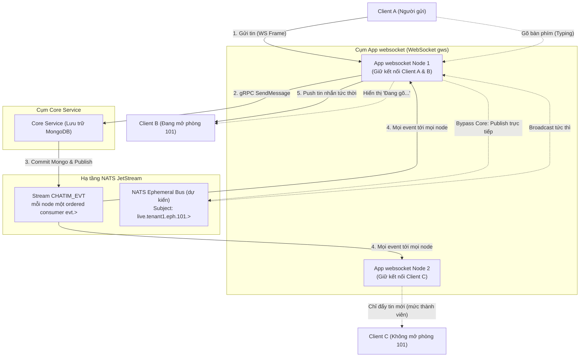
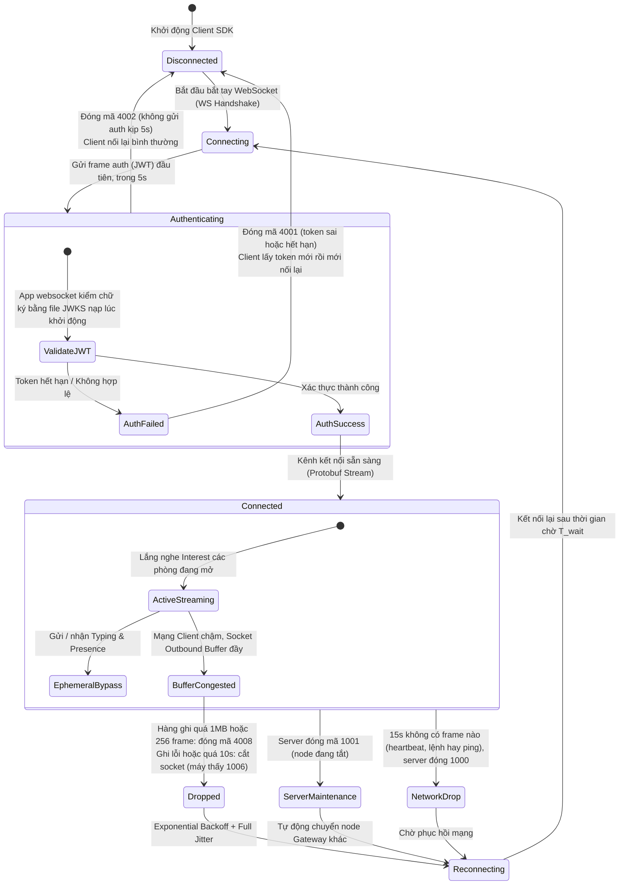

# Module 09: Thời gian thực — Phân phối Realtime & Tín hiệu tức thời (Typing/Presence)

> **Trạng thái:** App `websocket` (M4) **đã xây phần 1, 2 và 3/5** trên `feat/m4`; từ phần gateway (D198) websocket chỉ còn 12 lệnh ghi realtime, lệnh đọc và quản lý room đi HTTPS qua app `gateway` ([module 11](./11-feature-https-gateway.md)): kết nối, token, chuyển lệnh tới core (phần 1, [§7](#7-giao-thức-kết-nối-m4-phần-1-đã-xây), D183–D188); nhận và đẩy event, gói thông báo `WsPublish` (phần 2, [§8](#8-nhận-và-đẩy-event-m4-phần-2-đã-xây), D189–D195); đã đọc/đã xem (phần 3, [§9](#9-đã-đọc-và-đã-xem-m4-phần-3-đã-xây), D196–D197). Typing/online (phần 4), reconnect và vận hành (phần 5) vẫn là thiết kế dự kiến; chỗ nào khác §7–§9 thì §7–§9 đúng.
>
> **Mục tiêu module:** Đẩy các thông điệp và biến động dữ liệu đến người dùng đang online với độ trễ siêu thấp (p99 ≤100ms) qua kết nối WebSocket hai chiều, hỗ trợ các tương tác sinh động tức thời như "Đang gõ..." (Typing Indicator) và trạng thái trực tuyến (Presence) mà không làm suy giảm hiệu năng cơ sở dữ liệu.

---

## 1. Các Use Case nghiệp vụ (Business Use Cases)

| Mã Use Case | Tên Use Case | Tác nhân | Mô tả & Kết quả kỳ vọng |
|---|---|---|---|
| **UC-RT-01** | **Nhận tin nhắn & biến động tức thì (Realtime Push)** | Người dùng online | Khi có ai đó gửi tin nhắn, sửa tin, thả reaction hay đổi tên nhóm, giao diện của tôi lập tức cập nhật theo thời gian thực (độ trễ ≤100ms) mà không cần phải bấm tải lại. |
| **UC-RT-02** | **Hiển thị "Đang nhập tin nhắn..." (Typing Indicator)** | Người gửi | Khi tôi bắt đầu gõ bàn phím, những người khác đang mở phòng chat đó sẽ nhìn thấy thông báo *"Ivan Nguyen đang nhập tin..."*. Khi tôi dừng gõ vài giây, thông báo tự động biến mất. |
| **UC-RT-03** | **Trạng thái Trực tuyến (Presence)** | Hệ thống | Hiển thị dấu chấm xanh báo hiệu bạn bè đang Online, Vắng mặt (Away) hoặc Ngoại tuyến (Offline). |
| **UC-RT-04** | **Tin nhắn hệ thống tự động (System Messages)** | Hệ thống | Khi có các biến cố như thêm thành viên, đổi chủ nhóm hay ghim tin nhắn, một tin nhắn thông báo dạng hệ thống sẽ tự động xuất hiện trên timeline của mọi người. |

---

## 2. Luồng hoạt động chi tiết (How It Works)

### 2.1. Kiến trúc Cổng App websocket & Phân phối qua NATS Interest Routing

Hệ thống App websocket đóng vai trò làm lá chắn kết nối tập trung (Connection Hub) cho hàng trăm nghìn Client:

### 2.2. Vòng đời Kết nối WebSocket & Cơ chế Xử lý Mã lỗi (Connection Lifecycle & Close Codes)

Để đảm bảo hàng trăm nghìn kết nối đồng thời hoạt động ổn định và tự phục hồi khi có sự cố, Client SDK vận hành theo máy trạng thái kết nối có tích hợp xử lý mã đóng (Close Codes):

---

## 3. Cơ chế bảo đảm tính đúng đắn (Guarantees & Mechanisms)

### 3.1. Định tuyến theo mối quan tâm, lọc trong RAM (D189)
- **Vấn đề cần giải quyết:** Nếu mỗi tin nhắn đều phát tán cho toàn bộ 100.000 kết nối WebSocket, node websocket cạn băng thông trong vài giây; còn đăng ký NATS theo từng room thì bão kết nối lại sinh hàng triệu lần sub/unsub và node không thấy room mới.
- **Cơ chế bảo đảm (đã xây, chi tiết §8):**
  - Mỗi node đọc **toàn bộ** event của `CHATIM_EVT` bằng một ordered consumer, rồi lọc trong RAM theo bảng (tenant, user) → room. Tải NATS chỉ phụ thuộc số event và số node, không phụ thuộc số máy.
  - Hai mức: **thành viên** (mọi room của người đó, nạp bằng `ListMyRoomIDs`) nhận cái làm danh sách hội thoại đổi (tin mới/sửa/xoá, đổi tên room); **đang mở** (`open_room`) nhận thêm react, ghim, số thành viên, đổi vai trò. Event riêng (ẩn tin, xoá lịch sử, bookmark, cài đặt hội thoại, vị trí đọc) chỉ tới chủ nhân.
  - `open_room`/`close_room` chỉ đổi bảng trong RAM, không đụng NATS.

### 3.2. Đường truyền tắt cho Tín hiệu tạm thời (Ephemeral Bypass — Tiết kiệm 100% DB IOPS)
- **Vấn đề:** Các tín hiệu như "Đang gõ tin" (Typing) hay "Nhịp tim trực tuyến" (Presence Ping) diễn ra liên tục hàng nghìn lần mỗi giây nhưng không có giá trị lưu trữ lâu dài. Nếu ghi các tín hiệu này vào MongoDB, cơ sở dữ liệu sẽ sập ngay lập tức vì quá tải ghi đĩa.
- **Cơ chế bảo đảm:**
  - Toàn bộ gói tin Ephemeral được gán chủ đề riêng (dự kiến): `live.*.eph.*`.
  - App websocket nhận gói tin từ Client sẽ **bỏ qua hoàn toàn dịch vụ Core và MongoDB**, đẩy thẳng trực tiếp vào kênh phân phối siêu tốc của NATS.
  - Các tín hiệu này chỉ sống trong vài giây trong bộ nhớ RAM và tự động tiêu biến. Nếu người dùng rớt mạng, tín hiệu mất đi một cách tự nhiên mà không để lại bất kỳ rác dữ liệu nào trong cơ sở dữ liệu.

### 3.3. Mã hoá một lần, dùng chung cho mọi kết nối
- Trong một phòng chat lớn có 5.000 người đang online cùng lúc:
  - Node ghép bytes `Event` nhận từ NATS vào `ServerFrame` **đúng một lần** (`apps/websocket/internal/frame`, ghép thẻ field + độ dài bằng `protowire`, không giải mã lại), chỉ khi có ít nhất một người nhận.
  - Cùng một slice được xếp vào hàng ghi của 5.000 kết nối, không có 5.000 bản sao. Frame dùng chung không bao giờ bị sửa hay trả về pool (an toàn hơn pool, GC dọn khi kết nối cuối ghi xong).

### 3.4. Sinh tin nhắn hệ thống tất định (Deterministic SysMsg CID, D132)
- Khi có các sự kiện hệ thống (như Ghim tin, Thêm thành viên):
  - Một app SysMsg ngoài core (chưa xây) lắng nghe sự kiện từ NATS và gọi `SendMessage(kind = system, skip_unread, meta)` với mã định danh tất định:
    $$\text{cid} = \text{"sys-"}\{\text{event\_id}\}$$
  - Core chỉ cung cấp đường gửi: tin `system` bỏ kiểm membership, không cho link hay mention (D132).
  - Nhờ cơ chế chống trùng CID (Module 02), ngay cả khi có 2 node cùng xử lý sự kiện này trong cửa sổ `CID_COMMITTED_TTL` (15 phút), chỉ có đúng 1 tin nhắn hệ thống được ghi vào phòng chat.

### 3.5. Hợp đồng chống trùng và lấp lỗ (D156, bắt buộc cho websocket M4)
- Từ M3.1 event được giao **ít nhất một lần** (cờ `_state` + sweeper, Module 10) và bản phát bù có thể tới **sau** event mới hơn. Ví dụ: client nhận tin 46 trước, vài giây sau sweeper phát bù tin 45.
- Bỏ trùng theo id event; với event đổi trạng thái, so version của doc (`ver`, `read_ver`, `pin_ver`, `info_ver`, `preference_ver`, `rx.v`/`rc.v`, `member_count_ver`): bản lớn hơn thắng.
- `msg_created`: đã có đúng seq đó thì bỏ; thấy lỗ (seq > seq cuối + 1) thì gọi `GetHistory` để lấp. **Không bao giờ** bỏ theo luật "seq ≤ seq cuối đã thấy", vì như vậy tin 45 ở ví dụ trên sẽ mất.
- Chi tiết: [kiến trúc §8.1](../architecture.md).

---

## 4. Kỹ thuật & Công nghệ triển khai (Technologies)

### 4.1. Thư viện Go WebSocket `gws` hiệu năng cao
- App websocket sử dụng thư viện `github.com/lxzan/gws` được viết riêng cho Go để tối ưu hoá khả năng chịu tải cao:
  - Hỗ trợ quản lý hàng trăm nghìn kết nối đồng thời với lượng goroutine tối thiểu.
  - Hỗ trợ nén `permessage-deflate`, nhưng **tắt ở phần 1** (D185): nén tốn CPU khi có 100K kết nối; bật hay không quyết ở phần 5 khi có số đo.
  - Quản lý bộ đệm theo cơ chế tái sử dụng `sync.Pool`, triệt tiêu áp lực dọn rác của Go Garbage Collector (GC Pauses).

### 4.2. Định dạng Gói tin Protobuf Nhị phân
- Toàn bộ dữ liệu trao đổi giữa Client và App websocket qua WebSocket đều được đóng gói dưới dạng nhị phân **Protocol Buffers (Protobuf)** thay vì văn bản JSON.
- Giúp giảm từ **40% – 60% kích thước gói tin** truyền trên mạng di động 4G/5G, tiết kiệm pin cho thiết bị và tăng tốc độ giải mã.
- **Không có kênh JSON** (D185 bỏ phần "JSON debug" của D17): frame chữ bị đóng 1003; debug bằng `corecli` hoặc `pkg/wsclient`.

### 4.3. Hợp đồng Mã lỗi Kết nối & WebSocket Close Codes

Bảng mã đóng đầy đủ của phần 1 nằm ở [§7.4](#74-mã-đóng). Tóm tắt hành vi Client SDK:

| Mã | Ý nghĩa | Hành vi Client SDK |
|---|---|---|
| `4001` | Token sai, hết hạn, hoặc `auth` gia hạn khác người/tenant | Không nối lại ngay; lấy token mới rồi mới kết nối lại |
| `4002` | Không gửi `auth` trong 5 giây | Nối lại bình thường, không cần đổi token |
| `1001` | Node websocket đang tắt | Nối lại (qua LB sang node khác, phần 5) |
| `4008` | Máy nhận quá chậm: hàng ghi quá 1MB hoặc 256 frame (D194) | Nối lại có backoff, rồi tải lại danh sách hội thoại |
| `1013` | Node đang tắt (nạp danh sách room lỗi không đóng nữa mà gửi `load_failed`, D195) | Nối lại có backoff |

---

## 5. Hạn chế kỹ thuật & Đánh đổi (Limitations & Trade-offs)

1. **Ứng xử với Khách hàng Mạng chậm (Slow Client Handling):**
   - *Hạn chế:* Nếu kết nối internet của người dùng quá yếu, hàng đợi gửi gói tin (Socket Outbound Buffer) trên App websocket bị đầy:
   - *Đánh đổi:* Để bảo vệ App websocket không bị cạn kiệt RAM, App websocket chủ động **đóng kết nối** của client đó: hàng ghi quá `WS_SEND_QUEUE_BYTES` (1MB) hoặc `WS_SEND_QUEUE` (256 frame) → đóng **4008** sau các frame đã xếp (D194); một lần ghi lỗi hoặc quá `WS_WRITE_TIMEOUT` (10s) → cắt thẳng socket (máy thấy 1006). Riêng lúc node đang đuổi theo stream, máy không kịp nhận được `resync{CLIENT_BACKLOG}` thay vì bị đóng (§8.5). Không có ngân sách byte toàn node; RAM do `GOMEMLIMIT` giữ. Khi mạng ổn định, Client kết nối lại và tải lại trạng thái (Module 08).
2. **Không bảo đảm sống sót của Ephemeral:**
   - Các tín hiệu Typing và Presence không có cơ chế gửi lại khi mất gói tin (Best-effort unacknowledged). Nếu rớt mạng, client chỉ đơn giản là không thấy báo đang gõ.
3. **Chế độ Xoá chặt cho Tenant đặc thù (Privacy Strict Mode):**
   - Chưa có: event core phát luôn mang snapshot hiện tại kèm nội dung văn bản; chưa có cấu hình tenant để event chỉ chứa metadata và ID.

---

## 6. Phụ thuộc kỹ thuật & Bán kính sự cố (Dependencies & Blast Radius)

| Thành phần phụ thuộc | Mục đích phụ thuộc | Ứng xử khi thành phần gặp sự cố (Failure Behavior) |
|---|---|---|
| **NATS JetStream (`CHATIM_EVT`, `CHATIM_WS`)** | Nhận event và gói thông báo (hai ordered consumer mỗi node) | Lần khởi động đầu cần NATS (không có thì node không sẵn sàng và thoát). Mất NATS sau đó: lệnh vẫn chạy, `/readyz` vẫn true, gauge `nats_connected` = 0; nối lại thì thư viện đọc tiếp từ số cuối, không mất tin; trễ quá 2 phút thì nhảy tới hiện tại + nạp lại + `resync` rải 60s (D190). Event chưa vào JetStream được sweeper slot 0 phát bù (Module 10). |
| **File JWKS (khoá công khai)** | Xác thực JWT khi mở kết nối và khi gia hạn | Phần 1: file JWKS nạp một lần lúc khởi động (`WS_JWT_KEYS_FILE`), không gọi dịch vụ nào lúc kiểm token; file sai thì node không khởi động. Xoay khoá bằng rolling restart (D183). `identity` Phase 2 sẽ phát JWKS. |
| **Redis state** | Đọc bảng slot để chọn core (chỉ đọc) | Redis chết: node giữ bảng slot đang có và mọi kết nối gRPC tới core; lần nạp không thấy core nào cũng không đóng kết nối (D186). Lúc khởi động node chờ bảng slot rồi mới bật `/readyz`. |
| **Core `ListMyRoomIDs`** | Danh sách room đang ở và đã rời của người dùng khi login và khi nạp lại sau một lần nhảy (D195) | Tối đa `WS_ROOM_IDS_INFLIGHT` (64) lần gọi đang chạy mỗi node, nạp lại theo `WS_RELOAD_RATE`; lỗi thì gửi `load_failed` cho mọi kết nối của người đó, máy tự xin nạp lại (`load_rooms`) hoặc nối lại. |
| **Core Service (gRPC Unary)** | Xử lý mọi lệnh của máy | App websocket gọi Core qua gRPC theo bảng slot, hạn `CORE_REQUEST_DEADLINE` (5s), **không tự gửi lại** (luật không retry nội bộ). Core lỗi `UNAVAILABLE` thì app trả nguyên mã cho máy và kích làm mới bảng slot (gom, ≥ 250ms một lần); máy gửi lại cùng `cid`/`request_id` và lần sau đi đúng core mới. |

### 6.1. Chỉ số Sức khoẻ Vận hành & Cảnh báo SRE (Key Metrics & Alerts)

> **Đã có từ phần 1** (trên `/metrics` cổng admin, tiền tố `chatim_websocket_`): `connections`, `unauthenticated_connections` (gauge), `auth_failures_total{reason}`, `closes_total{code}` (chỉ mã do server đóng; nhãn 1000 gồm cả hết hạn heartbeat), `commands_rejected_total{reason=rate|inflight|unimplemented|shutdown}`, `unknown_frames_total`, `commands_total{command,code}`, histogram `core_call_seconds{command}`.
>
> **Thêm ở phần 2:** feed `nats_connected`, `nats_reconnects_total`, `consumer_lag_seconds{stream}` (tuổi tin vừa giao theo giờ lưu), `consumer_behind_seconds{stream}` (từ lúc watchdog thấy consumer sau đuôi stream, 0 khi kịp), `consumer_pending{stream}`, `consumer_resets_total{stream}`, `consumer_stale_skipped_total{stream}`, `catchup_jumps_total{stream}`, `catchup_jump_suppressed_total{stream}`, `catchup_jump_failures_total{stream}`, `fanout_queue_depth`, `fanout_handler_panics_total`, `events_unknown_total`, `events_dropped_at_stop_total`; bảng quan tâm `interest_users`, `interest_room_pairs`, histogram `room_ids_load_seconds`, `room_ids_load_failures_total`, `open_room_rejected_total`, `users_suspended`, `reloads_total`, histogram `reload_seconds`, `reload_failures_total`, `resyncs_total{reason}`, `events_delivered_total{level}`, `events_dropped_total{reason}`; gói `publish_packets_total`, `publish_delivered_total`, `publish_dropped_total{reason}`; hàng ghi `send_queue_bytes`. **Chưa có luật alert nào cho websocket** (phần 5: `nats_connected`, `catchup_jump_suppressed_total`, độ trễ).
>
> **Dự kiến, chưa xây:** các metric và alert dưới đây là thiết kế cho phần 3–5; chưa có trong code và chưa có trong `deploy/prometheus/alerts.yml`.

- **`chatim_websocket_connected_clients`:** Tổng số lượng kết nối WebSocket đang hoạt động đồng thời (CCU).
- **`chatim_realtime_delivery_latency_seconds`:** Độ trễ từ lúc tin được ghi vào DB đến khi Client nhận được frame WebSocket.
  - *Ngưỡng SLA:* p99 ≤ 100ms.
  - *Luật cảnh báo dự kiến (`ChatimDeliveryLatencyHigh`, chưa có):* Cảnh báo nếu p99 > 100ms trong 3 phút liên tục.
- **`chatim_websocket_slow_clients_dropped_total`:** Số lượng kết nối client bị App websocket ngắt cưỡng bức do nghẽn buffer.

---

## 7. Giao thức kết nối (M4 phần 1, đã xây)

> Xây trên `feat/m4` (commit `4363410`…`ae11be4`), theo [tóm tắt phần 1](../plans/2026-10-20-m4-1-ket-noi-va-lenh-summary.md); quyết định D183–D188 ở [decision log §17.7](../decision-log.md). Code: `apps/websocket` (app), `pkg/jwtverify` (kiểm token), `pkg/coreroute` (chọn core, không retry), `pkg/wsclient` (client Go mẫu), `proto/chatim/v1/ws.proto` (frame).

### 7.1. Mở kết nối

- Máy gọi `GET /ws` (cổng `WS_ADDR`, mặc định `:8080`; dev: `ws://127.0.0.1:8081/ws`) với subprotocol bắt buộc **`chatim.v1`**. Thiếu subprotocol → HTTP 400.
- Header HTTP phải tới trong 5 giây và ≤ 16KB (chặn máy gửi header chậm).
- Số kết nối chưa đưa token mỗi node ≤ `WS_UNAUTH_MAX` (10.000), giữ chỗ trước rồi mới kiểm; vượt → HTTP 503. Node đang tắt cũng trả 503.
- Cổng admin `WS_ADMIN_ADDR` (`:9090`, không publish ra ngoài): `/livez`, `/readyz` (true khi đã có bảng slot và hai consumer NATS đã chạy; mất NATS sau đó không đổi), `/metrics`.

### 7.2. Frame

- Mọi frame là **nhị phân protobuf** (D185): máy gửi `ClientFrame`, app gửi `ServerFrame`. Frame chữ → đóng 1003. Không có kênh JSON, chưa bật nén.
- `ClientFrame` (oneof): `auth{token}` (10), `heartbeat{}` (11), `request{id, oneof request}` (12); phần 2: `open_room{room_id}` (20), `close_room{room_id}` (21), `load_rooms{}` (22, xin nạp lại danh sách room sau `load_failed`, D195).
- `ServerFrame` (oneof): `response{id, code, message, oneof result}` (10); phần 2: `ready{}` (20), `event` (21, message `Event`), `notification` (22, message `Notification`), `resync{reason}` (23), `room_closed{room_id, reason}` (24), `load_failed{retry_after_ms}` (25, nạp danh sách room lỗi; kết nối vẫn giữ, D195). Ý nghĩa ở §8.
- Số field 10–19 dành cho phần 1, 20–39 cho phần 2–4 (event, vị trí đọc, typing, online, resync); chỉ thêm, không đổi số cũ.
- `open_room` khi người dùng chưa nạp xong (trước `ready`, đang tạm ngừng, sau `load_failed`) bị bỏ qua, không trả lời; máy chỉ mở room sau `ready`/`resync` (§8.2).
- Sau khi đã auth, frame loại app chưa biết (máy mới hơn app) bị bỏ qua và đếm ở `unknown_frames_total`, không đóng kết nối. Frame không giải mã được → đóng 1008.

### 7.3. Token, gia hạn, heartbeat

1. Frame đầu tiên phải là `auth{token}`, trong `WS_AUTH_TIMEOUT` (5s); không kịp → đóng **4002**. Gửi frame khác trước khi auth → đóng 1008.
2. Token là JWT `EdDSA` (Ed25519), khoá chọn theo `kid` trong file JWKS; kiểm `iss`, `aud`, `sub` (user), `tid` (tenant), `exp`, `nbf` (lệch giờ 30s). Sai → đóng **4001** (D183). Máy chỉ thấy mã; lý do vào log và metric, token không bao giờ vào log.
3. **Gia hạn trong kết nối:** trước khi hết hạn, máy gửi lại `auth` với token mới, cùng `sub` và `tid` (khác → 4001). Không gia hạn thì tới `exp + 30s` app đóng 4001.
4. **Heartbeat:** máy gửi `heartbeat` mỗi 5–10 giây (`pkg/wsclient` chọn ngẫu nhiên 5–8 giây để còn ≥ 7 giây dư). Mọi frame của máy đều tính là còn sống: heartbeat, lệnh, `auth`, và cả WebSocket ping (app trả pong). 15 giây (`WS_HEARTBEAT_TIMEOUT`) không có frame nào → app đóng (mã 1000).

Ví dụ: token của Lan hết hạn 11:00. Lúc 10:55 SDK lấy token mới và gửi `auth`; kết nối chạy tiếp. Nếu SDK quên, 11:00:30 kết nối bị đóng 4001 và SDK phải lấy token mới trước khi nối lại.

### 7.4. Mã đóng

| Mã | Khi nào | Máy làm gì |
|---|---|---|
| `4001` | Token sai, hết hạn, hoặc `auth` gia hạn khác người/tenant | Lấy token mới rồi mới nối lại |
| `4002` | Không gửi `auth` trong 5 giây | Nối lại bình thường, không đổi token |
| `1008` | Vi phạm giao thức: frame khác `auth` khi chưa auth, frame không giải mã được, `auth`/`heartbeat`/ping vượt giới hạn tốc độ | Sửa client; nối lại có backoff |
| `1003` | Gửi frame chữ thay vì nhị phân | Sửa client |
| `1009` | Frame lớn hơn `WS_FRAME_MAX` (128KB) | Sửa client (chia nhỏ lệnh) |
| `1001` | Node đang tắt | Nối lại (sang node khác qua LB, phần 5) |
| `1011` | Lỗi lạ (panic) khi xử lý kết nối này; chỉ kết nối này bị đóng, node vẫn chạy | Nối lại có backoff |
| `1000` | 15 giây không có frame nào | Nối lại; kiểm lại nhịp heartbeat |
| `1006` (máy tự thấy) | App cắt socket không gửi close frame: một lần ghi lỗi hoặc quá 10 giây | Nối lại có backoff |
| `4008` | Máy nhận quá chậm: hàng ghi quá `WS_SEND_QUEUE_BYTES` (1MB) hoặc `WS_SEND_QUEUE` (256 frame), D194 | Nối lại có backoff, tải lại danh sách hội thoại |
| `1013` | Node đang đóng bảng quan tâm; phần 5 dùng thêm khi node quá tải. `ListMyRoomIDs` lỗi không đóng mà gửi `load_failed` (D195) | Nối lại có backoff |

### 7.5. Lệnh và câu trả lời

- Máy gửi `request{id, <một lệnh>}`; app trả `response{id, code, message, result}` với cùng `id`. `id` do máy đặt; app không kiểm trùng. `code` là mã gRPC (0 = OK). Result số N đi với request số N.
- **Danh sách cho phép 12 lệnh ghi realtime** (D198, `corecall.Realtime()`; trước phần gateway là 34 lệnh, D184, D196): `SendMessage`, `EditMessage`, `DeleteMessage`, `HideMessage`, `ReactMessage`, `PinMessage`, `UnpinMessage`, `SetBookmark`, `MarkRead`, `MarkUnread`, `ClearHistory`, `SetRoomPreferences`. 22 lệnh đọc và quản lý (`ListMyRooms`, `GetHistory`, `CreateRoom`, `AddMembers`...) đi HTTPS qua `gateway` ([module 11](./11-feature-https-gateway.md)); gửi qua WebSocket thì nhận `UNIMPLEMENTED` "request not supported" như lệnh không biết, đếm `commands_rejected_total{reason="unimplemented"}`, không đóng kết nối; proto `ClientRequest` giữ đủ field. Không bao giờ có: `ListMyRoomIDs` (chỉ websocket gọi), `SetUserGroups`, `SetGroups` (hệ thống user/nhóm gọi).
- Field app không biết bị bỏ ở mọi tầng, không bao giờ tới core. `SendMessage` chỉ nhận `kind` mặc định hoặc `TEXT`; `kind` khác, `skip_unread` hay `meta` → `INVALID_ARGUMENT`. Lệnh rỗng (máy mới hơn app) → `UNIMPLEMENTED`, không đóng kết nối.
- Tenant và user gửi tới core (`x-chatim-tenant`, `x-chatim-user`) **chỉ lấy từ token**.
- Chọn core (D186): cả 12 lệnh đều có `room_id` → core đang giữ slot của room (`room_id` sai dạng → `INVALID_ARGUMENT` "invalid room_id"). Không có core sống → `UNAVAILABLE`. Phần chuyển lệnh chung (chép field biết, caller từ token, hạn, ánh xạ lỗi, bộ đếm) nằm trong `pkg/corecall`, dùng chung với gateway.
- Một lần gọi, hạn `CORE_REQUEST_DEADLINE` (5s). **App không tự gửi lại**; gặp `UNAVAILABLE` thì kích làm mới bảng slot rồi trả lỗi; máy gửi lại cùng `cid`/`request_id`.
- **Lời lỗi** (D184): giữ lời của core cho `INVALID_ARGUMENT`, `NOT_FOUND`, `FAILED_PRECONDITION`, `PERMISSION_DENIED`, `ALREADY_EXISTS`, `RESOURCE_EXHAUSTED`; câu cố định cho `UNAVAILABLE` ("core unavailable, retry later"), `DEADLINE_EXCEEDED` ("core did not answer in time"), `CANCELED` ("request canceled"), `UNIMPLEMENTED` ("request not supported"); mã khác → "request failed". Lời gốc chỉ vào log.
- **Thứ tự** (D187, D196): các `SendMessage`, `MarkRead` và `MarkUnread` của cùng kết nối vào cùng room chạy lần lượt theo thứ tự nhận. Một `SendMessage` lỗi `UNAVAILABLE`, `DEADLINE_EXCEEDED` hoặc `CANCELED` thì các lệnh đang chờ phía sau của room đó trả cùng lỗi ngay, không gọi core; `MarkRead`/`MarkUnread` lỗi thì không quét hàng (lệnh phía sau vẫn chạy); máy gửi lại theo đúng thứ tự. Kết nối đóng → bỏ các lần đang chờ. Lệnh khác chạy song song.

Ví dụ: máy gửi `request{id 17, SendMessage{room "77", cid "c-9", text "Ok anh"}}` rồi ngay sau đó `request{id 18, SendMessage{room "77", cid "c-10", text "Mai gặp"}}`. App gọi core cho id 17 trước; nếu core trả `UNAVAILABLE`, id 18 nhận `UNAVAILABLE` luôn mà không gửi, máy gửi lại 17 rồi 18 với cùng cid nên không sinh tin trùng và không đảo thứ tự.

### 7.6. Giới hạn mỗi kết nối

| Giới hạn | Mặc định | Vượt thì |
|---|---|---|
| Tốc độ frame (`WS_COMMAND_RATE`, `WS_COMMAND_BURST`), tính cả `auth`, `heartbeat`, ping | 50/s, dồn 100 | Lệnh: `response` `RESOURCE_EXHAUSTED` "too many requests", không gọi core. `auth`/`heartbeat`/ping: đóng 1008 |
| Lệnh đang chạy + đang chờ (`WS_COMMAND_INFLIGHT`) | 32 | `RESOURCE_EXHAUSTED` "too many requests in flight" |
| Cỡ frame (`WS_FRAME_MAX`) | 128KB | Đóng 1009 |
| Hàng đợi gửi (`WS_SEND_QUEUE`), một goroutine ghi mỗi kết nối | 256 frame | Đóng 4008 sau các frame đã xếp |
| Byte chờ ghi (`WS_SEND_QUEUE_BYTES`) | 1MB | Đóng 4008 sau các frame đã xếp (lúc node đuổi theo: `resync{CLIENT_BACKLOG}`, không đóng) |
| Hạn mỗi lần ghi (`WS_WRITE_TIMEOUT`) | 10s | Cắt socket (máy thấy 1006) |

Khi node tắt: `/readyz` false → chờ `WS_DRAIN_DELAY` (2s) → thôi nhận kết nối mới → lệnh mới nhận `UNAVAILABLE` "server shutting down, retry later", lệnh đang chạy vẫn được trả lời (trong `CORE_REQUEST_DEADLINE`) → dừng feed (≤ 2s: dừng hai consumer, xả worker, đóng NATS) → đóng mọi kết nối 1001 (≤ 1s); cả quá trình trong `WS_SHUTDOWN_BUDGET` (15s), mặc định 2 + 5 + 2 + 1 = 10s.

---

## 8. Nhận và đẩy event (M4 phần 2, đã xây)

> Xây trên `feat/m4` (commit `2b3c6c9`…`ec75155`), theo [tóm tắt phần 2](../plans/2026-10-21-m4-2-nhan-va-day-event-summary.md); quyết định D189–D195 ở [decision log §17.8](../decision-log.md); subject và bảng người nhận ở [events.md §3.1](../events.md). Code: `apps/websocket/internal/feed` (hai ordered consumer, worker theo room, watchdog, nhảy tới hiện tại), `apps/websocket/internal/interest` (bảng quan tâm, định tuyến, nạp lại, gói `WsPublish`), `apps/websocket/internal/frame` (ghép bytes), `pkg/wspublish` (khuôn hộp thư), `pkg/wsclient` (client mẫu áp event theo D156).

### 8.1. Sau khi auth: `ready`

1. Auth xong, node đăng ký kết nối vào bảng quan tâm theo (tenant, user). Người đã có kết nối khác trên node dùng chung danh sách room, không gọi core lại.
2. Người mới: node gọi core `ListMyRoomIDs` (tối đa `WS_ROOM_IDS_INFLIGHT` lần cùng lúc mỗi node), ghi mốc seq stream lúc bắt đầu gọi; core trả room đang ở (`rooms`) và room đã rời (`left`, kèm `ver`). Node ghi dấu "đã rời" từ `left` trước, rồi áp event thành viên tới trong lúc gọi theo `ver` lớn hơn thắng; `member_added` có `ver` ≤ dấu đã rời bị bỏ (D195). Lỗi → `load_failed` (§8.4), kết nối vẫn giữ.
   Danh sách room chỉ nạp từ core lúc login hoặc lúc node "khởi động lại" (§8.4); giữa hai lần đó node tự cập nhật trong RAM theo `member_added`/`member_removed`.
3. Xong thì gửi **`ready{}`**. Trước `ready` máy chưa nhận event nào; sau `ready` máy nên gọi `ListMyRooms` để có trạng thái đầy đủ (event chỉ báo cái mới).

Ví dụ: Lan nối lúc stream ở seq 5.000; trong lúc node hỏi core, Lan bị xoá khỏi Kho HCM (seq 5.003). Danh sách core trả có thể còn Kho HCM hoặc không; node áp event seq 5.003 sau (vì > 5.000), nên kết quả luôn là "không còn Kho HCM". Sau đó sweeper phát bù một `member_added` cũ (`ver 1`) của Lan: `left` đã ghi Kho HCM ở `ver 2`, nên node bỏ nó.

### 8.2. Mở và đóng room

- **`open_room{room_id}`**: nhận thêm react, ghim, số thành viên, đổi vai trò của room đó. Gửi khi người đó chưa nạp xong (trước `ready`, đang tạm ngừng, sau `load_failed`) thì node bỏ qua: không trả lời, không giữ gì; máy mở lại các room đang xem sau `ready`/`resync`. Room đang chờ `member_added` cũng bị bỏ khi người đó bị tạm ngừng. Room chưa có trong danh sách (ví dụ vừa `CreateRoom`, `member_added` chưa tới) thì chờ tối đa `WS_OPEN_PENDING` (10s); tới hạn vẫn không phải thành viên → **`room_closed{room_id, NOT_MEMBER}`**. `room_id` sai dạng cũng nhận `room_closed{NOT_MEMBER}`.
- **`close_room{room_id}`**: luôn được, không trả lời.
- Bị xoá khỏi room: máy nhận `member_removed` của mình trước, rồi **`room_closed{room_id, REMOVED}`** nếu đang mở; sau đó không nhận gì của room đó nữa.

### 8.3. Event và thông báo

- **`event`** mang nguyên bytes `Event` core phát (node không giải mã lại, trừ event loại `member` để biết người nào). Ai nhận kind nào: [events.md §3.1](../events.md). Máy áp theo hợp đồng D156 (§3.5): bỏ trùng theo id, version lớn hơn thắng, lỗ seq `msg_created` thì gọi `GetHistory`.
- **`notification`** mang `Notification` từ gói `WsPublish` mà app phát vào `websocket.publish.{tenant}` (D192). Websocket chỉ đẩy cho người có tên trong `targets.users` và đang nối vào node; máy bỏ trùng theo `Notification.id`. Mất thông báo lúc rớt mạng thì vẫn thấy trong `ListMentions`. Phase 1 server không lọc room đang tắt thông báo: máy tự ẩn (D193).

### 8.4. Đọc stream và đuổi theo

- Mỗi node hai ordered consumer (`CHATIM_EVT` `evt.>`, `CHATIM_WS` `websocket.publish.>`), bắt đầu ở seq cuối + 1. Lỡ tin (mạng chập, NATS restart) thì thư viện tự đọc lại từ số cuối đã giao, đúng thứ tự, không mất tin.
- Tin có giờ lưu cũ hơn 5s = đang đuổi theo: đọc tối đa `WS_REPLAY_RATE` (20.000/s).
- **Trễ từ `WS_REPLAY_MAX_AGE` trở lên (2m, đo bằng giờ JetStream lưu tin)**, watchdog thấy consumer đứng yên, hoặc stream bị tạo lại = **node coi như khởi động lại** (D195): bỏ đoạn cũ, đọc tiếp từ hiện tại, và **ngay lúc đó tạm ngừng mọi người trên node**: không event, không thông báo, máy mới của họ chưa nhận `ready`. Node nạp lại từ core từng người với tốc độ `WS_RELOAD_RATE` (1.000 người/giây mỗi node), thứ tự: máy đang chờ `ready` → người đang mở room → còn lại (máy mới đưa người đó lên đầu). Nạp xong: máy chưa `ready` nhận `ready`, máy đã `ready` nhận **`resync{LAG_TOO_OLD}`** (hoặc `CONSUMER_LOST`), rồi nhận tin bình thường. Máy nhận `resync` thì tải lại danh sách hội thoại và room đang mở (`ListMyRooms`, `GetHistory`). Nhảy lần hai giữa chừng thì mọi người lại tạm ngừng.
- **Nạp lỗi** (lúc login hay sau nhảy) → node gửi **`load_failed{retry_after_ms}`** tới mọi kết nối của người đó, giữ kết nối, người đó vẫn tạm ngừng (không event, không `ready`; lệnh vẫn chạy), và **server không làm gì thêm, không tự nạp lại** (owner 2026-10-22, đúng luật không retry nội bộ). **Máy quyết định**: gửi **`load_rooms`** để xin nạp lại, hoặc ngắt và kết nối lại (login nạp lại). `retry_after_ms` chỉ là gợi ý. `load_rooms` xếp một lần nạp lên đầu hàng (vẫn theo `WS_RELOAD_RATE`; gửi trùng khi đang chờ thì bỏ); thành công → `ready` cho máy chưa từng `ready`, `resync` cho máy đã `ready`; lỗi → `load_failed` lần nữa. `pkg/wsclient` có option xử lý `load_failed`; không đặt thì client mẫu gửi `load_rooms` sau gợi ý + jitter.
- Hộp thư `CHATIM_WS` nhảy riêng: không tạm ngừng ai, không `resync`; thông báo `@` của đoạn bỏ qua mất (vẫn có trong `ListMentions`).
- Watchdog mỗi 5s phát hiện consumer đứng yên khi stream có tin mới; hai lần nhảy vì trễ cách nhau ít nhất `WS_REPLAY_MAX_AGE` (giờ node lệch NATS thì không nhảy liên tục, chỉ đếm `catchup_jump_suppressed_total`).
- **Vận hành:** `WS_REPLAY_MAX_AGE` nên lớn hơn thời gian nạp lại cả node (số người trên node / `WS_RELOAD_RATE`; ví dụ 33.000 người / 1.000 = 33s < 2m). Ngắn hơn thì node có thể nhảy lần nữa khi chưa nạp xong lần trước, người cuối hàng chờ lâu hơn. Theo dõi `users_suspended`, `reload_seconds`, `reload_failures_total`, `room_ids_load_seconds_count` (số lần gọi `ListMyRoomIDs`).

| Chuyện xảy ra | Websocket làm gì | Máy thấy |
|---|---|---|
| Mạng chập 10 giây | Thư viện đọc lại từ số cuối (diễn tập: đuổi kịp 3–5s) | Tin tới trễ, không mất, không `resync`; người bị xoá trong lúc chập nhận `member_removed` rồi `room_closed`, không gì thêm |
| Node bị cắt khỏi NATS 3 phút | Khởi động lại: tạm ngừng mọi người, nạp lại theo `WS_RELOAD_RATE` (diễn tập: 3 người, nạp trung bình 16ms) | Một `resync` sau khi người đó được nạp lại; người bị xoá trong lúc cắt không nhận thêm gì của nhóm |
| NATS restart | Đọc tiếp (JetStream cũng dừng nên không có lỗ) | Không gì |

### 8.5. Máy nhận chậm

- Lúc node đang đuổi theo mà hàng ghi của một máy không còn chỗ: node gửi **`resync{CLIENT_BACKLOG}`** riêng máy đó và ngừng đẩy cho nó tới khi feed đuổi kịp (không cắt kết nối, vì nối lại sẽ gọi `ListMyRooms` đắt đúng lúc node đang trễ). Không vừa cả frame `resync` thì gửi khi đuổi kịp.
- Lúc bình thường: vượt `WS_SEND_QUEUE_BYTES` (1MB) hoặc `WS_SEND_QUEUE` (256 frame) → đóng 4008 (D194).

### 8.6. Giới hạn đã biết

- Một node nhận toàn bộ event: ổn tới ~10 node; quá thì chia node theo tenant.
- `left` không giới hạn: ~26 byte mỗi dòng, giới hạn nhận gRPC 4MB ≈ 160K nhóm đã rời mỗi người; quá thì lần nạp lỗi và máy nhận `load_failed` (ngoài use case, chấp nhận). RAM websocket ~30 byte mỗi dấu đã rời.
- Sau một lần nhảy, người dùng chờ tới lượt nạp lại (tối đa số người trên node / `WS_RELOAD_RATE`) mới nhận tin tiếp.
- Quyền NATS riêng cho websocket ở M5 (chặn go-live): tới lúc đó ai vào được NATS là giả được gói đẩy tới người dùng.

## 9. Đã đọc và đã xem (M4 phần 3, đã xây)

> Xây trên `feat/m4`, theo [tóm tắt phần 3](../plans/2026-10-22-m4-3-da-doc-va-da-xem-summary.md); quyết định D196–D197 ở [decision log §17.9](../decision-log.md).

- **Đường đi:** máy gửi `request{MarkRead{room_id, seq}}` (lệnh thứ 34) hoặc `MarkUnread`; websocket chuyển tới core theo hàng (kết nối, room) như `SendMessage`. Core ghi doc `members` một lần mỗi lệnh, trả `read_seq`/`read_ver` ngay, rồi đưa vị trí vào hàng gom `event/readbatch`.
- **Gom ở core:** mỗi `READ_EVENT_WINDOW` (1s) core phát một event `read_positions` mỗi room có người đọc, mỗi user một dòng (`read_ver` lớn nhất), tối đa 1.000 dòng mỗi event; id theo nội dung. Sau PubAck mọi cờ bit 2 có tên trong event được xoá; core chết thì sweeper phát `read_positions` một dòng từ doc (~15s).
- **Ai nhận:** kết nối đang mở room, cộng mọi kết nối của từng user có tên trong `entries` mà room còn trong danh sách RAM và không tạm ngừng; mỗi kết nối nhận một lần. Ví dụ: Lan đọc nhóm "Kho" trên điện thoại; máy tính của Lan (không mở nhóm) và Minh (đang mở nhóm) nhận; Hùng (thành viên, không mở nhóm) không nhận.
- **`pkg/wsclient`:** `MarkRead(ctx, room, seq)` gửi ngay lần đầu của room đang yên, sau đó tối đa 1 lần/giây mỗi room với seq lớn nhất đang chờ (`ReadInterval`); `MarkUnread` huỷ phần chờ của room rồi gửi (không bao giờ có `MarkRead` cũ đi sau nó); `CloseRoom` gửi phần chờ trước `close_room`; `FlushReads(ctx)` gửi mọi phần chờ và chờ mọi `MarkRead` đang bay trả lời: app gọi nó trước khi tải danh sách hội thoại qua HTTPS (D198) để unread đúng; `CloseContext(ctx)` cũng vậy trước khi đóng (`Close` dùng hạn 1s); lỗi của lần gửi theo nhịp báo qua `OnReadError(room, err)`; `Applier` áp `read_positions` theo (room, user) `read_ver` lớn hơn và chỉ đưa dòng mới hơn cho `OnEvent`.
- **Độ trễ:** e2e qua websocket-1 đo A → B 353ms (cửa sổ 1s).

