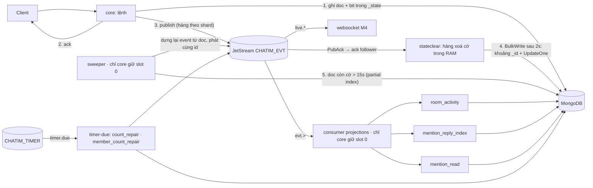
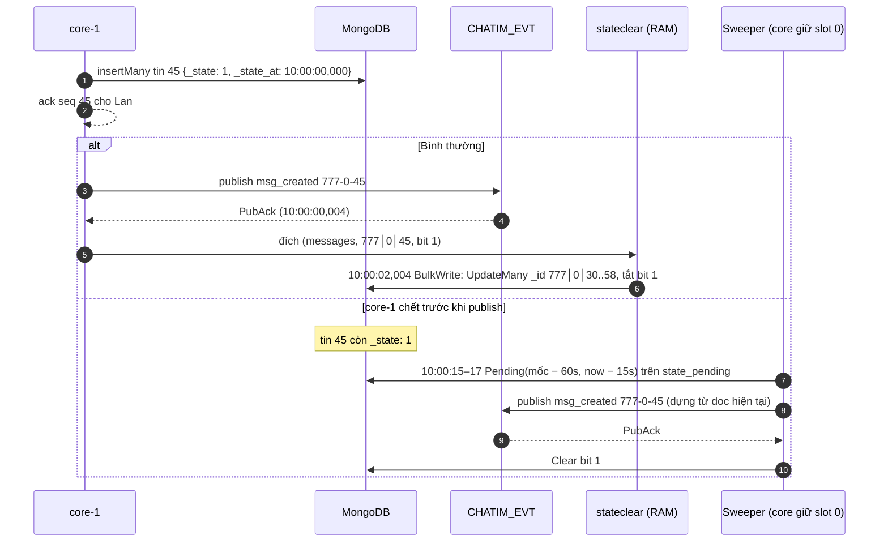

# Module 10: Tự phục hồi — Cờ event chờ phát, Sweeper, Projection & Sửa số đếm

> **Mục tiêu module:** Bảo đảm mọi thay đổi đã ghi DB đều có event tới `CHATIM_EVT` (ít nhất một lần) kể cả khi core chết hay NATS gián đoạn; giữ các bảng dẫn xuất (danh sách hội thoại, chỉ mục mention, doc trả lời, `rc`, `reply_threads`) theo kịp event; tự sửa số đếm lệch; và cho kỹ sư vận hành công cụ phát lại một khoảng.
>
> Cơ chế này có từ M3.1 (D141–D160, [bản tóm tắt](../plans/2026-10-16-m3-1-state-driven-events-summary.md)) và thay effect engine cũ (reader change stream → `CHATIM_WORK` → worker có delay 5s, ack mark trên Redis).

---

## 1. Các Use Case nghiệp vụ (Business Use Cases)

| Mã Use Case | Tên Use Case | Tác nhân | Mô tả & Kết quả kỳ vọng |
|---|---|---|---|
| **UC-RECON-01** | **Phát bù event bị rớt** | Hệ thống tự động | Tin đã ghi DB nhưng core chết trước khi publish, hoặc NATS từ chối: doc còn cờ `_state`, khoảng 15–17s sau (`SWEEP_MIN_AGE` + `SWEEP_INTERVAL`) sweeper phát lại event với đúng id. |
| **UC-RECON-02** | **Projection theo kịp event** | Hệ thống tự động | Danh sách hội thoại (`rooms.last_seq`), chỉ mục mention, doc trả lời, `rc`, `reply_threads`, mention đã đọc được ghi bởi consumer nghe `CHATIM_EVT`, không delay cố định (cửa sổ gom 3s). Bench 2K: trễ `rooms.last_seq` trung vị 1,6s, chậm nhất 3,6s (engine cũ 2,7s / 5,7s). |
| **UC-RECON-03** | **Tự sửa số đếm** | Hệ thống tự động | `$inc` của `rx`, `rc`, `member_count` bị ngắt giữa chừng: phiếu hẹn trên `CHATIM_TIMER` bật, đếm lại và CAS về số đúng. |
| **UC-RECON-04** | **Tự hoàn tất projection trên lệnh** | Hệ thống tự động | Fact `message_edits` hoặc `pin_actions` đã ghi nhưng `messages`/`rooms.pins` chưa áp: sweeper áp lại rồi mới phát event. |
| **UC-RECON-05** | **Phát lại một khoảng (`/app resync`)** | Kỹ sư vận hành (SRE) | Stream `CHATIM_EVT` mất dữ liệu hoặc cần dựng lại projection: resync bật lại cờ của các doc trong khoảng, sweeper phát lại, projection chạy lại (idempotent). |

---

## 2. Luồng hoạt động chi tiết (How It Works)

### 2.1. Sơ đồ tổng thể

### 2.2. Khuôn chung của mọi lệnh ghi

1. Kiểm tra như mọi lệnh (tenant, membership, policy, CAS). Không đổi mã lỗi gRPC nào.
2. Ghi doc chính **kèm bit** trong **cùng** lệnh ghi (insert, upsert pipeline, `$inc` hoặc transaction owner D100). Không thêm lần ghi nào trước ack.
3. Ack client.
4. Đưa event vào publisher (hàng theo shard, không chặn). Hàng đầy hoặc NATS lỗi thì event không đi, cờ còn.
5. Ack follower của shard chờ PubAck rồi đưa "collection + khoá + bit + version" (`publish.StateTargetOf`) vào `event/stateclear`. Hàng chạy một lần xoá 2s sau đích đầu tiên (hoặc khi đủ 16.384 đích): xếp cả lô theo `_id`, rồi mỗi collection và bit một `BulkWrite` không thứ tự (≤ 500 lệnh, không cắt đôi khoảng): dãy khoá liền nhau → một `UpdateMany` theo khoảng `_id`, khoá lẻ → `UpdateOne` theo `_id` (kèm version, bit). Mỗi lệnh tắt bit, hết bit thì `$unset` cả `_state` lẫn `_state_at`. Không dùng `$in` hay `$or` nhiều nhánh (bản đầu `updateMany` + `$or` 500 nhánh tốn 854ms mỗi lệnh dưới tải).

Core chết ở bất kỳ bước nào sau bước 2 thì doc còn cờ, và sweeper làm nốt bước 4–5.

### 2.3. Ví dụ: gửi tin và core chết

Khoảng `_id` trong lệnh xoá chỉ gồm các seq **liền nhau đã PubAck**: tin 43 chưa PubAck thì thành hai khoảng 30–42 và 44–58. Không dùng `$in` (D139).

---

## 3. Cơ chế bảo đảm tính đúng đắn (Guarantees & Mechanisms)

### 3.1. Bit theo collection

| Collection | Bit | Event | Bật trong lệnh ghi nào | Xoá bit khi |
|---|---|---|---|---|
| `messages` | 1 | `msg_created` | insert tin (thường, hệ thống, chuyển tiếp) | PubAck; khoảng `_id` liền nhau |
| | 2 | `counts_changed` reaction | `$inc rx` khi react; `SetReactions` của `count_repair` | PubAck và `rx.v` vẫn bằng |
| | 4 | `counts_changed` trả lời | `$inc rc` của `mention_reply_index`; `SetReplyCount` | PubAck và `rc.v` vẫn bằng |
| `message_edits` | 1 | `msg_edited`/`msg_deleted` | insert fact `ver ≥ 1` (dòng `ver 0` không có event nên không có cờ) | PubAck |
| `message_interactions` | 1 | `reaction_changed`/`bookmark_changed` | upsert khi thật sự đổi (chọn lại cùng emoji giữ nguyên byte nên không có cờ); doc trả lời không có cờ | PubAck và `ver` vẫn bằng |
| `pin_actions` | 1 | `msg_pinned`/`msg_unpinned` | insert fact ghim | PubAck |
| `members` | 1 | `member_added/removed/role_changed/priority_changed` | thêm, xoá, rời, đổi role/priority, transaction owner | PubAck và `ver` vẫn bằng |
| | 2 | `read_updated` | `MarkRead`/`MarkUnread` khi vị trí thật sự đổi | PubAck và `read_ver` vẫn bằng |
| | 4 | `history_cleared` | `ClearHistory` khi `cleared_at` thật sự tăng | PubAck và `cleared_at` vẫn bằng |
| | 8 | `room_preferences_changed` | `SetRoomPreferences` | PubAck và `preference_ver` vẫn bằng |
| `hidden` | 1 | `message_hidden` | lần ẩn đầu | PubAck |
| `rooms` | 1 | `room_created` | `InsertRoom` | PubAck (`_id $in`, `rooms` không clustered) |
| | 2 | `member_count_changed` | mọi chỗ ghi `member_count`: `$inc`, transaction owner, `member_count_repair`, `/app recount` | PubAck và `member_count_ver` vẫn bằng |
| | 4 | `room_updated` | `UpdateRoom` | PubAck và `info_ver` vẫn bằng |

`mentions`, `reply_threads`, doc trả lời và `room_dms` không có event nên không có cờ. `_state_at` ghi bằng `$min` (bit mới không đẩy lùi bit cũ): insert lấy giờ của doc, update lấy giờ server `$$NOW` (D149).

**Vì sao xoá bit kèm điều kiện version (D145).** Lan đọc tới `read_seq` 40 (`read_ver` 7), core phát `read_updated` v7. Ngay trước lúc xoá cờ, Lan đọc tiếp tới 45 (`read_ver` 8) và bit 2 bật lại. Xoá có điều kiện `read_ver = 7` thì doc v8 không khớp, bit giữ nguyên; nếu `read_updated` v8 publish lỗi, sweeper vẫn phát bù.

### 3.2. Sweeper (D146, D147, D154, D158)

- **Ai chạy:** chỉ core giữ lease slot 0 (log `event sweeper started`), mỗi `SWEEP_INTERVAL` 2s. Hai core cùng giữ slot 0 lúc chuyển giao có thể phát trùng; stream bỏ bản trùng theo `Nats-Msg-Id`.
- **Quét gì:** mỗi collection, đọc mốc trong `sweeper_state`, rồi đọc từng trang keyset `(_state_at, _id)` 500 doc trên partial index `state_pending`, trong khoảng `mốc − 60s ≤ _state_at < now − 15s`. Không giữ cursor giữa các trang. Lượt đầu sau khi lên làm leader quét từ đầu index.
- **Làm gì với mỗi doc, mỗi bit:** dựng event từ trạng thái **hiện tại** của doc với đúng id; với fact sửa thì chạy lại `ApplyEdit` (và xoá text khi xoá tin) trước, projection còn chậm thì giữ cờ; với fact ghim thì fold + CAS `rooms.pins`, thua CAS thì giữ cờ. Publish trên client JetStream riêng (tối đa `2 × SWEEP_BATCH` đang bay, ≤ `SWEEP_RATE` 5.000 event/s), chờ PubAck rồi `Clear` bit có điều kiện như §3.1.
- **Doc không còn:** bỏ và xoá cờ theo version đọc được. Nếu bit có version mà không biết version thì **giữ cờ** và đếm lỗi, để không xoá nhầm cờ của thay đổi mới hơn.
- **Mốc:** chỉ tiến. Bằng `_state_at` của doc kẹt cũ nhất trong lượt (publish lỗi), hoặc `now − 15s` nếu sạch.
- **Dò trước cửa sổ (D158):** sau mỗi lượt của một collection, sweeper dò **một** doc còn cờ có `_state_at` trước đầu cửa sổ. Có thì lượt sau quét từ đầu index và log `pending state older than the sweep checkpoint`. Dò trên partial index nên gần như miễn phí.

Ví dụ NATS chết từ 10:00:00 tới 10:02:00: gửi tin vẫn ack bình thường, mọi tin giữ cờ; mỗi lượt sweeper publish lỗi nên mốc đứng ở 10:00:00; khi NATS sống lại, sweeper phát bù với tốc độ ≤ 5.000/s và mốc tiến dần tới `now − 15s`. Diễn tập trên bản cuối (NATS dừng ~2 phút 45 giây ở 2K tin/s): ack 100%, không mất tin, đỉnh ~320K doc có cờ, mọi cờ về 0 sau 3 phút 11 giây kể từ lúc NATS sống lại (~1.600 doc/s, chậm hơn `SWEEP_RATE` vì sweeper dựng lại tuần tự).

### 3.3. Projection consumer (D150, D159)

Một consumer durable `projections` trên `CHATIM_EVT`: lọc một subject `evt.>` (mọi event), ack từng tin (`AckExplicit`), `AckWait` 30s, `MaxAckPending` = 4 × lô, `DeliverAll`. Chỉ core giữ slot 0 fetch (như sweeper, xét lại mỗi `SLOT_TICK`). Lô ≤ `PROJECTION_FETCH_BATCH` 8192 event, chờ ≤ `PROJECTION_FETCH_WAIT` 3s (server hết hạn đúng lúc đó, client đợi thêm tới tín hiệu hết hạn nên không đánh rơi tin đã giao). Cửa sổ 3s là để gom: ở 2K tin/s một lô ~6K event, `room_activity` ghi một dòng mỗi room-thread nên số lệnh ghi `rooms` giảm, CPU Mongo về ngang engine cũ (với cửa sổ 1s là ~85K lệnh so với 17K, CPU Mongo +16%). Lúc dừng, lần fetch dở không huỷ được: core đọc tới khi server hết hạn (≤ 3s, chậm nhất thêm 1s nếu mất tín hiệu 408), nên mốc dừng projections là `PROJECTION_FETCH_WAIT` + 1s = 4s. Mỗi lô decode một lần rồi chia cho ba handler chạy song song, mỗi handler chỉ nhận các kind nó giữ; kind không handler nào giữ (ví dụ `room_created`) chỉ được ack. Ba durable cũ `projection-room_activity`, `projection-mention_reply_index`, `projection-mention_read` bị xoá lúc khởi động (không có thì bỏ qua). Lần đầu tạo `projections` đọc lại toàn bộ stream còn giữ (idempotent).

| Handler | Nhận | Ghi | Chống trùng và lệch thứ tự |
|---|---|---|---|
| `room_activity` | 13 kind có room: `msg_created`, `msg_edited`, `msg_deleted`, `reaction_changed`, `msg_pinned`, `msg_unpinned`, `member_added/removed/role_changed/priority_changed`, `bookmark_changed`, `room_updated`, `room_preferences_changed` | Một `TouchActivity` mỗi (room, thread) mỗi lô: `$max last_seq`, `last_message_at` (chỉ `msg_created`); `last_change_at`, `activity_bucket`, `last_edit_at` (sửa/xoá trên thread 0) bằng giờ server `$$NOW` | `$max` |
| `mention_reply_index` | `msg_created`, `msg_edited`, `msg_deleted` | Đọc `reply_to` và mention **từ event**, không `Find`. Trả lời: đặt phiếu `replies` → `AddReply` → doc mới thì `$inc rc +1` (bit 4) → `counts_changed` → gỡ phiếu; xoá trả lời thì `RemoveReply` + `rc −1` cùng cách. Mention: `ApplyMentions` theo `message_ver`, `RaiseSharedMention` khi có `@all`/nhóm. `reply_threads.Touch` mỗi trả lời còn sống | doc trả lời theo `_id` (chèn một lần), tombstone trước khi thêm, mention theo version |
| `mention_read` | `read_updated` | Một `MembersOf` mỗi room mỗi lô; `read_ver` của doc nhỏ hơn event thì Nak; còn lại `Mentions.MarkRead(room, user, read_seq hiện tại)` | đọc lại `read_ver`, dùng vị trí hiện tại |

Ack từng tin, như trước:
- Ổn → `Ack`. Room hay doc không còn (`eventkit.Gone`) → `Ack`, đếm `projection_dropped_total`.
- Không decode được → `Term`, đếm dropped.
- Lỗi khác → `Nak` tin đó theo bậc thang 5s, 30s, 2m, 10m (`eventkit.NakDelay` theo số lần giao của nó). Chỉ tin đó chờ; các tin khác của lô vẫn được ack. `MaxAckPending` = 4 lô nên vài tin chậm không làm server ngừng giao.
- Mất slot 0 giữa lô → làm xong và ack/Nak lô đó; lô nhận sau khi mất slot thì `Nak(0)` từng tin để core mới nhận ngay. Dừng core: đợi lần fetch đang dở hết hạn (≤ `PROJECTION_FETCH_WAIT` 3s, thêm tối đa 1s nếu mất tín hiệu hết hạn) rồi trả mọi tin nó mang về bằng `Nak(0)`, nên không đánh rơi tin nào.

Từ lần giao thứ 6 đếm `projection_stuck_total` (alert). Các số đo mang nhãn `projection="projections"`. Một event lỗi chỉ làm chậm chính nó. Event phát lại (sweeper, lần đầu `DeliverAll`) cũng nâng `last_change_at`/bucket lên giờ hiện tại; chấp nhận được.

### 3.4. Phiếu hẹn sinh tồn (D111, D152)

- Lệnh có số đếm dẫn xuất đặt phiếu **trước** khi ghi (lỗi đặt phiếu → `UNAVAILABLE`, chưa ghi gì), ghi, `$inc`, rồi gỡ phiếu (`DeleteMsg`). Quên gỡ (core chết, `$inc` lỗi) thì phiếu bật.
- Phiếu nằm trên stream `CHATIM_TIMER` (WorkQueue, message schedule): `timer.arm.{room}.{op}` (member) hoặc `timer.arm.{room}.{thread}.{seq}.{counter}.{op}` (`reactions`/`replies`), tới hạn sau `MEMBER_COUNT_CHECK_DELAY`/`MESSAGE_COUNT_CHECK_DELAY` (5s) thì sang `timer.due`.
- Một consumer `timer-due` dùng chung chạy `count_repair` (đếm lại `rx`/`rc`; bằng và đã ổn định thì chỉ phát lại, không thì đặt phiếu mới rồi CAS version kèm bit 2/4) và `member_count_repair` (CAS `member_count_ver` kèm bit 2), rồi phát `counts_changed`/`member_count_changed`. Mất room/tin → ack và bỏ; lỗi → Nak theo bậc thang.

### 3.5. Không retry nội bộ

Publish lỗi thì để cờ; CAS thua trong sweeper thì để cờ; projection lỗi thì Nak. Nhịp quét 2s và Nak của JetStream không phải vòng lặp retry trong lệnh. Không có transaction mới: bit đi cùng lệnh ghi hiện có.

---

## 4. Kỹ thuật & Công nghệ triển khai (Technologies)

### 4.1. Package

| Package | Vai trò |
|---|---|
| `event/publish` | Hàng theo shard, `PublishMsgAsync`; `WithStateClears` + ack follower mỗi shard (4096 mục); `StateTargetOf` (19 kind) |
| `event/stateclear` | Hàng xoá cờ trong RAM: `Add` không chặn, xả mỗi `STATE_CLEAR_FLUSH`/`STATE_CLEAR_BATCH`, đầy thì bỏ và đếm, xả trong 1s khi dừng |
| `event/sweep` | Sweeper slot 0: `pass`, `page`, `publish`, `pace`, `rebuild_*` cho 7 collection |
| `event/projection` | Consumer `projections` (một durable, slot 0, ack từng tin) với 3 handler, `EnsureConsumer` (xoá 3 durable cũ), `Decode` |
| `event/timer` | `CHATIM_TIMER`, `Timers` (`Arm*`, `Disarm`), consumer `timer-due`, `count_repair`, `member_count_repair` |
| `event/eventkit` | Phần dùng chung: `NewPullSource`, `NakDelay`, `Gone`, `LimitedLog`, `RoomTypes`, `MessageKey` |
| `event/resync` | `/app resync`: chọn room, bật lại cờ (`EventStates.Mark`) |
| `store` | Ports `EventStates` (`Pending`, `Clear`, `Mark`), `SweepCheckpoints` (`Get`, `Advance`); contract `storetest.RunEventStates`, `RunMessageStates`, `RunFactStates`, `RunMemberStates` |

### 4.2. Config

| Env | Mặc định | Ý nghĩa |
|---|---|---|
| `STATE_CLEAR_FLUSH` / `STATE_CLEAR_BATCH` / `STATE_CLEAR_QUEUE` / `STATE_CLEAR_TIMEOUT` | `2s` / `16384` / `65536` / `5s` | Nhịp, cỡ lô, sức chứa và hạn mỗi lần xoá cờ; seq liền nhau của một room trong một lô thành một lệnh xoá theo khoảng, mỗi `BulkWrite` ≤ 500 lệnh |
| `SWEEP_INTERVAL` / `SWEEP_MIN_AGE` / `SWEEP_LOOKBACK` | `2s` / `15s` / `60s` | Nhịp quét, tuổi tối thiểu của cờ, phần lùi |
| `SWEEP_BATCH` / `SWEEP_RATE` | `500` / `5000` | Cỡ trang (≤ 1000) và số event phát bù tối đa mỗi giây |
| `PROJECTION_FETCH_BATCH` / `PROJECTION_FETCH_WAIT` | `8192` / `3s` | Lô của consumer `projections` (chỉ core giữ slot 0; lô ≤ 8192, chờ ≤ 3s; cửa sổ 3s gom ghi `rooms` theo room; mốc dừng = chờ + 1s; `MaxAckPending` = 4 × lô = 32768) |
| `TIMER_STREAM` / `TIMER_SUBJECT_ROOT` | `CHATIM_TIMER` / `timer` | Stream phiếu hẹn |

Kiểm lúc boot: `SWEEP_MIN_AGE > PUB_ACK_TIMEOUT + STATE_CLEAR_FLUSH + STATE_CLEAR_TIMEOUT` (không phát lại event còn đang bay hoặc đang chờ xoá cờ); `SWEEP_MIN_AGE + SWEEP_INTERVAL < EVT_STREAM_DUPLICATES` (bản phát lại bình thường bị stream bỏ); `SWEEP_LOOKBACK > CORE_REQUEST_DEADLINE + 10s` và `> SWEEP_MIN_AGE + 10s`.

### 4.3. Công cụ vận hành

- **`/app resync -from -to [-tenant] [-room] [-rate] [-dry-run]`** (D155): chọn room theo `activity_bucket` từ `-from` hoặc tạo trong khoảng (hoặc một room với `-room`), đọc doc hiện tại trong khoảng và bật lại bit bằng `EventStates.Mark` (trang ≤ 200 doc, nhịp `-rate`). Doc đang chờ giữ `_state_at` cũ; doc không còn hoặc đã đổi version thì bỏ qua. Mỗi tin có reaction và mỗi tin cha có doc trả lời trong khoảng nhận một phiếu đếm lại. Sweeper phát lại, projection chạy lại (idempotent). **Sau khi purge `CHATIM_EVT` phải chờ qua `EVT_STREAM_DUPLICATES` (5 phút)**, nếu không stream bỏ các id đó. Chạy `-dry-run` trước.
- **`/app recount -room ID [-dry-run]`:** đếm lại `member_count`, CAS `member_count_ver` kèm bit 2, publish `member_count_changed`, rồi xoá cờ.
- **Ghi tay vào DB** (mongosh, migration) phải tự bật `_state` + `_state_at` trong cùng lệnh ghi ([kiến trúc §7.3](../architecture.md)); không thì không có event.

### 4.4. Ma trận sự cố

| Sự cố | Biểu hiện | Tự phục hồi | Can thiệp tay |
|---|---|---|---|
| Core chết sau khi ghi, trước PubAck | Người nhận chưa thấy event | Sweeper phát bù sau ~15–17s | Không |
| NATS chết vài phút | Không event, projection đứng; gửi tin vẫn ack | Doc tích cờ; NATS sống lại thì sweeper phát bù ≤ 5.000/s | Không; theo dõi `ChatimEventPendingStuck` |
| Hàng xoá cờ đầy (Mongo chậm) | Cờ không được xoá | Sweeper phát lại sau ~15s, stream bỏ trùng | Không |
| Core giữ slot 0 chết | Phát bù dừng ~10s | Core mới nhận slot 0, đọc mốc, quét tiếp | Không |
| Core crash giữa `$inc` | `rx`/`rc`/`member_count` lệch | Phiếu hẹn bật sau 5s, đếm lại + CAS | `/app recount` nếu muốn |
| Projection lỗi kéo dài | Danh sách hội thoại/mention trễ | Nak giãn dần, chạy lại khi lỗi hết | Theo dõi `ChatimProjectionFailing` |
| Stream `CHATIM_EVT` mất dữ liệu | Consumer thiếu event | — | `/app resync` cho khoảng mất (chờ qua cửa sổ chống trùng) |

---

## 5. Hạn chế kỹ thuật & Đánh đổi (Limitations & Trade-offs)

1. **Ghi trên `messages` gấp đôi số doc bị sửa:** mỗi tin thêm một update xoá cờ (gom lô) và một entry oplog. Bench 2K, 60s: ~24,8K lệnh xoá cờ trên `messages` (22s thời gian lệnh), `members` update 4K → 8K; CPU Mongo vẫn 286% → 278% nhờ gom 2s và cửa sổ projection 3s.
2. **NATS chết thì projection đứng:** danh sách hội thoại, mention và `rc` dừng cập nhật tới khi NATS sống và sweeper phát bù xong. Gửi tin và ack vẫn chạy.
3. **Sweeper một máy:** core slot 0 chết thì phát bù dừng ~10s. Sweeper dựng lại event tuần tự (một lần đọc mỗi doc-bit), nên bắt kịp sau sự cố dài chậm hơn `SWEEP_RATE` (diễn tập ~1.600 doc/s).
4. **Index phụ đầu tiên trên `messages`** (partial `state_pending`, D148): khi shard, sweeper hỏi mọi shard (index nhỏ, 2s một lần).
5. **Ghi ngoài core không sinh event:** trước đây change stream bắt được; nay người chạy script phải tự bật cờ.
6. **Ít nhất một lần, có thể lệch thứ tự:** consumer bắt buộc theo hợp đồng chống trùng ([kiến trúc §8.1](../architecture.md), D156): bỏ trùng theo id và version doc; `msg_created` thấy lỗ seq thì gọi `GetHistory`; không bao giờ "seq ≤ seq đã thấy thì bỏ". Chỉ trạng thái cuối của doc được bảo đảm; event trung gian có thể không được phát bù.
7. **`projection_lag_seconds` đo theo `ts` nghiệp vụ** của event: event do sweeper phát lại làm lag trông cao dù projection không chậm.

---

## 6. Phụ thuộc kỹ thuật & Bán kính sự cố (Dependencies & Blast Radius)

| Thành phần phụ thuộc | Mục đích | Ứng xử khi gặp sự cố |
|---|---|---|
| **MongoDB (partial index `state_pending`, `sweeper_state`)** | Giữ cờ và mốc quét | Mongo failover: lệnh trả `UNAVAILABLE`; cờ đã ghi vẫn còn, sweeper quét tiếp khi Mongo sẵn sàng. |
| **NATS JetStream `CHATIM_EVT`** | Nhận event, nguồn của consumer `projections` (3 handler) | NATS chết: cờ tích lại, projection đứng; hồi phục thì sweeper phát bù. |
| **NATS JetStream `CHATIM_TIMER`** | Phiếu hẹn sửa số đếm | Đặt phiếu lỗi: lệnh trả `UNAVAILABLE` trước khi ghi; phiếu đã đặt sống qua restart NATS. |
| **Redis State (lease slot 0)** | Chọn core chạy sweeper | Mất lease: sweeper dừng, core khác nhận slot 0. Redis dedupe không còn liên quan tới event. |

### 6.1. Chỉ số Sức khoẻ Vận hành & Cảnh báo SRE (Key Metrics & Alerts)

Tên metric đầy đủ có tiền tố `chatim_core_`.

- **`event_pending_oldest_seconds{collection}`:** tuổi cờ cũ nhất sweeper thấy (chỉ core giữ slot 0 có giá trị).
  - *`ChatimEventPendingStuck`:* > 60s trong 5 phút.
- **`sweep_passes_total`**, **`sweep_republished_total{collection}`** (PubAck không bị stream đánh dấu trùng), **`sweep_dropped_total{collection}`**, **`sweep_publish_failures_total`**, **`sweep_failures_total`**.
  - *`ChatimSweeperIdle`:* không có lượt quét nào trong 10 phút.
- **`state_clear_cleared_total`**, **`state_clear_dropped_total`**, **`state_clear_failures_total`**, **`publish_state_track_full_total`:** đường xoá cờ (rơi thì sweeper bù).
- **`projection_lag_seconds{projection}`**, **`projection_failures_total`**, **`projection_dropped_total`**, **`projection_stuck_total`**.
  - *`ChatimProjectionLagging`:* > 10s trong 5 phút. *`ChatimProjectionFailing`:* `projection_stuck_total` tăng trong 15 phút.
- **`timer_failures_total`**, **`timer_dropped_total`**, **`counter_repaired_total{counter="reactions"|"replies"|"members"}`**.
  - *`ChatimTimerFailing`:* phiếu lỗi trong 15 phút. *`ChatimCounterRepairSurge`:* sửa số > 1/s trong 10 phút.
