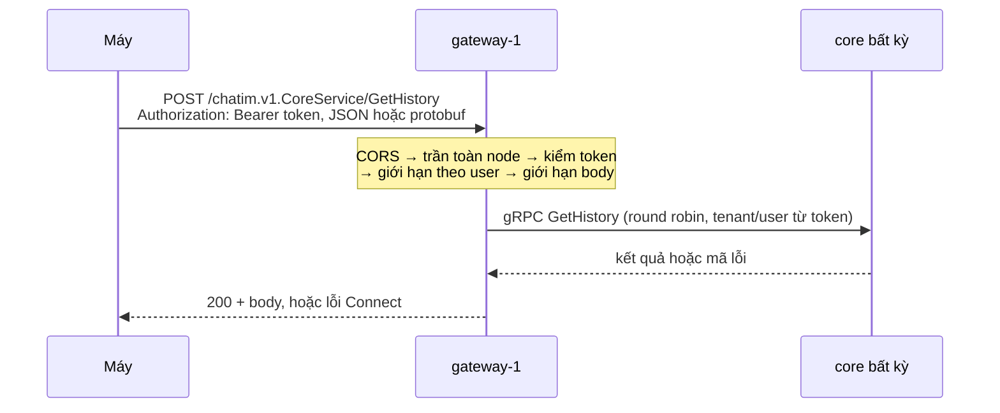

# Module 11: Cổng HTTPS — Tải dữ liệu & Quản lý room (App `gateway`)

> **Trạng thái:** đã xây trên `feat/m4` (M4 phần gateway, 2026-10-23), theo [tóm tắt](../plans/2026-10-23-m4-gateway-https-summary.md); quyết định D197–D198 ở [decision log §17.9–17.10](../decision-log.md). Code: `apps/gateway` (app), `pkg/corecall` (chuyển lệnh dùng chung với websocket), `pkg/grpcclient.NewStatic` (kết nối core round robin), `pkg/pb/chatim/v1/chatimv1connect` (code Connect sinh từ proto).
>
> **Mục tiêu module:** Cho máy tải dữ liệu (danh sách hội thoại, lịch sử, thành viên...) và quản lý room (tạo nhóm, thêm người, đổi tên...) qua HTTPS bình thường, còn WebSocket ([module 09](./09-feature-realtime-delivery-and-ephemeral.md)) chỉ lo ghi realtime và đẩy event.

---

## 1. Các Use Case nghiệp vụ (Business Use Cases)

| Mã Use Case | Tên Use Case | Tác nhân | Mô tả & Kết quả kỳ vọng |
|---|---|---|---|
| **UC-GW-01** | **Mở app, thấy danh sách hội thoại** | Người dùng | Máy gọi `ListMyRooms` qua HTTPS (trước đó chờ trả lời mọi `MarkRead` đang gửi trên WebSocket để unread đúng, [Module 09 §11](./09-feature-realtime-delivery-and-ephemeral.md)); nhận danh sách đã xếp và đếm unread. |
| **UC-GW-02** | **Cuộn lịch sử, xem thành viên, bookmark, thread** | Người dùng | 14 lệnh đọc (`GetHistory`, `ListMembers`, `ListBookmarks`...) qua HTTPS, kết quả bằng đúng gọi gRPC thẳng core. |
| **UC-GW-03** | **Tạo nhóm, thêm/xoá người, đổi tên, đổi quyền** | Chủ/admin nhóm | 8 lệnh quản lý qua HTTPS; người khác đang online nhận thay đổi realtime qua event trên WebSocket. |
| **UC-GW-04** | **App web gọi từ trình duyệt** | Frontend | CORS chỉ cho origin trong `GW_CORS_ORIGINS`; preflight không cần token. |

Ví dụ: Lan tạo nhóm "Kho HCM" có Bình bằng `POST /chatim.v1.CoreService/CreateRoom`; máy Bình đang nối WebSocket nhận `member_added` ngay, mở nhóm thì thấy `room_updated` khi Lan đổi tên.

---

## 2. Luồng hoạt động chi tiết (How It Works)

### 2.1. Chia lệnh giữa hai đường (D198)

| Đường | Lệnh |
|---|---|
| WebSocket, 12 lệnh ghi realtime (`corecall.Realtime()`) | `SendMessage`, `EditMessage`, `DeleteMessage`, `HideMessage`, `ReactMessage`, `PinMessage`, `UnpinMessage`, `SetBookmark`, `MarkRead`, `MarkUnread`, `ClearHistory`, `SetRoomPreferences` |
| HTTPS, 14 lệnh đọc (`corecall.Request()`) | `ListMyRooms`, `GetRooms`, `GetHistory`, `GetMessages`, `GetEditHistory`, `GetReplies`, `ListThreads`, `ListPins`, `GetReactions`, `GetReactionSettings`, `ListBookmarks`, `ListMembers`, `ListMentions`, `ListRoomGroups` |
| HTTPS, 8 lệnh quản lý (`corecall.Request()`) | `CreateRoom`, `OpenDirectRoom`, `UpdateRoom`, `AddMembers`, `RemoveMember`, `LeaveRoom`, `ChangeMemberRole`, `SetMemberPriority` |
| Không mở cho máy | `ListMyRoomIDs` (websocket gọi), `SetUserGroups`, `SetGroups` (app nội bộ) |

Test trong `pkg/corecall` kiểm hai tập không trùng và cộng lại đúng 34 field của `ClientRequest`. Gửi lệnh HTTPS qua WebSocket → `UNIMPLEMENTED` "request not supported"; gửi `SendMessage` qua gateway → `unimplemented`.

### 2.2. Một lệnh đi qua gateway

Chuỗi xử lý trong `apps/gateway/internal/api`, theo thứ tự:

1. **CORS:** origin có trong `GW_CORS_ORIGINS` thì trả `Access-Control-Allow-Origin` đúng origin đó, `Vary: Origin`; preflight (`OPTIONS` có `Access-Control-Request-Method`) trả 204 với `Allow-Methods: POST`, `Allow-Headers: Authorization, Content-Type, Connect-Protocol-Version, Connect-Timeout-Ms`, `Max-Age: 600`, không cần token; origin khác → 403 không header CORS. Không bao giờ có `Access-Control-Allow-Credentials`, không `*`.
2. **Trần toàn node:** quá `GW_INFLIGHT_MAX` (10.000) lệnh đang chạy → 503 `unavailable` "gateway busy, retry later", trước khi kiểm token.
3. **Kiểm token:** đúng một header `Authorization: Bearer <token>`, ký tự ASCII in được, ≤ 8KB; `pkg/jwtverify` như websocket (`EdDSA`, `iss`, `aud`, hạn, `sub`/`tid`). Sai → 401 `unauthenticated`, đếm theo lý do, log tối đa 1 dòng/giây chỉ ghi lý do.
4. **Giới hạn theo (tenant, user) trên node:** 50 lệnh/giây, dồn 100, tối đa 32 lệnh đang chạy → 429 `resource_exhausted`.
5. **Body:** quá `GW_BODY_MAX` (128KB) → `resource_exhausted`; không nhận body nén.
6. **Handler Connect:** một handler cho mỗi lệnh của `corecall.Request()`, sinh từ descriptor, cùng một hàm chuyển: lấy claims, gọi `corecall.Forwarder.Forward` (chép field biết, tenant/user chỉ từ token, hạn `CORE_REQUEST_DEADLINE`, một lần gọi). Đường khác → `unimplemented`, đếm `commands_total{command="unknown"}`.

### 2.3. Gọi core

Một `grpc.ClientConn` duy nhất tới mọi địa chỉ trong `GW_CORE_ADDRS` (resolver tĩnh, `round_robin`). Không Redis, không chọn theo slot: lệnh đọc đọc thẳng Mongo, lệnh quản lý không qua actor, nên core nào cũng đúng. Không retry của mình: core chết giữa lệnh → máy nhận `unavailable` sau đúng một lần gọi; lần sau round robin chọn core khác.

---

## 3. Cơ chế bảo đảm tính đúng đắn (Guarantees & Mechanisms)

- **Danh tính chỉ từ token:** header `x-chatim-*` máy gửi bị bỏ; metadata gửi core được đặt lại từ claims.
- **Field lạ không tới core:** JSON đọc bằng protojson `DiscardUnknown`, protobuf đi qua `corecall.CopyKnown`.
- **Lỗi một-một:** mã gRPC của core → `connect.Code` cùng số; giữ lời core cho `invalid_argument`, `not_found`, `failed_precondition`, `permission_denied`, `already_exists`, `resource_exhausted`; câu cố định cho lỗi hạ tầng (`unavailable` "core unavailable, retry later", `deadline_exceeded`, `canceled`, `unimplemented` "request not supported"); không lộ địa chỉ core.
- **Lỗi của tầng chặn** (401, 429, 503, 404 đường lạ) luôn là mã HTTP + thân JSON `{"code","message"}` kiểu Connect cho mọi giao thức, để client streaming/gRPC cũng thấy đúng mã.
- **Giải phóng chắc chắn:** handler panic hay máy huỷ giữa chừng vẫn trả chỗ của trần toàn node và của user (test).
- **Thay đổi tới người khác qua event:** gateway không phát event; core phát như mọi lệnh, websocket đẩy xuống.

---

## 4. Kỹ thuật & Công nghệ triển khai (Technologies)

- **Connect** `connectrpc.com/connect` v1.21.0 (plugin `buf.build/connectrpc/go` v1.21.0 sinh `chatimv1connect`): `POST /chatim.v1.{CoreService,MentionService}/{Lệnh}`, JSON hoặc protobuf; client sinh sẵn cho web, iOS, Android từ cùng proto.
- **HTTP/1.1 và h2c** (`http.Server.Protocols`), TLS ở load balancer. Server: `ReadHeaderTimeout` 5s, `ReadTimeout` 10s, `WriteTimeout` ≥ `CORE_REQUEST_DEADLINE` + 5s, `IdleTimeout` 60s, header ≤ 16KB, 250 stream HTTP/2 mỗi kết nối.
- **Kho giới hạn theo user** (`pkg/userlimit`): token bucket `golang.org/x/time/rate` + bộ đếm đang chạy, LRU `GW_USER_LIMITERS` (100.000) có khoá, chỉ đẩy người không có lệnh đang chạy.
- **Admin** (`pkg/admin`): `/livez`, `/readyz` (có core READY và chưa tắt), `/metrics`, pprof; `/app probe` cho healthcheck.

---

## 5. Hạn chế kỹ thuật & Đánh đổi (Limitations & Trade-offs)

| Hạn chế | Đánh đổi |
|---|---|
| Không thu hồi token ở Phase 1 (owner 2026-10-23) | Token ngắn (≤ 15 phút); hết hạn → 401 ở lần gọi kế; thu hồi thuộc `iam` Phase 2 |
| JWKS đọc một lần lúc khởi động | Đổi khoá = thêm khoá mới vào JWKS rồi rolling restart, như websocket |
| Giới hạn theo user là của từng node | N node thì một user tối đa N × 50 lệnh/giây; người bị đẩy khỏi LRU rồi quay lại được thêm tối đa một burst |
| Trần toàn node kiểm trước token | Lũ request không token vẫn chiếm chỗ tới trần; chặn lũ là việc của edge/load balancer; không giới hạn theo IP vì sau load balancer IP không tin được |
| Round robin không biết core nào đang chết tới khi kết nối báo hỏng | Một vài lệnh có thể nhận `unavailable`; máy gửi lại (lệnh quản lý có `request_id`) |
| Bộ đếm body quá lớn không đếm request giao thức gRPC khai kích thước quá lớn ở đầu tin | Request vẫn bị từ chối, chỉ thiếu số đếm |

---

## 6. Phụ thuộc kỹ thuật & Bán kính sự cố (Dependencies & Blast Radius)

- **Core:** không core nào READY → `/readyz` 503, lệnh trả `unavailable`; một core chết → round robin sang core còn lại.
- **Không Redis, không NATS, không database:** gateway chết chỉ mất đường tải dữ liệu; WebSocket và ghi realtime vẫn chạy.
- **Tắt:** `/readyz` false → `GW_DRAIN_DELAY` → `http.Server.Shutdown` chờ lệnh đang chạy trong `GW_SHUTDOWN_BUDGET` (> drain + `CORE_REQUEST_DEADLINE`) → đóng kết nối core; compose `stop_grace_period` 18s.

### 6.1. Chỉ số vận hành (`chatim_gateway_*`)

| Chỉ số | Ý nghĩa |
|---|---|
| `commands_total{command,code}` | Lệnh đã chuyển theo mã kết quả; `command="unknown"` là đường lạ |
| `core_call_seconds{command}` | Thời gian gọi core |
| `auth_failures_total{reason}` | Token thiếu/sai/hết hạn theo lý do |
| `rate_limited_total{limit="rate"\|"inflight"}` | Bị giới hạn theo user |
| `inflight_rejected_total` | Bị trần toàn node từ chối |
| `body_too_large_total` | Body quá `GW_BODY_MAX` |
| `inflight` | Lệnh đang chạy trên node |

Cấu hình đầy đủ (`GW_*`) và ví dụ `curl` với token dev: [README](../../README.md) mục "Biến môi trường `apps/gateway`".
