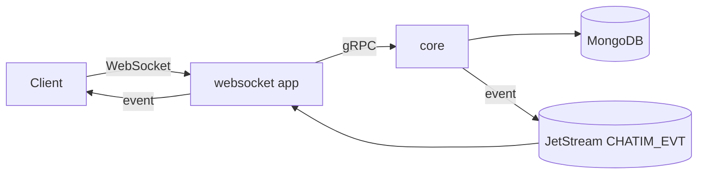

# M3 — Core: API truy vấn còn thiếu: tóm tắt kỹ thuật

> Trạng thái: **owner duyệt 2026-10-13** (viết lại sau một vòng phản biện độc lập). Chưa có code. Làm trên nhánh chung `feat/m3` (tạo từ `main` sau khi merge M2c). Decision log: `.claude/plans/m3-scope-boundary_design.md`, `.claude/plans/m3-core-query-apis_design.md`.

## 1. Thuật ngữ

| Từ | Nghĩa |
|---|---|
| người đọc | User gọi API (metadata `x-chatim-user`). Mọi tin trả về đã áp ẩn, xoá lịch sử và xoá tin theo người này |
| phần của tôi | Doc `members` của người đọc trong một room: `role`, `joined_at`, `cleared_at`, `read_seq`, `read_ver`, cài đặt hội thoại |
| cài đặt hội thoại | Ghim hội thoại lên đầu (`pinned_at`), tắt thông báo tới một lúc (`muted_until`), lưu trữ (`archived_at`). Riêng từng người, không ảnh hưởng người khác |
| hoạt động của room | `rooms.last_seq`, `last_message_at`, `last_edit_at` (mới), `last_change_at`: do worker `room_activity` ghi bằng `$max`, có thể trễ vài ms tới vài giây so với tin thật |
| mốc xếp | Thời điểm dùng để xếp room: `max(last_message_at, joined_at)`. Mọi tin mới, kể cả tin hệ thống, đẩy room lên; room vừa được thêm vào cũng nhảy lên đầu |
| đường join / đường app | Hai cách `ListMyRooms` đọc danh sách room của user: ≤ `ROOM_LIST_JOIN_MAX` (2.000) room thì một aggregate `members → rooms` ở DB; nhiều hơn thì đọc từng bước rồi xếp ở core. Cùng kết quả |
| ảnh chụp danh sách | Danh sách (room, khoá xếp) đã xếp của một user, giữ trong RAM core 30s để trang sau không phải xếp lại |
| cache thông tin room | Tên, loại, ảnh, `member_count`, `dm_key` của room trong RAM core, dùng chung cho mọi người đọc; xoá khi có `room_updated`/`member_count_changed`, TTL 60s |
| cache đuôi room | ~300 tin gần nhất của room ở dạng gọn (seq, người gửi, đã xoá, `nu`, lúc gửi) + ~10 tin có text rút gọn, trong RAM core, dùng chung cho mọi người đọc; kiểm bằng `last_seq`, `last_edit_at` (ý D72) |
| xem trước | `LastPreview`: tin mới nhất người đọc còn xem được, rút gọn (seq, người gửi, loại, text tối đa 120 ký tự, lúc gửi, đã xoá, đã sửa) |
| unread | Số tin chưa đọc theo R17: tin sau `read_seq`, của người khác, chưa xoá, không ẩn với tôi, sau `cleared_at`, không `skip_unread`. Đếm tới 100 (client hiện "99+") |
| `approx` | Cờ trên unread: đọc hết 300 tin gần nhất mà chưa về tới `read_seq` và chưa đủ 100 → số trả về là cận dưới |
| tin hệ thống | Tin do app nội bộ gửi ("Minh đã ghim một tin", "Cuộc gọi 3 phút"), `kind = system` (R23, P7). Như tin thường: đẩy room lên đầu và tính unread, trừ khi người gửi đặt `skip_unread` |
| meta | Dữ liệu tuỳ ý của app gắn vào tin, tối đa 8KB (A6). Core không đọc nội dung |
| emoji/bookmark của tôi | `my_reaction`, `bookmarked` trên tin ở màn hình mở room |
| thread | Tin cha có trả lời (D114: trả lời nằm trên main timeline có trích tin cha) |

## 2. Bức tranh chung

### 2.1 Scope và ranh giới

Client gọi core qua app websocket cho mọi màn hình chat, kể cả danh sách hội thoại (owner 2026-10-13). Core trả dữ liệu của core và giá trị theo người đọc tính lúc đọc (unread, ẩn, xem trước); cài đặt hội thoại của từng người lưu trên doc `members` của người đó.

| Trong scope M3 → core | Ngoài scope → thuộc về |
|---|---|
| Danh sách hội thoại đã xếp: ghim trước, rồi theo tin mới nhất; mỗi room kèm xem trước và unread; thư mục lưu trữ (`ListMyRooms`, `GetRooms`) | Dấu `@` trên danh sách hội thoại: owner 2026-10-13 không cần, danh sách chỉ hiện unread |
| Ghim hội thoại, tắt thông báo, lưu trữ (`SetRoomPreferences`) | Gửi thông báo đẩy (dùng `muted_until`) → app push |
| Cache thông tin room và cache đuôi room trong RAM core | Cache dùng chung giữa các core (Redis) → chưa cần |
| `GetHistory` thêm neo `AROUND(seq)`; `GetMessages`, `ListThreads`, `GetReactions`, `ListPins`, `ListMembers`, `UpdateRoom` | Sync token, đồng bộ đa thiết bị → owner xác định sau |
| Emoji/bookmark của tôi trên `GetHistory`, `GetMessages`, `GetReplies` | Gom `MarkRead`, reconnect jitter, bỏ `kind`/`skip_unread` gửi từ client → M4 websocket |
| `SendMessage` nhận `kind = system`, `skip_unread`, `meta` | Sinh tin hệ thống từ event (module SysMsg) → app riêng |
| Collection `reply_threads`; test sẵn sàng sharding trên 2 shard | Chuyển mentions, bookmarks ra khỏi core; tên, ảnh của user → hệ thống user; attachments → sau |

### 2.2 Màn hình → lần gọi core, hiện ngay và hiện sau

| Màn hình | Lần gọi | Hiện ngay | Hiện sau |
|---|---|---|---|
| Mở app, kết nối lại | `ListMyRooms` trang đầu | room, tên, ảnh, 2 user của DM, xem trước, unread, đã ghim, tắt tiếng, role, `read_seq` | `member_count`, `peer_read_seq` (đã có trong mục, client dùng khi cần); tên/ảnh user lấy từ hệ thống user |
| Cuộn danh sách | `ListMyRooms(next)` | như trên | |
| Tin mới, đọc, xoá khi đang mở danh sách | **không gọi core**: client áp event (mục 4.3); chỉ vài trường hợp gọi `GetRooms` | | |
| Thư mục lưu trữ | `ListMyRooms(folder = ARCHIVED)` | như trên | |
| Ghim, tắt tiếng, lưu trữ hội thoại | `SetRoomPreferences` | | |
| Mở room tại chỗ chưa đọc, nhảy tới tin (ghim, trích, mention) | `GetHistory(AROUND, seq)` | tin quanh seq, emoji/bookmark của tôi, số trả lời, trích dẫn | banner ghim (`ListPins`), "ai đã xem" (`ListMembers`) |
| Lấy vài tin đã biết seq | `GetMessages` | | |
| Tab thread | `ListThreads` | tin cha, số trả lời, lúc và xem trước trả lời mới nhất | |
| Người react một tin | `GetReactions` | user, emoji, lúc react (số đếm đã có trên tin) | |
| Tab ghim | `ListPins` | ghim + tin | |
| Thành viên, ai đã xem | `ListMembers` | user, role, `read_seq` | |
| Đổi tên, ảnh nhóm | `UpdateRoom` | | |

### 2.3 Sơ đồ

RPC của core sau M3 (33, ★ = mới):
- Room: `CreateRoom`, `OpenDirectRoom`, `ListMyRooms`★, `GetRooms`★, `UpdateRoom`★, `SetRoomPreferences`★.
- Member và vị trí đọc: `AddMembers`, `RemoveMember`, `LeaveRoom`, `ChangeMemberRole`, `SetMemberPriority`, `ListMembers`★, `MarkRead`, `MarkUnread`.
- Tin: `SendMessage` (sửa), `EditMessage`, `DeleteMessage`, `HideMessage`, `ClearHistory`, `GetHistory` (thêm `AROUND`), `GetEditHistory`, `GetReplies`, `GetMessages`★, `ListThreads`★.
- Reaction, ghim, bookmark, mention: `ReactMessage`, `GetReactionSettings`, `GetReactions`★, `PinMessage`, `UnpinMessage`, `ListPins`★, `SetBookmark`, `ListBookmarks`, `ListMentions`.

## 3. Dữ liệu

### 3.1 Field mới trên `messages` (tên ngắn, D96)

| Field | Nghĩa | Ví dụ |
|---|---|---|
| `k` | đã có; thêm giá trị 2 = `system` | `2` |
| `nu` | không tính unread; chỉ ghi khi `true` | `true` |
| `m` | meta, BinData ≤ 8KB; chỉ ghi khi có | byte của `{"call_seconds":180}` |

Sửa tin không đổi `k`, `nu`, `m`. Xoá tin `$unset m` (như `x`, D75), giữ `k`, `nu`.

### 3.2 Field mới trên `rooms`

| Field | Nghĩa | Ví dụ |
|---|---|---|
| `avatar` | tham chiếu ảnh nhóm do app giữ, ≤ 1.024 byte; thiếu = chưa có | `"files/av/777.png"` |
| `info_ver` | +1 mỗi lần `UpdateRoom` đổi tên/ảnh; 1 lúc tạo | `3` |
| `updated_at`, `updated_by` | lần đổi thông tin cuối | `2026-10-20T09:00Z`, `minh` |
| `last_edit_at` | lúc sửa/xoá tin main timeline gần nhất; worker `room_activity` `$max` theo phiếu `EditInserted`; chỉ dùng để kiểm cache đuôi room | `2026-10-20T09:10Z` |

### 3.3 Field mới trên `members` (cài đặt hội thoại)

| Field | Nghĩa | Ví dụ |
|---|---|---|
| `pinned_at` | lúc ghim hội thoại; thiếu = không ghim. Room ghim đứng đầu, ghim sau đứng trên | `2026-10-20T08:00Z` |
| `muted_until` | tắt thông báo tới lúc này; thiếu = không tắt; "mãi mãi" = `9999-12-31` | `2026-10-21T08:00Z` |
| `archived_at` | lúc lưu trữ; thiếu = ở danh sách chính. Tin mới không tự đưa ra khỏi lưu trữ | `2026-10-19T10:00Z` |
| `preference_ver` | +1 mỗi lần một trong ba field trên đổi; id event | `5` |

Ba field không đụng `ver` (membership) hay `read_ver`. Rời room rồi vào lại giữ nguyên như `cleared_at`.

### 3.4 Collection mới `reply_threads` (projection)

Ví dụ: tin 40 của room 777 có trả lời 57 (09:00) và 60 (09:30).

| Field | Nghĩa | Ví dụ |
|---|---|---|
| `_id` | khoá tin cha, 24B `room│thread│seq` (clustered) | `777│0│40` |
| `room_id`, `tenant` | room, tenant | `777`, `acme` |
| `last_reply_at`, `last_reply_seq` | trả lời mới nhất (lúc gửi, seq) | `09:30`, `60` |
| `updated_at` | lúc worker ghi | |

Index `{room_id, last_reply_at: -1, _id: -1}`. Chỉ worker `reply_mention_index` ghi.

### 3.5 Index đổi

| Collection | Cũ | Mới | Vì sao |
|---|---|---|---|
| `members` | `{tenant, user_id, state, room_id, joined_at, cleared_at, read_seq}` | thêm `pinned_at, archived_at` cuối | Trang đầu `ListMyRooms` đọc mọi room của tôi phủ index để xếp và chia thư mục; `RoomsOf` của `ListMentions` vẫn phủ |
| `message_interactions` | `{message_key, kind, state, value}` | `{message_key, kind, state, value, updated_at: -1, actor_id}` | `GetReactions` sắp mới nhất trước, đọc phủ index; tiền tố cũ vẫn phục vụ `CountReactions`, `CountLiveReplies` |

Dev: `make infra-reset`.

### 3.6 Proto, quyền, phiếu việc

- `MessageKind` thêm `MESSAGE_KIND_SYSTEM = 2`; `domain.kindNames` thêm `system` (dùng được trong `MESSAGE_LOCKED_KINDS`).
- `SendMessageRequest` thêm `kind`, `skip_unread`, `meta`. `Message` thêm `skip_unread`, `meta`, `my_reaction`, `bookmarked`. `HistoryAnchor` thêm `HISTORY_ANCHOR_AROUND`.
- `Room` thêm `avatar`, `info_ver`, `direct_users` (2 user của DM, tách từ `dm_key`). `UpdateRoomRequest` dùng `optional` cho `name`, `avatar` (vắng = không đổi, `""` của avatar = bỏ ảnh); `SetRoomPreferencesRequest` dùng `optional` cho cả ba cài đặt.
- `ListMyRoomsRequest{folder, next, limit}` → `{items, next}`. Message mới: `RoomItem{room, me, preview, unread{count, approx}, peer_read_seq}`, `LastPreview`, `Reactor`, `PinnedMessage`, `ThreadItem`, `MemberItem`, event `RoomUpdated`, `RoomPreferencesChanged`.
- Action mới của `access`: `read_reactions`, `read_members` (mọi member), `update_room` (owner, admin), `send_system_message` (mặc định cho phép). `SetRoomPreferences` chỉ cần là member (cài đặt của chính mình).
- Phiếu mới: kind 13 `RoomChanged` (`u:{room}-info-v{info_ver}`, feed lấy update `rooms` có `updatedFields.info_ver`); kind 14 `PreferenceChanged` (`f:{room}-pf-{user}-v{preference_ver}`, feed lấy update `members` có `updatedFields.preference_ver`). Update khác của `rooms` vẫn không vào feed.
- Config mới: `ROOM_LIST_JOIN_MAX` (2.000; điểm chuyển đường, không phải giới hạn), `ROOM_TAIL_CACHE_BYTES` (256MB, LRU theo byte), `ROOM_INFO_CACHE_ENTRIES` (100.000). Cỡ một đuôi: 300 × ~40B + 10 × ~200B ≈ 14KB → 10K room nóng ≈ 140MB mỗi core.

## 4. Luồng xử lý

Dữ liệu mẫu: Minh ở 4 room.

| room | role | `read_seq` | `cleared_at` | `pinned_at` | `archived_at` | `rooms.last_message_at` | tin cuối thật |
|---|---|---|---|---|---|---|---|
| 777 nhóm "Cửa hàng 12" | admin | 41 | — | — | — | 10:05 | 45 |
| 888 DM Minh–Lan | member | 12 | — | 08:00 | — | 09:40 | 12 |
| 999 nhóm "Kho" | member | 230 | 01/10 | — | — | hôm qua | 236 |
| 555 nhóm "Cũ" | member | 90 | — | — | 19/10 | tuần trước | 90 |

Mọi API đọc: `grpcsrv` → `access` → store → `view.Default()` → (màn hình mở room) emoji/bookmark của tôi. Không qua actor.

Phân trang: mọi API danh sách mới dùng **con trỏ**, không dùng số trang/offset (offset đọc rồi bỏ mọi doc phía trước và lặp/sót mục khi dữ liệu đổi). Core trả chuỗi `next` mờ (rỗng = hết), client gửi lại nguyên chuỗi; bên trong là khoá sắp của mục cuối (ghi ở từng API). Danh sách hội thoại dùng con trỏ theo khoá xếp (mục 4.1).

### 4.1 `ListMyRooms(folder, next, limit)` — danh sách hội thoại

Nguyên tắc: **dữ liệu riêng của người đọc đọc tươi qua join; dữ liệu chung của room đi qua cache trong RAM core**. Ví dụ nhóm 777 có 500 người cùng kết nối lại: 500 người dùng chung một bản thông tin room và một bản đuôi room, thay vì 500 lần đọc 300 tin.

| Phần | Riêng hay chung | Lấy từ |
|---|---|---|
| Room tôi ở, `joined_at`, ghim, lưu trữ, `read_seq`, `cleared_at`, role, tắt tiếng | riêng tôi | `members` (join hoặc đường app), tươi mỗi lần |
| `last_message_at`, `last_seq`, `last_edit_at` | chung, đổi mỗi tin | cùng lần đọc `members` (3 field nhỏ của `rooms`) |
| Tên, loại, ảnh, `member_count`, `dm_key` | chung, đổi hiếm | cache thông tin room |
| ~300 tin gần nhất dạng gọn + ~10 tin có text rút gọn | chung, đổi mỗi tin | cache đuôi room |
| Tin tôi đã ẩn | riêng tôi | 1 truy vấn `hidden` |

**Bước 1 — chọn đường.** `countDocuments` trên index "room của user" `{tenant, user_id, state: 1}` với `limit ROOM_LIST_JOIN_MAX + 1`: `COUNT_SCAN` phủ index, đọc tối đa 2.001 khoá, không đọc doc. Kết quả cache theo user 60s (hai đường ra cùng kết quả nên quyết định cũ vài giây không sai). ≤ 2.000 → đường join; lớn hơn → đường app.

**Bước 2 — danh sách đã xếp của trang** (cả hai đường cùng quy tắc xếp: room ghim trước theo `pinned_at` giảm, rồi mốc xếp giảm, hoà theo `room_id` giảm; thư mục `MAIN` = không `archived_at`, `ARCHIVED` = có):
- **Đường join (≤ 2.000 room):** một aggregate trên `members`: `$match` user → `$lookup rooms` (`room_id → _id`, sub-pipeline chỉ lấy `last_message_at, last_seq, last_edit_at`, không kéo `pins`) → `$addFields` mốc xếp → `$match` thư mục → `$sort`. Dòng nào cũng đã có đủ field `members` của tôi; DM thêm `$lookup members` của người kia (`peer_read_seq`).
- **Đường app (> 2.000 room):** đọc phủ index `members` (`room_id, joined_at, pinned_at, archived_at`) → `rooms _id $in` lô 1.000 lấy 3 field hoạt động → xếp trong RAM bằng một hàm thuần → `members _id $in` cho các room của trang (đủ field của tôi + người kia của DM).
- Kết quả xếp (room + khoá xếp, ~16B/room, 5.000 room ≈ 80KB) giữ làm **ảnh chụp** của user trong RAM 30s. Trang sau tới cùng core → cắt từ ảnh chụp, không xếp lại, chỉ `members _id $in` của 20 room để có field tươi; tới core khác hoặc hết hạn → chạy lại bước 2 với điều kiện "khoá nhỏ hơn con trỏ".

**Bước 3 — thông tin room của 20 dòng:** cache thông tin room theo room id; thiếu → một `rooms _id $in` cho các room thiếu. Entry bị xoá khi core nhận `room_updated` hoặc `member_count_changed` (watcher kiểu `memberwatch` trên core NATS `live.*.room.*.evt.…`), TTL 60s phòng event mất.

**Bước 4 — đuôi room của 20 dòng:** cache đuôi room theo room id, kiểm bằng `last_seq`, `last_edit_at` vừa đọc ở bước 2:
- cache có `last_seq` ≥ và `last_edit_at` bằng → dùng luôn, không gọi DB;
- chỉ có tin mới → quét bù `seq > last_seq của cache` (field gọn `_id f d nu ts`, thêm text rút gọn cho 10 tin mới nhất), nối vào, giữ 300;
- có sửa/xoá mới (`last_edit_at` đổi) hoặc chưa có → quét lại cửa sổ (≤ 300 tin).
Quét bù và quét lại của nhiều room chạy song song tối đa 16.

**Bước 5 — `hidden` và tính trong RAM:** một truy vấn `hidden {user_id: minh}` cho các seq trong cửa sổ của 20 room. Rồi đếm unread (bỏ tin của Minh, đã xoá, `nu`, `ts ≤ cleared_at`, đã ẩn; chỉ tin sau `read_seq`; dừng ở 100; cửa sổ 300 tin mà chưa tới `read_seq` → `approx`) và chọn xem trước = tin mới nhất Minh còn xem được trong 10 tin có text; không có → xem trước trống.

**Thứ tự chạy trong một lần gọi:** hai đợt nối tiếp, trong mỗi đợt các truy vấn chạy song song.
- Đợt 1: bước 2 (join hoặc `members` của trang; có `last_seq`, `last_edit_at`, `read_seq`) ∥ bước 3 (`rooms _id $in` cho room thiếu trong cache thông tin).
- Đợt 2: bước 4 (quét bù/quét lại các room có cache cũ, mỗi room một truy vấn, tối đa 16 cùng lúc) ∥ `hidden` của bước 5. Đợt 2 cần `last_seq`, `read_seq` của đợt 1.
- Rồi tính unread và xem trước trong RAM. Mỗi room một truy vấn quét vì mỗi room là một khoảng `_id` riêng với giới hạn 300 tin riêng; không gộp `$unionWith` vì server chạy các nhánh lần lượt.
- Thời gian chờ ước (~1ms mỗi truy vấn trong DC): cache nóng ~2 lượt chờ (2–3ms); cache lạnh 20 room ~3–4 lượt chờ (đợt 2 chạy 16 rồi 4).

**Trả về:** `items` (20 `RoomItem`) và `next` mờ = khoá xếp của dòng cuối `(đã ghim, pinned_at, mốc xếp, room_id)`, rỗng = hết.

Ví dụ trang đầu thư mục chính: 888 (ghim), 777 (10:05), 999 (hôm qua); 555 chỉ có ở `ARCHIVED`.
- 777: cache đuôi có tới 44, join báo `last_seq` 45 → quét bù 1 tin. Tin 43 của Minh, tin 44 Lan gửi nhưng Minh đã ẩn → unread 2 (42, 45), xem trước 45.
- 888: `read_seq` 12 = tin cuối, cache khớp → không gọi DB; unread 0; `peer_read_seq` = vị trí đọc của Lan → client hiện "đã xem".
- 999: tin 231–236 sau `cleared_at` → đếm bình thường.

**Con trỏ đúng mà không cần chốt thứ tự:** mốc xếp chỉ tăng (`$max`), nên room chỉ có thể nhảy lên. Room nhảy lên giữa hai trang không hiện ở trang sau, nhưng client đã đưa nó lên đầu theo `msg_created` (4.3); room ở trang trước không bao giờ hiện lại. Chỉ bỏ ghim, bỏ lưu trữ, vào lại room làm room tụt xuống: đó là lệnh của chính người đọc, client biết qua event và bỏ trùng theo room id. Ví dụ: Lan nhắn vào room ở vị trí 35 khi Minh đang xem trang 1 → client đưa room lên đầu; trang 2 lấy từ ảnh chụp vẫn có room đó ở vị trí 35 → client bỏ trùng; trang 2 chạy lại thì không có nó.

Kết nối lại: gọi lại trang đầu (P8). Lỗi: `limit > 100`, thư mục lạ, con trỏ hỏng → `INVALID_ARGUMENT`.

### 4.2 `GetRooms(room_ids ≤ 100)` — làm mới vài room

Bước 2 bằng `members _id $in keys.Member(room, minh)` (+ `$lookup rooms` 3 field hoạt động), rồi bước 3–5 như 4.1. Dùng khi client cần đếm lại vài room sau event (4.3). Room không có và room không ở đều vào `missing`, không phân biệt. Quá 100 id, id hỏng → `INVALID_ARGUMENT`.

### 4.3 Client áp event, không gọi lại core

Khi đang mở danh sách, client tự cập nhật từ event, không gọi core cho mỗi tin:

| Event | Client làm |
|---|---|
| `msg_created` của người khác, không `skip_unread` (kể cả tin hệ thống) | unread +1 (tới 100), xem trước = tin này, room lên đầu (sau các room ghim) |
| `msg_created` của mình hoặc có `skip_unread` | xem trước = tin này, room lên đầu, không đổi unread |
| `read_updated` của mình (thiết bị khác) | gọi `GetRooms([room])` để đếm lại |
| `msg_deleted` / `message_hidden` / `history_cleared` có tin sau `read_seq` | gọi `GetRooms([room])` |
| `room_preferences_changed`, `room_updated`, `member_added`/`member_removed` của mình | cập nhật cài đặt / tên / thêm, bỏ room (thêm: `GetRooms([room])`) |
| mất event, quay lại từ nền | gọi lại `ListMyRooms` |

Client gom các `GetRooms` trong ~1s thành một lần gọi (≤ 100 id). Một nhóm 500 người gửi 5 tin/s không sinh lần gọi core nào từ danh sách hội thoại.

### 4.4 `SetRoomPreferences(room, pinned?, muted_until?, archived?)`

1. Phải có ít nhất một field; `muted_until` trong quá khứ = bỏ tắt tiếng. Sai → `INVALID_ARGUMENT`.
2. Minh phải đang ở room (`PERMISSION_DENIED`); không hỏi policy (cài đặt của chính mình).
3. Một `FindOneAndUpdate` trên doc `members` của Minh, filter `state = 1` và chỉ khi có field thật sự đổi: `$set pinned_at/muted_until/archived_at` (hoặc `$unset`), `$inc preference_ver`, `$max last_change_at`; trả doc sau. Không đổi → `changed = false`, không event.
4. Enqueue `room_preferences_changed` `{room}-pf-{user}-v{preference_ver}` (subject `member`), mang cả ba giá trị hiện tại.

Hai thiết bị đổi cùng lúc: mỗi lệnh một `$inc`, field nào ghi sau thắng; event mang trạng thái sau lệnh, client giữ bản `preference_ver` cao nhất. Worker: phiếu `PreferenceChanged` → `preferences_event` (delay `RECONCILE_DELAY`, phát lại doc hiện tại khi `preference_ver` bằng phiếu). Resync thêm phiếu này khi `preference_ver ≥ 1`.

### 4.5 `GetHistory(AROUND, seq)` và `GetMessages`

- `AROUND(seq, limit)`: một lần quét lùi từ `seq` lấy `limit/2` tin và một lần quét tiến từ `seq + 1` lấy phần còn lại, trong cùng lần gọi; cùng `view` và emoji/bookmark như các neo cũ. Mở room ở tin chưa đọc đầu tiên: `AROUND(read_seq + 1)`.
- `GetMessages(room, thread, seqs ≤ 100)`: `Authorize(read_history)` → `Find _id $in` → `HiddenIn` → `view` → emoji/bookmark. Seq không có thì không trả. Dùng khi client đã biết seq (vd. tin được trích không nằm trong trang). Không phải member → `PERMISSION_DENIED`; room không có → `NOT_FOUND` (như `GetHistory`).

### 4.6 Emoji và bookmark của tôi

Chỉ ở `GetHistory`, `GetMessages`, `GetReplies` (màn hình mở room). Một truy vấn `message_interactions` `_id $in` [`khoá│1│minh`, `khoá│2│minh`] cho các tin còn xem được của trang (≤ 200 khoá, một room). Doc `state = 1` → `my_reaction`/`bookmarked`. Không lưu kết quả.

### 4.7 `ListThreads(room, before, limit)`

1. `Authorize(read_replies)`.
2. `reply_threads` lọc `room_id = 777` và khoảng `_id` của room (mongos nhắm một shard khi đã shard), sắp `last_reply_at` giảm, sau con trỏ `(last_reply_at, seq)`, trang 50 (≤ 100).
3. Một `Find $in` cả tin cha lẫn tin trả lời mới nhất → bỏ tin cha `rc` = 0 → `view`.
4. Trả `ThreadItem{message, last_reply_at, last_reply_preview}`.

Ghi: worker `reply_mention_index` upsert `reply_threads` **mỗi lần xử lý phiếu tin trả lời** (không chỉ khi `AddReply` vừa tạo doc), bằng một update pipeline: `last_reply_at = max(cũ, ts)`, `last_reply_seq` đổi cùng khi `ts` mới hơn. Chạy lại nhiều lần cho cùng kết quả; worker chết giữa `AddReply` và upsert thì lần chạy lại vẫn ghi.

### 4.8 `GetReactions(room, thread, seq, emoji, after, limit)`

`Admit` → `Find` tin (`NOT_FOUND`) → `Allow(read_reactions)`. Tin xoá hoặc ẩn với người đọc → rỗng. Có `emoji`: index mới bằng đủ 4 field, sắp `updated_at` giảm, con trỏ `(updated_at, actor_id)`. `emoji` rỗng (tab "Tất cả"): sắp `value` rồi `updated_at`, con trỏ `(value, updated_at, actor_id)`. Trả `Reactor{user, emoji, at}`, đọc phủ index, trang 50 (≤ 100). Emoji ngoài `REACTION_EMOJIS` → `INVALID_ARGUMENT`.

### 4.9 `ListPins(room)`

`Authorize(read_history)` → `pinproj.Projector.Current` (sẵn có) → `Find $in` các tin ghim → `view`. Trả `pin_ver`, `PinnedMessage{pin, message}`, ghim mới nhất trước; `PIN_LIMIT` 50 nên một trang. Tin ghim đã ẩn với người đọc vẫn có mục, tin là placeholder.

### 4.10 `ListMembers(room, after, limit)`

`Authorize(read_members)`. Đọc index `{room_id, state = 1, role, priority: -1, joined_at, user_id}` theo thứ tự owner → admin → member (ba khoảng, đọc lần lượt trong một lần gọi tới khi đủ trang), lấy doc để có `read_seq`. Trả `MemberItem{user, role, priority, joined_at, read_seq, read_ver}`, con trỏ `(role, priority, joined_at, user)`, trang 500 (≤ 1.000). "Ai đã xem tin 40" = người có `read_seq ≥ 40`.

### 4.11 `UpdateRoom(room, name?, avatar?)`

1. Ít nhất một field; `name` theo luật tạo room (không rỗng, ≤ 128 ký tự, UTF-8); `avatar` ≤ 1.024 byte, `""` = bỏ ảnh → sai thì `INVALID_ARGUMENT`.
2. `Admit` → `Rooms.Get` → DM thì `FAILED_PRECONDITION` → `Allow(update_room)` (owner, admin; khác → `PERMISSION_DENIED`).
3. Không đổi → `changed = false`, không ghi.
4. `UpdateOne` CAS `{_id, info_ver: hiện tại}` → `$set`, `$inc info_ver`; không khớp → `UNAVAILABLE` ngay.
5. Enqueue `room_updated` `{room}-info-v{info_ver}`; worker `room_event` (phiếu `RoomChanged`) phát lại, `room_activity` (`Seq 0`) nâng `last_change_at` để resync tìm được.

### 4.12 `SendMessage` tin hệ thống

Ví dụ: SysMsg nhận `member_removed` của Lan, gửi vào 777 tin `kind = system`, `meta = {"event":"member_left","user":"lan"}`, cid `sys-{event_id}`, metadata user `lan` hoặc id bot.

1. `meta` ≤ 8KB; `kind` chỉ `text`/`system`; tin `system` không nhận `reply_to`, `forward_from`, mention → `INVALID_ARGUMENT`.
2. Actor: tin `system` chỉ kiểm room thuộc tenant, **không kiểm membership**, rồi hỏi policy `send_system_message`.
3. Ghi, chống trùng cid, ack, `msg_created` như tin thường (mang `kind`, `skip_unread`, `meta`). Room lên đầu danh sách và tin được tính unread như tin thường; chỉ tin có `skip_unread` không vào unread.

Muốn khoá sửa/xoá tin `system`: `MESSAGE_LOCKED_KINDS=system` (D87).

### 4.13 Test 2 shard

Compose profile `shard`: config server rs + 2 shard rs + mongos (`mongo:8.2.12`). Script shard collection clustered theo `{_id: 1}`, tách chunk để hai room mẫu ở hai shard. `make itest` qua mongos: toàn bộ `storetest`, explain kiểm `SINGLE_SHARD` cho truy vấn theo một room (`GetHistory`, `AROUND`, quét unread, `GetMessages`, `GetReactions`, `ListThreads`, `ListMembers`), transaction owner (D100), change feed; `make e2e` một lượt qua mongos.

## 5. Đúng đắn và chạy đua

- **Tin cuối và unread** đọc từ `messages` (trực tiếp hoặc qua cache đuôi kiểm bằng `last_seq`): tin vừa ack mà `room_activity` chưa nâng `last_seq` (vài ms–giây) chưa có trong lần gọi đó; client đã áp `msg_created` nên màn hình vẫn đúng, lần gọi sau đúng.
- **Cache chỉ để nhanh, không để đúng (P1):** cache thiếu, hết hạn hay bị xoá → đọc DB; core khởi động lạnh vẫn trả đúng. Mỗi core một bản cache riêng; hai core có thể trả thông tin room lệch nhau tới khi event `room_updated`/`member_count_changed` tới hoặc hết TTL 60s. Sửa/xoá tin đổi `last_edit_at` nên cache đuôi không giữ text đã xoá.
- **Hai đường cùng kết quả:** một quy tắc xếp, test so khớp hai đường trên cùng dữ liệu (mục 12).
- **Client áp event:** event best-effort có thể mất; worker phát lại, và quay lại từ nền hay kết nối lại thì gọi `ListMyRooms` (P8). Unread client tự cộng có thể lệch khi tin vừa tới đã bị xoá trước khi client nhận `msg_created`; `msg_deleted` sau đó kích `GetRooms` sửa lại.
- **Con trỏ danh sách:** mốc xếp chỉ tăng nên không có room bị sót mà client không biết; trùng chỉ xảy ra khi trang lấy từ ảnh chụp cũ hoặc sau lệnh bỏ ghim/bỏ lưu trữ/vào lại của chính người đọc, client bỏ trùng theo room id.
- **Membership:** đọc trong cùng lần gọi; bị xoá giữa chừng thì lần gọi đó có thể còn thấy xem trước, như `GetHistory` hôm nay.
- **`SetRoomPreferences` hai thiết bị:** field ghi sau thắng, `preference_ver` tăng mỗi lần; event mang trạng thái đầy đủ.
- **`reply_threads`:** chạy lại an toàn; trả lời mới hiện ở `ListThreads` sau khi worker chạy (thường vài ms).
- **`UpdateRoom`:** CAS `info_ver`, người thua `UNAVAILABLE`, không mất cập nhật.
- **`GetReactions`:** người đổi emoji giữa hai trang có thể chuyển tab hoặc hiện lại; chỉ trạng thái cuối được bảo đảm.
- **Tin `system`:** cid `sys-{event_id}` nên gửi lại không trùng.

## 6. Event và subject

| Event | Id | Subject | Worker phát lại |
|---|---|---|---|
| `room_updated` (mới) | `{room}-info-v{info_ver}` | `evt.{t}.room.{rid}.room_updated` | `room_event` |
| `room_preferences_changed` (mới) | `{room}-pf-{user}-v{preference_ver}` | `evt.{t}.member.{rid}.room_preferences_changed` | `preferences_event` |
| `msg_created` (đã có) | như cũ | như cũ; payload thêm `kind`, `skip_unread`, `meta` | như cũ |

API đọc và unread không có event. Hai effect mới có `effect_dropped_total`, `reconcile_republished_total`, nằm trong alert `ChatimEffectDropping`, `ChatimRepublishSurge` đã có.

## 7. Thư viện và hạ tầng

Không thêm thư viện. Compose profile `shard` (dev/itest) và script shard. Bootstrap tạo `reply_threads` và hai index mới.

## 8. Quyết định

| # | Quyết định | Phương án bị loại | Vì sao |
|---|---|---|---|
| D120 | Client lấy danh sách hội thoại thẳng từ core; mỗi màn hình một lần gọi | Qua Mention App; ghép nhiều API | Owner 2026-10-13 |
| D121 | `ListMyRooms` xếp lúc đọc (ghim trước, rồi mốc xếp `max(last_message_at, joined_at)`), phân trang bằng con trỏ theo khoá xếp; ảnh chụp danh sách của user giữ 30s trong RAM core để trang sau không xếp lại | Trả `order` mọi room cho client; offset; xếp lại mỗi trang không ảnh chụp; lưu thứ tự theo user | Owner 2026-10-13 không muốn gửi `order` (~80KB ở 5.000 room); mốc xếp chỉ tăng nên con trỏ không làm sót room client chưa biết; lưu theo user tốn một ghi mỗi member mỗi tin (200K ở channel) |
| D122 | Client áp `msg_created` cho unread, xem trước, thứ tự; chỉ gọi `GetRooms` khi đọc ở thiết bị khác, xoá/ẩn trong phần chưa đọc; mất event thì gọi lại `ListMyRooms` | Gọi `GetRooms` mỗi event | Nhóm 500 người, 5 tin/s = 2.500 lần gọi/s; channel 200K = 200K lần gọi mỗi tin |
| D123 | Tin cuối, xem trước và unread tính từ `messages` (qua cache đuôi room) | `rooms.last_seq` làm tin cuối; số lưu sẵn; tin đầy đủ trong mục | D72; P5; tin đầy đủ tới ~200KB mỗi trang |
| D124 | Unread R17 dừng ở 100, quét ≤ 300 tin, quá thì `approx` (D73); không đẩy bản đúng sau | Exact tuyệt đối; core đẩy cho từng user | Chặn chi phí; core không chọn người nhận (P3) |
| D125 | Xem trước = tin mới nhất còn xem được trong phần đã quét, rút gọn `LastPreview` | Tin cuối kèm placeholder ẩn | Dòng room không hiện "đã ẩn" hay nội dung đã xoá lịch sử |
| D126 | Tin hệ thống như tin thường: đẩy room lên đầu, tính unread; `skip_unread` chỉ bỏ tin khỏi unread | Tin hệ thống không đẩy room lên | Owner 2026-10-13 |
| D127 | Ghim/tắt tiếng/lưu trữ hội thoại là field trên `members` với `preference_ver`, một `SetRoomPreferences`, event `room_preferences_changed` subject `member` | Collection riêng; ba RPC | Cài đặt của một (room, user) như vị trí đọc (D105): một doc, toán tử thường, không đụng `ver`; một lệnh cho một màn hình cài đặt |
| D128 | `GetHistory` neo `AROUND(seq)` | Hai lần gọi trước/sau | Mở room tại chỗ chưa đọc và nhảy tới tin là một lần gọi |
| D129 | Emoji/bookmark của tôi chỉ trên `GetHistory`, `GetMessages`, `GetReplies` | Trên mọi API trả tin | Các màn hình khác không hiện |
| D130 | `reply_threads` (projection) ghi mỗi lần xử lý phiếu trả lời, update pipeline `max` | Chỉ ghi khi doc reply vừa tạo; quét doc reply | Worker chết giữa hai bước không làm mất thread; tin nóng 10K trả lời không làm trang đọc 10K doc |
| D131 | Index reaction thêm `updated_at, actor_id`; mới nhất trước | Sắp theo user id | Chi phí như nhau, người xem thường muốn người mới nhất |
| D132 | Tin `system` không kiểm membership, sender do caller chọn, action `send_system_message` | Bắt sender là member | SysMsg gửi được "X đã rời nhóm" |
| D133 | `UpdateRoom`: `info_ver` CAS một lượt, owner/admin, field `optional`; feed lấy update `rooms` có `info_ver` | Fact `room_changes` riêng | Một doc một version như member (D98) |
| D134 | `ListMembers` owner → admin → member trong một lần gọi | Sắp theo chữ cái của role | Role lưu chuỗi; đọc ba khoảng của index sẵn có |
| D135 | Index "room của user" thêm `pinned_at, archived_at` | Đọc đủ doc `members` mọi room ở đường app | Đường app đọc phủ index cả 5.000 room |
| D136 | Hai đường theo `ROOM_LIST_JOIN_MAX` (2.000): join `members → rooms` trong một aggregate, hoặc đọc từng bước rồi xếp ở core; chọn bằng `countDocuments` phủ index có `limit`, cache 60s theo user | Một đường; bộ đếm số room mỗi user; chạy join có chặn `$limit` rồi bỏ khi vượt | Owner chọn hai đường 2026-10-13 (join đắt hơn khi `members` đã shard và user nhiều room); bộ đếm theo user cần `$inc` + phiếu hẹn ở mọi lệnh member; chạy join rồi bỏ làm user lớn tốn cả hai đường |
| D137 | Dữ liệu riêng người đọc đọc tươi; dữ liệu chung của room (thông tin, đuôi ~300 tin) qua cache RAM core, kiểm bằng `last_seq`/`last_edit_at` đọc trong cùng lần, xoá thông tin room theo `room_updated`/`member_count_changed` + TTL 60s | Gộp hết vào một aggregate (cả `$lookup` vào `messages`); cache theo user; Redis chung | Owner 2026-10-13: tận dụng cache, không cần một lần gọi; `messages` là collection lớn nhất, luật shard cấm join vào; cache theo user không dùng chung được giữa 500 người của một nhóm; RAM đủ (≈ 140MB cho 10K room nóng) và không thêm hạ tầng |
| D138 | `rooms.last_edit_at` (`$max` bởi `room_activity` trên phiếu `EditInserted`) | Dùng `last_change_at` | `last_change_at` đổi theo cả reaction, ghim, member: cache đuôi sẽ bị quét lại liên tục |

Đã ghi vào Decision Log design §17 (2026-10-13); D72–D74 xét lại ở D121–D125, D137.

## 9. Chi phí

| Lần gọi | Truy vấn |
|---|---|
| `ListMyRooms` trang đầu, ≤ 2.000 room, cache nóng, không room nào có tin mới | 1 đếm (thường đã cache) + 1 aggregate + 1 `hidden` = **2–3** |
| như trên, k room có tin mới từ lần trước | 3 + k quét bù |
| như trên, cache lạnh | 3 + 1 `rooms` + 20 quét = **24** |
| `ListMyRooms` trang đầu, 5.000 room (đường app) | đếm + `members` phủ + 5 `rooms` + `members` trang + `hidden` = **9** (cache nóng); 9 + k; lạnh **30** |
| `ListMyRooms` trang sau, ảnh chụp còn | `members` của 20 room + `hidden` = **2** (cache nóng); lạnh 23 |
| `GetRooms` 20 room (làm mới) | 2 + quét bù/quét lại theo cache |
| Tin mới khi đang mở danh sách | 0 |
| `SetRoomPreferences` | 1 ghi; worker 1 đọc + 1 event |
| `GetHistory AROUND` | 2 quét + `hidden` + emoji/bookmark = 4 |
| `GetMessages` | 3 |
| `ListThreads` | 2 (`reply_threads`, `Find` tin cha + trả lời mới nhất) |
| `GetReactions` | 2 |
| `ListPins` | 2–3 |
| `ListMembers` | 1–3 |
| `UpdateRoom` | 1 đọc + 1 ghi |
| Tin trả lời (worker) | +1 update `reply_threads` |

Mỗi trang trả 20 dòng, không có danh sách toàn bộ. Kết nối lại hàng loạt (~100K kết nối trải ≥ 1 phút, ~1.700 `ListMyRooms`/s): đuôi của một nhóm đông chỉ đọc một lần mỗi core rồi dùng chung, nên tải DB đi theo số room có tin mới, không theo user × room (mục tiêu của D72). Ước ~1.700 × 3 + số quét bù ≈ 5–10K truy vấn/s khi cache nóng, thay ~44K khi không cache. Ngoài lúc đó danh sách hội thoại gần như không tốn truy vấn vì client áp event. Đo ở M3 (mục 12.2).

## 10. Rủi ro

- **Core khởi động lạnh hoặc mới thêm core:** cache trống, các trang đầu tốn như không cache (24–30 truy vấn) tới khi cache đầy; kết nối lại hàng loạt ngay sau deploy là ca nặng nhất. Đo ở M3.
- **RAM core:** cache đuôi tới `ROOM_TAIL_CACHE_BYTES` (256MB) + ảnh chụp danh sách (≈ 80KB mỗi user 5.000 room trong 30s) mỗi core; chỉnh theo số đo.
- **Hai đường lệch nhau:** chặn bằng một quy tắc xếp và test so khớp; đường join qua `members` đã shard đắt hơn (`$lookup` từ từng shard) → đo ở 2.000 room trên profile `shard`, chỉnh `ROOM_LIST_JOIN_MAX`.
- **User 5.000 room (đường app):** trang đầu đọc 5.000 dòng index `members` và 5.000 doc `rooms` (Mongo đọc cả doc, gồm `pins`). Nếu đo thấy chậm: index phủ `rooms {_id, last_message_at, last_seq, last_edit_at}`.
- **Client phải áp event đúng quy tắc 4.3**; SDK làm sai thì unread lệch tới lần `GetRooms`/`ListMyRooms` kế tiếp.
- Thứ tự theo mốc xếp lệch khi work stream tồn đọng (alert `ChatimReconcilerLagging`); tin cuối và unread vẫn đúng.
- Hai index to hơn (`members` thêm 2 field trên ~500M doc theo giả định §2.3; `message_interactions` thêm 2 field); dev `make infra-reset`.
- Tin `system` bỏ kiểm membership: tới khi có mTLS, caller nội bộ nào cũng gửi được tin hệ thống vào mọi room của tenant.

## 11. Điểm owner

### 11.1 Owner đã chốt (2026-10-12, 2026-10-13)

- Scope M3; thêm `ListMembers`, `UpdateRoom`; thêm ghim, tắt thông báo, lưu trữ hội thoại.
- Mỗi màn hình một lần gọi core; client lấy danh sách hội thoại từ core, không qua Mention App.
- Core xếp danh sách hội thoại và đếm unread; danh sách không hiện dấu `@`, chỉ unread.
- Tin hệ thống đẩy room lên đầu và tính unread như tin thường; `skip_unread` chỉ bỏ tin khỏi unread.
- App riêng đổi tên Mention App; việc còn lại của app owner xác định sau.
- `ListMyRooms` hai đường theo ngưỡng 2.000 room; đường join tận dụng cache, không cần gộp tất cả vào một lần gọi; không gửi `order` cho client.

### 11.2 Đội tự chọn, owner xem lại

- Mốc xếp `max(last_message_at, joined_at)`; room ghim đứng đầu, ghim sau đứng trên; không giới hạn số room ghim.
- Lưu trữ không tự bỏ khi có tin mới; tắt tiếng không đổi thứ tự hay unread (chỉ app push dùng).
- Cài đặt hội thoại giữ khi rời rồi vào lại room.
- Unread dừng ở 100, quét ≤ 300 tin, quá thì `approx`; xem trước cắt 120 ký tự.
- Cache: đuôi 300 tin + 10 tin có text, `ROOM_TAIL_CACHE_BYTES` 256MB; thông tin room TTL 60s; ảnh chụp danh sách 30s; quyết định đường cache 60s.
- Trang/lô: `ListMyRooms` 20 (≤ 100), `GetRooms` ≤ 100, `GetMessages` ≤ 100 seq, `ListMembers` 500 (≤ 1.000), còn lại 50 (≤ 100).
- `UpdateRoom`: `name`, `avatar`; owner + admin; DM không đổi được. `GetReactions` mới nhất trước. `meta` là byte mờ.
- Các API danh sách chỉ cho member (channel công khai tính ở milestone Channel).

## 12. Kiểm thử

### 12.1 Có gì và chứng minh gì

| Test | Chứng minh |
|---|---|
| Unit hàm đếm unread và chọn xem trước (thuần) | bỏ đúng tin của mình, xoá, `nu`, trước `cleared_at`, ẩn; dừng ở 100; `approx`; xem trước bỏ tin ẩn, trống khi hết |
| Unit hàm xếp và chia thư mục (thuần) | ghim trước, mốc xếp, hoà theo room id, lưu trữ tách riêng |
| `storetest` so khớp hai đường | cùng dữ liệu (199, 2.000, 2.001 room) qua đường join và đường app ra cùng thứ tự, cùng trang, cùng con trỏ |
| Unit cache đuôi room, cache thông tin room, ảnh chụp | khớp thì không gọi DB; `last_seq` mới → quét bù đúng; `last_edit_at` đổi → quét lại; `room_updated` xoá entry; hết TTL hay lạnh → đọc DB; trang sau từ ảnh chụp và từ chạy lại ra cùng tập room trừ room đã nhảy lên |
| Unit `room_activity` | phiếu `EditInserted` nâng `last_edit_at`, phiếu reaction/ghim không |
| `storetest` cho quét unread, `members` lô, cài đặt hội thoại, `reply_threads` chạy lại, reaction theo emoji, `ListMembers` ba role, `UpdateRoom` CAS, `AROUND` | memstore và mongostore cùng hành vi |
| Unit `grpcsrv` từng RPC | quyền, mã lỗi, `missing`, xem trước, `peer_read_seq` |
| Unit actor tin `system` | không kiểm membership, từ chối link/mention, meta > 8KB bị từ chối |
| Unit feed `RoomChanged`, `PreferenceChanged`; worker `room_event`, `preferences_event`, `reply_mention_index` | update thiếu field version không vào feed; phát lại đúng doc; chạy lại `reply_threads` vẫn ghi |
| Itest 2 shard | truy vấn theo room là `SINGLE_SHARD`; transaction owner, change feed qua mongos |
| e2e phase 7 | tin hệ thống đẩy room lên và tính unread, tin `skip_unread` không tính; ghim/lưu trữ đổi thứ tự và thư mục; unread đúng sau gửi/đọc/xoá/ẩn; `AROUND`; `UpdateRoom` + `room_updated`; `ListThreads`, `GetReactions`, `ListPins`, `ListMembers`, `GetMessages` |

### 12.2 Kiểm chứng cuối milestone

`make fmt-check`, `vet`, `lint`, `test`, `itest` (cả profile `shard`), `make core-up && make e2e`. Đo `ListMyRooms` trang đầu và trang sau cho user 200, 2.000, 2.001 và 5.000 room (cache lạnh và nóng, cả trên profile `shard`), và một đợt kết nối lại giả lập theo mục 9 bằng tool PoC; ghi số vào `docs/poc/README.md`.
