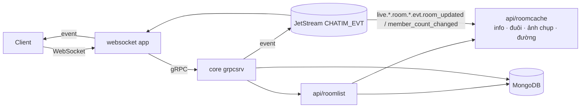
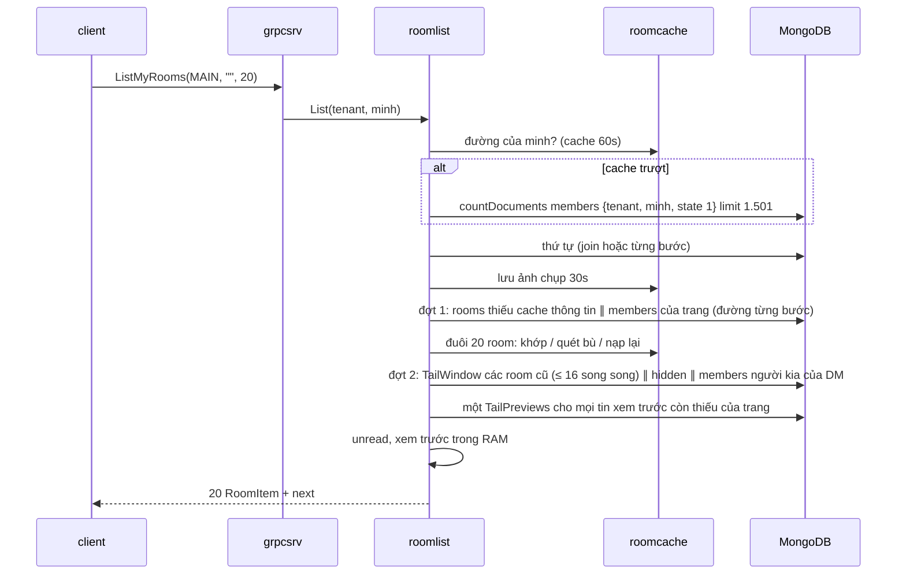

# M3 — Core: API truy vấn còn thiếu: tóm tắt kỹ thuật

> Trạng thái: **xây xong trên `feat/m3`, chờ PR (`dev-done` khi merge)**. Bản này viết lại từ cái đã thực sự xây: owner duyệt bản trước khi code ngày 2026-10-13; mọi chỗ đội làm khác bản đó nằm trong thân bài và ở mục 11.2, quyết định owner trong lúc xây ở mục 11.1. Plan execute cho AI ở `.claude/plans/2026-10-12-m3-core-query-apis.md` (local, có mục "Kết quả thực thi" theo từng task). Decision log: `.claude/plans/m3-scope-boundary_design.md`, `.claude/plans/m3-core-query-apis_design.md`. Quyết định D120–D140 nằm trong Decision Log của [thiết kế](../architecture.md) §17.2; thiết kế là nguồn sự thật hiện hành. Hai chủ đề owner muốn thảo luận cuối milestone (effect engine chặn đầu hàng, sharding): [2026-10-15-m3-open-topics.md](2026-10-15-m3-open-topics.md).

## 1. Thuật ngữ

| Từ | Nghĩa |
|---|---|
| người đọc | User gọi API (metadata `x-chatim-user`). Mọi tin trả về đã áp ẩn, xoá lịch sử và xoá tin theo người này |
| phần của tôi | Doc `members` của người đọc trong một room: `role`, `joined_at`, `cleared_at`, `read_seq`, `read_ver`, cài đặt hội thoại |
| cài đặt hội thoại | Ghim hội thoại lên đầu (`pinned_at`), tắt thông báo tới một lúc (`muted_until`), lưu trữ (`archived_at`). Riêng từng người, không ảnh hưởng người khác |
| hoạt động của room | `rooms.last_seq`, `last_message_at`, `last_edit_at` (mới), `last_change_at`: do worker `room_activity` ghi bằng `$max`, nên trễ so với tin thật bằng độ trễ của worker (thường tới ~5s, xem mục 5) |
| mốc xếp | Thời điểm dùng để xếp room: `max(last_message_at, joined_at)`. Mọi tin mới, kể cả tin hệ thống, đẩy room lên; room vừa được thêm vào cũng nhảy lên đầu |
| đường join / đường từng bước | Hai cách `ListMyRooms` lấy thứ tự room của user. User có ≤ `ROOM_LIST_JOIN_MAX` (1.500) room: một aggregate `members → rooms` ở DB. Nhiều hơn: đọc phủ index `members`, đọc `rooms` theo lô, xếp ở core. Cùng kết quả |
| ảnh chụp danh sách | Danh sách khoá xếp đã xếp của một (tenant, user, thư mục), giữ trong RAM core 30s để trang sau không phải xếp lại |
| cache thông tin room | Tên, loại, ảnh, `member_count`, `dm_key` của room trong RAM core, dùng chung cho mọi người đọc; xoá khi có `room_updated`/`member_count_changed`, TTL 60s |
| cache đuôi room | ≤ 300 tin gần nhất của room ở dạng gọn (seq, người gửi, đã xoá, `nu`, lúc gửi) + ≤ 10 tin có text rút gọn, trong RAM core, dùng chung cho mọi người đọc; kiểm bằng `last_seq`, `last_edit_at`; mỗi entry sống tối đa 30s |
| xem trước | `LastPreview`: tin mới nhất người đọc còn xem được, rút gọn (seq, người gửi, loại, text tối đa 120 ký tự, lúc gửi, đã xoá, đã sửa) |
| unread | Số tin chưa đọc theo R17: tin sau `read_seq`, của người khác, chưa xoá, không ẩn với tôi, sau `cleared_at`, không `skip_unread`. Đếm tới 100 (client hiện "99+") |
| `approx` | Cờ trên unread: cửa sổ đủ 300 tin mà tin cũ nhất vẫn sau `read_seq + 1` và chưa đủ 100 → số trả về là cận dưới |
| tin hệ thống | Tin do app nội bộ gửi ("Minh đã ghim một tin", "Cuộc gọi 3 phút"), `kind = system` (R23, P7). Như tin thường: đẩy room lên đầu và tính unread, trừ khi người gửi đặt `skip_unread` |
| meta | Dữ liệu tuỳ ý của app gắn vào tin, tối đa 8KB (A6). Core không đọc nội dung |
| emoji/bookmark của tôi | `my_reaction`, `bookmarked` trên tin ở màn hình mở room |
| thread | Tin cha có trả lời (D114: trả lời nằm trên main timeline có trích tin cha) |
| tra theo tập `_id` | Đọc một nhóm doc biết trước khoá (ví dụ 20 tin xem trước của 20 room). Trên collection clustered gửi `$or` các khoảng `_id`, không gửi `$in` (D139, mục 3.6) |

## 2. Bức tranh chung

### 2.1 Scope và ranh giới

Client gọi core qua app websocket cho mọi màn hình chat, kể cả danh sách hội thoại (owner 2026-10-13). Core trả dữ liệu của core và giá trị theo người đọc tính lúc đọc (unread, ẩn, xem trước); cài đặt hội thoại của từng người lưu trên doc `members` của người đó.

| Trong scope M3 → core | Ngoài scope → thuộc về |
|---|---|
| Danh sách hội thoại đã xếp: ghim trước, rồi theo tin mới nhất; mỗi room kèm xem trước và unread; thư mục lưu trữ (`ListMyRooms`, `GetRooms`) | Dấu `@` trên danh sách hội thoại: owner 2026-10-13 không cần, danh sách chỉ hiện unread |
| Ghim hội thoại, tắt thông báo, lưu trữ (`SetRoomPreferences`) | Gửi thông báo đẩy (dùng `muted_until`) → app push |
| Cache thông tin room và cache đuôi room trong RAM core | Cache dùng chung giữa các core (Redis) → chưa cần |
| `GetHistory` thêm neo `AROUND(seq)`; `GetMessages`, `ListThreads`, `GetReactions`, `ListPins`, `ListMembers`, `UpdateRoom` | Sync token, đồng bộ đa thiết bị → owner xác định sau (Mention App) |
| Emoji/bookmark của tôi trên `GetHistory`, `GetMessages`, `GetReplies` | Gom `MarkRead`, reconnect jitter, bỏ `kind`/`skip_unread` gửi từ client → M4 websocket |
| `SendMessage` nhận `kind = system`, `skip_unread`, `meta` | Sinh tin hệ thống từ event (module SysMsg) → app riêng |
| Collection `reply_threads`; luật tra theo tập `_id` có cận (D139) | Sửa effect engine chặn đầu hàng; test 2 shard và chọn shard key → hoãn, owner thảo luận cuối milestone (2026-10-14, D140). Chuyển mentions, bookmarks ra khỏi core; tên, ảnh của user → hệ thống user; attachments → sau |

### 2.2 Màn hình → lần gọi core

| Màn hình | Lần gọi | Hiện ngay | Hiện sau |
|---|---|---|---|
| Mở app, kết nối lại | `ListMyRooms` trang đầu | room, tên, ảnh, 2 user của DM, xem trước, unread, đã ghim, tắt tiếng, role, `read_seq`, `peer_read_seq` của DM | tên/ảnh user lấy từ hệ thống user |
| Cuộn danh sách | `ListMyRooms(next)` | như trên | |
| Tin mới, đọc, xoá khi đang mở danh sách | **không gọi core**: client áp event (mục 4.3); chỉ vài trường hợp gọi `GetRooms` | | |
| Thư mục lưu trữ | `ListMyRooms(folder = ARCHIVED)` | như trên | |
| Ghim, tắt tiếng, lưu trữ hội thoại | `SetRoomPreferences` | | |
| Mở room tại chỗ chưa đọc, nhảy tới tin (ghim, trích, mention) | `GetHistory(AROUND, seq)` | tin quanh seq, emoji/bookmark của tôi, số trả lời, trích dẫn | banner ghim (`ListPins`), "ai đã xem" (`ListMembers`) |
| Lấy vài tin đã biết seq | `GetMessages` | | |
| Tab thread | `ListThreads` | tin cha, số trả lời, lúc và tin trả lời mới nhất | |
| Người react một tin | `GetReactions` | user, emoji, lúc react (số đếm đã có trên tin) | |
| Tab ghim | `ListPins` | ghim + tin | |
| Thành viên, ai đã xem | `ListMembers` | user, role, `read_seq` | |
| Đổi tên, ảnh nhóm | `UpdateRoom` | | |

### 2.3 Sơ đồ

Package mới: `api/roomlist` (dựng mục room cho `ListMyRooms`, `GetRooms`) và `api/roomcache` (bốn cache + watcher xoá cache thông tin room). `grpcsrv` gọi `roomlist`; `roomlist` gọi `roomcache` và store.

RPC của core sau M3 (33, ★ = mới):
- Room: `CreateRoom`, `OpenDirectRoom`, `ListMyRooms`★, `GetRooms`★, `UpdateRoom`★, `SetRoomPreferences`★.
- Member và vị trí đọc: `AddMembers`, `RemoveMember`, `LeaveRoom`, `ChangeMemberRole`, `SetMemberPriority`, `ListMembers`★, `MarkRead`, `MarkUnread`.
- Tin: `SendMessage` (sửa), `EditMessage`, `DeleteMessage`, `HideMessage`, `ClearHistory`, `GetHistory` (thêm `AROUND`), `GetEditHistory`, `GetReplies`, `GetMessages`★, `ListThreads`★.
- Reaction, ghim, bookmark, mention: `ReactMessage`, `GetReactionSettings`, `GetReactions`★, `PinMessage`, `UnpinMessage`, `ListPins`★, `SetBookmark`, `ListBookmarks`, `ListMentions`.

## 3. Dữ liệu

### 3.1 Field mới trên `messages` (tên ngắn, D96)

| Field | Nghĩa | Ví dụ |
|---|---|---|
| `k` | đã có; thêm giá trị 2 = `system` | `2` |
| `nu` | không tính unread; chỉ ghi khi `true` | `true` |
| `m` | meta, BinData ≤ 8KB; chỉ ghi khi có | byte của `{"call_seconds":180}` |

Sửa tin không đổi `k`, `nu`, `m`. Xoá tin `$unset m` (như `x`, D75), giữ `k`, `nu`.

### 3.2 Field mới trên `rooms`

| Field | Nghĩa | Ví dụ |
|---|---|---|
| `avatar` | tham chiếu ảnh nhóm do app giữ, ≤ 1.024 byte; thiếu = chưa có | `"files/av/777.png"` |
| `info_ver` | +1 mỗi lần `UpdateRoom` đổi tên/ảnh; 1 lúc tạo (bước "đảm bảo" của `CreateRoom`/`OpenDirectRoom` ghi sẵn) | `3` |
| `updated_at`, `updated_by` | lần đổi thông tin cuối | `2026-10-20T09:00Z`, `minh` |
| `last_edit_at` | lúc sửa/xoá tin main timeline gần nhất; worker `room_activity` `$max` theo phiếu `EditInserted` (reaction, ghim, member không đổi); chỉ dùng để kiểm cache đuôi room | `2026-10-20T09:10Z` |

### 3.3 Field mới trên `members` (cài đặt hội thoại)

| Field | Nghĩa | Ví dụ |
|---|---|---|
| `pinned_at` | lúc ghim hội thoại; thiếu = không ghim. Room ghim đứng đầu, ghim sau đứng trên | `2026-10-20T08:00Z` |
| `muted_until` | tắt thông báo tới lúc này; thiếu = không tắt; "mãi mãi" = `9999-12-31` | `2026-10-21T08:00Z` |
| `archived_at` | lúc lưu trữ; thiếu = ở danh sách chính. Tin mới không tự đưa ra khỏi lưu trữ | `2026-10-19T10:00Z` |
| `preference_ver` | +1 mỗi lần một trong ba field trên đổi; luôn ghi (0 khi chưa đổi); id event | `5` |

Ba field không đụng `ver` (membership) hay `read_ver`. Rời room rồi vào lại giữ nguyên như `cleared_at`.

### 3.4 Collection mới `reply_threads` (projection)

Ví dụ: tin 40 của room 777 có trả lời 57 (09:00) và 60 (09:30).

| Field | Nghĩa | Ví dụ |
|---|---|---|
| `_id` | khoá tin cha, 24B `room│thread│seq` (clustered) | `777│0│40` |
| `room_id`, `tenant` | room, tenant | `777`, `acme` |
| `last_reply_at`, `last_reply_seq` | trả lời mới nhất (lúc gửi, seq) | `09:30`, `60` |
| `updated_at` | lúc worker ghi | |

Index `{room_id, last_reply_at: -1, _id: -1}`. Chỉ worker `reply_mention_index` ghi. Không vào change feed.

### 3.5 Index đổi

| Collection | Cũ | Mới | Vì sao |
|---|---|---|---|
| `members` | `{tenant, user_id, state, room_id, joined_at, cleared_at, read_seq}` | thêm `pinned_at, archived_at` cuối | Đường từng bước đọc mọi room của tôi phủ index để xếp và chia thư mục; `RoomsOf` của `ListMentions` vẫn phủ (explain test) |
| `message_interactions` | `{message_key, kind, state, value}` | `{message_key, kind, state, value, updated_at: -1, actor_id}` | `GetReactions` mới nhất trước, đọc phủ index; tiền tố cũ vẫn phục vụ `CountReactions`, `CountLiveReplies` |

Bootstrap tạo index mới và bỏ hai index cũ (`bootstrap_replaced_indexes.go`). Dev: `make infra-reset`.

### 3.6 Tra theo tập `_id` trên collection clustered (D139)

Đo trên dữ liệu bench (2026-10-15): gửi `_id $in` 100 khoá tin của 20 room làm Mongo 8.2 quét **một khoảng** từ khoá nhỏ nhất tới khoá lớn nhất, đọc 320.040 doc để trả 100. Lý do: planner chạy `$in` trên clustered index thành một lần quét min..max, và Mongo so BinData theo **độ dài trước**, nên khoảng đó còn trùm qua room khác và qua khoá dài khác (`members`, `message_interactions` có khoá dài theo user id).

Luật từ M3: mọi tra theo tập `_id` đi qua một hàm chung (`boundedIDs`): sắp khoá theo thứ tự BinData, bỏ trùng, gộp seq liền nhau thành một khoảng, gửi `$or` các nhánh `{_id: {$gte, $lte}}` (một khoá thì so bằng; không có khoá nào thì `$in` rỗng, Mongo không đọc doc nào), điều kiện phụ (ví dụ `state`) đặt trong từng nhánh, không sort ở server (core tự sắp). Áp cho `Find` theo khoá, `TailPreviews`, `SentTimes` (của `ListMentions`, M2c), `MembersByKeys`, `MembersOf`, `MyInteractions`. Sau sửa: 20 room đọc 120 doc cho 100 tin xem trước; explain itest kiểm mỗi chỗ gọi đọc ≤ 2 doc mỗi khoá.

### 3.7 Proto, quyền, phiếu việc, config

- `MessageKind` thêm `MESSAGE_KIND_SYSTEM = 2` (`UNSPECIFIED` = text); `domain.kindNames` thêm `system` (dùng được trong `MESSAGE_LOCKED_KINDS`).
- `SendMessageRequest` thêm `kind`, `skip_unread`, `meta`. `Message` thêm `skip_unread`, `meta`, `my_reaction`, `bookmarked`. `HistoryAnchor` thêm `HISTORY_ANCHOR_AROUND`.
- `Room` thêm `avatar`, `info_ver`, `direct_users` (2 user của DM, tách từ `dm_key`). `UpdateRoomRequest` dùng `optional` cho `name`, `avatar` (vắng = không đổi, `""` của avatar = bỏ ảnh); `SetRoomPreferencesRequest` dùng `optional` cho cả ba cài đặt.
- File proto mới `room_list.proto` (`RoomFolder`, `ListMyRooms`, `GetRooms`, `RoomItem{room, me, preview, unread{count, approx}, peer_read_seq}`, `MyRoomState`, `LastPreview`, `SetRoomPreferences`, `UpdateRoom`) và `message_reads.proto` (`GetMessages`, `ListThreads` → `ThreadItem{message, last_reply_at, last_reply_preview}`, `GetReactions` → `Reactor`, `ListPins` → `PinnedMessage`, `ListMembers` → `MemberItem`). Event oneof 37 `room_updated`, 38 `room_preferences_changed`.
- Action mới của `access`: `read_reactions`, `read_members` (mọi member), `update_room` (owner, admin), `send_system_message` (mặc định cho phép), `set_room_preferences` (chỉ `Admit`, không hỏi policy).
- Phiếu mới: kind 13 `RoomChanged` (`u:{room}-info-v{info_ver}`, feed lấy update `rooms` có `updatedFields.info_ver`); kind 14 `PreferenceChanged` (`f:{room}-pf-{user}-v{preference_ver}`, mang đuôi user, feed lấy update `members` có `updatedFields.preference_ver`). Update khác của `rooms` vẫn không vào feed.
- Config mới: `ROOM_LIST_JOIN_MAX` (1.500, ≥ 1; điểm chuyển đường, không phải giới hạn), `ROOM_TAIL_CACHE_BYTES` (256MB, ≥ 1MB, LRU theo byte), `ROOM_INFO_CACHE_ENTRIES` (100.000). Hằng không lên env (YAGNI): ảnh chụp 64MB mỗi core, cache đường 100.000 entry, TTL thông tin 60s, đuôi 30s, ảnh chụp 30s, đường 60s. Cỡ một đuôi: 300 × ~40B + 10 × ~200B ≈ 14KB → 10K room nóng ≈ 140MB mỗi core.
- Thư viện: `golang.org/x/sync` (errgroup, singleflight) thành phụ thuộc trực tiếp.

## 4. Luồng xử lý

Dữ liệu mẫu: Minh ở 4 room.

| room | role | `read_seq` | `cleared_at` | `pinned_at` | `archived_at` | `rooms.last_message_at` | tin cuối thật |
|---|---|---|---|---|---|---|---|
| 777 nhóm "Cửa hàng 12" | admin | 41 | — | — | — | 10:05 | 45 |
| 888 DM Minh–Lan | member | 12 | — | 08:00 | — | 09:40 | 12 |
| 999 nhóm "Kho" | member | 230 | 01/10 | — | — | hôm qua | 236 |
| 555 nhóm "Cũ" | member | 90 | — | — | 19/10 | tuần trước | 90 |

Mọi API đọc: `grpcsrv` → `access` → store → `view` → (màn hình mở room) emoji/bookmark của tôi. Không qua actor. Lỗi store trong API đọc mới → `UNAVAILABLE` (không lộ lỗi nội bộ là `INVALID_ARGUMENT`).

Phân trang: mọi API danh sách mới dùng **con trỏ** mờ `next` (base64url của khoá sắp của mục cuối, rỗng = hết), không offset (offset đọc rồi bỏ mọi doc phía trước và lặp/sót mục khi dữ liệu đổi). Con trỏ hỏng → `INVALID_ARGUMENT`.

### 4.1 `ListMyRooms(folder, next, limit)` — danh sách hội thoại

Nguyên tắc: **dữ liệu riêng của người đọc đọc tươi; dữ liệu chung của room đi qua cache trong RAM core**. Ví dụ nhóm 777 có 500 người cùng kết nối lại: 500 người dùng chung một bản thông tin room và một bản đuôi room, thay vì 500 lần đọc 300 tin.

| Phần | Riêng hay chung | Lấy từ |
|---|---|---|
| Room tôi ở, `joined_at`, ghim, lưu trữ, `read_seq`, `cleared_at`, role, tắt tiếng | riêng tôi | `members`, tươi mỗi lần |
| `last_message_at`, `last_seq`, `last_edit_at` | chung, đổi mỗi tin | cùng lần đọc thứ tự (3 field nhỏ của `rooms`) |
| Tên, loại, ảnh, `member_count`, `dm_key` | chung, đổi hiếm | cache thông tin room |
| ≤ 300 tin gần nhất dạng gọn + ≤ 10 tin có text rút gọn | chung, đổi mỗi tin | cache đuôi room |
| Tin tôi đã ẩn | riêng tôi | 1 truy vấn `hidden` |
| Vị trí đọc của người kia trong DM | riêng người kia | `members` theo khoá |

**Bước 1 — chọn đường.** Cache theo (tenant, user) 60s; trượt thì `countDocuments` trên index "room của user" `{tenant, user_id, state: 1}` với `limit ROOM_LIST_JOIN_MAX + 1` (`COUNT_SCAN`, đọc tối đa 1.501 khoá, không đọc doc). Hai đường ra cùng kết quả nên quyết định cũ vài giây không sai. ≤ 1.500 → đường join; lớn hơn → đường từng bước.

**Bước 2 — thứ tự** (cả hai đường cùng một hàm so sánh: room ghim trước theo `pinned_at` giảm, rồi mốc xếp giảm, hoà theo `room_id` giảm; thư mục `MAIN` = không `archived_at`, `ARCHIVED` = có):
- **Đường join (≤ 1.500 room):** một aggregate trên `members`: `$match` user, `state 1` → `$lookup rooms` (`room_id → _id`, sub-pipeline chỉ lấy `last_message_at, last_seq, last_edit_at`, không kéo `pins`) → mốc xếp → thư mục → `$sort` (thiếu `pinned_at` tự đứng sau mọi room ghim). Dòng nào cũng đã có đủ field `members` của tôi.
- **Đường từng bước (> 1.500 room):** đọc phủ index `members` (`room_id, joined_at, pinned_at, archived_at`) → `rooms` lô 1.000 lấy 3 field hoạt động → xếp trong RAM → `MembersByKeys` cho các room của trang (đủ field của tôi).
- Kết quả xếp giữ làm **ảnh chụp** trong RAM 30s. Trang sau tới cùng core: cắt từ ảnh chụp sau con trỏ, đọc `MembersByKeys` + `RoomActivities` của 20 room để có field tươi (room đã rời giữa chừng bị bỏ). Tới core khác hoặc hết hạn: chạy lại đường đã chọn rồi chỉ giữ khoá sau con trỏ.

**Bước 3 — thông tin room (đợt 1):** cache theo room id; thiếu → một lần đọc `rooms` cho các room thiếu, song song với `MembersByKeys`/`RoomActivities` của trang khi bước 2 chưa có đủ field (đường từng bước, trang sau, `GetRooms`). Entry bị xoá khi core nhận `room_updated` hoặc `member_count_changed` (watcher trên core NATS `{live}.*.room.*.evt.…`, room id ở token 4), TTL 60s phòng event mất. Một lần đọc bắt đầu trước khi room bị xoá không được ghi đè bản mới vào cache (dấu `Mark`/`Put`).

**Bước 4 — đuôi room:** cache theo room id, kiểm bằng `last_seq`, `last_edit_at` vừa đọc ở bước 2:
- cache có `last_seq` ≥ và `last_edit_at` bằng, entry chưa quá 30s → dùng luôn;
- chỉ có tin mới → quét bù `seq > last_seq của cache` (`TailWindow`, field gọn), nối vào, giữ 300; quét bù về đủ 300 tin thì thay hẳn entry;
- có sửa/xoá mới (`last_edit_at` đổi), entry quá 30s hoặc chưa có → nạp lại cửa sổ ≤ 300 tin.
Nhiều yêu cầu cùng cần một room (cùng `last_seq`, `last_edit_at`) chờ chung một lần nạp (singleflight), nên đợt kết nối lại không quét trùng. Tối đa 16 lần nạp song song mỗi lời gọi. Cache trả bản sao, không dùng chung slice.

**Bước 5 — xem trước, `hidden`, tính trong RAM:** sau khi có cửa sổ, **một** `TailPreviews` (tra `_id` có cận, D139) đọc mọi tin xem trước còn thiếu của cả trang (tối đa 10 tin mới nhất mỗi room chưa có text trong cache); kết quả ghi vào entry chỉ khi entry còn cùng `last_seq`/`last_edit_at`. Song song: một truy vấn `hidden {user_id: minh}` với khoảng từ `last_seq − 299` trở lên của mỗi room trong 20 room (gồm cả tin sau `last_seq` khi worker trễ), và `MembersByKeys` của người kia trong các DM (`peer_read_seq`). Rồi đếm unread (bỏ tin của Minh, đã xoá, `nu`, `ts ≤ cleared_at`, đã ẩn; chỉ tin sau `read_seq`; dừng ở 100; `approx` như mục 1) và chọn xem trước = tin mới nhất Minh còn xem được trong 10 tin có text (tin đã xoá vẫn chọn được, hiện "đã xoá"; tin ẩn hoặc trước `cleared_at` thì bỏ); không có → xem trước trống.

**Cô lập tenant:** doc member phải đúng tenant người gọi và `state 1`, room phải đúng tenant, người kia của DM cùng tenant (áp cả khi cache trúng). User id trùng giữa hai tenant không thấy room của nhau.

**Trả về:** `items` (20 `RoomItem`) và `next` = 26 byte base64url `(thư mục, đã ghim, pinned_at ms, mốc xếp ms, room_id)`; rỗng = hết. Con trỏ khác thư mục hoặc hỏng → `INVALID_ARGUMENT`. Trang ngắn vẫn có thể có `next` (gọi tiếp ra trang rỗng).

Ví dụ trang đầu thư mục chính: 888 (ghim), 777 (10:05), 999 (hôm qua); 555 chỉ có ở `ARCHIVED`.
- 777: cache đuôi có tới 44, `rooms` báo `last_seq` 45 → quét bù 1 tin. Tin 43 của Minh, tin 44 Lan gửi nhưng Minh đã ẩn → unread 2 (42, 45), xem trước 45.
- 888: `read_seq` 12 = tin cuối, cache khớp → không gọi DB; unread 0; `peer_read_seq` = vị trí đọc của Lan → client hiện "đã xem".
- 999: tin 231–236 sau `cleared_at` → đếm bình thường.

**Con trỏ đúng mà không cần chốt thứ tự:** mốc xếp chỉ tăng (`$max`), nên room chỉ có thể nhảy lên. Room nhảy lên giữa hai trang không hiện ở trang sau, nhưng client đã đưa nó lên đầu theo `msg_created` (4.3); room ở trang trước không bao giờ hiện lại. Chỉ bỏ ghim, bỏ lưu trữ, vào lại room làm room tụt xuống: đó là lệnh của chính người đọc, client biết qua event và bỏ trùng theo room id. Ví dụ: Lan nhắn vào room ở vị trí 35 khi Minh đang xem trang 1 → client đưa room lên đầu; trang 2 lấy từ ảnh chụp vẫn có room đó ở vị trí 35 → client bỏ trùng; trang 2 chạy lại thì không có nó.

Kết nối lại: gọi lại trang đầu (P8). Lỗi: `limit > 100`, thư mục lạ, con trỏ hỏng → `INVALID_ARGUMENT`; `limit` 0 → 20.

### 4.2 `GetRooms(room_ids ≤ 100)` — làm mới vài room

`MembersByKeys(room, minh)` + `RoomActivities` thay bước 2, rồi bước 3–5 như 4.1. Dùng khi client cần đếm lại vài room sau event (4.3). Room không có, room khác tenant và room không ở đều vào `missing`, không phân biệt. Danh sách rỗng → trả rỗng; quá 100 id, id 0 → `INVALID_ARGUMENT`.

### 4.3 Client áp event, không gọi lại core

| Event | Client làm |
|---|---|
| `msg_created` của người khác, không `skip_unread` (kể cả tin hệ thống) | unread +1 (tới 100), xem trước = tin này, room lên đầu (sau các room ghim) |
| `msg_created` của mình hoặc có `skip_unread` | xem trước = tin này, room lên đầu, không đổi unread |
| `read_updated` của mình (thiết bị khác) | gọi `GetRooms([room])` để đếm lại |
| `msg_deleted` / `message_hidden` / `history_cleared` có tin sau `read_seq` | gọi `GetRooms([room])` |
| `room_preferences_changed`, `room_updated`, `member_added`/`member_removed` của mình | cập nhật cài đặt / tên / thêm, bỏ room (thêm: `GetRooms([room])`) |
| mất event, quay lại từ nền | gọi lại `ListMyRooms` |

Client gom các `GetRooms` trong ~1s thành một lần gọi (≤ 100 id). Một nhóm 500 người gửi 5 tin/s không sinh lần gọi core nào từ danh sách hội thoại. `GetRooms` gọi ngay sau event có thể vẫn thấy bản cũ tới khi worker `room_activity` chạy (mục 5).

### 4.4 `SetRoomPreferences(room, pinned?, muted_until?, archived?)`

1. Phải có ít nhất một field; `muted_until` trong quá khứ = bỏ tắt tiếng. Sai → `INVALID_ARGUMENT`.
2. `Admit(set_room_preferences)`: Minh phải đang ở room (`PERMISSION_DENIED`); không hỏi policy (cài đặt của chính mình).
3. Một `FindOneAndUpdate` (update pipeline) trên doc `members` của Minh, filter `state = 1` và `$or` theo field thật sự đổi: `$set`/`$unset` ba field, `$inc preference_ver`, `$max last_change_at`; trả doc sau. Không đổi → `changed = false`, không event.
4. Enqueue `room_preferences_changed` `{room}-pf-{user}-v{preference_ver}` (subject `member`), mang trạng thái đầy đủ (`MyRoomState`; role và `read_seq` lấy từ lần đọc `Admit`, có thể cũ một chút, client giữ bản `read_ver`/`preference_ver` cao nhất).

Hai thiết bị đổi cùng lúc: mỗi lệnh một `$inc`, field nào ghi sau thắng; event mang trạng thái sau lệnh. Worker: phiếu `PreferenceChanged` → `room_activity` (`Seq 0`) và `preferences_event` (delay `RECONCILE_DELAY`, `MembersOf`: bằng phiếu → phát doc hiện tại, mới hơn → bỏ, cũ hơn → Nak). Không có phiếu hẹn (không có giá trị dẫn xuất ghi inline).

### 4.5 `GetHistory(AROUND, seq)` và `GetMessages`

- `AROUND(seq, limit)`: quét lùi từ `seq` lấy `ceil(limit/2)` tin (gồm `seq`) và quét tiến từ `seq + 1` lấy phần còn lại, hai quét song song; ghép tăng dần; bên thiếu không bù bên kia (ở đầu/cuối timeline trang ngắn hơn). `seq` 0 hoặc `MaxUint64` → `INVALID_ARGUMENT`. Cùng `view`, `reply_preview` và emoji/bookmark như các neo cũ. Mở room ở tin chưa đọc đầu tiên: `AROUND(read_seq + 1)`.
- `GetMessages(room, thread, seqs)`: 1..100 seq (đếm trước khi bỏ trùng), ngoài khoảng → `INVALID_ARGUMENT`; `Authorize(read_history)` → `Find` theo khoá (D139) → `HiddenIn(min, max)` → `view.Default()` → emoji/bookmark. Seq không có thì không trả. Không phải member → `PERMISSION_DENIED`; room không có → `NOT_FOUND`.

### 4.6 Emoji và bookmark của tôi

Chỉ ở `GetHistory`, `GetMessages`, `GetReplies` (màn hình mở room). Một `MyInteractions` trên `message_interactions` (tra `_id` có cận, D139) với hai khoá mỗi tin [`khoá│1│minh`, `khoá│2│minh`] và `state = 1` trong từng nhánh, chỉ cho tin còn xem được của trang. Không lưu kết quả.

### 4.7 `ListThreads(room, before, limit)`

1. `Authorize(read_replies)`.
2. `reply_threads` lọc `room_id = 777` và khoảng `_id` của room, sắp `last_reply_at` giảm, sau con trỏ `(last_reply_at, seq cha)`, trang 50 (≤ 100).
3. Một `Find` theo khoá cả tin cha lẫn tin trả lời mới nhất → bỏ tin cha `rc` = 0 hoặc không còn → `MaskDeleted` + `HideForViewer`.
4. Trả `ThreadItem{message, last_reply_at, last_reply_preview}`.

Ghi: worker `reply_mention_index` gọi `ReplyThreads.Touch` **mỗi lần xử lý phiếu tin trả lời còn sống** (sau chuỗi đếm `rc`, không chỉ khi `AddReply` vừa tạo doc), một update pipeline upsert: `last_reply_at = max(cũ, ts)`, `last_reply_seq` đổi cùng khi `ts` mới hơn (hoà theo seq lớn hơn); lỗi → Nak. Chạy lại cho cùng kết quả (doc không đổi byte); worker chết giữa `AddReply` và `Touch` thì lần chạy lại vẫn ghi. Tin trả lời bị xoá không hạ mốc.

### 4.8 `GetReactions(room, thread, seq, emoji, after, limit)`

Emoji ngoài `REACTION_EMOJIS` → `INVALID_ARGUMENT` (kiểm trước membership) → `Admit` → `Find` tin (`NOT_FOUND`) → `Allow(read_reactions)`. Tin xoá hoặc ẩn với người đọc → rỗng. Có `emoji`: index mới bằng đủ 4 field, sắp `updated_at` giảm, con trỏ `(updated_at, actor_id)`. `emoji` rỗng (tab "Tất cả"): sắp `value` rồi `updated_at` giảm, con trỏ `(value, updated_at, actor_id)`; truy vấn là `$or` cấp đầu mỗi emoji, Mongo trộn bằng `SORT_MERGE` phủ index, không đọc doc, không sắp trong RAM. Trả `Reactor{user, emoji, at}`, trang 50 (≤ 100).

### 4.9 `ListPins(room)`

`Authorize(read_history)` → `pinproj.Projector.Current` (fold `rooms.pins` + fact sau đó) → `Find` theo khoá các tin ghim → `MaskDeleted` + `HideForViewer`. Trả `pin_ver`, `PinnedMessage{pin, message}`, ghim mới nhất trước theo `pin_ver`; `PIN_LIMIT` 50 nên một trang. Tin ghim đã ẩn với người đọc vẫn có mục, tin là placeholder.

### 4.10 `ListMembers(room, after, limit)`

`Authorize(read_members)`. Đọc index `{room_id, state = 1, role, priority: -1, joined_at, user_id}` theo thứ tự owner → admin → member: một `find` mỗi role, bắt đầu từ role của con trỏ, tới khi đủ trang (`IXSCAN`, không sort), lấy doc để có `read_seq`. Trả `MemberItem{user, role, priority, joined_at, read_seq, read_ver}`, con trỏ `(role, priority, joined_at, user)`, trang 500 (≤ 1.000). "Ai đã xem tin 40" = người có `read_seq ≥ 40`.

### 4.11 `UpdateRoom(room, name?, avatar?)`

1. Ít nhất một field; `name` theo luật tạo room (không rỗng, ≤ 128 ký tự, UTF-8); `avatar` ≤ 1.024 byte, `""` = bỏ ảnh → sai thì `INVALID_ARGUMENT`.
2. `Admit(update_room)` → `Rooms.Get` → DM thì `FAILED_PRECONDITION` → `Allow(update_room)` (owner, admin; khác → `PERMISSION_DENIED`).
3. Không đổi → `changed = false`, không ghi.
4. `UpdateOne` CAS `{_id, info_ver: hiện tại}` → `$set`, `$inc info_ver`, `updated_at`, `updated_by`; không khớp → `UNAVAILABLE` ngay.
5. Enqueue `room_updated` `{room}-info-v{info_ver}` (subject `room`); worker: phiếu `RoomChanged` → `room_activity` (`Seq 0`, nâng `last_change_at` để resync tìm được) và `room_event` (phát lại doc hiện tại khi `info_ver` bằng phiếu). Mọi core nhận `room_updated` xoá cache thông tin của room.

### 4.12 `SendMessage` tin hệ thống

Ví dụ: SysMsg nhận `member_removed` của Lan, gửi vào 777 tin `kind = system`, `meta = {"event":"member_left","user":"lan"}`, cid `sys-{event_id}`, metadata user `lan` hoặc id bot.

1. `grpcsrv` kiểm sớm: `meta` ≤ 8KB; `kind` chỉ `text`/`system`; tin `system` không nhận `reply_to`, `forward_from`, mention → `INVALID_ARGUMENT` (kiểm trước actor, nên non-member gửi `system` kèm link nhận `INVALID_ARGUMENT` chứ không `PERMISSION_DENIED`). `Router.Send` kiểm lại cùng luật.
2. Actor: luôn kiểm room thuộc tenant; tin `system` **không kiểm membership** và không đọc member cache, hỏi policy `send_system_message` với `Member` rỗng và `Request.Kind` rỗng; tin `text` như cũ.
3. Ghi, chống trùng cid, ack, `msg_created` như tin thường (mang `kind`, `skip_unread`, `meta`). Room lên đầu danh sách và tin được tính unread như tin thường; chỉ tin có `skip_unread` không vào unread.
4. Forward giữ `skip_unread`, `meta` của request (thuộc tính của tin mới, không chép từ tin nguồn).

Muốn khoá sửa/xoá tin `system`: `MESSAGE_LOCKED_KINDS=system` (D87).

## 5. Đúng đắn và chạy đua

- **Danh sách hội thoại trễ theo worker:** tin cuối và unread đọc từ `messages` qua cache đuôi kiểm bằng `last_seq`, `last_edit_at`; hai field này do worker `room_activity` ghi. Effect engine hiện chặn đầu hàng (có từ M2b.1): một lô phiếu đứng chờ effect có delay `RECONCILE_DELAY` (5s) nên `room_activity` cũng chạy trễ ~5s (tới ~20s khi PubAck chậm). Trong khoảng đó `ListMyRooms`/`GetRooms` có thể trả tin cuối, unread và thứ tự cũ, và hai core có thể trả khác nhau. Ví dụ Lan gửi tin 46 vào 777 lúc 10:00:00; tới ~10:00:05 `GetRooms([777])` vẫn trả xem trước 45. Owner 2026-10-14 chấp nhận, hoãn sửa engine (D140); client đã áp `msg_created`/`msg_deleted` tại chỗ nên màn hình đúng; gọi lại sau khoảng trễ thì đúng. `reply_threads`, `rc`, chỉ mục mention trễ theo cùng cách.
- **Cache chỉ để nhanh, không để đúng (P1):** cache thiếu, hết hạn hay bị xoá → đọc DB; core khởi động lạnh vẫn trả đúng. Mỗi core một bản cache riêng; hai core có thể trả thông tin room lệch nhau tới khi event `room_updated`/`member_count_changed` tới hoặc hết TTL 60s. Một lần đọc `rooms` bắt đầu trước lúc quên room không ghi đè cache (dấu `Mark`/`Put`; quá 4.096 lần quên giữa hai mốc thì bỏ ghi).
- **Đuôi room sống tối đa 30s:** một tin seq thấp vào muộn (lần ghi chưa rõ, D119) có thể nằm dưới `last_seq` của cache khi quét bù chỉ đọc `seq > last_seq`; entry hết hạn sau 30s thì nạp lại nên tin đó hiện ra. Sửa/xoá đổi `last_edit_at` nên cache không giữ text đã xoá.
- **Hai đường cùng kết quả:** một hàm so sánh, test so khớp hai đường trên cùng dữ liệu (3, 199, 2.000, 2.001 room) và test ngưỡng chọn đường.
- **Client áp event:** event best-effort có thể mất; worker phát lại, và quay lại từ nền hay kết nối lại thì gọi `ListMyRooms` (P8). Unread client tự cộng có thể lệch khi tin vừa tới đã bị xoá trước khi client nhận `msg_created`; `msg_deleted` sau đó kích `GetRooms` sửa lại.
- **Con trỏ danh sách:** mốc xếp chỉ tăng nên không có room bị sót mà client không biết; trùng chỉ xảy ra khi trang lấy từ ảnh chụp cũ hoặc sau lệnh bỏ ghim/bỏ lưu trữ/vào lại của chính người đọc, client bỏ trùng theo room id.
- **Membership:** đọc trong cùng lần gọi; bị xoá giữa chừng thì lần gọi đó có thể còn thấy xem trước, như `GetHistory`.
- **Lỗi một phần:** một lần nạp đuôi hay một lô xem trước lỗi → cả lời gọi `UNAVAILABLE` (không trả mục thiếu im lặng); lần nạp dùng chung (singleflight) chạy trên context của yêu cầu đầu, nên một yêu cầu bị huỷ không làm hỏng yêu cầu khác đang chờ cùng room.
- **`SetRoomPreferences` hai thiết bị:** field ghi sau thắng, `preference_ver` tăng mỗi lần; event mang trạng thái đầy đủ.
- **Feed `members`:** một update được xếp loại theo field version đầu tiên có trong nó, thứ tự `ver` → `read_ver` → `cleared_at` → `preference_ver`. Hôm nay không lệnh nào ghi hai field này cùng lúc; lệnh tương lai ghi `read_ver` và `preference_ver` trong một update sẽ che phiếu `PreferenceChanged` (bất biến ghi trong design §8.2).
- **`reply_threads`:** chạy lại an toàn; trả lời mới hiện ở `ListThreads` sau khi worker chạy (trễ như trên). Tin cha bị mất mà `Touch` vẫn ghi: `ListThreads` bỏ cha không còn.
- **`UpdateRoom`:** CAS `info_ver`, người thua `UNAVAILABLE`, không mất cập nhật.
- **`GetReactions`:** người đổi emoji giữa hai trang có thể chuyển tab hoặc hiện lại; chỉ trạng thái cuối được bảo đảm.
- **Tin `system`:** cid `sys-{event_id}` nên gửi lại không trùng.

## 6. Event và subject

| Event | Id | Subject | Worker phát lại |
|---|---|---|---|
| `room_updated` (mới) | `{room}-info-v{info_ver}` | `evt.{t}.room.{rid}.room_updated` | `room_event` |
| `room_preferences_changed` (mới) | `{room}-pf-{user}-v{preference_ver}` | `evt.{t}.member.{rid}.room_preferences_changed` | `preferences_event` |
| `msg_created` (đã có) | như cũ | như cũ; payload thêm `kind`, `skip_unread`, `meta` | như cũ |

API đọc và unread không có event. Hai effect mới có `effect_dropped_total`, `reconcile_republished_total` (chỉ đếm PubAck không trùng), nằm trong alert `ChatimEffectDropping`, `ChatimRepublishSurge` đã có. Metric mới của cache (không phải guarantee, không alert): `room_cache_hits_total`, `room_cache_misses_total` theo `cache = info|tail|snapshot|path`, gauge `room_tail_cache_bytes`, `room_watch_forgets_total`, `room_watch_malformed_total`. Vẫn 17 luật alert.

## 7. Thư viện và hạ tầng

- `golang.org/x/sync` (errgroup có giới hạn, singleflight) thành phụ thuộc trực tiếp; không thêm hạ tầng.
- Bootstrap tạo `reply_threads`, hai index mới và bỏ hai index cũ; anchor feed không đổi.
- Watcher `roomcache.Watch` dùng kết nối NATS core như `memberwatch`; hai watcher khởi động cùng nhóm sau router, dừng (Unsubscribe, không thêm mốc trong ngân sách 28s) sau worker, trước router.
- Công cụ đo `tools/poc/roomlistbench` (seed qua API core, đo trang đầu/trang sau lạnh và nóng, đếm truy vấn Mongo bằng `serverStatus`).
- Profile compose 2 shard: đã thử và gỡ (bản vá `bin/m3-shard-profile.patch`), xem D140.

## 8. Quyết định

| # | Quyết định | Phương án bị loại | Vì sao |
|---|---|---|---|
| D120 | Client lấy danh sách hội thoại thẳng từ core; mỗi màn hình một lần gọi | Qua Mention App; ghép nhiều API | Owner 2026-10-13 |
| D121 | `ListMyRooms` xếp lúc đọc (ghim trước, rồi mốc xếp `max(last_message_at, joined_at)`), phân trang bằng con trỏ theo khoá xếp; ảnh chụp danh sách giữ 30s trong RAM core | Trả `order` mọi room cho client; offset; xếp lại mỗi trang; lưu thứ tự theo user | Owner không muốn gửi `order` (~80KB ở 5.000 room); mốc xếp chỉ tăng nên con trỏ không làm sót room; lưu theo user tốn một ghi mỗi member mỗi tin (200K ở channel) |
| D122 | Client áp `msg_created` cho unread, xem trước, thứ tự; chỉ gọi `GetRooms` khi đọc ở thiết bị khác, xoá/ẩn trong phần chưa đọc; mất event thì gọi lại `ListMyRooms` | Gọi `GetRooms` mỗi event | Nhóm 500 người, 5 tin/s = 2.500 lần gọi/s; channel 200K = 200K lần gọi mỗi tin |
| D123 | Tin cuối, xem trước và unread tính từ `messages` (qua cache đuôi room) | `rooms.last_seq` làm tin cuối; số lưu sẵn; tin đầy đủ trong mục | D72; P5; tin đầy đủ tới ~200KB mỗi trang |
| D124 | Unread R17 dừng ở 100, quét ≤ 300 tin, quá thì `approx` (D73) | Exact tuyệt đối; core đẩy cho từng user | Chặn chi phí; core không chọn người nhận (P3) |
| D125 | Xem trước = tin mới nhất còn xem được trong 10 tin có text, rút gọn `LastPreview` | Tin cuối kèm placeholder ẩn | Dòng room không hiện "đã ẩn" hay nội dung đã xoá lịch sử |
| D126 | Tin hệ thống như tin thường: đẩy room lên đầu, tính unread; `skip_unread` chỉ bỏ tin khỏi unread | Tin hệ thống không đẩy room lên | Owner 2026-10-13 |
| D127 | Ghim/tắt tiếng/lưu trữ hội thoại là field trên `members` với `preference_ver`, một `SetRoomPreferences`, event `room_preferences_changed` subject `member` | Collection riêng; ba RPC | Như vị trí đọc (D105): một doc, toán tử thường, không đụng `ver`; một lệnh cho một màn hình cài đặt |
| D128 | `GetHistory` neo `AROUND(seq)` | Hai lần gọi trước/sau | Mở room tại chỗ chưa đọc và nhảy tới tin là một lần gọi |
| D129 | Emoji/bookmark của tôi chỉ trên `GetHistory`, `GetMessages`, `GetReplies` | Trên mọi API trả tin | Các màn hình khác không hiện |
| D130 | `reply_threads` ghi mỗi lần xử lý phiếu trả lời còn sống, update pipeline `max` | Chỉ ghi khi doc reply vừa tạo; quét doc reply | Worker chết giữa hai bước không làm mất thread; tin nóng 10K trả lời không làm trang đọc 10K doc |
| D131 | Index reaction thêm `updated_at, actor_id`; mới nhất trước | Sắp theo user id | Chi phí như nhau, người xem thường muốn người mới nhất |
| D132 | Tin `system` không kiểm membership, sender do caller chọn, action `send_system_message` | Bắt sender là member | SysMsg gửi được "X đã rời nhóm" |
| D133 | `UpdateRoom`: `info_ver` CAS một lượt, owner/admin, field `optional`; feed lấy update `rooms` có `info_ver` | Fact `room_changes` riêng | Một doc một version như member (D98) |
| D134 | `ListMembers` owner → admin → member trong một lần gọi | Sắp theo chữ cái của role | Role lưu chuỗi; đọc ba khoảng của index sẵn có |
| D135 | Index "room của user" thêm `pinned_at, archived_at` | Đọc đủ doc `members` mọi room ở đường từng bước | Đọc phủ index cả 5.000 room |
| D136 | Hai đường theo `ROOM_LIST_JOIN_MAX` 1.500 (owner 2026-10-13 chọn 2.000, hạ 2026-10-15 theo số đo); chọn bằng `countDocuments` phủ index có `limit`, cache 60s | Một đường; bộ đếm số room mỗi user; chạy join có `$limit` rồi bỏ | Join 2.000 room ~200ms mỗi lời gọi (2.000 lượt `$lookup`) chậm hơn đường từng bước ở 5.000 room (~134ms); bộ đếm theo user cần `$inc` + phiếu hẹn ở mọi lệnh member |
| D137 | Dữ liệu riêng người đọc đọc tươi; dữ liệu chung của room (thông tin, đuôi ~300 tin) qua cache RAM core, kiểm bằng `last_seq`/`last_edit_at` đọc trong cùng lần | Gộp hết vào một aggregate (`$lookup` vào `messages`); cache theo user; Redis chung | Luật shard cấm join vào `messages`; cache theo user không dùng chung được giữa 500 người; RAM đủ (≈ 140MB cho 10K room nóng) |
| D138 | `rooms.last_edit_at` (`$max` bởi `room_activity` trên phiếu `EditInserted`) | Dùng `last_change_at` | `last_change_at` đổi theo cả reaction, ghim, member: cache đuôi sẽ bị nạp lại liên tục |
| D139 | Không gửi `_id $in` tới collection clustered: `$or` các khoảng `_id` có cận (một khoảng mỗi khoá hoặc mỗi dãy seq liền nhau, một khoá so bằng), điều kiện phụ trong từng nhánh, không sort ở server; explain itest canh mọi chỗ gọi | `$in`; `$or` các phép bằng; sort `_id` hoặc điều kiện ngoài `$or` | Mongo 8.2 chạy `$in` (và `$or` phép bằng, bị gộp lại thành `$in`) thành một quét min..max, BinData so độ dài trước: 320.040 doc đọc cho 100 tin; sort/điều kiện ngoài `$or` thành `COLLSCAN`. Sau sửa 120 doc, trang lạnh 200 room 221ms → 32ms |
| D140 | Hoãn sửa effect engine chặn đầu hàng và chọn shard key/bật sharding; owner thảo luận cuối milestone; M3 chấp nhận danh sách hội thoại trễ tới độ trễ của worker | Hai giai đoạn trong M3; test 2 shard trong M3 | Thử hai giai đoạn: 1K tốt hơn nhưng 5K tệ hơn (mất gom lô, ghi `rooms` ×5); 2 shard lộ ra `members`/`message_interactions`/`mentions` không nằm trên một shard theo `{_id: 1}` và feed qua mongos trễ ~10s. Cả hai cần quyết định có số đo, không vá trong M3 |

Đã ghi vào Decision Log design §17.2; D72–D74 xét lại ở D121–D125, D137.

## 9. Chi phí

Số đo dev (2026-10-15, `tools/poc/roomlistbench`, rs0 một node, hai core, trang 20 room, `CPU_Speed_Limit` 100; chi tiết `docs/poc/README.md`). Lạnh = user mới (cache thông tin, đuôi, đường, ảnh chụp đều trượt; cache WiredTiger của Mongo vẫn nóng). Truy vấn = delta `opcounters` của Mongo.

| User | Đường | Trang đầu lạnh | Trang đầu nóng | Trang sau lạnh | Trang sau nóng |
|---|---|---|---|---|---|
| 200 room | join | 25 truy vấn, p50 32ms | 2, p50 29ms | 25, p50 8ms | 3, p50 6ms |
| 2.000 room | từng bước | 28 (+3 getmore), p50 46ms | 5 (+3 getmore), p50 40ms | 25, p50 9ms | 3, p50 6ms |
| 5.000 room | từng bước | 31 (+6 getmore), p50 92ms | 8 (+6 getmore), p50 84ms | 25, p50 8ms | 3, p50 6ms |

- Trang lạnh = 20 `TailWindow` + 1 `TailPreviews` + `hidden` + `members` + `rooms` (+ đếm và đọc thứ tự). Trang nóng join = aggregate + `hidden`; từng bước = `members` phủ index + lô `rooms` + `members` của trang + `hidden`. Trang sau = `members` + `rooms` hoạt động + `hidden`.
- Trước D139 và gộp xem trước: trang lạnh 44–50 truy vấn; user 2.000 room đi đường join tốn ~200ms cả lạnh lẫn nóng.
- Chưa đo đợt kết nối lại hàng loạt; ước (~100K kết nối trải ≥ 1 phút, ~1.700 `ListMyRooms`/s): đuôi một nhóm đông chỉ đọc một lần mỗi core rồi dùng chung, nên tải DB đi theo số room có tin mới, ~1.700 × 3 + số quét bù ≈ 5–10K truy vấn/s khi cache nóng.

| Lần gọi khác | Truy vấn (ước, chưa đo riêng) |
|---|---|
| `GetRooms` 20 room | `members` + `rooms` + `hidden` + quét bù/nạp lại theo cache |
| Tin mới khi đang mở danh sách | 0 |
| `SetRoomPreferences` | 1 ghi; worker 1 đọc + 1 event |
| `GetHistory AROUND` | 2 quét + `hidden` + emoji/bookmark = 4 |
| `GetMessages` | `Find` + `hidden` + emoji/bookmark = 3 |
| `ListThreads` | 2 (`reply_threads`, `Find` tin cha + trả lời mới nhất) |
| `GetReactions` | 2 (`Find` tin, `Reactors` phủ index) |
| `ListPins` | 2–3 |
| `ListMembers` | 1–3 (một mỗi role) |
| `UpdateRoom` | 1 đọc + 1 ghi |
| Tin trả lời (worker) | +1 update `reply_threads` |

Mỗi trang trả 20 dòng, không có danh sách toàn bộ. Không chỗ nào xếp hàng toàn cục: cache khoá theo room/user, singleflight theo room.

## 10. Rủi ro

- **Danh sách hội thoại, `reply_threads`, `rc`, chỉ mục mention trễ ~5s (tới ~20s khi PubAck chậm)** do effect engine chặn đầu hàng, và thông lượng ~1,6K phiếu/s mỗi core: trên mức đó mọi effect trễ ~5s cố định. `GetRooms` gọi ngay sau event có thể trả bản cũ. Hoãn tới buổi thảo luận cuối milestone (D140, [open topics](2026-10-15-m3-open-topics.md) §1).
- **Sharding chưa sẵn:** shard theo `{_id: 1}` không giữ một room trên một shard ở `members`, `message_interactions`, `mentions`; change feed qua mongos trễ ~10s khi shard rảnh. Chưa shard thì không ảnh hưởng (D140, open topics §2).
- **Core lạnh hoặc mới thêm core:** cache trống, trang đầu 25–31 truy vấn tới khi cache đầy; kết nối lại hàng loạt ngay sau deploy là ca nặng nhất, chưa đo.
- **RAM core:** cache đuôi tới `ROOM_TAIL_CACHE_BYTES` (256MB) + ảnh chụp tới 64MB + cache thông tin 100.000 entry mỗi core; ước lượng byte của entry đuôi dùng hằng, có thể thấp hơn thật.
- **User 5.000 room:** trang đầu đọc 5.000 dòng index `members` và 5.000 doc `rooms` (Mongo đọc cả doc, gồm `pins`): p50 ~84–92ms trên dev. Nếu prod-like chậm: index phủ `rooms {_id, last_message_at, last_seq, last_edit_at}`.
- **Tra theo tập `_id` với nhiều khoá rời:** 1.000 khoá không liền nhau thành `$or` 1.000 nhánh, 61–90ms trên dev (vẫn nhanh hơn `$in` cũ).
- **Client phải áp event đúng quy tắc 4.3**; SDK làm sai thì unread lệch tới lần `GetRooms`/`ListMyRooms` kế tiếp.
- **Tin `system` bỏ kiểm membership:** tới khi có mTLS, caller nội bộ nào cũng gửi được tin hệ thống vào mọi room của tenant. Policy theo role sau này không được dựa vào `Member` cho action `send_system_message` (luôn rỗng).
- **Resync:** room chỉ đổi tên hoặc chỉ đổi cài đặt hội thoại trong khoảng mất feed không được chọn theo `activity_bucket`, phải chạy `-room` (như member, D91). Lần đổi tên đầu của room tạo trước M3 (không có `info_ver`) không được phát lại; dev đã reset.
- **Deploy cuốn chiếu:** phiếu kind 13/14 bị core cũ Nak tới khi mọi core nâng cấp; core cũ tạo lại hai index cũ tới lúc đó (chỉ tốn ghi).
- **Hai index to hơn** (`members` thêm 2 field; `message_interactions` thêm 2 field); dev `make infra-reset`.

## 11. Điểm owner

### 11.1 Owner đã chốt

- **2026-10-12:** scope M3 là API truy vấn của core; mỗi màn hình một lần gọi.
- **2026-10-13:** client lấy danh sách hội thoại từ core, không qua Mention App; core xếp và đếm unread; danh sách không có dấu `@`; tin hệ thống đẩy room lên và tính unread, `skip_unread` chỉ bỏ khỏi unread; thêm `ListMembers`, `UpdateRoom`, ghim/tắt thông báo/lưu trữ hội thoại; hai đường theo ngưỡng (2.000); tận dụng cache, không gộp mọi thứ vào một truy vấn; không gửi `order`; app riêng đổi tên Mention App. Duyệt bản tóm tắt (D120–D138).
- **2026-10-14:** effect engine chặn đầu hàng phải được review → sau thử nghiệm hai giai đoạn (5K tệ hơn) **hoãn sửa engine**, chấp nhận danh sách hội thoại trễ ~`RECONCILE_DELAY`; phiếu lỗi khi sửa sau này: giãn dần + alert, không bỏ phiếu. **Sharding để sau**, cần thảo luận kỹ; bỏ test 2 shard khỏi M3. Hai chủ đề thảo luận cuối milestone ([open topics](2026-10-15-m3-open-topics.md)).
- **2026-10-15:** sau số đo `roomlistbench`: `ROOM_LIST_JOIN_MAX` 2.000 → 1.500; gộp đọc xem trước cả trang trong M3 (dẫn tới luật D139).

### 11.2 Đội tự chọn, owner xem lại

- Mốc xếp `max(last_message_at, joined_at)`; room ghim đứng đầu, ghim sau đứng trên; không giới hạn số room ghim. Lưu trữ không tự bỏ khi có tin mới; tắt tiếng không đổi thứ tự hay unread; cài đặt giữ khi rời rồi vào lại.
- Unread dừng ở 100, cửa sổ 300 tin; xem trước cắt 120 ký tự; `approx` chỉ khi cửa sổ đủ 300.
- Cache: đuôi 300 tin + 10 tin có text, TTL entry 30s (thêm sau review để tin vào muộn hiện ra); thông tin room TTL 60s; ảnh chụp 30s, 64MB; đường 60s, 100.000 entry; bốn số sau là hằng, không env.
- Con trỏ danh sách 26 byte base64url gồm thư mục; con trỏ của các API khác cũng base64url.
- Người kia của DM đọc bằng `MembersByKeys` trong đợt 2, không `$lookup` trong aggregate; khoảng `hidden` từ `last_seq − 299` trở lên (lệch nhẹ khi seq có lỗ).
- Lỗi store trong API đọc mới luôn `UNAVAILABLE`; một room lỗi làm cả lời gọi lỗi.
- `info_ver = 1` ghi ngay ở bước "đảm bảo" tạo room (không chờ `UpdateRoom` đầu).
- `ListThreads`, `ListPins` và bước kiểm tin của `GetReactions` áp `MaskDeleted` + `HideForViewer`, không `CollapseRetried` (đọc theo khoá, không có trang để gộp bản trùng cid); `GetMessages` dùng `view.Default()` như `GetHistory`.
- `GetMessages`: 1..100 seq đếm trước khi bỏ trùng. `AROUND`: `ceil(limit/2)` về trước gồm `seq`, không bù bên thiếu.
- `GetReactions` kiểm emoji trước membership. `ListMembers` một `find` mỗi role. `ListPins` mới nhất theo `pin_ver`.
- Tin `system`: kiểm sớm ở `grpcsrv`; `Request.Kind` rỗng cho `send_system_message`; forward giữ `skip_unread`/`meta` của request.
- `SetRoomPreferences` trả và phát role/`read_seq` từ lần đọc `Admit` (có thể cũ một chút, đi kèm `read_ver`). `preferences_event` của member đã rời vẫn phát event ở version của phiếu (vô hại).
- Trang/lô: `ListMyRooms` 20 (≤ 100), `GetRooms` ≤ 100, `GetMessages` ≤ 100 seq, `ListMembers` 500 (≤ 1.000), còn lại 50 (≤ 100).
- `UpdateRoom`: `name`, `avatar`; owner + admin; DM không đổi được. `GetReactions` mới nhất trước. `meta` là byte mờ. Các API danh sách chỉ cho member (channel công khai tính ở milestone Channel).
- e2e phase 7 đọc danh sách hội thoại bằng vòng chờ ổn định (500ms, tối đa 45s) vì engine trễ (D140).

## 12. Kiểm thử

### 12.1 Có gì và chứng minh gì

| Test | Chứng minh |
|---|---|
| `domain` unread, xem trước, khoá xếp, con trỏ, meta, tin `system` | Bỏ đúng tin của mình, xoá, `nu`, trước `cleared_at`, ẩn; dừng ở 100; `approx`; xem trước bỏ tin ẩn, trống khi hết; ghim trước, hoà theo room id, thư mục; con trỏ quay vòng, sai thư mục/hỏng bị từ chối; meta 8KB/8KB+1; tin `system` có link bị từ chối |
| `storetest` (memstore + mongostore): `nu/m`, `UpdateRoomInfo` CAS, `last_edit_at` chỉ theo phiếu sửa, `SetPreferences`, `reply_threads` `Touch`/`List`, `MyInteractions`, `Reactors`, `ListMembers`, `HiddenInRooms`, `TailWindow`/`TailPreviews`, feed kind 13/14 | Hai adapter cùng hành vi; `Touch` chạy lại không đổi, `at` cũ không lùi; preferences đổi/không đổi/không phải member/vào lại giữ; feed bỏ update `rooms` không có `info_ver` |
| `storetest` so khớp hai đường (3, 199, 2.000, 2.001 room, có ghim, lưu trữ, `joined_at` mới hơn tin cuối) | `JoinedRoomOrder` và `StepwiseRoomOrder` ra cùng thứ tự |
| Mongo explain | `CountRooms` `COUNT_SCAN`; `$lookup` dùng `_id`; `TailWindow` quét `_id` clustered; `RoomsOf` vẫn phủ; `Reactors` `SORT_MERGE` phủ index không sort; `ListMembers` một khoảng role không sort; `reply_threads` dùng index mới; `TestMessageLookupsAcrossRoomsAndThreadsStayBounded`, `TestMemberAndInteractionLookupsWithMixedKeyLengthsStayBounded`: mọi tra `_id` theo tập đọc ≤ 2 doc mỗi khoá, không `COLLSCAN` |
| `boundedIDs` unit (`TestBoundedIDsMergesConsecutiveSeqsIntoOneRange`, `…OrdersShorterKeysFirstAndNeverMergesAcrossLengths`, `…NeverMergesPastTheLastByteValue` …) | Một khoá so bằng; gộp seq liền nhau; không gộp qua độ dài hay qua byte 0xff; điều kiện phụ trong từng nhánh |
| `roomcache` (synctest + goleak, `-count=5`) | TTL, LRU theo byte và theo entry; `Lookup` ba trạng thái; `Merge` giữ 300 và xem trước; quét bù đủ 300 thay entry; TTL 30s nạp lại cả khi đã merge; singleflight một lần nạp, lỗi dùng chung không cache; bản trả về không dùng chung slice; `AttachPreviews` chỉ ghi entry còn cùng mốc; `Forget` qua watcher; subject hỏng đếm; `Stop` gỡ subscribe |
| `roomlist` (`TestTheMainFolderListsPinnedThenNewestWithUnreadPreviewAndPeerRead`, `TestAWarmCacheReadsOnlyTheOrderTheDirectPeerAndHidden`, `TestAColdPageReadsEveryRoomWindowAndOneBatchOfPreviews`, `TestTheNextPageIsCutFromTheSnapshotWithFreshMemberFields`, `TestAnotherCoreRerunsTheOrderAndKeepsOnlyKeysAfterTheCursor`, `TestAnotherTenantNeverSeesTheRoomsOfASameNamedUser`, `TestALoadSharedWithAnotherRequestSurvivesTheFirstRequestFailing`, `TestTheJoinLimitPicksThePathAndBothPathsListTheSameRooms` …) | Ví dụ mục 4 (777, 888, 999, 555): thứ tự, thư mục, unread, xem trước, `peer_read_seq`; cache nóng không đọc tin; trang lạnh một lô xem trước; trang sau từ ảnh chụp và từ chạy lại; cô lập tenant; lỗi store → `UNAVAILABLE`; `GetRooms` `missing` |
| `grpcsrv` từng RPC mới | Quyền, mã lỗi, con trỏ, `AROUND` ở đầu/cuối timeline, seq thiếu, emoji/bookmark không có trên tin ẩn, thread hết trả lời bị bỏ, tab "Tất cả", ba role qua ranh giới trang |
| actor, `grpcsrv` tin `system` | Non-member gửi `system` được, `text` vẫn `PERMISSION_DENIED`; link/mention/meta lớn → `INVALID_ARGUMENT`; event mang `kind`, `skip_unread`, `meta`; forward mang `skip_unread`/`meta` |
| `mutate` `UpdateRoom`, `SetRoomPreferences` | Owner/admin/member; DM; không đổi; CAS thua → `UNAVAILABLE`; từng field, bỏ tắt tiếng bằng thời điểm quá khứ; event id và payload |
| effects `room_event`, `preferences_event`, `room_activity`, `reply_mention_index`; work record; resync | Phát/bỏ/Nak theo version; `last_edit_at` không nâng theo reaction; `Touch` vẫn ghi khi doc reply đã có; id `u:`/`f:`; resync sinh phiếu 13/14 đúng điều kiện |
| config, `app` | Ba env mới parse và kiểm, log đủ field; watcher nhóm khởi động sau router, lỗi thì không mở gRPC, dừng trước router; metric cache theo nhãn |
| itest `TestRealInfraRoomListCachesOnOneCoreFollowWritesMadeOnTheOther` | Hai core thật: cache nóng ở core 1 thấy tin mới qua `last_seq` (quét bù), sửa tin qua `last_edit_at` (nạp lại), `room_updated` xoá cache thông tin ở core kia |
| e2e phase 7 (`make e2e`, 15 bước, 34 event live) | Tin hệ thống từ non-member đẩy room lên và tính unread, `skip_unread` không tính; unread đúng sau gửi/đọc/xoá/ẩn; ghim và lưu trữ đổi thứ tự/thư mục; trang 2 qua con trỏ; `GetRooms`; `UpdateRoom` + `room_updated`; `SetRoomPreferences` + event; `AROUND`; `GetMessages`; `ListThreads` sau hai trả lời; `GetReactions`; `ListPins`; `ListMembers`; forward có `skip_unread`/`meta` |
| `roomlistbench` | Số đo mục 9 |

Test actor chập chờn (`TestLateUncertainWriteAnswersTheRetryWithItsOriginalSeqAfterOtherTrafficReloadedTheRoom`, có từ M2c): nguyên nhân là test đọc commit cid mà không chờ actor (ack đi trước `Commit`, D59); sửa ở `e2b07db`, stress 6×200 `-cpu=8` xanh.

### 12.2 Kiểm chứng cuối milestone

- Trong lúc xây: `make itest` xanh ở các task đổi store/wiring (3, 4, 11, 12, 13); `make core-up && make e2e` PASS phase 1–7 ở `16ff6c8` và ở `cebc4ee`; `deploy/prometheus/alerts.yml` vẫn 17 luật.
- Lần chạy cuối ở `c556eaa` (2026-10-15): `fmt-check`, `vet`, `lint` (0 issue), `alerts-check` (17 luật) xanh; `make test` xanh (30s); `make itest` xanh (155s, mongostore 146s, itest 105s); `make core-up && make e2e` PASS phase 1–7 (33s, phase 7 có 34 event live). Corebench (`-rate 1000 -duration 30s -watch 10`, hai core, `CPU_Speed_Limit` 100 suốt lần chạy, chạy hai lần): cả hai lần 30000/30000 ack, 0 lỗi, 0 gửi lại, event live đủ, không trùng. Lần đầu p99 594ms, max 889ms vì một lần MongoDB khựng ~785ms lúc 23:56:15Z làm chậm mọi lệnh ghi `w:majority` (`messages`, `rooms`, `reconciler_state`) ở cả hai core cùng giây; lần chạy lại: ack p50 12.9ms, p95 27.7ms, p99 45.9ms, max 82.7ms, pacer lag p99 2.4ms, event live 303/303 (M2c cùng lệnh: p99 79.6ms).
- Không chạy: test 2 shard (D140), đo đợt kết nối lại hàng loạt (để PoC prod-like P7).
