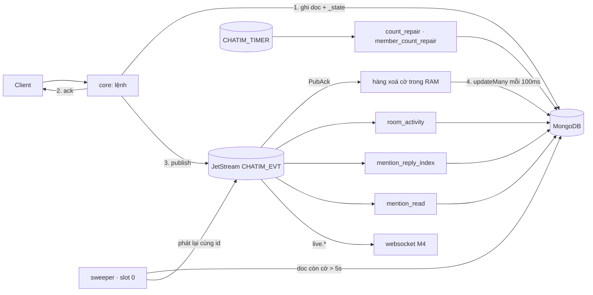

# M3.1 — Core: bỏ effect engine, chuyển sang event theo trạng thái doc: tóm tắt kỹ thuật

> Trạng thái: **bản trình owner duyệt trước khi code (2026-10-16)**. Hướng do owner chốt ngày 2026-10-15 và 2026-10-16. Decision log: `.claude/plans/m3-1-state-driven-events_design.md` (S1–S17). Plan execute cho AI sẽ viết ở `.claude/plans/` sau khi owner duyệt bản này. Bản này thay `.agent/plans/state_driven_in_table_outbox_migration_plan.md` và chủ đề 1 của [open topics](2026-10-15-m3-open-topics.md). Khi xây xong, quyết định mới sẽ vào Decision Log của [thiết kế](../architecture.md) từ D141.

## 1. Thuật ngữ

| Từ | Nghĩa |
|---|---|
| effect engine | Cơ chế hiện tại (M2b.1–M3): reader đọc change stream của Mongo, đẩy phiếu vào `CHATIM_WORK`, worker chạy các effect, một số effect chờ 5s rồi phát bù event. **Bỏ hẳn trong M3.1** |
| cờ chưa phát (`_state`) | Field nội bộ trên doc, số nguyên dạng bitmask. Mỗi bit là một event của doc đó **đã ghi DB nhưng chưa chắc vào NATS**. Không còn bit nào thì field bị xoá. Không bao giờ trả cho client |
| lúc bật cờ (`_state_at`) | Thời điểm bit cũ nhất còn chờ được bật. Sweeper tìm doc theo field này |
| phát inline | Lệnh tự publish event ngay sau khi ghi DB và ack client (như fast path hiện nay), giờ là con đường **duy nhất** |
| xoá cờ theo lô | Sau khi NATS xác nhận (PubAck), core gom các doc đã phát rồi xoá bit bằng một lệnh `updateMany` mỗi 100ms |
| sweeper | Vòng quét nền, chỉ chạy trên core giữ slot 0: tìm doc còn cờ quá 5s, làm lại phần đuôi của lệnh, phát lại event, xoá cờ |
| mốc quét | `_state_at` mà sweeper đã quét sạch tới đó, lưu trong `sweeper_state`, chỉ tiến không lùi |
| phần lùi | Mỗi lượt sweeper quét lùi thêm 30s trước mốc (`SWEEP_LOOKBACK`) để không sót doc commit muộn hoặc do core có đồng hồ lệch ghi |
| projection | Dữ liệu dẫn xuất ghi sau lệnh: `rooms.last_seq` và hoạt động room, chỉ mục mention, doc trả lời, `rc`, `reply_threads`, mention đã đọc |
| consumer projection | Consumer durable trên `CHATIM_EVT`, dùng chung cho mọi core, không delay; nghe event rồi ghi projection |
| phiếu hẹn | Cơ chế D111 giữ nguyên: đặt hẹn sửa số trước khi ghi, gỡ sau khi `$inc` xong; quên gỡ thì phiếu bật và đếm lại |
| ít nhất một lần | Event có thể tới hai lần (cùng id); consumer phải tự bỏ bản trùng |
| chốt version | Cách consumer bỏ trùng: so `ver`/`read_ver`/seq của chính doc, không so "seq nhỏ hơn thì bỏ" |

## 2. Bức tranh chung

### 2.1 Vì sao làm

Effect engine đúng nhưng khó dùng, theo owner (2026-10-15):
- **Phức tạp:** gồm reader trên slot 0, work stream 32 partition, registry effect có chính sách delay/mark, và bit ack trên Redis.
- **Mỗi feature mới phải tuân thủ chặt:** thêm loại change trong feed, thêm kind phiếu, thêm effect, thêm test parity.
- **Có đánh đổi mà dev không chỉnh được:** effect phát bù chờ 5s giữ cả lô phiếu, nên `rooms.last_seq`, `reply_threads`, `rc` và chỉ mục mention trễ khoảng 5s, tới 20s khi PubAck chậm (D140).

Hướng mới: **nhìn vào một lệnh là thấy hết việc nó làm.** Lệnh ghi doc kèm cờ, ack, publish, xoá cờ. Nếu core chết ở giữa, cờ còn nằm trên doc và sweeper làm nốt. Projection nghe event, không chờ.

### 2.2 Scope và ranh giới

| Trong scope M3.1 → core | Ngoài scope → thuộc về |
|---|---|
| Cờ `_state`/`_state_at` trên 7 collection; xoá cờ theo lô sau PubAck | Đổi subject, đổi id event, đổi proto client → không đổi |
| Mọi lệnh gắn "đích xoá cờ" cho event inline đã có; `counts_changed` trả lời và `member_count_changed` do consumer phiếu hẹn/projection phát cũng mang cờ | Websocket chống trùng và lấp lỗ seq → M4, theo hợp đồng ở mục 6 |
| Sweeper trên slot 0, quét từ mốc | Sharding (open topics §2) → để sau |
| 3 consumer projection trên `CHATIM_EVT` | Đọc số thật prod (MarkRead/s, tỉ lệ sửa) → trước PoC prod-like |
| Phiếu hẹn chuyển sang stream `CHATIM_TIMER` | Ghi tay vào DB → người chạy script tự bật cờ (mục 10) |
| Xoá reader, `CHATIM_WORK`, effect, bit ack Redis, config và alert liên quan; viết lại `/app resync` | |

### 2.3 Sơ đồ

So với hiện nay:
- **Mất đi:** change stream, `CHATIM_WORK` (32 partition, 32 consumer), registry effect, delay 5s, `chatim:evtack:*` trên Redis, `reconciler_state`.
- **Thêm vào:** hai field trên doc, 7 partial index, một hàng xoá cờ trong RAM, một sweeper, 3 consumer projection, một stream phiếu hẹn nhỏ.

## 3. Dữ liệu

### 3.1 Hai field mới, cùng tên trên mọi collection có event

| Field | Kiểu | Nghĩa | Ví dụ |
|---|---|---|---|
| `_state` | int32 bitmask | Event còn chờ phát của doc; không còn bit thì field bị `$unset` | `1` = chờ `msg_created`; `3` = chờ cả `msg_created` lẫn `counts_changed` reaction |
| `_state_at` | date | Lúc bit cũ nhất còn chờ được bật: insert lấy giờ core, update lấy giờ server `$$NOW` và ghi bằng `$min` (bit mới không đẩy lùi bit cũ) | `2026-10-16T10:00:00.120Z` |

Dấu `_` cho biết đây là field kỹ thuật, không phải dữ liệu nghiệp vụ. Doc đã phát xong không mang hai field này, nên `messages` (vốn dùng tên ngắn) gần như không tốn thêm byte. Proto và pbconv không đọc hai field này.

### 3.2 Bit theo collection

| Collection | Bit | Event | Bật trong lệnh ghi nào | Xoá bit khi |
|---|---|---|---|---|
| `messages` | 1 | `msg_created` | insert tin (thường, hệ thống, chuyển tiếp) | PubAck; lệnh xoá dùng khoảng `_id` liền nhau của các tin đã PubAck |
| | 2 | `counts_changed` reaction | `$inc rx` khi react; `SetReactions` của `count_repair` | PubAck và `rx.v` vẫn bằng v đã phát |
| | 4 | `counts_changed` trả lời | `$inc rc` của `mention_reply_index`; `SetReplyCount` | PubAck và `rc.v` vẫn bằng v đã phát |
| `message_edits` | 1 | `msg_edited`/`msg_deleted` | insert fact sửa/xoá (dòng `ver 0` không có event nên không có cờ) | PubAck |
| `message_interactions` | 1 | `reaction_changed` hoặc `bookmark_changed` | upsert khi thật sự đổi (doc giữ nguyên byte khi chọn lại cùng emoji thì không có cờ); doc trả lời không có event nên không có cờ | PubAck và `ver` vẫn bằng |
| `pin_actions` | 1 | `msg_pinned`/`msg_unpinned` | insert fact ghim | PubAck |
| `members` | 1 | `member_added/removed/role_changed/priority_changed` | thêm, xoá, rời, đổi role, đổi priority, transaction owner (D100) | PubAck và `ver` vẫn bằng |
| | 2 | `read_updated` | `MarkRead`, `MarkUnread` khi vị trí thật sự đổi | PubAck và `read_ver` vẫn bằng |
| | 4 | `history_cleared` | `ClearHistory` khi `cleared_at` thật sự tăng | PubAck và `cleared_at` vẫn bằng |
| | 8 | `room_preferences_changed` | `SetRoomPreferences` | PubAck và `preference_ver` vẫn bằng |
| `hidden` | 1 | `message_hidden` | lần ẩn đầu (lần sau không ghi gì) | PubAck |
| `rooms` | 1 | `room_created` | `InsertRoom` | PubAck |
| | 2 | `member_count_changed` | mọi chỗ ghi `member_count`: `$inc`, transaction owner, `member_count_repair`, `/app recount` | PubAck và `member_count_ver` vẫn bằng |
| | 4 | `room_updated` | `UpdateRoom` | PubAck và `info_ver` vẫn bằng |

`mentions`, `reply_threads`, doc trả lời và `room_dms` không có event nên không có cờ.

**Vì sao xoá bit phải kèm điều kiện version.** Ví dụ Lan đọc tới `read_seq` 40 (`read_ver` 7), core phát `read_updated` v7. Ngay trước lúc xoá cờ, Lan đọc tiếp tới 45 (`read_ver` 8) và bit 2 được bật lại. Nếu xoá bit không điều kiện, cờ của v8 mất. Khi đó nếu `read_updated` v8 publish lỗi, không ai phát bù nữa. Xoá có điều kiện `read_ver = 7` thì doc v8 không khớp, bit giữ nguyên. `messages` (bit 1), `message_edits`, `pin_actions`, `hidden`, `rooms` (bit 1) chỉ được insert một lần nên không cần điều kiện.

### 3.3 Index và collection

- **7 partial index** `{_state_at: 1}` với điều kiện `_state` tồn tại, mỗi collection một cái. Index chỉ chứa doc đang chờ, thường vài chục entry, luôn nằm trong RAM.
  - Đây là **index phụ đầu tiên trên `messages`**, ngoại lệ của quy tắc shard-ready (`architecture.md` §5.2) (owner duyệt hướng 2026-10-15).
  - Mỗi tin tốn 1 lần thêm và 1 lần xoá entry trên một cây rất nhỏ.
- **`sweeper_state`** (mới, nhỏ): mỗi collection một doc `{_id: "messages", checkpoint, updated_at}`, ghi `w:majority`, chỉ tiến.
- **Bỏ:**
  - `reconciler_state`;
  - stream `CHATIM_WORK`;
  - key Redis `chatim:evtack:*`.
- **Giữ:** index `{activity_bucket: 1}` và `{created_at: 1}` trên `rooms`, vì resync mới vẫn chọn room theo hai field này.
- **Stream mới `CHATIM_TIMER`:** retention WorkQueue, cho phép message schedule. Phiếu đặt ở `timer.arm.{room}.{op}`, tới hạn thì sang `timer.due`. Một consumer dùng chung. Thay phần phiếu hẹn của `CHATIM_WORK`.

### 3.4 Config

| Env | Mặc định | Ý nghĩa |
|---|---|---|
| `STATE_CLEAR_FLUSH` / `STATE_CLEAR_BATCH` | `100ms` / `500` | Chu kỳ và cỡ lô xoá cờ |
| `STATE_CLEAR_QUEUE` | `65536` | Sức chứa hàng xoá cờ. Đầy thì bỏ lượt xoá (đếm metric), doc giữ cờ, sweeper phát lại và stream bỏ bản trùng. Không chặn lệnh |
| `SWEEP_INTERVAL` / `SWEEP_MIN_AGE` / `SWEEP_LOOKBACK` | `2s` / `5s` / `30s` | Nhịp quét, tuổi tối thiểu của cờ, phần lùi |
| `SWEEP_BATCH` / `SWEEP_RATE` | `500` / `5000/s` | Cỡ trang và tốc độ phát bù tối đa |
| `PROJECTION_FETCH_BATCH` / `PROJECTION_FETCH_WAIT` | `256` / `500ms` | Lô của consumer projection; thời gian chờ lô là cửa sổ gom |
| `PROJECTION_RETRY` | `5s,30s,2m,10m` | Giãn dần khi projection lỗi (owner 2026-10-14) |

Kiểm lúc boot:
- `SWEEP_MIN_AGE > PUB_ACK_TIMEOUT + STATE_CLEAR_FLUSH + 1s`, để không phát lại event còn đang bay.
- `SWEEP_MIN_AGE + SWEEP_INTERVAL < EVT_STREAM_DUPLICATES`, để bản phát lại bình thường bị stream bỏ.
- `SWEEP_LOOKBACK > CORE_REQUEST_DEADLINE + 10s`.

Bỏ:
- `RECONCILE_ENABLED`, `RECONCILE_DELAY`, `RECONCILE_WINDOW`, `RECONCILE_CONFIRM_EVERY`, `RECONCILE_DRAIN`;
- mọi `WORK_*`, `EVT_ACK_MARK_TTL`.

## 4. Luồng xử lý

### 4.1 Khuôn chung của mọi lệnh ghi

1. Kiểm tra như hiện nay (tenant, membership, policy, CAS). Không đổi mã lỗi gRPC nào.
2. Ghi doc chính **kèm bit** trong **cùng** lệnh ghi: insert, upsert pipeline, `$inc` hoặc transaction owner. Không thêm lần ghi nào trước ack.
3. Ack client.
4. Đưa event vào publisher (hàng theo shard, không chặn). Hàng đầy hoặc NATS lỗi thì event không đi, cờ còn.
5. PubAck về thì đưa "khoá doc + bit + version" vào hàng xoá cờ. Mỗi 100ms một `updateMany` cho mỗi collection, dạng pipeline update: tắt bit; hết bit thì `$unset` cả `_state` lẫn `_state_at`.

Core chết ở bất kỳ bước nào sau bước 2 thì doc còn cờ. Khoảng 5–7s sau, sweeper làm nốt bước 4–5.

### 4.2 Gửi tin (`SendMessage`, tin hệ thống, chuyển tiếp)

Ví dụ Lan gửi tin 45 vào nhóm 777 lúc 10:00:00,000.
1. Actor đánh seq 45; flusher `insertMany` doc `{_id: 777│0│45, f: lan, x: "chào", ts: …, _state: 1, _state_at: 10:00:00,000}`.
2. Ack seq 45, rồi publish `msg_created` id `777-0-45`, rồi commit cid. Thứ tự giống hiện nay.
3. 10:00:00,004: PubAck về, khoá 777│0│45 vào hàng xoá cờ.
4. 10:00:00,100: hàng có các tin 40–45 của room 777 và 12–13 của room 900 đã PubAck. Chạy `updateMany` với `$or: [{_id: {$gte: 777│0│40, $lte: 777│0│45}}, {_id: {$gte: 900│0│12, $lte: 900│0│13}}]` và `_state` có bit 1, tắt bit 1.
   - Khoảng chỉ gom các seq **liền nhau đã PubAck**: tin 43 chưa PubAck thì thành hai khoảng 40–42 và 44–45.
   - Không dùng `$in` (D139).
5. Song song, consumer `room_activity` nhận `msg_created` 777-0-45, gom với các event khác trong lô ≤ 500ms, rồi `$max rooms.last_seq = 45`. `ListMyRooms` thấy tin 45 trong khoảng 0,5s, so với 5–11s hiện nay.
6. Tin có trả lời hoặc mention: `mention_reply_index` đọc `reply_to` và mention **từ chính event**, không `Find`.

Các nhánh khi có sự cố:
- **Core chết sau bước 1:** client nhận `UNAVAILABLE` hoặc mất kết nối và gửi lại cùng cid. Đường cid giữ như hiện nay (ghi chưa rõ, D119). Tin 45 nằm trong DB với `_state: 1`; 10:00:05–07 sweeper phát `777-0-45`.
- **NATS chết 2 phút:** mọi tin trong 2 phút giữ cờ, gửi tin vẫn chạy và ack bình thường. Khi NATS sống lại, sweeper phát bù với tốc độ tối đa 5K/s (mục 5).
- **Ghi chưa rõ (`Unknown`) nhưng tin thật đã vào:** sweeper phát `msg_created` cho tin đó. Hiện nay worker cũng làm vậy. Client gửi lại cùng cid nhận lại ack cũ. Đường `landLate` (tin ghi chưa rõ, sau đó tìm thấy) hôm nay commit cid mà không publish; M3.1 để nguyên, vì doc mang cờ nên sweeper phát.

### 4.3 Sửa, xoá tin

Thứ tự: insert fact `message_edits` (bit 1), rồi `ApplyEdit` lên `messages` (`v < ver`), ack, publish `msg_edited`/`msg_deleted`, xoá cờ.
- Core chết giữa fact và projection: sweeper thấy fact còn cờ, chạy `ApplyEdit` (idempotent) rồi mới phát snapshot. Việc này thay `edit_projection` của worker.
- `mention_reply_index` nghe `msg_edited`/`msg_deleted` để sửa mention (theo `message_ver`) và gỡ doc trả lời khi xoá. Gỡ trả lời vẫn đặt phiếu hẹn rồi `$inc rc −1`; lệnh `$inc` bật bit 4 trên tin cha.
- `room_activity` nâng `last_edit_at` khi nghe `msg_edited`/`msg_deleted`.

### 4.4 Reaction, bookmark

React: kiểm emoji, `Admit`, `Find`, `Allow`, đặt phiếu, upsert reaction.
- Nếu doc thật sự đổi thì bật bit 1 trên doc reaction, ghi kèm `ver`.
- Sau đó `$inc rx` và bật bit 2 trên tin, gỡ phiếu, ack.
- Publish `reaction_changed` và `counts_changed` rồi xoá hai cờ, mỗi cờ theo version của nó.
- Chọn lại đúng emoji cũ: không đổi gì, không cờ, không event, như hiện nay.

Bookmark: như reaction, phát `bookmark_changed` (đã inline từ trước).

### 4.5 Ghim, bỏ ghim

Insert `pin_actions` (bit 1), fold + CAS `rooms.pins/pin_ver`, ack, publish `msg_pinned`/`msg_unpinned`, xoá cờ.
- Sweeper: fold + CAS rồi publish.
- CAS thua: để cờ, lượt quét sau làm lại. Đây là nhịp quét định kỳ, không phải retry trong lệnh.

### 4.6 Member và vị trí đọc

- **Thêm, xoá, rời, đổi role/priority:** mỗi doc `members` đổi thật thì bật bit 1. `$inc rooms.member_count` bật bit 2 trên room. Transaction owner (D100) ghi bit trong chính transaction đó.
  - Ack, rồi publish `member_*` (mỗi người một event) và `member_count_changed`, rồi xoá cờ theo `ver` và `member_count_ver`.
  - `$inc` lỗi thì phiếu hẹn còn. Khi phiếu bật, `member_count_repair` CAS số và bật bit 2.
- **`MarkRead`/`MarkUnread`:** vị trí đổi thật thì bật bit 2 cùng `read_ver`; publish `read_updated`.
  - Consumer `mention_read` đọc lại doc: `read_ver` của doc nhỏ hơn event thì Nak; còn lại `MarkRead(room, user, read_seq hiện tại)`. Event v7 tới sau v8 không làm sai, vì nó dùng vị trí hiện tại.
- **`ClearHistory`:** `cleared_at` tăng thật thì bật bit 4; phát `history_cleared` như hiện nay.
- **`SetRoomPreferences`:** bật bit 8; phát `room_preferences_changed` như hiện nay.

### 4.7 Ẩn tin

Lần ẩn đầu upsert `hidden` kèm bit 1; phát `message_hidden` như hiện nay. Lần sau không ghi gì, như hiện nay.

### 4.8 Tạo room, mở DM, đổi thông tin room

- **Tạo room, mở DM:** `InsertRoom` mang bit 1. Các member sáng lập mang bit 1. `$inc member_count` bật bit 2. Phát `room_created`, `member_added`, `member_count_changed` như fast path hiện nay. Luồng "đảm bảo" chạy lại được (D117/D118) không đổi.
- **`UpdateRoom`:** CAS `info_ver` kèm bit 4; phát `room_updated` như hiện nay.

### 4.9 Sweeper

Chỉ core giữ lease slot 0 chạy sweeper (owner 2026-10-16), mỗi `SWEEP_INTERVAL`. Mỗi collection theo thứ tự:
1. Đọc mốc trong `sweeper_state`.
2. Đọc từng trang keyset `(_state_at, _id)`, 500 doc mỗi trang, trong khoảng `mốc − 30s ≤ _state_at < now − 5s`. Index partial nên chỉ đọc doc đang chờ. Không giữ cursor mở giữa các trang.
3. Với từng doc, theo từng bit:
   - làm lại phần đuôi của lệnh cho collection có projection inline: `ApplyEdit` cho fact sửa, fold + CAS cho fact ghim;
   - đọc trạng thái **hiện tại** của doc, dựng event với đúng id, publish;
   - PubAck về thì xoá bit có điều kiện như mục 3.2.
4. Mốc mới bằng `_state_at` của doc cũ nhất còn kẹt sau lượt (publish lỗi). Nếu sạch hết thì bằng `now − 5s`. Ghi mốc chỉ tiến.

Ví dụ NATS chết từ 10:00:00 tới 10:02:00:
- Từ 10:00:05, mỗi lượt sweeper thấy tin 45 (cùng các tin sau) và publish lỗi. Mốc đứng ở 10:00:00.
- Lượt 10:02:02: NATS đã sống, sweeper phát tin 45 và các tin kẹt với tốc độ ≤ 5K/s, mốc tiến dần.
- Khoảng 10:02:50 mốc bắt kịp `now − 5s`.

Một số tình huống khác:
- **Core slot 0 chết:** sweeper dừng tới khi slot 0 đổi chủ (~10s), rồi core mới đọc mốc và quét tiếp.
- **Hai core cùng giữ slot 0 trong lúc chuyển:** cả hai có thể phát cùng event; stream bỏ bản trùng theo id.
- **Doc nằm trước `mốc − 30s` mà vẫn còn cờ** (đồng hồ core lệch hơn 30s): lượt quét đầu sau khi core lên quét từ đầu index; doc như vậy được phát và log cảnh báo.

### 4.10 Consumer projection

Ba consumer durable dùng chung cho mọi core. Core nào rảnh thì lấy lô; không gắn slot, không delay. Mỗi lô ≤ 256 event, chờ tối đa 500ms. Ack từng event khi ghi xong. Lỗi thì `NakWithDelay` theo `PROJECTION_RETRY`, kèm alert từ lần giao thứ 6.

| Consumer | Nghe | Ghi | Chốt chống trùng và lệch thứ tự |
|---|---|---|---|
| `room_activity` | mọi event có room | `$max` `last_seq`, `last_message_at` (chỉ `msg_created`), `last_change_at`, `activity_bucket`, `last_edit_at`; gom một lần ghi mỗi room mỗi lô | `$max` |
| `mention_reply_index` | `msg_created`, `msg_edited`, `msg_deleted` | `mentions` (theo `message_ver`), `last_shared_mention_at` (`$max`), doc trả lời và `rc` dưới phiếu hẹn, `reply_threads` | doc trả lời theo `_id` (chèn một lần), tombstone trước khi thêm, mention theo version |
| `mention_read` | `read_updated` | trạng thái đọc của `mentions` | đọc lại `read_ver` của doc, dùng vị trí hiện tại |

Event đã được bảo đảm tới nhờ cờ + sweeper, nên projection dựng từ event là đủ.

### 4.11 Phiếu hẹn

Cơ chế D111 không đổi: đặt phiếu trước khi ghi (lỗi đặt phiếu thì `UNAVAILABLE`, chưa ghi gì), ghi, `$inc`, gỡ phiếu. Chỉ đổi nơi chứa (`CHATIM_TIMER`) và người nhận (một consumer `timer-due`, dùng chung). `count_repair` và `member_count_repair` giữ logic đếm lại + CAS, và bật bit trên doc khi CAS ghi số mới.

### 4.12 `/app resync` và `/app recount`

- **`/app resync -from -to [-tenant] [-room] [-rate] [-dry-run]`:** chọn room như hiện nay, quét các doc trong khoảng, rồi **bật lại bit** với `_state_at = now`, theo `-rate`. Sweeper sẽ phát lại và các projection chạy lại (idempotent).
  - Dùng khi stream `CHATIM_EVT` mất dữ liệu, hoặc khi cần dựng lại projection.
  - Không còn trường hợp "mất feed oplog".
- **`/app recount`:** CAS `member_count_ver` kèm bit 2, rồi publish; giống nay.

## 5. Đúng đắn và chạy đua

- **Mọi thay đổi có event:** bit nằm trong cùng lệnh ghi với dữ liệu, nên không có lúc "đã ghi mà không ai biết phải phát". Chỉ PubAck mới xoá bit.
- **Hết rủi ro "mất feed oplog"** (RC5) vì không còn feed. Rủi ro thay thế là NATS chết lâu: doc tích cờ, có alert.
- **Thứ tự tới consumer không bảo đảm khi phát bù:**
  - Ví dụ tin 46 tới client trước, sweeper phát tin 45 sau. Consumer **không được** dùng "seq ≤ seq đã thấy thì bỏ", vì như vậy tin 45 mất.
  - Hợp đồng: `msg_created` bỏ nếu đã có đúng seq đó; thấy lỗ (seq > seq cuối + 1) thì gọi `GetHistory` để lấp. Event đổi trạng thái so `ver`/`read_ver`/`pin_ver`/`info_ver`/`preference_ver` của doc, bản lớn hơn thắng.
  - Ghi vào `architecture.md` §8 cho M4 và Mention App.
- **Trùng ngoài 5 phút:** stream chỉ bỏ trùng trong `EVT_STREAM_DUPLICATES`. Projection lỗi lâu hay resync có thể phát lại sau 5 phút, và consumer bỏ theo hợp đồng trên.
- **Xoá cờ theo lô với tin chưa PubAck:** khoảng `_id` chỉ gồm seq liền nhau đã PubAck. Filter còn kèm điều kiện bit, nên tin không có bit (đã xoá) không bị ghi lại.
- **Bit mới trên doc cũ:** sweeper tìm theo `_state_at` (lúc bật cờ), không theo `ts`/`created_at`. React một tin của năm ngoái vẫn được quét.
- **Hai lệnh cùng doc:** xoá bit có điều kiện version (mục 3.2). Sweeper luôn phát trạng thái **hiện tại**, nên event trung gian có thể không bao giờ được phát bù; chỉ trạng thái cuối được bảo đảm (giữ nguyên D93, D104).
- **Projection lệch thứ tự** (consumer dùng chung, nhiều core): mọi ghi đều idempotent hoặc chặn bằng version (mục 4.10). Mỗi projection có test giao event đảo thứ tự và giao trùng.
- **Không retry nội bộ:** publish lỗi thì để cờ; CAS thua trong sweeper thì để cờ; projection lỗi thì Nak. Nhịp quét 2s và Nak của JetStream không phải vòng lặp retry trong lệnh.
- **Không transaction mới:** bit đi cùng lệnh ghi hiện có; transaction owner (D100) giữ nguyên.
- **Bất biến "core nào cũng xử lý đúng mọi room":** giữ nguyên. Sweeper chạy trên một core nhưng xử lý mọi room, và stream bỏ trùng.

## 6. Event và subject

Không đổi tên, id, subject, payload hay luật RePublish `live.*` (D108). Chỉ đổi **ai phát**:

| Event | Hiện nay | M3.1 |
|---|---|---|
| `msg_created`, `msg_edited/deleted`, `reaction_changed`, `counts_changed`, `msg_pinned/unpinned`, `member_*`, `member_count_changed`, `read_updated`, `room_created` | fast path + worker phát bù sau 5s | inline + sweeper |
| `bookmark_changed`, `message_hidden`, `history_cleared`, `room_updated`, `room_preferences_changed` | inline + worker phát bù sau 5s | inline + sweeper |
| `counts_changed` trả lời; `member_count_changed` sau khi sửa số | chỉ worker (`reply_mention_index`, `member_count_repair`) | consumer projection/phiếu hẹn phát ngay sau khi ghi, cờ trên doc + sweeper |

Metric:
- **Bỏ:**
  - các metric `reconcile_*`, `effect_dropped_total`, `work_*`;
  - `counter_repaired_total` giữ nguyên, nhưng chuyển sang consumer phiếu hẹn.
- **Mới:**
  - `event_pending_oldest_seconds{collection}`;
  - `sweep_republished_total{collection}`;
  - `sweep_publish_failures_total`;
  - `state_clear_dropped_total` (hàng xoá cờ đầy);
  - `projection_lag_seconds{projection}`;
  - `projection_failures_total{projection}`.
- **Alert:**
  - bỏ RC5/oplog, `ChatimReconcilePublishFailing` và các alert theo effect;
  - thêm `ChatimEventPendingStuck` (cờ cũ nhất > 60s trong 5 phút);
  - thêm `ChatimProjectionLagging` (> 10s trong 5 phút);
  - thêm `ChatimProjectionFailing` (từ lần giao thứ 6);
  - thêm `ChatimSweeperIdle` (không lượt quét nào trong 1 phút).

## 7. Thư viện và hạ tầng

- Không thêm thư viện; dùng nats.go `jetstream` (pull consumer, message schedule) và Mongo driver như hiện nay.
- NATS 2.15 (compose) có message schedule. `CHATIM_TIMER` dùng chung kiểu cấu hình với `CHATIM_WORK` cũ.
- Bootstrap tạo 7 partial index, `sweeper_state`, `CHATIM_TIMER`, 3 consumer projection, rồi xoá `CHATIM_WORK`. Dev chạy `make infra-reset` (chưa go-live).
- Thứ tự khởi động: publisher → hàng xoá cờ → flusher → cid batcher → router → slot manager → consumer phiếu hẹn → consumer projection → sweeper (khi giữ slot 0) → watcher → gRPC.
- Thứ tự dừng: sweeper → consumer projection → consumer phiếu hẹn, rồi các phần như nay.
  - Hàng xoá cờ xả trước publisher, trong 1s. Phần không kịp xả thì sweeper phát lại và stream bỏ bản trùng.
  - Ngân sách 28s dư hơn nay vì bỏ `RECONCILE_DRAIN` và `WORK_DRAIN`.
- **Package:**
  - mới: `event/sweep` (một file mỗi collection), `event/projection` (ba consumer), `event/timer`, `event/clear` (hàng xoá cờ);
  - xoá: `event/reconcile`, `event/effects`, `event/eventmark`, `event/work` (phần phiếu hẹn chuyển sang `event/timer`), `store/mongostore/feed*.go`, `store.ChangeFeed`;
  - viết lại: `event/resync`.
  - Ước tính bỏ ~4.000 dòng code (không tính test), thêm ~1.500.

## 8. Quyết định

| # | Quyết định | Phương án bị loại | Vì sao |
|---|---|---|---|
| S1 | Bỏ effect engine | Sửa engine bằng hai giai đoạn hoặc hai consumer (open topics A/B) | Owner: engine quá phức tạp, phải tuân thủ chặt, đánh đổi dev không chỉnh được |
| S2 | Cờ trên chính doc, ghi cùng lệnh | Collection `outbox` riêng + transaction; đặt dấu trên `rooms` trước khi insert | Transaction trái quy tắc; dấu trước insert thêm ~1–2ms vào ack |
| S3 | Tên `_state`, chung mọi collection, `$unset` khi xong | `st`, `event_pending` riêng từng nơi | Owner chọn; một tên thì sweeper và index dùng chung code |
| S4 | Xoá cờ theo lô ngoài luồng gRPC, khoảng `_id` | `UpdateOne` mỗi tin; `$in` 500 id | Gom lô giảm số lệnh; `$in` trên clustered đọc cả khoảng giữa các room (D139) |
| S5 | Bitmask + xoá có điều kiện version | Cờ 0/1 | Doc `members` có tới 4 event chờ cùng lúc; không có điều kiện thì mất cờ của thay đổi mới |
| S6 | Sweeper chỉ trên slot 0 | Mọi core quét slot của mình | Owner: đúng một máy query |
| S7 | Quét từ mốc, keyset, phần lùi 30s | Cửa sổ cố định `now−30s..now−5s` | Cửa sổ cố định bỏ mất tin kẹt lâu hơn 30s (NATS chết) |
| S8 | Partial index `{_state_at}` | Index đầy đủ `{ts}`; không index | Index đầy đủ đọc lại cả phần lùi mỗi lượt (~30K doc/s ở 2K tin/s) và giữ entry mãi; không index thì không tìm được tin kẹt |
| S9 | `_state_at` theo lúc bật cờ | Theo `ts`/`created_at` | React tin cũ hay đổi role member cũ sẽ nằm sau mốc và bị sót |
| S10 | Projection là consumer trên `CHATIM_EVT`, không delay | Ghi projection inline trong lệnh | Inline làm chậm ack và lệnh; consumer gom lô được |
| S11 | Projection inline có sẵn (`ApplyEdit`, fold ghim) giữ trên lệnh, sweeper làm lại | Chuyển sang consumer | Snapshot trong event cần projection đã áp |
| S12 | Phiếu hẹn sang `CHATIM_TIMER` | Giữ `CHATIM_WORK` chỉ cho phiếu | Bỏ hẳn tên và cấu trúc 32 partition |
| S13 | Event do consumer phát (`counts_changed` trả lời, `member_count_changed` sau sửa số) cũng theo khuôn cờ | Để riêng không cờ | Không còn worker phát bù cho chúng |
| S14 | Giới hạn tốc độ phát bù | Phát một lèo | Tránh dồn tải NATS và projection sau sự cố |
| S15 | Resync = bật lại cờ | Resync tự publish | Một đường phát duy nhất (sweeper) |
| S16 | Chốt chống trùng theo version doc | "seq ≤ hiện tại thì bỏ" | Phát bù lệch thứ tự sẽ làm mất tin |

## 9. Chi phí

Ước tính ở 2K tin/s (mốc bench duy nhất); số thật đo ở bench.

| Mỗi tin | Hiện nay | M3.1 |
|---|---|---|
| Mongo ghi | insert; `rooms` `$max` mỗi room mỗi lô | insert (+1 entry partial index); **+1 update xoá cờ** (gom lô: ~10 lệnh/s nhưng ~2K doc/s và ~2K entry oplog/s); `rooms` `$max` mỗi room mỗi lô |
| Mongo đọc | change stream đọc oplog; `Find` tin chưa có bit ack (ít) | không |
| NATS | publish event; reader publish phiếu; worker fetch + ack phiếu; worker phát bù (bị bỏ trùng) | publish event; 2 consumer projection fetch + ack (`room_activity` mọi event, `mention_reply_index` event tin) |
| Redis dedupe | `SETBIT` + `GETBIT` (theo lô) | không |

- Lệnh khác (sửa, react, member, đọc…) thêm 1 update xoá cờ mỗi lệnh.
- Sau khi NATS chết 2 phút ở 2K tin/s: ~240K doc chờ. Sweeper phát bù ≤ 5K/s trong ~48s, đọc ~480 trang partial index.
- Trễ projection mong đợi ≤ 1s (cửa sổ gom 500ms), so với 5–11s hiện nay.

## 10. Rủi ro

- **Ghi trên `messages` gấp đôi số doc bị sửa:** mỗi tin thêm một update và một entry oplog. Oplog đầy nhanh hơn nên cửa sổ oplog ngắn lại (chỉ còn quan trọng cho replica và backup). Bench 2K đo mức tăng thật.
- **NATS chết thì projection đứng:** danh sách hội thoại, mention và `rc` dừng cập nhật tới khi NATS sống và sweeper phát bù xong (~48s sau sự cố 2 phút ở 2K). Gửi tin và ack vẫn chạy. Hiện nay worker cũng dừng khi NATS chết, nên không xấu hơn.
- **Sweeper một máy:** core slot 0 chết thì phát bù dừng ~10s.
- **Ghi ngoài core không sinh event:** sửa tay trong mongosh hay script migration phải tự bật `_state` + `_state_at`. Hiện nay change stream bắt được những ghi này. Ghi quy ước vào `architecture.md` §7.
- **Index phụ đầu tiên trên `messages`:** khi shard, sweeper hỏi mọi shard (index nhỏ, 2s một lần).
- **Consumer ngoài phải theo hợp đồng chống trùng** ở mục 5. Websocket M4 làm sai thì client thấy tin trùng hoặc bỏ lỡ tin phát bù.
- **Hàng xoá cờ đầy** (Mongo chậm): bỏ lượt xoá, sweeper phát lại sau 5s, stream bỏ trùng. Chỉ tốn thêm việc, không sai.

## 11. Điểm owner

### 11.1 Owner đã chốt

- **2026-10-15:** bỏ effect engine; hướng: doc mang trạng thái, lệnh tự phát, sweeper phát bù, projection nghe event không delay.
- **2026-10-16:**
  - field nội bộ tên `_state`;
  - xoá cờ gom lô ngoài luồng gRPC;
  - sweeper chỉ trên slot 0;
  - quét từ mốc lần trước bằng keyset, không giữ cursor dài;
  - chấp nhận giao ít nhất một lần;
  - bench chỉ một ô 2K tin/s trên dev.

### 11.2 Đội tự chọn, owner xem lại

- Bitmask theo loại event; `_state_at` ghi bằng `$min`, update lấy giờ server.
- Xoá bit có điều kiện version với doc sửa nhiều lần.
- Partial index thay vì index đầy đủ. Đổi thì chỉ sửa bootstrap; bench đo cả hai.
- Phần lùi 30s; tuổi tối thiểu 5s; nhịp 2s; trang 500; tốc độ 5K/s.
- Ba consumer projection dùng chung (không gắn slot); lô 256, chờ 500ms.
- Giãn dần Nak 5s/30s/2m/10m + alert (dùng lại lựa chọn 2026-10-14).
- `CHATIM_TIMER` thay `CHATIM_WORK` cho phiếu hẹn.
- Event do consumer phát (`counts_changed` trả lời, `member_count_changed` sau sửa số) cũng mang cờ.
- Resync bật lại cờ thay vì tự phát.
- Milestone M3.1, nhánh `feat/m3.1` tách từ `main` sau khi PR M3 merge.

## 12. Kiểm thử

### 12.1 Có gì và chứng minh gì

| Test | Chứng minh |
|---|---|
| `storetest` contract mới: mỗi write method bật đúng bit cùng lần ghi; `ClearState` tắt bit có điều kiện; `Pending` trả doc theo keyset | memstore và mongostore giống nhau; không lệnh nào quên cờ |
| Unit test từng lệnh (mutate, actor, grpcsrv): PubAck → khoá vào hàng xoá cờ; publish lỗi → cờ còn | Khuôn 4.1 đúng ở mọi lệnh |
| Unit test hàng xoá cờ (`synctest`, `goleak`, `-count=5`): gom 100ms/500, khoảng chỉ gồm seq liền nhau đã PubAck, đầy thì bỏ và đếm, dừng thì xả | Không xoá nhầm cờ chưa phát; không chặn lệnh |
| Unit test sweeper: từng collection, từng bit; mốc chỉ tiến; publish lỗi giữ mốc; phần lùi; doc trước mốc; tốc độ | Không sót, không lùi |
| Unit test projection: giao trùng, đảo thứ tự, lỗi rồi Nak | Projection idempotent |
| itest `CHATIM_IT_*`: giết core sau insert, trước publish → event tới trong ~7s và cờ về 0 | Bảo đảm Y1 trên hạ tầng thật |
| itest explain: sweeper đọc partial index, chỉ đọc doc có cờ; lệnh xoá cờ là các khoảng `_id` | Đúng chi phí, đúng D139 |
| itest phiếu hẹn trên `CHATIM_TIMER`: phiếu bật sau restart NATS | Phiếu không mất khi đổi stream |
| e2e phase 1–7 giữ nguyên; phase "giết core-1" kiểm event phát bù bởi sweeper; phase 7 bỏ vòng chờ 45s vì engine trễ | Hành vi client không đổi; danh sách hội thoại cập nhật nhanh |

### 12.2 Kiểm chứng cuối milestone

- `make fmt-check`, `vet`, `lint`, `test`, `itest`, `core-up && e2e`.
- Bench một ô 2K tin/s trên dev: `base-2k` trên `main`, `after-2k` trên `feat/m3.1`. Đạt khi:
  - trễ `last_seq` ≤ 1s;
  - ack p99 không tăng;
  - ghi lại số lệnh và số doc Mongo tăng thêm, kèm `CPU_Speed_Limit`.
- Thử NATS chết: `docker stop chatim-nats` 2 phút trong lúc gửi 2K tin/s, rồi bật lại. Đạt khi:
  - không mất tin (corebench đếm);
  - mốc sweeper bắt kịp;
  - `event_pending_oldest_seconds` về 0.
