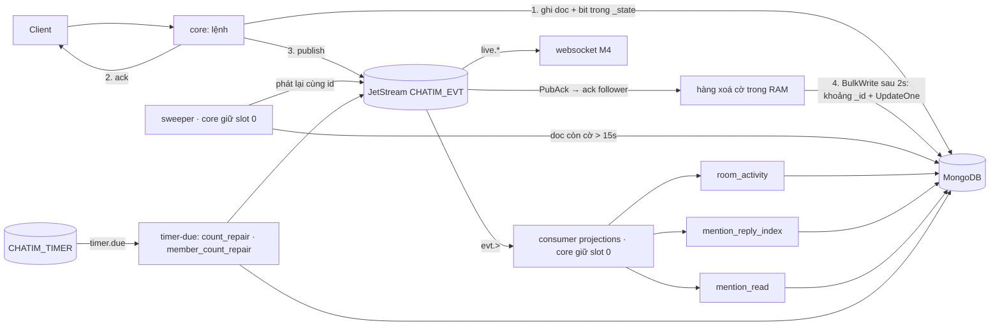

# M3.1 — Core: bỏ effect engine, chuyển sang event theo trạng thái doc: tóm tắt kỹ thuật

> Trạng thái: **xây xong, đã merge `main` (PR #15, 2026-10-17, `dev-done`)**. Bản này viết lại từ cái đã thực sự xây: owner duyệt hướng ngày 2026-10-15 và 2026-10-16; mọi chỗ đội làm khác bản trước khi code nằm trong thân bài và ở mục 11.2, quyết định owner trong lúc xây ở mục 11.1. Plan execute cho AI đã xoá sau merge; Minor còn lại nằm ở [roadmap](../roadmap.md) "Mục mang sang M5". Log brainstorm (S1–S17) đã gộp vào Decision Log và xoá. Quyết định D141–D160 nằm trong [Decision Log](../decision-log.md) §17.3; [thiết kế](../architecture.md) và [Module 10](../modules/10-feature-data-reconciliation-and-repair.md) là nguồn sự thật hiện hành. M3.1 giải chủ đề 1 của [open topics](2026-10-15-m3-open-topics.md) (effect engine chặn đầu hàng); chủ đề 2 (sharding) còn mở.

## 1. Thuật ngữ

| Từ | Nghĩa |
|---|---|
| effect engine | Cơ chế cũ (M2b.1–M3): reader đọc change stream của Mongo, đẩy phiếu vào `CHATIM_WORK`, worker chạy các effect, một số effect chờ 5s rồi phát bù event. **Đã xoá hẳn trong M3.1** |
| cờ chưa phát (`_state`) | Field nội bộ trên doc, số nguyên dạng bitmask. Mỗi bit là một event của doc đó **đã ghi DB nhưng chưa chắc vào NATS**. Không còn bit nào thì field bị xoá. Không bao giờ trả cho client |
| lúc bật cờ (`_state_at`) | Thời điểm bit cũ nhất còn chờ được bật. Sweeper tìm doc theo field này |
| phát inline | Lệnh tự publish event ngay sau khi ghi DB và ack client. Đây là con đường **duy nhất**; sweeper chỉ phát bù |
| hàng xoá cờ | Hàng trong RAM mỗi core (`event/stateclear`). Sau PubAck, publisher đưa "collection + khoá + bit + version" vào hàng; hàng gom trong 2s rồi xoá bit trên Mongo bằng một `BulkWrite` |
| sweeper | Vòng quét nền, chỉ chạy trên core giữ slot 0: tìm doc còn cờ quá 15s, làm lại phần đuôi của lệnh, phát lại event, xoá cờ |
| mốc quét | `_state_at` mà sweeper đã quét sạch tới đó, lưu trong `sweeper_state`, chỉ tiến không lùi |
| phần lùi | Mỗi lượt sweeper quét lùi thêm 60s trước mốc (`SWEEP_LOOKBACK`) để không sót doc commit muộn hoặc do core có đồng hồ lệch ghi |
| dò trước cửa sổ | Sau mỗi lượt, sweeper hỏi partial index xem còn **một** doc có cờ nằm trước phần lùi không; có thì lượt sau quét từ đầu (D158) |
| projection | Dữ liệu dẫn xuất ghi sau lệnh: hoạt động room (`rooms.last_seq`…), chỉ mục mention, doc trả lời, `rc`, `reply_threads`, mention đã đọc |
| consumer `projections` | **Một** consumer durable trên `CHATIM_EVT`, nghe mọi event (`evt.>`), chỉ core giữ slot 0 đọc; mỗi lô chia cho ba phần xử lý `room_activity`, `mention_reply_index`, `mention_read` |
| cửa sổ gom | Consumer `projections` chờ tối đa 3s cho mỗi lô (owner chọn 2026-10-17) để gom nhiều event của một room vào một lần ghi `rooms` |
| phiếu hẹn | Cơ chế D111 giữ nguyên: đặt hẹn sửa số trước khi ghi, gỡ sau khi `$inc` xong; quên gỡ thì phiếu bật và đếm lại. Nay nằm trên stream `CHATIM_TIMER` |
| ít nhất một lần | Event có thể tới hai lần (cùng id); người nhận phải tự bỏ bản trùng |
| chốt version | Cách người nhận bỏ trùng: so `ver`/`read_ver`/seq của chính doc, không so "seq nhỏ hơn thì bỏ" |

## 2. Bức tranh chung

### 2.1 Vì sao làm

Effect engine đúng nhưng khó dùng, theo owner (2026-10-15):
- **Phức tạp:** reader trên slot 0, work stream 32 partition, registry effect có chính sách delay/mark, và bit ack trên Redis.
- **Mỗi feature mới phải tuân thủ chặt:** thêm loại change trong feed, thêm kind phiếu, thêm effect, thêm test parity.
- **Có đánh đổi mà dev không chỉnh được:** effect phát bù chờ 5s giữ cả lô phiếu, nên `rooms.last_seq`, `reply_threads`, `rc` và chỉ mục mention trễ khoảng 5s, tới 20s khi PubAck chậm (D140).

Hướng mới: **nhìn vào một lệnh là thấy hết việc nó làm.** Lệnh ghi doc kèm cờ, ack, publish, xoá cờ. Nếu core chết ở giữa, cờ còn nằm trên doc và sweeper làm nốt. Projection nghe event, không có delay cố định.

### 2.2 Scope và ranh giới

| Trong scope M3.1 → core | Ngoài scope → thuộc về |
|---|---|
| Cờ `_state`/`_state_at` trên 7 collection, ghi cùng lần ghi dữ liệu; xoá cờ theo lô sau PubAck | Đổi subject, id event, payload, proto client → không đổi gì |
| Mọi event inline đã có mang cờ; thêm cờ cho hai event trước đây chỉ worker phát: `counts_changed` của trả lời và `member_count_changed` sau khi sửa số | Websocket chống trùng và lấp lỗ seq → M4, theo hợp đồng ở mục 5 |
| Sweeper trên core giữ slot 0, quét từ mốc, có phần lùi và lần dò | Sharding → không làm trong core; người triển khai tự chọn shard key (D161) |
| Một consumer `projections` trên `CHATIM_EVT` với ba phần xử lý | Số thật prod (MarkRead/s, tỉ lệ sửa) → trước PoC prod-like |
| Phiếu hẹn chuyển sang stream `CHATIM_TIMER`, consumer `timer-due` | Ghi tay vào DB → người chạy script tự bật cờ (mục 10) |
| Xoá reader, `CHATIM_WORK`, effect, bit ack Redis, change feed, config và alert liên quan; viết lại `/app resync` | Xoá collection `reconciler_state` và stream `CHATIM_WORK` cũ trên môi trường đang chạy → người vận hành xoá tay (mục 7) |

### 2.3 Sơ đồ

So với trước M3.1:
- **Mất đi:** change stream, `CHATIM_WORK` (32 partition, 32 consumer), registry effect, delay 5s, `chatim:evtack:*` trên Redis, `reconciler_state`, `store.ChangeFeed`.
- **Thêm vào:** hai field trên doc, 7 partial index, một hàng xoá cờ trong RAM mỗi core, một sweeper, một consumer `projections`, một stream phiếu hẹn nhỏ.
- Trên NATS mỗi tin còn 1 publish + 1 lần giao + 1 ack (engine cũ: 2 publish vì thêm phiếu việc, + 1 lần giao + 1 ack).

## 3. Dữ liệu

### 3.1 Hai field mới, cùng tên trên mọi collection có event

| Field | Kiểu | Nghĩa | Ví dụ |
|---|---|---|---|
| `_state` | int32 bitmask | Event còn chờ phát của doc; không còn bit thì `$unset` | `1` = chờ `msg_created`; `3` = chờ cả `msg_created` lẫn `counts_changed` reaction |
| `_state_at` | date | Lúc bit cũ nhất còn chờ được bật: insert lấy giờ của doc, update lấy giờ server `$$NOW`, ghi bằng `$min` (bit mới không đẩy lùi bit cũ) | `2026-10-16T10:00:00.120Z` |

Dấu `_` cho biết đây là field kỹ thuật. Doc đã phát xong không mang hai field này, nên `messages` (vốn dùng tên ngắn) gần như không tốn thêm byte. Proto và pbconv không đọc hai field này. Để ghi được `$$NOW`, các update member/room và `SetReactions`/`SetReplyCount` chuyển sang dạng pipeline; filter CAS và giá trị trả về giữ nguyên.

### 3.2 Bit theo collection

| Collection | Bit | Event | Bật trong lệnh ghi nào | Xoá bit khi |
|---|---|---|---|---|
| `messages` | 1 | `msg_created` | insert tin (thường, hệ thống, chuyển tiếp) | PubAck |
| | 2 | `counts_changed` reaction | `$inc rx` khi react; `SetReactions` của `count_repair` | PubAck và `rx.v` vẫn bằng v đã phát |
| | 4 | `counts_changed` trả lời | `$inc rc` của `mention_reply_index`; `SetReplyCount` | PubAck và `rc.v` vẫn bằng v đã phát |
| `message_edits` | 1 | `msg_edited`/`msg_deleted` | insert fact `ver ≥ 1` (dòng `ver 0` không có event nên không có cờ) | PubAck |
| `message_interactions` | 1 | `reaction_changed` hoặc `bookmark_changed` | upsert khi thật sự đổi; gỡ luôn bật bit. Chọn lại cùng emoji giữ doc nguyên byte nên không có cờ; doc trả lời không có cờ | PubAck và `ver` vẫn bằng |
| `pin_actions` | 1 | `msg_pinned`/`msg_unpinned` | insert fact ghim | PubAck |
| `members` | 1 | `member_added/removed/role_changed/priority_changed` | thêm, xoá, rời, đổi role, đổi priority, transaction owner (D100) | PubAck và `ver` vẫn bằng |
| | 2 | `read_updated` | `MarkRead`, `MarkUnread` khi vị trí thật sự đổi | PubAck và `read_ver` vẫn bằng |
| | 4 | `history_cleared` | `ClearHistory` khi `cleared_at` thật sự tăng | PubAck và `cleared_at` vẫn bằng |
| | 8 | `room_preferences_changed` | `SetRoomPreferences` | PubAck và `preference_ver` vẫn bằng |
| `hidden` | 1 | `message_hidden` | lần ẩn đầu (`$setOnInsert`; lần sau không ghi gì) | PubAck |
| `rooms` | 1 | `room_created` | `InsertRoom` | PubAck |
| | 2 | `member_count_changed` | mọi chỗ ghi `member_count`: `$inc`, transaction owner, `member_count_repair`, `/app recount` | PubAck và `member_count_ver` vẫn bằng |
| | 4 | `room_updated` | `UpdateRoom` | PubAck và `info_ver` vẫn bằng |

`mentions`, `reply_threads`, doc trả lời và `room_dms` không có event nên không có cờ.

**Vì sao xoá bit phải kèm điều kiện version.** Ví dụ Lan đọc tới `read_seq` 40 (`read_ver` 7), core phát `read_updated` v7. Ngay trước lúc xoá cờ, Lan đọc tiếp tới 45 (`read_ver` 8) và bit 2 được bật lại. Nếu xoá không điều kiện, cờ của v8 mất; khi đó nếu `read_updated` v8 publish lỗi thì không ai phát bù. Xoá có điều kiện `read_ver = 7` thì doc v8 không khớp, bit giữ nguyên. `messages` bit 1, `message_edits`, `pin_actions`, `hidden`, `rooms` bit 1 chỉ được insert một lần nên không cần điều kiện. Lệnh bật lại cờ (`Mark`, của resync) cũng kiểm version như vậy; version lớn hơn `MaxUint32` bị từ chối.

### 3.3 Index, collection và stream

- **7 partial index `state_pending {_state_at: 1, _id: 1}`** với điều kiện `_state` tồn tại, mỗi collection một cái. Index chỉ chứa doc đang chờ (lúc chạy bình thường là các doc của 2–3s gần nhất), luôn nằm trong RAM.
  - Đây là **index phụ đầu tiên trên `messages`**, ngoại lệ của quy tắc shard-ready (D148, owner duyệt hướng 2026-10-15).
  - Mỗi tin tốn 1 lần thêm và 1 lần xoá entry trên một cây nhỏ.
- **`sweeper_state`** (mới, nhỏ): mỗi collection một doc `{_id: "messages", checkpoint, updated_at}`, ghi `w:majority`, chỉ tiến.
- **Stream `CHATIM_TIMER`** (mới): WorkQueue, cho phép message schedule, `MaxAge` 2h, chống trùng 2 phút. Phiếu đặt ở `timer.arm.{room}.{op}` (member) hoặc `timer.arm.{room}.{thread}.{seq}.{counter}.{op}` (`reactions`/`replies`), tới hạn thì sang `timer.due`. Một consumer `timer-due` dùng chung mọi core.
- **Consumer `projections`** (mới) trên `CHATIM_EVT`: lọc `evt.>`, ack từng tin (`AckExplicit`), `AckWait` 30s, `MaxAckPending` = 4 × lô = 32.768, `DeliverAll`. Lúc khởi động core tạo nó và xoá ba durable cũ `projection-room_activity`, `projection-mention_reply_index`, `projection-mention_read` của bản dựng giữa chừng (không có thì bỏ qua).
- **Bỏ:** collection `reconciler_state`, stream `CHATIM_WORK`, key Redis `chatim:evtack:*`. Bootstrap không còn đụng tới chúng; database hay NATS cũ còn giữ thì xoá tay (vô hại nếu để).
- **Giữ:** index `{activity_bucket: 1}` và `{created_at: 1}` trên `rooms`, vì resync vẫn chọn room theo hai field này.

### 3.4 Config

| Env | Mặc định | Ý nghĩa |
|---|---|---|
| `STATE_CLEAR_FLUSH` / `STATE_CLEAR_BATCH` | `2s` / `16384` | Hàng xoá cờ chạy một lần xoá 2s sau đích đầu tiên của lô, hoặc khi đủ 16.384 đích |
| `STATE_CLEAR_QUEUE` | `65536` | Sức chứa hàng. Đầy thì bỏ lượt xoá (đếm `state_clear_dropped_total`), doc giữ cờ, sweeper phát lại và stream bỏ bản trùng. Không chặn lệnh |
| `STATE_CLEAR_TIMEOUT` | `5s` | Hạn của mỗi lần xoá |
| `SWEEP_INTERVAL` / `SWEEP_MIN_AGE` / `SWEEP_LOOKBACK` | `2s` / `15s` / `60s` | Nhịp quét, tuổi tối thiểu của cờ, phần lùi |
| `SWEEP_BATCH` / `SWEEP_RATE` | `500` / `5000` | Cỡ trang (≤ 1.000) và số event phát bù tối đa mỗi giây |
| `PROJECTION_FETCH_BATCH` / `PROJECTION_FETCH_WAIT` | `8192` / `3s` | Lô tối đa và cửa sổ gom của consumer `projections` (tối đa 8.192 và 3s) |
| `TIMER_STREAM` / `TIMER_SUBJECT_ROOT` | `CHATIM_TIMER` / `timer` | Stream phiếu hẹn; phải khác stream event |
| `CORE_SHUTDOWN_BUDGET` | `30s` (trước 28s) | Ngân sách dừng; kế hoạch mặc định 29,7s (mục 7) |

Kiểm lúc boot:
- `SWEEP_MIN_AGE > PUB_ACK_TIMEOUT + STATE_CLEAR_FLUSH + STATE_CLEAR_TIMEOUT` (mặc định 15s > 2s + 2s + 5s), để sweeper không phát lại event còn đang bay hoặc đang chờ xoá cờ.
- `SWEEP_MIN_AGE + SWEEP_INTERVAL < EVT_STREAM_DUPLICATES` (5 phút), để bản phát lại bình thường bị stream bỏ.
- `SWEEP_LOOKBACK > SWEEP_MIN_AGE + 10s` và `> CORE_REQUEST_DEADLINE + 10s`.
- Tổng các mốc dừng phải nhỏ hơn `CORE_SHUTDOWN_BUDGET`.

Bỏ (env cũ còn đặt thì bị bỏ qua, không làm boot lỗi): `RECONCILE_ENABLED`, `RECONCILE_DELAY`, `RECONCILE_WINDOW`, `RECONCILE_CONFIRM_EVERY`, `RECONCILE_DRAIN`; mọi `WORK_*`; `EVT_ACK_MARK_TTL`. Không có env cho bậc thang Nak (cố định 5s/30s/2m/10m).

## 4. Luồng xử lý

### 4.1 Khuôn chung của mọi lệnh ghi

1. Kiểm tra như trước (tenant, membership, policy, CAS). Không đổi mã lỗi gRPC nào.
2. Ghi doc chính **kèm bit** trong **cùng** lệnh ghi: insert, upsert pipeline, `$inc` hoặc transaction owner. Không thêm lần ghi nào trước ack.
3. Ack client.
4. Đưa event vào publisher (hàng theo shard, không chặn). Hàng đầy hoặc NATS lỗi thì event không đi, cờ còn.
5. Mỗi shard của publisher có **một ack follower** (4.096 mục, chờ PubAck theo thứ tự đến). nats.go giao PubAck của một lần publish đúng một lần, nên đây là chỗ duy nhất đọc được ack. PubAck OK thì follower đưa đích (`publish.StateTargetOf`: collection, khoá, bit, version) vào hàng xoá cờ; follower đầy thì chỉ đếm `publish_state_track_full_total` (doc giữ cờ, sweeper bù).
6. Hàng xoá cờ chạy 2s sau đích đầu tiên (hoặc đủ 16.384 đích): xếp cả lô theo `_id`, rồi với mỗi (collection, bit) gửi một `BulkWrite` không thứ tự, tối đa 500 lệnh mỗi lần, không cắt đôi khoảng nào:
   - các khoá **liền nhau** (seq liên tiếp của một room đã PubAck) thành **một** `UpdateMany` theo khoảng `_id`;
   - khoá lẻ là `UpdateOne` theo `_id` bằng (kèm version và bit);
   - `hidden` theo khoá tự nhiên, `rooms` theo `_id` (không clustered).
   Mỗi lệnh tắt bit; hết bit thì `$unset` cả `_state` lẫn `_state_at`. Không dùng `$in` hay `$or` nhiều nhánh.

Core chết ở bất kỳ bước nào sau bước 2 thì doc còn cờ; khoảng 15–17s sau sweeper làm nốt bước 4–6.

### 4.2 Gửi tin (`SendMessage`, tin hệ thống, chuyển tiếp)

Ví dụ Lan gửi tin 45 vào nhóm 777 lúc 10:00:00,000.
1. Actor đánh seq 45; flusher `insertMany` doc `{_id: 777│0│45, f: lan, x: "chào", ts: …, _state: 1, _state_at: 10:00:00,000}`.
2. Ack seq 45, rồi publish `msg_created` id `777-0-45`, rồi commit cid. Thứ tự như trước.
3. 10:00:00,004: PubAck về, khoá 777│0│45 vào hàng xoá cờ.
4. 10:00:02,004: hàng có các tin 30–58 của room 777 (đã PubAck hết) và tin 12, 14 của room 900. Gửi một `BulkWrite`: một `UpdateMany {_id: 777│0│30 … 777│0│58, _state có bit 1}` và hai `UpdateOne` cho 900│0│12, 900│0│14. Tin 43 chưa PubAck thì 777 thành hai khoảng 30–42 và 44–58.
5. Song song, consumer `projections` nhận `msg_created` 777-0-45 trong lô 3s, gom với các event khác của room 777, rồi một lần ghi `$max rooms.last_seq = 58`. `ListMyRooms` thấy tin 45 sau trung vị 1,6s, chậm nhất ~3,6s (bench 2K), so với 2,7s / 5,7s của engine cũ.
6. Tin có trả lời hoặc mention: `mention_reply_index` đọc `reply_to` và mention **từ chính event**, không `Find`.

Các nhánh khi có sự cố:
- **Core chết sau bước 1:** client nhận `UNAVAILABLE` hoặc mất kết nối và gửi lại cùng cid. Đường cid giữ như trước (ghi chưa rõ, D119). Tin 45 nằm trong DB với `_state: 1`; khoảng 10:00:15–17 sweeper phát `777-0-45`.
- **NATS chết vài phút:** mọi tin trong lúc đó giữ cờ, gửi tin vẫn chạy và ack bình thường. Khi NATS sống lại, sweeper phát bù (mục 4.9, số đo ở mục 12.2).
- **Ghi chưa rõ (`Unknown`) nhưng tin thật đã vào:** đường `landLate` (tin ghi chưa rõ, sau đó tìm thấy) chỉ commit cid, không publish; doc mang cờ nên sweeper phát `msg_created` sau ~15s. Client gửi lại cùng cid nhận lại ack cũ.

### 4.3 Sửa, xoá tin

Thứ tự: insert fact `message_edits` (bit 1), rồi `ApplyEdit` lên `messages` (`v < ver`), ack, publish `msg_edited`/`msg_deleted`, xoá cờ.
- Core chết giữa fact và projection: sweeper thấy fact còn cờ, chạy `ApplyEdit` (idempotent) và xoá text cũ khi xoá tin, rồi mới phát snapshot theo version của fact. Projection còn chậm hơn fact thì giữ cờ, lượt sau làm lại. Việc này thay `edit_projection` của worker cũ (D151).
- `mention_reply_index` nghe `msg_edited`/`msg_deleted` để sửa mention (theo `message_ver`) và gỡ doc trả lời khi xoá. Gỡ trả lời vẫn đặt phiếu hẹn rồi `$inc rc −1`; lệnh `$inc` bật bit 4 trên tin cha.
- `room_activity` nâng `last_edit_at` (sửa/xoá trên thread 0) bằng giờ server khi nghe `msg_edited`/`msg_deleted`.

### 4.4 Reaction, bookmark

React: kiểm emoji, `Admit`, `Find`, `Allow`, đặt phiếu, upsert reaction.
- Doc thật sự đổi thì bật bit 1 trên doc reaction, ghi kèm `ver`, `_state_at = $$NOW`.
- Sau đó `$inc rx` và bật bit 2 trên tin, gỡ phiếu, ack.
- Publish `reaction_changed` và `counts_changed`, rồi xoá hai cờ, mỗi cờ theo version của nó.
- Chọn lại đúng emoji cũ: doc giữ nguyên byte, không cờ, không event, như trước.

Bookmark: như reaction, phát `bookmark_changed`.

### 4.5 Ghim, bỏ ghim

Insert `pin_actions` (bit 1), fold + CAS `rooms.pins/pin_ver`, ack, publish `msg_pinned`/`msg_unpinned`, xoá cờ.
- Sweeper: `Project` (fold + CAS) rồi đọc lại trạng thái ghim và tin, rồi publish.
- CAS thua: để cờ, lượt quét sau làm lại. Đây là nhịp quét định kỳ, không phải retry trong lệnh.

### 4.6 Member và vị trí đọc

- **Thêm, xoá, rời, đổi role/priority:** mỗi doc `members` đổi thật thì bật bit 1. `$inc rooms.member_count` bật bit 2 trên room. Transaction owner (D100) ghi bit trong chính transaction đó, nên bit `members` và `rooms` commit hoặc huỷ cùng nhau.
  - Ack, rồi publish `member_*` (mỗi người một event) và `member_count_changed`, rồi xoá cờ theo `ver` và `member_count_ver`.
  - `$inc` lỗi thì phiếu hẹn còn. Khi phiếu bật, `member_count_repair` CAS số kèm bit 2 rồi phát.
- **`MarkRead`/`MarkUnread`:** vị trí đổi thật thì bật bit 2 cùng `read_ver`; publish `read_updated`.
  - `mention_read` đọc lại doc: `read_ver` của doc nhỏ hơn event thì Nak; còn lại `MarkRead(room, user, read_seq hiện tại)`. Event v7 tới sau v8 không làm sai, vì nó dùng vị trí hiện tại.
- **`ClearHistory`:** `cleared_at` tăng thật thì bật bit 4; phát `history_cleared`.
- **`SetRoomPreferences`:** bật bit 8; phát `room_preferences_changed`.

### 4.7 Ẩn tin

Lần ẩn đầu upsert `hidden` kèm bit 1 (`$setOnInsert`); phát `message_hidden`. Lần sau không ghi gì và nay đúng một lần publish (trước M3.1 worker còn phát thêm một bản).

### 4.8 Tạo room, mở DM, đổi thông tin room

- **Tạo room, mở DM:** `InsertRoom` mang bit 1, các member sáng lập mang bit 1, `$inc member_count` bật bit 2. Phát `room_created`, `member_added`, `member_count_changed` inline. Luồng "đảm bảo" chạy lại được (D117/D118) không đổi.
- **`UpdateRoom`:** CAS `info_ver` kèm bit 4; phát `room_updated`.

### 4.9 Sweeper

Chỉ core giữ lease slot 0 chạy sweeper (owner 2026-10-16; log `event sweeper started`), mỗi 2s. Mỗi collection theo thứ tự:
1. Đọc mốc trong `sweeper_state`. Lượt đầu mỗi lần lên làm leader quét từ đầu index.
2. Đọc từng trang keyset `(_state_at, _id)`, 500 doc mỗi trang, trong khoảng `mốc − 60s ≤ _state_at < now − 15s`. Index partial nên chỉ đọc doc đang chờ. Không giữ cursor giữa các trang.
3. Với từng doc, theo từng bit:
   - làm lại phần đuôi của lệnh cho collection có projection inline: `ApplyEdit` cho fact sửa, fold + CAS cho fact ghim;
   - đọc trạng thái **hiện tại** của doc, dựng event với đúng id, publish trên **client JetStream riêng** (không chiếm cửa sổ pending của đường inline), tối đa 2 × 500 publish đang bay, tối đa 5.000 event/s;
   - PubAck về thì xoá bit có điều kiện như mục 3.2.
4. Doc không còn: bỏ và xoá cờ theo version đọc được. Nếu bit có version mà không biết version (doc đã mất) thì **giữ cờ** và đếm lỗi, để không xoá nhầm cờ của thay đổi mới hơn.
5. Mốc mới bằng `_state_at` của doc kẹt cũ nhất sau lượt (publish lỗi, CAS thua). Nếu sạch hết thì bằng `now − 15s`. Ghi mốc chỉ tiến.
6. **Dò trước cửa sổ (D158):** hỏi partial index một doc có cờ trước `mốc − 60s`. Có thì lượt sau quét từ đầu và log `pending state older than the sweep checkpoint`. Ví dụ: tin của 10 phút trước được react lúc cửa sổ đã trượt qua, nhưng `$min` giữ `_state_at` cũ của một bit khác còn chờ; cửa sổ không bao giờ thấy doc đó, lần dò thì thấy.

Ví dụ NATS chết từ 10:00:00 tới 10:02:00:
- Từ khoảng 10:00:15, mỗi lượt sweeper thấy tin 45 (cùng các tin sau) và publish lỗi. Mốc đứng ở 10:00:00.
- Sau 10:02:00, NATS đã sống, sweeper phát tin 45 và các tin kẹt, mốc tiến dần tới `now − 15s`.
- Sweeper dựng lại tuần tự, mỗi doc-bit một lần đọc, nên bắt kịp chậm hơn mức 5.000/s: diễn tập trên bản cuối ~1.600 doc/s, NATS chết ~2 phút 45 giây thì mọi cờ về 0 sau 3 phút 11 giây kể từ lúc NATS sống lại (mục 12.2).

Một số tình huống khác:
- **Core slot 0 chết:** sweeper và consumer `projections` dừng tới khi slot 0 đổi chủ (~10s), rồi core mới đọc mốc và quét tiếp.
- **Hai core cùng giữ slot 0 trong lúc chuyển:** cả hai có thể phát cùng event; stream bỏ bản trùng theo id.
- **Doc chỉ mang bit lạ** (không thuộc collection đó): cảnh báo một lần mỗi khoá, không giữ mốc mãi.

### 4.10 Consumer `projections`

Một consumer durable dùng chung, nhưng chỉ core giữ slot 0 đọc (xét lại mỗi `SLOT_TICK`). Mỗi lần đọc chờ tối đa 3s hoặc tới 8.192 event; ở 2K tin/s một lô ~6K event, nên cửa sổ 3s đóng lô chứ không phải cỡ lô. Lần đọc dùng `FetchMaxWait`: server hết hạn đúng lúc, client đợi tín hiệu hết hạn nên không đánh rơi tin đã giao.

Mỗi lô decode một lần, rồi mỗi phần xử lý nhận đúng các kind nó giữ; ba phần chạy song song. Kind không ai giữ (ví dụ `room_created`) chỉ được ack.

| Phần xử lý | Nghe | Ghi | Chốt chống trùng và lệch thứ tự |
|---|---|---|---|
| `room_activity` | 13 kind có room | Một dòng mỗi (room, thread) mỗi lô: `$max last_seq`, `last_message_at` (chỉ `msg_created`, lấy từ event); `last_change_at`, `activity_bucket`, `last_edit_at` = `$max(field, $$NOW)` giờ server (D159) | `$max` |
| `mention_reply_index` | `msg_created`, `msg_edited`, `msg_deleted` | `mentions` (theo `message_ver`), `last_shared_mention_at` (`$max`), doc trả lời và `rc` dưới phiếu hẹn (bit 4, phát `counts_changed`), `reply_threads` | doc trả lời theo `_id` (chèn một lần), tombstone trước khi thêm, mention theo version |
| `mention_read` | `read_updated` | Một `MembersOf` mỗi room mỗi lô; trạng thái đọc của `mentions` | đọc lại `read_ver` của doc, dùng vị trí hiện tại |

Ack từng tin:
- Ổn → `Ack`. Room hay doc không còn → `Ack`, đếm `projection_dropped_total`.
- Không decode được (hoặc `ts` ≤ 0) → `Term`, đếm dropped.
- Lỗi khác → `Nak` riêng tin đó theo bậc thang 5s, 30s, 2m, 10m. Một tin lỗi chỉ làm chậm chính nó; `MaxAckPending` = 4 lô nên vài tin chậm không làm server ngừng giao. Từ lần giao thứ 6 đếm `projection_stuck_total` (alert).
- Mất slot 0 giữa lô: làm xong và ack/Nak lô đó; lô nhận sau khi mất slot thì `Nak(0)` để core mới nhận ngay.
- Dừng core: lần đọc dở không huỷ được, nên core đợi nó hết hạn (≤ 3s, chậm nhất thêm 1s nếu mất tín hiệu hết hạn) rồi trả mọi tin mang về bằng `Nak(0)`.

Event đã được bảo đảm tới nhờ cờ + sweeper, nên projection dựng từ event là đủ.

**Vì sao một consumer, chỉ trên slot 0, cửa sổ 3s (D160).** Bản đầu có ba consumer dùng chung mọi core, lô 256/500ms. Bench 2K cho thấy NATS là nút thắt: mỗi tin giao hai lần, consumer nhiều filter, tồn tới 81K event, trễ danh sách 19s. Gộp thành một consumer lọc `evt.>` thì mỗi tin giao một lần. Bản gộp đầu ack cả lô một lần (`AckAll`) nhưng phải tự giữ mốc ack, đuôi chờ và lỗ, và một event lỗi chặn cả ba projection; đó chính là độ phức tạp và chặn đầu hàng mà owner bỏ cùng engine, nên quay về ack từng tin. Cửa sổ 1s thì `rooms` nhận ~85K lệnh ghi (engine cũ 17K) và CPU Mongo +16%; owner chọn 3s (2026-10-17) để gom theo room, đổi lại danh sách hội thoại trễ tới ~3s.

### 4.11 Phiếu hẹn

Cơ chế D111 không đổi: đặt phiếu trước khi ghi (lỗi đặt phiếu thì `UNAVAILABLE`, chưa ghi gì), ghi, `$inc`, gỡ phiếu (`DeleteMsg`). Chỉ đổi nơi chứa (`CHATIM_TIMER`) và người nhận: một consumer `timer-due` dùng chung, lô 64 chờ 500ms.
- `count_repair`: đếm lại `rx`/`rc`; bằng và đã ổn định thì chỉ phát lại; không thì đặt phiếu mới rồi CAS version kèm bit 2/4, rồi phát `counts_changed`.
- `member_count_repair`: CAS `member_count_ver` kèm bit 2, rồi phát `member_count_changed`.
- Mất room/tin → ack và bỏ; lỗi → Nak theo bậc thang. Phiếu sống qua `docker restart chatim-nats` (kiểm tay).

### 4.12 `/app resync` và `/app recount`

- **`/app resync -from -to [-tenant] [-room] [-rate] [-dry-run]`:** chọn room như trước (`activity_bucket` từ `-from`, tạo trong khoảng, hoặc một `-room`), đọc doc hiện tại trong khoảng rồi **bật lại bit** bằng `EventStates.Mark` (trang ≤ 200 doc, nhịp `-rate`). Doc đang chờ giữ `_state_at` cũ; doc không còn hoặc đã đổi version thì bỏ qua. Mỗi tin có reaction và mỗi tin cha có doc trả lời trong khoảng nhận một phiếu đếm lại. Sweeper phát lại, projection chạy lại (idempotent).
  - Dùng khi stream `CHATIM_EVT` mất dữ liệu, hoặc khi cần dựng lại projection. Không còn trường hợp "mất feed oplog".
  - **Sau khi purge `CHATIM_EVT` phải chờ qua `EVT_STREAM_DUPLICATES` (5 phút)**, nếu không stream bỏ các id đó như bản trùng. Ví dụ itest: purge stream, chờ, resync, 16 event id quay lại, projection không đổi.
- **`/app recount -room ID`:** CAS `member_count_ver` kèm bit 2, publish `member_count_changed`, rồi xoá cờ.

### 4.13 Khởi động và dừng

- Khởi động: publisher → hàng xoá cờ → flusher → cid batcher → router → slot manager → consumer phiếu hẹn → consumer `projections` → sweeper (chỉ làm việc khi giữ slot 0) → watcher → gRPC.
- Dừng: `/readyz` false → drain → gRPC → sweeper (1s) → `projections` (`PROJECTION_FETCH_WAIT` + 1s = 4s) → phiếu hẹn (500ms + 1s = 1,5s) → watcher → router → cid batcher → flusher → publisher → hàng xoá cờ (xả trong 1s; phần không kịp thì sweeper phát lại và stream bỏ trùng) → nhả slot → đóng client.
- Kế hoạch mặc định 29,7s trong `CORE_SHUTDOWN_BUDGET` 30s (trước 28s), log ở `core shutting down` dạng `stop_plan`. Compose `stop_grace_period` 33s.

## 5. Đúng đắn và chạy đua

- **Mọi thay đổi có event:** bit nằm trong cùng lệnh ghi với dữ liệu, nên không có lúc "đã ghi mà không ai biết phải phát". Chỉ PubAck mới xoá bit.
- **Hết rủi ro "mất feed oplog"** (RC5) vì không còn feed. Rủi ro thay thế là NATS chết lâu: doc tích cờ, có alert `ChatimEventPendingStuck`.
- **Thứ tự tới người nhận không bảo đảm khi phát bù:**
  - Ví dụ tin 46 tới client trước, sweeper phát tin 45 sau. Người nhận **không được** dùng "seq ≤ seq đã thấy thì bỏ", vì như vậy tin 45 mất.
  - Hợp đồng (D156, `architecture.md` §8.1): `msg_created` bỏ nếu đã có đúng seq đó; thấy lỗ (seq > seq cuối + 1) thì gọi `GetHistory` để lấp. Event đổi trạng thái so `ver`/`read_ver`/`pin_ver`/`info_ver`/`preference_ver` của doc, bản lớn hơn thắng.
- **Trùng ngoài 5 phút:** stream chỉ bỏ trùng trong `EVT_STREAM_DUPLICATES`. Projection lỗi lâu hay resync có thể phát lại sau 5 phút; người nhận bỏ theo hợp đồng trên.
- **Xoá cờ theo lô với tin chưa PubAck:** khoảng `_id` chỉ gồm seq liền nhau đã PubAck. Mỗi lệnh còn kèm điều kiện bit (và version), nên doc không còn bit hay đã đổi version không bị ghi lại.
- **Bit mới trên doc cũ:** sweeper tìm theo `_state_at` (lúc bật cờ), không theo `ts`/`created_at`. React một tin của năm ngoái vẫn được quét. Bit bật lại với `_state_at` cũ (do `$min`) sau khi cửa sổ đã trượt thì lần dò bắt được (D158).
- **Hai lệnh cùng doc:** xoá bit có điều kiện version (mục 3.2). Sweeper luôn phát trạng thái **hiện tại**, nên event trung gian có thể không bao giờ được phát bù; chỉ trạng thái cuối được bảo đảm (giữ nguyên D93, D104).
- **Projection lệch thứ tự hoặc trùng:** mọi ghi đều idempotent hoặc chặn bằng version (mục 4.10). Lần đầu tạo consumer `projections` đọc lại cả stream (`DeliverAll`), an toàn vì idempotent.
- **Giờ server cho hoạt động room (D159):** core lệch giờ không làm `last_edit_at` đứng yên (nếu đứng, cache đuôi room trả bản cũ tới TTL 30s). Hệ quả chấp nhận: event phát lại cũng nâng `last_change_at`/bucket lên giờ hiện tại, thêm một lần nạp cache và resync quét thêm room.
- **Không retry nội bộ:** publish lỗi thì để cờ; CAS thua trong sweeper thì để cờ; projection lỗi thì Nak. Nhịp quét 2s và Nak của JetStream không phải vòng lặp retry trong lệnh.
- **Không transaction mới:** bit đi cùng lệnh ghi hiện có; transaction owner (D100) giữ nguyên, bit bên trong nó.
- **Bất biến "core nào cũng xử lý đúng mọi room":** giữ nguyên. Sweeper và projection chạy trên một core nhưng xử lý mọi room; đổi chủ slot 0 chỉ làm phát trùng, stream và version bỏ trùng.

## 6. Event và subject

Không đổi tên, id, subject, payload hay luật RePublish `live.*` (D108). Chỉ đổi **ai phát bù**:

| Event | Trước M3.1 | M3.1 |
|---|---|---|
| `msg_created`, `msg_edited/deleted`, `reaction_changed`, `counts_changed` reaction, `msg_pinned/unpinned`, `member_*`, `member_count_changed`, `read_updated`, `room_created`, `bookmark_changed`, `message_hidden`, `history_cleared`, `room_updated`, `room_preferences_changed` | inline + worker phát bù sau 5s | inline + sweeper |
| `counts_changed` trả lời; `member_count_changed` sau khi sửa số | chỉ worker (`reply_mention_index`, `member_count_repair`) | projection/phiếu hẹn phát ngay sau khi ghi; cờ trên doc + sweeper (D153) |

Ghi chú: lúc thiết kế đội tưởng năm event `bookmark_changed`, `message_hidden`, `history_cleared`, `room_updated`, `room_preferences_changed` chỉ do worker phát; khi xây thấy cả năm đã phát inline từ trước, nên chỉ hai event ở dòng cuối thật sự đổi người phát.

Metric (tiền tố `chatim_core_`):
- **Bỏ:** `reconcile_*`, `effect_dropped_total`, `work_*`.
- **Giữ:** `counter_repaired_total{counter}` (nay từ consumer phiếu hẹn), `publish_dropped_total`.
- **Mới:**
  - cờ và xoá cờ: `event_pending_oldest_seconds{collection}` (chỉ core giữ slot 0, tính cả lần dò), `state_clear_cleared_total`, `state_clear_dropped_total`, `state_clear_failures_total`, `publish_state_track_full_total`;
  - sweeper: `sweep_passes_total`, `sweep_republished_total{collection}` (chỉ PubAck không trùng), `sweep_dropped_total{collection}`, `sweep_publish_failures_total`, `sweep_failures_total`;
  - projection (nhãn `projection="projections"`): `projection_lag_seconds`, `projection_failures_total`, `projection_dropped_total`, `projection_stuck_total`;
  - phiếu hẹn: `timer_failures_total`, `timer_dropped_total`.

Alert: 17 → 14 luật.
- Bỏ `ChatimReconcilePublishFailing` và các alert theo effect/reader; ba alert oplog giữ lại, đổi mô tả thành sức khoẻ replica.
- Thêm `ChatimEventPendingStuck` (cờ cũ nhất > 60s trong 5 phút), `ChatimProjectionLagging` (> 10s trong 5 phút), `ChatimProjectionFailing` (`projection_stuck_total` tăng trong 15 phút), `ChatimSweeperIdle` (không lượt quét nào trong **10 phút**; một lượt bắt kịp sau sự cố NATS có thể dài hơn 1 phút), `ChatimTimerFailing`.

## 7. Thư viện và hạ tầng

- Không thêm thư viện; dùng nats.go `jetstream` (pull consumer, message schedule, `FetchMaxWait`) và Mongo driver như trước.
- **Package:**
  - mới: `event/stateclear` (hàng xoá cờ), `event/sweep` (sweeper, `rebuild_*` cho 7 collection), `event/projection` (consumer và ba phần xử lý), `event/timer` (stream, `Timers`, consumer `timer-due`, hai repair), `event/eventkit` (nguồn pull, bậc thang Nak, `Gone`, log giới hạn, `RoomTypes`);
  - port mới `store.EventStates` (`Pending`, `Clear`, `Mark`), `store.SweepCheckpoints`; contract `storetest.RunEventStates`, `RunMessageStates`, `RunFactStates`, `RunMemberStates` trên memstore và mongostore;
  - xoá: `event/reconcile`, `event/effects`, `event/eventmark`, `event/work`, change feed (mongostore, memstore, storetest), `store.ChangeFeed`; viết lại `event/resync`.
  - Cỡ mã: so với `f5b2e8e`, Go không tính test +7.202 / −6.442 dòng (ước trước: +1.500 / −4.000). Phần thêm lớn hơn dự tính vì ghi cờ ở mọi lệnh store và dựng lại event cho 7 collection; riêng commit xoá engine bỏ 12.377 dòng (gồm test).
- **Bootstrap** tạo 7 partial index, `sweeper_state`; lúc khởi động core tạo `CHATIM_TIMER` và consumer `projections`, xoá ba durable cũ. Không còn đụng `CHATIM_WORK` hay `reconciler_state`.
- **Deploy (chưa go-live):**
  - lần đầu chạy, consumer `projections` đọc lại toàn bộ `CHATIM_EVT` còn giữ (tới 7 ngày); idempotent, chỉ tốn tải một lần;
  - phiếu hẹn đã đặt trên `CHATIM_WORK` ngay lúc deploy không còn ai nhận (mất số sửa lỗi của vài giây đó; dev reset);
  - collection `reconciler_state` và stream `CHATIM_WORK` cũ xoá tay;
  - máy dev đã chạy bản `849d0f7` (consumer `projections` kiểu `AckAll`) phải xoá durable `projections` một lần, vì NATS không cho đổi kiểu ack của durable.

## 8. Quyết định

Ghi vào [Decision Log](../decision-log.md) §17.3; thay D52, D65, D66, D79–D81 và phần reader/worker của D83, D84, D91, D103, D109.

| # | Quyết định | Phương án bị loại | Vì sao |
|---|---|---|---|
| D141 | Bỏ effect engine (owner 2026-10-15) | Sửa engine bằng hai giai đoạn hoặc hai consumer (open topics A/B) | Owner: engine quá phức tạp, phải tuân thủ chặt, đánh đổi dev không chỉnh được |
| D142 | Cờ trên chính doc, ghi cùng lệnh, 7 collection | Collection `outbox` riêng + transaction; dấu trên `rooms` trước khi insert | Transaction trái quy tắc shard; dấu trước insert thêm ~1–2ms vào ack |
| D143 | Tên `_state`, chung mọi collection, `$unset` khi xong | `st`, `event_pending` riêng từng nơi | Owner chọn; một tên thì sweeper và index dùng chung code |
| D144 | Xoá cờ gom lô ngoài luồng gRPC; một ack follower mỗi shard của publisher. Khi xây: `BulkWrite` các khoảng `_id` liền nhau + `UpdateOne` theo `_id`, cửa sổ 2s, hạn 5s | `UpdateOne` mỗi tin không gom; `$in` 500 id; `updateMany` với `$or` 500 nhánh (bản đầu) | `$in` trên clustered quét trùm qua room khác (D139); `$or` nhiều nhánh khi ghi tốn ~0,7ms/doc (854ms mỗi lệnh dưới tải, mục 9); cửa sổ 2s để seq liền nhau thành khoảng |
| D145 | Bitmask + xoá có điều kiện version; `Mark` cũng kiểm version | Cờ 0/1 | Doc `members` có tới 4 event chờ cùng lúc |
| D146 | Sweeper chỉ trên slot 0, client JetStream riêng | Mọi core quét slot của mình; chung client với publisher | Owner: đúng một máy query; phát bù không chiếm cửa sổ pending của đường inline |
| D147 | Quét từ mốc, keyset, phần lùi 60s, tuổi tối thiểu 15s; doc mất mà không biết version thì giữ cờ | Cửa sổ cố định; xoá cờ không điều kiện khi doc mất | Cửa sổ cố định bỏ mất tin kẹt lâu (NATS chết); 15s > 2s PubAck + 2s gom + 5s hạn xoá |
| D148 | Partial index `{_state_at, _id}` | Index đầy đủ `{ts}`; không index | Index đầy đủ đọc lại cả phần lùi mỗi lượt; không index thì không tìm được tin kẹt |
| D149 | `_state_at` theo lúc bật cờ (`$min`; update giờ server) | Theo `ts`/`created_at` | React tin cũ hay đổi role member cũ sẽ nằm sau mốc và bị sót |
| D150 | Projection là consumer trên `CHATIM_EVT`, không delay cố định, chặn theo version; bậc thang Nak cố định, đếm `projection_stuck_total` | Ghi projection inline trong lệnh; env cho bậc thang; gauge lần giao lớn nhất | Inline làm chậm lệnh; bậc thang owner chốt 2026-10-14; counter đọc được từng lần giao |
| D151 | Projection inline có sẵn (`ApplyEdit`, fold ghim) giữ trên lệnh, sweeper làm lại | Chuyển sang consumer | Snapshot trong event cần projection đã áp |
| D152 | Phiếu hẹn sang `CHATIM_TIMER`, consumer `timer-due` | Giữ `CHATIM_WORK` chỉ cho phiếu | Bỏ hẳn cấu trúc 32 partition |
| D153 | Event do consumer phát cũng theo khuôn cờ | Để riêng không cờ | Không còn worker phát bù |
| D154 | Giới hạn tốc độ phát bù 5K/s; `ChatimSweeperIdle` 10 phút | Phát một lèo; idle 1 phút | Tránh dồn tải NATS sau sự cố; lượt bắt kịp có thể dài hơn 1 phút |
| D155 | Resync = bật lại cờ | Resync tự publish | Một đường phát duy nhất (sweeper) |
| D156 | Người nhận chống trùng theo version doc; lỗ seq thì `GetHistory` | "seq ≤ hiện tại thì bỏ" | Phát bù lệch thứ tự sẽ làm mất tin |
| D157 | Bench một ô 2K tin/s trên dev + diễn tập NATS chết (owner 2026-10-16) | Nhiều mốc 1K/3K/5K | Owner chọn |
| D158 | Dò một doc trước cửa sổ sau mỗi lượt | Chỉ cửa sổ trượt; quét lại từ đầu mỗi lượt | Bit bật lại với `_state_at` cũ nằm ngoài cửa sổ mãi; dò một doc trên partial index gần như miễn phí |
| D159 | `room_activity` đóng dấu `last_change_at`, `last_edit_at`, `activity_bucket` bằng giờ server | Lấy `ts` trong event (giờ core) | Core lệch giờ thì sửa tin không nâng `last_edit_at`, cache đuôi trả bản cũ |
| D160 | Một durable `projections` (`evt.>`, ack từng tin, `MaxAckPending` 4 × lô), chỉ slot 0 đọc, lô 8.192 / 3s; `CORE_SHUTDOWN_BUDGET` 30s | Ba durable dùng chung; một durable `AckAll`; cửa sổ 1s | Ba durable: NATS 147% CPU, tồn 81K, trễ 19s; `AckAll` đưa lại độ phức tạp và chặn đầu hàng; 1s: `rooms` ~85K lệnh, Mongo +16%. Owner chọn 3s (2026-10-17) |

## 9. Chi phí

Số đo dev, một ô 2K tin/s trong 60s (120.000 tin), hai core, rs0 một node, cả hai ô `CPU_Speed_Limit` 100. "Engine cũ" = image dựng từ `f5b2e8e`; "M3.1" = bản cuối `ac9fb97`. Kết quả: `docs/poc/results/base-2k-v8` và `docs/poc/results/after-2k-v7`.

| | Engine cũ | M3.1 |
|---|---|---|
| ack p50 / p99 | 13,2 / 121ms | 13,0 / 131ms |
| live p50 / p95 / max | 12 / 40 / 232ms | 12 / 32 / 233ms |
| trễ danh sách hội thoại (`rooms.last_seq`, 20 room mỗi giây) trung vị / p95 / max | 2,7 / 3,7 / 5,7s | 1,6 / 3,3 / 3,6s |
| CPU Mongo | 286% | 278% |
| CPU NATS | 80% | 70% |
| CPU hai core | 329% | 303% |
| CPU Redis dedupe | 43% | 39% |
| Ack, live | 120.000/120.000, 2.401/2.401 | 120.000/120.000, 2.376/2.376, không thiếu, không trùng |

Lệnh Mongo trong 60s đó (`top`):
- `messages`: thêm ~24,8K lệnh update xoá cờ (22s thời gian lệnh), engine cũ không có. Lệnh đọc `messages` ngang nhau (~3,2K): sweeper không đọc gì khi không có cờ kẹt.
- `rooms` update: 21,8K so với 17,1K.
- `members` update: 8K so với 4K (xoá cờ `read_updated`).
- `sweeper_state`: ~230 đọc + ~230 ghi.
- Engine cũ còn đọc oplog (change stream) và `SETBIT`/`GETBIT` trên Redis; M3.1 không còn.
- Backlog consumer `projections` lúc cao nhất 1.615 event.

**Đường đi tới số trên.** Bench đầu (`8121816`) không đạt:

| Bước | Thay đổi | Kết quả chính (engine cũ / M3.1) |
|---|---|---|
| bench đầu | — | Mongo 287% / 507%; trễ danh sách trung vị 2,8s / 21s; ack p99 263 / 366ms. Nguyên nhân: lệnh xoá cờ `updateMany` với `$or` 500 nhánh tốn trung bình 854ms (45% thời gian lệnh của Mongo), sát hạn 1s, 74 lô hết hạn → cờ còn → sweeper `Find` và phát lại → thêm tải (vòng tự khuếch đại) |
| `70e4764` | Xoá cờ bằng ghi theo điểm/khoảng (`BulkWrite`), hạn 5s, `SWEEP_MIN_AGE` 15s, lookback 60s | Hết vòng lặp, nhưng ack p99 209 / 705ms, Mongo 87s / 207s thời gian lệnh. Owner đặt chuẩn: **phải ≥ engine** |
| `c2c198b` | Gom xoá cờ 2s; `room_activity` gộp theo room, chỉ chạy trên slot 0 | Mongo 297% / 295% (đạt), nhưng trễ danh sách 2,5s / 19s, NATS 93% / 147%: ba consumer giao mỗi tin hai lần, tồn tới 81K event |
| `849d0f7`, `79eaa9d` | Một consumer `projections`, ack từng tin, lô 1s | ack, live ngang; trễ danh sách 2,7s / 0,13s; nhưng `rooms` 84,6K / 17,3K lệnh, Mongo 293% / 341% (+16%) |
| `ac9fb97` | Cửa sổ 3s (owner chọn), ngân sách dừng 30s | Bảng trên: đạt chuẩn owner |

Lệnh khác (sửa, react, member, đọc…) thêm một update xoá cờ mỗi lệnh, gom 2s.

## 10. Rủi ro

- **Ghi Mongo thêm:** mỗi tin thêm một entry partial index và một lần xoá cờ (~25K lệnh mỗi phút ở 2K tin/s, gom theo khoảng), mỗi doc sửa thêm một entry oplog. Oplog đầy nhanh hơn nên cửa sổ oplog ngắn lại (quan trọng cho replica và backup).
- **Danh sách hội thoại trễ tới ~3s:** cửa sổ gom 3s đổi lấy CPU Mongo ngang engine cũ. Trung vị 1,6s, chậm nhất 3,6s trên dev; mục tiêu "≤ 1s" ban đầu không đạt, owner chấp nhận ngày 2026-10-17. `reply_threads`, `rc`, chỉ mục mention trễ cùng mức. `projection_lag_seconds` thường ~3s (alert ở 10s).
- **Một core làm hết projection và phát bù:** consumer `projections` và sweeper chỉ chạy trên core giữ slot 0, nên thông lượng projection bị chặn bởi một core (2K tin/s: backlog ≤ 1.615) và core đó tốn CPU hơn. Core slot 0 chết thì cả hai dừng ~10s.
- **NATS chết thì projection đứng và bắt kịp chậm:** danh sách hội thoại, mention và `rc` dừng cập nhật tới khi NATS sống và sweeper phát bù xong. Sweeper dựng lại tuần tự, một lần đọc mỗi doc-bit: diễn tập trên bản cuối, NATS chết ~2 phút 45 giây ở 2K tin/s, đỉnh ~320K doc có cờ, bắt kịp 3 phút 11 giây sau khi NATS sống lại (~1.600 doc/s). Gửi tin và ack vẫn chạy (ack p99 131ms).
- **Ghi ngoài core không sinh event:** sửa tay trong mongosh hay script migration phải tự bật `_state` + `_state_at` ([kiến trúc §7.3](../architecture.md), có ví dụ). Trước đây change stream bắt được những ghi này.
- **Index phụ đầu tiên trên `messages`:** khi shard, sweeper hỏi mọi shard (index nhỏ, 2s một lần).
- **Người nhận ngoài phải theo hợp đồng chống trùng** ở mục 5. Websocket M4 làm sai thì client thấy tin trùng hoặc bỏ lỡ tin phát bù.
- **Event phát lại nâng `last_change_at`** lên giờ hiện tại (D159): thêm một lần nạp cache và resync quét thêm room.
- **`projection_lag_seconds` đo theo `ts` của event:** event do sweeper phát lại làm lag trông cao dù projection không chậm.
- **Deploy lần đầu** đọc lại cả `CHATIM_EVT` (≤ 7 ngày) qua `projections`; phiếu hẹn đặt trên `CHATIM_WORK` lúc deploy mất (mục 7).
- **Dừng core lâu hơn:** kế hoạch 29,7s/30s; tăng mốc nào cũng phải tăng ngân sách và `stop_grace_period`.

## 11. Điểm owner

### 11.1 Owner đã chốt

- **2026-10-15:** bỏ effect engine; hướng: doc mang trạng thái, lệnh tự phát, sweeper phát bù, projection nghe event không delay.
- **2026-10-16:**
  - field nội bộ tên `_state`;
  - xoá cờ gom lô ngoài luồng gRPC;
  - sweeper chỉ trên slot 0;
  - quét từ mốc lần trước bằng keyset, không giữ cursor dài;
  - chấp nhận giao ít nhất một lần;
  - bench chỉ một ô 2K tin/s trên dev, kèm diễn tập NATS chết;
  - nhánh `feat/m3.1` tách từ `feat/m3`;
  - commit trong chatim không có dòng `Co-Authored-By` hay nhắc AI;
  - sau bench đầu: chuẩn đạt là **M3.1 phải ≥ engine cũ** (ack, live, trễ danh sách, CPU).
- **2026-10-17:** cửa sổ gom projection 3s để CPU Mongo ngang engine cũ, chấp nhận danh sách hội thoại trễ tới ~3s; ngân sách dừng 30s.

### 11.2 Đội tự chọn, owner xem lại

- Bitmask theo loại event; `_state_at` ghi bằng `$min`, update lấy giờ server; update member/room chuyển sang pipeline để dùng `$$NOW`.
- Xoá bit có điều kiện version; `Mark` cũng kiểm version; version > `MaxUint32` bị từ chối.
- Partial index thay vì index đầy đủ.
- Xoá cờ: `BulkWrite` các khoảng `_id` liền nhau + `UpdateOne` (thay `updateMany` + `$or` sau bench đầu), 2s / 16.384 đích, hạn 5s, tối đa 500 lệnh mỗi `BulkWrite`; `rooms` theo `_id`.
- Một ack follower mỗi shard của publisher (4.096 mục), vì nats.go chỉ giao PubAck một lần.
- Sweeper: tuổi tối thiểu 15s, phần lùi 60s, nhịp 2s, trang 500, 5K/s (burst `min(trang, tốc độ)`), client JetStream riêng, lần dò trước cửa sổ (D158), doc mất mà không biết version thì giữ cờ, `ChatimSweeperIdle` 10 phút.
- `room_activity` đóng dấu giờ server (D159), gộp theo (room, thread).
- Một consumer `projections` chỉ trên slot 0, ack từng tin (thay ba consumer dùng chung, rồi thay bản `AckAll`); bậc thang Nak cố định, bỏ env `PROJECTION_RETRY`; counter `projection_stuck_total` thay gauge.
- `DeliverAll` cho consumer `projections` (lần đầu đọc lại cả stream).
- `CHATIM_TIMER` thay `CHATIM_WORK` cho phiếu hẹn; event do consumer phát cũng mang cờ.
- `mention_reply_index`: `$inc` lỗi thì Nak, giữ phiếu (như trước); publisher từ chối event thì bỏ qua và gỡ phiếu, vì bit 4 đã bật nên sweeper phát.
- Resync bật lại cờ (trang ≤ 200) thay vì tự phát.
- **Điểm chạy tuần tự** (giới hạn thông lượng, ghi lại để biết):
  - mọi projection chạy trên một core; một lô chờ phần xử lý chậm nhất; `mention_reply_index` xử lý mỗi trả lời một vòng đặt phiếu + ghi;
  - sweeper dựng lại từng doc-bit một lần đọc (gom đọc theo room là việc sau, mục 12.2);
  - hàng xoá cờ chạy từng lần xoá một; một lô lỗi bỏ các lô sau của cùng lần xoá (sweeper bù);
  - consumer phiếu hẹn xử lý tuần tự trong lô 64.

## 12. Kiểm thử

### 12.1 Có gì và chứng minh gì

| Test | Chứng minh |
|---|---|
| `storetest` contract `RunEventStates`, `RunMessageStates`, `RunFactStates`, `RunMemberStates` trên memstore và mongostore: mỗi lệnh ghi bật đúng bit cùng lần ghi; `Clear`/`Mark` có điều kiện version; `Pending` keyset, hoà thời gian qua khoá dài khác nhau | Hai adapter giống nhau; không lệnh nào quên cờ |
| itest so raw BSON khi chọn lại cùng emoji/bookmark | Doc giữ nguyên byte, không cờ |
| Unit test publisher: PubAck → đích vào hàng xoá cờ (19 kind); publish lỗi → cờ còn | Khuôn 4.1 đúng ở mọi event |
| Unit test `stateclear` (`synctest`, `goleak`): gom 2s/16.384, đầy thì bỏ và đếm, dừng thì xả 1s; test chia lô của mongostore (khoảng không bị cắt) | Không xoá nhầm cờ chưa phát; không chặn lệnh |
| Explain itest: `Pending` dùng `state_pending`; xoá cờ là các khoảng `_id` có cận và `UpdateOne` theo `_id`; `hidden`, `rooms` theo khoá; explain trên dữ liệu có cờ thật | Đúng chi phí, đúng D139 |
| Unit test sweeper: pass, trang, nhịp, lần dò, PubAck muộn, mốc chỉ tiến, publish lỗi giữ mốc, `rebuild_*` từng collection, doc mất | Không sót, không lùi |
| Unit test projection: chia lô, leader slot 0, ack/Term/Nak từng tin, dừng giữa lô; itest giao lại | Idempotent; tin lỗi chỉ chậm chính nó; dừng không rơi tin |
| Unit test consumer phiếu hẹn và hai repair; kiểm tay phiếu sống qua restart NATS | Phiếu không mất khi đổi stream |
| itest: ghi thẳng Mongo (bỏ qua core) → `msg_created` tới trong ~2,1s với cấu hình quét nhanh, cờ về 0; fact sửa ghi ngoài core → sweeper áp projection, `msg_edited` ver 1 | Bảo đảm trên hạ tầng thật |
| itest resync: purge `CHATIM_EVT`, chờ qua cửa sổ chống trùng, resync → 16 event id quay lại, projection không đổi | Resync đúng |
| e2e phase 1–7 | Hành vi client không đổi (24/22/34 event live như trước); danh sách hội thoại ổn định trong 0–536ms (≈ một nhịp poll 500ms), trước ~5s |

### 12.2 Kiểm chứng cuối milestone

- `make fmt-check`, `vet`, `lint`, `test`, `itest`, `alerts-check` (14 luật), `core-up && e2e`.
- Bench 2K: bảng mục 9. Đạt chuẩn owner "≥ engine": ack và live ngang, trễ danh sách tốt hơn, CPU Mongo/NATS/core/Redis thấp hơn. Mục tiêu "trễ `last_seq` ≤ 1s" của plan không đạt (trung vị 1,6s) do cửa sổ 3s owner chọn.
- Diễn tập NATS chết: corebench gửi 2K tin/s trong 4 phút (480K tin), giữa chừng `docker stop chatim-nats`, ~2 phút 45 giây sau `docker start`. Kết quả: `docs/poc/results/drill-nats-2k` (lần đầu) và `docs/poc/results/drill-nats-2k-v2` (bản cuối).

| | Lần đầu (`8121816`, trước các sửa hiệu năng) | Bản cuối (`ac9fb97`) |
|---|---|---|
| NATS dừng | 22:17:59–22:20:43 | 09:45:48–09:48:33 |
| Ack | 480K/480K, không lỗi | 480K/480K, không lỗi; p50/p99 15,5/131ms, không bị sự cố ảnh hưởng |
| Tin còn cờ ngay trước khi dừng NATS | ~35K (cờ dồn cả khi NATS sống, vòng xoá cờ chậm ở mục 9) | 4.080 (~2s tin: cửa sổ xoá cờ bình thường) |
| Đỉnh doc có cờ | ~387K | ~320K |
| Sweeper phát lại | 365K | 304K (169K lần publish lỗi khi NATS còn chết, lượt sau làm lại) |
| Mọi cờ về 0 sau khi NATS sống lại | ~7,5 phút (~860 doc/s) | 3 phút 11 giây (09:51:44, ~1.600 doc/s) |
| Mất tin | Không | Không: cờ chỉ xoá sau PubAck và mọi cờ về 0 |

  Bộ theo dõi live của corebench báo thiếu 5.646 event ở lần cuối chỉ vì nó dừng 5s sau lần gửi cuối, trước khi sweeper phát bù xong; không phải mất event.
- Việc sau: gom lần đọc của sweeper theo room nếu cần bắt kịp nhanh hơn ~1.600 doc/s.
