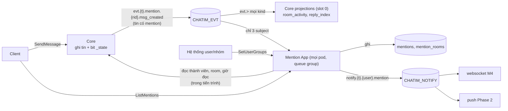

# Mention App: tóm tắt kỹ thuật

> **Trạng thái:** bản thiết kế trước khi xây, owner duyệt ngày 2026-10-17. Bước tiếp: plan thực thi.
>
> **Nguồn:**
> - Hướng đi: owner duyệt ngày 2026-10-17 sau ba vòng brainstorm. Log ở `.claude/plans/mention-app_design.md` (MA1–MA18).
> - Quyết định: D163–D173 trong [Decision Log](../decision-log.md) §17.4.
> - Danh mục event, subject, ai nhận gì: [events.md](../events.md).
>
> **Thứ tự:** làm trước M4 websocket (owner).
>
> **Sau khi xây:** bản này được viết lại theo cái đã thực sự xây.

## 1. Thuật ngữ

| Từ | Nghĩa |
|---|---|
| Mention App | App riêng `apps/mention`. Ghi ai được nhắc trong tin, bung nhóm, gửi thông báo theo người. Hiện chạy **nhúng** trong tiến trình core |
| đích (target) | Thứ được nhắc trong tin: một user (`@Minh`), một nhóm (`@team-sale`) hoặc cả room (`@all`). Core lưu trên tin ở `mt`/`ma` |
| doc mention | Một dòng trong collection `mentions` cho mỗi (tin, đích). Đã có từ M2c (D115) |
| đường A, đường B | Hai cách đọc của `ListMentions` (D115). A: "ai nhắc tên tôi", tìm theo tên. B: "`@all`/`@nhóm` trong room tôi đang ở", đi qua từng room |
| bung nhóm | Đổi `@team-sale` thành danh sách người thật, giao với thành viên room |
| thông báo | Một event gửi cho **một người** trên `notify.{t}.{user}.mention`. App notification (websocket M4, `push` Phase 2) giao nó tới máy |
| app notification | Nơi giao thông báo tới máy và lọc room đã tắt thông báo. Không thuộc Mention App |
| cổng | Giao diện mà Mention App khai báo để đọc dữ liệu core. Chạy nhúng thì cổng nối thẳng vào hàm của core |
| `message_ver` | Phiên bản nội dung tin: 0 khi gửi, tăng mỗi lần sửa/xoá. Dùng để bỏ event cũ |
| ngưỡng tuổi | Event cũ hơn 5 phút thì vẫn ghi mention nhưng không gửi thông báo |
| queue group | Mọi pod (chạy nhúng: mọi core) cùng kéo một consumer `mention`; mỗi event tới đúng một pod; không có leader, không chia partition. Event của cùng một tin có thể được xử lý song song và lệch thứ tự |
| giờ của đích (`at`) | Giờ một đích xuất hiện trong tin: giờ gửi, hoặc giờ sửa nếu đích được thêm bằng sửa. Core đóng dấu trên tin và trong event |
| đích trước (`previous_mentions`) | Tập đích của phiên bản ngay trước, core gửi kèm event sửa/xoá. Nhờ nó, mỗi event tự đủ thông tin, không phụ thuộc thứ tự xử lý |

## 2. Bức tranh chung

### 2.1 Vì sao làm

Hôm nay core tự ghi chỉ mục mention (projection `mention_reply_index`), tự đánh dấu đã đọc (`mention_read`) và tự trả `ListMentions`. Theo checklist và D162, những việc này thuộc app:
- Trạng thái lưu theo người đọc (ai được nhắc, đã đọc chưa) thuộc app, không thuộc core.
- Gửi thông báo cần chọn người nhận và bung nhóm, mà core không làm cả hai.
- Thành viên nhóm là dữ liệu của hệ thống user/nhóm, không phải core.

Ví dụ xuyên suốt: Lan gửi "@Minh @team-sale @all họp lúc 3h" vào group 777 (50 người). `team-sale` gồm Minh, Hà, Tú; Tú không ở room 777.
- Hôm nay: core ghi 3 doc mention và không ai được báo.
- Sau milestone này:
  - Mention App ghi 3 doc như cũ.
  - Mention App gửi thông báo cho 49 người (50 trừ Lan). Minh và Hà chỉ nhận **một** thông báo mỗi người; Tú không nhận.
  - Websocket M4 hoặc app `push` Phase 2 giao các thông báo đó tới máy.

### 2.2 Scope và ranh giới

| Việc | Trong/ngoài | Ai giữ |
|---|---|---|
| Ghi mention theo đích; cập nhật khi sửa/xoá tin | Trong | Mention App. Mô hình D115 chuyển nguyên |
| `ListMentions` (hai đường, trang 20) | Trong | Mention App, `MentionService` trên gRPC server của core |
| Nhóm của từng người `mention_user_groups` + `SetUserGroups` (bên gửi luôn gửi đủ nhóm của người đó) | Trong | Mention App (owner, Q1; 2026-10-17: set theo người, không đi hai lệnh) |
| Bung `@nhóm`/`@all`; gửi thông báo theo người lên `CHATIM_NOTIFY` | Trong | Mention App |
| Consumer `mention` chỉ nhận tin có mention, sửa, xoá | Trong | Mention App; core phát tin có mention ở loại data `mention` |
| Chạy nhúng trong core, config chung | Trong | Mention App + wiring core |
| Gỡ khỏi core: nửa mention của `mention_reply_index`, `mention_read`, `ListMentions` trong `CoreService`, `rooms.last_shared_mention_at`, `MENTION_HIDE_READ_TENANTS` | Trong | Core |
| Danh mục nhóm được tag `mention_groups` + `SetGroups` | Trong | Mention App (owner) |
| Dữ liệu cho gợi ý `@nhóm`: `ListRoomGroups(room)`, nhóm có người trong room kèm tên | Trong | Mention App (owner) |
| Ghép gợi ý `@người` + `@nhóm`, lọc theo chữ đang gõ | Ngoài | Client (owner) |
| Danh mục event `docs/events.md` | Trong | Docs (đã viết) |
| Server riêng, database riêng, CDC/chép dữ liệu, bản sao dữ liệu core | Ngoài | Sau (owner 2026-10-17) |
| Lọc room tắt thông báo; giao tới máy online/offline | Ngoài | Websocket M4; `push` Phase 2 (owner, Q2) |
| `@all` trong channel tới từng người (~200K) | Ngoài | `push` Phase 2 |
| Đích trên tin (`mt`/`ma`), kiểm hợp lệ (`MENTION_TARGETS_MAX`), phát event | Ngoài | Core giữ nguyên |
| Event tự đủ thông tin: giờ của từng đích (`mt[].a`, `mat`) và `previous_mentions` trên `msg_edited`/`msg_deleted`; fact xoá giữ đích của phiên bản bị xoá | Trong | Core (D173) |
| Mọi pod/core cùng chia tải consumer `mention` (queue group, không leader) | Trong | Mention App (owner 2026-10-17) |
| Trả lời (doc trả lời, `rc`, `reply_threads`), bookmarks | Ngoài | Ở lại core |
| Dấu `@` trên danh sách hội thoại, sync token, đa thiết bị | Ngoài | Sau |
| Tìm kiếm (người theo tên, nhóm, nội dung tin) | Ngoài | Search App riêng, milestone sau (owner 2026-10-17) |

### 2.3 Sơ đồ

So với hôm nay:
- Core mất phần mention của projection, toàn bộ `mention_read` và `ListMentions`.
- Thêm một consumer chỉ nhận tin có mention, một stream thông báo và hai collection (`mention_rooms`, `mention_user_groups`).
- `read_updated` không còn ai ghi DB theo nó.

## 3. Dữ liệu

### 3.1 `mentions` (giữ chỗ cũ, Mention App ghi)

Schema và index như D115, với ba thay đổi: bỏ `state 3`; `created_at` lấy giờ của đích (`at`) do core đóng dấu trong event; mọi lần ghi có điều kiện theo `message_ver` (không ghi đè doc có `message_ver` lớn hơn), và đích bị bỏ được ghi tombstone kể cả khi chưa có doc.

| Field | Nghĩa | Ví dụ | Dùng ở |
|---|---|---|---|
| `_id` | khoá tin (24B) + loại đích + id đích | tin 777/0/41 + `1` + `Minh` | ghi, xoá theo tin |
| `message_key` | khoá tin | 777/0/41 | đích hiện có của một tin |
| `room_id`, `tenant` | room, tenant | 777, `t1` | đường B, cô lập tenant |
| `kind` | `user`, `group`, `all` | `group` | đường B |
| `target` | `user:{id}`, `group:{id}`, `all:{room}` | `group:team-sale` | đường A, B |
| `thread_root`, `seq` | vị trí tin | 0, 41 | đọc tin |
| `sender_id` | người gửi | `Lan` | bỏ người gửi |
| `state` | 1 còn, 2 đã gỡ (bỏ 3 "đã đọc") | 1 | đọc |
| `message_ver` | phiên bản tin của lần ghi cuối; chỉ tăng | 0 | chặn event cũ ghi đè |
| `created_at` | giờ của đích (`at` trong event): giờ gửi tin; đích thêm bằng sửa thì giờ sửa | 15:00:02 | sắp xếp, since, đã đọc |
| `updated_at` | lần ghi cuối | 15:00:02 | |

Giữ ba index của D115: `{tenant, target, state, created_at: -1, message_key: -1}` (đường A), `{room_id, kind, created_at: -1, message_key: -1}` (đường B) và `{message_key: 1}`. Bỏ `{room_id, target, thread_root, seq}`, vì nó chỉ phục vụ `mention_read`.

### 3.2 `mention_rooms` (mới, thay `rooms.last_shared_mention_at`)

| Field | Nghĩa | Ví dụ | Dùng ở |
|---|---|---|---|
| `_id` | room id | 777 | `$in` theo lô 1.000 room ở đường B |
| `tenant` | tenant | `t1` | cô lập |
| `last_shared_mention_at` | giờ mới nhất của một `@all`/`@nhóm` trong room; chỉ tăng (`$max`) | 15:00:02 | đường B bỏ room không có gì mới, dừng sớm |

Chưa go-live nên không dựng lại từ dữ liệu cũ; dev chạy `make infra-reset`. Field cũ trên `rooms` không còn ai ghi hay đọc.

### 3.3 `mention_user_groups` (mới, mỗi người một doc chứa đủ nhóm của họ)

Owner chốt 2026-10-17: lệnh set **cả danh sách nhóm của một người**, bên gửi buộc gửi đủ. Lý do: chuyển nhóm phải là một lần ghi, không phải hai lệnh "thêm nhóm mới, bỏ nhóm cũ".

| Field | Nghĩa | Ví dụ | Dùng ở |
|---|---|---|---|
| `_id` | chuỗi `tenant│user` (`│` là U+2502, như `room_dms`); collection clustered | `t1│Ha` | tra nhóm của một người |
| `tenant`, `user_id` | tenant, người | `t1`, `Ha` | |
| `groups` | **đủ** các nhóm người này đang thuộc, đã khử trùng và sắp xếp; rỗng là không thuộc nhóm nào | `[manager, team-sale]` | bung nhóm |
| `ver` | version do hệ thống user/nhóm cấp cho người này; chỉ nhận lớn hơn | 1003 | chống lệnh tới lệch thứ tự |
| `updated_at`, `updated_by` | lần ghi cuối, app gọi | 14:00, `hr-sync` | vận hành |

Index `{tenant: 1, groups: 1, user_id: 1}` (multikey) dùng cho "ai thuộc nhóm X", quét theo trang `user_id`. Đây là collection của app, không phải `messages`, nên index phụ không phạm luật shard.

**Ví dụ:**

| Việc | Lệnh | Kết quả |
|---|---|---|
| Hà chuyển `staff` → `manager` | `SetUserGroups(Hà, [manager], 1003)` | Một lần ghi: `groups` đổi từ `[staff]` sang `[manager]`, `ver` 1003. Không lúc nào Hà ở cả hai nhóm hay không nhóm nào |
| Hà nghỉ việc | `SetUserGroups(Hà, [], 1004)` | `groups` rỗng; doc giữ lại với `ver` 1004 |
| Lệnh cũ tới muộn | `SetUserGroups(Hà, [staff], 1002)` | 1002 < 1004 nên bị bỏ, không đưa Hà về `staff` |

Vì mỗi lệnh mang đủ nhóm, nên `ver` theo người là đủ: bản mới nhất của người đó thắng, không có chuyện lệnh của nhóm A chặn nhầm lệnh của nhóm B.

`ver` không cần liên tiếp, chỉ cần tăng theo thời gian của bên gửi, ví dụ id nhật ký thay đổi hoặc giờ đổi tính bằng ms.

Doc không bao giờ bị xoá: bị xoá thì một lệnh cũ tới sau sẽ tạo lại nó.

### 3.4 Stream, consumer, config

| Thứ | Giá trị |
|---|---|
| Consumer `mention` trên `CHATIM_EVT` | durable, mọi pod cùng kéo (queue group), ack từng tin, `AckWait` 30s, `MaxAckPending` = `MENTION_MAX_ACK_PENDING` (16.384, tổng cho mọi pod), `DeliverAll`. Lọc 3 subject: `evt.*.mention.*.msg_created`, `evt.*.message.*.msg_edited`, `evt.*.message.*.msg_deleted` |
| Stream `CHATIM_NOTIFY` | subject `notify.>`, lưu file, giữ 24h, chống trùng 6 phút |
| `MENTION_ENABLED` | bật app nhúng (mặc định bật; tắt thì không ghi mention) |
| `MENTION_FETCH_BATCH` / `MENTION_FETCH_WAIT` | 512 / 250ms mỗi pod |
| `MENTION_WORKERS` | 8: số event một pod xử lý cùng lúc |
| `MENTION_NOTIFY_MAX_AGE` | 5m (owner) |
| `NOTIFY_STREAM`, `NOTIFY_SUBJECT_ROOT` | `CHATIM_NOTIFY`, `notify` |
| `NOTIFY_STREAM_MAX_AGE`, `NOTIFY_STREAM_DUPLICATES` | 24h, 6m |
| `MENTION_HIDE_READ_TENANTS` | chuyển từ core sang config app, nghĩa không đổi |
| `MENTION_ROOM_GROUPS_SYNC_MAX` | 5.000: room tới cỡ này thì dựng tập nhóm ngay khi được hỏi, lớn hơn thì dựng ở nền |
| `MENTION_ROOM_GROUPS_TTL` / `MENTION_ROOM_GROUPS_REBUILD` | 60s / 10m |

Luật boot:
- `NOTIFY_STREAM_DUPLICATES` ≥ `MENTION_NOTIFY_MAX_AGE`.
- `MENTION_FETCH_WAIT` ≤ `PROJECTION_FETCH_WAIT`, để pha dừng không dài hơn hôm nay.
- `NOTIFY_STREAM` khác `CHATIM_EVT` và `CHATIM_TIMER`.

### 3.5 `mention_groups` (mới, danh mục nhóm được tag)

Owner chốt 2026-10-17: phải có một nơi định nghĩa nhóm nào được tag; khi trả gợi ý thì map id sang tên.

| Field | Nghĩa | Ví dụ | Dùng ở |
|---|---|---|---|
| `_id` | chuỗi `tenant│nhóm`; collection clustered | `t1│team-sale` | tra nhóm |
| `tenant`, `group_id` | tenant, id nhóm | `t1`, `team-sale` | |
| `name` | tên hiển thị | Phòng Kinh doanh | gợi ý, client hiện tên |
| `state` | 1 được tag, 2 thôi cho tag (không bao giờ xoá doc) | 1 | gợi ý, thông báo, `ListMentions` |
| `ver` | version do hệ thống user/nhóm cấp; chỉ nhận lớn hơn | 50 | chống lệnh lệch thứ tự |
| `updated_at`, `updated_by` | lần ghi cuối, app gọi | 14:00, `hr-sync` | vận hành |

Không cần index phụ: danh mục mỗi tenant cỡ vài trăm tới vài nghìn nhóm, app giữ trong RAM.

`@nhóm` không có trong danh mục, hoặc `state 2`:
- **Vẫn ghi doc mention.** Nếu không ghi, danh mục đổi giữa lúc gửi và lúc sửa tin sẽ sinh thông báo hoặc lệnh gỡ sai.
- **Không gửi thông báo.**
- **Không hiện trong `ListMentions`.**

Ví dụ: ai đó gõ tay `@hr-internal` (`state 2`). Không ai được báo, và không ai thấy nó trong danh sách mention.

## 4. Luồng xử lý

### 4.1 Gửi tin có mention

1. Core `SendMessage` không đổi: kiểm đích (`ValidateMentions`), quyền `mention_all`, ghi tin kèm bit `_state`, ack.
2. Core publish trên `evt.t1.mention.777.msg_created`, vì tin có `mt`/`ma`; tin không mention vẫn ở `message`. Sweeper phát bù từ doc tin nên ra cùng subject.
3. Một pod bất kỳ (queue group) fetch lô ≤ 512 trong ≤ 250ms; `MENTION_WORKERS` event được xử lý cùng lúc, không theo thứ tự.
4. Ghi mention, chỉ dựa vào event, không dựa vào thứ tự:
   - Mỗi đích trong tin: upsert doc `state 1`, `created_at` = `at` của đích, `message_ver` = phiên bản của event.
   - Mỗi đích ở `previous_mentions` mà không còn trong tin: upsert tombstone `state 2` với phiên bản của event.
   - Mọi lần ghi có điều kiện: doc đang có `message_ver` lớn hơn thì giữ nguyên. Event cũ tới sau không làm sống lại đích đã bỏ, cũng không ghi đè giờ.
   - Có `@all`/`@nhóm`: nâng `mention_rooms.last_shared_mention_at` (`$max`) bằng `at` lớn nhất của các đích đó, để mention thêm bằng sửa vẫn hiện ở đường B.
5. Tính người nhận:
   - `@Minh`: `MembersOf(777, [Minh])`, một lần đọc có cận.
   - `@team-sale`: đi từ phía nhỏ hơn, không cần biết trước nhóm lớn bao nhiêu.
     - Đọc trang đầu `ListMembers(777)` tối đa 1.001 người.
     - Room ≤ 1.000 người: tra `_id` `t1│{user}` của chính những người đó trong `mention_user_groups`, một lần đọc có cận (D139); giữ người có `team-sale` trong `groups`.
     - Room lớn hơn: quét index `{tenant, groups: team-sale}` theo trang 1.000 người, mỗi trang một `MembersOf(777, trang)`.
     - Ví dụ: `@toan-cong-ty` (20.000 người) trong room 30 người tốn 2 lần đọc, không phải 20.
   - `@all`: room là channel (`room_type` trong event) thì bỏ qua; DM/group thì `ListMembers(777)` theo trang.
   - Gộp lại, bỏ người gửi, mỗi người một lần. Đích ghi trên thông báo theo thứ tự ưu tiên user > nhóm > `@all`.
6. Event cũ hơn 5 phút: dừng ở đây (đã ghi mention) và đếm `mention_notify_skipped_total{reason="stale"}`.
7. Đọc phiên bản hiện tại của các tin trong lô (một lần đọc có cận mỗi room, qua cổng). Event đã bị thay bởi phiên bản mới hơn thì không đẩy thông báo (bản mới tự lo). Đây chỉ là bớt thông báo thừa; đúng sai do luật "phiên bản lớn hơn thắng" ở client.
8. Còn lại: publish async `mention_notified` cho từng người, chờ mọi PubAck, rồi ack event.

Lỗi:
- Store lỗi hoặc publish lỗi: Nak theo bậc thang 5s/30s/2m/10m. Lần sau ghi lại không đổi gì (đã có cùng `message_ver`); thông báo trùng id bị stream bỏ trong 6 phút.
- Không decode được: Term.
- Không ai có nhóm đó trong `groups`: không ai nhận qua nhóm, doc mention vẫn ghi.
- Nhóm không có trong danh mục hoặc `state 2` lúc xử lý: không ai nhận qua nhóm, doc mention vẫn ghi.

### 4.2 Sửa tin

1. Core `EditMessage` phát `evt.t1.message.777.msg_edited` (id `777-0-41-v1`). Event gồm bản chụp tin (đích hiện tại, mỗi đích có `at`), `message_ver` 1, và `previous_mentions` (đích của phiên bản 0).
   - Core đóng dấu `at`: đích giữ nguyên giữ giờ cũ; đích mới thêm lấy giờ sửa (D166).
2. Ghi mention như 4.1 bước 4: đích hiện tại upsert sống, đích trong `previous_mentions` không còn thì tombstone. Mọi lần ghi có điều kiện `message_ver`.
3. Thông báo tính từ chính event, không từ doc đang có:
   - `mention_notified` (id `…-m1`) cho người nhận của đích hiện tại trừ người nhận của đích trước.
   - `mention_retracted` (id `…-r1`) cho người nhận của đích trước trừ người nhận của đích hiện tại.

Ví dụ: Minh đã đọc room 777 tới tin 120 (gửi 10:03). Lúc 10:10 Lan sửa tin 120, thêm "@Minh".
- Core đóng dấu `at` = 10:10 cho `@Minh`. Doc mention mang 10:10, sau 10:03, nên hiện là **chưa đọc** và đứng đầu danh sách của Minh.
- Minh nhận thông báo `…-m1`.
- Hôm nay (giờ gửi 10:03) mention này bị tính là đã đọc dù Minh vừa nhận báo (D166).

Ví dụ lệch thứ tự: v0 nhắc Minh, v1 bỏ Minh, v2 nhắc lại Minh. Ba event tới ba pod cùng lúc, xử lý theo bất kỳ thứ tự nào.
- **Doc:**
  - v1 ghi tombstone Minh với phiên bản 1; v2 ghi sống với phiên bản 2 và `at` = giờ sửa v2.
  - Thứ tự nào cũng kết thúc ở doc phiên bản 2, sống, `at` của v2.
  - v0 tới cuối thì bị chặn, vì doc đã có phiên bản lớn hơn.
- **Thông báo:**
  - Minh có thể nhận `m0`, `r1`, `m2` theo thứ tự bất kỳ.
  - Client giữ cái có phiên bản lớn nhất (`m2`), nên Minh đang được nhắc là đúng.

### 4.3 Xoá tin

`msg_deleted` mang `message_ver` của lần xoá và `previous_mentions` (đích của phiên bản bị xoá).
- Core lấy `previous_mentions` từ tin ngay trước khi xoá (lệnh xoá đã đọc tin).
- Khi sweeper phát lại, core lấy từ fact xoá. Fact xoá giữ đích của phiên bản bị xoá; `PurgeText` chỉ xoá chữ và đích ở các fact cũ hơn nó.
- Mention App ghi tombstone cho mọi đích trong `previous_mentions`, kể cả đích chưa có doc. Event tạo tin tới muộn bị chặn.
- `mention_retracted` gửi cho người nhận của đích trước, nếu event còn trong 5 phút. Client: `r` có phiên bản lớn hơn `m0` nên `m0` tới muộn bị bỏ.
- `mention_rooms` không lùi.

### 4.4 `ListMentions` (`MentionService`)

Request và response giống hệt `CoreService.ListMentions` hôm nay (nhóm kèm since, `before`, `limit` ≤ 20). Chỉ đổi service.

1. `RoomsOf(user)` qua cổng: các room đang ở, `joined_at`, `cleared_at`, `read_seq`.
2. Đường A: `ListByTarget(user:{caller})`, chỉ `state 1`. Tenant ẩn: bỏ mục đã đọc theo giờ (trước đây loại bằng `state 3` ở index).
3. Đường B: `mention_rooms` theo lô 1.000 → room có gì mới sau since → lô 200 room → `ListShared` → dừng sớm. Như D115, nhưng chỉ dùng các nhóm người gọi gửi lên mà đang `state 1` trong danh mục.
4. Đã đọc: giờ mention ≤ giờ gửi của tin tại `read_seq` (`SentTimes` qua cổng, theo lô, nhớ trong lần gọi).
5. Nội dung: theo từng (room, thread), `Authorize(read_history)` + đọc tin + view qua cổng, như hôm nay (tin đã xoá hoặc bị ẩn với người xem thì bị bỏ ở đây).
6. Lưới an toàn, không tốn thêm lần đọc: chỉ giữ mục khi tin hiện tại vẫn còn đích đó (`mt` có user/nhóm, hoặc `ma` cho `@all`). Doc cũ sót lại do lỗi nào đó không bao giờ hiện ra.

Mã lỗi giữ nguyên:
- `limit` > 20 hoặc tham số sai: `INVALID_ARGUMENT`.
- Store lỗi: `UNAVAILABLE`.

Chi phí xấu nhất giữ nguyên (113 truy vấn ở 5.000 room, tenant ẩn). Đường A của tenant ẩn có thể cần thêm vòng (mục 10).

### 4.5 `SetUserGroups` (`MentionService`)

Request: danh sách mục `{user, groups, ver}`, tối đa 1.000 mục mỗi lần gọi. Đây là lô ghi, không phải giới hạn số người.

- **Người gọi:** app nội bộ tin cậy (hệ thống user/nhóm), như mọi caller hiện nay. Tenant lấy từ `x-chatim-tenant`; `updated_by` lấy từ `x-chatim-user`.
- **Hợp đồng với bên gửi:** `groups` là **đủ** các nhóm của người đó lúc `ver`. Gửi thiếu một nhóm nghĩa là người đó bị bỏ khỏi nhóm ấy. Muốn bỏ người khỏi mọi nhóm thì gửi `groups` rỗng.
- **Kiểm tra:** user id hợp lệ, id nhóm theo luật id đích (`[A-Za-z0-9_:-]{1,64}`), `ver` ≥ 1, một user không xuất hiện hai lần trong cùng request. Sai thì trả `INVALID_ARGUMENT`. Nhóm trùng trong `groups` được khử trùng. Không đặt trần số nhóm mỗi người (không có use case).
- **Ghi:** một `BulkWrite(ordered:false)`, mỗi mục một upsert theo `_id`, dùng pipeline `$cond` như `AddMembers` (D99).
  - `ver` mới > `ver` đang giữ: đặt `groups`, `ver`, `updated_at`, `updated_by`.
  - Ngược lại doc giữ nguyên từng byte.
  - Filter là phép bằng trên `_id`, nên khi hai upsert chạy đua thì server tự thử lại phần trùng khoá.
- **Trả về:** danh sách người có `groups` thật sự đổi. Gọi lại cùng request thì danh sách rỗng, `OK`.
- **Lỗi:**
  - Store lỗi: `UNAVAILABLE`, không thử lại nội bộ. Bên gửi gửi lại cùng request là an toàn.
  - Một phần lô đã ghi rồi lỗi: gửi lại cũng an toàn, vì mỗi mục có `ver`.
- **Event:** không phát. Thông báo của tin gửi sau dùng nhóm mới.

**Nạp lần đầu:** 20.000 nhân viên = 20 lần gọi, mỗi lần 1.000 người kèm đủ nhóm.

**Tạo nhóm mới cho 500 người:** gửi 500 mục, mỗi mục là danh sách nhóm cũ của người đó cộng nhóm mới. Bên gửi đã giữ đủ nhóm của từng người nên tự làm được.

### 4.6 Gợi ý `@` khi soạn tin (client tự ghép)

Owner chốt 2026-10-17: client tự ghép API để gợi ý theo người và theo nhóm. Server chỉ trả dữ liệu; client lọc theo chữ đang gõ và bỏ dấu (kể cả `đ` → `d`) ngay trên máy, không gọi server mỗi phím.

| Gợi ý | API | Ai trả |
|---|---|---|
| `@người` | `ListMembers(room)` (đã có từ M3) | core |
| `@nhóm` | `ListRoomGroups(room)` → `[{id, name}]` (mới) | Mention App |

Ví dụ: Lan mở ô soạn tin ở room 777.
1. Client gọi hai API trên một lần.
2. Lan gõ `@kinh`. Client lọc trên máy ra Minh Kinh (người) và Phòng Kinh doanh (`team-sale`).
3. Lan chọn nhóm. Tin gửi đi mang id `team-sale`.

**`ListRoomGroups(room)`** trả các nhóm `state 1` có ít nhất một người trong room, kèm tên.
- **Quyền:** cần quyền xem thành viên room (`read_members`), giống `ListMembers`. Nếu không, một người chỉ vào được channel cũng suy ra được trong channel có ai thuộc nhóm nào. Thiếu quyền: `PERMISSION_DENIED`. Room không tồn tại hoặc khác tenant: `NOT_FOUND`.
- **Cách tính, với room 777 có Minh, Hà, Lan:**
  1. Đọc user id của room qua một hàm mới của core, chạy trong tiến trình. Hàm này chỉ đọc index `{room_id, state, …, user_id}`, không mở doc thành viên.
  2. Tra `mention_user_groups` của 3 người đó theo `_id` (một lần đọc có cận, D139) → `{team-sale, manager}`.
  3. Giao với danh mục `state 1`, map tên, xếp theo tên.
- **Giữ trong RAM** tập nhóm theo room (LRU), như `roomcache`:
  - Room ≤ `MENTION_ROOM_GROUPS_SYNC_MAX` (5.000) người:
    - dựng khi được hỏi: 1 lần đọc user id + tối đa 5 lần tra nhóm;
    - quên khi có `member_added`/`member_removed` (nghe live như `roomcache.Watch`) hoặc sau 60s.
  - Room lớn hơn (channel):
    - dựng ở nền khoảng 10 phút một lần, một lần dựng mỗi room (singleflight);
    - trong lúc dựng lại vẫn trả tập cũ;
    - lần đầu chưa có tập thì trả mọi nhóm `state 1` của tenant, kèm cờ `filtered = false` để client biết danh sách chưa lọc theo room.
  - Ngưỡng 5.000 chỉ chọn "dựng ngay" hay "dựng ở nền", không phải giới hạn dữ liệu.
- **Danh mục** giữ trong RAM theo tenant. Quên ngay khi `SetGroups` chạy trên core này; core khác quên sau 60s.
- Gợi ý có thể cũ tới 60s (room thường) hoặc 10 phút (channel). Thông báo thì luôn tính đúng tại lúc xử lý tin (mục 4.1).

**`SetGroups([{id, name, active, ver}])`** (≤ 1.000 mục mỗi lần gọi), do hệ thống user/nhóm gọi.
- Cùng khuôn với `SetUserGroups`: upsert pipeline `$cond`, chỉ đổi khi `ver` mới lớn hơn; `active = false` thành `state 2`.
- Kiểm tra: id nhóm theo luật id đích, tên không rỗng, `ver` ≥ 1. Sai: `INVALID_ARGUMENT`.
- Trả về: các nhóm thật sự đổi.

### 4.7 Chạy và dừng

- **Khởi động:** sau `projections`, app tạo `CHATIM_NOTIFY`, consumer `mention`, `mention_rooms`, `mention_user_groups` (bootstrap, clustered, index multikey), `mention_groups` (clustered), rồi bắt đầu kéo consumer, trên **mọi** core/pod. `MentionService` đăng ký lên gRPC server của core, nên mọi core đều trả `ListMentions` và nhận `SetUserGroups`, `SetGroups`, `ListRoomGroups`.
- **Dừng:** consumer `mention` dừng **song song** với `projections`, cùng đợi lần fetch dở hết hạn (≤ 250ms + 1s, trong pha 4s của `projections`). Event chưa xong thì Nak(0) để pod khác nhận. Kế hoạch dừng giữ 29,7s/30s.
- **Thêm/bớt pod (K8s HPA):** không cần chia lại gì; pod mới bắt đầu kéo, pod tắt thì event đang cầm quay lại hàng đợi sau Nak hoặc `AckWait`.

## 5. Đúng đắn và chạy đua

| Tình huống | Điều gì giữ đúng |
|---|---|
| Event của cùng một tin xử lý song song, lệch thứ tự (nhiều pod) | Event tự đủ: đích hiện tại kèm `at`, đích trước. Mọi lần ghi có điều kiện `message_ver` (không ghi đè doc mới hơn), đích bị bỏ ghi tombstone kể cả khi chưa có doc. Mọi thứ tự xử lý đều cho cùng kết quả cuối |
| Event phát lại (sweeper, Nak) tới sau event mới hơn | Như trên: bị chặn bởi doc có `message_ver` lớn hơn. Sweeper dựng event từ doc hiện tại, nên `at` và đích lấy theo bản chụp, không theo `ts` của event |
| Thông báo tới lệch thứ tự | Thông báo tính từ chính event (đích hiện tại trừ đích trước); client giữ phiên bản lớn nhất cho mỗi tin |
| Tin bị xoá ngay sau khi gửi, event tạo tin xử lý sau | Tombstone của lần xoá chặn doc; `r` phiên bản lớn hơn `m0` ở client; bước 7 bỏ đẩy nếu thấy tin đã có phiên bản mới |
| Gửi lại thông báo | Id cố định theo (tin, người, phiên bản); stream bỏ trùng trong 6 phút, dài hơn ngưỡng tuổi 5 phút |
| Đọc lại stream (resync, tạo lại consumer) | Ngưỡng tuổi: event cũ hơn 5 phút chỉ ghi mention, không báo |
| Người vừa vào/rời room | Đọc thành viên từ store core lúc xử lý (không bản sao), nên đúng tới lúc đó. Người rời trong lúc app đang gửi có thể vẫn nhận một thông báo |
| Thành viên nhóm đổi giữa lúc gửi tin và lúc xử lý | Dùng danh sách lúc xử lý (≤ vài trăm ms sau) |
| Mention App lỗi lâu | Tin vẫn gửi bình thường; core không phụ thuộc app. Mention đuổi kịp khi app chạy lại (`DeliverAll`); thông báo cũ hơn 5 phút bị bỏ |
| Tenant | Mọi đọc ghi có tenant; `_id` thành viên nhóm bắt đầu bằng tenant |
| Lệnh nhóm tới lệch thứ tự hoặc gửi lại | `ver` theo người, mỗi lệnh mang đủ nhóm; `ver` lớn hơn thắng; doc không bao giờ xoá |
| Chuyển nhóm (`staff` → `manager`) | Một lần ghi một doc, nên không có lúc Hà ở cả hai nhóm hay không ở nhóm nào |
| Bỏ ai đó khỏi nhóm ngay trước tin `@nhóm` | Đọc thành viên lúc xử lý, nên người vừa bị bỏ không nhận. Doc mention theo nhóm không đổi; `ListMentions` vẫn dùng danh sách nhóm do người gọi gửi |

## 6. Event và subject

Chi tiết đầy đủ: [events.md](../events.md).

**Core đổi đúng một chỗ (D170):** `msg_created` của tin có mention phát ở `evt.{t}.mention.{rid}.msg_created`.
- Bản live: `live.{t}.mention.{rid}.evt.msg_created`.
- Id và các kind khác không đổi.
- Payload thêm (D173, chỉ thêm field): mỗi `MentionTarget` có `at`; `MentionSet` có `all_at`; `MessageEdited`, `MessageDeleted` có `previous_mentions`.
- `projections` (`evt.>`), websocket (`live.{t}.*.{rid}.>`), `memberwatch` và `roomcache` không bị ảnh hưởng.

Mention App nhận đúng 3 subject. Ví dụ ở 2.000 tin/s, nếu 5% tin có mention, app nhận khoảng 100 tin/s cộng sửa/xoá, thay vì 2.000.

Mention App phát hai kind trên `CHATIM_NOTIFY`:
- `mention_notified`: id `{room}-{thread}-{seq}-{user}-m{message_ver}`; bản chụp tin, đích làm người này được báo, loại room.
- `mention_retracted`: id `…-r{message_ver}`; lý do sửa/xoá.

Hợp đồng cho người nhận (websocket, push):
- Bỏ trùng theo id.
- Với cùng tin, `message_ver` lớn hơn thắng.
- Tự lọc room đã tắt thông báo (`muted_until` có trong `room_preferences_changed` và `ListMyRooms`).

## 7. Thư viện và hạ tầng

- NATS 2.15 (compose `nats:2.15-alpine`): consumer lọc nhiều subject (`FilterSubjects`, có từ 2.10); `nats.go` jetstream như hôm nay.
- Dùng lại:
  - `eventkit.PullSource` (fetch chờ tín hiệu hết hạn), cách settle của `projections` (Ack/Term/Nak bậc thang, `projection_stuck` từ lần giao ≥ 6). Không dùng cổng `Leader`: mọi pod cùng kéo;
  - `ApplyMentions`, `ListByTarget`, `ListShared`, `mention_merge`, `mention_page` (chuyển package). `PlanMentions` (so với doc đang có) được thay bằng kế hoạch tính từ event: đích hiện tại + đích trước;
  - publisher async của core cho `CHATIM_NOTIFY`.
- Proto mới `proto/chatim/v1/mention_service.proto`:
  - `MentionService { ListMentions, SetUserGroups, SetGroups, ListRoomGroups }`; message `ListMentions*` chuyển sang đây;
  - `Notification` (oneof `mention_notified`, `mention_retracted`);
  - `CoreService.ListMentions` bị xoá (chưa go-live, chưa có client ngoài).
- Package:
  - `apps/mention/internal/` gồm `consumer`, `recipients`, `notify`, `groups`, `store` (mongo + mem + contract suite), `grpcsrv`, `config`; mỗi file < 200 dòng.
  - Core: `apps/core/internal/app` nối cổng và vòng đời; store thêm hàm đọc user id của room chỉ dùng index; `mutate` sửa/xoá đóng dấu `at` và gửi `previous_mentions`; sweeper dựng lại hai thứ đó từ doc và fact; fact xoá giữ đích của phiên bản bị xoá; `event/publish/subjectFor` thêm loại `mention`; `event/projection` đổi `mention_reply_index` → `reply_index`, xoá `mention_read`.
- Metric (`chatim_mention_`):
  - `lag_seconds`, `failures_total`, `dropped_total`, `stuck_total`;
  - `notified_total`, `retracted_total`, `notify_skipped_total{reason}`, `notify_failures_total`;
  - `room_groups_hits_total`, `room_groups_misses_total`, `room_groups_rebuild_seconds` (đo tốc độ, không có alert).
- Alert (14 → 16): `ChatimMentionLagging` (lag > 10s trong 5m), `ChatimMentionFailing` (`stuck_total` tăng trong 15m).

## 8. Quyết định

| # | Chọn | Bỏ | Vì sao |
|---|---|---|---|
| D163 | Chạy nhúng, config chung; đọc core qua cổng trong tiến trình | Bản sao thành viên từ event, `members.read_at`, API quét; chép dữ liệu | Owner: tuỳ CDC, làm sau; rẻ và không trễ |
| D164 | Chuyển nguyên D115 sang app, `mentions` giữ chỗ | Hộp thư theo người | Đã đo, đã duyệt; `@all` channel không thành 200K lần ghi |
| D165 | Bỏ `mention_read`, `state 3` | Giữ trong app | App không phải nhận mọi `read_updated` |
| D166 | Đích thêm bằng sửa mang giờ sửa; core đóng dấu `at` trên từng đích (D173) | Giờ gửi tin; app tự đoán giờ từ doc đang có | Khớp thông báo với cờ đã đọc; giờ không phụ thuộc thứ tự xử lý |
| D167 | `mention_user_groups` mỗi người một doc chứa đủ nhóm, `SetUserGroups` theo `ver` của người | Mỗi (nhóm, người) một doc với `AddGroupMembers`/`RemoveGroupMembers`; một doc mỗi nhóm chứa mảng; hỏi hệ thống nhóm mỗi lần | Owner: chuyển nhóm phải là một lệnh, không phải hai, nên bên gửi buộc gửi đủ nhóm; đổi một người chỉ ghi một doc; không phụ thuộc hệ thống kia lúc gửi tin |
| D168 | Thông báo theo người trên `CHATIM_NOTIFY`; channel `@all` không gửi riêng; tắt thông báo do app notification | Mention App xét mute; 200K publish | Một đầu ra cho hai nơi giao; owner giao mute đi |
| D169 | Ngưỡng tuổi 5 phút, chống trùng ≥ ngưỡng | Không ngưỡng; 2 phút | Owner: NATS chết ≤ 5 phút vẫn báo; đọc lại stream không báo lại |
| D170 | `msg_created` có mention ở loại data `mention`; consumer lọc 3 subject | Nhận mọi `msg_created`; event riêng | Owner: chỉ nhận data cần |
| D172 | Danh mục `mention_groups` (`SetGroups`, `state`, `ver`); chỉ nhóm `state 1` được báo và hiện trong `ListMentions`, doc mention vẫn ghi. Gợi ý `@` do client ghép `ListMembers` (core) + `ListRoomGroups` (Mention App), lọc trên máy; `ListRoomGroups` lấy từ tập nhóm theo room giữ trong RAM | Gợi ý mọi nhóm của tenant; tìm theo chữ trên server mỗi phím; lưu sẵn "room × nhóm → số người" trong DB; duyệt từng nhóm rồi kiểm có người trong room | Owner: chỉ gợi ý nhóm có người trong room, phải có nơi định nghĩa nhóm được tag, client tự ghép; lưu sẵn tốn tới 5.000 lần ghi khi một người đổi nhóm; duyệt từng nhóm bị kẹt ở nhóm lớn không ai trong room |
| D171 | (Owner 2026-10-17) Queue group: mọi pod/core cùng kéo consumer `mention`, không leader, `MENTION_WORKERS` event cùng lúc mỗi pod, lô 512/250ms; dừng song song `projections` | Một bản xử lý trên slot 0 (nối tiếp, không chia tải trên K8s); chia partition theo room (phải giao partition cho pod, chia lại khi scale, channel nóng dồn một partition); chung consumer `projections` | Owner: mọi pod K8s cùng chia tải; đúng sai do event tự đủ (D173), không do thứ tự |
| D173 | Event tự đủ thông tin: core đóng dấu `at` cho từng đích (giữ giờ cũ cho đích giữ nguyên, giờ sửa cho đích thêm), `msg_edited`/`msg_deleted` mang `previous_mentions`; fact xoá giữ đích của phiên bản bị xoá. App ghi có điều kiện `message_ver`, tombstone cho đích bị bỏ, thông báo = người nhận(hiện tại) − người nhận(trước), gỡ = ngược lại; `ListMentions` chỉ giữ mục khi tin hiện tại còn đích đó | App so với doc đang có (`PlanMentions`, đọc rồi ghi, sai khi lệch thứ tự); app đọc lịch sử `message_edits` | Reviewer chỉ ra khi xử lý song song: giờ `created_at` phụ thuộc thứ tự, đích đã bỏ sống lại, thông báo trùng hoặc thiếu lệnh gỡ. Event tự đủ thì mọi thứ tự cho cùng kết quả |

## 9. Chi phí

Giả định để tính (bench sẽ đo thật): 2.000 tin/s, 5% có mention, trung bình 2 đích, 1% tin bị sửa/xoá.

| Thứ | Hôm nay | Sau |
|---|---|---|
| Lần giao NATS mỗi giây | 2.000 tin tới `projections` | 2.000 tới `projections` + khoảng 140 tới `mention` (100 tin mention + 40 sửa/xoá) |
| Ghi Mongo cho mention | như nhau | như nhau |
| `read_updated` | `mention_read`: một `MembersOf` + một `UpdateMany` mỗi room mỗi lô | 0 |
| Đọc để tìm người nhận | 0 (không ai được báo) | `@user`: một `MembersOf` có cận mỗi tin. `@nhóm`: room ≤ 1.000 người thì 2 lần đọc (trang thành viên room + tra `_id` người trong `mention_user_groups`); room lớn hơn thì 1 + 2 lần đọc mỗi 1.000 người trong nhóm. `@all` group 5.000 người: khoảng 5 trang `ListMembers` |
| Đổi nhóm của người | không có | một `BulkWrite` mỗi lần gọi (≤ 1.000 người), chỉ ghi doc có `ver` mới hơn |
| `ListRoomGroups` | không có | trong RAM: 0 lần đọc. Dựng room 30 người: 2 lần đọc. Dựng room 5.000 người: khoảng 6 lần đọc, khoảng 0,3–0,5s. Dựng channel 200K người: khoảng 200–400 lần đọc ở nền, 10–20s, 10 phút một lần |
| Publish thông báo | 0 | bằng số người nhận; một `@all` group 5.000 người là 5.000 publish async, khoảng vài chục tới vài trăm ms |
| `ListMentions` | 113 truy vấn xấu nhất | như nhau; tenant ẩn có thể thêm vòng ở đường A |
| Kiểm phiên bản trước khi đẩy | không có | một lần đọc có cận mỗi room mỗi lô |
| Sửa tin có nhóm | không có | bung thêm nhóm của đích trước để tính phần chênh (sửa ít, nên nhỏ) |
| Chia tải | một core (slot 0) | mọi pod/core; thêm pod là tăng thông lượng |
| Dừng | 29,7s/30s | không đổi (pha song song) |

## 10. Rủi ro

**R1. Thông báo và lệnh gỡ dựa trên thành viên lúc xử lý từng event.**
- Chuyện gì: tạo tin và sửa tin có thể được xử lý ở hai thời điểm khác nhau. Nếu nhóm đổi người ở giữa, lệnh gỡ có thể không tới đúng người đã nhận thông báo.
- Ví dụ: v0 `@team-sale` báo cho Hà. Hà rời `team-sale`. v1 bỏ `@team-sale`; lúc xử lý v1, Hà không còn trong nhóm nên không nhận `r1`, máy Hà vẫn còn thông báo cũ.
- Mở danh sách mention thì không thấy nữa (lưới an toàn ở 4.4); mở tin thì không còn `@team-sale`.

**R2. NATS chết quá 5 phút thì mention trong khoảng đó không có thông báo.**
- Ví dụ: NATS chết 10:00–10:07; "@Minh" lúc 10:01 được phát bù khoảng 10:07, đã cũ 6 phút, nên không báo. Minh vẫn thấy tin và mention trong danh sách.
- Cách giảm: nâng `MENTION_NOTIFY_MAX_AGE`, và nâng chống trùng theo.

**R3. Tenant "ẩn mention đã đọc" có thể nhận trang `@mình` ngắn hơn.**
- Chuyện gì: bỏ `state 3` thì index không loại được mục đã đọc. App đọc rồi bỏ, mỗi trang tối đa 3 vòng.
- Ví dụ: 100 mention mới nhất của Minh đều đã đọc. Trang đầu có ít hơn 20 mục, kèm `next`.
- Tenant không bật "ẩn" thì không đổi.

**R4. `msg_created` có mention đổi subject.**
- Ai lọc đúng `evt.*.message.*.msg_created` sẽ bỏ sót tin có mention. Hôm nay không ai lọc như vậy.
- `docs/events.md` ghi luật này cho M4 và app sau.

**R5. Gợi ý `@nhóm` có thể cũ.**
- Room thường cũ tới 60s; channel cũ tới 10 phút, và lần đầu chưa lọc theo room.
- Ví dụ: Hà vừa được thêm vào `manager`. Trong channel lớn, `manager` có thể chưa hiện trong gợi ý tới 10 phút. Nếu Lan vẫn gõ `@manager`, Hà vẫn được báo đúng.

**R6. Nhóm thôi cho tag thì mention cũ của nhóm biến mất khỏi `ListMentions`.**
- Ví dụ: `team-sale` chuyển sang `state 2`. Các tin `@team-sale` từ trước không còn trong danh sách mention của thành viên nhóm; tin vẫn nằm trong room.

## 11. Điểm owner

### 11.1 Owner đã chốt (2026-10-17)
- Mention App là app riêng (D162).
- Hiện chạy chung server, config chung. Server riêng có database riêng, làm sau cùng CDC/chép; bản sao dữ liệu core tuỳ CDC.
- Mention App quản lý thành viên nhóm (Q1).
- Tắt thông báo thuộc app notification (Q2).
- Làm trước M4 (Q3).
- Thông báo gửi lại trong 5 phút khi NATS chết.
- Consumer riêng, chỉ nhận data cần, kèm tài liệu event có sơ đồ.
- Nhóm set theo người, bên gửi gửi đủ nhóm (`SetUserGroups`).
- Gợi ý `@nhóm` chỉ gồm nhóm có người trong room; có danh mục nhóm được tag, map id sang tên; client tự ghép API gợi ý người và nhóm.
- Mention App là queue group: mọi pod K8s cùng chia tải.

### 11.2 Đội tự chọn, owner xem lại
- Tách tin có mention bằng loại data `mention` ở subject (R4).
- Bỏ `mention_read` và `state 3` (R3).
- Đích thêm bằng sửa mang giờ sửa.
- `@all` trong channel không gửi riêng từng người.
- Đích trên thông báo theo ưu tiên user > nhóm > `@all`; một người một thông báo mỗi phiên bản tin.
- `MENTION_WORKERS` 8, `MENTION_MAX_ACK_PENDING` 16.384, lô 512/250ms mỗi pod.
- Event tự đủ (`at`, `previous_mentions`) thay cho so với doc đang có; thông báo tính từ event; lưới an toàn ở `ListMentions`.
- `CHATIM_NOTIFY` giữ 24h, chống trùng 6 phút.
- Nhóm lưu theo người (`mention_user_groups`), `ver` do bên gửi cấp, lô ≤ 1.000 người mỗi lần gọi; bung nhóm đi từ phía nhỏ hơn (room ≤ 1.000 người thì tra theo room, không thì quét index nhóm).
- Không dựng lại `mention_rooms` từ dữ liệu cũ (chưa go-live).
- `MENTION_ENABLED` mặc định bật.
- Hai alert mới.
- Gợi ý nhóm giữ trong RAM theo room: 60s và quên theo event live cho room ≤ 5.000 người; dựng ở nền 10 phút cho channel, lần đầu trả danh mục chưa lọc (R5).
- Nhóm không ở danh mục: vẫn ghi mention, không báo, không hiện trong `ListMentions` (R6).
- `ListRoomGroups` cần quyền `read_members`.

## 12. Kiểm thử

### 12.1 Có gì và chứng minh gì

| Test | Chứng minh |
|---|---|
| Unit kế hoạch từ event | Đích hiện tại sống với `at`, đích trước không còn thành tombstone, ghi có điều kiện `message_ver` |
| Unit thứ tự (mọi hoán vị của v0 thêm, v1 bỏ, v2 thêm lại, xoá) | Mọi thứ tự cho cùng doc cuối (`state`, `message_ver`, `created_at`) và cùng thông báo phiên bản lớn nhất cho mỗi người |
| Unit core `at` và `previous_mentions` | Sửa giữ giờ của đích giữ nguyên, đóng giờ sửa cho đích thêm; event sửa/xoá mang đích trước; sweeper dựng lại giống lệnh; fact xoá giữ đích |
| Unit người nhận | user/nhóm/`@all`, bỏ người gửi, gộp một lần mỗi người, channel không gửi `@all`, ưu tiên đích |
| Unit ngưỡng tuổi | Cũ hơn 5 phút thì ghi mà không báo |
| Unit sửa/xoá → thông báo | Đúng `mention_notified` cho đích mới, `mention_retracted` cho đích bỏ, không báo người vẫn còn được nhắc |
| Unit `SetUserGroups` | `ver` cũ bị bỏ; chuyển nhóm một lần ghi; `groups` rỗng giữ doc và chặn lệnh cũ; gọi lại trả rỗng; user trùng trong request, id sai, `ver` 0, quá 1.000 mục → `INVALID_ARGUMENT` |
| Unit `ListRoomGroups` | đúng nhóm có người trong room, chỉ `state 1`, đúng tên; quên khi có người vào/rời; channel trả tập cũ khi dựng lại, lần đầu `filtered = false`; thiếu `read_members` → `PERMISSION_DENIED` |
| Unit danh mục | `SetGroups` theo `ver`; nhóm `state 2` không được báo và không hiện trong `ListMentions`, doc vẫn ghi |
| Unit bung nhóm | Room nhỏ tra theo room, room lớn quét index nhóm theo trang; ra cùng kết quả |
| Contract `storetest` cho `mentions`, `mention_rooms`, `mention_user_groups` (mongo + mem; quét theo nhóm, `ver`) | Hai adapter cùng nghĩa |
| Unit `subjectFor` | Tin có `mt`/`ma` ra loại `mention`, tin khác ra `message`; sweeper dựng cùng subject |
| Unit settle, worker, dừng (synctest, goleak) | Ack sau đủ PubAck, Nak khi lỗi, Nak(0) event dở khi dừng, không rơi tin |
| `make itest` | Consumer chỉ nhận 3 subject (tin không mention không tới); hai core cùng kéo chia nhau event; chống trùng `CHATIM_NOTIFY`; dữ liệu Mongo thật |
| e2e phase 8 (corecli sub `notify.*`) | set nhóm cho 3 người, chuyển 1 người sang nhóm khác → `@nhóm` báo đúng 2 người còn trong room; `@user`/`@all` đúng người; sửa thêm đích → chưa đọc + báo; sửa bỏ đích → `mention_retracted`; xoá → `mention_retracted`; `ListMentions` qua `MentionService` ra như phase 6 cũ |
| Bench 2K có 5% tin mention (thêm cờ cho corebench) | CPU NATS/Mongo và ack p99 không kém hôm nay |

### 12.2 Kiểm chứng cuối milestone
- `make fmt-check`, `vet`, `lint`, `test`, `itest`.
- `make core-up && make e2e`.
- `make alerts-check`.
- Bench 2K trước/sau.
