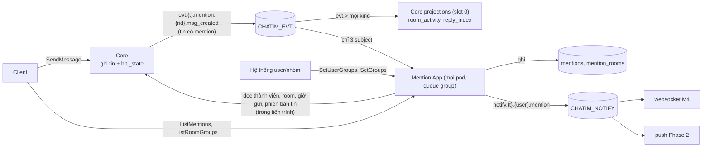

# Mention App: tóm tắt kỹ thuật

> **Trạng thái:** xây xong trên `feat/mention-app` (chồng lên `feat/m3.1`), chờ PR. Thiết kế owner duyệt ngày 2026-10-17; bản này viết lại theo cái đã thực sự xây.
>
> **Nguồn:**
> - Hướng đi: owner duyệt ngày 2026-10-17 sau ba vòng brainstorm. Log ở `.claude/plans/mention-app_design.md` (MA1–MA18).
> - Quyết định: D162–D176 trong [Decision Log](../decision-log.md) §17.4.
> - Danh mục event, subject, ai nhận gì: [events.md](../events.md).
> - Plan thực thi: `.claude/plans/2026-10-17-mention-app.md` (commit `64dd67e` … `334f8e1`).
>
> **Thứ tự:** làm trước M4 websocket (owner). PR mở sau khi PR M3 và M3.1 merge.

## 1. Thuật ngữ

| Từ | Nghĩa |
|---|---|
| Mention App | App riêng `apps/mention`. Ghi ai được nhắc trong tin, bung nhóm, gửi thông báo theo người. Hiện chạy **nhúng** trong tiến trình core; core chỉ import package công khai `apps/mention/mentionapp` |
| đích (target) | Thứ được nhắc trong tin: một user (`@Minh`), một nhóm (`@team-sale`) hoặc cả room (`@all`). Core lưu trên tin ở `mt`/`ma` |
| doc mention | Một dòng trong collection `mentions` cho mỗi (tin, đích). Mô hình D115, nay do Mention App ghi |
| đường A, đường B | Hai cách đọc của `ListMentions` (D115). A: "ai nhắc tên tôi", tìm theo tên. B: "`@all`/`@nhóm` trong room tôi đang ở", đi qua từng room |
| bung nhóm | Đổi `@team-sale` thành danh sách người thật, giao với thành viên room |
| thông báo | Một event gửi cho **một người** trên `notify.{t}.{user}.mention`. App notification (websocket M4, `push` Phase 2) giao nó tới máy |
| app notification | Nơi giao thông báo tới máy và lọc room đã tắt thông báo. Không thuộc Mention App |
| cổng | Giao diện `mentionapp.CoreReader` mà Mention App khai báo để đọc dữ liệu core. Chạy nhúng thì core nối cổng thẳng vào store và hàm của nó (`apps/core/internal/app/mention_core_reader.go`) |
| `message_ver` | Phiên bản nội dung tin: 0 khi gửi, tăng mỗi lần sửa/xoá. Dùng để bỏ event cũ |
| ngưỡng tuổi | Event cũ hơn 5 phút thì vẫn ghi mention nhưng không gửi thông báo |
| queue group | Mọi pod (chạy nhúng: mọi core) cùng kéo một consumer `mention`; mỗi event tới đúng một pod; không có leader, không chia partition. Event của cùng một tin có thể được xử lý song song và lệch thứ tự |
| giờ của đích (`at`) | Giờ một đích xuất hiện trong tin: giờ gửi, hoặc giờ sửa nếu đích được thêm bằng sửa. Core đóng dấu trên tin (`mt[].a`, `mat`, BSON date tính bằng ms) và trong event |
| đích trước (`previous_mentions`) | Tập đích của phiên bản ngay trước, core gửi kèm `msg_edited`/`msg_deleted`. Nhờ nó, mỗi event tự đủ thông tin, không phụ thuộc thứ tự xử lý |

## 2. Bức tranh chung

### 2.1 Vì sao làm

Trước milestone này core tự ghi chỉ mục mention (projection `mention_reply_index`), tự đánh dấu đã đọc (`mention_read`) và tự trả `ListMentions`. Theo checklist và D162, những việc này thuộc app:
- Trạng thái lưu theo người đọc (ai được nhắc, đã đọc chưa) thuộc app, không thuộc core.
- Gửi thông báo cần chọn người nhận và bung nhóm, mà core không làm cả hai.
- Thành viên nhóm là dữ liệu của hệ thống user/nhóm, không phải core.

Ví dụ xuyên suốt: Lan gửi "@Minh @team-sale @all họp lúc 3h" vào group 777 (50 người). `team-sale` gồm Minh, Hà, Tú; Tú không ở room 777.
- Trước đây: core ghi 3 doc mention và không ai được báo.
- Bây giờ:
  - Mention App ghi 3 doc như cũ.
  - Mention App gửi thông báo cho 49 người (50 trừ Lan). Minh và Hà chỉ nhận **một** thông báo mỗi người; Tú không nhận.
  - Websocket M4 hoặc app `push` Phase 2 giao các thông báo đó tới máy.

### 2.2 Scope và ranh giới

| Việc | Trong/ngoài | Ai giữ |
|---|---|---|
| Ghi mention theo đích; cập nhật khi sửa/xoá tin | Trong | Mention App. Mô hình D115 chuyển nguyên |
| `ListMentions` (hai đường, trang 20) | Trong | Mention App, `MentionService` trên gRPC server của core |
| Nhóm của từng người `mention_user_groups` + `SetUserGroups` (bên gửi luôn gửi đủ nhóm của người đó) | Trong | Mention App (owner, Q1; set theo người, không đi hai lệnh) |
| Bung `@nhóm`/`@all`; gửi thông báo theo người lên `CHATIM_NOTIFY` | Trong | Mention App |
| Consumer `mention` chỉ nhận tin có mention, sửa, xoá | Trong | Mention App; core phát tin có mention ở loại data `mention` |
| Chạy nhúng trong core, config chung | Trong | Mention App + wiring core |
| Gỡ khỏi core: nửa mention của `mention_reply_index` (còn lại `reply_index`), `mention_read`, `CoreService.ListMentions`, `rooms.last_shared_mention_at`, store mention của core | Trong | Core |
| Danh mục nhóm được tag `mention_groups` + `SetGroups` | Trong | Mention App (owner) |
| Dữ liệu cho gợi ý `@nhóm`: `ListRoomGroups(room)`, nhóm có người trong room kèm tên | Trong | Mention App (owner) |
| Ghép gợi ý `@người` + `@nhóm`, lọc theo chữ đang gõ | Ngoài | Client (owner) |
| Danh mục event `docs/events.md` | Trong | Docs |
| Server riêng, database riêng, CDC/chép dữ liệu, bản sao dữ liệu core | Ngoài | Sau (owner 2026-10-17) |
| Lọc room tắt thông báo; giao tới máy online/offline | Ngoài | Websocket M4; `push` Phase 2 (owner, Q2) |
| `@all` trong channel tới từng người (~200K) | Ngoài | `push` Phase 2 |
| Đích trên tin (`mt`/`ma`), kiểm hợp lệ (`MENTION_TARGETS_MAX`), phát event | Ngoài | Core giữ nguyên |
| Event tự đủ thông tin: giờ của từng đích (`mt[].a`, `mat`), `previous_mentions` trên `msg_edited`/`msg_deleted`; fact xoá giữ đích của phiên bản bị xoá | Trong | Core (D173) |
| Mọi pod/core cùng chia tải consumer `mention` (queue group, không leader) | Trong | Mention App (owner 2026-10-17) |
| Trả lời (doc trả lời, `rc`, `reply_threads`), bookmarks | Ngoài | Ở lại core (`reply_index`) |
| Dấu `@` trên danh sách hội thoại, sync token, đa thiết bị | Ngoài | Sau |
| Tìm kiếm (người theo tên, nhóm, nội dung tin) | Ngoài | Search App riêng, milestone sau (owner 2026-10-17) |

### 2.3 Sơ đồ

So với trước:
- Core mất phần mention của projection, toàn bộ `mention_read`, `ListMentions` và store mention.
- Thêm một consumer chỉ nhận tin có mention, một stream thông báo và ba collection (`mention_rooms`, `mention_user_groups`, `mention_groups`).
- `read_updated` không còn ai ghi DB theo nó.

## 3. Dữ liệu

### 3.1 `mentions` (giữ chỗ cũ, Mention App ghi)

Schema và index như D115, với các thay đổi:
- bỏ `state 3`;
- `created_at` lấy giờ của đích (`at`) do core đóng dấu trong event, cắt về ms trước khi ghi, nên phát lại không đổi `updated_at`;
- mọi lần ghi có điều kiện theo `message_ver` (không ghi đè doc có `message_ver` lớn hơn);
- đích bị bỏ được ghi tombstone kể cả khi chưa có doc, và tombstone lấy `at` của đích trước làm `created_at`.

| Field | Nghĩa | Ví dụ | Dùng ở |
|---|---|---|---|
| `_id` | khoá tin (24B) + loại đích + id đích | tin 777/0/41 + `1` + `Minh` | ghi, xoá theo tin |
| `message_key` | khoá tin | 777/0/41 | đích hiện có của một tin |
| `room_id`, `tenant` | room, tenant | 777, `t1` | đường B, cô lập tenant |
| `kind` | `user`, `group`, `all` | `group` | đường B |
| `target` | `user:{id}`, `group:{id}`, `all:{room}` | `group:team-sale` | đường A, B |
| `thread_root`, `seq` | vị trí tin | 0, 41 | đọc tin |
| `sender_id` | người gửi | `Lan` | bỏ người gửi |
| `state` | 1 còn, 2 đã gỡ | 1 | đọc |
| `message_ver` | phiên bản tin của lần ghi cuối; chỉ tăng | 0 | chặn event cũ ghi đè |
| `created_at` | giờ của đích (`at` trong event): giờ gửi tin; đích thêm bằng sửa thì giờ sửa | 15:00:02 | sắp xếp, since, đã đọc |
| `updated_at` | lần ghi cuối | 15:00:02 | |

Ba index: `{tenant, target, state, created_at: -1, message_key: -1}` (đường A), `{room_id, kind, created_at: -1, message_key: -1}` (đường B) và `{message_key: 1}`. Bootstrap của app xoá index cũ `{room_id, target, thread_root, seq}` (chỉ phục vụ `mention_read`), nếu còn.

Doc cũ (ghi trước milestone) không có `a` trên đích: app coi `at` rỗng là chưa biết và dùng `ts` của tin. Chưa go-live, dev chạy `make infra-reset`.

### 3.2 `mention_rooms` (mới, thay `rooms.last_shared_mention_at`)

| Field | Nghĩa | Ví dụ | Dùng ở |
|---|---|---|---|
| `_id` | room id | 777 | `$in` theo lô 1.000 room ở đường B (collection thường, không clustered, nên `$in` trên `_id` được) |
| `tenant` | tenant | `t1` | cô lập; `Raise` bỏ qua room của tenant khác |
| `last_shared_mention_at` | giờ mới nhất của một `@all`/`@nhóm` trong room; chỉ tăng (`$max`) | 15:00:02 | đường B bỏ room không có gì mới, dừng sớm |

Không dựng lại từ dữ liệu cũ (chưa go-live). Field cũ trên `rooms` đã xoá khỏi core.

### 3.3 `mention_user_groups` (mới, mỗi người một doc chứa đủ nhóm của họ)

Owner chốt 2026-10-17: lệnh set **cả danh sách nhóm của một người**, bên gửi buộc gửi đủ. Lý do: chuyển nhóm phải là một lần ghi, không phải hai lệnh "thêm nhóm mới, bỏ nhóm cũ".

| Field | Nghĩa | Ví dụ | Dùng ở |
|---|---|---|---|
| `_id` | chuỗi `tenant│user` (`│` là U+2502, như `room_dms`); collection clustered | `t1│Ha` | tra nhóm của một người |
| `tenant`, `user_id` | tenant, người | `t1`, `Ha` | |
| `groups` | **đủ** các nhóm người này đang thuộc, đã khử trùng và sắp xếp; rỗng là không thuộc nhóm nào | `[manager, team-sale]` | bung nhóm |
| `ver` | version do hệ thống user/nhóm cấp cho người này; chỉ nhận lớn hơn; ≤ MaxInt64 | 1003 | chống lệnh tới lệch thứ tự |
| `updated_at`, `updated_by` | lần ghi cuối, app gọi (handler luôn điền từ `x-chatim-user`) | 14:00, `hr-sync` | vận hành |

Index `{tenant: 1, groups: 1, user_id: 1}` (multikey) dùng cho "ai thuộc nhóm X", quét theo trang `user_id`. Tra theo người là các khoảng `_id` chuỗi (`pkg/mongobound.StringIDs`, CLUSTERED_IXSCAN, không `$in`).

**Ví dụ:**

| Việc | Lệnh | Kết quả |
|---|---|---|
| Hà chuyển `staff` → `manager` | `SetUserGroups(Hà, [manager], 1003)` | Một lần ghi: `groups` đổi từ `[staff]` sang `[manager]`, `ver` 1003. Không lúc nào Hà ở cả hai nhóm hay không nhóm nào |
| Hà nghỉ việc | `SetUserGroups(Hà, [], 1004)` | `groups` rỗng; doc giữ lại với `ver` 1004 |
| Lệnh cũ tới muộn | `SetUserGroups(Hà, [staff], 1002)` | 1002 < 1004 nên bị bỏ, không đưa Hà về `staff` |

Vì mỗi lệnh mang đủ nhóm, `ver` theo người là đủ: bản mới nhất của người đó thắng. `ver` không cần liên tiếp, chỉ cần tăng theo thời gian của bên gửi (id nhật ký thay đổi, giờ đổi tính bằng ms). Doc không bao giờ bị xoá, vì xoá thì một lệnh cũ tới sau sẽ tạo lại nó.

### 3.4 `mention_groups` (mới, danh mục nhóm được tag)

Owner chốt 2026-10-17: phải có một nơi định nghĩa nhóm nào được tag; khi trả gợi ý thì map id sang tên.

| Field | Nghĩa | Ví dụ | Dùng ở |
|---|---|---|---|
| `_id` | chuỗi `tenant│nhóm`; collection clustered | `t1│team-sale` | tra nhóm |
| `tenant`, `group_id` | tenant, id nhóm | `t1`, `team-sale` | |
| `name` | tên hiển thị | Phòng Kinh doanh | gợi ý, client hiện tên |
| `state` | 1 được tag, 2 thôi cho tag (không bao giờ xoá doc) | 1 | gợi ý, thông báo, `ListMentions` |
| `ver` | version do hệ thống user/nhóm cấp; chỉ nhận lớn hơn | 50 | chống lệnh lệch thứ tự |
| `updated_at`, `updated_by` | lần ghi cuối, app gọi | 14:00, `hr-sync` | vận hành |

Không có index phụ: `All(tenant)` là một khoảng `_id` theo tiền tố tenant, danh mục mỗi tenant cỡ vài trăm tới vài nghìn nhóm, app giữ trong RAM.

`@nhóm` không có trong danh mục, hoặc `state 2`:
- **Vẫn ghi doc mention.** Nếu không ghi, danh mục đổi giữa lúc gửi và lúc sửa tin sẽ sinh thông báo hoặc lệnh gỡ sai.
- **Không gửi thông báo.**
- **Không hiện trong `ListMentions`.**

Ví dụ: ai đó gõ tay `@hr-internal` (`state 2`). Không ai được báo, và không ai thấy nó trong danh sách mention.

### 3.5 Stream, consumer, config

| Thứ | Giá trị |
|---|---|
| Consumer `mention` trên `CHATIM_EVT` | durable, mọi pod cùng kéo (queue group), ack từng tin, `AckWait` 30s, `MaxAckPending` = `MENTION_MAX_ACK_PENDING` (16.384, tổng cho mọi pod), `DeliverAll`. Lọc 3 subject: `evt.*.mention.*.msg_created`, `evt.*.message.*.msg_edited`, `evt.*.message.*.msg_deleted` |
| Stream `CHATIM_NOTIFY` | subject `notify.>`, lưu file, giữ 24h, chống trùng 6 phút, số bản sao theo `EVT_STREAM_REPLICAS` |
| Client NATS | `notifyJS` riêng cho thông báo (in-flight và error handler riêng, không cộng vào `publish_dropped`) |
| `MENTION_ENABLED` | bật app nhúng (mặc định bật). Tắt: không tạo consumer, không đăng ký `MentionService`, không watch, không ghi mention |
| `MENTION_FETCH_BATCH` / `MENTION_FETCH_WAIT` | 512 / 250ms mỗi pod |
| `MENTION_WORKERS` | 8: số event một pod xử lý cùng lúc |
| `MENTION_MAX_ACK_PENDING` | 16.384, ≥ `MENTION_FETCH_BATCH` |
| `MENTION_NOTIFY_MAX_AGE` | 5m (owner) |
| `NOTIFY_STREAM`, `NOTIFY_SUBJECT_ROOT` | `CHATIM_NOTIFY`, `notify` |
| `NOTIFY_STREAM_MAX_AGE`, `NOTIFY_STREAM_DUPLICATES` | 24h, 6m |
| `MENTION_HIDE_READ_TENANTS` | chuyển từ core sang config app (`Mention.HideReadTenants`), nghĩa không đổi |
| `MENTION_ROOM_GROUPS_SYNC_MAX` | 5.000: room tới cỡ này thì dựng tập nhóm ngay khi được hỏi, lớn hơn thì dựng ở nền |
| `MENTION_ROOM_GROUPS_TTL` / `MENTION_ROOM_GROUPS_REBUILD` | 60s / 10m |

Luật boot:
- `MENTION_NOTIFY_MAX_AGE` ≤ `NOTIFY_STREAM_DUPLICATES` ≤ `NOTIFY_STREAM_MAX_AGE`.
- `MENTION_FETCH_WAIT` ≤ `PROJECTION_FETCH_WAIT`, để pha dừng không dài hơn trước.
- `NOTIFY_STREAM` khác `EVT_STREAM` và `TIMER_STREAM`; `NOTIFY_SUBJECT_ROOT` khác `EVT_SUBJECT_ROOT`, `EVT_LIVE_ROOT`, `TIMER_SUBJECT_ROOT`.
- Tenant sai định dạng trong `MENTION_HIDE_READ_TENANTS` thì core không khởi động.

## 4. Luồng xử lý

### 4.1 Gửi tin có mention

1. Core `SendMessage`: kiểm đích (`ValidateMentions`; `MENTION_KIND_ALL` trong danh sách bị từ chối, `@all` đi bằng cờ `mention_all`), quyền `mention_all`, đóng dấu `at` = giờ gửi cho mọi đích, ghi tin kèm bit `_state`, ack.
2. Core publish trên `evt.t1.mention.777.msg_created`, vì tin có `mt`/`ma`; tin không mention vẫn ở `message`. Sweeper phát bù từ doc tin bằng cùng hàm nên ra cùng subject.
3. Một pod bất kỳ (queue group) fetch lô ≤ 512 trong ≤ 250ms. Trong lô:
   - mỗi event được giải mã một lần; event không có đích hiện tại lẫn đích trước được ack ngay;
   - một lần `MessageVersions` cho mọi tin còn trong ngưỡng tuổi (đọc `_id` có cận, chỉ field `v`);
   - `MENTION_WORKERS` event được xử lý cùng lúc, không theo thứ tự;
   - event chưa settle được gửi `InProgress` mỗi `AckWait/3` (10s), nên một loạt `@all` lớn không làm event cuối lô bị NATS giao lại.
4. Ghi mention, chỉ dựa vào event, không dựa vào thứ tự:
   - Mỗi đích trong tin: upsert doc `state 1`, `created_at` = `at` của đích, `message_ver` = phiên bản của event.
   - Mỗi đích ở `previous_mentions` mà không còn trong tin: upsert tombstone `state 2` với phiên bản của event, `created_at` = `at` của đích trước.
   - Mọi lần ghi là một `BulkWrite(ordered:false)` các upsert pipeline `$cond`, filter chỉ `_id`: doc đang có `message_ver` lớn hơn thì giữ nguyên từng byte. Event cũ tới sau không làm sống lại đích đã bỏ, cũng không ghi đè giờ.
   - Có `@all`/`@nhóm`: nâng `mention_rooms.last_shared_mention_at` (`$max`) bằng `at` lớn nhất của các đích đó, để mention thêm bằng sửa vẫn hiện ở đường B.
5. Event cũ hơn 5 phút: dừng ở đây (đã ghi mention), đếm `chatim_mention_notify_skipped_total{reason="stale"}`. Kiểm tuổi trước khi tìm người nhận, nên event cũ không tốn lần đọc core nào thêm.
6. Đọc phiên bản lỗi ở bước 3: mention đã ghi, rồi Nak. Phiên bản hiện tại lớn hơn phiên bản event: không đẩy, đếm `reason="superseded"` (bản mới tự lo; đúng sai do luật "phiên bản lớn hơn thắng" ở client).
7. Tính người nhận:
   - `@Minh`: `MembersOf(777, [Minh])`, một lần đọc có cận.
   - `@team-sale` (chỉ khi nhóm có trong danh mục với `state 1`): đi từ phía nhỏ hơn, không cần biết trước nhóm lớn bao nhiêu.
     - Đọc một trang `ListMembers(777)` 1.000 dòng, đúng giới hạn trang của core.
     - Trang dưới 1.000 dòng (room nhỏ, `SmallRoom` = 999): tra `_id` `t1│{user}` của chính những người đó trong `mention_user_groups`, một lần đọc có cận (D139); giữ người có `team-sale` trong `groups`.
     - Trang đủ 1.000 dòng (room lớn): quét index `{tenant, groups: team-sale}` theo trang 1.000 người, mỗi trang một `MembersOf(777, trang)`.
     - Chọn nhánh theo độ dài trang thô, rồi mới bỏ người đã rời (tombstone), để không bỏ sót người ở trang sau.
     - Ví dụ: `@toan-cong-ty` (20.000 người) trong room 30 người tốn 2 lần đọc, không phải 20.
   - `@all`: room là channel, hoặc loại room lạ (proto chưa có giá trị `CHANNEL`) thì bỏ qua; DM/group thì `ListMembers(777)` theo trang.
   - Gộp lại, bỏ người gửi, mỗi người một lần. Đích ghi trên thông báo theo thứ tự ưu tiên user > nhóm > `@all` (`@all` mang `MENTION_KIND_ALL`).
8. Publish async `mention_notified` cho từng người, chờ mọi PubAck, rồi ack event. PubAck báo trùng thì không đếm vào `notified_total`.

Lỗi:
- Store lỗi hoặc publish lỗi: Nak theo bậc thang 5s/30s/2m/10m. Lần sau ghi lại không đổi gì (đã có cùng `message_ver`); thông báo trùng id bị stream bỏ trong 6 phút.
- Không decode được, đích sai, hoặc không dựng được thông báo: Term.
- Không ai có nhóm đó trong `groups`, hoặc nhóm không có trong danh mục / `state 2` lúc xử lý: không ai nhận qua nhóm, doc mention vẫn ghi.

### 4.2 Sửa tin

1. Core `EditMessage` phát `evt.t1.message.777.msg_edited` (id `777-0-41-v1`). Event gồm bản chụp tin (đích hiện tại, mỗi đích có `at`), `message_ver` 1 và `previous_mentions` (đích của phiên bản 0, lấy từ tin đọc trước khi sửa).
   - Core đóng dấu `at`: đích giữ nguyên giữ giờ cũ; đích mới thêm lấy giờ của fact sửa (D166). `Mentions` nil (giữ nguyên đích) chép cả `at`. `@all` tương tự với `mention_all_at`.
   - Fact sửa (`message_edits`) lưu đích kèm `at` (`mention_targets[].at`, `mention_all_at`).
2. Ghi mention như 4.1 bước 4.
3. Thông báo tính từ chính event, không từ doc đang có:
   - `mention_notified` (id `…-m1`) cho người nhận của đích hiện tại trừ người nhận của đích trước.
   - `mention_retracted` (id `…-r1`, lý do `EDITED`) cho người nhận của đích trước trừ người nhận của đích hiện tại.
   - Người vẫn còn được nhắc không nhận gì.

Ví dụ: Minh đã đọc room 777 tới tin 120 (gửi 10:03). Lúc 10:10 Lan sửa tin 120, thêm "@Minh".
- Core đóng dấu `at` = 10:10 cho `@Minh`. Doc mention mang 10:10, sau 10:03, nên hiện là **chưa đọc** và đứng đầu danh sách của Minh.
- Minh nhận thông báo `…-m1`.
- Nếu lấy giờ gửi (10:03) thì mention bị tính là đã đọc dù Minh vừa nhận báo (D166).

Ví dụ lệch thứ tự: v0 nhắc Minh, v1 bỏ Minh, v2 nhắc lại Minh, v3 xoá. Bốn event tới bốn pod cùng lúc, xử lý theo bất kỳ thứ tự nào.
- **Doc:** thứ tự nào cũng kết thúc ở doc phiên bản 3, tombstone; các event phiên bản nhỏ hơn tới sau bị chặn. Test chạy đủ 24 hoán vị trên cả memstore lẫn Mongo thật và ra cùng doc cuối (`state`, `message_ver`, `created_at`).
- **Thông báo:** Minh có thể nhận `m0`, `r1`, `m2`, `r3` theo thứ tự bất kỳ; client giữ cái có phiên bản lớn nhất.

**Sweeper phát lại `msg_edited`:** `previous_mentions` lấy từ fact `ver − 1` (dòng `ver 0` có từ lần sửa đầu). Vì vậy ai ghi fact sửa từ ngoài core (mongosh, migration) phải ghi luôn dòng `ver 0`, nếu không sweeper giữ cờ mãi (`UNAVAILABLE`).

**Lệnh xoá chen vào lệnh sửa:** nếu fact trước đã bị lệnh xoá dọn chữ (dòng còn mà chữ rỗng; chữ của tin không bao giờ rỗng nên dấu này chắc chắn), lệnh sửa vẫn trả thành công cho client, không enqueue event; cờ `_state` của fact còn đó và sweeper phát bù (`ErrPreviousPurged`). Client không nhận `UNAVAILABLE` sai cho một lệnh sửa đã thành công.

### 4.3 Xoá tin

`msg_deleted` mang `message_ver` của lần xoá và `previous_mentions` (đích của phiên bản bị xoá).
- Lệnh lấy `previous_mentions` từ tin ngay trước khi xoá.
- Fact xoá giữ đích của phiên bản bị xoá (kèm `at`); `PurgeText` chỉ xoá chữ và đích ở các fact cũ hơn nó. Sweeper phát lại lấy đích từ fact xoá.
- Bản chụp tin đã xoá không mang đích ra ngoài (`WithoutDeletedContent`), nên đích hiện tại rỗng.
- Mention App ghi tombstone cho mọi đích trong `previous_mentions`, kể cả đích chưa có doc. Event tạo tin tới muộn bị chặn.
- `mention_retracted` (lý do `DELETED`) gửi cho người nhận của đích trước, nếu event còn trong 5 phút.
- `mention_rooms` không lùi.

Sweeper phát lại `msg_created` từ doc tin hiện tại. Tin đã bị xoá hoặc đã sửa bỏ hết đích thì bản chụp không còn đích, nên event đi loại data `message` và không tới Mention App. Không sao: app đã học thay đổi từ `previous_mentions` của `msg_edited`/`msg_deleted`.

### 4.4 `ListMentions` (`MentionService`)

Request và response giống `CoreService.ListMentions` trước đây (nhóm kèm since, `before`, `limit` ≤ 20). Chỉ đổi service; `CoreService` còn 32 RPC.

1. `RoomsOf(user)` qua cổng: các room đang ở, `joined_at`, `cleared_at`, `read_seq`.
2. Đường A: `ListByTarget(user:{caller})`, chỉ `state 1`. Tenant ẩn: bỏ mục đã đọc theo giờ (trước đây loại bằng `state 3` ở index).
3. Đường B: `mention_rooms` theo lô 1.000 → room có gì mới sau since → lô 200 room → `ListShared` (SORT_MERGE) → dừng sớm. Như D115, nhưng chỉ dùng các nhóm người gọi gửi lên mà đang `state 1` trong danh mục.
4. Gộp: `MergeMentions` bỏ trùng theo khoá tin (giữ bản mới nhất), vì các đích của một tin nay có `at` khác nhau.
5. Đã đọc: giờ mention ≤ giờ gửi của tin tại `read_seq` (`SentTimes` qua cổng, theo lô ≤ 200 khoá, nhớ trong lần gọi).
6. Nội dung: theo từng (room, thread), `Authorize(read_history)` + `VisibleMessages` qua cổng (tin đã xoá hoặc bị ẩn với người xem thì bị bỏ ở đây).
7. Lưới an toàn, không tốn thêm lần đọc (tin đã nạp sẵn):
   - chỉ giữ mục khi tin hiện tại vẫn còn đích đó (`mt` có user/nhóm, hoặc `ma` cho `@all`);
   - **một mục mỗi tin trên mọi trang** (D174): bỏ mục nếu tin có đích khác chạm tới người xem (chính user, nhóm `state 1` người gọi gửi với since, `@all`; sau since của room) với `at` mới hơn giờ của mục. Mỗi tin chỉ hiện một lần, ở giờ mới nhất.

Ví dụ một tin hai trang: tin M có `@all` lúc t5 và `@team-sale` lúc t3, tin X lúc t4, `limit` 2. Không có bước 7: trang 1 [M t5, X t4], trang 2 lại có M t3. Có bước 7: mục M t3 bị bỏ vì M còn `@all` t5 chạm tới người xem.

Mã lỗi giữ nguyên:
- `limit` > 20 hoặc tham số sai: `INVALID_ARGUMENT`.
- Store hoặc core lỗi: `UNAVAILABLE` (lỗi `INVALID_ARGUMENT` từ phía dưới không đi qua thành lỗi của người gọi).

Chi phí xấu nhất giữ nguyên (113 truy vấn ở 5.000 room, tenant ẩn). Đường A của tenant ẩn có thể cần thêm vòng (R3).

### 4.5 `SetUserGroups` (`MentionService`)

Request: danh sách mục `{user, groups, ver}`, tối đa 1.000 mục mỗi lần gọi. Đây là lô ghi, không phải giới hạn số người.

- **Người gọi:** app nội bộ tin cậy (hệ thống user/nhóm), như mọi caller hiện nay. Tenant lấy từ `x-chatim-tenant`; `updated_by` lấy từ `x-chatim-user` (`pkg/callerid`).
- **Hợp đồng với bên gửi:** `groups` là **đủ** các nhóm của người đó lúc `ver`. Gửi thiếu một nhóm nghĩa là người đó bị bỏ khỏi nhóm ấy. Muốn bỏ người khỏi mọi nhóm thì gửi `groups` rỗng.
- **Kiểm tra:** user id hợp lệ, id nhóm theo luật id đích (`keys.ValidMentionID`, `[A-Za-z0-9_:-]{1,64}`), `ver` ≥ 1, một user không xuất hiện hai lần trong cùng request, quá 1.000 mục. Sai thì `INVALID_ARGUMENT`. Nhóm trùng trong `groups` được khử trùng. Không đặt trần số nhóm mỗi người (không có use case).
- **Ghi:** một `BulkWrite(ordered:false)`, mỗi mục một upsert theo `_id`, pipeline `$cond` như `AddMembers` (D99).
  - `ver` mới > `ver` đang giữ: đặt `groups`, `ver`, `updated_at`, `updated_by`.
  - Ngược lại doc giữ nguyên từng byte.
  - Filter là phép bằng trên `_id`, nên khi hai upsert chạy đua thì server tự thử lại phần trùng khoá.
- **Trả về:** danh sách người có `groups` thật sự đổi, tính từ một lần đọc có cận ngay trước khi ghi. Chỉ để thông tin: hai pod ghi cùng lúc có thể báo dư. Gọi lại cùng request thì danh sách rỗng, `OK`.
- **Lỗi:** store lỗi → `UNAVAILABLE`, không thử lại nội bộ. Gửi lại cùng request là an toàn, kể cả khi một phần lô đã ghi, vì mỗi mục có `ver`.
- **Event:** không phát. Thông báo của tin gửi sau dùng nhóm mới. Không có cache nào giữ nhóm theo người, nên đổi có hiệu lực ngay cho thông báo; gợi ý `@nhóm` (4.6) cập nhật sau TTL.

**Nạp lần đầu:** 20.000 nhân viên = 20 lần gọi, mỗi lần 1.000 người kèm đủ nhóm.

**Tạo nhóm mới cho 500 người:** gửi 500 mục, mỗi mục là danh sách nhóm cũ của người đó cộng nhóm mới.

### 4.6 Gợi ý `@` khi soạn tin (client tự ghép)

Owner chốt 2026-10-17: client tự ghép API để gợi ý theo người và theo nhóm. Server chỉ trả dữ liệu; client lọc theo chữ đang gõ và bỏ dấu (kể cả `đ` → `d`) ngay trên máy, không gọi server mỗi phím.

| Gợi ý | API | Ai trả |
|---|---|---|
| `@người` | `ListMembers(room)` (có từ M3) | core |
| `@nhóm` | `ListRoomGroups(room)` → `{groups: [{id, name}], filtered}` | Mention App |

Ví dụ: Lan mở ô soạn tin ở room 777.
1. Client gọi hai API trên một lần.
2. Lan gõ `@kinh`. Client lọc trên máy ra Minh Kinh (người) và Phòng Kinh doanh (`team-sale`).
3. Lan chọn nhóm. Tin gửi đi mang id `team-sale`.

**`ListRoomGroups(room)`** trả các nhóm `state 1` có ít nhất một người trong room, kèm tên, xếp theo tên.
- **Quyền:** `Authorize(read_members)`, giống `ListMembers`. Nếu không, một người chỉ vào được channel cũng suy ra được trong channel có ai thuộc nhóm nào. Thiếu quyền: `PERMISSION_DENIED`. Room không tồn tại hoặc khác tenant: `NOT_FOUND`.
- **Cách tính, với room 777 có Minh, Hà, Lan:**
  1. `MemberUserIDs(777)` của core: chỉ đọc index `{room_id, state, …, user_id}` (covered, không FETCH).
  2. Tra `mention_user_groups` của 3 người đó theo `_id`, lô 1.000 (một lần đọc có cận, D139) → `{team-sale, manager}`.
  3. Giao với danh mục `state 1`, map tên.
- **Chọn cách dựng:** số người của room lấy từ `RoomMemberCount` (cache thông tin room của core, có thể cũ tới 60s; chỉ ảnh hưởng chọn dựng ngay hay dựng nền).
- **Giữ trong RAM** tập nhóm theo room (LRU), như `roomcache`:
  - Room ≤ `MENTION_ROOM_GROUPS_SYNC_MAX` (5.000) người:
    - dựng khi được hỏi: 1 lần đọc user id + tối đa 5 lần tra nhóm; singleflight dùng ctx tách riêng có hạn 30s, nên một người gọi huỷ không làm hỏng người khác;
    - quên khi có `member_added`/`member_removed` (watch core NATS `live.*.member.*.evt.member_added|member_removed`) hoặc sau 60s.
  - Room lớn hơn (channel):
    - khi có người hỏi và tập đã cũ hơn `MENTION_ROOM_GROUPS_REBUILD` (10 phút) thì dựng lại ở nền; không có vòng hẹn giờ;
    - một lần dựng mỗi room, tối đa 4 lần dựng nền chạy cùng lúc mỗi pod (`MaxRebuilds`);
    - trong lúc dựng lại vẫn trả tập cũ;
    - lần đầu chưa có tập thì trả mọi nhóm `state 1` của tenant, kèm `filtered = false` để client biết danh sách chưa lọc theo room.
  - Ngưỡng 5.000 chỉ chọn "dựng ngay" hay "dựng ở nền", không phải giới hạn dữ liệu.
- **Danh mục** giữ trong RAM theo tenant (TTL 60s, singleflight, LRU 1.024 tenant). `SetGroups` quên ngay danh mục của tenant trên pod nhận lệnh; pod khác thấy thay đổi sau tối đa 60s.
- Gợi ý có thể cũ tới 60s (room thường) hoặc 10 phút (channel). Thông báo luôn tính thành viên đúng lúc xử lý tin (4.1); riêng danh mục nhóm thì theo cache 60s.

**`SetGroups([{id, name, active, ver}])`** (≤ 1.000 mục mỗi lần gọi), do hệ thống user/nhóm gọi.
- Cùng khuôn với `SetUserGroups`: upsert pipeline `$cond`, chỉ đổi khi `ver` mới lớn hơn; `active = false` thành `state 2`.
- Kiểm tra: id nhóm theo luật id đích, tên không rỗng, `ver` ≥ 1, không trùng id. Sai: `INVALID_ARGUMENT`.
- Trả về: các nhóm thật sự đổi.

### 4.7 Chạy và dừng

- **Khởi động:** core chạy `wire` rồi `prepare`; `mentionapp.Prepare` tạo collection và index (bootstrap của app), stream `CHATIM_NOTIFY`, consumer `mention`. Task `mention` bắt đầu kéo consumer ngay sau `projections`, trên **mọi** core/pod. Watch của tập nhóm theo room vào cùng nhóm live watcher với `memberwatch` và `roomcache.Watch`. `MentionService` đăng ký lên gRPC server của core, nên mọi core đều trả `ListMentions` và nhận `SetUserGroups`, `SetGroups`, `ListRoomGroups`. Khởi động lỗi giữa chừng thì core đóng các phần của app đã mở.
- **Dừng:** consumer `mention` dừng **song song** với `projections` (pha `max(PROJECTION_FETCH_WAIT, MENTION_FETCH_WAIT) + 1s`). Event đã giao cho worker chạy xong; event chưa bắt đầu thì Nak(0) để pod khác nhận; hết hạn pha thì huỷ việc đang chạy và Nak(0). Publisher thông báo đóng trong `mention.Close`. Kế hoạch dừng giữ 29,7s/30s.
- **Thêm/bớt pod (K8s HPA):** không cần chia lại gì; pod mới bắt đầu kéo, pod tắt thì event đang cầm quay lại hàng đợi sau Nak hoặc `AckWait`.

## 5. Đúng đắn và chạy đua

| Tình huống | Điều gì giữ đúng |
|---|---|
| Event của cùng một tin xử lý song song, lệch thứ tự (nhiều pod) | Event tự đủ: đích hiện tại kèm `at`, đích trước. Mọi lần ghi có điều kiện `message_ver`; đích bị bỏ ghi tombstone kể cả khi chưa có doc, với `created_at` = `at` của đích. Đủ 24 hoán vị cho cùng doc cuối trên hai adapter |
| Event phát lại (sweeper, Nak) tới sau event mới hơn | Bị chặn bởi doc có `message_ver` lớn hơn. Sweeper dựng event từ doc hiện tại, nên `at` và đích lấy theo bản chụp |
| Thông báo tới lệch thứ tự | Thông báo tính từ chính event (đích hiện tại trừ đích trước); client giữ phiên bản lớn nhất cho mỗi tin |
| Tin bị xoá ngay sau khi gửi, event tạo tin xử lý sau | Tombstone của lần xoá chặn doc; `r` phiên bản lớn hơn `m0` ở client; bước 6 bỏ đẩy khi thấy tin đã có phiên bản mới |
| Lệnh xoá dọn fact trước của một lệnh sửa đang chạy | Lệnh sửa trả thành công, không enqueue; sweeper phát bù từ cờ `_state` |
| Gửi lại thông báo | Id cố định theo (tin, người, phiên bản); stream bỏ trùng trong 6 phút, dài hơn ngưỡng tuổi 5 phút |
| Đọc lại stream (resync, tạo lại consumer) | Ngưỡng tuổi: event cũ hơn 5 phút chỉ ghi mention, không báo |
| Lô chậm (một `@all` 5.000 người) | `InProgress` mỗi 10s cho event chưa settle; NATS không giao lại giữa chừng |
| Người vừa vào/rời room | Đọc thành viên từ store core lúc xử lý (không bản sao), nên đúng tới lúc đó. Người rời trong lúc app đang gửi có thể vẫn nhận một thông báo |
| Room lớn có người đã rời ở trang đầu | Chọn nhánh room nhỏ/lớn theo độ dài trang thô, lọc người đã rời sau |
| Thành viên nhóm đổi giữa lúc gửi tin và lúc xử lý | Dùng danh sách lúc xử lý (≤ vài trăm ms sau) |
| Mention App lỗi lâu | Tin vẫn gửi bình thường; core không phụ thuộc app. Mention đuổi kịp khi app chạy lại (`DeliverAll`); thông báo cũ hơn 5 phút bị bỏ |
| Tenant | Mọi đọc ghi có tenant; `Apply` bỏ qua doc khác tenant cùng `_id`; `_id` nhóm bắt đầu bằng tenant. Lệnh đọc thành viên không mang tenant: event do core phát và room id duy nhất toàn hệ thống |
| Lệnh nhóm tới lệch thứ tự hoặc gửi lại | `ver` theo người, mỗi lệnh mang đủ nhóm; `ver` lớn hơn thắng; doc không bao giờ xoá |
| Chuyển nhóm (`staff` → `manager`) | Một lần ghi một doc, nên không có lúc Hà ở cả hai nhóm hay không ở nhóm nào |
| Một tin có nhiều đích với giờ khác nhau | `ListMentions` trả đúng một mục mỗi tin trên mọi trang, ở giờ mới nhất chạm tới người xem (D174) |

## 6. Event và subject

Chi tiết đầy đủ: [events.md](../events.md).

**Core đổi một chỗ ở subject (D170):** `msg_created` của tin có mention phát ở `evt.{t}.mention.{rid}.msg_created`.
- Bản live: `live.{t}.mention.{rid}.evt.msg_created`.
- Id và các kind khác không đổi.
- Payload thêm (D173, chỉ thêm field): `MentionTarget.at` (3), `MentionSet.all_at` (3), `Message.mention_all_at` (25), `previous_mentions` (3) trên `MessageEdited` và `MessageDeleted`; enum `MENTION_KIND_ALL = 3` (chỉ dùng trên thông báo, core từ chối ở đầu vào).
- `projections` (`evt.>`), websocket (`live.{t}.*.{rid}.>`), `memberwatch` và `roomcache` không bị ảnh hưởng.

Mention App nhận đúng 3 subject. Bench 2.000 tin/s với 5% tin có mention: app nhận khoảng 100 event/s cộng sửa/xoá, thay vì 2.000.

Mention App phát hai kind trên `CHATIM_NOTIFY` (proto `Notification{id, tenant, user, room_id, room_type, thread_root, seq, message_ver, ts, oneof}`):
- `mention_notified`: id `{room}-{thread}-{seq}-{user}-m{message_ver}`; bản chụp tin và đích làm người này được báo.
- `mention_retracted`: id `…-r{message_ver}`; lý do `EDITED`/`DELETED`.
- `room_type` của channel là `ROOM_TYPE_UNSPECIFIED` (proto chưa có channel).

Hợp đồng cho người nhận (websocket, push):
- Bỏ trùng theo id.
- Với cùng tin, `message_ver` lớn hơn thắng.
- Tự lọc room đã tắt thông báo (`muted_until` có trong `room_preferences_changed` và `ListMyRooms`).

## 7. Thư viện, package và hạ tầng

- NATS 2.15 (`FilterSubjects`, `InProgress`), `nats.go` jetstream; MongoDB 8.2 (clustered `_id` nhị phân và chuỗi, update pipeline `$cond`, `BulkWrite` unordered).
- Dời sang `pkg/` để app dùng mà không phạm luật `internal` của Go:
  - `pkg/jsconsume`: `PullSource`, `Delivery` (thêm `InProgress`), `NakDelay`, `LimitedLog`, `FetchExpiryGrace`;
  - `pkg/mongobound`: `IDs`, `Runs`, `StringIDs` (khoảng `_id` có cận, D139);
  - `pkg/callerid`: header tenant/user, `Of`;
  - `pkg/ids` (`ValidTenant`, `ValidUser`, `ValidCID`), `pkg/keys.ValidMentionID`.
- Proto: `mention_service.proto` (`MentionService { ListMentions, SetUserGroups, SetGroups, ListRoomGroups }`, dùng lại `ListMentionsRequest/Response`), `notifications.proto` (`Notification`, `RetractReason`). `CoreService.ListMentions` đã xoá.
- Package của app (mỗi file < 200 dòng):
  - `apps/mention/mentionapp`: bề mặt công khai `Config`, `Deps`, `New`, `Prepare`, `Run`, `Close`, `Register`, `Watch`, `Probes`, `StopTimeout`; cổng `CoreReader`;
  - `apps/mention/internal/`: `config`, `domain`, `store` (port, memstore, mongostore, storetest), `plan` (`FromEvent`, `Diff`), `recipients`, `notify` (stream, `Batch`, `Gate`), `consumer`, `groups` (danh mục), `roomgroups` (cache, dựng, watch), `grpcsrv`.
- Core:
  - `apps/core/internal/app`: `mention_wiring.go`, `mention_core_reader.go`, `mention_core_messages.go` nối cổng; `notifyJS`; task `mention`; pha dừng song song;
  - store mới: `MemberUserIDs` (covered), `MessageVersions` (khoảng `_id`, chỉ `v`), `MessageTimes` chuyển sang `store/message_lookup.go` (≤ 200 khoá mỗi lần, adapter chia lô);
  - `api/grpcsrv/visible.go`: `VisibleMessages` export cho app;
  - `mutate`, `send/actor`: đóng dấu `at`, gửi `previous_mentions`; sweeper `rebuild_edits` dựng lại từ fact; `publish.subjectFor` thêm loại `mention`;
  - `event/projection`: `mention_reply_index` → `reply_index` (chỉ phần trả lời), xoá `mention_read`; core vẫn xoá durable cũ `projection-mention_read` lúc khởi động;
  - xoá store mention của core, `domain.Mention`, `rooms.last_shared_mention_at`, `grpcsrv` `ListMentions`;
  - `platform/metrics`: `Source.Subsystem` để có tên `chatim_mention_*`.
- Metric `chatim_mention_*`:
  - consumer: `lag_seconds`, `failures_total`, `dropped_total`, `stuck_total`;
  - thông báo: `notified_total`, `retracted_total`, `notify_failures_total`, `notify_skipped_total{reason="stale"|"superseded"}`;
  - gợi ý nhóm (đo tốc độ, không alert): `room_groups_hits_total`, `room_groups_misses_total`, `room_groups_rebuild_failures_total`, `room_groups_watch_forgets_total`, `room_groups_watch_malformed_total`.
- Alert (14 → 16): `ChatimMentionLagging` (`max(chatim_mention_lag_seconds) > 10` trong 5m), `ChatimMentionFailing` (`stuck_total` tăng trong 15m). Lỗi gửi thông báo kéo dài lộ ra qua `stuck_total` → `ChatimMentionFailing`; không có alert riêng cho `notify_failures_total`. `ChatimProjectionLagging` bỏ chữ mention.

## 8. Quyết định

| # | Chọn | Bỏ | Vì sao |
|---|---|---|---|
| D163 | Chạy nhúng, config chung; đọc core qua cổng `CoreReader` trong tiến trình | Bản sao thành viên từ event, `members.read_at`, API quét; chép dữ liệu | Owner: tuỳ CDC, làm sau; rẻ và không trễ |
| D164 | Chuyển nguyên D115 sang app, `mentions` giữ chỗ | Hộp thư theo người | Đã đo, đã duyệt; `@all` channel không thành 200K lần ghi |
| D165 | Bỏ `mention_read`, `state 3` | Giữ trong app | App không phải nhận mọi `read_updated` |
| D166 | Đích thêm bằng sửa mang giờ sửa; core đóng dấu `at` trên từng đích (D173) | Giờ gửi tin; app tự đoán giờ từ doc đang có | Khớp thông báo với cờ đã đọc; giờ không phụ thuộc thứ tự xử lý |
| D167 | `mention_user_groups` mỗi người một doc chứa đủ nhóm, `SetUserGroups` theo `ver` của người | Mỗi (nhóm, người) một doc với hai lệnh thêm/bỏ; một doc mỗi nhóm chứa mảng; hỏi hệ thống nhóm mỗi lần | Owner: chuyển nhóm phải là một lệnh; đổi một người chỉ ghi một doc; không phụ thuộc hệ thống kia lúc gửi tin |
| D168 | Thông báo theo người trên `CHATIM_NOTIFY`; channel (và loại room lạ) `@all` không gửi riêng; tắt thông báo do app notification | Mention App xét mute; 200K publish | Một đầu ra cho hai nơi giao; owner giao mute đi |
| D169 | Ngưỡng tuổi 5 phút, chống trùng ≥ ngưỡng | Không ngưỡng; 2 phút | Owner: NATS chết ≤ 5 phút vẫn báo; đọc lại stream không báo lại |
| D170 | `msg_created` có mention ở loại data `mention`; consumer lọc 3 subject | Nhận mọi `msg_created`; event riêng | Owner: chỉ nhận data cần |
| D171 | Queue group: mọi pod/core cùng kéo, không leader, 8 worker mỗi pod, lô 512/250ms, `InProgress` mỗi `AckWait/3`; dừng song song `projections` | Một bản trên slot 0 (nối tiếp); chia partition theo room; chung consumer `projections` | Owner: mọi pod K8s cùng chia tải; đúng sai do event tự đủ (D173), không do thứ tự |
| D172 | Danh mục `mention_groups`; chỉ nhóm `state 1` được báo và hiện; gợi ý do client ghép `ListMembers` + `ListRoomGroups`, tập nhóm theo room trong RAM | Gợi ý mọi nhóm; tìm theo chữ trên server; lưu sẵn "room × nhóm → số người"; duyệt từng nhóm | Owner: chỉ gợi ý nhóm có người trong room; lưu sẵn tốn tới 5.000 lần ghi khi một người đổi nhóm; duyệt từng nhóm kẹt ở nhóm lớn |
| D173 | Event tự đủ: `at` (ms) trên từng đích, `previous_mentions`, fact xoá giữ đích, `MENTION_KIND_ALL` cho thông báo; tombstone lấy `at` làm `created_at`; `ErrPreviousPurged` ack ở luồng lệnh | App so với doc đang có; app đọc lịch sử `message_edits` | Mọi thứ tự cho cùng kết quả (test 24 hoán vị bắt lỗi tombstone giữ `created_at` cũ: 6/24 thứ tự lệch) |
| D174 | (Lúc xây) `ListMentions` trả **một mục mỗi tin trên mọi trang**, ở giờ đích mới nhất chạm tới người xem; `MergeMentions` bỏ trùng theo khoá | Chỉ bỏ trùng trong một trang; lưu "giờ mới nhất" theo tin | Từ D173 các đích của một tin có giờ khác nhau, nên một tin hiện ở hai trang; tin đã nạp sẵn nên không tốn thêm lần đọc |
| D175 | (Lúc xây, e2e bắt được) Bung nhóm thăm **một trang 1.000 dòng**, đúng giới hạn trang của core: dưới 1.000 là room nhỏ | Trang 1.001 dòng; nâng giới hạn trang của core | Core từ chối trang > 1.000 (`INVALID_ARGUMENT`), mọi `@nhóm` không kèm `@all` bị Nak mãi; không đổi API core vì một caller |
| D176 | (Owner 2026-10-17) Chấp nhận CPU Mongo +11–17%, NATS +19–27% ở bench 2K, đổi lấy trễ danh sách hội thoại và projection giảm 2–3 lần; tối ưu để sau số prod-like | Tối ưu ngay (ghi `mentions` rẻ hơn, bớt đọc `members`) | Chưa có số thật; phần tăng là tính năng mới (thông báo) và chia tải ra mọi pod |

## 9. Chi phí

### 9.1 Đo (bench 2K tin/s, 5% tin có mention, mỗi 20 tin mention có 1 `@all`; dev MacBook, không throttle)

| Số đo | `base-mention-2k` (trước) | `after-mention-2k` (lượt 1) | `after-mention-2k-r2` (lượt 2) |
|---|---|---|---|
| ack p50/p99/p99.9 | 17,1/184/358 ms | 20,4/294/513 ms (ô bẩn: host khựng ở +51s, pacer p99 13,6 ms) | 22,2/229/351 ms, max 445 ms (pacer p99 12,2 ms, base 5,3 ms) |
| CPU Mongo trung bình | 346% | 385% (+11%) | 404% (+17%) |
| CPU NATS trung bình | 62% | 79% (+27%) | 74% (+19%) |
| CPU core | 168/166% | 175/174% | 191/182% |
| Trễ danh sách hội thoại median/max | 5,5/11,9 s | 2,0/4,3 s | 1,7/4,3 s |
| Trễ `projections` đỉnh / về 0 | 12,2 s / ~14 s | 4,3 s / ~4 s | 4,3 s |
| Trễ `mention` đỉnh | — | 0,68 s | 0,48 s |
| Thông báo trên `CHATIM_NOTIFY` | — (không có tính năng) | 7.051 | 7.155 |
| Lỗi/kẹt/rơi | 0 | 0 | 0 |

Vì sao CPU tăng (Mongo `top`):
- `mentions` 27,2s cho 6.411 upsert pipeline `$cond` (~4,2 ms/lệnh), trước là 8,5s;
- `members` +7.009 truy vấn, gần một lần đọc thành viên mỗi tin có mention;
- `rooms` +2,5K update, vì projection trễ ít hơn nên gom được ít hơn trong cửa sổ 3s;
- NATS: thêm consumer `mention` và stream `CHATIM_NOTIFY`.

Vì sao trễ giảm: trước đây nửa mention của `mention_reply_index` chạy nối tiếp trên slot 0 và kéo cả `projections`; nay nó ở consumer riêng chia cho mọi pod. Owner chấp nhận giá CPU này (D176).

### 9.2 Theo thao tác

| Thứ | Trước | Sau |
|---|---|---|
| Lần giao NATS mỗi giây | 2.000 tin tới `projections` | 2.000 tới `projections` + khoảng 100 tin mention + sửa/xoá tới `mention` |
| `read_updated` | `mention_read`: một `MembersOf` + một `UpdateMany` mỗi room mỗi lô | 0 |
| Đọc để tìm người nhận | 0 (không ai được báo) | `@user`: một `MembersOf` có cận mỗi tin. `@nhóm`: room < 1.000 người thì 2 lần đọc (trang thành viên room + tra `_id` người trong `mention_user_groups`); room lớn hơn thì 1 + 2 lần đọc mỗi 1.000 người trong nhóm. `@all` group 5.000 người: khoảng 5 trang `ListMembers` |
| Kiểm phiên bản trước khi đẩy | không có | một `MessageVersions` mỗi lô |
| Đổi nhóm của người | không có | một lần đọc có cận + một `BulkWrite` mỗi lần gọi (≤ 1.000 người) |
| `ListRoomGroups` | không có | trong RAM: 0 lần đọc. Dựng room 30 người: 2 lần đọc. Dựng room 5.000 người: khoảng 6 lần đọc. Dựng channel 200K người: khoảng 200–400 lần đọc ở nền, 10 phút một lần khi có người hỏi |
| Publish thông báo | 0 | bằng số người nhận; một `@all` group 5.000 người là 5.000 publish async |
| `ListMentions` | 113 truy vấn xấu nhất | như nhau; tenant ẩn có thể thêm vòng ở đường A |
| Sửa tin có nhóm | không có | bung thêm nhóm của đích trước để tính phần chênh |
| Chia tải | một core (slot 0), nối tiếp | mọi pod/core; thêm pod là tăng thông lượng. Không còn chỗ nào xử lý nối tiếp trong consumer `mention` |
| Dừng | 29,7s/30s | không đổi (pha song song) |

## 10. Rủi ro

**R1. Thông báo và lệnh gỡ dựa trên thành viên lúc xử lý từng event.**
- Tạo tin và sửa tin có thể được xử lý ở hai thời điểm khác nhau. Nếu nhóm hoặc room đổi người ở giữa, lệnh gỡ có thể không tới người đã nhận thông báo.
- Ví dụ: v0 `@team-sale` báo cho Hà. Hà rời `team-sale`. v1 bỏ `@team-sale`; lúc xử lý v1, Hà không còn trong nhóm nên không nhận `r1`, máy Hà vẫn còn thông báo cũ.
- Mở danh sách mention thì không thấy nữa (lưới an toàn ở 4.4); mở tin thì không còn `@team-sale`.

**R2. NATS chết quá 5 phút thì mention trong khoảng đó không có thông báo.**
- Ví dụ: NATS chết 10:00–10:07; "@Minh" lúc 10:01 được phát bù khoảng 10:07, đã cũ 6 phút, nên không báo. Minh vẫn thấy tin và mention trong danh sách.
- Cách giảm: nâng `MENTION_NOTIFY_MAX_AGE`, và nâng chống trùng theo.

**R3. Tenant "ẩn mention đã đọc" có thể nhận trang `@mình` ngắn hơn.**
- Bỏ `state 3` thì index không loại được mục đã đọc. App đọc rồi bỏ, mỗi trang tối đa 3 vòng.
- Ví dụ: 100 mention mới nhất của Minh đều đã đọc. Trang đầu có ít hơn 20 mục, kèm `next`.

**R4. `msg_created` có mention đổi subject.**
- Ai lọc đúng `evt.*.message.*.msg_created` sẽ bỏ sót tin có mention. Hiện không ai lọc như vậy; `docs/events.md` ghi luật này cho M4 và app sau.

**R5. Gợi ý `@nhóm` và danh mục có thể cũ.**
- Gợi ý room thường cũ tới 60s; channel cũ tới 10 phút, và lần đầu chưa lọc theo room.
- `SetGroups` có hiệu lực ngay trên pod nhận lệnh, pod khác sau tối đa 60s: trong 60s đó một nhóm vừa bật có thể chưa được báo trên pod khác, một nhóm vừa tắt có thể vẫn được báo.
- Ví dụ: Hà vừa được thêm vào `manager`. Trong channel lớn, `manager` có thể chưa hiện trong gợi ý tới 10 phút. Nếu Lan vẫn gõ `@manager`, Hà vẫn được báo đúng.

**R6. Nhóm thôi cho tag thì mention cũ của nhóm biến mất khỏi `ListMentions`.**
- Ví dụ: `team-sale` chuyển sang `state 2`. Các tin `@team-sale` từ trước không còn trong danh sách mention của thành viên nhóm; tin vẫn nằm trong room.

**R7. Đích vừa thêm bằng sửa có thể tạm ẩn khỏi `ListMentions` vài trăm ms.**
- Lưới "một mục mỗi tin" thấy đích mới trên tin trước khi doc của nó được ghi, nên bỏ mục cũ; doc mới hiện sau khi consumer xử lý xong.

**R8. CPU Mongo/NATS cao hơn ở cùng tải** (9.1). Owner chấp nhận; tối ưu sau khi có số prod-like.

## 11. Điểm owner

### 11.1 Owner đã chốt (2026-10-17)
- Mention App là app riêng (D162).
- Hiện chạy chung server, config chung. Server riêng có database riêng, làm sau cùng CDC/chép; bản sao dữ liệu core tuỳ CDC.
- Mention App quản lý thành viên nhóm (Q1).
- Tắt thông báo thuộc app notification (Q2).
- Làm trước M4 (Q3).
- Thông báo gửi lại trong 5 phút khi NATS chết.
- Consumer riêng, chỉ nhận data cần, kèm tài liệu event có sơ đồ.
- Nhóm set theo người, bên gửi gửi đủ nhóm (`SetUserGroups`).
- Gợi ý `@nhóm` chỉ gồm nhóm có người trong room; có danh mục nhóm được tag, map id sang tên; client tự ghép API gợi ý người và nhóm.
- Mention App là queue group: mọi pod K8s cùng chia tải.
- Bench: chạy lại một lượt rồi chấp nhận giá CPU đổi lấy trễ thấp hơn (D176).

### 11.2 Đội tự chọn, owner xem lại
- Tách tin có mention bằng loại data `mention` ở subject (R4).
- Bỏ `mention_read` và `state 3` (R3).
- Đích thêm bằng sửa mang giờ sửa.
- `@all` trong channel (và loại room lạ) không gửi riêng từng người.
- Đích trên thông báo theo ưu tiên user > nhóm > `@all`; một người một thông báo mỗi phiên bản tin.
- `MENTION_WORKERS` 8, `MENTION_MAX_ACK_PENDING` 16.384, lô 512/250ms mỗi pod.
- Event tự đủ (`at`, `previous_mentions`) thay cho so với doc đang có; thông báo tính từ event; lưới an toàn ở `ListMentions`, một mục mỗi tin (D174, R7).
- `CHATIM_NOTIFY` giữ 24h, chống trùng 6 phút.
- Nhóm lưu theo người, `ver` do bên gửi cấp, lô ≤ 1.000 người mỗi lần gọi; bung nhóm thăm một trang 1.000 dòng (D175).
- Không dựng lại `mention_rooms` từ dữ liệu cũ (chưa go-live).
- `MENTION_ENABLED` mặc định bật.
- Hai alert mới; không alert riêng cho lỗi gửi thông báo.
- Gợi ý nhóm giữ trong RAM theo room; danh mục cache 60s theo tenant, không báo quên sang pod khác (R5).
- Nhóm không ở danh mục: vẫn ghi mention, không báo, không hiện trong `ListMentions` (R6).
- `ListRoomGroups` cần quyền `read_members`.

## 12. Kiểm thử

### 12.1 Có gì và chứng minh gì

| Test | Chứng minh |
|---|---|
| Unit `plan` (`FromEvent`, `Diff`) | Đích hiện tại sống với `at`, đích trước không còn thành tombstone; thông báo = hiện tại − trước, gỡ = ngược lại; `MENTION_KIND_ALL` trong `mention_targets` bị từ chối |
| `storetest` thứ tự (24 hoán vị v0 tạo, v1 bỏ, v2 thêm lại, v3 xoá) trên memstore và Mongo | Mọi thứ tự cho cùng doc cuối (`state`, `message_ver`, `created_at`) |
| Unit core `at` và `previous_mentions` | Sửa giữ giờ của đích giữ nguyên, đóng giờ sửa cho đích thêm; gửi lại cùng lệnh sửa vẫn là gửi lại (`SameMentions` không so `at`); event sửa/xoá mang đích trước từ lệnh và từ sweeper; fact xoá giữ đích; `ErrPreviousPurged` ack |
| Unit `subjectFor` | Tin có `mt`/`ma` ra loại `mention`; không đích hoặc đã xoá ra `message`; sweeper dựng cùng subject |
| Unit người nhận | user/nhóm/`@all`, bỏ người gửi, gộp một lần mỗi người, channel không gửi `@all`, ưu tiên đích; room nhỏ và lớn cùng kết quả; 50 người đã rời + 951 người còn ở trang đầu không bỏ sót; fake áp giới hạn trang 1.000 của core |
| Unit `notify` | id và subject; `Wait` báo lỗi khi một PubAck lỗi; ngưỡng tuổi đúng biên 5 phút; bỏ phiên bản đã bị thay |
| Unit consumer (synctest, goleak, `-count=5`) | Settle từng nhánh; hai consumer chia nhau event, mỗi event một lần; `InProgress` cho lô chậm; dừng giữa lô không rơi event; hết hạn dừng thì huỷ và Nak(0) |
| Unit `grpcsrv` | `ListMentions` hai đường, mục bị bỏ khi tin không còn đích, nhóm `state 2` không hiện, một mục mỗi tin qua hai trang; `SetUserGroups`/`SetGroups` mã lỗi; `ListRoomGroups` đủ nhánh (quyền, room nhỏ, room lớn, lần đầu `filtered = false`, quên khi có event live) |
| Contract `storetest` (`mentions`, `mention_rooms`, `mention_user_groups`, `mention_groups`) | Hai adapter cùng nghĩa; tombstone chặn bản sống cũ; `ver` 0 và trùng id trong lô; cô lập tenant |
| Explain itest (Mongo 8.2) | `ListByTarget` IXSCAN không SORT; `ListShared` 200 room SORT_MERGE; `Apply` CLUSTERED_IXSCAN; `UserGroups.Of` OR các khoảng `_id`; `MembersOfGroup` IXSCAN; `Mentions.Of` qua `message_key_1`; `MemberUserIDs` không FETCH |
| `make itest` hai core | `@user`, `@nhóm`, `@all` → mỗi đích một doc; người nhận đúng, người gửi không nhận; `@nhóm` không kèm `@all` chỉ báo thành viên room; `ListMentions` trên core kia trả mục; resync purge rồi phát lại, mention vẫn khớp |
| e2e phase 8 (10 bước, subscriber `notify.{tenant}.>`, 12 thông báo kiểm theo id, kind, subject, đích) | 1 `SetGroups` tạo `team-sale` (`state 1`) và `hr-internal` (`state 2`); 2 `SetUserGroups` cho 3 người, chuyển 1 người; 3 `@team-sale` báo đúng 2 người còn trong room; 4 `@hr-internal` không ai nhận, không hiện; 5 sửa thêm `@Minh` → `…-m1`, chưa đọc; 6 sửa bỏ `@Minh` → `…-r2`, mục biến mất; 7 xoá → `mention_retracted`; 8 `@all` → mọi thành viên trừ người gửi; 9 `ListRoomGroups` đúng nhóm; 10 `SetUserGroups` `ver` cũ → `changed` rỗng, `@team-sale` vẫn theo nhóm cũ |
| Bench 2K có 5% mention | Số ở 9.1 |

### 12.2 Kiểm chứng cuối milestone
- `make fmt-check`, `vet`, `lint`, `test`, `itest`: xanh.
- `make core-up && make e2e`: PASS đủ 8 phase; log core không có WARN/ERROR.
- `make alerts-check`: 16 luật.
- Bench 2K trước/sau: 9.1.

### 12.3 Kết quả thực thi
- 22 commit từ `64dd67e` tới `334f8e1`, cộng commit docs này.
- Review tìm 5 lỗi Important, đều đã sửa: lệnh sửa báo `UNAVAILABLE` sai khi lệnh xoá chen vào (`453283e`); chọn nhánh room nhỏ/lớn sau khi lọc người đã rời (`8759ce0`); lô chậm vượt `AckWait` (`1dda978`); một tin hiện ở hai trang `ListMentions` (`547ac83`); bootstrap app xoá index mà `mention_read` còn dùng (xử lý bằng thứ tự task: cùng commit `b550e06` bỏ `mention_read`).
- Test 24 hoán vị bắt lỗi thật: tombstone giữ `created_at` cũ làm 6/24 thứ tự lệch; sửa ở cả hai adapter.
- e2e bắt lỗi thật: bung nhóm xin trang 1.001 dòng, core từ chối (`ea1434c`, D175).
- Khác plan: `prepare` chạy sau `wire`; `MessageTimes` chuyển sang `store/message_lookup.go`; không có metric `room_groups_rebuild_seconds` (thay bằng `rebuild_failures_total`, `watch_*`); phase 6 e2e thêm bước `SetGroups` và chờ một lần TTL 60s của danh mục.
- Bench: lượt 1 khác "Expected" (CPU cao hơn) nên dừng báo owner; owner cho chạy lại một lượt và chấp nhận (D176).
