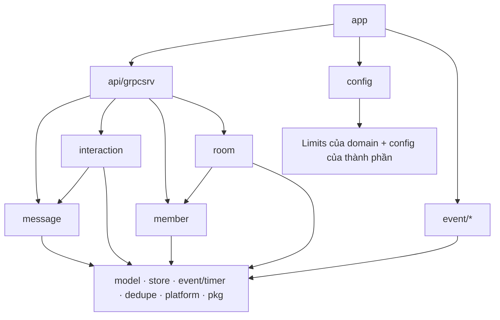

# Xếp lại `apps/core` theo domain: tóm tắt kỹ thuật

> Ngày: 2026-10-19, xây xong 2026-10-20 (bước 4 `modules/mention` cùng ngày, D182) · Trạng thái: **đã xây** trên `refactor/core-domain-layout` (chờ PR) · Loại: refactor, **không đổi hành vi**
> Hướng chốt qua hai vòng review độc lập, đối chiếu playbook enterprise `.claude/skills/go-lang/playbooks/architecture-and-layout.md` và `code-style-and-review.md`; bước 1 có một reviewer, kết quả APPROVE

## Phạm vi và ranh giới

| Trong phạm vi | Ngoài phạm vi |
|---|---|
| Sắp lại package trong `apps/core/internal` theo 4 domain: `message`, `interaction`, `member`, `room` | Tách app, Go module riêng, service riêng (D177: core vẫn là một modular monolith) |
| Chia `change/mutate` thành service theo domain; kéo logic ghi và đọc ra khỏi `api/grpcsrv` | Đổi API gRPC, proto, subject, event id, field DB, tên env |
| Luật `depguard` cưỡng chế chiều phụ thuộc | Tách `store` hoặc `model/domain` theo domain |
| Chuyển `apps/mention` → `modules/mention` (bước 4, D182): `apps/` chỉ còn binary có `main.go`, `modules/` là module nghiệp vụ nhúng | Đổi code bên trong Mention App; tách Mention thành service (D177 giữ nguyên) |
| `INDEXES.csv`, kiến trúc §6.2, `CLAUDE.md`, `docs/modules` | Summary của các milestone cũ (hồ sơ lưu trữ) |

Ví dụ cái đổi được: trước đây muốn biết "member" làm gì phải mở 5 chỗ (`change/mutate/member_*.go`, `change/ownership`, `send/memberwatch`, `api/grpcsrv/members*.go`, `api/grpcsrv/read.go`). Giờ chỉ cần mở `internal/member/`.

## 1. Thuật ngữ

| Từ | Nghĩa |
|---|---|
| Domain | Một nhóm dữ liệu và lệnh đi cùng nhau: tin nhắn, tương tác trên tin, thành viên, room |
| Use case | Hàm nghiệp vụ mà transport gọi, ví dụ `member.Service.AddMembers` |
| Transport | `api/grpcsrv`: đọc metadata, kiểm input proto, đổi proto ↔ domain, mã hoá cursor |
| Phần dùng chung | `model` (kiểu domain, quyền, đổi proto), `store` (port + adapter), `event` (publish, sweeper, projection, timer), `platform` (slot, metrics, redisguard) |
| `depguard` | Linter của `golangci-lint` báo lỗi khi một package import sai chiều |

## 2. Bức tranh chung

Cây thư mục sau refactor:

```
apps/core/internal/
  message/       Editor (sửa, xoá, ẩn; CheckReply, Forward khi gửi), Reader (lịch sử, AROUND, GetMessages, lịch sử sửa, VisibleMessages, emoji/bookmark của người đọc), Limits{MentionTargets}
    actor/  flush/  view/
  interaction/   Service (react, bookmark, ghim/bỏ ghim, số đếm reaction), Reader (ghim, bookmark, trả lời, thread, ai react), Limits{Emojis, PinLimit}
    pinproj/
  member/        Service (thêm, xoá, rời, role, priority, đọc/chưa đọc, clear history, cài đặt hội thoại, số member: ArmCount, SettleCount, AddFounders), Reader (ListMembers), Limits{MemberBatch}
    ownership/  memberwatch/
  room/          Service (tạo room, mở DM, cập nhật room)
    roomlist/  roomcache/
  dedupe/        chống gửi lại (cid, request_id)
  model/         domain/  access/ (thêm Checker.Target)  pbconv/
  store/         mongostore/  memstore/  storetest/
  event/         eventkit/ projection/ publish/ resync/ stateclear/ sweep/ timer/
  platform/      metrics/  redisguard/  slot/  testlog/
  api/grpcsrv/   transport mỏng, không gọi thẳng store
  app/  config/
modules/mention/
  mentionapp/    cửa công khai duy nhất core được import (chỉ từ app/ và config/)
  internal/      consumer, store, notify, grpcsrv… của Mention App
```

Luật layout (D182): `apps/<x>` là chương trình chạy được, có `main.go`. `modules/<x>` là module nghiệp vụ nhúng vào một chương trình, có một package công khai và `internal/`. Một phần chỉ thành module khi đủ ba điều: có collection riêng không ai khác ghi, chỉ phụ thuộc một chiều vào core, và nối với core qua event + port, không chung transaction. Mention đủ cả ba. `message`, `member`, `interaction`, `room` không đủ điều nào (ví dụ doc `rooms` do 4 phần cùng ghi: `member_count`, `pins`, `last_seq`, tên/avatar), nên ở lại thành domain trong `apps/core/internal`.

Chiều phụ thuộc (mũi tên = được import):



## 3. Bảng đổi chỗ

Không có field DB nào đổi.

| Cũ | Mới | Bước |
|---|---|---|
| `change/mutate/mutator.go` `target()` | `model/access` `Checker.Target`, port `MessageFinder` | 1 |
| `send/dedupe` | `dedupe` | 1 |
| `change/mutate` phần member (`members`, `member_change`, `member_owner_path`, `member_count`, `member_ports`, `read`, `room_preferences`, phần clear của `hide_clear`) | `member.Service` | 1 |
| `change/mutate/room_update.go`; logic của `api/grpcsrv/room_ensure.go`, `create_room.go`, `direct_room.go` | `room.Service` | 1 |
| `change/mutate` `react`, `reaction_count`, `bookmark`, `pin` | `interaction.Service` | 1 |
| `change/mutate` `change`, `edit_mentions`, phần ẩn của `hide_clear`; logic của `api/grpcsrv/send_links.go`, `forward.go` | `message.Editor` (`CheckReply`, `Forward`) | 1 |
| `change/mutate/limits.go` | `message.Limits`, `interaction.Limits`, `member.Limits` | 1 |
| `api/view` | `message/view` | 2 |
| logic của `api/grpcsrv/get_history.go`, `history_around.go`, `get_messages.go`, `reply_preview.go`, `my_interactions.go`, `visible.go`, `edit_history.go` | `message.Reader` | 2 |
| logic của `api/grpcsrv/pins_list.go`, `bookmarks.go`, `replies.go`, `threads.go`, `reactions_list.go` | `interaction.Reader` | 2 |
| logic của `api/grpcsrv/members_list.go` | `member.Reader` | 2 |
| `send/actor`, `send/flush` | `message/actor`, `message/flush` | 3 |
| `change/pinproj` | `interaction/pinproj` | 3 |
| `change/ownership`, `send/memberwatch` | `member/ownership`, `member/memberwatch` | 3 |
| `api/roomlist`, `api/roomcache` | `room/roomlist`, `room/roomcache` | 3 |
| `apps/mention/**` | `modules/mention/**` (chỉ đổi đường dẫn import) | 4 |
| Ở lại `api/grpcsrv` | `core_service.go`, handler mỏng của mọi RPC, `message_items.go` (đổi item sang proto), `page_cursor.go`, `query_cursors.go` | — |

`grpcsrv.Deps` giờ chỉ còn: `Sender`, `Editor`, `Reader`, `InteractionService`, `InteractionReader`, `MemberService`, `MemberReader`, `RoomService`, `RoomList`.

## 4. Luồng sau refactor (ví dụ)

- **`CreateRoom`:** `grpcsrv` đọc caller, đổi kiểu room rồi gọi `room.Service.CreateRoom`. Service này làm lần lượt:
  1. kiểm `request_id` và `MemberBatch`;
  2. dedupe `Begin`;
  3. `member.ArmCount` (lỗi = `UNAVAILABLE`);
  4. `InsertRoom`, rồi `Finish`;
  5. `member.AddFounders` (`request_id {room}-created`);
  6. `member.SettleCount`;
  7. phát event.
  
  Kết quả trả về là `domain.Room`, `grpcsrv` đổi sang proto. Nếu id room đã bị room khác giữ thì gỡ phiếu hẹn bằng `SettleCount(…, 0)`.
- **`ReactMessage`:** `grpcsrv` gọi `interaction.Service.React`. Service dùng `access.Checker.Target` (Admit → một `Find` → Allow), rồi đi đúng các bước cũ: hẹn timer → upsert → `$inc` → gỡ timer → event.
- **`ListPins`:** `grpcsrv` gọi `interaction.Reader.Pins`. Reader đọc ghim, lọc qua `message.Reader` (`Masked`/`Viewed`) và trả `PinList` kiểu domain. `grpcsrv` gọi `pbconv` và mã hoá cursor.
- **Mention App:** `app/mention_core_reader.go` lấy `VisibleMessages` từ `message.Reader`. Port `CoreReader` không đổi.

## 5. Đúng đắn

- Code được **chuyển nguyên**, không viết lại logic: thứ tự ghi và đọc, bit `_state`, điểm hẹn/gỡ timer, mã lỗi, thứ tự kiểm, event id và số lần đọc store đều giữ nguyên. Không thêm retry.
- Mọi domain dùng **chung một checker** `DefaultPolicy{LockedKinds}`. Đã kiểm trong `model/access`: `LockedKinds` chỉ tác động lên `edit_message`/`delete_message`. Vì vậy các quyết định quyền của room, đọc, forward và reply giống hệt checker cũ của `grpcsrv`.
- **Gộp hai chỗ chép logic:**
  - chốt số member: trước có ở cả `grpcsrv/room_ensure.go` và `mutate/member_count.go`, giờ chỉ còn `member.SettleCount`;
  - giới hạn `MemberBatch`: một nguồn qua `member.Service`.
- Mỗi constructor domain kiểm deps bắt buộc (lỗi `ErrInvalidArgument` có liệt kê tên) và chạy `withDefaults` + `validate` như `mutate.New`, nên lỗi lúc boot giữ nguyên.
- **Thay đổi nhìn thấy được, đã chấp nhận:**
  - đường tạo room dùng câu log của member khi hẹn hoặc chốt số bị lỗi;
  - log cấu hình lúc khởi động đổi tên nhóm `limits` → `interactions` + `messages`;
  - `GetReactions` khi tin bị ẩn và `ListThreads` khi mọi thread bị lọc giờ trả list rỗng thay vì nil. Bytes protobuf giống hệt, `proto.Equal` coi là bằng.

## 6. Event và subject

Không đổi. Domain gửi event qua port `EventPublisher` của chính nó, không import `event/publish`.

## 7. Thư viện và hạ tầng

Thêm `depguard` vào `.golangci.yaml` (golangci-lint v2.14.0). Luật cuối:

| Luật | Cấm |
|---|---|
| `domain-boundaries` | domain (kể cả test) import `api`, `app`, `config` |
| `domain-event-delivery` | domain import `event/{publish,sweep,projection,resync,stateclear}` (trừ test của `message/actor`, nơi nối publisher thật) |
| `send-actor` | domain khác import `message/actor` |
| `member-domain`, `message-domain` | `member`, `message` import domain khác |
| `interaction-domain` | `interaction` import `room`, `member` (được import `message`) |
| `room-domain` | `room` import `message`, `interaction` (được import `member`) |
| `room-read-models` | `room/roomlist`, `room/roomcache` import `message`, `interaction`, `member` |
| `event-layer` | code `event/*` import domain |
| `event-layer-tests` | test `event/*` import domain, trừ `interaction/pinproj` (test sweeper dựng projector thật) |
| `config-owner` | mọi package import `config`, trừ `app`, test của `config` và `apps/core/itest` (khởi động core qua `app.Run`) |
| `api-store-adapters`, `api-memstore` | `api` import `store/mongostore`; code `api` (không phải test) import `store/memstore` |
| `mention-module-entry` | package nào trong `apps/core` import `modules/mention`, trừ `app` và `config` |

Mỗi luật đã được thử bằng một import sai cố ý, và `make lint` báo lỗi đúng luật. Chiều ngược (Mention import `apps/core/internal`) do luật `internal/` của Go chặn sẵn.

Thêm test `modules/mention/internal/store/mongostore/owned_collections_test.go`: đọc mã nguồn của module, báo lỗi khi mở collection bằng chuỗi viết thẳng hoặc khi hằng tên collection khác 4 tên `mentions`, `mention_rooms`, `mention_user_groups`, `mention_groups`. Mention dùng chung database với core, test này giữ cho nó không đụng collection của core.

## 8. Quyết định và phương án bị loại

| Quyết định | Bị loại | Lý do |
|---|---|---|
| Xếp theo domain trên phần dùng chung | Giữ xếp theo luồng | Playbook: "organize by domain", hexagonal theo module; trước đây một domain rải 4–5 chỗ |
| Một Go module | Module riêng từng phần | Quy tắc `internal` đã đủ ranh giới; module riêng tốn `go.work`, CI, Dockerfile |
| Một `store` | `store` theo domain | Một adapter, một contract suite; `_state` và tra `_id` có cận (D139) dùng chung; consumer đã khai interface hẹp |
| Một `model/domain` | Kiểu domain theo domain | `access.Request` mang cả Room và Member, tách ra là vòng import |
| Use case ở package gốc (`member.Service`) | `member/command`, `room/command`, `room/list` | Trùng tên package `command`; `list` trùng `container/list` |
| `ClearHistory`, `SetRoomPreferences` ở `member` | Ở `message`/`room` | Cả hai ghi doc `members` và phát event trên subject `member` |
| Chuyển phần đọc ngay, bước riêng | Để lại `grpcsrv`; gộp vào bước 1 | Để lại là nửa vời và sau `git mv` không ai làm; gộp thì diff rủi ro to gấp đôi |
| `config` import `Limits` của domain | Struct riêng rồi map ở wiring | Đúng mẫu đang dùng; struct riêng là ngoại lệ duy nhất và chép trùng mặc định |
| `projection`, rebuilder sweeper ở lại `event/` | Chia vào domain | Một consumer leader, một dispatch; rebuilder chỉ dựa `store` + `pbconv` |
| Room dùng `member.ArmCount`/`Settling`/`SettleCount` | Room giữ bản chép riêng và dep `Timers` | Bỏ được bản chép logic đếm; câu log đổi là chấp nhận được |
| Chuyển `api/view` sang `message/view` ngay ở bước 2 | Đợi tới bước 3 | `message.Reader` cần `view`; bỏ được bản chép riêng luật "cleared" sớm |
| Mention ở `modules/mention` (D182) | Giữ `apps/mention`; đưa vào `apps/core/internal/mention`; tách service ngay | `apps/mention` không có `main.go` nên tên gây hiểu nhầm. Đưa vào core thì đảo D164 (core bung nhóm, chọn người nhận) và mất chặn của compiler. Tách ngay không đạt điều kiện nào của D177, còn phải thêm ~6 API lô vào core |
| Domain của core ở lại `apps/core/internal` | Tách `message`, `member`, `interaction`, `room` thành `modules/` | Cùng ghi doc `rooms`, chung transaction owner (D100), chung sweeper và store; tách là distributed monolith |

## 9. Chi phí

- 13 commit trên một nhánh, làm trong worktree riêng: bước 1 có 7 commit, bước 2 có 3, bước 3 có 2, cộng 1 commit tài liệu as-built.
- Bước 3 có 106 file đổi tên bằng `git mv` (68 file giữ nguyên 100%); các file còn lại chỉ sửa dòng import.
- Bước 4: `git mv apps/mention modules/mention` và đổi dòng import trong 108 file, một luật depguard, một test.
- Không đổi tải lúc chạy, nên không cần bench.

## 10. Rủi ro còn lại

- **Helper nhỏ bị chép ở vài nơi**, vì các domain không được import nhau: `settling`/`settleTimeout` (interaction, member), `validKey` (interaction, message), `now`/`tell` (3 bản). Nếu một helper đổi luật thì phải sửa ở mọi bản.
- **`e2e` phase 5 bước 9 đôi khi đỏ.** Đây là race đã biết giữa lúc clear và lúc gửi trong cùng một ms (mục mang sang M5 từ M2b.4); code liên quan không đổi so với `main`.
- **Test của sweeper dựng `interaction/pinproj` thật.** Luật `event-layer-tests` cho phép riêng trường hợp này.
- **`CLAUDE.md` trên `main` còn thay đổi chưa commit** (tài liệu exit Phase 1) trong thư mục chính, nên khi gộp có thể đụng ở phần Architecture.

## 11. Điểm đội tự chọn (owner có thể phản biện)

- Tên use case: `message.Editor`, `message.Reader`, `interaction.Service`, `interaction.Reader`, `member.Service`, `member.Reader`, `room.Service`.
- `dedupe` đặt ở `internal/dedupe` thay vì `platform`, vì nó mang key nghiệp vụ `cid`, `request_id`.
- Giữ tên package con cũ (`roomlist`, `roomcache`, `memberwatch`, `pinproj`) để bước 3 chỉ đổi đường dẫn.

## 12. Kiểm thử

| Bước | Chạy | Kết quả |
|---|---|---|
| Mốc trên `main` | `fmt-check`, `vet`, `lint`, `test` | xanh, 63 package |
| 1 | `fmt-check`, `vet`, `lint`, `test`, `itest`, `core-up` + `e2e`; reviewer chạy `-count=3` trên 5 package | test 66 package ok, itest ok; e2e lần 1 đỏ ở phase 5 bước 9 (race đã biết), lần 2 qua đủ 8 phase; review APPROVE |
| 2 | `fmt-check`, `vet`, `lint`, `test`, `e2e` | xanh; e2e qua ngay lần đầu ở cả hai task |
| 3 | `fmt-check`, `vet`, `lint`, `test`, `itest`, `e2e`, R5 | test 66 package, itest 66 package, e2e qua lần đầu; R5 (`slot`, `-race -count=20`) ok trong 703 giây |
| 4 | `fmt-check`, `vet`, `lint`, test `./modules/... ./apps/core/...`, `make image TARGET=apps/core`; thử cố ý một import sai và một collection lạ | xanh; luật depguard và test collection đều bắt được lỗi cố ý. Không chạy `itest`/`e2e` vì chỉ đổi đường dẫn import |

Các thay đổi nội dung test (đều ghi trong commit body):
- `TestNewRequiresEveryDependency` được chia theo từng service.
- `TestHideAndClearAskThePolicy` tách thành `TestHideAsksThePolicy` và `TestClearAsksThePolicy`, assertion giữ nguyên.
- Ba test của `interaction` tự ghi fact xoá qua memstore thay vì gọi `Delete`.
- Không assertion nào bị nới. Số hàm test tăng từ 119 (`mutate`) lên 128 ở 4 domain, cộng 5 hàm của `access.Target`.
