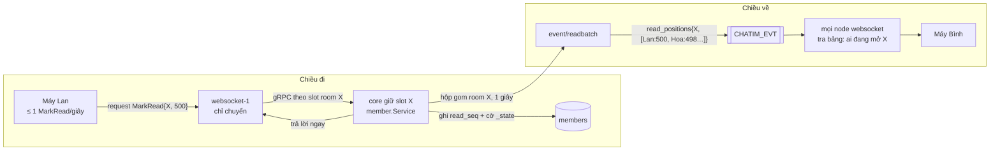

# M4 phần 3: đã đọc và đã xem — tóm tắt

> Ngày: 2026-10-22 · Nhánh `feat/m4` · Trạng thái: chờ owner duyệt
> **Các phần của M4:** (1) kết nối, token, lệnh ✅ · (2) nhận và đẩy event ✅ · **(3) đã đọc, đã xem** · (HTTPS) app `gateway` cho lệnh tải dữ liệu · (4) typing, online · (5) reconnect, vận hành, kiểm thử.

## 1. Phần này làm gì

Nhóm Kho HCM có 1.000 người. Bình gửi tin 500. Lan đang mở nhóm và đọc tới tin 500.

- **Đã đọc:** máy Lan báo "đọc tới 500". Số tin chưa đọc của nhóm trên mọi máy của Lan về 0 ngay.
- **Đã xem:** máy Bình đang mở nhóm thì khoảng 1 giây sau hiện "Lan đã xem" dưới tin 500. Trong DM là dấu "đã xem" của người kia.

Core đã có `MarkRead`, `MarkUnread`, vị trí đọc trong `members` (`read_seq`, `read_ver`), `ListMembers` trả vị trí đọc của từng người, `ListMyRooms` trả `peer_read_seq` cho DM. Phần 3 làm cho "đã xem" tới người khác mà không làm ngập hệ thống.

## 2. Trong và ngoài

| Trong phần 3 | Ai làm |
|---|---|
| Gom event "đã xem" theo room mỗi 1 giây | core (`event/readbatch`, mới) |
| Ghi vị trí đọc mỗi lần `MarkRead` | core `member` (không đổi) |
| Chuyển `MarkRead` như lệnh thường; đẩy "đã xem" cho người đang mở room | websocket (chỉ chuyển và định tuyến, không giữ gì) |
| Giãn nhịp `MarkRead` (≤ 1 lần/giây mỗi room) và không nhấp nháy unread | SDK (`pkg/wsclient` làm mẫu) |

| Ngoài | Ở đâu |
|---|---|
| Lệnh tải dữ liệu, `CreateRoom`, `AddMembers` qua HTTPS | phần `gateway`, ngay sau phần này |
| Typing, online | phần 4 |
| Gom việc ghi Mongo | chỉ làm nếu PoC prod-like cho thấy nghẽn (owner 2026-10-22) |

## 3. Đường đi

Máy chỉ nói chuyện với websocket, không bao giờ vào thẳng core. Lệnh ghi đi qua WebSocket vì cần realtime (owner 2026-10-22).

## 4. Từng bước

1. **Máy Lan** đang xem nhóm X thì báo `MarkRead` tối đa 1 lần/giây, cộng một lần khi rời nhóm hoặc đưa app xuống nền. Lướt từ tin 480 tới 500 trong 1 giây thì chỉ báo một lần (500).
2. **Websocket** chuyển `MarkRead` như mọi lệnh khác (thành lệnh thứ 34 trong danh sách cho phép). `MarkRead` và `MarkUnread` giữ thứ tự theo (kết nối, room) như `SendMessage`, nên "đánh dấu chưa đọc" không bị một `MarkRead` gửi trước đó vượt lên.
3. **Core** ghi `read_seq` ngay (chỉ nâng lên với `MarkRead`, chỉ hạ với `MarkUnread`, như hôm nay), đặt cờ `_state` trong cùng lần ghi, rồi trả lời. Unread của Lan đúng ngay sau câu trả lời.
4. **Hộp gom:** thay vì phát một `read_updated` mỗi lần, core bỏ vị trí đọc vào hộp gom của room. Hết 1 giây (`READ_EVENT_WINDOW`), core phát một event `read_positions` cho room đó, chứa mọi người vừa đổi (người đổi nhiều lần chỉ giữ bản mới nhất). Sau khi NATS xác nhận, core xoá cờ của từng doc trong event.
5. **Websocket** nhận `read_positions` (đã đọc toàn bộ `CHATIM_EVT` từ phần 2) và đẩy cho kết nối đang mở room đó, cùng mọi máy của những người có tên trong event (để máy khác của Lan cũng về 0 unread). Không gom, không tính gì thêm.
6. **Máy Bình** giữ vị trí đọc của từng người theo `read_ver` lớn hơn (hợp đồng D156). Lúc mở nhóm, máy lấy vị trí hiện tại qua `ListMembers`, rồi cập nhật theo `read_positions`.

## 5. Event `read_positions` (thay `read_updated`)

| Trường | Ví dụ | Ghi chú |
|---|---|---|
| subject | `evt.acme.member.7001.read_positions` | loại data `member` như `read_updated` |
| `room_id` | `7001` | |
| `entries[]` | `[{user: lan, read_seq: 500, read_ver: 12}, {user: hoa, read_seq: 498, read_ver: 40}]` | mỗi người một dòng, bản `read_ver` mới nhất trong cửa sổ |
| id | `7001-rp-9f2c…` (16 ký tự hex sha256 của các dòng) | cùng ý với id trang của `WsPublish`; phát lại cùng nội dung thì stream bỏ trùng |
| chia trang | tối đa 1.000 người mỗi event | nhóm 5.000 người cùng đọc trong 1 giây → 5 event; đây là cỡ trang, không phải giới hạn |

`MarkUnread` cũng đi vào hộp gom: dòng mang `read_seq` thấp hơn nhưng `read_ver` cao hơn, nên máy nhận đúng.

## 6. Khi có sự cố

| Chuyện | Kết quả | Người dùng thấy |
|---|---|---|
| Websocket chết | Không mất gì: websocket không giữ vị trí đọc nào | Máy nối lại, mở nhóm thì lấy lại qua `ListMembers` |
| Core chết khi hộp gom còn giữ | Vị trí đọc đã ghi Mongo; cờ `_state` còn, sweeper phát bù sau ~15–20 giây | "Đã xem" tới chậm ~15 giây (owner chấp nhận) |
| Core chết trước khi ghi | Máy nhận lỗi, SDK gửi lại ở nhịp sau (client thử lại, đúng luật) | Không thấy gì |
| Slot room X chuyển core | Vài giây có thể hai core cùng phát cho X | Không sai: máy giữ `read_ver` lớn hơn |

## 7. Không nhấp nháy unread

SDK chờ câu trả lời của `MarkRead` đang gửi rồi mới gọi `ListMyRooms`. Ví dụ: Lan đọc xong nhóm X rồi bấm quay ra danh sách; máy chờ `MarkRead` (~10ms) rồi mới tải danh sách, nên X hiện 0, không hiện lại số cũ. Phần 3 làm luật này trong `pkg/wsclient`; khi `ListMyRooms` chuyển sang HTTPS ở phần `gateway`, luật giữ nguyên.

## 8. Luật cho websocket (đề nghị ghi thành quyết định)

Websocket chỉ giữ trạng thái nạp lại được từ core lúc login (kết nối, token, bảng định tuyến room của từng người, hàng gửi) và tín hiệu không lưu (typing, online). Websocket được chuyển, giữ thứ tự, giới hạn tốc độ, chia trang và định tuyến theo bảng đã khai báo. Websocket không được giữ lần ghi chưa tới core, không gộp hay diễn giải lại lệnh, không đổi lệnh này vì nghĩa của lệnh khác, không tính giá trị nghiệp vụ. Thứ gì mất hoặc sai sau khi websocket khởi động lại thì phải nằm ở core hoặc module.

## 9. Thay đổi ở từng bên

- **Core:** package `event/readbatch` (hộp gom theo room, 1 giây, chia trang 1.000); `member.Service` đưa vị trí đọc vào hộp thay vì phát `read_updated`; publisher xoá cờ cho nhiều doc từ một event; sweeper dựng lại `read_positions` từ doc còn cờ; config `READ_EVENT_WINDOW` (1s) và luật khởi động `SWEEP_MIN_AGE > PUB_ACK_TIMEOUT + STATE_CLEAR_FLUSH + STATE_CLEAR_TIMEOUT + READ_EVENT_WINDOW` (2 + 2 + 5 + 1 < 15). Bỏ `read_updated`.
- **Websocket:** thêm `MarkRead` vào danh sách cho phép; `MarkRead`/`MarkUnread` giữ thứ tự theo (kết nối, room); một dòng bảng định tuyến cho `read_positions`.
- **`pkg/wsclient`:** giãn nhịp `MarkRead`, chờ trả lời trước `ListMyRooms`, áp `read_positions` theo `read_ver`.
- **Docs:** D196 (luật websocket + `read_positions`), D197 (lệnh ghi qua WebSocket, tải dữ liệu qua HTTPS), `docs/events.md`, module 09, `architecture.md` (dòng "`read_updated` không gom").

## 10. Chi phí (số production, owner 2026-10-19)

| | Hôm nay | Sau phần 3 |
|---|---|---|
| Ghi Mongo | ~5.000 `MarkRead`/giây | không đổi (owner: giữ, đo ở PoC) |
| Event trên NATS | ~5.000 `read_updated`/giây, mọi node websocket đều đọc | ≤ số room đang hoạt động/giây (~1.000) |
| Nhóm 300 người đang xem, 300 người đọc/giây | 90.000 frame/giây | 300 frame/giây (~9KB mỗi frame) |

## 11. Quyết định

| Chọn | Bỏ, vì sao |
|---|---|
| Core gom event theo room; websocket chỉ chuyển (reviewer độc lập, owner duyệt) | Websocket gom: mất vị trí đọc khi node chết, websocket phải hiểu nghĩa lệnh. Module riêng: phải đọc bảng `members` của core. Không gom: 90.000 frame/giây cho một nhóm |
| Mỗi `MarkRead` một lần ghi (owner) | Gom ghi trong core: thêm cơ chế khi chưa có số đo; làm nếu PoC nghẽn |
| "Đã xem" chậm ~1 giây, ~15 giây khi sự cố (owner) | — |
| Lệnh ghi qua WebSocket, tải dữ liệu qua HTTPS (owner) | Mọi lệnh qua HTTPS: gửi tin cần realtime. Mọi thứ qua WebSocket: owner muốn tải dữ liệu đi HTTPS |

## 12. Rủi ro

- Publisher xoá cờ cho nhiều doc từ một event là đổi trên đường publish: có reviewer khi code.
- Ghi `members` ~5.000/giây chỉ đo được ở PoC prod-like; nghẽn thì thêm gom ghi trong core.

## 13. Kiểm thử

| Test | Chứng minh |
|---|---|
| Unit `readbatch` | Gom đúng 1 giây; người đổi nhiều lần chỉ còn bản mới nhất; chia trang 1.000; id cố định theo nội dung |
| Unit publisher + sweeper | Sau PubAck xoá cờ đủ mọi doc trong event; core chết giữa chừng thì sweeper phát bù |
| Unit websocket | `read_positions` tới người đang mở room và máy của người có tên; không tới người khác; `MarkUnread` không bị `MarkRead` gửi trước vượt |
| Unit `pkg/wsclient` | ≤ 1 `MarkRead`/giây mỗi room; chờ trả lời trước `ListMyRooms` |
| e2e | A đọc → B đang mở nhóm nhận "A đã xem" trong ~1 giây; máy thứ hai của A về 0 unread; B không mở nhóm thì không nhận |

## Câu hỏi còn mở

- Các lệnh quản lý khác (`OpenDirectRoom`, `UpdateRoom`, `RemoveMember`, `LeaveRoom`, `ChangeMemberRole`, `SetMemberPriority`) đi WebSocket hay HTTPS? Chốt ở phần `gateway`; phần 3 không đổi đường đi của chúng.
