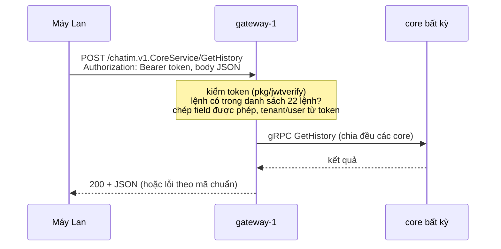

# M4 phần `gateway`: HTTPS cho tải dữ liệu và quản lý — tóm tắt

> Ngày: 2026-10-23 · Nhánh `feat/m4` · Trạng thái: **đã xây** (owner duyệt 2026-10-23; quyết định D198)
> **Các phần của M4:** (1) kết nối, token, lệnh ✅ · (2) nhận và đẩy event ✅ · (3) đã đọc, đã xem ✅ · **(gateway) HTTPS ✅** · (4) typing, online · (5) reconnect, vận hành, kiểm thử.

## 1. Phần này làm gì

Lan mở app chat:

| Lan làm gì | Máy gọi | Đường |
|---|---|---|
| Mở app, thấy danh sách hội thoại | `ListMyRooms` | HTTPS → `gateway` → core |
| Bấm vào nhóm Kho HCM, cuộn tin cũ | `GetHistory` | HTTPS |
| Tạo nhóm, thêm Bình, đổi tên nhóm | `CreateRoom`, `AddMembers`, `UpdateRoom` | HTTPS |
| Gõ "ok" rồi gửi, react, đọc tới tin 500 | `SendMessage`, `ReactMessage`, `MarkRead` | WebSocket (realtime) |
| Bình trả lời, Hoa đã xem, nhóm đổi tên | event, `read_positions`, `room_updated` | WebSocket (đẩy xuống) |

Luật (owner 2026-10-22, 2026-10-23): **ghi realtime qua WebSocket, tải dữ liệu và quản lý qua HTTPS.** Thay đổi do HTTPS gây ra vẫn tới người khác realtime qua event trên WebSocket.

## 2. Trong và ngoài

| Trong | Ai |
|---|---|
| App `apps/gateway`: HTTPS, kiểm token, danh sách 22 lệnh, gọi core | gateway (không database, không Redis) |
| Phần kiểm lệnh và chép field dùng chung, hai danh sách lệnh | `pkg/corecall` (chuyển từ websocket) |
| Websocket chỉ còn 12 lệnh ghi realtime | websocket |
| Client mẫu gọi HTTPS (Connect sinh từ proto); `pkg/wsclient.FlushReads`; e2e chuyển lệnh đọc sang HTTPS | `pkg/pb/chatim/v1/chatimv1connect`, `pkg/wsclient`, `tools/corecli` |

| Ngoài | Ở đâu |
|---|---|
| Webhook, REST cho hệ thống khác, API key | Phase 2 (`gateway` mở rộng sau) |
| TLS | load balancer ở prod; dev chạy HTTP trên `127.0.0.1` |
| Typing, online | phần 4 |

## 3. Chia lệnh

| Đường | Lệnh |
|---|---|
| **WebSocket** (12 lệnh ghi realtime) | `SendMessage`, `EditMessage`, `DeleteMessage`, `HideMessage`, `ReactMessage`, `PinMessage`, `UnpinMessage`, `SetBookmark`, `MarkRead`, `MarkUnread`, `ClearHistory`, `SetRoomPreferences` |
| **HTTPS** (14 lệnh đọc) | `ListMyRooms`, `GetRooms`, `GetHistory`, `GetMessages`, `GetEditHistory`, `GetReplies`, `ListThreads`, `ListPins`, `GetReactions`, `GetReactionSettings`, `ListBookmarks`, `ListMembers`, `ListMentions`, `ListRoomGroups` |
| **HTTPS** (8 lệnh quản lý) | `CreateRoom`, `OpenDirectRoom`, `UpdateRoom`, `AddMembers`, `RemoveMember`, `LeaveRoom`, `ChangeMemberRole`, `SetMemberPriority` |
| Không mở cho máy | `ListMyRoomIDs` (chỉ websocket gọi), `SetUserGroups`, `SetGroups` (app nội bộ) |

Một lệnh chỉ nằm ở một đường; có test kiểm hai danh sách không trùng và cộng lại đủ 34 lệnh.

## 4. Đường đi một lệnh HTTPS

1. Máy gửi `POST` kèm token trong header `Authorization` (không để token trên URL). Cùng token với WebSocket.
2. Gateway kiểm token như websocket (chỉ `EdDSA`, `iss`, `aud`, hạn, `sub`/`tid` hợp lệ). Sai hoặc hết hạn → `401`.
3. Lệnh không có trong danh sách → `unimplemented`. Field lạ bị bỏ. Tenant và user chỉ lấy từ token.
4. Gateway gọi **core bất kỳ**, chia đều theo danh sách địa chỉ core (owner 2026-10-23). Không chọn theo slot, không Redis: lệnh đọc đọc thẳng Mongo, lệnh quản lý không qua actor, nên core nào cũng như nhau. Lỗi thì trả ngay, không thử lại; core hỏng thì lần gọi sau tự sang core khác.

## 5. Kiểu API

Dùng **Connect** (thư viện chuẩn `connectrpc.com/connect`): mỗi lệnh là một `POST /chatim.v1.CoreService/{Lệnh}` (hoặc `MentionService`), body JSON hoặc protobuf, chạy trên HTTP/1.1 và HTTP/2. Lý do: sinh sẵn client cho web (TypeScript), iOS, Android từ cùng file proto; mã lỗi gRPC ánh xạ sang HTTP theo chuẩn; không phải tự định nghĩa URL cho từng lệnh.

Ví dụ: `POST /chatim.v1.CoreService/GetHistory` với body `{"roomId": "7001", "limit": 50}` → `200 {"messages": [...], "next": "..."}`; room không tồn tại → `404 {"code": "not_found", "message": "room not found"}`.

## 6. Bảo vệ

| Gì | Mặc định | Vượt thì |
|---|---|---|
| Kích thước body | 128KB (theo lệnh lớn nhất: `AddMembers` 500 người) | `resource_exhausted` |
| Lệnh đang chạy cả node (kiểm trước token) | 10.000 | `503` (`unavailable`) |
| Tốc độ mỗi user trên một node (HTTP không có kết nối lâu dài như WebSocket) | 50 lệnh/giây, dồn 100 | `429` (`resource_exhausted`) |
| Lệnh đang chờ core mỗi user trên một node | 32 | `429` |
| Hạn mỗi lệnh | `CORE_REQUEST_DEADLINE` | `504` (`deadline_exceeded`) |
| CORS (app web gọi từ trình duyệt) | chỉ các origin trong config, không dùng `*` | trình duyệt chặn |

Lỗi hạ tầng trả câu cố định, không lộ chi tiết; log không bao giờ chứa token. Lỗi do tầng chặn trước khi tới lệnh (`401`, `429`, `503`, đường lạ `404`) luôn là mã HTTP + JSON `{"code", "message"}` kiểu Connect.

Token hết hạn → `401` ngay ở lệnh HTTPS kế tiếp (WebSocket: đóng 4001 sau hạn + 30 giây nếu máy không gia hạn). Phase 1 không thu hồi token (owner 2026-10-23): token nên ngắn, ≤ 15 phút; thu hồi để `identity` Phase 2.

## 7. Thay đổi ở từng bên

- **`apps/gateway` (mới):** HTTP server (Connect), admin port với `/livez`, `/readyz` (sẵn sàng khi có ít nhất một core nối được và chưa tắt; khoá JWKS đọc lúc khởi động, lỗi thì không chạy), `/metrics` (`chatim_gateway_*`). Config `GW_ADDR`, `GW_ADMIN_ADDR`, `GW_CORE_ADDRS` (danh sách địa chỉ core), `GW_JWT_KEYS_FILE`, `GW_JWT_ISSUER`, `GW_JWT_AUDIENCE`, `GW_JWT_LEEWAY`, `GW_BODY_MAX`, `GW_USER_RATE`, `GW_USER_BURST`, `GW_USER_INFLIGHT`, `GW_USER_LIMITERS`, `GW_INFLIGHT_MAX`, `GW_CORS_ORIGINS`, hạn đọc/ghi của server, `CORE_REQUEST_DEADLINE`, `GW_DRAIN_DELAY`, `GW_SHUTDOWN_BUDGET` (bảng đầy đủ trong README). Tắt: `/readyz` false → chờ drain → dừng nhận → chờ lệnh đang chạy.
- **`pkg/corecall`:** phần chuyển lệnh chung (bảng lệnh theo tên method gRPC, chép field biết, caller từ token, hạn, ánh xạ lỗi, đếm kết quả) tách từ `apps/websocket/internal/command`, cùng hai danh sách `Realtime()` (12) và `Request()` (22); kiểm `SendMessage` ở lại websocket.
- **Websocket:** danh sách còn 12 lệnh; lệnh đã chuyển nhận `unimplemented`. Vẫn chọn core theo slot (vì `SendMessage` đi actor).
- **Compose:** `gateway-1` ở `127.0.0.1:8082`, admin không publish, chỉ mount khoá công khai JWKS.
- **Client mẫu và e2e:** client Connect sinh từ proto (`chatimv1connect`) trong `tools/corecli`; e2e phase 9 chuyển lệnh đọc và quản lý sang gateway, phase 10 mới cho gateway. `pkg/wsclient.FlushReads(ctx)`: app gọi trước khi tải danh sách hội thoại qua HTTPS để các `MarkRead` đang chờ tới core trước.
- **Docs:** D198, module mới [11](../modules/11-feature-https-gateway.md), module 09 (còn 12 lệnh), kiến trúc, roadmap, README env, CLAUDE.md.

## 8. Quyết định

| Chọn | Bỏ, vì sao |
|---|---|
| Ghi realtime qua WebSocket, tải dữ liệu + quản lý qua HTTPS (owner) | Mọi lệnh qua HTTPS: gửi tin cần realtime. Mọi lệnh qua WebSocket: owner muốn tải dữ liệu đi HTTPS |
| Gateway gọi core bất kỳ (owner) | Chọn theo slot như websocket: thêm phụ thuộc Redis và mật khẩu mà không được lợi |
| App riêng `gateway`, chỉ chuyển lệnh (luật D196) | Core tự mở HTTPS: core phải lo xác thực người dùng cuối và tải từ internet |
| Connect | Tự viết `POST /v1/{Lệnh}`: không có client sinh sẵn. grpc-gateway (REST theo URL): phải khai báo URL cho từng lệnh |
| Giới hạn theo user trên mỗi node | Theo kết nối: HTTP không có kết nối lâu dài |

## 9. Rủi ro

- Thêm một app phải triển khai và giám sát; tải đọc (danh sách hội thoại, lịch sử) lúc bão kết nối lại dồn vào gateway → core. Đo ở phần 5 và PoC.
- App web gọi hai nơi (HTTPS và WebSocket) với cùng token; token hết hạn phải gia hạn ở cả hai (WebSocket gia hạn bằng frame `auth`, HTTPS gửi token mới ở lần gọi sau).

## 10. Kiểm thử

| Test | Chứng minh |
|---|---|
| Unit danh sách lệnh | 12 + 22 = 34, không trùng; `ListMyRoomIDs`, `SetUserGroups`, `SetGroups` không ở đâu |
| Unit gateway | Token sai/hết hạn → `401`; lệnh ngoài danh sách bị từ chối; field lạ bị bỏ; tenant/user chỉ từ token; giới hạn tốc độ và body; CORS; lỗi hạ tầng câu cố định; không log token |
| Unit websocket | Lệnh đã chuyển nhận `unimplemented` |
| e2e | Qua gateway-1: danh sách hội thoại, lịch sử, thành viên bằng đúng kết quả gRPC; tạo nhóm, thêm người, đổi tên → người đang mở nhóm nhận event qua WebSocket; gửi tin qua gateway bị từ chối |

## 11. Kết quả thực thi

Xây trên `feat/m4` ngày 2026-10-23, chín commit: `pkg/corecall` tách từ websocket (websocket chưa đổi hành vi), sinh code Connect, config + kết nối core + giới hạn theo user, app gateway, compose `gateway-1`, sửa sau review (body, auth), websocket còn 12 lệnh, e2e qua gateway, `FlushReads`.

Khác so với bản duyệt:

| Bản duyệt | Bản xây | Vì sao |
|---|---|---|
| `/healthz` | `/livez` | Dùng chung `pkg/admin` như core và websocket |
| Body quá lớn → `413` | `resource_exhausted` | Connect trả mã này cho tin quá lớn; đọc qua `MaxBytesReader` nên dừng sớm và đếm đúng |
| (chưa có) | Trần toàn node 10.000 lệnh đang chạy, kiểm trước token → `503` | Review: chặn quá tải trước khi tốn công kiểm token; lũ request để edge chặn |
| Lỗi theo giao thức của client | Lỗi của tầng chặn luôn là mã HTTP + JSON Connect | Để client gRPC/streaming cũng thấy `401` thay vì `200` |
| (chưa có) | `pkg/wsclient.FlushReads` | `ListMyRooms` đi HTTPS nên SDK không tự gửi `MarkRead` đang chờ trước đó được nữa |
| Connect (chưa chốt bản) | `connectrpc.com/connect` v1.21.0 | Bản mới nhất có tuổi ≥ 2 tuần |

Kiểm thử: unit `pkg/corecall` (hai danh sách, chuyển lệnh, lỗi, đếm), `apps/gateway` (22 lệnh tới core đúng user, 15 method còn lại `unimplemented`, 11 kiểu token sai → `401`, giới hạn theo user và hai tenant cùng id, trần node, body, nén, CORS, panic và huỷ đều trả chỗ, tắt chờ lệnh đang chạy, h2c, `-race`, goleak), websocket (12 lệnh chạy, 22 lệnh `UNIMPLEMENTED` không đếm vào `commands_total`). e2e đầy đủ xanh hai lần; phase 10: tạo nhóm, thêm người, đổi tên qua gateway → người đang mở nhóm trên websocket nhận `member_added`, `room_updated`; `ListMyRooms`, `GetHistory`, `ListMembers`, `ListBookmarks` bằng đúng gRPC; `FlushReads` rồi `ListMyRooms` thấy vị trí đọc mới; token hết hạn `401`; `SendMessage` qua gateway và `GetHistory` qua websocket đều `unimplemented`; preflight CORS đúng header; log gateway không chứa token nào trong 12 token đã dùng.
