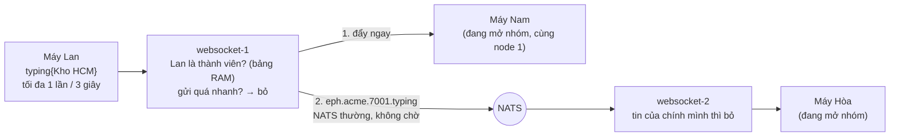
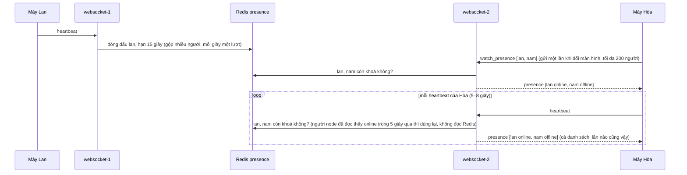

# M4 phần 4: đang gõ và online — tóm tắt

> Ngày: 2026-10-24 · Nhánh `feat/m4` · Trạng thái: **đã xây** trên `feat/m4` (owner duyệt 2026-10-24: online theo heartbeat, khoá có hạn 15 giây, chưa làm "xem lần cuối"; quyết định D199–D201 ở [decision log §17.11](../decision-log.md))
> **Các phần của M4:** (1) kết nối, token, lệnh ✅ · (2) nhận và đẩy event ✅ · (3) đã đọc, đã xem ✅ · (HTTPS) app `gateway` ✅ · **(4) đang gõ, online** ✅ · (5) reconnect, vận hành, kiểm thử.

## 1. Phần này làm gì

Lan nối vào `websocket-1`, Hòa nối vào `websocket-2`. Cả hai đang mở nhóm Kho HCM.

- **Đang gõ:** Lan gõ phím. Chưa tới nửa giây sau, máy Hòa hiện "Lan đang gõ…". Dòng đó tắt khi Lan gửi tin hoặc xoá hết chữ, hoặc tự tắt sau 6 giây nếu Lan ngừng gõ.
- **Online:** Hòa nhìn danh sách hội thoại và thấy chấm xanh cạnh Lan. Lúc 18:00 Lan tắt app. Khoảng 10–30 giây sau, chấm xanh cạnh Lan trên máy Hòa tắt.

Cả hai **chỉ đi qua websocket** (owner 2026-10-20): không qua core, không ghi Mongo, không dùng JetStream.

## 2. Trong và ngoài

| Trong phần 4 | Ai làm |
|---|---|
| Nhận `typing`, đẩy cho người đang mở room ở mọi node | websocket + NATS thường |
| Online/offline của người đang hiện trên màn hình | websocket + Redis mới `chatim-redis-presence` |
| Giãn nhịp `typing` 3 giây, tự tắt "đang gõ" sau 6 giây | SDK (`pkg/wsclient` làm mẫu) |
| Node thứ hai `websocket-2` trong compose để thử đường giữa hai node | deploy |

| Ngoài | Ở đâu |
|---|---|
| "Xem lần cuối" (owner 2026-10-24: làm sau) | sau; thêm được mà không đổi phần 4 |
| "Vắng mặt", trạng thái tự đặt, "ẩn online của tôi" | Phase 2 |
| Push cho người offline | app notification Phase 2 |
| Alert websocket, bão nối lại, thử 10K kết nối | phần 5 |
| Core, Mongo, JetStream | không đổi gì |

## 3. Đang gõ

- Chỉ người **đang mở room** nhận (owner 2026-10-24); không gửi về các máy của chính Lan.
- Người không là thành viên, chưa sẵn sàng, hoặc gửi quá 2 tín hiệu/giây: tín hiệu bị bỏ và chỉ đếm; kết nối không bị đóng.
- Tín hiệu chỉ vào hàng gửi của một máy khi hàng còn dưới một nửa, nên typing không bao giờ chiếm chỗ của tin chat và không bao giờ gây đóng 4008.
- Máy Hòa tắt dòng "đang gõ" khi nhận `stopped`, khi thấy tin của Lan, hoặc sau 6 giây không có tín hiệu mới. Mất một tín hiệu thì tín hiệu sau 3 giây hoặc mốc 6 giây tự sửa.

## 4. Online: một luật duy nhất

**Khoá online của Lan còn trong Redis thì Lan online; khoá mất thì Lan offline.**

| Khoá | Giá trị | Hạn |
|---|---|---|
| `chatim:presence:{tenant}:{user}`, ví dụ `chatim:presence:acme:lan` | `1` | 15 giây, đặt lại mỗi lần đóng dấu |

- Node của Lan **đóng dấu** (đặt lại hạn 15 giây) mỗi khi nhận heartbeat của Lan (tối đa một lần mỗi 2 giây cho mỗi người, để frame dồn dập không ghi thừa). Kết nối đầu tiên được đóng dấu ngay.
- Không node nào xoá hay sửa khoá của người khác. Redis tự xoá khoá hết hạn bằng đồng hồ của chính nó, nên đồng hồ các máy chủ lệch nhau cũng không sai.
- Lan lỡ 1–2 lần đóng dấu (mạng chập chờn) thì khoá vẫn còn, không nhấp nháy.

## 5. Online: luồng đi

Máy đã gửi heartbeat mỗi 5–8 giây để giữ kết nối (phần 1). Phần 4 dùng luôn heartbeat đó cho online, không thêm nhịp mới.

- Node chỉ nhớ **danh sách hỏi online** của từng kết nối; mất kết nối thì máy gửi lại danh sách sau khi nối lại (trạng thái máy dựng lại được, đúng luật D196). Node không nhớ đã gửi gì: mỗi lần trả lời là kết quả mới đọc từ Redis.
- Máy nhận chậm (hàng gửi quá nửa) thì lần đó không gửi; heartbeat sau gửi kết quả mới. Không máy nào kẹt ở một trạng thái cũ.
- Bộ đệm RAM 5 giây trên mỗi node, **chỉ giữ kết quả online** (owner 2026-10-24): node đọc thấy Lan online thì trong 5 giây mọi máy trên node hỏi Lan đều dùng lại kết quả đó; quá 5 giây thì đọc Redis lại. Kết quả offline không giữ, lần nào cũng đọc Redis, nên người vừa vào thấy ngay ở heartbeat kế. 500 máy cùng hỏi Lan đang online → Redis bị đọc khoá Lan tối đa một lần mỗi 5 giây mỗi node.
- Ai cùng tenant cũng xem được (owner 2026-10-24); tenant lấy từ token.

## 6. Một ngày của Lan

| Giờ | Chuyện | Redis | Máy Hòa thấy |
|---|---|---|---|
| 08:00:00 | Lan mở app ở node 1 | khoá `lan` có ngay | online ở heartbeat kế của Hòa (≤ 9 giây; bộ đệm không làm chậm vì offline không được giữ) |
| 09:00 | Lan mở thêm laptop, vào node 2 | cả hai node đóng dấu | không đổi |
| 12:00 | Lan tắt laptop | node 1 vẫn đóng dấu | không đổi |
| 15:00:00 | Lan chuyển 4G sang Wi-Fi, nối lại sau 3 giây | khoá còn hạn | không nhấp nháy |
| 18:00:00 | Lan tắt app | lần đóng dấu cuối khoảng 17:59:56, khoá hết hạn khoảng 18:00:11 | offline ở heartbeat kế của Hòa sau khi bộ đệm hết hạn: khoảng 18:00:11–18:00:24 |

## 7. Khi có sự cố

| Chuyện | Vì sao tự đúng | Người dùng thấy |
|---|---|---|
| Node 1 chết đột ngột | không ai đóng dấu cho người của nó, khoá tự hết hạn | 10–30 giây sau: offline, trừ ai đã nối sang node khác |
| Node 1 khởi động lại ngay, cùng tên | không có gì cần dọn | không sai |
| Deploy lần lượt từng node | như trên | người nối lại sau hơn 10 giây có thể hiện offline một lúc (họ thật sự không nối) |
| Máy mất mạng mà không đóng kết nối | không còn heartbeat nên không còn đóng dấu | offline sau 10–30 giây, như khi tắt app |
| Redis presence lỗi | node không gửi gì (máy giữ trạng thái đang thấy) | chấm xanh đứng yên tới khi Redis về |
| Redis presence ngừng rồi chạy lại, khởi động lại, hoặc bị xoá sạch | khoá cũ có thể đã mất; các node đóng dấu lại ở heartbeat kế của từng người (≤ 10 giây) | một số người hiện offline tối đa khoảng 10 giây rồi tự online lại |
| Một node không nối được Redis | người trên node đó không được đóng dấu | họ hiện offline ở mọi nơi tới khi node nối lại được (alert ở phần 5) |
| Mất một tin NATS typing | không gửi lại | dòng "đang gõ" không hiện, hoặc tắt sau 6 giây |

## 8. Frame mới (chỉ thêm số, không đổi số cũ)

| Frame | Số | Nội dung |
|---|---|---|
| `ClientFrame.typing` | 23 | `room_id`, `stopped` |
| `ClientFrame.watch_presence` | 24 | `user_ids[]` (thay cả danh sách, tối đa 200) |
| `ServerFrame.typing` | 26 | `room_id`, `user_id`, `stopped` |
| `ServerFrame.presence` | 27 | `[{user_id, online}]` (cả danh sách hỏi online, mỗi heartbeat của người hỏi) |

Tin typing giữa các node (`TypingSignal`) nằm trong proto riêng của websocket. Online không đi qua NATS.

## 9. Chi phí (100K người online, số production)

| | Ước tính |
|---|---|
| Ghi Redis | một lần mỗi heartbeat mỗi người: 100K kết nối ≈ 15.000 lần/giây, gộp mỗi giây theo lượt 500 (≈ 30 lượt/giây) |
| Đọc Redis | người đang online: số người **khác nhau** được hỏi trên mỗi node / 5 giây (ví dụ 30.000 người ≈ 6.000 khoá/giây mỗi node); người offline: mỗi heartbeat của người hỏi một lần đọc. Giờ làm việc phần lớn người được hỏi đang online nên đỡ nhiều nhất (không có bộ đệm: ≈ 800.000 khoá/giây toàn hệ thống) |
| RAM Redis | chỉ người đang online: 100K khoá, vài MB |
| Băng thông tới máy | mỗi heartbeat một frame cả danh sách: danh sách 50 người ≈ 1KB / 6 giây mỗi máy, 100K máy ≈ 15MB/giây toàn hệ thống (trần 200 người ≈ 60MB/giây) |
| NATS | chỉ typing: 2.000 người cùng gõ ≈ 700 tin/giây × số node |
| Mongo, core | 0 |

## 10. Quyết định

| Chọn | Bỏ, vì sao |
|---|---|
| Cùng tenant xem được online của nhau (owner) | Chỉ người chung room: mỗi lần xem phải hỏi core |
| Typing chỉ tới người đang mở room (owner) | Hiện ở danh sách hội thoại: nhóm 300 người thì mỗi lần gõ là 300 frame |
| Online theo heartbeat: node đóng dấu khoá hạn 15 giây cho người của mình; mỗi heartbeat của người hỏi, node trả cả danh sách đọc từ Redis (owner 2026-10-24) | Nhiều node cùng sửa một bản ghi chung, hàng chờ offline, node sống dọn hộ node chết: review tìm ra 12 cách làm người dùng kẹt online/offline, đều do "phải dọn hộ". Server tự đọc định kỳ cho mọi người xem, hoặc chỉ gửi người đổi trạng thái: thêm vòng lặp và trạng thái nhớ theo máy, dễ sai, không cần thiết (owner). Đẩy giờ online của mình tới người trong danh sách: người xem do người bị xem chọn, ~500.000 tin NATS/giây, offline không ai báo |
| Chưa làm "xem lần cuối" (owner 2026-10-24) | Chưa có yêu cầu dùng; thêm sau bằng cách ghi giờ lúc thoát |
| Một Redis riêng cho online | Dùng chung Redis state: Redis đó chỉ cho slot manager (D44) |
| NATS thường cho typing | JetStream: lưu thứ không cần lưu |

## 11. Rủi ro

- Online hiện chậm tối đa một nhịp heartbeat của người xem (≤ 9 giây); offline sau 10–30 giây (cộng tối đa 5 giây bộ đệm online).
- Một node mất Redis thì người trên node đó hiện offline sai cho tới khi nối lại; cần alert ở phần 5.
- Redis ngừng, khởi động lại hoặc bị xoá sạch thì một số người hiện offline tối đa khoảng 10 giây rồi tự online lại (hiếm, tự hết, không thêm luật riêng).

## 12. Kiểm thử

| Test | Chứng minh |
|---|---|
| Unit typing | Chỉ thành viên đã sẵn sàng gửi được; tới người đang mở room, không tới máy của chính người gõ; quá nhanh hoặc hàng gửi quá nửa thì bỏ, không đóng kết nối |
| Unit + itest online (Redis thật) | Đóng dấu mỗi heartbeat; heartbeat thưa 10 giây khoá vẫn không hết hạn; khoá hết hạn → offline; mỗi heartbeat của người hỏi trả cả danh sách; kết quả online giữ 5 giây rồi đọc lại, kết quả offline không giữ; máy nhận chậm thì lần sau nhận kết quả mới; Redis lỗi hoặc treo thì không gửi gì và không kẹt vòng |
| Unit `pkg/wsclient` | ≤ 1 `typing`/3 giây; tự tắt sau 6 giây; gửi danh sách hỏi online |
| e2e phase 11 (hai node) | Lan gõ ở node 1, Hòa ở node 2 đang mở nhóm thấy, Châu không mở nhóm không thấy, người ngoài nhóm gõ bị bỏ; Hòa xem Lan: online; Lan tắt: offline trong ≤ 35 giây; Lan nối lại sau 3 giây: không offline; `kill -9 websocket-2`: người trên đó offline trong ≤ 35 giây |

## Kết quả thực thi

| Commit | Nội dung |
|---|---|
| `dfb538e` | proto: `ClientFrame.typing` (23), `watch_presence` (24); `ServerFrame.typing` (26), `presence` (27); `TypingSignal` trong `ws_ephemeral.proto` |
| `fde5b39` | `Offer`: tín hiệu chỉ vào hàng gửi khi còn dưới một nửa (frame và byte), không bao giờ đóng kết nối; `Table.Signal` đẩy cho người đang mở room trừ một user |
| `8b7a99c` | typing: giới hạn chung rồi `WS_TYPING_RATE`/`WS_TYPING_BURST` mỗi kết nối, chỉ thành viên đang sống, đẩy trên node rồi phát `eph.{tenant}.{room}.typing`, node khác bỏ tin của chính origin mình |
| `101d633` | online: Redis riêng `chatim-redis-presence`, đóng dấu `SET … EX` mỗi frame đã auth (2s mỗi người, gom mỗi giây theo lô 500, hạn 500ms mỗi pipeline), compose `redis-presence`, `make redis-cli INSTANCE=presence` |
| `5690c82` | trả lời online: `watch_presence` ≤ 200 người, mỗi heartbeat/ping trả cả danh sách, bộ đệm 5s chỉ cho online, một lần trả mỗi kết nối (`busy`), `send_full` |
| `e3e28bc` | `pkg/wsclient`: `Typing` (3s), `StopTyping`, `WatchPresence`, `OnTyping` (tắt khi `stopped`, 6s hoặc tin của người gõ), `OnPresence` |
| `a936aa2` | compose `websocket-2` (cổng 8083, chung anchor với `websocket-1`), `make core-up` chờ cả hai node, `make ws-logs NODE=2`, e2e phase 11 (`corecli e2e ws-ephemeral`, `ws-ephemeral-kill`, `kill -9 websocket-2`) |

Kiểm thử đến lúc này:

- Unit `make -s go ARGS="test -race -shuffle=on ./apps/websocket/... ./pkg/wsclient/... ./tools/corecli/..."`: xanh (gồm `typing`, `presence`, `session`, `interest`, `config`, `app`, `pkg/wsclient`, `tools/corecli/internal/e2e`).
- `make fmt-check`, `make vet`, `make lint`: sạch.
- `make itest` toàn bộ xanh (89 package, gồm itest presence trên `chatim-redis-presence` thật); `make core-up && make e2e` xanh phase 1–11 (2026-10-24). Lần đầu itest core đỏ vì máy dev: 3 tiến trình `agy_acp_server` (agent Antigravity của Zed, mồ côi) ăn ~200% CPU và I/O, `fsync` trong Docker 44ms/lần; tắt xong còn ~2,8ms/lần và itest xanh.

| Đo ở e2e phase 11 | Kết quả |
|---|---|
| Đang gõ A (node 1) → B (node 2) | ~1ms (cùng máy dev); `stopped` tới cũng ~1ms |
| D đóng → B thấy D offline | 16,5 giây |
| A nối lại sau 3 giây: số lần B nhận online trong 20 giây, không lần nào offline | 3 lần trả lời trong 20 giây, cả 3 online |
| `kill -9 websocket-2` → người ở đó offline trên máy xem ở node 1 | 14,6 giây tính từ lúc B thấy E online (gồm cả lúc chờ kill) |
