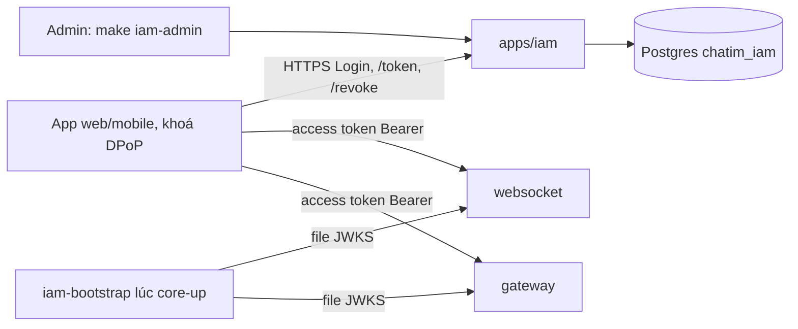
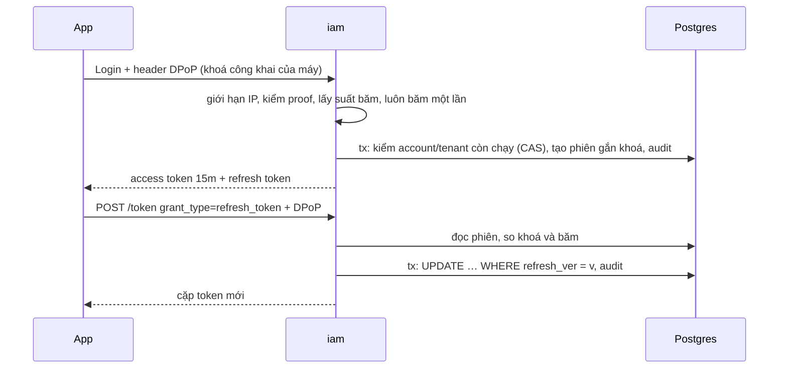

# M6 phần 1: đăng nhập mật khẩu và phiên — tóm tắt

> Ngày: 2026-10-25 · Nhánh `feat/m6` · Trạng thái: **đã xây** (2026-10-27, `dev-done` trên `feat/m6`; quyết định D209–D218; kết quả, số đo và chỗ lệch ở mục cuối)
> **Các phần của M6 `iam`:** **(1) đăng nhập mật khẩu + phiên ✅** · (2) thu hồi tới websocket/gateway · (3) quyền + danh bạ · (4) OIDC provider + IdP ngoài + exchange · (5) sẵn sàng go-live.

## 1. Phần này làm gì

`iam` là IAM tổng quát kiểu Keycloak, tự xây bằng Go trên Postgres; chatim chỉ là một client (owner 2026-10-25). Phần 1 làm đúng những gì owner muốn có trước: **"login password trước, chưa cho đăng ký, admin cấp trước, có token, refresh token, quản lý phiên trước, thu hồi phiên"**.

Một ngày của Lan:
- **08:00** admin chạy lệnh tạo account `lan` trong tenant `shop`. Lệnh in mật khẩu tạm **một lần**.
- **08:05** Lan đăng nhập bằng mật khẩu tạm → `iam` trả "phải đổi mật khẩu" → Lan đổi → đăng nhập lại. App gửi kèm **khoá công khai của máy** (DPoP). `iam` tạo **phiên** `sid` gắn với khoá đó, trả access token 15 phút và refresh token.
- **08:06** app mở WebSocket bằng access token. Websocket kiểm chữ ký như hôm nay (D183), không biết `iam` tồn tại.
- **08:18** app đổi refresh token, kèm chữ ký bằng khoá của máy. Mạng rớt, app không nhận được trả lời, gửi lại token cũ hai lần → vẫn được (cửa sổ 30 giây).
- **10:00** web dính XSS, kẻ xấu lấy được refresh token của Lan và mang sang máy khác. Máy đó không có khoá riêng (trình duyệt không cho xuất) → `iam` từ chối, phiên của Lan vẫn chạy.
- **12:00** Lan xem danh sách phiên: "iPhone 08:05", "Chrome 09:30". Lan thu hồi Chrome → refresh token của Chrome chết ngay.
- **17:00** Bình nghỉ việc → admin khoá Bình → mọi phiên của Bình bị thu hồi trong cùng một transaction. Bình đang đăng nhập dở đúng lúc đó cũng không lọt được phiên mới.

**Giới hạn đã biết của phần 1:** access token đã cấp vẫn dùng được tới khi hết hạn (tối đa 15 phút) sau khi thu hồi, vì websocket/gateway chưa nghe event thu hồi. Phần 2 lấp khoảng này.

## 2. Trong và ngoài

| Trong phần 1 | Ai làm |
|---|---|
| App `apps/iam`, database `chatim_iam` trên Postgres, migration bằng lệnh | `iam`, `deploy/compose` |
| Tenant, account, mật khẩu Argon2id, mật khẩu tạm phải đổi | `iam` |
| DPoP: refresh token gắn khoá của máy, bắt buộc cho web và mobile | `iam` |
| Login / đổi mật khẩu (Connect); refresh / đăng xuất dạng OAuth chuẩn; liệt kê và thu hồi phiên | `iam` |
| Lệnh admin; ký access token Ed25519, khoá riêng mã hoá; xuất JWKS | `iam` |
| Chống đoán theo account và theo IP; audit log | `iam` |
| CORS dùng chung với gateway (`pkg/httpcors`) | `pkg`, gateway |
| e2e phase 13; itest Postgres; benchmark | `tools/corecli`, `scripts/e2e.sh` |

| Ngoài phần 1 | Ở đâu |
|---|---|
| Event thu hồi tới node, khoá qua NATS KV | phần 2 |
| Access token gắn DPoP (node phải kiểm proof mỗi request) | sau |
| Role, permission, permission_group, profile, `GetUsers` | phần 3 |
| Client OAuth, trang đăng nhập, IdP ngoài, exchange | phần 4 |
| Tự đăng ký, gửi email, MFA, SAML | sau go-live |
| HA/backup Postgres, conformance suite, security review, xoay KEK | phần 5 |

## 3. Bức tranh chung

`iam` không gọi core, core không gọi `iam`. Websocket và gateway **không sửa**: token của `iam` có đúng các claim `pkg/jwtverify` đang kiểm; `sid`, `iat` bị bỏ qua tới phần 2.

## 4. Bảng dữ liệu (Postgres, mọi bảng có `tenant_id`)

| Bảng | Field chính | Ví dụ | Dùng để |
|---|---|---|---|
| `tenants` | `id`, `name`, `state` (1 chạy, 2 khoá), `ver`, `created_at`, `updated_at`, `updated_by` | `shop` | realm |
| `accounts` | `id` (= `sub`), `username`, `email`, `state`, `password_hash` (chuỗi PHC), `password_must_change`, `failed_login_count`, `next_login_at`, `ver`, audit | `lan` | `UNIQUE (tenant_id, username)` |
| `sessions` | `id` (= `sid`), `account_id`, `state`, `device_name`, `user_agent`, `created_at`, `last_used_at`, `idle_expires_at`, `expires_at`, `refresh_ver`, `refresh_hash`, `refresh_history` (20 băm gần nhất + giờ thay), `dpop_jkt` (vân tay khoá máy), `dpop_recent_jti` (2 chữ ký gần nhất), `revoked_at/by/reason` | "iPhone" | một máy đăng nhập; chỉ lưu băm SHA-256 |
| `signing_keys` | `kid`, `state` (chờ / đang ký / nghỉ), `public_key`, `private_key_sealed` (AES-256-GCM) | `k-ab12…` | luôn đúng một khoá đang ký |
| `audit_events` | `at`, `actor`, `action`, `account_id`, `session_id`, `ip`, `detail` | `login_failed` | chỉ thêm, không sửa |

**Lớp dữ liệu (design §4):** tenant, account, session, khoá là state có version (CAS); audit là fact bất biến. Phần 1 không phát event vì chưa có ai nghe; outbox thêm ở phần 2.

**Luật riêng cho `iam`** (decision mới): unique theo cột, khoá ngoại, transaction ngắn một lần chạy là bình thường. Luật "không transaction, unique chỉ qua `_id`" là luật shard-ready của core, không áp cho `iam` (~100K account). Không retry nội bộ vẫn giữ.

## 5. Luồng chính

| API | Lỗi |
|---|---|
| `Login` | mật khẩu sai, account không có hoặc khoá, tenant khoá, **đang bị bắt chờ** → cùng một câu `UNAUTHENTICATED` "invalid credentials", cùng thời gian; IP vượt giới hạn → `RESOURCE_EXHAUSTED`; hết suất băm → `UNAVAILABLE`; proof DPoP sai → `INVALID_ARGUMENT`; mật khẩu đúng nhưng phải đổi → `FAILED_PRECONDITION` |
| `ChangePassword` (không cần token) | như Login; mật khẩu mới yếu → `INVALID_ARGUMENT`. Đổi xong thu hồi mọi phiên |
| Refresh `POST /realms/{tenant}/protocol/openid-connect/token` (RFC 6749 §6 + RFC 9449) | token sai/hết hạn/đã thu hồi, khoá máy khác → `400 invalid_grant`; thiếu hoặc sai proof → `400 invalid_dpop_proof`; đụng CAS → `503` + `Retry-After` |
| Đăng xuất `POST /realms/{tenant}/protocol/openid-connect/revoke` (RFC 7009) | luôn `200` với token không biết (không lộ gì); gửi access token → `400 unsupported_token_type` |
| `ListSessions`, `RevokeSession` | thiếu/sai Bearer hoặc phiên đã thu hồi → `UNAUTHENTICATED`; phiên người khác → `NOT_FOUND` |

Refresh và đăng xuất theo đúng dạng OAuth, đường giống Keycloak: ở phần 4, handler của `zitadel/oidc` thay handler tự viết mà app không sửa gì. Access token trả `token_type: Bearer` vì chưa gắn DPoP (RFC 9449 §5 cho phép; refresh token của client công khai thì bắt buộc gắn).

## 6. Đúng đắn và chạy đua

- **Refresh token** = `{sid}.{32 byte ngẫu nhiên}`, tra theo khoá chính `sid`. Thứ tự kiểm:
  1. Khoá máy (`jkt`) khác → từ chối, **không** huỷ phiên.
  2. Băm khớp token hiện tại → xoay.
  3. Khớp một trong 20 token cũ, thay chưa quá 30 giây → xoay lại (mạng rớt, thử lại mấy lần cũng được).
  4. Khớp token cũ đã quá 30 giây → coi là lộ, huỷ phiên.
  5. Không khớp gì → từ chối, **không** huỷ phiên. Kẻ chỉ biết `sid` (có trong access token) không phá được phiên của Lan.
- **Hai refresh cùng lúc** (hai tab): cả hai đọc `refresh_ver = 7`. Tab A ghi `WHERE refresh_ver = 7` thắng; tab B 0 dòng → `503`. B thử lại với token cũ (vừa thay vài ms) → xoay lại, nhận cặp mới.
- **Khoá account đúng lúc đang đăng nhập:** Lan đọc account (ver 4), đang băm thì admin khoá (ver 5). Transaction tạo phiên ghi `WHERE ver = 4 AND state = 1` → 0 dòng → không có phiên. Tương tự với đổi mật khẩu và khoá tenant.
- **Chống đoán:**
  - Theo account: sai 5 lần thì mỗi lần sai sau đó phải chờ gấp đôi (1s, 2s… tối đa **1 phút**). Kẻ xấu chỉ làm Lan chậm tối đa 1 phút, không khoá được.
  - Theo IP: mỗi IP 20 lần/giây, dồn được 200 (mỗi node; owner 2026-10-27, chỉnh bằng `IAM_LOGIN_IP_RATE`/`IAM_LOGIN_IP_BURST`). Văn phòng ~200 người chung một IP vẫn đăng nhập cùng lúc được; lũ hàng nghìn lần/giây từ một máy bị chặn trước khi băm.
  - Mọi nhánh đều băm đúng một lần và trả cùng câu lỗi. Người ngoài không phân biệt được "không có account" với "sai mật khẩu" hay "đang bị chờ".
  - Mỗi node 16 suất băm (16 × 19 MiB ≈ 304 MiB RAM); quá suất → `503`.
- **DPoP chống phát lại:** chữ ký có hạn ±60 giây, đúng method và URL (URL dựng từ `IAM_PUBLIC_URL`, không tin header); phiên nhớ 2 `jti` gần nhất, gửi trùng → từ chối. Client phải ký proof mới cho mỗi lần gửi, kể cả gửi lại.
- **Đăng xuất** chỉ thu hồi khi token đúng là token (hiện tại hoặc cũ) của phiên; biết `sid` mà sai bí mật thì không làm gì.
- **Thứ tự xếp hàng:** chỉ trong một phiên (CAS `refresh_ver`); không có khoá chung giữa các phiên.

## 7. Khoá ký

- `key-rotate` tạo khoá "chờ" → `jwks-export` ghi file JWKS (khoá chờ + đang ký + nghỉ chưa quá 15 phút) → người vận hành đưa file cho websocket/gateway và khởi động lại lần lượt (D183, giữ ở phần 1) → `key-activate`. Đổi khoá đang ký trong một transaction, luôn đúng một khoá đang ký.
- Dev: `make core-up` chạy `iam-bootstrap` trước websocket/gateway (migrate, tạo khoá đầu, gộp khoá `iam` vào file JWKS dev).
- Khoá riêng mã hoá bằng `IAM_KEY_ENCRYPTION_KEY` (Secret), không ra log hay JWKS. Không có khoá đang ký, hoặc schema cũ hơn binary → `/readyz` false.

## 8. Thư viện và hạ tầng

| Thứ | Chọn | Lý do |
|---|---|---|
| Ký JWT | `golang-jwt/jwt/v5` EdDSA | đã dùng ở `pkg/jwtverify`, `devtoken` |
| DPoP | `go-jose/go-jose/v4` (ES256, EdDSA, thumbprint RFC 7638) | chuẩn; `zitadel/oidc` ở phần 4 cũng dùng |
| Postgres | `jackc/pgx/v5` + `pgxpool` (đã có trong `go.mod`) | có sẵn |
| Migration | SQL nhúng + `schema_migrations`, lệnh `/app migrate` (dry run), khoá advisory | không thêm thư viện; giống D191 |
| Băm | `x/crypto/argon2` Argon2id m=19 MiB t=2 p=1 (OWASP) | chuỗi PHC để nâng tham số sau |
| Giới hạn IP | `x/time/rate` + `pkg/lru` | có sẵn |
| API | Connect (proto `chatim.iam.v1`); refresh/revoke dạng OAuth | sinh client web/mobile |
| Compose | `postgres:18` sẵn có (dev hạ `shared_buffers` 512MB), `postgres-init`, `iam-bootstrap`, `iam-1` | không thêm image |

## 9. Chi phí và tải

- 100K phiên, refresh mỗi ~12 phút → ~140 refresh/giây; mỗi refresh 1 đọc + 1 transaction. `BenchmarkRotateRefresh`: ~1,7 ms một lần xoay tuần tự (transaction có commit, Postgres trong Docker trên máy dev).
- Login: một phép băm Argon2id + một proof DPoP. `BenchmarkHash`: ~40 ms và ~19 MB mỗi phép băm.
- Đường nóng thật là kiểm token ở websocket/gateway: `BenchmarkVerify`: ~121 µs mỗi token; bão 100K kết nối lại tốn ~12 giây CPU chia cho các node.
- Audit ~1 dòng mỗi login/refresh: ~12M dòng/ngày ở 140/s. Chưa xoá audit cũ; chính sách giữ hỏi owner ở phần 5.

## 10. Rủi ro thật

- Thu hồi chưa tới node: tối đa 15 phút token cũ còn dùng (phần 2).
- Xoay khoá vẫn cần khởi động lại websocket (phần 2).
- XSS trên web vẫn **dùng tại chỗ** được khi tab còn mở (DPoP chỉ chặn mang token đi). Access token Bearer bị lấy thì dùng được tới 15 phút.
- Tới phần 4, ô mật khẩu nằm trên trang của product: web của product dính XSS thì lộ mật khẩu.
- Rải đoán mật khẩu từ nhiều IP (botnet) vượt giới hạn theo IP → cần WAF/rate limit ở edge.
- Chưa có cách xoay KEK (phần 5). Đăng nhập một yếu tố tới khi có MFA.
- Cổng admin `:9090` (`/metrics`, pprof) không được public; chỉ `:8080` sau LB.
- Phát hiện dùng lại refresh token chỉ trong 20 lần xoay gần nhất (~4 giờ dùng liên tục).
- Lần sai mật khẩu của account có thật tốn thêm một lần ghi DB: lệch thời gian nhỏ cạnh phép băm, chấp nhận ở phần 1.

## 11. Điểm đội tự chọn (anh phản biện)

- Access token 15 phút; phiên hết hạn sau 30 ngày không dùng, tối đa 90 ngày.
- Mật khẩu 12–128 ký tự, không bắt buộc ký tự đặc biệt (NIST 800-63B); mật khẩu tạm 20 ký tự.
- Sai 5 lần rồi mới bắt chờ, tối đa 1 phút; mỗi IP 20 lần/giây, dồn 200.
- DPoP bắt buộc cho mọi client; chấp nhận ES256 và EdDSA.
- `iss` một giá trị ở phần 1; theo realm ở phần 4.

## 12. Kiểm thử

| Test | Chứng minh |
|---|---|
| Unit Argon2id | băm/kiểm đúng, đọc tham số PHC, chuỗi hỏng hay tham số khổng lồ không làm sập |
| Unit ký token | token `iam` qua được `pkg/jwtverify` hiện tại |
| Unit refresh (bảng 7 kết quả) | xoay, xoay lại trong 30s, lộ → huỷ, token rác và khoá khác không huỷ phiên |
| Unit DPoP | mỗi lỗi của RFC 9449 §4.3 bị bắt; vân tay đúng vector RFC 7638 |
| Unit Login | mọi nhánh thất bại băm đúng một lần và trả cùng lỗi |
| itest Postgres | unique, CAS hai refresh, khoá account lúc đang đăng nhập không lọt phiên, đúng một khoá đang ký, migrate song song an toàn |
| e2e phase 13 | admin tạo account → đổi mật khẩu tạm → login → websocket → refresh, gửi lại → khoá máy khác bị từ chối → thu hồi → khoá account → bị bắt chờ; log không chứa bí mật |

## Bảng phủ

| Yêu cầu | Thành phần | Task (plan chi tiết) | Test | Bằng chứng |
|---|---|---|---|---|
| Login mật khẩu Argon2id (owner 2026-10-25, D179) | `password`, `auth` | 2, 8, 10 | unit, e2e 13 | `b08553b`, `32ed082`, `2e59ecd`; e2e 13 PASS |
| Admin cấp account, chưa đăng ký, đặt lại mật khẩu (owner 2026-10-25) | lệnh admin | 12 | itest, e2e 13 | xem mục Kết quả |
| Token Ed25519 + JWKS (D183) | `signing`, bootstrap | 3, 13 | unit, e2e 13 | xem mục Kết quả |
| Refresh xoay vòng, phát hiện dùng lại | `session`, `auth`, `pgstore` | 4, 7, 8 | unit bảng, itest, e2e 13 | xem mục Kết quả |
| DPoP gắn refresh token (owner 2026-10-26) | `dpop`, `auth` | 5, 8 | unit DPoP, e2e 13 | xem mục Kết quả |
| Quản lý và thu hồi phiên (owner 2026-10-25) | `auth`, `api`, lệnh admin | 7, 8, 10, 12 | itest, e2e 13 | xem mục Kết quả |
| Refresh/revoke OAuth chuẩn (owner 2026-10-26) | `api` | 10 | unit OAuth | xem mục Kết quả |
| Postgres riêng (owner 2026-10-25) | `pgstore`, compose | 7, 13 | itest, `core-up` | xem mục Kết quả |
| Chống đoán, không lộ account, audit | `guard`, `auth`, `pgstore` | 6, 7, 8 | unit, itest, e2e 13 | xem mục Kết quả |
| Không đọc bảng của nhau (D177) | depguard | 11 | `make lint` | xem mục Kết quả |

## Kết quả (đã xây, 2026-10-27)

**Bằng chứng**
- Commit trên `feat/m6`: proto `f0cb537`, băm `b08553b`, ký `e17e4a3`, refresh `9c8228a`, DPoP `93dea2e`, chống đoán `c4e9382`, store `7eea16a`, use case `32ed082` + sửa review `020b5d5`, CORS `37e2c23`, API `2e59ecd` + sửa review `c1a6f39`, app `a07aae8`, lệnh admin `dd5d75b`, compose `e591ddb`, e2e `870e581`/`9c27b10`, mức IP `55cd677`, docs `2308458`.
- `make fmt-check`, `make vet`, `make lint` (0 issues), `make go ARGS="test -race -shuffle=on ./apps/iam/..."` xanh; itest Postgres (`CHATIM_IT_PG_URI`) xanh cho `pgstore` và lệnh admin; `make alerts-check` 29 luật.
- `make core-up` healthy cả 7 container; `make e2e` PASS 13 phase. Phase 13: log `iam-1` không chứa bí mật nào trong 46 mật khẩu, token và proof đã dùng; log Postgres không chứa mật khẩu role `iam`.
- Review: plan (2 Critical, 9 Important, đã gộp trước khi code), lượt soát lại DPoP (4 Important, đã gộp), code Task 7+8 (không Critical; 3 Important đã sửa), code Task 10 (không Critical; 3 Important đã sửa).

**Lệch so với plan**
- Thêm package `keyring` (nạp khoá, signer hiện tại, kiểm Bearer) và tách `admincmd` thành task riêng để file ≤ 350 dòng.
- `iam-1` ở cổng `127.0.0.1:8084` (8083 đã là `websocket-2`).
- Mức IP mặc định 20/s dồn 200 thay 1/s dồn 10 (owner 2026-10-27, lý do NAT văn phòng).
- Chưa có histogram `hash_seconds`, `refresh_seconds`; có counter theo kết quả và gauge. Thêm ở phần 5 nếu cần.
- e2e phase 13 chạy account bị chờ trước, account chính sau.

**Minor để lại (gộp từ review)**
- Lần sai mật khẩu của account có thật tốn thêm một lần ghi DB: lệch thời gian nhỏ cạnh phép băm ~40 ms; tenant không tồn tại trả sớm hơn một lần đọc.
- Chưa audit lần bị chặn theo IP/chờ, refresh khoá khác, account lạ (có metric).
- Thiếu itest giữ transaction khoá tenant song song với tạo phiên (lập luận khoá `FOR SHARE` đúng); bổ sung khi phần 2 đụng lại store.
- `revokeWhere` đánh số tham số cứng; chỉ gọi nội bộ với hằng số.
- Body quá lớn ở `/token` trả 413 (RFC 6749 chỉ có 400); `server_error` 503 là lệch có chủ đích.
- Phát hiện dùng lại refresh token chỉ trong 20 lần xoay gần nhất; không xét khi phiên đã hết hạn hoặc khoá máy khác (có chủ đích).
- e2e phase 2 (core, có từ trước M6) hỏng một lần trên dev: client `corecli` gửi lại ngay sau `docker kill` core-1 gặp `grpc: the client connection is closing`; lần chạy sau qua. Ghi vào "Mục mang sang M5".
