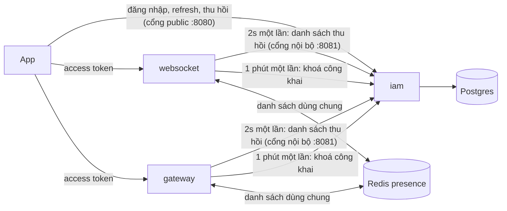
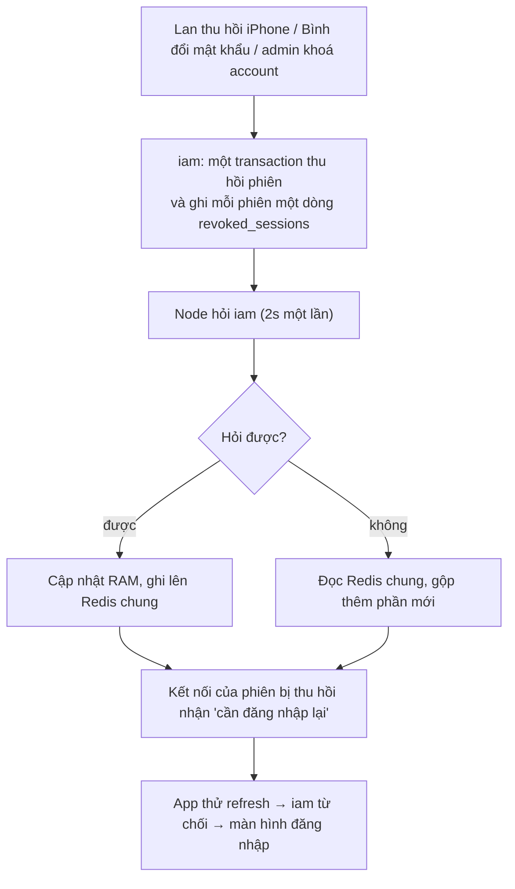
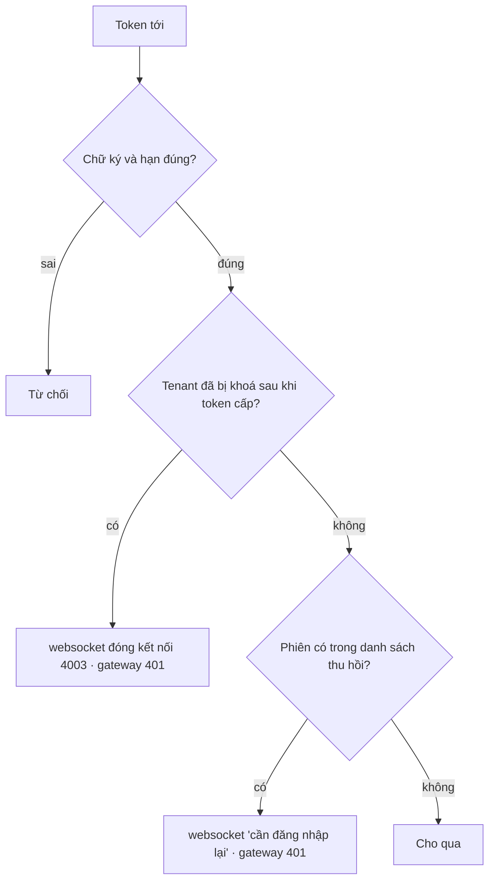
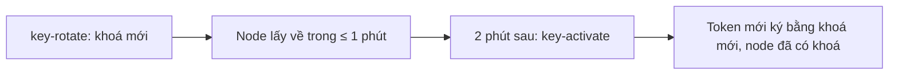

# M6 phần 2: thu hồi tới websocket/gateway — tóm tắt

> Ngày: 2026-10-27 · Nhánh `feat/m6` · Trạng thái: **chờ owner duyệt**
> **Các phần của M6 `iam`:** (1) đăng nhập mật khẩu + phiên ✅ · **(2) thu hồi tới websocket/gateway** · (3) quyền + danh bạ (+ event `user_disabled`, `user_updated`) · (4) OIDC + IdP ngoài + exchange · (5) sẵn sàng go-live.

## 1. Phần này làm gì

Hôm nay (sau phần 1) Lan thu hồi phiên iPhone thì iPhone không refresh được nữa, nhưng access token đang có vẫn dùng được ở websocket/gateway thêm tối đa 15 phút. Xoay khoá ký thì phải khởi động lại từng node. Phần 2 sửa hai việc này, không dùng NATS (owner 2026-10-27).

- **09:00:00** Lan thu hồi iPhone.
- **09:00:02** mỗi node websocket/gateway hỏi `iam` "có phiên nào mới bị thu hồi không?" (2 giây một lần cho cả node, không hỏi theo từng token). Thấy iPhone → kết nối của iPhone nhận "cần đăng nhập lại"; request HTTPS bằng token cũ bị từ chối.
- **Đường từ `websocket-2` tới `iam` đang đứt:** `websocket-2` lấy danh sách từ Redis chung mà `websocket-1` vừa ghi lên (owner 2026-10-27), nên iPhone vẫn bị chặn đúng lúc.
- **Bình đổi mật khẩu:** mọi phiên của Bình bị chặn như trên; Bình đăng nhập lại ngay vẫn được.
- **Admin khoá tenant `shop`:** mọi kết nối của `shop` bị đóng.
- **Admin xoay khoá ký:** node tự lấy khoá mới từ `iam`, không khởi động lại.

## 2. Yêu cầu

| # | Yêu cầu | Nguồn |
|---|---|---|
| R1 | Thu hồi phiên, account, tenant có hiệu lực ở websocket và gateway | D179, D218 |
| R2 | Node tự kiểm token, không gọi service khác cho từng token | D211 |
| R3 | Không dùng NATS | owner 2026-10-27 |
| R4 | `iam` không với tới thì người có token còn hạn vẫn dùng được | D218 |
| R5 | Kết nối bị thu hồi chuyển về "cần đăng nhập lại", không đóng ngay | D202 |
| R6 | Xoay khoá không khởi động lại node | D216 |
| R7 | Token cấp đúng lúc thu hồi không lọt | D214 |
| R8 | API nội bộ một cổng, API public một cổng, bật/tắt từng cổng | owner 2026-10-27 |
| R9 | Node không hỏi được `iam` thì dùng danh sách node khác đã lấy | owner 2026-10-27 |
| R10 | Đảm bảo mới có metric và alert | `CLAUDE.md` |

## 3. Trong và ngoài

| Trong phần 2 | Ai làm |
|---|---|
| Ghi phiên bị thu hồi vào bảng, cổng nội bộ trả danh sách, trả khoá công khai | `iam` |
| Hỏi `iam` 2 giây một lần, giữ danh sách trong RAM, ghi/đọc Redis chung | `pkg/iamsync`, `pkg/revocation` (mới) |
| Kiểm token có trong danh sách không | websocket, gateway |
| Lấy khoá mới không khởi động lại | `pkg/jwtverify` |
| e2e phase 14 | `tools/corecli`, `scripts/e2e.sh` |

| Ngoài phần 2 | Ở đâu |
|---|---|
| Event `user_disabled`, `user_updated` cho app khác | phần 3 |
| OIDC, trang đăng nhập | phần 4 |
| mTLS, security review | phần 5 |

## 4. Bức tranh chung

- `iam` có cổng public `:8080` (sau LB) và cổng nội bộ `:8081` (chỉ node gọi, cần secret); để trống địa chỉ là tắt cổng đó.
- Redis chung là `chatim-redis-presence` đang có; gateway thêm kết nối này (không cấu hình thì bỏ qua).

## 5. Dữ liệu

| Ở đâu | Có gì | Ví dụ |
|---|---|---|
| Postgres `revoked_sessions` (mới) | mỗi phiên bị thu hồi một dòng: `session_id`, `tenant_id`, `revoked_at`, `expires_at` (sau 16 phút tự xoá) | iPhone của Lan |
| Postgres `tenants.sessions_revoked_at` (mới) | giờ khoá tenant | `shop` 16:00 |
| Redis `chatim:iam:revocations` | bản danh sách mới nhất một node lấy được, kèm giờ lấy | ghi bởi `websocket-1` |
| RAM mỗi node | danh sách + khoá công khai | |

Lớp dữ liệu (design §4): dòng thu hồi là fact ghi một lần cùng transaction thu hồi; Redis và RAM là bản sao, tự đúng lại ở lần hỏi kế.

## 6. Luồng

### 6.1. Thu hồi tới node

### 6.2. Node kiểm một token

### 6.3. Xoay khoá

Node gặp khoá chưa có thì hỏi `iam` ngay, không đá người dùng ra.

## 7. Đúng đắn

- **Thu hồi theo từng phiên.** Mỗi phiên bị thu hồi có dòng riêng, ghi cùng lúc với lệnh thu hồi. Refresh đang chạy song song hoặc thua (phiên đã thu hồi) hoặc thắng rồi phiên bị thu hồi ngay sau, token mới cũng nằm trong danh sách.
- **Khoá tenant** so giờ cấp token với giờ khoá, cả hai lấy từ đồng hồ Postgres nên không lệch.
- **Đăng nhập đúng lúc danh sách mới về:** node ghi danh sách trước rồi mới quét kết nối, và kiểm lại lúc kết nối bắt đầu chạy, nên không kết nối nào lọt.
- **Redis chỉ thêm, không xoá:** dữ liệu sai trên Redis không gỡ được một lệnh thu hồi. Khoá ký không bao giờ đi qua Redis.

## 8. Thư viện và hạ tầng

Không thêm thư viện. Thêm cổng nội bộ của `iam`, secret cho node, gateway nối Redis presence. Tên biến và mặc định ghi trong plan chi tiết.

## 9. Quyết định và phương án bị loại

| Chọn | Bỏ | Vì sao |
|---|---|---|
| Node hỏi `iam` qua HTTPS | NATS (D216, D218 cũ) | Ai vào được NATS là chèn được khoá giả (owner 2026-10-27) |
| Hỏi 2s một lần cho cả node | Hỏi `iam` cho từng token | 100K máy kết nối lại = ~1.700 lần gọi/giây, `iam` chậm thì không ai vào được |
| Redis chung khi không hỏi được `iam` | Thử nhiều địa chỉ `iam` | Owner 2026-10-27 |
| Thu hồi theo từng phiên | So giờ cấp token với giờ thu hồi | Lệch giờ giữa các máy làm token lọt 15 phút |
| Khoá tenant thì đóng kết nối | Bắt 100K máy đăng nhập lại | 100K máy cùng đăng nhập vô ích làm nghẽn `iam` |

## 10. Chi phí

~15 node × 1 lần/2 giây ≈ 7–8 lần hỏi/giây tới `iam`, đa số trả "không đổi"; cùng số lần ghi lên Redis. Kiểm token thêm một lần tra RAM, không gọi mạng.

## 11. Rủi ro

- Thu hồi có hiệu lực sau ~2 giây, không tức thì.
- Hiếm: một node không hỏi được cả `iam` lẫn Redis → token đã thu hồi còn dùng được ở node đó tới 15 phút. Có alert sau 30 giây.
- Khoá ký nằm trong file JWKS chỉ gỡ được bằng khởi động lại node.

## 12. Đội tự chọn (anh phản biện)

Hỏi danh sách 2 giây, hỏi khoá 1 phút, chờ 2 phút trước khi kích hoạt khoá mới, mã đóng `4003` khi khoá tenant.

## 13. Việc và kiểm thử

| # | Việc | Test chứng minh |
|---|---|---|
| 1 | `iam`: bảng thu hồi, giờ khoá tenant | itest: mỗi cách thu hồi ghi đúng dòng; khoá tenant đua với refresh không lọt |
| 2 | `iam`: cổng nội bộ, danh sách, khoá công khai, chờ 2 phút | unit: cổng nào trả API nấy, thiếu secret bị từ chối, không đổi trả 304 |
| 3 | `pkg/jwtverify`: token phải có `sid`, `iat`; đổi khoá lúc chạy | unit |
| 4 | `pkg/revocation`: danh sách trong RAM | unit |
| 5 | `pkg/iamsync`: hỏi `iam`, ghi/đọc Redis chung | unit: `iam` lỗi thì lấy từ Redis; Redis không xoá được mục |
| 6 | websocket: đẩy kết nối về "cần đăng nhập lại", đóng khi khoá tenant | unit, kể cả đăng nhập đúng lúc danh sách mới về |
| 7 | gateway: kiểm mỗi request | unit |
| 8 | Proto lý do `REVOKED`, đặc tả client | `make buf-lint` |
| 9 | Compose, alert, docs | `make alerts-check`, `make core-up` |
| 10 | e2e phase 14 | thu hồi → websocket và gateway chặn trong ≤ 5 giây; chặn đường `websocket-2` → `iam` vẫn chặn được nhờ Redis; xoay khoá không khởi động lại |

## Bảng phủ

| Yêu cầu | Việc | Test | Bằng chứng |
|---|---|---|---|
| R1 thu hồi tới node | 1, 2, 4, 5, 6, 7 | itest 1, unit 4–7, e2e 14 | (sau khi xây) |
| R2 node tự kiểm | 3, 4 | unit 3, 4 | (sau khi xây) |
| R3 không NATS | 5 | unit 5, depguard | (sau khi xây) |
| R4 `iam` không với tới vẫn dùng được | 5 | unit 5 | (sau khi xây) |
| R5 về "cần đăng nhập lại" | 6, 8 | unit 6, e2e 14 | (sau khi xây) |
| R6 xoay khoá không khởi động lại | 2, 3, 5 | unit, e2e 14 | (sau khi xây) |
| R7 không lọt token lúc thu hồi | 1, 6 | itest 1, unit 6 | (sau khi xây) |
| R8 hai cổng bật/tắt | 2, 9 | unit 2 | (sau khi xây) |
| R9 Redis chung | 5, 6, 7, 10 | unit 5, e2e 14 | (sau khi xây) |
| R10 metric + alert | 5, 9 | `make alerts-check` | (sau khi xây) |
