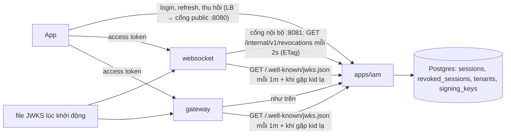
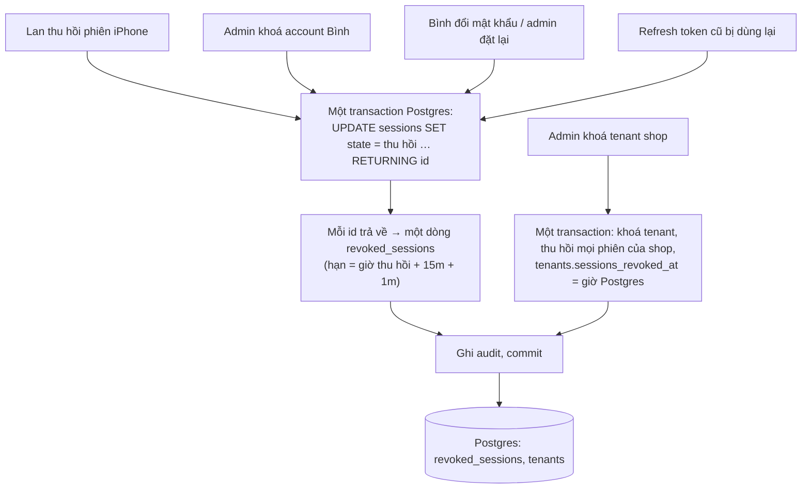
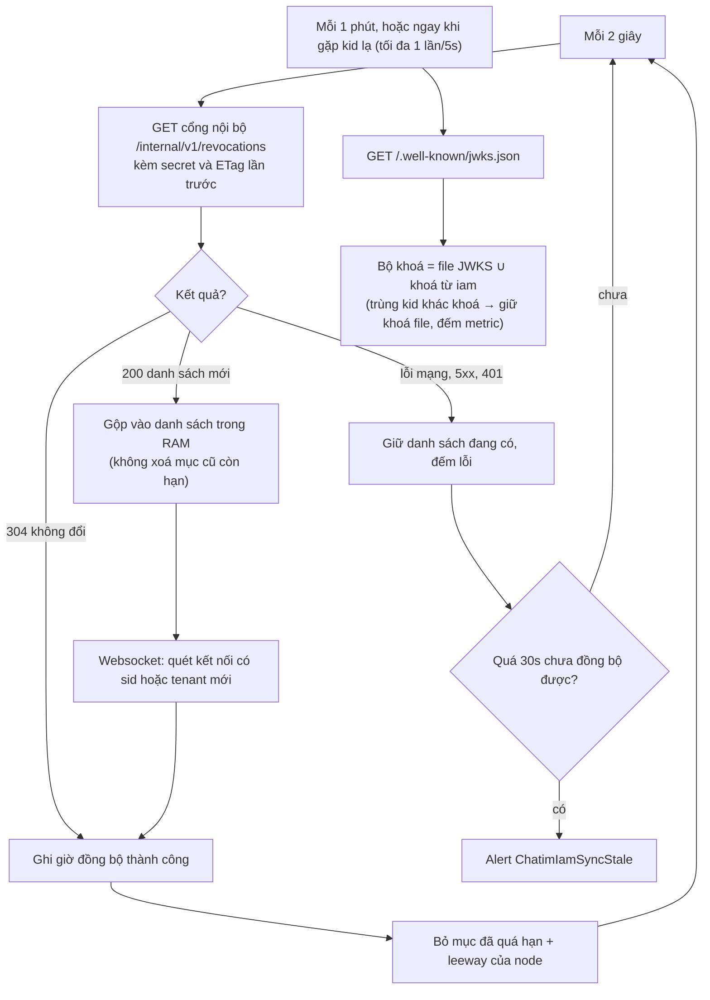
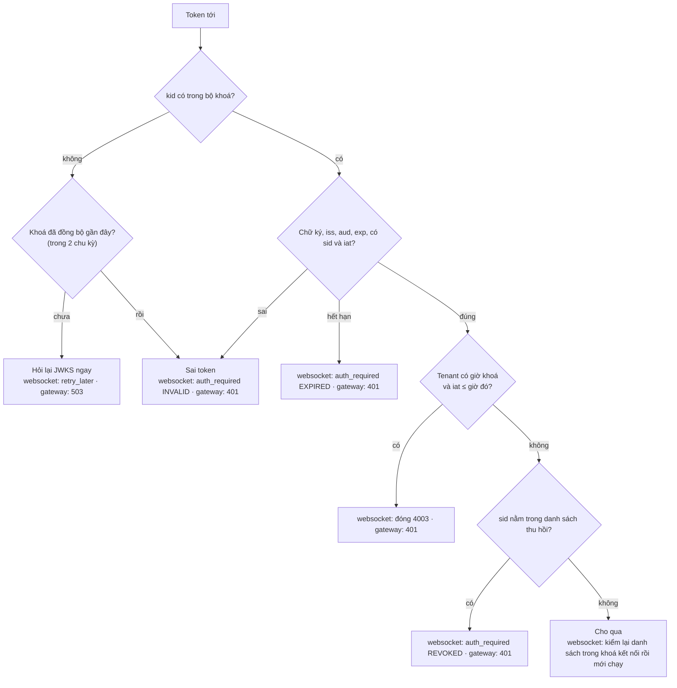
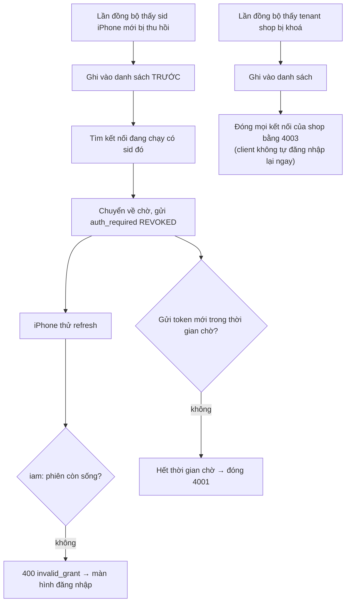
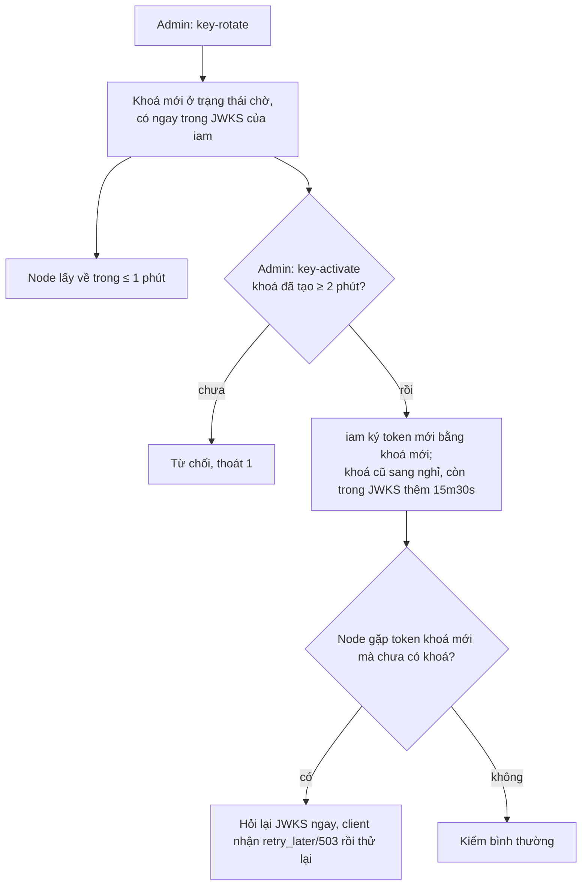

# M6 phần 2: thu hồi tới websocket/gateway, khoá ký qua HTTPS — tóm tắt

> Ngày: 2026-10-27 · Nhánh `feat/m6` · Trạng thái: **chờ owner duyệt** (hướng owner "ok" 2026-10-27)
> **Các phần của M6 `iam`:** (1) đăng nhập mật khẩu + phiên ✅ · **(2) thu hồi tới websocket/gateway** · (3) quyền + danh bạ (+ `user_disabled`, `user_updated`) · (4) OIDC provider + IdP ngoài + exchange · (5) sẵn sàng go-live.

## 1. Phần này làm gì

Sau phần 1, thu hồi phiên chỉ có hiệu lực ở `iam`: access token đã cấp vẫn qua websocket/gateway tới 15 phút; xoay khoá phải đưa file JWKS mới và khởi động lại từng node. Phần 2 lấp hai chỗ này **mà không phụ thuộc NATS** (owner 2026-10-27: "ko nên phụ thuộc NATS", sau khi thấy ai vào được NATS là chèn được khoá giả): mỗi node tự hỏi `iam` qua HTTPS.

Một ngày của Lan:
- **09:00** Lan mất iPhone. Trên laptop, Lan thu hồi phiên "iPhone". `iam` ghi phiên đó vào danh sách thu hồi trong cùng transaction.
- **09:00 + ~2s** các node websocket/gateway hỏi `iam` (2 giây một lần), thấy `sid` của iPhone. Kết nối WebSocket của iPhone nhận `auth_required{REVOKED}`; app thử refresh → bị từ chối → về màn hình đăng nhập. Request HTTPS bằng token cũ → `UNAUTHENTICATED`.
- **11:00** Bình đổi mật khẩu → mọi phiên của Bình bị thu hồi, mỗi phiên một dòng; Bình đăng nhập lại ngay trong cùng giây vẫn vào được (phiên mới không có trong danh sách).
- **14:00** admin chạy `key-rotate`. Khoá mới hiện ngay trong JWKS của `iam`; node lấy về trong ≤ 1 phút. 14:05 `key-activate` → token mới ký bằng khoá mới, node nào chưa có thì hỏi lại `iam` ngay. Không node nào khởi động lại.
- **16:00** admin khoá tenant `shop` → mọi kết nối của `shop` bị đóng (`4003`), mọi token cũ của `shop` bị từ chối; bật lại tenant không làm token cũ sống lại.

## 2. Yêu cầu

| # | Yêu cầu | Nguồn |
|---|---|---|
| R1 | Thu hồi phiên, account, tenant tới được websocket và gateway | D179, D218, roadmap M6 |
| R2 | Kiểm token nhúng trong node, không có service verifier | D211 |
| R3 | Không phụ thuộc NATS | owner 2026-10-27 |
| R4 | Khởi động: nạp danh sách, quá 10s vẫn `ready`, có metric và alert | D218 |
| R5 | `iam` không với tới: vẫn nhận token còn hạn | D218 |
| R6 | Kết nối bị thu hồi về `auth_required`, không đóng ngay | D202 |
| R7 | Xoay khoá không khởi động lại node; file JWKS làm dự phòng lúc khởi động | D216 |
| R8 | Token cấp sát lúc thu hồi không được lọt | D214, review 2026-10-27 |
| R9 | Đảm bảo mới có metric và luật alert | `CLAUDE.md` §Architecture |
| R10 | API nội bộ trên cổng nội bộ, API public trên cổng public, bật/tắt được từng cổng | owner 2026-10-27 |

## 3. Trong và ngoài

| Trong phần 2 | Ai làm |
|---|---|
| Bảng `revoked_sessions`, `tenants.sessions_revoked_at`, `iat` theo giờ Postgres, job xoá dòng hết hạn | `iam` |
| Tách cổng (owner 2026-10-27): cổng public `IAM_ADDR` (login, refresh, thu hồi, phiên, JWKS) và cổng nội bộ mới `IAM_INTERNAL_ADDR` (danh sách thu hồi, bản JWKS); để trống địa chỉ là tắt cổng đó, phải bật ít nhất một | `iam` |
| `GET /.well-known/jwks.json` (cả hai cổng), `GET /internal/v1/revocations` (chỉ cổng nội bộ, secret node), `key-activate` chờ đủ 2 phút | `iam` |
| `Claims` có `sid`, `iat` bắt buộc; bộ khoá đổi được lúc chạy | `pkg/jwtverify`, `devtoken` |
| Danh sách thu hồi trong RAM (thuần, không mạng) | `pkg/revocation` mới |
| Client hỏi khoá + danh sách, trạng thái sẵn sàng, metric | `pkg/iamsync` mới |
| Đẩy kết nối bị thu hồi về chờ, `REVOKED`, đóng `4003` khi khoá tenant | `websocket` |
| Kiểm danh sách mỗi request | `gateway` |
| Proto `AUTH_REQUIRED_REASON_REVOKED`, đặc tả client §11 | `proto`, module 09 |
| Compose, config, alert, e2e phase 14 | `deploy`, `scripts`, `tools/corecli` |

| Ngoài phần 2 | Ở đâu |
|---|---|
| Event `user_disabled`, `user_updated`, outbox | phần 3 (khi có app nghe: M8, M9) |
| JWKS theo realm, discovery OIDC | phần 4 |
| mTLS nội bộ, security review, HA Postgres | phần 5 / go-live |
| Access token gắn DPoP | sau |

## 4. Bức tranh chung

`iam` có ba cổng: public `:8080` (duy nhất đứng sau LB), nội bộ `:8081` (chỉ trong mạng cụm, cho node), admin `:9090` (metric, pprof, như phần 1). Cổng public không trả `/internal/…`, cổng nội bộ không trả login/refresh. Ví dụ: một cụm chỉ để node đọc → tắt cổng public; dev không cần thu hồi → tắt cổng nội bộ. Ở node, `*_IAM_INTERNAL_URL` trống = không kiểm thu hồi (log cảnh báo lúc khởi động, metric `iam_sync_enabled` = 0), `*_IAM_JWKS_URL` trống = chỉ dùng file JWKS như phần 1.

Không còn NATS trong đường thu hồi và khoá. Gateway vẫn không NATS, không DB. `iam` không gọi node; node chỉ đọc.

## 5. Dữ liệu và lớp dữ liệu (design §4)

| Bảng / field | Field | Ví dụ | Lớp |
|---|---|---|---|
| `revoked_sessions` (mới) | `session_id` (khoá chính), `tenant_id`, `revoked_at`, `expires_at` (= `revoked_at` + `IAM_ACCESS_TTL` + 1m) | iPhone của Lan | fact có hạn: ghi một lần cùng transaction thu hồi, job xoá khi quá `expires_at` |
| `tenants.sessions_revoked_at` (mới) | giờ Postgres lúc khoá tenant | `shop` 16:00:00.412 | state của tenant, CAS `ver` như phần 1 |
| `signing_keys` | không đổi; `created_at` dùng cho luật chờ 2 phút | | state |
| Danh sách + khoá trong node | bản sao dẫn xuất trong RAM | | sửa bằng lần hỏi kế (mỗi lần trả đủ), không cần sweeper |

Endpoint thu hồi trả JSON: `sessions: [{session_id, tenant_id, expires_at}]`, `tenants: [{tenant_id, revoked_before, expires_at}]`, kèm `ETag`.

## 6. Luồng chính

### 6.1. Thu hồi trong `iam`

### 6.2. Node đồng bộ với `iam` (websocket và gateway như nhau)

### 6.3. Node kiểm một token (websocket `auth`, gia hạn; gateway mỗi request)

### 6.4. Kết nối đang chạy bị thu hồi (websocket)

### 6.5. Xoay khoá không khởi động lại node

Tóm tắt kết quả:

| Chỗ | Kết quả |
|---|---|
| Websocket `auth`/gia hạn token với `sid` đã thu hồi | `auth_required{REVOKED}` |
| Websocket, tenant bị khoá | đóng `4003`; client không tự đăng nhập lại ngay |
| Gateway, `sid` thu hồi hoặc tenant khoá | `UNAUTHENTICATED` (401) |
| `kid` lạ khi khoá chưa đồng bộ (chưa lần nào, hoặc lần cuối quá 2 chu kỳ) | websocket `retry_later`, gateway `UNAVAILABLE`; ngoài ra `INVALID` |
| Endpoint thu hồi thiếu/sai secret | 401, không nói gì thêm |
| `key-activate` khoá tạo chưa đủ 2 phút | lỗi, thoát 1 |

## 7. Đúng đắn và chạy đua

- **Thu hồi theo `sid`, không theo giờ.** Bản nháp so `iat` với "giờ thu hồi" của account; reviewer chỉ ra: đổi mật khẩu lấy giờ 10,5s rồi chậm, refresh ở replica khác lúc 11,1s ghi trước → token `iat` 11 sống 15 phút trên phiên đã thu hồi. Nay mỗi phiên bị thu hồi có dòng riêng, ghi trong cùng transaction bằng `RETURNING`. Refresh đua với thu hồi: CAS `state = 1` của phần 1 bảo đảm hoặc refresh thắng (rồi `sid` bị thu hồi ngay sau, token mới cũng chết) hoặc refresh 0 dòng.
- **Khoá tenant dùng một đồng hồ:** giờ khoá = `clock_timestamp()` của Postgres sau khi khoá phiên; `iat` = `now()` của transaction cấp token. Login khoá tenant `FOR SHARE`, refresh khoá dòng phiên mà lệnh khoá tenant cũng cập nhật → transaction cấp token nào cũng kết thúc trước lệnh khoá, nên `iat` ≤ giờ khoá.
- **Đăng nhập đua với danh sách mới (websocket):** node ghi danh sách **trước** rồi mới quét kết nối; bước chuyển kết nối sang chạy (`startRunning`, gia hạn) kiểm lại danh sách trong khoá của kết nối. Kết nối nào cũng bị một trong hai bước bắt.
- **Leeway của node:** node giữ mỗi mục tới `expires_at` + leeway của chính nó (`WS_JWT_LEEWAY`/`GW_JWT_LEEWAY`), nên token còn qua được bước kiểm `exp` thì mục thu hồi vẫn còn.
- **Gộp, không thay:** node gộp danh sách mới vào RAM và tự bỏ mục hết hạn; một lần trả thiếu (job xoá chạy sớm) không làm sống lại token.
- **Khoá:** trùng `kid` giữa file và `iam` mà khác khoá → dùng khoá của file, bỏ khoá `iam`, đếm metric. Hỏi khi gặp `kid` lạ tối đa 1 lần/5s mỗi node.
- **Không có hàng đợi chung:** mỗi node hỏi độc lập; `iam` đọc bảng nhỏ.

## 8. Thư viện và hạ tầng

Không thêm thư viện: `net/http` (client có timeout, TLS mặc định của Go), `pkg/jwtverify` (đọc JWKS), `pgx/v5`. Config mới: `IAM_INTERNAL_ADDR` (`:8081`, trống = tắt; `IAM_ADDR` trống cũng = tắt cổng public), `IAM_NODE_SECRET`/`_FILE` (bắt buộc khi bật cổng nội bộ: chưa có mTLS thì pod nào trong cụm cũng gọi được cổng này), `IAM_KEY_ACTIVATE_LEAD` (2m); mỗi node `*_IAM_INTERNAL_URL`, `*_IAM_JWKS_URL` (prod bắt buộc `https://`: cổng public qua LB, hoặc cổng nội bộ nếu có TLS), `*_IAM_SECRET`/`_FILE`, `*_IAM_KEYS_INTERVAL` (1m), `*_IAM_REVOCATIONS_INTERVAL` (2s), `*_IAM_READY_TIMEOUT` (10s), `*_IAM_ALLOW_HTTP` (dev). Compose thêm secret `iam_node_secret`.

## 9. Quyết định và phương án bị loại

| Quyết định | Loại | Lý do |
|---|---|---|
| Node hỏi `iam` qua HTTPS cho khoá và danh sách | NATS KV + stream (D216, D218 cũ) | Owner 2026-10-27; ai ghi được NATS là chèn khoá giả; HTTPS + kiểm chứng chỉ chặn giả `iam` |
| Trả cả danh sách còn hạn + ETag | long-poll, con trỏ `id` tăng dần | Danh sách vài trăm dòng; con trỏ `bigserial` bỏ sót dòng commit muộn |
| Thu hồi theo `sid`, tenant theo giờ Postgres | so `iat` với giờ thu hồi theo account | Lỗi chạy đua (mục 7) |
| Đóng `4003` khi khoá tenant | `auth_required` cho 100K máy | Tránh 100K máy cùng refresh/login vô ích (Argon2 16 phép/node) |
| `user_disabled` sang phần 3 | phát ngay ở phần 2 | Chưa có app nghe; phần 2 không cần outbox |

## 10. Chi phí và tải

- ~15 node × 1 lần/2s ≈ 7,5 request/s tới `iam`, đa số `304`; JWKS ~15 lần/phút.
- Thu hồi vài trăm phiên/ngày → bảng `revoked_sessions` vài trăm dòng (xoá sau ~16 phút).
- Đường nóng: thêm một tra map mỗi lần kiểm token (cạnh ~121 µs chữ ký).
- Đổi mật khẩu, khoá account: N dòng cho N phiên (thường < 10).

## 11. Rủi ro và giới hạn

- Thu hồi tới node trong ~2–3s, không còn tức thì.
- **Node mất liên lạc với `iam` trong khi `iam` vẫn nhận lệnh thu hồi.** Ví dụ: 10:00 đường mạng giữa `websocket-2` và `iam` đứt 10 phút. 10:03 Lan thu hồi iPhone (laptop gọi `iam` qua LB vẫn được). `websocket-1` biết sau ~2s; `websocket-2` không hỏi được nên iPhone đang nối vào `websocket-2` vẫn chạy tới khi mạng về (10:10) hoặc token hết hạn (≤ 15 phút), cái nào tới trước. Refresh của iPhone thì bị `iam` từ chối ngay. Nếu chính `iam` chết thì không ai thu hồi được nên không có gì bị lỡ. Alert `ChatimIamSyncStale` khi một node quá 30s chưa hỏi được. Đã chấp nhận ở D218 (bản NATS).
- Node khởi động đúng lúc không với tới `iam`: sau 10s vẫn `ready` nhưng chưa có danh sách, nên các phiên bị thu hồi trong 15 phút trước đó vẫn qua node này tới khi hỏi được.
- Khoá nằm trong file JWKS chỉ gỡ được bằng khởi động lại node.
- Cổng nội bộ không đứng sau LB; trong cụm vẫn bảo vệ bằng secret tới khi có mTLS. Lộ secret chỉ lộ `sid` đã thu hồi và tenant id.

## 12. Điểm đội tự chọn (anh phản biện)

- Hỏi danh sách 2 giây một lần, khoá 1 phút một lần; chờ 2 phút trước khi kích hoạt khoá mới.
- Mục thu hồi giữ access TTL + 1 phút.
- Close code `4003` cho tenant bị khoá.

## 13. Thứ tự làm và kiểm thử

| # | Task | Test chứng minh gì |
|---|---|---|
| 1 | Migration 0002, mọi đường thu hồi ghi `revoked_sessions`, `iat` theo giờ Postgres, job xoá | itest: mỗi đường thu hồi (người dùng, admin, khoá account, đổi/đặt lại mật khẩu, dùng lại refresh) có đúng dòng; khoá tenant đua với refresh không lọt token; job xoá đúng mục hết hạn |
| 2 | Cổng nội bộ bật/tắt, endpoint JWKS, endpoint thu hồi (secret, ETag), luật chờ 2 phút của `key-activate` | unit: cổng public không trả `/internal/…`, cổng nội bộ không trả login; tắt từng cổng chạy đúng, tắt cả hai → config lỗi; thiếu/sai secret → 401; 304 khi không đổi; khoá riêng không bao giờ trong JWKS; activate sớm bị từ chối |
| 3 | `pkg/jwtverify` (`sid`, `iat` bắt buộc; bộ khoá động, ưu tiên file), `devtoken` thêm `sid` | unit: thiếu `sid`/`iat` → từ chối; trùng `kid` khác khoá → giữ khoá file; đổi khoá lúc chạy an toàn khi verify song song (`-race`) |
| 4 | `pkg/revocation` | unit: `sid`, tenant theo `iat`, gộp không thay, bỏ mục hết hạn + leeway |
| 5 | `pkg/iamsync` | unit (`synctest`, `httptest`): hỏi định kỳ, 304, hỏi khoá khi `kid` lạ có giới hạn, sẵn sàng sau lần đầu hoặc sau 10s, `iam` chết giữ dữ liệu cũ, metric tuổi đồng bộ |
| 6 | Websocket: quét kết nối, `REVOKED`, `4003`, `retry_later` khi khoá chưa đồng bộ | unit: kết nối đang chạy về chờ; đăng nhập đua với danh sách mới không lọt (`synctest`); tenant khoá → `4003` |
| 7 | Gateway: kiểm mỗi request | unit: `sid` thu hồi → 401, `kid` lạ chưa đồng bộ → 503 |
| 8 | Proto + đặc tả §11 | `make buf-lint` |
| 9 | Config, compose, alert (`ChatimIamSyncStale`, `ChatimJwksConflict`), docs | `make alerts-check`, `make core-up` healthy |
| 10 | e2e phase 14 | thu hồi phiên → websocket nhận `REVOKED` và gateway 401 trong ≤ 5s; khoá account tương tự; xoay khoá + activate, token mới qua websocket không restart; khoá tenant → `4003` |

## Bảng phủ

| Yêu cầu | Thành phần | Task | Test | Bằng chứng |
|---|---|---|---|---|
| R1 thu hồi tới node | `iam` store + API, `revocation`, `iamsync`, websocket, gateway | 1, 2, 4, 5, 6, 7 | itest 1, unit 4–7, e2e 14 | (sau khi xây) |
| R2 kiểm nhúng trong node | `jwtverify`, `revocation` | 3, 4 | unit 3, 4 | (sau khi xây) |
| R3 không NATS | `iamsync` qua HTTPS | 5, 9 | unit 5; depguard: `pkg/iamsync`, `pkg/revocation` không import NATS | (sau khi xây) |
| R4 khởi động ≤ 10s rồi `ready` | `iamsync`, wiring | 5, 6, 7 | unit 5, lifecycle test của hai app | (sau khi xây) |
| R5 `iam` chết vẫn nhận token còn hạn | `iamsync` | 5 | unit 5 | (sau khi xây) |
| R6 về `auth_required` | websocket, proto | 6, 8 | unit 6, e2e 14 | (sau khi xây) |
| R7 xoay khoá không restart, file dự phòng | `iam` JWKS + lead, `jwtverify`, `iamsync` | 2, 3, 5 | unit 2, 3, 5, e2e 14 | (sau khi xây) |
| R8 không lọt token sát lúc thu hồi | `iam` store, websocket | 1, 6 | itest đua 1, unit đua 6 | (sau khi xây) |
| R9 metric + alert | `iamsync`, alerts | 5, 9 | `make alerts-check` | (sau khi xây) |
| R10 cổng nội bộ riêng, bật/tắt từng cổng | `iam` app + config, node config | 2, 9 | unit 2, config test | (sau khi xây) |
