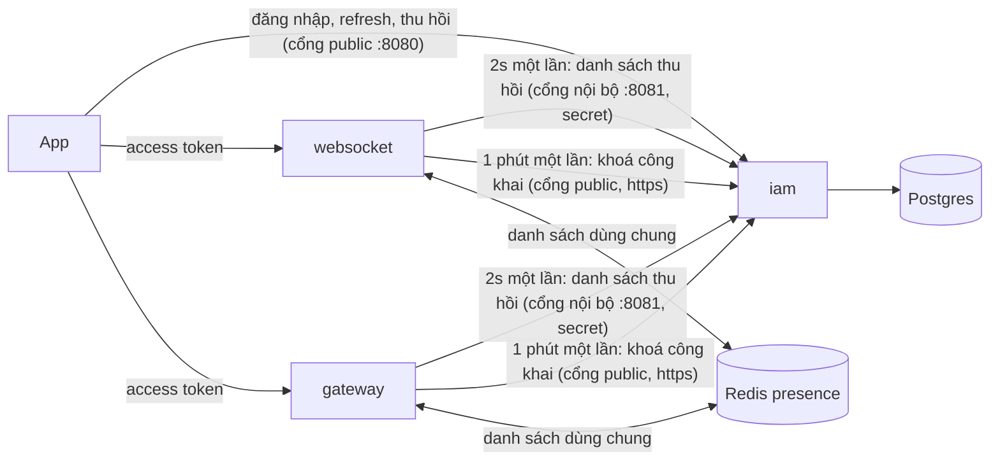
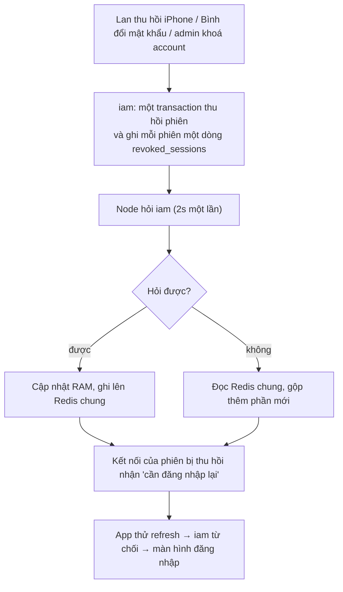
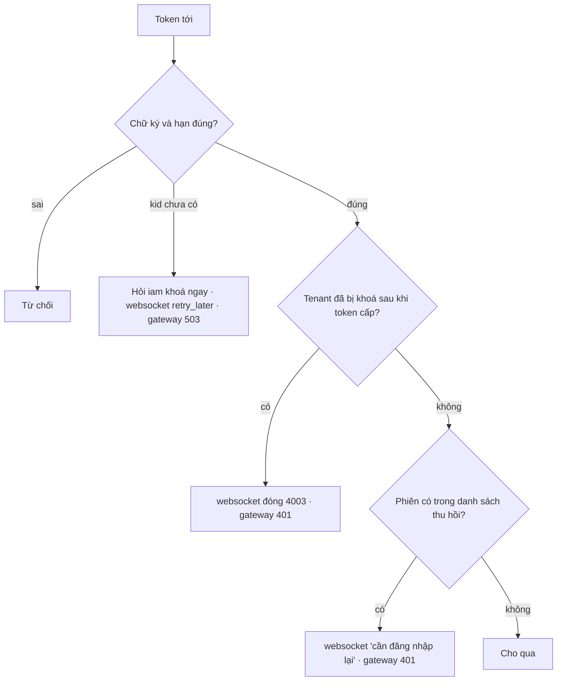
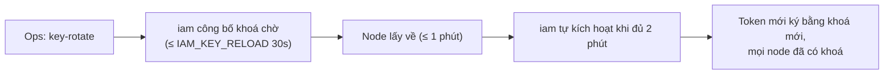
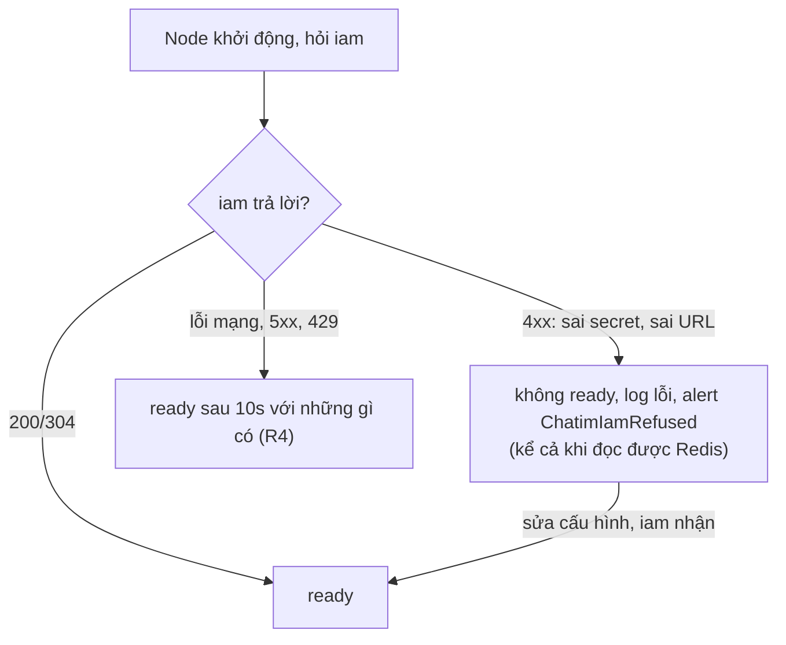

# M6 phần 2: thu hồi tới websocket/gateway — tóm tắt

> Ngày: 2026-10-27, viết lại theo cái đã xây 2026-10-31 · Nhánh `feat/m6` · Trạng thái: **đã xây, `dev-done` trên nhánh (chưa push)**
> **Các phần của M6 `iam`:** (1) đăng nhập mật khẩu + phiên ✅ · **(2) thu hồi tới websocket/gateway ✅** · (3) quyền + danh bạ (+ event `user_disabled`, `user_updated`) · (4) OIDC + IdP ngoài + exchange · (5) sẵn sàng go-live.

## 1. Phần này làm gì

Trước phần 2, Lan thu hồi phiên iPhone thì iPhone không refresh được nữa, nhưng access token đang có vẫn dùng được ở websocket/gateway thêm tối đa 15 phút; xoay khoá ký phải khởi động lại từng node. Phần 2 sửa hai việc này, không dùng NATS (owner 2026-10-27).

- **09:00:00** Lan thu hồi iPhone.
- **09:00:02** mỗi node websocket/gateway hỏi `iam` "có phiên nào mới bị thu hồi không?" (2 giây một lần cho cả node, không hỏi theo từng token). Thấy iPhone → kết nối của iPhone nhận "cần đăng nhập lại" (`auth_required{REVOKED}`); request HTTPS bằng token cũ bị 401. e2e đo được 0,7–1,7 giây.
- **Đường từ `websocket-2` tới `iam` đứt:** `websocket-2` lấy danh sách từ Redis chung mà `websocket-1` vừa ghi, nên iPhone vẫn bị chặn đúng lúc.
- **Bình đổi mật khẩu:** mọi phiên của Bình bị chặn như trên; Bình đăng nhập lại ngay vẫn được.
- **Admin khoá tenant `shop`:** mọi kết nối của `shop` bị đóng `4003`.
- **Admin xoay khoá ký:** chỉ chạy `key-rotate`. `iam` tự kích hoạt khoá mới khi mọi node đã kịp lấy về; không ai canh giờ, không khởi động lại node.
- **Ops gõ nhầm secret của node:** node không `ready`, log `iam refused this node`, alert `ChatimIamRefused`; không còn chuyện node chạy mà thu hồi tắt im lặng.

## 2. Yêu cầu

| # | Yêu cầu | Nguồn |
|---|---|---|
| R1 | Thu hồi phiên, account, tenant có hiệu lực ở websocket và gateway | D179, D218 |
| R2 | Node tự kiểm token, không gọi service khác cho từng token | D211 |
| R3 | Không dùng NATS | owner 2026-10-27 |
| R4 | `iam` không với tới thì người có token còn hạn vẫn dùng được | D218 |
| R5 | Kết nối bị thu hồi chuyển về "cần đăng nhập lại", không đóng ngay | D202 |
| R6 | Xoay khoá không khởi động lại node | D216 |
| R7 | Token cấp đúng lúc thu hồi không lọt | D214 |
| R8 | API nội bộ một cổng, API public một cổng, bật/tắt từng cổng | owner 2026-10-27 |
| R9 | Node không hỏi được `iam` thì dùng danh sách node khác đã lấy | owner 2026-10-27 |
| R10 | Đảm bảo mới có metric và alert | `CLAUDE.md` |
| R11 | Setup và vận hành khó sai: đặt sai thì báo ngay, xoay khoá một bước | owner 2026-10-31 ("setup mà phức tạp và dễ sai thế này thì vận hành khó lắm") |

## 3. Trong và ngoài

| Trong phần 2 | Ai làm |
|---|---|
| Ghi phiên bị thu hồi vào bảng, cổng nội bộ trả danh sách, trả khoá công khai, tự kích hoạt khoá | `iam` |
| Hỏi `iam` 2 giây một lần, giữ danh sách trong RAM, ghi/đọc Redis chung, từ chối cấu hình sai | `pkg/iamsync`, `pkg/revocation` (mới) |
| Kiểm token có trong danh sách không | websocket, gateway |
| Lấy khoá mới không khởi động lại | `pkg/jwtverify` |
| e2e phase 14 | `tools/corecli`, `scripts/e2e.sh` |

| Ngoài phần 2 | Ở đâu |
|---|---|
| Event `user_disabled`, `user_updated` cho app khác | phần 3 |
| OIDC, trang đăng nhập | phần 4 |
| mTLS, xoay `IAM_NODE_SECRET`, security review | phần 5 |

## 4. Bức tranh chung

- Cổng public `:8080` (sau LB), cổng nội bộ `:8081` (chỉ node gọi); để trống địa chỉ là tắt cổng đó, phải bật ít nhất một.
- Redis chung là `chatim-redis-presence`; gateway thêm kết nối này (tuỳ chọn).

## 5. Dữ liệu

| Ở đâu | Có gì | Ví dụ |
|---|---|---|
| Postgres `revoked_sessions` (mới) | mỗi phiên bị thu hồi một dòng: `session_id`, `tenant_id`, `revoked_at`, `expires_at` (sau 16 phút tự xoá) | iPhone của Lan |
| Postgres `tenants.sessions_revoked_at` (mới) | giờ khoá tenant | `shop` 16:00 |
| Redis `chatim:iam:revocations:<issuer>` | bản danh sách mới nhất một node lấy được, kèm giờ lấy; mỗi môi trường một key | ghi bởi `websocket-1` |
| RAM mỗi node | danh sách + khoá công khai | |

Lớp dữ liệu (design §4): dòng thu hồi là fact ghi một lần cùng transaction thu hồi; Redis và RAM là bản sao, tự đúng lại ở lần hỏi kế.

## 6. Luồng

### 6.1. Thu hồi tới node

### 6.2. Node kiểm một token

### 6.3. Xoay khoá

Ràng buộc "chờ ≥ nạp lại + hỏi khoá" do code kiểm: `iam` không khởi động nếu `IAM_KEY_ACTIVATE_LEAD` < `IAM_KEY_RELOAD` + 1m, node không khởi động nếu hỏi khoá thưa hơn 1 phút. Nhiều replica `iam` cùng thử kích hoạt, Postgres khoá dòng nên chỉ một lần; khoá đã nghỉ không bật lại được.

### 6.4. Node khởi động

## 7. Đúng đắn

- **Thu hồi theo từng phiên.** Mỗi phiên bị thu hồi có dòng riêng, ghi cùng lúc với lệnh thu hồi. Refresh đang chạy song song hoặc thua (phiên đã thu hồi) hoặc thắng rồi phiên bị thu hồi ngay sau, token mới cũng nằm trong danh sách.
- **Khoá tenant** so giờ cấp token với giờ khoá, cả hai lấy từ đồng hồ Postgres nên không lệch.
- **Đăng nhập đúng lúc danh sách mới về:** node ghi danh sách trước rồi mới quét kết nối, và kiểm lại trong khoá của kết nối lúc bắt đầu chạy và lúc gia hạn token.
- **Redis chỉ thêm, không xoá:** dữ liệu sai trên Redis không gỡ được một lệnh thu hồi. Khoá ký không bao giờ đi qua Redis.
- **`IAM_ACCESS_TTL` + 1m ≤ 2h** do `iam` kiểm, nên node không bao giờ bỏ một mục thu hồi còn hiệu lực.

## 8. Lưu ý khi setup

1. Tạo `IAM_KEY_ENCRYPTION_KEY` và `IAM_NODE_SECRET`; secret giống nhau ở `iam`, websocket, gateway.
2. `IAM_ISSUER`/`IAM_AUDIENCE` trùng `*_JWT_ISSUER`/`*_JWT_AUDIENCE` của node.
3. Node trỏ `*_IAM_INTERNAL_URL` vào cổng nội bộ, `*_IAM_JWKS_URL` vào địa chỉ public https.
4. Chạy `bootstrap -jwks` một lần, gắn file làm `*_JWT_KEYS_FILE`.
5. Websocket và gateway dùng chung một Redis presence; mỗi môi trường một issuer.

Mọi số khác để mặc định; đặt sai thì app không khởi động hoặc node không `ready` kèm log rõ (`docs/apps/iam.md`).

## 9. Quyết định và phương án bị loại

| Chọn | Bỏ | Vì sao |
|---|---|---|
| Node hỏi `iam` qua HTTPS | NATS (D216, D218 cũ) | Ai vào được NATS là chèn được khoá giả (owner 2026-10-27) |
| Hỏi 2s một lần cho cả node | Hỏi `iam` cho từng token | 100K máy kết nối lại = ~1.700 lần gọi/giây, `iam` chậm thì không ai vào được |
| Redis chung khi không hỏi được `iam` | Thử nhiều địa chỉ `iam` | Owner 2026-10-27 |
| Thu hồi theo từng phiên | So giờ cấp token với giờ thu hồi | Lệch giờ giữa các máy làm token lọt 15 phút |
| Khoá tenant thì đóng kết nối | Bắt 100K máy đăng nhập lại | 100K máy cùng đăng nhập vô ích làm nghẽn `iam` |
| `iam` tự kích hoạt khoá, giờ chờ kiểm trong code | Người vận hành chạy `key-activate` sau khi tự canh 3 bộ hẹn giờ | e2e hỏng hai lần vì đặt giờ sai mà không chỗ nào báo (owner 2026-10-31) |
| `iam` trả 4xx thì node không `ready` | Node vẫn `ready`, chỉ tăng metric | Sai secret = thu hồi tắt im lặng trên node đó |

## 10. Chi phí

~15 node × 1 lần/2 giây ≈ 7–8 lần hỏi/giây tới `iam`, đa số trả "không đổi"; cùng số lần ghi lên Redis. Kiểm token thêm một lần tra RAM, không gọi mạng.

## 11. Rủi ro

- Thu hồi có hiệu lực sau ~2 giây, không tức thì.
- Hiếm: một node không hỏi được cả `iam` lẫn Redis → token đã thu hồi còn dùng được ở node đó tới 15 phút. Có alert sau 30 giây.
- Khoá ký nằm trong file JWKS của node chỉ gỡ được bằng khởi động lại node.

## 12. Kết quả

**Commit** (`feat/m6`): `79478f7` jwtverify cần `sid`/`iat`, khoá đổi lúc chạy · `1213a99` `pkg/revocation` · `a5f2091` bảng thu hồi, giờ khoá tenant · `b56415e` hai cổng, danh sách, JWKS · `9f11806` + `03e2229` `pkg/iamsync` · `e07658e` proto `REVOKED` · `89dc2d4` + `d62c3dc` websocket · `01c6abc` gateway · `41b2480` compose, alert · `e4f21ee` e2e phase 9 · `114d8c5` tự kích hoạt khoá, chặn cấu hình sai · `edd436d` giờ khoá lấy từ Postgres · `3843863` e2e phase 14 · `bfb9ba2` docs.

**Số đo e2e** (`bin/e2e-m6p2.log`, dev): thu hồi tới websocket-1 và gateway 1,7s (lần chạy riêng phase 14: 0,7s); `websocket-2` bị chặn cổng nội bộ vẫn áp thu hồi qua Redis; `key-rotate` → `iam` ký bằng khoá mới sau 63s (compose: lead 65s, nạp lại 5s), cả hai websocket và gateway nhận ngay, không `retry_later`; khoá tenant đóng `4003`; không secret nào trong log `iam`, hai websocket, gateway.

**Khác với bản duyệt 2026-10-27:**
- Xoay khoá thành một bước (`iam` tự kích hoạt) và mọi giờ chờ kiểm trong code; `key-activate` từ chối khoá đã nghỉ; giờ tạo, so giờ chờ, kích hoạt và nghỉ của khoá đều lấy đồng hồ Postgres (review: đồng hồ máy chạy lệnh lệch thì khoá bật sớm); tự kích hoạt không bao giờ chọn khoá chờ cũ hơn khoá đang ký. Lý do: e2e hỏng hai lần vì xoay khoá phụ thuộc ba bộ hẹn giờ ở ba app; reviewer vận hành độc lập xác nhận (owner "ok" 2026-10-31).
- URL và secret `iam` bắt buộc trên node (trước: trống = tắt thu hồi); `iam` trả 4xx thì node không `ready`; key Redis theo issuer.
- e2e phase 9: token khoá lạ giờ nhận `retry_later` rồi mới `INVALID` (đúng §6.2); assertion cũ sửa theo.
- `iamsync.Defaults/FromEnv/NewList` dùng chung cho hai app; hẹn giờ khởi động là `AfterFunc` riêng (lần hỏi đầu không chặn nó); gateway nối Redis tuỳ chọn (`GW_SHARED_REDIS_*`).
- `E2E_ONLY=14 make e2e` chạy riêng phase 14 (~3 phút).

**Ghi nhận nhỏ (không sửa):** review commit tự kích hoạt: `key-activate` tay đúng lúc nhịp tự kích hoạt chạy có thể làm Postgres huỷ một transaction (deadlock → `UNAVAILABLE`, chạy lại lệnh); `iam` bắt đầu trả 401 sau khi node đã `ready` (đổi secret một phía) thì node vẫn `ready`, chỉ có `iam_refused` + `ChatimIamRefused` và `ChatimIamSyncStale`; 401 tới đúng lúc hết 10s chờ có thể cho node `ready` (alert vẫn bắn); cờ từ chối giữ nguyên qua các lỗi mạng sau đó tới khi `iam` trả lời lại; 408/425 từ proxy cũng tính là từ chối; `iam_boot_timeouts_total` không đếm ca từ chối rồi hết từ chối sau 10s. token cấp trong cùng giây với lệnh khoá tenant rồi bật lại ngay vẫn bị chặn (`iat` theo giây), chỉ tốn một lần đăng nhập lại; `iam` chết thì `ready` có thể trễ tới ~6s quá 10s; bảng `kid` lạ xoá khi đủ 64 mục, chỉ thêm một lần 503 thừa; test websocket session `TestBadTokenGetsAuthRequiredInvalidAndALaterGoodTokenGetsReady` đỏ một lần khi máy tải nặng, chạy lại 5 lần xanh.

**Mang sang:** xoay `IAM_NODE_SECRET` (nhận hai secret) → phần 5; body danh sách lớn khi thu hồi hàng loạt và listener websocket mở trước khi đồng bộ xong → "Mục mang sang M5"; thử hai replica `iam` ở prod-like.

## Bảng phủ

| Yêu cầu | Việc | Test | Bằng chứng |
|---|---|---|---|
| R1 thu hồi tới node | iam, revocation, iamsync, websocket, gateway | itest `revocations_integration_test.go`, unit `revoke_test.go` (websocket, gateway), e2e 14 | `a5f2091`, `89dc2d4`, `01c6abc`; e2e PASS 1,7s |
| R2 node tự kiểm | jwtverify, revocation | unit `pkg/jwtverify`, `pkg/revocation` | `79478f7`, `1213a99`; `make test` xanh |
| R3 không NATS | iamsync qua HTTP | depguard `iam-sync-no-nats` | `make lint` 0 issue |
| R4 `iam` không với tới vẫn dùng được | iamsync | `TestBootedAfterTheTimeoutWhenIamIsDown`, `TestBusyIamStillBootsAfterTheTimeout`, lifecycle websocket/gateway | `make test` xanh |
| R5 về "cần đăng nhập lại" | websocket, proto | unit websocket session, e2e 14 | e2e PASS (`auth_required REVOKED`) |
| R6 xoay khoá không khởi động lại | keyring, jwtverify động, iamsync, tự kích hoạt | itest `TestDuePendingKeyIsActivatedOnce`, `TestKeyCommandsAndBootstrap`, unit `TestDueKeyIsActivatedOnTheReloadTick`, e2e 14 | `114d8c5`; e2e PASS 63s, không `retry_later` |
| R7 không lọt token lúc thu hồi | pgstore, websocket kiểm trong khoá | itest đua thu hồi/refresh, unit đua websocket | `a5f2091`, `d62c3dc` |
| R8 hai cổng bật/tắt | iam app | `ports_test.go` | `b56415e` |
| R9 Redis chung | iamsync | `TestFailureFallsBackToTheSharedCopy`, `TestRedisSharedRoundTrip`, e2e 14 | e2e PASS (`websocket-2` qua Redis) |
| R10 metric + alert | alerts, iamsync, iam | `make alerts-check` | 33 luật, nhóm `chatim-iam-sync` |
| R11 khó sai khi setup | iam config, iamsync, admincmd | `TestLoadRefusesTimersThatBreakNodes`, `TestRefusedNodeStaysNotReadyEvenWithTheSharedCopy`, `TestNodeRefusedByIAMStaysNotReady` (websocket, gateway), validate tests | `114d8c5`; `make test` xanh |
