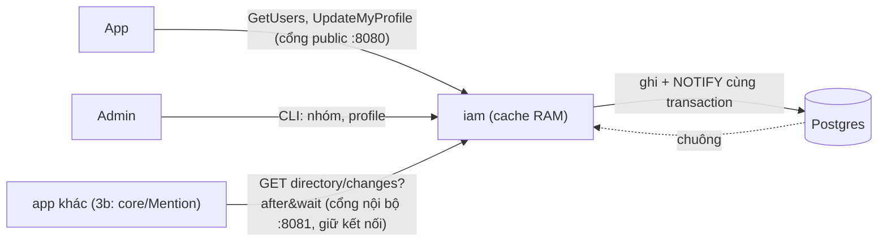
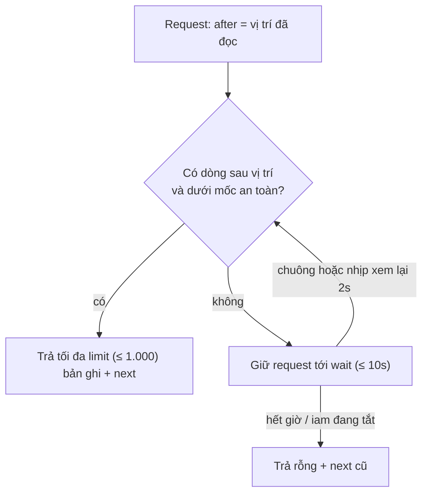
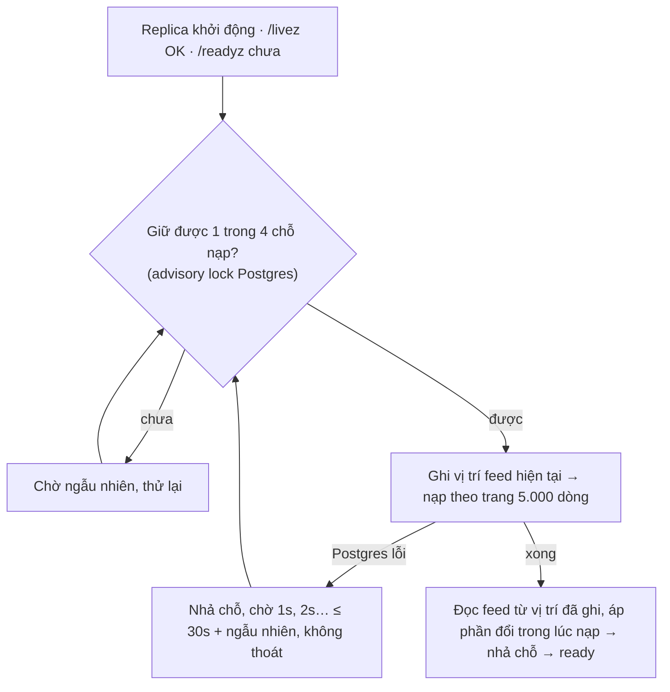

# M6 phần 3a: danh bạ trong `iam` — tóm tắt

> Ngày: 2026-10-31 · Nhánh `feat/m6` · Trạng thái: **owner duyệt hướng 2026-10-31, chờ plan chi tiết và review**
> **Các phần của M6 `iam`:** (1) đăng nhập + phiên ✅ · (2) thu hồi tới node ✅ · **(3a) danh bạ trong `iam`** · (3b) đồng bộ nhóm sang Mention · (3c) role, permission, API admin · (4) OIDC + IdP ngoài + exchange · (5) sẵn sàng go-live.

## 1. Phần này làm gì

- **Lan mở app.** Core trả 300 hội thoại, chỉ có user id. App gọi `GetUsers` với id những người trên màn hình. `iam` trả tên, ảnh, trạng thái **từ RAM của nó**, không chạm Postgres. Bình đã bị khoá thì hiện "tài khoản đã khoá". Không ai thấy email hay username của người khác.
- **9:00:00 Lan đổi tên** thành "Lan Nguyễn". Vài ms sau, Postgres báo mọi replica `iam` (chuông `NOTIFY`), và replica sửa RAM. Lần `GetUsers` kế tiếp ở bất kỳ replica nào đều trả tên mới.
- **Admin dựng cây nhóm** bằng CLI: `kinh-doanh`, dưới đó là `kinh-doanh-hcm`. Admin gán Bình vào `kinh-doanh-hcm`.
- **App khác** (3b là Mention, sau này M8, M9) gọi `GET /internal/v1/directory/changes?after=…&wait=10s` trên cổng nội bộ, dùng lại kết nối cũ.
  - Không có gì đổi thì `iam` giữ request.
  - Admin chuyển Bình sang `marketing`: request trả bản ghi mới của Bình trong dưới 1 giây.
- **Node chết, 10 replica `iam` cùng khởi động lại.** Mỗi lượt tối đa 4 replica nạp danh bạ (~1s mỗi replica, ước lượng). Khoảng 3s sau cả 10 đã `ready`. Trong lúc nạp K8s không giết pod (`/livez` vẫn OK), Postgres không bị dội.

## 2. Yêu cầu

| # | Yêu cầu | Nguồn |
|---|---|---|
| R1 | Client hiện tên, ảnh người trong room; core không lưu tên | D207; roadmap M9 |
| R2 | Tra profile theo lô `GetUsers` | D207; roadmap M6 P3 |
| R4 | Báo thay đổi user (đổi tên, khoá) và nhóm cho app khác | roadmap M6 P3; owner 2026-10-31 |
| R6 | Không phụ thuộc NATS | owner 2026-10-27 (D219) |
| R7 | Không service nào đọc bảng của service khác | D177 |
| R8 | Người dùng chính ở ~5.000 room cần tên ~5.000 người | CLAUDE.md số thật |
| R10 | App khác gọi như HTTPS (đường + query), không mở kết nối mới mỗi lần | owner 2026-10-31 |
| R11 | `iam` là nguồn nhóm dạng cây; mọi nhóm tag được mặc định, admin tắt từng nhóm | owner 2026-10-31; D209 |
| R12 | Cấu hình sai thì không chạy | D225 |
| R13 | DB đổi thì cache đổi ngay, không cache theo giờ | owner 2026-10-31 |
| R14 | Chịu tải: 100K máy nối lại trong ≥ 1 phút | owner 2026-10-31 ("đảm bảo khả năng chịu tải"); CLAUDE.md số thật |
| R15 | Khởi động lại thường xuyên không thành bão | owner 2026-10-31 ("K8s sẽ restart liên tục") |

## 3. Trong và ngoài

| Trong 3a | Ai làm |
|---|---|
| Profile (`display_name`, `avatar_url`), cây nhóm, người ↔ nhóm, bảng thay đổi | `iam` (Postgres, migration 0003) |
| Cache danh bạ và danh sách thu hồi trong RAM mỗi replica, chuông `NOTIFY`, chặn bão khởi động | `iam` |
| `GetUsers`, `GetMyProfile`, `UpdateMyProfile` (cổng public, Bearer) | `iam` |
| Feed `directory/changes` (cổng nội bộ, `IAM_NODE_SECRET`) | `iam` |
| Lệnh CLI cho nhóm và profile | `iam` admincmd |
| e2e phase 15 | `tools/corecli`, `scripts/e2e.sh` |

| Ngoài 3a | Ở đâu |
|---|---|
| Kéo feed, tính nhóm cha, gọi `SetUserGroups`/`SetGroups` | 3b (core, `modules/mention`) |
| Role, permission, API admin | 3c |
| Upload ảnh (3a chỉ lưu URL) | M7 |
| Tìm người theo tên; gỡ máy push khi bị khoá | M9; M8 (đọc cùng feed) |
| Cách client giữ profile | client (repo khác) |
| Secret riêng cho từng bên gọi; khôi phục backup | 5 |

## 4. Thuật ngữ

| Từ | Nghĩa |
|---|---|
| Dòng thay đổi | Mỗi người, mỗi nhóm có đúng một dòng trong `directory_changes`, được ghi đè mỗi lần đổi |
| `ver` | Số lần đổi của một người hay một nhóm; bản có `ver` lớn hơn thắng |
| Vị trí | Chỗ đã đọc tới trong feed; đọc tiếp từ vị trí thì không sót, không trùng |
| Chuông `NOTIFY` | Lệnh có sẵn của Postgres: transaction ghi xong thì Postgres báo ngay các kết nối đang `LISTEN`. Không thêm hạ tầng |
| Cache RAM | Bản danh bạ (id, tên, ảnh, trạng thái, `ver`) trong bộ nhớ mỗi replica `iam`, nạp lúc khởi động, sửa khi nghe chuông |

## 5. Bức tranh chung

## 6. Dữ liệu

| Ở đâu | Có gì | Ví dụ |
|---|---|---|
| `accounts` (thêm cột) | `display_name` (bản cũ lấy bằng username), `avatar_url` | Lan Nguyễn, `https://cdn…/lan.png` |
| `groups` (mới) | `tenant_id`, `id` (theo luật id của Mention), `name`, `parent_id`, `mentionable` (mặc định true), `state` (1 dùng, 2 đã xoá), `updated_at`/`updated_by` | `kinh-doanh-hcm`, cha `kinh-doanh` |
| `account_groups` (mới) | nhóm **trực tiếp** của người | Bình → `marketing` |
| `directory_changes` (mới) | `kind` (user/group), `tenant_id`, `id`, `ver`, `change_xid` (mã transaction Postgres) | user Bình, ver 8 |
| RAM mỗi replica | danh bạ (id, tên, ảnh, trạng thái, `ver`), danh sách thu hồi, vị trí feed đã áp | 100K người ≈ 20–40 MB (ước lượng) |

Lớp dữ liệu (design §4): profile, nhóm, nhóm của người là fact ghi thẳng. Dòng thay đổi và `NOTIFY` ghi **cùng transaction**, giống bit `_state` của core, nên không cần sweeper. Cache RAM và feed đều dựng từ bảng; RAM chỉ nhận bản có `ver` lớn hơn.

Bản ghi feed:
- `user`: id, tenant, `ver`, `state`, `display_name`, `avatar_url`, `groups` (nhóm trực tiếp).
- `group`: id, tenant, `ver`, `state`, `name`, `parent_id`, `mentionable`.
- Không có email và username.

## 7. Luồng

**`GetUsers` (≤ 500 id mỗi lần)**
1. Kiểm chữ ký token, rồi kiểm danh sách thu hồi **trong RAM** (cùng chuông cập nhật), không đọc bảng `sessions`.
2. Lấy tenant từ token; tra RAM.
- Id lạ hoặc của tenant khác: bỏ qua, không báo lỗi, nên không dò được id có tồn tại hay không.
- Mọi lệnh của danh bạ (`GetUsers`, `GetMyProfile`, `UpdateMyProfile`) có giới hạn theo người (như gateway) và trần request đồng thời mỗi replica.
- Mã lỗi: quá 500 id hoặc id sai → `invalid_argument`; token hỏng hoặc phiên đã thu hồi → `unauthenticated`; quá giới hạn → `resource_exhausted`; replica chưa `ready` → `unavailable`.

**`UpdateMyProfile`**
1. Kiểm dữ liệu: tên 1–128 ký tự, bỏ ký tự điều khiển và bidi; ảnh chỉ `https`, tối đa 2.048 byte. Sai thì `invalid_argument`.
2. Một transaction: kiểm phiên còn chạy, sửa `accounts`; trigger của Postgres tự tăng `ver` dòng thay đổi và kéo chuông. Phiên vừa bị thu hồi thì không sửa gì.

**Feed `directory/changes?after&limit&wait`** (đọc Postgres, cho app khác)

- Sai hoặc thiếu secret → 401. `after` sai dạng → 400. `after` rỗng → đọc từ đầu, tức là toàn bộ danh bạ.

**Nạp cache lúc khởi động**

**CLI**
- `group-create`, `group-update` (tên, cha, `mentionable`), `group-delete`.
- `account-groups -groups a,b`: đặt **đủ** nhóm của người trong một lệnh, như D167.
- `profile-set`; `account-create` nhận thêm `-name`.
- Chuyển nhóm mà tạo vòng → từ chối. Xoá nhóm còn nhóm con → từ chối. Xoá nhóm có người → bỏ nhóm khỏi những người đó, mỗi người tăng `ver`.

## 8. Đúng đắn

- **Không sót thay đổi khi hai transaction commit đảo thứ tự.**
  - Feed và cache chỉ đọc dòng có `change_xid` nhỏ hơn mốc `xmin` (transaction cũ nhất còn chạy). Mọi transaction dưới mốc đã xong.
  - Ví dụ: T1 (mã 100) đổi tên Lan, T2 (mã 101) đổi nhóm Bình. T2 commit trước, nhưng mốc vẫn là 100 nên chưa ai đọc T2. T1 commit thì đọc được cả hai.
- **`ver` tăng dưới khoá dòng**, nên bản cũ tới muộn không đè được bản mới, kể cả lúc nạp và đọc feed chồng lên nhau.
- **Cache không bao giờ cũ hơn DB quá ~2 giây.** Chuông báo trong vài ms. Nếu kết nối `LISTEN` đứt, replica xem lại mỗi 2 giây. Khi Postgres chết thì không ai ghi được, nên RAM cũng không thể cũ hơn DB.
- **Postgres chết sau khi replica đã nạp xong:** replica vẫn `ready`. `GetUsers` và khoá công khai (JWKS) vẫn phục vụ từ RAM; đăng nhập và refresh trả `unavailable` cho tới khi Postgres lên; có alert. Postgres chết lúc khởi động: replica không thoát, `/livez` OK, chờ Postgres rồi mới nạp.
- **Mọi đường ghi đều báo thay đổi:** trigger nằm ở bảng `accounts`, `account_groups`, `groups`, nên CLI, API và phần 3c sau này không thể quên tăng `ver` hay kéo chuông.
- **Phiên bị thu hồi** bị `GetUsers` chặn sau vài ms (chuông), không phải ngay lập tức như khi đọc bảng `sessions`. Lệnh ghi vẫn kiểm phiên trong transaction.
- **Chuyển nhóm sang cha khác** khoá cây nhóm của tenant trong lúc đổi (advisory lock theo tenant), nên hai lệnh chuyển cùng lúc không tạo vòng. Đây là chỗ xếp hàng có chủ đích: chỉ lệnh chuyển nhóm của một tenant, rất hiếm.
- **Một transaction treo** trong DB `iam` giữ mốc `xmin`, làm feed và cache đứng chờ. Có metric tuổi mốc và alert.

## 9. Lưu ý khi setup

- Không thêm secret mới: feed dùng `IAM_NODE_SECRET`.
- K8s: liveness trỏ `/livez`, readiness trỏ `/readyz`. Trỏ nhầm liveness vào `/readyz` thì pod đang nạp bị giết.
- Postgres riêng cho `iam`, không đặt PgBouncer chế độ transaction phía trước (hỏng `LISTEN`). Mỗi replica dùng thêm một kết nối Postgres cho `LISTEN`.
- Đặt GOMEMLIMIT cho pod; chưa đặt thì có alert nhắc.
- Mọi số khác để mặc định; giờ chờ của feed sai miền thì `iam` không khởi động.

## 10. Quyết định và phương án bị loại

| Chọn | Bỏ | Vì sao |
|---|---|---|
| Long-poll HTTP trên kết nối giữ lâu | NATS + outbox; kéo mỗi 2s; SSE; bidi stream | Owner 2026-10-27 và 2026-10-31. Kéo 2s chậm 2s và gửi request rỗng liên tục |
| Cache RAM nạp toàn bộ, chuông `NOTIFY` | Đọc thẳng Postgres; LRU nạp dần; Redis | Đọc thẳng: ~85K dòng/giây lúc nối lại. LRU: vừa deploy thì RAM rỗng, tải rơi xuống Postgres, và có ca đua đọc bản cũ. Redis: thêm hạ tầng cho `iam`, vẫn cần chuông để sửa khi `iam` chết giữa commit và ghi Redis |
| 4 chỗ nạp, nạp theo trang, lỗi thì chờ tăng dần | Nạp một câu lớn, lỗi thì thoát | Thoát làm K8s khởi động lại liên tục; câu lớn giữ mốc `xmin` làm feed đứng |
| Feed mang nhóm trực tiếp, bản ghi nhóm riêng | Mỗi người mang cả nhóm cha | Chuyển một nhóm 50K người chỉ sinh 1 bản ghi thay vì 50K |
| Một dòng thay đổi mỗi thực thể, mốc `xmin` | Outbox chỉ thêm, đọc theo số thứ tự | Số thứ tự cấp trước commit nên đọc sót; outbox chỉ thêm phải dọn |
| `ver` danh bạ riêng | Dùng `accounts.ver` | `accounts.ver` tăng cả khi đổi mật khẩu |
| Không trả email, username | Trả đủ | Riêng tư; username là nửa thông tin đăng nhập |
| Client gọi thẳng `iam` | Qua gateway | Gateway chỉ chuyển lệnh tới core (D198) |

## 11. Chi phí

- **`GetUsers`:** tra RAM. 100K máy nối lại ≈ 1.700 lần/giây × 50 id, ước lượng ~0,1 core mỗi replica, Postgres ~0.
- **Khởi động:** mỗi replica một lần đọc 100K dòng theo trang (~1s, ước lượng). 10 replica cùng lúc ≈ 3s.
- **RAM:** ~20–40 MB cho 100K người, tăng theo số account.
- **Feed:** mỗi app một request đang chờ, lúc rảnh ~0,1 lần gọi/giây.
- Mọi số là ước lượng; plan có bench nạp 100K dòng, `GetUsers` 50 và 500 id, và thử 10 replica khởi động cùng lúc.

## 12. Rủi ro

- Phiên vừa bị thu hồi còn đọc được danh bạ thêm vài ms, tối đa ~2 giây nếu kết nối `LISTEN` đứt.
- Danh bạ lớn hơn nhiều (1 triệu account ≈ 200 MB, nạp ~10s) thì phải tăng RAM pod hoặc đổi sang LRU. Có metric cỡ danh bạ và alert khi gần trần GOMEMLIMIT.

## 13. Điểm đội tự chọn, owner phản biện

- 500 id mỗi lần `GetUsers`; tên tối đa 128 ký tự; 4 chỗ nạp; trang 5.000 dòng.
- Id nhóm do admin đặt (`kinh-doanh-hcm`), theo luật id của Mention để 3b gửi thẳng được.
- Postgres chết sau khi đã nạp thì replica vẫn `ready` để phục vụ danh bạ từ RAM (trước đây `/readyz` phụ thuộc Postgres).
- Chuyển bộ giới hạn theo người của gateway sang `pkg/userlimit` để `iam` dùng chung, không chép code.
- Xoá nhóm còn nhóm con bị từ chối; xoá là xoá mềm (`state` 2) để feed báo được.

## 14. Kiểm thử

- **Unit:**
  - Kiểm tên và ảnh; mã hoá vị trí; cắt `wait`; từ chối giờ chờ sai.
  - Cache RAM chỉ nhận `ver` lớn hơn.
  - `GetUsers` lọc tenant, không có email/username; phiên thu hồi bị chặn.
  - Nạp lỗi không thoát, `/livez` vẫn OK.
- **itest Postgres:**
  - Hai transaction commit đảo thứ tự: feed và cache không sót.
  - Chuông đánh thức request đang chờ và sửa cache dưới 1 giây.
  - Ghi đúng lúc đang nạp: sau `ready`, cache khớp DB.
  - 6 replica cùng nạp: không quá 4 chạy cùng lúc.
  - Hai lệnh chuyển nhóm đua nhau không tạo vòng; xoá nhóm có người thì tăng `ver` từng người.
  - Tắt `iam` thì trả ngay các request đang chờ.
  - Hai lần long-poll rảnh liên tiếp đi trên cùng một kết nối HTTP/1.1.
  - Postgres chết lúc khởi động: không thoát, ready khi Postgres lên.
- **Bench (dev):** nạp 100K dòng; tra RAM 50 và 500 id; `GetUsers` 50 id qua đủ đường HTTP (kiểm token, giới hạn); 10 replica nạp cùng lúc.
- **e2e phase 15:**
  - CLI tạo nhóm, gán Bình; app đăng nhập, `GetUsers` trả tên, không có email.
  - `profile-set` thì `GetUsers` ngay sau trả tên mới.
  - Long-poll cổng nội bộ được `profile-set` đánh thức dưới 1 giây; khoá Bình thì bản ghi có `state = disabled`; sai secret → 401.
  - Khởi động lại `iam-1`: `/readyz` chỉ true sau khi nạp xong.

## Bảng phủ

| Yêu cầu | Việc | Test | Bằng chứng |
|---|---|---|---|
| R1 hiện tên | profile, `GetUsers` | unit handler, e2e 15 | — |
| R2 tra theo lô | `GetUsers` ≤ 500 id | unit, bench 500 id | — |
| R4 báo thay đổi | `directory_changes`, feed | itest đảo thứ tự, chuông, e2e 15 | — |
| R6 không NATS | feed HTTP, chuông Postgres | depguard cấm NATS trong `apps/iam` | — |
| R7 không đọc bảng chéo | feed qua API | e2e 15 (chỉ gọi HTTP) | — |
| R8 ~5.000 người | 10 lần × 500 id từ RAM | bench 500 id | — |
| R10 không mở kết nối mới | long-poll + keep-alive | itest đánh thức, e2e 15 | — |
| R11 cây nhóm, `mentionable` | `groups`, `account_groups`, CLI | itest vòng, xoá nhóm, e2e 15 | — |
| R12 cấu hình sai không chạy | config validate | unit giờ chờ | — |
| R13 cache đổi ngay | chuông + xem lại 2s, `ver` | unit `ver`, itest chuông, e2e 15 đổi tên | — |
| R14 chịu tải | cache RAM, giới hạn theo người, trần đồng thời | bench `GetUsers`, nạp | — |
| R15 không bão khởi động | 4 chỗ nạp, trang, chờ tăng dần, `/livez` tách `/readyz` | itest 6 replica, unit nạp lỗi, e2e 15 khởi động lại | — |
