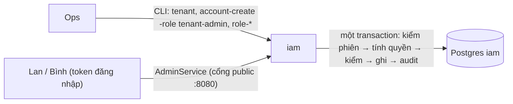
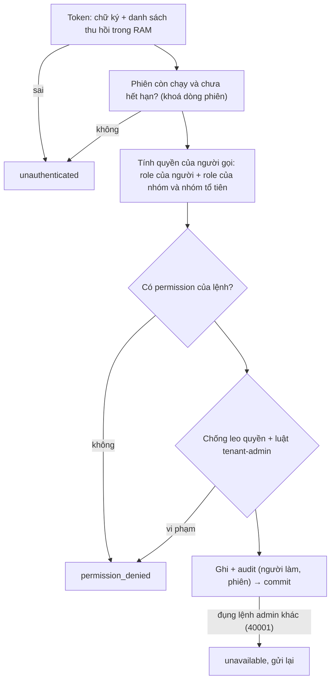

# M6 phần 3c.1: role và kiểm quyền — tóm tắt

> Ngày: 2026-10-31 · Nhánh `feat/m6` · Trạng thái: **chờ owner duyệt** · Quyết định: D233 (đã sửa theo owner 2026-10-31), D234 · Mô hình: [nghiên cứu](../research/261031-iam-authorization-models.md)
> **Các phần của 3c:** **(3c.1) role và kiểm quyền** · (3c.2) quản trị account, tạo theo lô · (3c.3) account máy.

## 1. Phần này làm gì

- **Ops tạo tenant** `acme` bằng CLI. Tenant tự có role `tenant-admin`. Ops tạo Lan bằng `account-create -role tenant-admin`.
- **Lan đăng nhập app** (như phần 1) và gọi `AdminService`:
  - tạo role `it-admin` gồm `iam:groups.read`, `iam:groups.members.write`, `iam:accounts.read`;
  - gán role đó cho nhóm `it`.
- **Bình ở `it-hcm`** (nhóm con của `it`) nên được thừa hưởng `it-admin`. Bình gọi `SetAccountGroups` đưa Hà vào nhóm `sale` → được.
- **Bình tự thêm mình vào nhóm `admins`** (nhóm mang `tenant-admin`) → `permission_denied`, vì nhóm đó trao thêm quyền Bình không có.
- **Bình gọi `CreateRole`** → `permission_denied`, vì `it-admin` không có `iam:roles.write`.
- **Lan gỡ `it-admin` khỏi nhóm `it`:** lần gọi kế tiếp của Bình bị từ chối ngay. Quyền không nằm trong token mà đọc từ DB mỗi lần gọi.
- **Bình gửi id một nhóm của tenant khác** → `not_found`, như thể nhóm đó không tồn tại.

## 2. Yêu cầu

| # | Yêu cầu | Nguồn |
|---|---|---|
| R1 | API admin có kiểm quyền, trên cổng public | D233 |
| R3 | Permission dạng `<client>:<resource>.<action>`; role là tập permission, theo tenant | D233 |
| R4 | Role gán được cho nhóm cây; nhóm con thừa hưởng | D233; cây nhóm 3a |
| R5 | Quyền đọc từ DB mỗi lần gọi; không đưa vào JWT | D233 |
| R6 | `tenant-admin` có sẵn khi tạo tenant; không ép tenant luôn còn admin | owner 2026-10-31 |
| R7 | `iam` chỉ lưu và cấp permission; đánh giá policy là việc của app | D217 |
| R8 | Không sửa app khác | D234; owner 2026-10-31 |
| R9 | DB riêng, không đọc bảng chéo | D177, D209 |
| R10 | Không retry nội bộ: `40001` → `unavailable` | D210 |
| R13 | Permission phải có trong danh mục của client | nghiên cứu §7 |
| R14 | Quyền quản trị chia nhỏ, độc lập | nghiên cứu §3 |

## 3. Trong và ngoài

| Trong 3c.1 | Ai làm |
|---|---|
| Bảng client, danh mục, role, gán role (migration 0004); `tenant-admin` tự tạo | `iam` (Postgres) |
| Tính quyền theo cây nhóm, chống leo quyền, luật `tenant-admin` | `iam` (gói kiểm quyền mới) |
| `AdminService`: role, gán role, nhóm, gán nhóm, xem/liệt kê account | `iam` (cổng public) |
| Kiểm phiên chưa hết hạn cho lệnh admin và lệnh phiên cũ (`checkCaller`) | `iam` |
| CLI: `role-*`, `account-roles`, `group-roles`, `account-create -role`, `client-permissions-set` | `iam` admincmd |
| e2e phase 16 | `tools/corecli`, `scripts/` |

| Ngoài 3c.1 | Ở đâu |
|---|---|
| Tạo account theo lô, đặt lại mật khẩu, khoá/mở, phiên của account | 3c.2 |
| Account máy | 3c.3 |
| Danh mục `chatim:*`; app đọc permission | Tích hợp sau khi `iam` xong (D234) |
| Role theo room, quyền theo tài nguyên | core (`members`), không phải `iam` |

## 4. Thuật ngữ

| Từ | Nghĩa |
|---|---|
| Permission | Một quyền, ví dụ `iam:groups.members.write` (client `iam`, tài nguyên `groups.members`, hành động `write`) |
| Danh mục | Các permission một client khai báo; role chỉ chứa được permission có trong danh mục |
| Role | Tập permission đặt tên, theo tenant, ví dụ `it-admin` |
| Quyền của một người | Gộp permission của role gán thẳng cho người đó với role của mọi nhóm trực tiếp và nhóm tổ tiên |
| `tenant-admin` | Role dựng sẵn, có mọi permission; không sửa, không xoá được |
| Leo quyền | Tự trao cho mình hoặc người khác quyền mà bản thân không có |

## 5. Bức tranh chung

Không thêm event và không thêm cache. Thay đổi nhóm và gán nhóm vẫn đi qua trigger danh bạ của 3a như trước. Role không vào feed danh bạ.

## 6. Dữ liệu (migration 0004)

| Bảng | Field chính | Ví dụ |
|---|---|---|
| `clients` | `id`, `name`, `created_at`, `updated_at`, `updated_by` | `iam` |
| `client_permissions` | `client_id`, `permission`, `description` | `iam`, `iam:roles.write` |
| `roles` | `tenant_id`, `id`, `name`, `builtin`, `ver`, `created_at`, `updated_at`, `updated_by` | `acme`, `it-admin`, false, 3 |
| `role_permissions` | `tenant_id`, `role_id`, `permission` (khoá ngoại tới danh mục) | `acme`, `it-admin`, `iam:groups.read` |
| `account_roles` | `tenant_id`, `account_id`, `role_id`, `created_at`, `created_by` | Lan → `tenant-admin` |
| `group_roles` | `tenant_id`, `group_id`, `role_id`, `created_at`, `created_by` | `it` → `it-admin` |

- **`groups.ancestors`** (cột mới, mảng id từ gốc tới cha, gốc là mảng rỗng): `it-hcm` → `{cong-ty, it}`. Owner chọn 2026-11-01 (lưu sẵn đường tổ tiên, thay vì đệ quy lúc đọc).
  - Trigger trên `groups` tự đặt cột này khi tạo nhóm hoặc đổi `parent_id`, và sửa luôn đường của cả cây con trong cùng transaction. Nhờ vậy CLI, API và 3a không đường ghi nào quên được.
  - Migration tính sẵn cho các nhóm đang có, từ `parent_id`.
  - Trigger danh bạ của 3a chỉ bắn khi đổi `name`, `parent_id`, `mentionable`, `state` (`0003_directory.sql:99-104`). Sửa `ancestors` của nhóm con không sinh bản ghi feed, nên đổi cha vẫn chỉ là 1 bản ghi (D228).
- **Index:** GIN trên `groups.ancestors` để tìm cây con khi đổi cha; `(tenant_id, role_id)` trên hai bảng gán.
- **`tenant-admin`:** trigger trên `tenants` tự tạo role này cho mọi tenant mới; migration thêm cho tenant đã có. Role này không có dòng nào trong `role_permissions`: luật hiểu nó là "mọi permission".
- **Danh mục `iam:*`:** nạp bằng migration. Unit test giữ cho dòng trong migration khớp danh sách trong code.

Danh mục `iam:*` (chia nhỏ theo cách Keycloak làm; có quyền sửa không có nghĩa là có quyền xem):

| Permission | Cho phép | Phase dùng |
|---|---|---|
| `iam:roles.read`, `iam:roles.write` | xem; tạo, sửa, xoá role | 3c.1 |
| `iam:roles.assign` | gán, gỡ role cho người và nhóm | 3c.1 |
| `iam:groups.read`, `iam:groups.write` | xem; tạo, sửa, xoá, đổi cha nhóm | 3c.1 |
| `iam:groups.members.write` | đặt nhóm cho một người | 3c.1 |
| `iam:accounts.read` | xem, liệt kê account | 3c.1 |
| `iam:accounts.create`, `iam:accounts.update`, `iam:accounts.reset_password`, `iam:accounts.sessions.revoke` | tạo; khoá/mở, profile; đặt lại mật khẩu; thu hồi phiên | 3c.2 |
| `iam:machines.write` | account máy và khoá | 3c.3 |

Lớp dữ liệu (§4): "cấu hình phân quyền": dòng Postgres, không event, không cache, đọc mỗi lần gọi, không cần sửa lỗi.

## 7. Luồng

**Mỗi lệnh `AdminService` là một transaction**, chạy đúng một lần:

**Luật chống leo quyền.** "Trao thêm" phải là tập con quyền của người gọi:

| Lệnh | Trao thêm là gì | Thêm điều kiện |
|---|---|---|
| Tạo, sửa role | permission mới thêm vào role | role dựng sẵn không sửa, không xoá được |
| Gán role cho người X | permission của role | quyền của X ⊆ quyền người gọi |
| Gán role cho nhóm | permission của role | không kiểm từng người trong nhóm (nhóm có thể 50K người), như luật `bind` của Kubernetes |
| Gỡ role khỏi người X | không trao gì | quyền của X ⊆ quyền người gọi |
| Gỡ role khỏi nhóm | không trao gì | role là `tenant-admin` thì chỉ `tenant-admin` gỡ được |
| Đặt nhóm cho người X | quyền từ các nhóm mới (kể cả nhóm tổ tiên) | quyền của X ⊆ quyền người gọi |
| Đổi cha nhóm G | quyền từ chuỗi tổ tiên mới | G hoặc tổ tiên cũ của G mang `tenant-admin` thì chỉ `tenant-admin` được xoá hay đổi cha (chỉ đi **lên** cây, không đi xuống) |

- Chỉ `tenant-admin` gán, gỡ, hay tác động lên người có `tenant-admin`.
- Ví dụ: Minh có `it-admin`, đổi cha nhóm `it-hcm` sang nhóm `hr` (mang role `hr-admin` có `iam:roles.write`). Minh không có `iam:roles.write` → `permission_denied`.

**Mã lỗi.**

| Mã | Khi nào |
|---|---|
| `unauthenticated` | token hỏng, phiên bị thu hồi hoặc hết hạn |
| `permission_denied` | thiếu permission, hoặc vi phạm luật chống leo quyền |
| `not_found` | id không có, hoặc thuộc tenant khác |
| `invalid_argument` | permission không có trong danh mục, id sai dạng |
| `failed_precondition` | sửa hoặc xoá role dựng sẵn; nhóm tạo thành vòng |
| `unavailable` | đụng lệnh admin khác (SERIALIZABLE), Postgres lỗi |
| `resource_exhausted` | quá giới hạn theo người |

**CLI** là đường của vận hành: không kiểm permission, nhưng vẫn ghi audit. Dùng để tạo `tenant-admin` đầu tiên và để cứu tenant lỡ mất admin.

## 8. Đúng đắn

- **Đua giữa lúc kiểm và lúc ghi.** Ví dụ: Bình đổi nhóm cho Hà đúng lúc Lan gán `tenant-admin` cho nhóm hiện tại của Hà. Kiểm của Bình chưa thấy `tenant-admin`.
  - Mọi transaction ghi của admin (cả API lẫn CLI) chạy SERIALIZABLE: Postgres phát hiện hai bên đọc-ghi chéo nhau và cho một bên lỗi `40001` → `unavailable`.
  - Gửi lại thì phép kiểm chạy lại và thấy Hà đã là `tenant-admin`, nên bị chặn.
  - Không có khoá theo tenant, không có chỗ xếp hàng mới. Khoá cây độc quyền của 3a vẫn chỉ dùng khi đổi cha nhóm (chống vòng).
- **Gỡ quyền có hiệu lực ngay:** quyền được tính trong cùng transaction với lệnh, không nằm trong token.
- **Phiên hết hạn bị chặn.** Lệnh admin và các lệnh phiên cũ (`ListSessions`, `RevokeSession`) cùng kiểm "còn chạy và chưa hết hạn" trong transaction. Hàm `checkCaller` cũ không kiểm hết hạn (3a ghi lại); sửa ở phase này.
- **Cô lập tenant:** mọi câu đọc và ghi đều có `tenant_id` của token; khoá ngoại đều kèm `tenant_id`.
- **Đường tổ tiên luôn khớp `parent_id`:** chỉ trigger ghi cột này, trong cùng transaction với lệnh đổi cha. Vòng bị chặn bằng phép kiểm "cha mới không nằm trong cây con của G" (`G` thuộc `ancestors` của cha mới). Đổi cha vẫn giữ khoá cây độc quyền của 3a (hiếm). Có itest so `ancestors` với kết quả đệ quy từ `parent_id` sau một chuỗi tạo, đổi cha, xoá ngẫu nhiên.
- **Không retry nội bộ:** `40001` và `40P01` trả `unavailable` ngay (D210).

## 9. Event và subject

Không có. Role và gán role không vào feed danh bạ. Nhóm và gán nhóm qua API đi đúng trigger của 3a, nên feed và cache RAM tự cập nhật như khi dùng CLI.

## 10. Thư viện và hạ tầng

Không thêm thư viện. Dùng lại Connect, `pkg/userlimit` (giới hạn riêng cho admin), và đường kiểm token cùng danh sách thu hồi trong RAM của `DirectoryService`.

## 11. Quyết định và phương án bị loại

| Chọn | Bỏ | Vì sao |
|---|---|---|
| RBAC theo tenant, gán qua nhóm cây | Casbin/OPA; ReBAC | Nghiên cứu §1; Casbin không làm được chống leo quyền và ghi cùng transaction (owner hỏi 2026-10-31) |
| Lưu sẵn đường tổ tiên `groups.ancestors`, trigger giữ đúng (owner chọn 2026-11-01) | Đệ quy lúc đọc; bảng closure; lưu sẵn quyền từng người | Tính quyền chỉ tra mỗi nhóm trực tiếp 1 dòng. Closure ghi nhiều hơn khi đổi cha. Lưu quyền từng người: đổi cha nhóm 50K người là 50K lần ghi |
| Quyền đọc từ DB mỗi lần gọi | Quyền trong JWT | Gỡ quyền phải chờ token hết hạn (D233) |
| Chống leo quyền kiểu Kubernetes | Tin người có `iam:roles.write` | Bình tự vào nhóm `admins` là thành tenant-admin |
| SERIALIZABLE cho lệnh ghi admin | Khoá theo tenant; khoá cây dạng chia sẻ | Khoá làm mọi lệnh admin của tenant chờ nhau |
| `tenant-admin` không có dòng permission (= mọi quyền) | Liệt kê mọi permission | Danh mục lớn thêm thì không phải backfill |
| Không ép luôn còn admin, cứu bằng CLI | Luật "luôn còn ≥ 1 owner" | Owner bỏ 2026-10-31; không sản phẩm nào ép |
| Danh mục chỉ có `iam:*` | Đăng ký `chatim:*` ngay | Trong M6 chưa ai đọc (D234) |

## 12. Chi phí

- **Mỗi lệnh admin:** một transaction gồm: kiểm phiên, một câu tính quyền (đệ quy lên chuỗi tổ tiên của các nhóm trực tiếp), phần kiểm của lệnh, phần ghi, một dòng audit.
- **Tính quyền của một người không đệ quy và không đi xuống.** Ví dụ cây `cong-ty` → `it` → `it-hcm` và `cong-ty` → `du-an` → `du-an-x`; Bình ở `it-hcm` và `du-an-x`.
  1. Đọc 2 dòng `account_groups` (nhóm trực tiếp), join 2 dòng `groups` bằng khoá chính, mỗi dòng mang sẵn `ancestors`: `{cong-ty, it}` và `{cong-ty, du-an}`.
  2. Gộp lại thành 5 nhóm, đọc role của chúng (`group_roles`) và role gán thẳng cho Bình (`account_roles`), rồi permission của các role.
  - Cả việc là một câu SQL, vài chục dòng, tra bằng khoá hay index. Số dòng tuỳ **số nhóm trực tiếp** của Bình, không tuỳ độ sâu cây hay tenant có 2.000 nhóm, 100K người.
- **Đổi cha nhóm** (hiếm): trigger sửa `ancestors` của cả cây con trong một câu. Ví dụ chuyển `it` (có 50 nhóm con) sang cha khác: 51 dòng `groups`; không đụng `account_groups`, không ghi gì theo người.
- **Bench dev:** tính quyền ở cây 5 tầng, 2.000 nhóm, người ở 10 nhóm; đổi cha một nhóm có 500 nhóm con.
- **Không tốn gì thêm** cho đăng nhập, `GetUsers`, feed hay app khác.

## 13. Rủi ro

- Hai admin cùng sửa một chỗ: một người nhận `unavailable` và phải gửi lại.
- Tenant-admin tự gỡ quyền admin cuối cùng: tenant không còn ai quản trị qua API; vận hành cứu bằng CLI.

## 14. Điểm đội tự chọn, owner phản biện

- Danh sách permission `iam:*` ở §6.
- Gỡ role khỏi một người cũng cần "quyền người bị gỡ ⊆ quyền mình"; gán hoặc gỡ role cho nhóm thì không kiểm từng người trong nhóm.
- Xoá role đang được gán thì gỡ luôn mọi chỗ gán (ghi audit), không từ chối.
- Liệt kê account trả mỗi trang 100, theo con trỏ id.
- Giới hạn theo người riêng cho admin: `IAM_ADMIN_USER_RATE` 10/s, `IAM_ADMIN_USER_BURST` 20, `IAM_ADMIN_INFLIGHT_MAX` 1.000 mỗi node.

## 15. Kiểm thử

- **Unit:**
  - dạng chuỗi permission;
  - tập con và luật `tenant-admin`;
  - mỗi RPC bị từ chối khi thiếu đúng permission của nó;
  - danh mục trong migration khớp trong code.
- **itest Postgres:**
  - nhóm cháu thừa hưởng role của gốc; đổi cha thì quyền đổi theo;
  - Bình tự vào nhóm `admins` → `permission_denied`;
  - đổi cha nhóm sang nhánh mạnh hơn → `permission_denied`;
  - id tenant khác → `not_found`; cùng tên role ở hai tenant;
  - gán và đổi nhóm đua nhau dưới SERIALIZABLE → một bên `unavailable`, gửi lại thì bị chặn;
  - gỡ role thì lần gọi sau bị từ chối;
  - tenant mới có `tenant-admin`; tenant cũ được thêm;
  - phiên hết hạn bị chặn ở lệnh admin và ở `ListSessions`.
- **Bench dev:** tính quyền ở cây 5 tầng, 2.000 nhóm.
- **e2e phase 16** (`E2E_ONLY=16`, rồi chạy đủ 16 phase):
  - CLI tạo tenant và Lan `tenant-admin`;
  - Lan tạo `it-admin` và gán cho nhóm của Bình;
  - Bình đổi nhóm của Hà → được; tự vào `admins` → `permission_denied`;
  - id tenant khác → `not_found`;
  - Lan gỡ role → lệnh kế tiếp của Bình bị từ chối.
- **Ngân sách kiểm:**
  - `make itest` vì đổi pgstore;
  - một reviewer cho phần kiểm quyền và chống leo quyền;
  - phase 13–15 vẫn qua.

## Bảng phủ

| Yêu cầu | Thành phần | Test | Bằng chứng |
|---|---|---|---|
| R1 API admin có kiểm quyền | `AdminService` + gói kiểm quyền | unit từng RPC; e2e 16 | (điền sau khi xây) |
| R3 permission, role | migration 0004, kiểm dạng chuỗi | unit dạng chuỗi; itest cùng tên role hai tenant | |
| R4 nhóm con thừa hưởng | câu tính quyền đệ quy | itest nhóm cháu, đổi cha | |
| R5 đọc DB mỗi lần | tính quyền trong transaction | itest gỡ role → bị từ chối; token không có claim quyền | |
| R6 `tenant-admin` có sẵn, không ép | trigger + backfill | itest tenant mới và cũ; itest tự gỡ admin cuối được | |
| R7 chỉ lưu và cấp | không có API đánh giá cho app | xem lại proto; unit chỉ chặn `iam:*` | |
| R8 không sửa app khác | chỉ đổi trong `iam`, proto `iam`, e2e | `git diff --stat`; `make lint` | |
| R9 DB riêng | depguard `iam-boundaries` | `make lint` | |
| R10 không retry nội bộ | SERIALIZABLE, `40001` → `unavailable` | itest đua | |
| R13 danh mục | khoá ngoại tới `client_permissions` | itest `iam:acounts.read` → `invalid_argument` | |
| R14 quyền chia nhỏ | danh mục §6 | unit: có `groups.write` mà không có `groups.read` thì không liệt kê được | |
