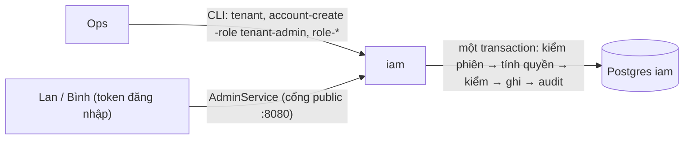
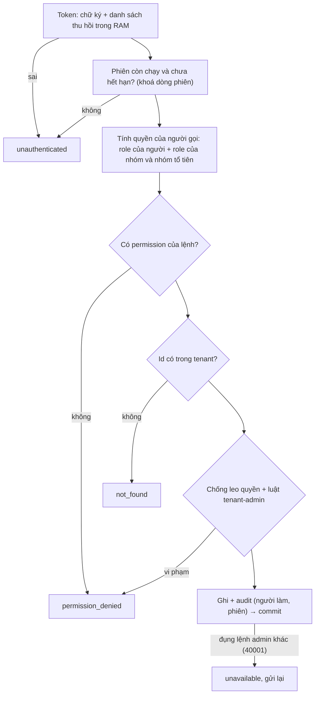

# M6 phần 3c.1: role và kiểm quyền — tóm tắt

> **Đổi hướng owner 2026-11-02:** chat không giữ danh tính; `iam` đổi tên `identity`. Đăng nhập mật khẩu, phiên, refresh token, DPoP, role và `AdminService` đã gỡ ở M6 PA; phần còn giữ (khoá ký, thu hồi theo tenant, danh bạ) chạy tiếp dưới tên `identity` ([tóm tắt PA](2026-11-02-m6-pa-identity-doi-token-summary.md)). Tài liệu này giữ nguyên như lúc xây.
> Ngày: 2026-10-31, viết lại theo bản đã xây 2026-11-01 · Nhánh `feat/m6` (`52dad0f`…`15641e3`) · Trạng thái: **đã xây (`dev-done`)** · Quyết định: D233, D235, D236 (3c.2: D237, 3c.3: D238), D234 · Mô hình: [nghiên cứu](../research/261031-iam-authorization-models.md)
> **Các phần của 3c:** **(3c.1) role và kiểm quyền** · (3c.2) quản trị account, tạo theo lô · (3c.3) account máy.

## 1. Phần này làm gì

- **Ops tạo tenant** `acme` bằng CLI. Tenant tự có role `tenant-admin`. Ops tạo Lan bằng `account-create -role tenant-admin`.
- **Lan đăng nhập app** (như phần 1) và gọi `AdminService`:
  - tạo role `it-admin` gồm `iam:groups.read`, `iam:groups.members.write`, `iam:accounts.read`;
  - gán role đó cho nhóm `it`.
- **Bình ở `it-hcm`** (nhóm con của `it`) nên được thừa hưởng `it-admin`. Bình gọi `SetAccountGroups` đưa Hà vào nhóm `sale` → được.
- **Bình tự thêm mình vào nhóm `admins`** (nhóm mang `tenant-admin`) → `permission_denied`, vì nhóm đó trao thêm quyền Bình không có.
- **Bình gọi `CreateRole`** → `permission_denied`, vì `it-admin` không có `iam:roles.write`.
- **Lan gỡ `it-admin` khỏi nhóm `it`:** lần gọi kế tiếp của Bình bị từ chối ngay. Quyền không nằm trong token mà đọc từ DB mỗi lần gọi.
- **Bình gửi id một nhóm của tenant khác** → `not_found`, như thể nhóm đó không tồn tại.

## 2. Yêu cầu

| # | Yêu cầu | Nguồn |
|---|---|---|
| R1 | API admin có kiểm quyền, trên cổng public | D233 |
| R3 | Permission dạng `<client>:<resource>.<action>`; role là tập permission, theo tenant | D233 |
| R4 | Role gán được cho nhóm cây; nhóm con thừa hưởng | D233; cây nhóm 3a |
| R5 | Quyền đọc từ DB mỗi lần gọi; không đưa vào JWT | D233 |
| R6 | `tenant-admin` có sẵn khi tạo tenant; không ép tenant luôn còn admin | owner 2026-10-31 |
| R7 | `iam` chỉ lưu và cấp permission; đánh giá policy là việc của app | D217 |
| R8 | Không sửa app khác | D234; owner 2026-10-31 |
| R9 | DB riêng, không đọc bảng chéo | D177, D209 |
| R10 | Không retry nội bộ: `40001` → `unavailable` | D210 |
| R13 | Permission phải có trong danh mục của client | nghiên cứu §7 |
| R14 | Quyền quản trị chia nhỏ, độc lập | nghiên cứu §3 |

## 3. Trong và ngoài

| Trong 3c.1 | Ai làm |
|---|---|
| Bảng client, danh mục, role, gán role (migration 0004); `tenant-admin` tự tạo | `iam` (Postgres) |
| Tính quyền theo cây nhóm, chống leo quyền, luật `tenant-admin` | `iam` (gói kiểm quyền mới) |
| `AdminService`: role, gán role, nhóm, gán nhóm, xem/liệt kê account | `iam` (cổng public) |
| Kiểm phiên chưa hết hạn cho lệnh admin và lệnh phiên cũ (`checkCaller`) | `iam` |
| Giới hạn số transaction admin giữ kết nối Postgres (`IAM_ADMIN_DB_SLOTS`) | `iam` |
| CLI: `role-*`, `account-roles`, `group-roles`, `account-create -role`, `client-permissions-set` | `iam` admincmd |
| e2e phase 16 | `tools/corecli`, `scripts/` |

| Ngoài 3c.1 | Ở đâu |
|---|---|
| Tạo account theo lô, đặt lại mật khẩu, khoá/mở, phiên của account | 3c.2 |
| Account máy | 3c.3 |
| Danh mục `chatim:*`; app đọc permission | Tích hợp sau khi `iam` xong (D234) |
| Role theo room, quyền theo tài nguyên | core (`members`), không phải `iam` |

## 4. Thuật ngữ

| Từ | Nghĩa |
|---|---|
| Permission | Một quyền, ví dụ `iam:groups.members.write` (client `iam`, tài nguyên `groups.members`, hành động `write`) |
| Danh mục | Các permission một client khai báo; role chỉ chứa được permission có trong danh mục |
| Role | Tập permission đặt tên, theo tenant, ví dụ `it-admin` |
| Quyền của một người | Gộp permission của role gán thẳng cho người đó với role của mọi nhóm trực tiếp và nhóm tổ tiên |
| `tenant-admin` | Role dựng sẵn, có mọi permission; không sửa, không xoá được |
| Leo quyền | Tự trao cho mình hoặc người khác quyền mà bản thân không có |

## 5. Bức tranh chung

Không thêm event và không thêm cache. Thay đổi nhóm và gán nhóm vẫn đi qua trigger danh bạ của 3a như trước. Role không vào feed danh bạ.

## 6. Dữ liệu (migration 0004)

| Bảng | Field chính | Ví dụ |
|---|---|---|
| `clients` | `id`, `name`, `created_at`, `updated_at`, `updated_by` | `iam` |
| `client_permissions` | `client_id`, `permission`, `description` | `iam`, `iam:roles.write` |
| `roles` | `tenant_id`, `id`, `name`, `builtin`, `ver`, `created_at`, `updated_at`, `updated_by` | `acme`, `it-admin`, false, 3 |
| `role_permissions` | `tenant_id`, `role_id`, `permission` (khoá ngoại tới danh mục) | `acme`, `it-admin`, `iam:groups.read` |
| `account_roles` | `tenant_id`, `account_id`, `role_id`, `created_at`, `created_by` | Lan → `tenant-admin` |
| `group_roles` | `tenant_id`, `group_id`, `role_id`, `created_at`, `created_by` | `it` → `it-admin` |

- **`groups.ancestors`** (cột mới, mảng id từ gốc tới cha, gốc là mảng rỗng): `it-hcm` → `{cong-ty, it}`. Owner chọn 2026-11-01 (lưu sẵn đường tổ tiên, thay vì đệ quy lúc đọc).
  - Trigger trên `groups` tự đặt cột này khi tạo nhóm hoặc đổi `parent_id`, và sửa luôn đường của cả cây con trong cùng transaction. Nhờ vậy CLI, API và 3a không đường ghi nào quên được.
  - Migration tính sẵn cho các nhóm đang có, từ `parent_id`.
  - Trigger danh bạ của 3a chỉ bắn khi đổi `name`, `parent_id`, `mentionable`, `state` (`0003_directory.sql:99-104`). Sửa `ancestors` của nhóm con không sinh bản ghi feed, nên đổi cha vẫn chỉ là 1 bản ghi (D228).
- **Index:** GIN trên `groups.ancestors` để tìm cây con khi đổi cha; `(tenant_id, role_id)` trên hai bảng gán.
- **`tenant-admin`:** trigger trên `tenants` tự tạo role này cho mọi tenant mới; migration thêm cho tenant đã có. Role này không có dòng nào trong `role_permissions`: luật hiểu nó là "mọi permission".
- **Danh mục `iam:*`:** nạp bằng migration. Unit test giữ cho dòng trong migration khớp danh sách trong code.

Danh mục `iam:*` (chia nhỏ theo cách Keycloak làm; có quyền sửa không có nghĩa là có quyền xem):

| Permission | Cho phép | Phase dùng |
|---|---|---|
| `iam:roles.read`, `iam:roles.write` | xem; tạo, sửa, xoá role | 3c.1 |
| `iam:roles.assign` | gán, gỡ role cho người và nhóm | 3c.1 |
| `iam:groups.read`, `iam:groups.write` | xem; tạo, sửa, xoá, đổi cha nhóm | 3c.1 |
| `iam:groups.members.write` | đặt nhóm cho một người | 3c.1 |
| `iam:accounts.read` | xem, liệt kê account | 3c.1 |
| `iam:accounts.create`, `iam:accounts.update`, `iam:accounts.reset_password`, `iam:accounts.sessions.revoke` | tạo; khoá/mở, profile; đặt lại mật khẩu; thu hồi phiên | 3c.2 |
| `iam:machines.write` | account máy và khoá | 3c.3 |

Lớp dữ liệu (§4): "cấu hình phân quyền": dòng Postgres, không event, không cache, đọc mỗi lần gọi, không cần sửa lỗi.

## 7. Luồng

**Mỗi lệnh `AdminService` là một transaction**, chạy đúng một lần:

**Luật chống leo quyền.** "Trao thêm" phải là tập con quyền của người gọi:

| Lệnh | Trao thêm là gì | Thêm điều kiện |
|---|---|---|
| Tạo, sửa role | permission mới thêm vào role | role dựng sẵn không sửa, không xoá được |
| Gán role cho người X | permission của role | quyền của X ⊆ quyền người gọi |
| Gán role cho nhóm | permission của role | không kiểm từng người trong nhóm (nhóm có thể 50K người), như luật `bind` của Kubernetes |
| Gỡ role khỏi người X | không trao gì | quyền của X ⊆ quyền người gọi |
| Gỡ role khỏi nhóm | không trao gì | role là `tenant-admin` thì chỉ `tenant-admin` gỡ được |
| Đặt nhóm cho người X | quyền từ các nhóm mới (kể cả nhóm tổ tiên) | quyền của X ⊆ quyền người gọi |
| Tạo nhóm dưới cha P | quyền từ P và tổ tiên của P | — |
| Đổi cha nhóm G | quyền từ chuỗi tổ tiên mới | G hoặc tổ tiên cũ của G mang `tenant-admin` thì chỉ `tenant-admin` được xoá hay đổi cha (chỉ đi **lên** cây, không đi xuống) |

- Chỉ `tenant-admin` gán, gỡ, hay tác động lên người có `tenant-admin`.
- Ví dụ: Minh có `it-admin`, đổi cha nhóm `it-hcm` sang nhóm `hr` (mang role `hr-admin` có `iam:roles.write`). Minh không có `iam:roles.write` → `permission_denied`.
- Tạo role và đặt nhóm cho người thì ghi trước, kiểm leo quyền sau, bị từ chối thì rollback. Nhờ vậy gõ sai permission luôn ra `invalid_argument`, id nhóm lạ luôn ra `not_found`, kể cả khi người gọi không đủ quyền.
- Bớt quyền thì không bị chặn: người có `iam:groups.write` xoá hay đổi cha một nhóm mang role mạnh (không phải `tenant-admin`) làm thành viên mất quyền; không ai được thêm quyền.

**Mã lỗi.**

| Mã | Khi nào |
|---|---|
| `unauthenticated` | token hỏng, phiên bị thu hồi hoặc hết hạn |
| `permission_denied` | thiếu permission, hoặc vi phạm luật chống leo quyền |
| `not_found` | id không có, hoặc thuộc tenant khác |
| `invalid_argument` | permission không có trong danh mục, id sai dạng |
| `failed_precondition` | sửa hoặc xoá role dựng sẵn; nhóm tạo thành vòng |
| `unavailable` (+ `Retry-After: 1`) | đụng lệnh admin khác (SERIALIZABLE), chờ khoá hay chạy quá 5s, hết suất, node đầy, Postgres lỗi |
| `resource_exhausted` | quá giới hạn theo người |

Nội dung lỗi gửi client cắt ở 200 byte. `CreateGroup`/`UpdateGroup` trả nhóm có `role_ids` rỗng (xem bằng `ListGroups`). `GetAccount`/`ListAccounts` chỉ trả nhóm và role của account khi người gọi có `iam:groups.read`/`iam:roles.read`.

**CLI** là đường của vận hành: không kiểm permission, nhưng vẫn ghi audit `admin-cli`. Dùng để tạo `tenant-admin` đầu tiên (`account-create -role tenant-admin`) và để cứu tenant lỡ mất admin (`account-roles -roles tenant-admin`). Lệnh nhóm của CLI cũng chạy SERIALIZABLE: đụng lệnh khác thì thoát 1 với `unavailable`, chạy lại là được.

## 8. Đúng đắn

- **Đua giữa lúc kiểm và lúc ghi.** Ví dụ: Minh gán role `R` cho Hà đúng lúc Bình đổi nhóm cho Hà; cả hai cùng đọc quyền của Hà.
  - Mọi transaction ghi của admin (cả API lẫn CLI) chạy SERIALIZABLE: Postgres thấy hai bên đọc-ghi chéo nhau và cho Bình lỗi `40001` → `unavailable`.
  - Bình gửi lại thì phép kiểm chạy lại, thấy Hà đã có `R` mà Bình không có, nên bị chặn (`TestStoryRaceThenRetryIsBlocked`).
  - Không có khoá theo tenant. Khoá cây của 3a vẫn dùng ở ba chỗ như cũ: tạo nhóm có cha, đổi cha, xoá nhóm. Khoá này nay lấy **trước** `BEGIN`, để transaction thấy kết quả của người vừa nhả khoá.
- **Lệnh admin không chiếm hết Postgres:** chờ khoá hay chạy quá 5s thì trả `unavailable`; mỗi node chỉ cho `IAM_ADMIN_DB_SLOTS` (4) transaction admin cùng lúc; khởi động kiểm `IAM_ADMIN_DB_SLOTS + IAM_DIRECTORY_LOAD_SLOTS + 2 ≤ IAM_PG_MAX_CONNS`, nên đăng nhập luôn còn kết nối. Lỗi hay panic giữa chừng đều nhả khoá và trả kết nối.
- **Gỡ quyền có hiệu lực ngay:** quyền được tính trong cùng transaction với lệnh, không nằm trong token (e2e 16: token của Bình chỉ có `iss aud sub tid sid iat exp`).
- **Phiên hết hạn bị chặn** ở lệnh admin và ở `ListSessions`/`RevokeSession` (`checkCaller` nay kiểm hạn).
- **Cô lập tenant:** mọi câu đọc và ghi đều có `tenant_id` của token; id tenant khác → `not_found`.
- **Đường tổ tiên luôn khớp `parent_id`:** trigger ghi cột này trong cùng transaction; itest so `ancestors` với kết quả đệ quy từ `parent_id` sau 300 thao tác ngẫu nhiên. Vòng bị chặn bằng phép kiểm của store và trigger (`groups_no_cycle`). SQL viết tay phải đổi cha từng dòng một và chèn nhóm cha trước nhóm con.
- **Không retry nội bộ:** `40001`, `40P01`, `55P03`, `57014` trả `unavailable` ngay (D210).

## 9. Event và subject

Không có. Role và gán role không vào feed danh bạ. Nhóm và gán nhóm qua API đi đúng trigger của 3a, nên feed và cache RAM tự cập nhật như khi dùng CLI.

## 10. Thư viện và hạ tầng

Không thêm thư viện. Dùng lại Connect, `pkg/userlimit` (giới hạn riêng cho admin), và đường kiểm token cùng danh sách thu hồi trong RAM của `DirectoryService`. Makefile: `make itest ITEST_ARGS="…"` chạy itest và bench của một app.

Config mới: `IAM_ADMIN_USER_RATE` 10/s, `IAM_ADMIN_USER_BURST` 20, `IAM_ADMIN_INFLIGHT_MAX` 1.000, `IAM_ADMIN_DB_SLOTS` 4. Metric mới: `chatim_iam_admin_calls_total{result}`, `admin_denied_total{rpc}`, `admin_user_limited_total`, `admin_inflight_rejected_total`, `admin_slot_timeouts_total`; không thêm alert (lệnh bị từ chối là lỗi của client).

## 11. Quyết định và phương án bị loại

| Chọn | Bỏ | Vì sao |
|---|---|---|
| RBAC theo tenant, gán qua nhóm cây | Casbin/OPA; ReBAC | Nghiên cứu §1; Casbin không làm được chống leo quyền và ghi cùng transaction (owner hỏi 2026-10-31) |
| Lưu sẵn đường tổ tiên `groups.ancestors`, trigger giữ đúng (owner chọn 2026-11-01) | Đệ quy lúc đọc; bảng closure; lưu sẵn quyền từng người | Tính quyền chỉ tra mỗi nhóm trực tiếp 1 dòng. Closure ghi nhiều hơn khi đổi cha. Lưu quyền từng người: đổi cha nhóm 50K người là 50K lần ghi |
| Quyền đọc từ DB mỗi lần gọi | Quyền trong JWT | Gỡ quyền phải chờ token hết hạn (D233) |
| Chống leo quyền kiểu Kubernetes | Tin người có `iam:roles.write` | Bình tự vào nhóm `admins` là thành tenant-admin |
| SERIALIZABLE cho lệnh ghi admin | Khoá theo tenant; khoá cây dạng chia sẻ | Khoá làm mọi lệnh admin của tenant chờ nhau |
| `tenant-admin` không có dòng permission (= mọi quyền) | Liệt kê mọi permission | Danh mục lớn thêm thì không phải backfill |
| Không ép luôn còn admin, cứu bằng CLI | Luật "luôn còn ≥ 1 owner" | Owner bỏ 2026-10-31; không sản phẩm nào ép |
| Danh mục chỉ có `iam:*` | Đăng ký `chatim:*` ngay | Trong M6 chưa ai đọc (D234) |

## 12. Chi phí

- **Mỗi lệnh admin:** một transaction gồm kiểm phiên, một câu tính quyền, phần kiểm của lệnh, phần ghi, một dòng audit.
- **Tính quyền không đệ quy và không đi xuống.** Ví dụ cây `cong-ty` → `it` → `it-hcm` và `cong-ty` → `du-an` → `du-an-x`; Bình ở `it-hcm` và `du-an-x`.
  1. Đọc 2 dòng `account_groups`, join 2 dòng `groups` bằng khoá chính, mỗi dòng mang sẵn `ancestors`: `{cong-ty, it}` và `{cong-ty, du-an}`.
  2. Gộp lại thành 5 nhóm, đọc role của chúng và role gán thẳng cho Bình, rồi permission của các role.
  - `EXPLAIN` trên 41K nhóm, 25K account: chỉ quét index khoá chính, không quét tuần tự.
- **Bench dev 2026-11-01** (`CPU_Speed_Limit` 100):
  - tính quyền, cây 5 tầng 2.000 nhóm, người ở 10 nhóm: 0,24 ms, đọc 261 dòng;
  - đổi cha một nhóm có 500 nhóm con: 21,9 ms.
- **Không tốn gì thêm** cho đăng nhập, `GetUsers`, feed hay app khác.

## 13. Rủi ro

- **Tenant nhỏ, nhiều admin bấm cùng lúc thì một phần lệnh phải gửi lại.** Postgres phát hiện xung đột theo trang dữ liệu, mà dữ liệu của tenant nhỏ nằm chung một trang. Đo dev: tenant 17 account, 8 admin sửa 8 người khác nhau liên tục trong 3s → 38% lệnh nhận `unavailable`; tenant có thêm 10.000 account → 0%. Client gửi lại theo `Retry-After`; lệnh đổi cha nhóm lớn không bị huỷ.
- Tenant-admin tự gỡ quyền admin cuối cùng: tenant không còn ai quản trị qua API; vận hành cứu bằng CLI.

## 14. Điểm đội tự chọn, owner phản biện

- Danh sách permission `iam:*` ở §6.
- Gỡ role khỏi một người cũng cần "quyền người bị gỡ ⊆ quyền mình"; gán hoặc gỡ role cho nhóm thì không kiểm từng người trong nhóm.
- Xoá role đang được gán thì gỡ luôn mọi chỗ gán (ghi audit), không từ chối.
- Liệt kê account trả mỗi trang 100, theo con trỏ id.
- Giới hạn theo người riêng cho admin: `IAM_ADMIN_USER_RATE` 10/s, `IAM_ADMIN_USER_BURST` 20, `IAM_ADMIN_INFLIGHT_MAX` 1.000 mỗi node.
- Gán role đã có, gỡ role không có: trả ok, không ghi audit. Sửa role hay nhóm mà không gửi trường nào: `invalid_argument`. `mentionable` mặc định true như CLI.

**Mang sang sau:**
- `pool.Acquire` của CLI không có hạn riêng (API có hạn request).
- GIN chỉ trên `ancestors`, chưa kèm `tenant_id` (cần `btree_gin`); đổi cha hiếm nên chấp nhận.
- `client-permissions-set` chưa kiểm dạng id client khi file rỗng.
- Vài test biên của khoá cây (hết giờ bên trong transaction có khoá, huỷ lúc đang chờ khoá) chưa có.

## 15. Kiểm thử (kết quả)

- **Unit:** dạng permission, tập con và luật `tenant-admin` (`authz`, 41 ca leo quyền); mỗi RPC bị từ chối khi thiếu đúng permission của nó; thứ tự lỗi (`manage`, 38 ca leo quyền + 11 ca thứ tự); danh mục migration khớp code; `mapErr`; mã lỗi Connect và mỗi RPC trong proto có permission (`api`); config và metric.
- **itest Postgres** (`make itest ITEST_ARGS="-race -shuffle=on -count=1 ./apps/iam/..."`, mọi package `ok`, không test nào bị bỏ qua): 10 câu chuyện ở `manage_integration_test.go`; trigger `ancestors` và chặn vòng; SERIALIZABLE, khoá cây được nhả cả khi panic (`-count=5`); tính quyền và cô lập tenant; role, gán role, trang 100; CLI và cứu tenant mất admin.
- **itest 3a đổi kỳ vọng một chỗ:** đặt nhóm trong lúc xoá nhóm, bên thua nay nhận `unavailable` (gửi lại thì có kết quả đúng) thay vì chờ.
- **e2e:** `E2E_ONLY=16 make e2e` → `e2e PASS: phase 16 only`; `make e2e` đủ 16 phase PASS, phase 13–15 vẫn qua; log `iam` không chứa bí mật nào của phase 16.
- **Review:** một reviewer cho T1, T3, T4, T5, T8; không có Critical; một Important ở T8 (thứ tự lỗi) đã sửa ở `bc53f40`.

## Bảng phủ

| Yêu cầu | Thành phần | Test | Bằng chứng |
|---|---|---|---|
| R1 API admin có kiểm quyền | `AdminService` + `authz` + `manage` | `TestEachRPCNeedsItsPermission`, `TestEveryAdminProcedureHasARequiredPermission`, `TestAdminServiceIsMounted`, e2e 16 | `6cdffa7`, `cb564ae`, `8e89982`, `15641e3` |
| R3 permission, role | migration 0004, `authz.Parse` | `TestParsePermission*`, `TestSameRoleIDInTwoTenants` | `710ca89`, `90f771c`, `64dae10` |
| R4 nhóm con thừa hưởng | `groups.ancestors` + câu tính quyền | `TestGrandchildInheritsTheRootRole`, `TestStoryGrandchildInheritsAndMoveFollows`, `TestAncestorsFollowParentThroughRandomOps` | `90f771c`, `7806327`, `0b2a56b` |
| R5 đọc DB mỗi lần | tính quyền trong transaction | `TestStoryUnassignTakesEffectOnTheNextCall`; e2e 16 khoá JWT | `0b2a56b`, `15641e3` |
| R6 `tenant-admin` có sẵn, không ép | trigger + backfill, CLI | `TestNewTenantGetsTenantAdmin`, `TestMigrationBackfillsTenantAdminAndAncestors`, `TestStoryLastTenantAdminMayRemoveItself`, `TestRescueALostTenantAdmin` | `90f771c`, `f615acf`, `0b2a56b` |
| R7 chỉ lưu và cấp | proto không có RPC đánh giá | `TestRequiredPermissionsAreIAMCatalogEntries` | `62a5e46` |
| R8 không sửa app khác | chỉ `iam`, proto `iam`, e2e, Makefile | `git diff --stat 92eeb92..HEAD`; `make lint` 0 issues | `15641e3` |
| R9 DB riêng | depguard `iam-boundaries`, `iam-authz-pure` | `make lint`; `TestGrantStaysInsideTheTenant` | `710ca89`, `7806327` |
| R10 không retry nội bộ | SERIALIZABLE, `mapErr` | `TestCrossedAdminWritesConflict`, `TestStoryRaceThenRetryIsBlocked`, `TestMapErrKeepsDomainErrors` | `8edc158`, `7806327`, `0b2a56b` |
| R13 danh mục | `client_permissions` + kiểm trước khi ghi | `TestMigrationCatalogMatchesTheCode`, `TestCreateRoleRejectsUnknownPermission`, `TestStoryUnknownPermissionIsInvalid` | `90f771c`, `64dae10`, `bc53f40` |
| R14 quyền chia nhỏ | 12 permission `iam:*` | `TestWriteDoesNotImplyRead`, `TestStoryWriteWithoutRead` | `710ca89`, `0b2a56b` |
