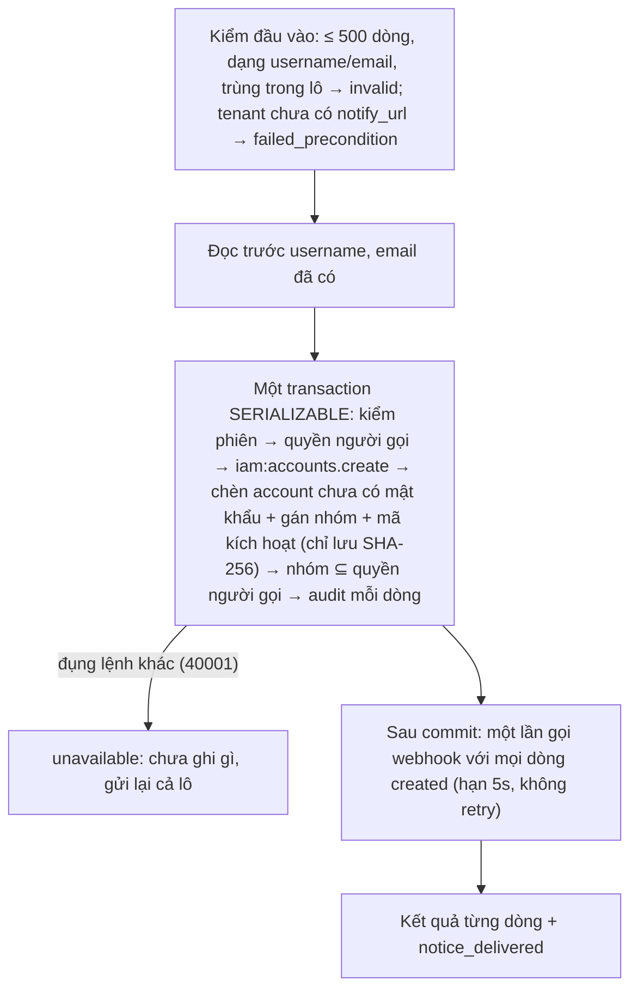

# M6 phần 3c.2: quản trị account, tạo theo lô, link đặt mật khẩu — tóm tắt

> **Bỏ 2026-11-02, chưa xây:** owner đổi hướng, chat không giữ danh tính (không account, mật khẩu, role), nên phần này không còn làm ([tóm tắt PA](2026-11-02-m6-pa-identity-doi-token-summary.md)).
> Ngày: 2026-11-01 · Nhánh `feat/m6` · Trạng thái: **owner duyệt 2026-11-01** · Quyết định: D237, D212 (đổi 2026-11-01: admin không đặt mật khẩu giùm), dựa trên D235–D236 (3c.1) · Mô hình: [nghiên cứu](../research/261031-iam-authorization-models.md)
> **Các phần của 3c:** (3c.1) role và kiểm quyền ✅ · **(3c.2) quản trị account, tạo theo lô** · (3c.3) account máy.

## 1. Phần này làm gì

- **Không admin nào đặt hay thấy mật khẩu của người khác** (owner 2026-11-01). Admin chỉ vô hiệu mật khẩu hiện tại, hoặc yêu cầu `iam` gửi cho người đó một link dùng một lần. Vận hành vẫn có đường cứu hộ bằng CLI (in mật khẩu tạm, có audit).
- **Backend acme nạp người dùng.** Minh mang role `provisioner` (`iam:accounts.create`, `iam:groups.members.write`). Backend gọi `CreateAccounts` với lô 500 người, mỗi người có username, tên, email và nhóm (ví dụ `sale`), **không có mật khẩu**.
  - `iam` tạo account chưa có mật khẩu, sinh cho mỗi người một mã kích hoạt (hạn 7 ngày), rồi gọi webhook notify của tenant acme **một lần** với cả 500 mã. Hệ thống notify của acme gửi email/SMS/Zalo tuỳ nó.
  - Kết quả từng dòng: `created` (kèm id), `exists` (username đã có, kèm id, không sửa, không gửi) hoặc `invalid` (kèm lý do, ví dụ email trùng).
  - Mạng đứt giữa chừng thì gửi lại cả lô: người đã tạo thành `exists`.
- **Hà quên mật khẩu.** it-admin gọi `SendPasswordReset(ha)`: `iam` sinh mã (hạn 30 phút) và gửi qua webhook. Hà mở link trong app acme, nhập mật khẩu mới; app gọi `CompletePasswordReset(mã, mật khẩu mới)` của `iam`. Mã dùng xong là hết, mọi phiên cũ bị thu hồi. it-admin không bao giờ thấy mã hay mật khẩu.
- **Nghi lộ mật khẩu.** it-admin gọi `DisablePassword(binh)`: mật khẩu cũ hết dùng, phiên bị thu hồi; Bình chỉ vào lại được qua link.
- **Bình nghỉ việc.** `SetAccountState(binh, disabled)`: phiên bị thu hồi, kết nối websocket bị cắt trong vài giây (đường thu hồi của phần 2).
- **Bị chặn:** it-admin gửi link đặt lại cho Lan (`tenant-admin`) → `permission_denied`, vì quyền của Lan lớn hơn.

## 2. Yêu cầu

| # | Yêu cầu | Nguồn |
|---|---|---|
| R2 | Product mới cấp ~100K account qua API (chưa có admin UI) | D233 |
| R10 | Không retry nội bộ: `40001` → `unavailable` | D210 |
| R11 | Cấu hình sai thì không chạy | D225 |
| R14 | Quyền quản trị chia nhỏ, độc lập | nghiên cứu §3 |
| R15 | Tác động lên account X chỉ khi quyền(X) ⊆ quyền người gọi | D236 |
| R18 | Admin không đặt, không thấy mật khẩu người khác; chỉ vô hiệu hoặc gửi link do server sinh | owner 2026-11-01 |
| R19 | Link gửi qua hệ thống notify đã tích hợp của tenant | owner 2026-11-01 |

## 3. Trong và ngoài

| Trong 3c.2 | Ai làm |
|---|---|
| RPC admin `CreateAccounts`, `UpdateAccount`, `SetAccountState`, `SendPasswordReset`, `DisablePassword`, `ListAccountSessions`, `RevokeAccountSession` | `iam` `AdminService` |
| RPC public `CompletePasswordReset` | `iam` `AuthService` (không cần đăng nhập) |
| Bảng `password_tokens`, `password_hash` được rỗng, `tenants.notify_url` (migration 0005) | `iam` |
| Gọi webhook có ký; CLI `tenant-notify-set` | `iam` |
| e2e phase 17 (có bên nhận webhook giả) | `tools/corecli`, `scripts/` |

| Ngoài 3c.2 | Ở đâu |
|---|---|
| Gửi email/SMS/Zalo thật | Hệ thống notify của tenant (sau này có thể là M8) |
| Trang nhập mật khẩu mới | App của product, gọi `CompletePasswordReset` |
| Tự bấm "quên mật khẩu" không qua admin | Chưa có use case (D212); mã và API đã sẵn cho việc này sau |
| Gán role lúc tạo theo lô | Gán sau bằng `AssignAccountRole` |
| CLI vận hành (`account-create`, `password-reset`) | Giữ nguyên, vẫn in mật khẩu tạm (cứu hộ) |
| Account máy | 3c.3 |

## 4. Luồng

**Tạo theo lô:**

- Lô không băm mật khẩu nên nhanh: chỉ là chèn dòng. 100K người là 200 lô.
- Webhook lỗi thì account vẫn được tạo, mã vẫn sống, phản hồi báo `notice_delivered = false`; người gọi gọi `SendPasswordReset` cho những người đó (mã mới thay mã cũ).

**Webhook:** `POST notify_url` của tenant, body là một JWT ký bằng khoá ký của `iam` (`typ` `notice+jwt`, `aud` = URL, `iat`, `jti`), chứa danh sách `{account_id, username, display_name, email, purpose, token, expires_at}`. Bên nhận kiểm chữ ký bằng JWKS công khai của `iam`, không cần secret chung. Chỉ `https` (dev cho `http`). URL chỉ vận hành đặt được (`tenant-notify-set`).

**Hoàn tất:** `CompletePasswordReset(tenant, token, new_password)` → so SHA-256 của mã, còn hạn → băm mật khẩu (suất băm chung, không chờ, như đăng nhập) → đặt mật khẩu, bỏ cờ bắt đổi, thu hồi mọi phiên, xoá mã. Mã sai hay hết hạn đều trả một lỗi chung, không lộ account có tồn tại. Giới hạn theo IP như đăng nhập.

## 5. Lệnh trên một account

| RPC | Permission | Việc |
|---|---|---|
| `UpdateAccount` | `iam:accounts.update` | sửa tên, email, avatar; feed danh bạ +1 bản ghi |
| `SetAccountState` | `iam:accounts.update` | khoá/mở; khoá thì thu hồi mọi phiên |
| `SendPasswordReset` | `iam:accounts.reset_password` | sinh mã 30 phút, gửi webhook; tuỳ chọn vô hiệu mật khẩu hiện tại cùng lúc |
| `DisablePassword` | `iam:accounts.reset_password` | mật khẩu hết dùng, thu hồi mọi phiên |
| `ListAccountSessions` | `iam:accounts.read` | phiên đang chạy của X |
| `RevokeAccountSession` | `iam:accounts.sessions.revoke` | thu hồi một phiên, lọc `tenant_id` + `account_id` + `id` |
| `CreateAccounts` | `iam:accounts.create` (+ `iam:groups.members.write` nếu có nhóm) | §4 |

- Thứ tự như 3c.1: kiểm phiên → quyền người gọi → permission của RPC → X có trong tenant (`not_found`) → quyền(X) ⊆ người gọi → ghi → audit, một transaction SERIALIZABLE qua `RunAdmin`. Webhook gọi sau commit.
- Chỉ `tenant-admin` tác động lên account đang có `tenant-admin`.
- Mã và mật khẩu không bao giờ vào log, audit hay phản hồi admin.

## 6. Dữ liệu (migration 0005)

| Bảng / cột | Field chính | Ví dụ |
|---|---|---|
| `accounts.password_hash` | được NULL: chưa kích hoạt hoặc bị vô hiệu | Hà mới tạo |
| `password_tokens` | `tenant_id`, `account_id` (PK, tối đa một mã sống), `purpose` (kích hoạt/đặt lại), `token_hash`, `expires_at`, `created_at`, `created_by` | `acme`, `ha`, đặt lại, 30 phút |
| `tenants.notify_url` | URL webhook | `https://notify.acme.vn/iam` |

- Đăng nhập bằng account chưa có mật khẩu → như account không tồn tại (băm giả, D215).
- Lớp dữ liệu: account và nhóm là fact danh bạ 3a (trigger feed); mã là dữ liệu phiên (phần 1), có hạn, dùng xong xoá.

## 7. Mã lỗi

| Mã | Khi nào |
|---|---|
| `permission_denied` | thiếu permission; quyền(X) lớn hơn người gọi; nhóm của lô trao thêm quyền |
| `not_found` | X không có hoặc thuộc tenant khác; nhóm của lô không có |
| `failed_precondition` | tenant chưa có `notify_url` |
| `invalid_argument` | lô > 500 dòng, dạng sai; mã sai hay hết hạn; mật khẩu mới ngắn hơn `IAM_PASSWORD_MIN` |
| `unavailable` + `Retry-After: 1` | đụng lệnh khác, hết suất Postgres, hết suất băm (chỉ `CompletePasswordReset`) |
| `resource_exhausted` | quá giới hạn theo người hoặc theo IP |

## 8. Đúng đắn

- **Gửi lại an toàn:** dòng đã có thành `exists`; lô bị `unavailable` thì chưa ghi gì; `SendPasswordReset` gọi lại thì mã mới thay mã cũ.
- **Mã dùng một lần:** xoá trong cùng transaction với lúc đặt mật khẩu; hai lần dùng cùng lúc thì một lần thắng.
- **Đua:** it-admin gửi link cho Hà đúng lúc Lan gán `tenant-admin` cho Hà → SERIALIZABLE cho một bên `unavailable`; gửi lại thì bị chặn.
- **Khoá account cắt kết nối:** đường thu hồi của phần 2.

## 9. Config mới

| Biến | Mặc định | Luật |
|---|---|---|
| `IAM_RESET_TTL` | 30 phút | dương |
| `IAM_ACTIVATION_TTL` | 7 ngày | dương, ≥ `IAM_RESET_TTL` |
| `IAM_NOTIFY_TIMEOUT` | 5s | dương, < `IAM_WRITE_TIMEOUT` |
| `IAM_NOTIFY_ALLOW_HTTP` | false | chỉ bật ở dev |
| `IAM_ADMIN_BODY_MAX` | 256 KB | dương (lô 500 người ≈ 60–100 KB) |

Metric: `chatim_iam_notify_calls_total{result}`, `chatim_iam_admin_accounts_created_total{result}`, `chatim_iam_password_resets_total{result}` (`ok`, `invalid_token`).

## 10. Quyết định và phương án bị loại

| Chọn | Bỏ | Vì sao |
|---|---|---|
| Admin chỉ vô hiệu hoặc gửi link | Admin đặt mật khẩu tạm | Owner 2026-11-01: đặt được mật khẩu là đăng nhập thay được |
| Link dùng một lần | Gửi mật khẩu tạm qua kênh notify | Mật khẩu nằm lại trong hộp thư, còn dùng tới khi đổi |
| Webhook tới hệ thống notify của tenant | `iam` tự gửi email (SMTP); chờ M8 | Tenant chọn kênh; `iam` không giữ cấu hình từng kênh |
| Body ký bằng khoá của `iam`, kiểm bằng JWKS | Secret chung HMAC | Không phải cất và xoay secret theo tenant |
| Gọi webhook sau commit, lỗi thì báo để gửi lại | Outbox + vòng gửi lại | Bản đơn giản nhất trước: outbox thêm trạng thái chờ và một bên gửi trên mỗi node; thêm khi có số đo cần. Mã hết hạn được dọn bởi vòng dọn 30s đã có (`app/run.go:163-207`) |
| Account mới chưa có mật khẩu | Backend gửi mật khẩu trong lô | Lô không băm, nhanh; không ai biết mật khẩu người khác |

## 11. Rủi ro

- Webhook của tenant chết thì người mới không nhận được link; account vẫn tạo, người gọi gửi lại khi webhook sống lại.
- Hai lô song song vào cùng tenant có thể làm một lô nhận `unavailable` (khoá theo trang, như 3c.1); gửi lại rẻ vì lô không băm. Bench đo tỉ lệ này.

## 12. Kiểm thử

- **Unit:** kiểm đầu vào lô; mỗi RPC thiếu đúng permission → `permission_denied`; quyền(X) > người gọi → chặn; JWT webhook ký đúng, `aud` = URL; mã sai/hết hạn → một lỗi chung.
- **itest:** gửi lại lô → `exists`; trùng email trong lô và với DB → dòng `invalid`; lô có nhóm mạnh hơn → rollback; mã dùng hai lần → lần sau bị từ chối; `DisablePassword` thì đăng nhập như account không có; it-admin không gửi được link cho `tenant-admin`; webhook lỗi → `notice_delivered = false`, gửi lại được.
- **Bench dev:** lô 500; 4 lô song song cùng tenant (tỉ lệ `unavailable`).
- **e2e phase 17:** bên nhận webhook giả trong mạng compose kiểm chữ ký bằng JWKS; Minh nạp lô 3 người rồi gửi lại (3 `exists`); người mới đặt mật khẩu bằng link rồi đăng nhập; it-admin khoá Hà thì kết nối websocket của Hà bị cắt; it-admin gửi link cho Lan → `permission_denied`; log `iam` không có mã hay mật khẩu; phase 13–16 vẫn qua.

## Bảng phủ

| Yêu cầu | Thành phần | Test | Bằng chứng |
|---|---|---|---|
| R2 cấp 100K qua API | `CreateAccounts` | itest gửi lại lô; bench lô 500; e2e 17 | (điền sau khi xây) |
| R10 không retry nội bộ | `RunAdmin`; webhook một lần | itest đua; bench lô song song | |
| R11 cấu hình sai không chạy | luật TTL, timeout, body | unit config | |
| R14 quyền chia nhỏ | 5 permission `iam:accounts.*` | unit từng RPC | |
| R15 quyền(X) ⊆ người gọi | `manage` + `authz` | itest it-admin vs Lan; e2e 17 | |
| R18 admin không đặt mật khẩu | không RPC admin nào nhận/trả mật khẩu; `CompletePasswordReset` | test proto: không trường mật khẩu trong `AdminService`; itest mã một lần | |
| R19 gửi qua notify của tenant | webhook ký + `tenant-notify-set` | unit JWT; e2e 17 bên nhận giả | |
