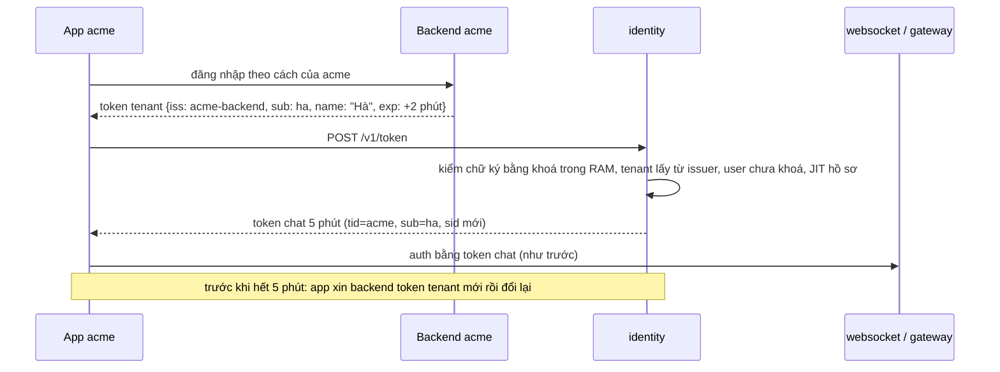

# M6 phase A: gỡ đăng nhập, đổi tên `identity`, đổi token — tóm tắt

> Ngày: 2026-11-02, viết lại theo cái đã xây cùng ngày · Nhánh `feat/m6` (`bc9122a`…`72e11f3`) · Trạng thái: **đã xây (`dev-done` trên nhánh)** · Quyết định: D239–D244 (`docs/decision-log.md` §17.18)
> **Hướng (owner 2026-11-02):** chat không giữ danh tính. Backend của tenant đăng nhập user của mình rồi ký một JWT ngắn; `identity` kiểm JWT đó và đổi sang token chat. Go-live chưa phụ thuộc IAM ngoài.
> **Các phase của M6 mới:** **(PA) gỡ code + đổi tên + đổi token ✅** · (PM) store `identity` sang MongoDB (owner 2026-11-02, D244) · (PB) server API theo lô cho user/nhóm, khoá user, thu hồi theo giờ.

## 1. Thuật ngữ

| Từ | Nghĩa |
|---|---|
| `identity` | Tên mới của `apps/iam`: cầu nối danh tính, không phải IAM |
| Token tenant | JWT do backend tenant ký bằng khoá riêng của họ, sống tối đa 10 phút, nói "người này là `ha` của acme" |
| Issuer tin cậy | Một backend tenant được phép ký token tenant: chuỗi `iss`, tenant mà nó thuộc về, các khoá công khai |
| Đổi token | Gửi token tenant, nhận token chat (RFC 8693 token exchange) |
| Token chat | JWT Ed25519 5 phút websocket/gateway kiểm như trước (D211): `aud`, `exp`, `iat`, `iss`, `sid`, `sub`, `tid` |
| JIT | Tạo hoặc sửa bản sao user ngay lúc đổi token, từ claim `name`/`picture` |

## 2. Bức tranh chung

- **Gỡ** (`bc9122a`): đăng nhập mật khẩu, refresh, DPoP, phiên, role, permission, `AdminService`, `UpdateMyProfile`; gói `password`, `auth`, `session`, `dpop`, `authz`, `manage`.
- **Giữ, đổi tên** (`e18a0b5`): khoá ký và JWKS, danh bạ 3a, thu hồi theo tenant (phần 2), cây nhóm với `ancestors`.
- **Thêm:** gói `trust` (issuer, khoá, kiểm token tenant), `exchange` (use case), `POST /v1/token`, CLI `issuer-*`, JIT.

## 3. Dữ liệu (một migration gộp `0001_identity.sql`, database mới `chatim_identity`, `0559c72`)

| Bảng | Dùng làm gì |
|---|---|
| `tenants` (giữ `sessions_revoked_at`) | Khoá tenant → thu hồi theo tenant |
| `trusted_issuers` **mới**: `issuer` khoá chính, `tenant_id`, `state` | Tenant lấy từ đây, không bao giờ từ claim |
| `trusted_keys` **mới**: `issuer`, `key_id`, `algorithm`, `public_key` (JWK đã chuẩn hoá), `state` | Kiểm chữ ký; xoay khoá = thêm khoá mới rồi gỡ khoá cũ |
| `users` (trước `accounts`): id do tenant đặt, `display_name`, `avatar_url`, `state`, `ver` | Danh bạ, chặn đổi token khi bị khoá |
| `groups`, `user_groups`, `directory_changes`, `signing_keys`, `revoked_sessions`, `audit_events` (`user_id`) | Như 3a và phần 2; `revoked_sessions` không còn đường ghi, PB quyết định |

Bỏ: `sessions`, `clients`, `client_permissions`, `roles`, `role_permissions`, `account_roles`, `group_roles`, trigger `tenant-admin`, cột `username`, `email`, `password_*`, `failed_login_count`, `next_login_at`.

## 4. Đổi token `POST /v1/token` (cổng public)

Body form RFC 8693: `grant_type=urn:ietf:params:oauth:grant-type:token-exchange`, `subject_token`, `subject_token_type=urn:ietf:params:oauth:token-type:jwt`. Thứ tự trong `exchange.Exchange`: đã nạp xong → kiểm token (`trust`) → tìm user trong RAM → user bị khoá? → có khoá ký? → JIT → ký.

| # | Kiểm (gói `trust`, `7d11c7c`) | Ví dụ bị từ chối |
|---|---|---|
| 1 | Có `kid`; `alg` ∈ {EdDSA, ES256, RS256} và bằng thuật toán của khoá | `alg: none`; HS256 dùng khoá công khai làm secret; khoá ES256 mà `alg: RS256` |
| 2 | `iss` là chuỗi, issuer đang hoạt động, khoá `kid` thuộc issuer đó | issuer lạ; khoá đã gỡ; `kid` của issuer khác |
| 3 | Chữ ký đúng; RSA 2048–4096 bit, e = 65537 (kiểm lúc `issuer-key-add`) | sửa payload; RSA 1024 |
| 4 | `aud` = `IDENTITY_EXCHANGE_AUDIENCE` (bắt buộc, khác `IDENTITY_AUDIENCE`) | token dành cho service khác, token chat |
| 5 | Có `exp`, `iat`; `exp − iat` ≤ 10 phút; còn hạn; lệch giờ ≤ 30s | token sống 11 phút |
| 6 | Tenant của issuer đang hoạt động; claim `tid` nếu có phải bằng tenant đó | issuer của acme ký `tid: beta` |
| 7 | `sub` hợp lệ theo `pkg/ids` | `auth0\|abc` |
| 8 | User chưa bị khoá (`State != active` → từ chối) | `ha` đã `user-disable` |
| 9 | JIT: chưa có thì tạo; `name`/`picture` khác RAM thì sửa, CAS trên giá trị đã thấy; giống thì không ghi | lần đầu tạo "Hà" |
| 10 | Ký: `sid` ngẫu nhiên mới, TTL `IDENTITY_TOKEN_TTL` 5 phút | |

Trả lời: `{access_token, issued_token_type, token_type: Bearer, expires_in}`. Mọi lần từ chối là cùng một `400 {"error":"invalid_grant"}` (giống từng byte, kể cả `Content-Length`), lý do chỉ ở log Info kèm IP. `grant_type` sai → `unsupported_grant_type`. Quá giới hạn IP → 429; chưa nạp danh bạ/issuer, không có khoá ký, ghi JIT lỗi → 503 + `Retry-After: 1` và một dòng log Warn. Body quá `IDENTITY_BODY_MAX` → 413. Client bỏ đi giữa lúc ghi JIT không bị đếm là lỗi (`0812795`).

## 5. Cơ chế đúng đắn

- **Tenant chỉ từ issuer:** một `issuer` thuộc đúng một tenant (khoá chính); `issuer-add` từ chối issuer bằng `IDENTITY_ISSUER`.
- **Issuer và khoá trong RAM:** `trust.Reloader` nạp mỗi `IDENTITY_TRUST_RELOAD` (10s) và ngay khi có tín hiệu thu hồi (`tenant-disable`); nạp lỗi giữ bản cũ; issuer tắt không vào bản RAM; chưa nạp lần đầu → 503.
- **JIT không ghi thừa, không chặn:** so RAM trước khi ghi; thua CAS hay trùng insert vẫn cấp token, đếm `jit_writes_total{result="conflict"}`; không thử lại bên trong; không có khoá ký thì không ghi DB.
- **Khoá user:** `user-disable` đổi trạng thái; RAM thấy qua `LISTEN/NOTIFY` như 3a; từ đó đổi token bị từ chối, token chat đang có hết hạn trong ≤ 5 phút. Cắt ngay kết nối đang mở là việc của PB.

## 6. Thay đổi theo từng mặt

| Mặt | Có | Bỏ |
|---|---|---|
| API public | `POST /v1/token`, `DirectoryService.GetUsers`/`GetMyProfile` (theo `sub`, từ RAM), JWKS | `AuthService`, `/realms/…`, `AdminService`, `UpdateMyProfile` |
| CLI | `migrate`, `bootstrap`, `tenant-*`, `key-*`, `jwks-export`, `group-*`, `user-groups`, `user-set` (chỉ sửa user có sẵn), `user-disable/enable`, `issuer-add/-disable/-enable`, `issuer-key-add/-remove`, `issuer-keys` (`5d610cc`) | `account-create`, `password-reset`, `session-*`, `role-*`, `client-permissions-set` |
| Env (`a0ea875`) | `IDENTITY_*`, `WS_IDENTITY_*`, `GW_IDENTITY_*`; mới `IDENTITY_TOKEN_TTL` 5m, `IDENTITY_EXCHANGE_AUDIENCE`, `IDENTITY_EXCHANGE_MAX_LIFETIME` 10m, `IDENTITY_TRUST_RELOAD` 10s (≤ 1m), `IDENTITY_EXCHANGE_IP_RATE`/`_BURST`/`_TRACKED` 50/500/100000 | `IAM_LOGIN_*`, `IAM_SESSION_*`, `IAM_DPOP_WINDOW`, `IAM_PUBLIC_URL`, `IAM_ADMIN_*` trừ cổng admin |
| Metric | `chatim_identity_*`; mới `exchanges_total{result=ok\|invalid\|disabled\|rate\|error}`, `jit_writes_total{result=created\|updated\|conflict\|error}`, `trust_reload_errors_total`; `store_errors_total` nuôi bằng lỗi ghi JIT | series đăng nhập, refresh, băm, admin |
| Alert (`9d661fb`) | 39 → 37 (T1 gỡ `HashSaturated`, `RefreshReuse`) → 39: `ChatimIdentityExchangeErrors`, `ChatimIdentityTrustStale` | |
| Tool | `tools/internal/devtoken` ký token tenant EdDSA/ES256/RS256 (`3ffdd1c`); `corecli dev-issuer-key`; `tools/poc/exchangebench` (`9928bbe`) | |

## 7. Event và subject

Không có. `identity` không dùng NATS.

## 8. Kết quả đã xây

| Kiểm | Kết quả |
|---|---|
| `make fmt-check`, `make vet`, `make lint` | sạch, `0 issues.` |
| `make test` | 105 package `ok`, 0 FAIL |
| `make itest` `./apps/identity/... ./pkg/identitysync/...` | 13 package `ok`, 0 FAIL |
| `make alerts-check` | `SUCCESS: 39 rules found` |
| `make core-up && make e2e` | `e2e PASS`, 14 phase (1–13, 15); phase 13 và 15: log `identity-1` không chứa token hay secret nào trong 50 và 16 cái đã dùng |
| Bench đổi token (`docs/poc/README.md`, `docs/poc/results/exchange-261102/`) | User đã có: 1.700/s, p99 2,08 ms (ES256) và 2,20 ms (RS256), ~0,6 core, 0 lỗi 5xx. User mới (JIT): ~560/s mỗi node, 0 lỗi 5xx |
| Review độc lập T2, T4, T5, T6, T9 | 0 Critical, 0 Important; Minor ở §11 |

## 9. Quyết định và phương án bị loại

| Chọn | Bỏ | Vì sao |
|---|---|---|
| Gỡ trước, đổi tên sau, rồi mới viết đổi token; mỗi bước một commit | Làm lẫn | Không đổi tên code sắp xoá; đổi tên review được bằng `git diff -M` |
| Gộp migration, database mới | Thêm migration xoá dần | Chưa deploy; lược đồ đọc ở một chỗ |
| Khoá công khai đăng ký bằng CLI | Tải URL JWKS của backend | Không SSRF, không treo lúc tải |
| Không chống dùng lại `jti` | Bảng `jti` | Dùng lại chỉ ra token chat của đúng user đó; thêm một lần ghi mỗi lần đổi |
| JIT CAS trên giá trị đã thấy | CAS trên `users.ver` | Không đổi RAM và feed của 3a |
| Lý do từ chối chỉ ở log | Nhãn `reason` trên metric | Giữ một thông điệp chung ra ngoài; metric đủ để báo động |

## 10. Chi phí và tải

- 100K user, token chat 5 phút: ~330 lần đổi/s thường ngày, ~1.700/s khi 100K người nối lại trong 1 phút. Một node đạt 1.700/s với user đã có, kiểm chữ ký không phải nút thắt.
- User mới bị chặn ở ~560/s mỗi node: mỗi lần JIT tạo user là một commit có `NOTIFY`, Postgres xếp hàng các commit đó qua một khoá chung (18–19/20 kết nối chờ `Lock|object`). Ví dụ: 100K người đăng nhập lần đầu cùng lúc cần ~3 phút với một node. Đo lại trên MongoDB ở PM; prod-like P13.
- Giới hạn IP 50/s, dồn 500: chưa có nguồn số; ước tính một văn phòng NAT 2.000 người nối lại trong 1 phút ≈ 33/s.

## 11. Rủi ro và giới hạn

- **Khoá riêng của backend tenant bị lộ** thì giả được mọi user của tenant đó, chỉ trong tenant đó; `issuer-key-remove` có hiệu lực ≤ 10s.
- **Khoảng hở còn lại, đều trong 5 phút owner chấp nhận:** token chat cấp giữa lúc `tenant-disable` commit và lúc nạp lại vẫn sống tới 5 phút; user bị khoá trong DB nhưng RAM chưa thấy (trễ `NOTIFY`) vẫn đổi được token; khoá user ở backend tenant mà không báo chat thì user còn chat tới 5 phút.
- **Follower danh bạ chạy liên tục sau đợt ghi lớn** (có từ 3a): một lượt đọc mỗi `NOTIFY`, và kế hoạch chung của prepared statement quét cả `directory_changes`; Postgres gần một core tới khi hết hàng thông báo. Owner 2026-11-02 không sửa trên Postgres; PM thiết kế lại feed.
- **Request hỏng form** (`grant_type`, `subject_token_type` sai, thiếu `subject_token`) không có nhãn trong `exchanges_total`.
- **Khoá hỏng trong DB** làm `trust_reload_errors_total` tăng mỗi lần nạp, `ChatimIdentityTrustStale` báo tới khi gỡ khoá (chủ ý).
- Minor của review: `trusted_issuers` chưa có index `tenant_id` (thêm khi có lệnh liệt kê theo tenant); `state` của `trusted_*` không có `CHECK`; `users.ver` không phải version của feed; shutdown quá hạn rơi về `Close()` nên request đang chạy có thể nhận 503.
- e2e: issuer hay khoá vừa thêm có hiệu lực sau lần nạp kế tiếp, nên lần đổi đầu của mỗi phase hỏi lại tới 15s. PA không có e2e cho `key-rotate` không restart và đóng `4003` khi khoá tenant (phase 14 cũ); quay lại ở PB.
- Dev: database `chatim_iam` cũ và tenant bench `xb67bb53es256`, `xb67bb53rs256` (~84K user) còn trong Postgres dev; bỏ khi chuyển MongoDB.

## Bảng phủ

| Yêu cầu | Thành phần | Test | Bằng chứng |
|---|---|---|---|
| B1 chat không giữ danh tính | gỡ 6 gói, bảng phiên, cột mật khẩu | lint, itest lược đồ | `bc9122a`, `0559c72`; lint `0 issues.`; itest 13 package ok |
| B2 tin cậy theo tenant, bản sao user | `trusted_*`, `users`, `trust` | unit `trust`, itest store | `032c5a4`, `7d11c7c`; `make test` ok |
| B3 đổi token, node không đổi | `exchange`, `POST /v1/token` | e2e 13 websocket `ready`, gateway 200 | `3ad1b1a`, `d87ecd3`; e2e PASS |
| B4 tenant chỉ từ issuer | `trust`, `issuer-add` | unit `tid` lệch, chéo issuer; e2e 13 | `7d11c7c`, `5d610cc` |
| B5 khoá qua CLI, chỉ EdDSA/ES256/RS256 | `issuer-*` CLI, `ParsePublicJWK` | unit JWK; e2e 13 ES256, RS256; e2e 15 EdDSA | `5d610cc`; e2e PASS |
| B6 JIT chỉ hồ sơ, không ghi thừa | `exchange`, `WriteProfile` | unit; itest; e2e 13 `jit_writes_total` không đổi | `032c5a4`, `3ad1b1a` |
| B9 không role tổ chức | gỡ `authz`, `manage` | lint | `bc9122a` |
| B10 đổi tên cả node | env, metric, alert, proto, compose | e2e 1–12, `alerts-check` 39 | `e18a0b5`; `alerts-check` 39 |
| B11 token chat 5 phút | `IDENTITY_TOKEN_TTL` | unit config; e2e 13 `exp − iat = 300` | `a0ea875`; e2e PASS |
| Khoá tenant chặn đổi token ngay | `Reloader.Wake` qua tín hiệu thu hồi | unit synctest; e2e 13 | `d87ecd3` |
| R6 danh bạ 3a | `directory`, feed | e2e 15 | `58fe29c`; e2e PASS |
| R7 thu hồi theo tenant | `/internal/v1/revocations` | itest `identitysync`; e2e 13 | itest 13 package ok |
| D232/D234 cây nhóm | `groups.ancestors` | itest đổi cha, chặn vòng | itest 13 package ok |
| Guarantee mới có metric + rule | `exchanges_total`, `trust_reload_errors_total` | `alerts-check` | `9d661fb`; 39 luật |
| Log không có token | handler, service | e2e 13, 15 quét log | e2e PASS |
| Tải 1.700/s | toàn đường đổi | `exchangebench` | `9928bbe`; ấm 1.700/s, lạnh ~560/s (§10) |
