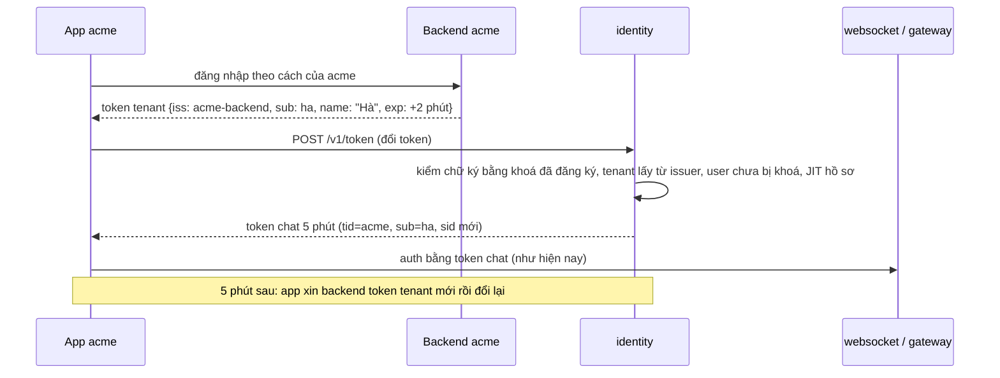

# M6 phase A: gỡ đăng nhập, đổi tên `identity`, đổi token — tóm tắt

> Ngày: 2026-11-02 · Nhánh `feat/m6` · Trạng thái: **chờ owner duyệt** (phần gỡ code và đổi tên owner đã "ok" 2026-11-02; phần đổi token là phần mới)
> **Hướng (owner 2026-11-02):** chat không giữ danh tính. Backend của tenant đăng nhập user của mình rồi ký một JWT ngắn; `identity` kiểm JWT đó và đổi sang token chat. Go-live chưa phụ thuộc IAM ngoài; tích hợp IAM ngoài làm khi có tenant cần.
> **Hai phase (owner 2026-11-02 "gộp task còn 2 phase"):** **(PA) gỡ code + đổi tên + đổi token** · (PB) server API theo lô cho user/nhóm, khoá user, thu hồi theo giờ.

## 1. Thuật ngữ

| Từ | Nghĩa |
|---|---|
| `identity` | Tên mới của `apps/iam`: cầu nối danh tính, không phải IAM |
| Token tenant | JWT do backend tenant ký bằng khoá riêng của họ, sống vài phút, nói "người này là `ha` của acme" |
| Issuer tin cậy | Một backend tenant được phép ký token tenant: chuỗi `iss`, tenant mà nó thuộc về, các khoá công khai |
| Đổi token | Gửi token tenant, nhận token chat (theo RFC 8693 token exchange) |
| Token chat | JWT Ed25519 5 phút mà websocket/gateway kiểm như hiện nay (D211): `iss`, `aud`, `sub`, `tid`, `sid`, `iat`, `exp` |
| Bản sao user | Bảng `users` (trước là `accounts`): id do tenant đặt, tên, ảnh, trạng thái; không mật khẩu, username, email |
| JIT | Tạo hoặc sửa bản sao user ngay lúc đổi token, từ claim `name`/`picture` trong token tenant |

## 2. Bức tranh chung

**Gỡ:**
- đăng nhập mật khẩu, refresh, DPoP, phiên;
- role, permission, `AdminService`.

**Giữ và đổi tên:**
- khoá ký và JWKS;
- danh bạ 3a (`GetUsers`, feed thay đổi);
- thu hồi theo tenant (phần 2);
- cây nhóm cùng `ancestors`.

**Thêm:** issuer tin cậy, đổi token, JIT.

## 3. Dữ liệu (một migration gộp, database mới `chatim_identity`)

| Bảng | Field | Ví dụ | Dùng làm gì |
|---|---|---|---|
| `tenants` | `id`, `name`, `state`, `ver`, `created_at`, `updated_at`, `updated_by` | `acme` | Khoá tenant → thu hồi theo tenant (phần 2) |
| `trusted_issuers` **mới** | `issuer` (khoá chính, không trùng giữa các tenant), `tenant_id`, `state`, `ver`, `created_at`, `updated_at`, `updated_by` | `acme-backend` → `acme` | Tenant lấy từ đây, không bao giờ từ claim trong token |
| `trusted_keys` **mới** | `issuer`, `key_id`, `algorithm` (`EdDSA`, `ES256`, `RS256`), `public_key` (JWK công khai), `state`, `created_at`, `created_by` | `acme-backend`, `k1`, `ES256` | Kiểm chữ ký token tenant; xoay khoá = thêm khoá mới rồi gỡ khoá cũ |
| `users` (trước `accounts`) | `tenant_id`, `id`, `display_name`, `avatar_url`, `state`, `ver`, `created_at`, `updated_at`, `updated_by` | `acme`, `ha`, "Hà" | Danh bạ, chặn đổi token khi bị khoá |
| `groups`, `user_groups` (trước `account_groups`), `directory_changes` | như 3a, giữ `ancestors` và hai trigger của nó | `kinh-doanh-hcm` | Cây nhóm; `@nhóm cha` gồm nhóm con (D232/D234) |
| `signing_keys` | như phần 2 | | Ký token chat, JWKS |
| `revoked_sessions` | như phần 2 | | Giữ để hợp đồng với node không đổi; PB quyết định |
| `audit_events` | như phần 1 | | Lệnh CLI của vận hành |

**Bỏ:**
- bảng `sessions`, `clients`, `client_permissions`, `roles`, `role_permissions`, `account_roles`, `group_roles`;
- trigger `tenants_tenant_admin`;
- các cột `username`, `email`, `password_*`, `failed_login_count`, `next_login_at`.

## 4. Luồng xử lý

### 4.1 Đổi token: `POST /v1/token` (cổng public)

Body dạng form theo RFC 8693:
- `grant_type=urn:ietf:params:oauth:grant-type:token-exchange`
- `subject_token=<token tenant>`
- `subject_token_type=urn:ietf:params:oauth:token-type:jwt`

Các bước kiểm, theo thứ tự. Sai bất kỳ bước nào thì trả `400 invalid_grant` với một thông điệp chung; lý do chi tiết chỉ ghi vào log và metric.

| # | Kiểm | Ví dụ bị từ chối |
|---|---|---|
| 1 | Header có `kid`; `alg` thuộc {EdDSA, ES256, RS256} và **đúng** thuật toán của khoá đã đăng ký | `alg: none`; `HS256` dùng khoá công khai làm secret; khoá ES256 nhưng `alg: RS256` |
| 2 | `iss` là issuer đang hoạt động; khoá `kid` thuộc issuer đó và đang hoạt động | issuer lạ; khoá đã gỡ |
| 3 | Chữ ký đúng; RSA tối thiểu 2048 bit (kiểm lúc đăng ký khoá) | sửa một ký tự payload |
| 4 | `aud` = `IDENTITY_EXCHANGE_AUDIENCE` (vd `chatim`) | token dành cho service khác |
| 5 | Có `exp` và `iat`; `exp − iat` ≤ `IDENTITY_EXCHANGE_MAX_LIFETIME` (10 phút); còn hạn; lệch giờ ≤ 30s | token sống 1 ngày |
| 6 | Tenant (lấy từ issuer) đang hoạt động; nếu token có claim `tid` thì phải bằng tenant đó | issuer của acme ký `tid: beta` |
| 7 | `sub` hợp lệ theo `pkg/ids` (`[A-Za-z0-9_-]`, ≤ 64 byte) | `auth0|abc`, email |
| 8 | User chưa bị khoá trong bản sao | `ha` đã bị `user-disable` |
| 9 | JIT: chưa có user thì tạo; có `name`/`picture` khác bản RAM thì sửa; giống thì không ghi | lần đầu tạo `ha` tên "Hà" |
| 10 | Ký token chat: `sid` ngẫu nhiên mới, TTL `IDENTITY_TOKEN_TTL` 5 phút, khoá ký đang dùng | |

Kết quả: `{access_token, issued_token_type: urn:ietf:params:oauth:token-type:access_token, token_type: Bearer, expires_in: 300}`. Chưa có khoá ký đang dùng hoặc database lỗi thì trả `503`. Giới hạn theo IP dùng `guard.IPLimiter` sẵn có, vượt thì `429`.

### 4.2 Các luồng giữ lại

| Use case | Kiểm | Lỗi |
|---|---|---|
| `GetUsers(ids)`, `GetMyProfile` (theo `sub` của token, không qua phiên) | Token chat hợp lệ, tenant chưa khoá | `unauthenticated`, `not_found` |
| Node lấy JWKS và danh sách thu hồi; feed `directory/changes` | Secret node như phần 2 | 401 |

## 5. Cơ chế đúng đắn

- **Không nhầm tenant:** tenant chỉ đến từ `trusted_issuers`. Một `issuer` thuộc đúng một tenant (khoá chính), nên token của acme không thể thành token của beta.
- **Không nhầm thuật toán:** `alg` của token phải bằng thuật toán của khoá. Không nhận HMAC.
- **Khoá và issuer trong RAM:** nạp lúc khởi động, nạp lại mỗi `IDENTITY_TRUST_RELOAD` (10s). Thêm hay gỡ khoá có hiệu lực trên mọi bản `identity` trong ≤ 10s. Nạp lỗi thì giữ bản cũ và tăng metric.
- **JIT không ghi thừa:** so với RAM danh bạ trước khi ghi. Ghi dùng CAS trên `ver`; nếu CAS thua thì vẫn cấp token (hồ sơ là phụ), ghi metric, lần đổi sau sửa tiếp. Không thử lại bên trong.
- **Khoá user:** CLI `user-disable` đổi trạng thái; RAM danh bạ thấy qua `LISTEN/NOTIFY` như 3a. Từ đó user không đổi được token nữa, và mất quyền tối đa 5 phút sau, khi token chat hết hạn. Cắt ngay kết nối đang mở là việc của PB.
- **Không phụ thuộc gói bị bỏ:** cắt các import hiện có ở `keyring/ring.go:11-12`, `api/directory.go:12`, `store/ports.go:8`, `pgstore/catalog.go:12` và `pgstore/profile.go:12-28`.

## 6. Thay đổi theo từng mặt

| Mặt | Giữ (đổi tên) hoặc thêm | Bỏ |
|---|---|---|
| Package | `signing`, `keyring`, `directory`, `guard` (`IPLimiter`, `ClientIP`), `app`, `config`, `api`, `store`, `admincmd`; thêm `trust` (issuer, khoá, kiểm token tenant) và `exchange` (use case đổi token) | `password`, `auth`, `session`, `dpop`, `authz`, `manage` |
| API public | `POST /v1/token`, `DirectoryService.GetUsers`/`GetMyProfile`, JWKS | `AuthService`, `/realms/…/token` và `/revoke`, `AdminService`, `UpdateMyProfile` |
| CLI | `migrate`, `bootstrap`, `tenant-*`, `key-*`, `jwks-export`, `group-*`, `user-groups`, `user-set`, `user-disable/enable`; thêm `issuer-add`, `issuer-disable/enable`, `issuer-key-add`, `issuer-key-remove`, `issuer-keys` | `password-reset`, `session-*`, `role-*`, `account-roles`, `group-roles`, `client-permissions-set` |
| Env | `IAM_*` → `IDENTITY_*`; `WS_IAM_*`, `GW_IAM_*` → `WS_IDENTITY_*`, `GW_IDENTITY_*`; thêm `IDENTITY_TOKEN_TTL` 5m, `IDENTITY_EXCHANGE_AUDIENCE` (bắt buộc), `IDENTITY_EXCHANGE_MAX_LIFETIME` 10m, `IDENTITY_TRUST_RELOAD` 10s | `IAM_ACCESS_TTL`, `IAM_DPOP_WINDOW`, `IAM_HASH_CONCURRENCY`, `IAM_LOGIN_*`, `IAM_PASSWORD_MIN`, `IAM_REFRESH_GRACE`, `IAM_SESSION_*`, `IAM_ADMIN_*` |
| Metric | `chatim_iam_*` → `chatim_identity_*` (node tương tự); thêm `chatim_identity_exchanges_total{result}` (`ok`, `invalid`, `disabled`, `rate`, `error`), `chatim_identity_jit_writes_total{result}`, `chatim_identity_trust_reload_errors_total` | `login_total`, `refresh_total`, `hash_inflight`, `password_changes_total`, `sessions_revoked_total`, `admin_*` |
| Alert | `chatim-iam-*` → `chatim-identity-*`; thêm `ChatimIdentityExchangeErrors` (`result="error"` > 0 trong 5 phút), `ChatimIdentityTrustStale` (nạp lại lỗi liên tục) | `ChatimIamHashSaturated`, `ChatimIamRefreshReuse` (39 → 39 luật) |
| Proto, gói chung | `chatim.identity.v1` (chỉ `directory.proto`); `pkg/iamsync` → `pkg/identitysync`; `pkg/jwtverify`, `pkg/revocation` không đổi | `auth.proto`, `admin.proto` |
| Hạ tầng | compose `identity-1`, `identity-bootstrap`, database `chatim_identity`; make `identity-*`; depguard `identity-*` | `iam-*` |
| e2e | 1–12; **13 mới** (đổi token); **15 viết lại** (danh bạ trên token đổi được) | 13 cũ (đăng nhập), 16 (role); 14 (thu hồi) quay lại ở PB |
| Tài liệu | `docs/apps/identity.md` viết lại; summary M6 cũ thêm một dòng ghi chú đổi hướng; 3c.2 và 3c.3 ghi "bỏ 2026-11-02" | |

## 7. Event và subject

Không có. `identity` không dùng NATS (owner 2026-10-27).

## 8. Thư viện và hạ tầng

- `golang-jwt/jwt/v5` sẵn có (phần 1) kiểm EdDSA, ES256 và RS256. Không thêm thư viện.
- `tools/internal/devtoken` sinh khoá và ký token. e2e và CLI dev dùng nó để đóng vai backend tenant. Cần mở rộng để ký token tenant với `iss`/`aud` tuỳ chọn.

## 9. Quyết định và phương án bị loại

| Chọn | Bỏ | Vì sao |
|---|---|---|
| Hai phase: PA gồm gỡ, đổi tên và đổi token | Bốn phase (0, A, B, C) | Owner 2026-11-02; PA xong là chat dùng được ngay, không có quãng không lấy được token |
| Gỡ trước, đổi tên sau, rồi mới viết đổi token; mỗi bước một commit | Làm lẫn | Không đổi tên code sắp xoá; commit đổi tên review được bằng `git diff -M` |
| Gộp migration, database mới | Thêm migration xoá dần | Chưa deploy; lược đồ đọc ở một chỗ |
| `accounts` → `users` | Giữ tên | Bản sao user không phải account đăng nhập |
| Khoá công khai đăng ký bằng CLI | Tải URL JWKS của backend | Không có rủi ro SSRF hay treo lúc tải; URL JWKS để tới khi tích hợp IAM ngoài |
| Đường dẫn không có tenant; tenant lấy từ `iss` | `/realms/{tenant}/…` | Một nguồn sự thật duy nhất cho tenant |
| `exp − iat` ≤ 10 phút | Không giới hạn | Token tenant lộ chỉ dùng được trong khoảng ngắn |
| Không chống dùng lại `jti` | Bảng `jti` | Dùng lại token tenant còn hạn chỉ ra token chat cho đúng user đó; thêm bảng là thêm một lần ghi mỗi lần đổi |
| JIT chỉ hồ sơ; nhóm qua server API ở PB | JIT cả nhóm | Hai nguồn cùng ghi nhóm sẽ đè nhau |
| `sid` ngẫu nhiên mỗi lần đổi | Không có `sid` | `pkg/jwtverify` đòi `sid`; giữ đường thu hồi theo phiên |

## 10. Chi phí và tải

- 100K user, token chat 5 phút: khoảng 330 lần đổi mỗi giây ở mức thường. Lúc 100K người nối lại trong 1 phút thì khoảng 1.700 lần mỗi giây.
- Mỗi lần đổi: kiểm một chữ ký (RS256 nặng nhất), ký một Ed25519, đọc RAM. Không đọc Postgres, trừ JIT khi hồ sơ đổi hoặc user mới. Số đo thật nằm trong bench của plan; chưa có nguồn.
- websocket nhận lại token mới mỗi 5 phút trên mỗi kết nối. Kiểm token tốn khoảng 121 µs (D211).
- `identity` không còn băm Argon2id (~40 ms, ~19 MB mỗi lần) và không còn ghi phiên.

## 11. Rủi ro và giới hạn

- **Khoá riêng của backend tenant bị lộ** thì kẻ có khoá giả được mọi user của tenant đó, trong tenant đó. Cách xử lý: gỡ khoá bằng `issuer-key-remove`, có hiệu lực trong ≤ 10s.
- **Khoá user ở backend tenant** mà không báo cho chat thì user vẫn chat được tối đa 5 phút (owner chấp nhận 2026-11-02). Cắt ngay thuộc PB.
- **Diff rất lớn và phần lớn là việc cơ học** (khoảng 3/4 code chính của `apps/iam` bị xoá). Commit đổi tên chỉ đổi tên.
- **Database `chatim_iam` trên dev bị bỏ.** Trong đó chỉ có dữ liệu thử.

## 12. Điểm đội tự chọn, mời owner phản biện

1. Gộp migration và dùng database mới.
2. Đổi tên `accounts` → `users`.
3. Endpoint `POST /v1/token`, không có tenant trong đường dẫn.
4. Token tenant sống tối đa 10 phút.
5. Không chống dùng lại `jti`.
6. Giữ `revoked_sessions` tới PB.

## 13. Kiểm thử

| Kiểm | Chứng minh |
|---|---|
| Unit `trust`: từng hàng của bảng §4.1 (alg none, HS256 với khoá công khai, alg lệch khoá, kid lạ, issuer tắt, aud sai, hết hạn, sống > 10 phút, `tid` lệch, `sub` sai ký tự, RSA < 2048 lúc đăng ký) | Mỗi kiểm từ chối đúng ca, trả cùng một lỗi chung |
| Unit `exchange`: user bị khoá, tenant bị khoá, JIT không ghi khi hồ sơ không đổi, CAS thua vẫn cấp token | Use case đúng thứ tự §4.1 |
| Itest lược đồ: migrate trên database trống ra đúng §3; trigger `ancestors` cập nhật khi đổi cha | Lược đồ gộp đúng |
| Itest danh bạ, khoá ký, thu hồi theo tenant, nạp lại issuer | Phần giữ lại không đổi hành vi |
| `make lint` với depguard `identity-*` | Không còn import gói bị bỏ; ranh giới app giữ |
| `make alerts-check` | 39 luật hợp lệ |
| e2e 13 mới: script `issuer-add` + `issuer-key-add` (khoá dev); `corecli` ký token tenant → đổi → websocket-1 `ready`, gateway 200, `GetUsers` thấy tên JIT; các ca từ chối chính; `user-disable` → đổi bị từ chối; gỡ khoá → đổi bị từ chối trong ≤ 15s | Đường dùng thật chạy từ đầu tới cuối |
| e2e 15 viết lại: như cũ (long-poll ≤ 1s, `GetUsers` sau restart) nhưng token lấy bằng đổi token, tên đổi bằng `user-set` | Danh bạ 3a giữ hợp đồng |
| e2e 1–12 | Đổi tên không làm hỏng node |
| Bench đổi token: 1.700 lần/giây trên dev với khoá RS256 và ES256, đo CPU và p99 | Số §10 |
| `git grep -il iam` (trừ tài liệu lịch sử) | Không còn tên cũ |
| Log `identity-1` trong e2e | Không có token nào trong log |

## Bảng phủ

| Yêu cầu | Thành phần | Test | Bằng chứng |
|---|---|---|---|
| B1 chat không giữ danh tính | gỡ `password`, `auth`, `session`, `dpop`; bỏ bảng phiên, cột mật khẩu | `make test`, lint, itest lược đồ | (điền sau khi xây) |
| B2 tin cậy theo tenant, bản sao user | `trusted_issuers`, `trusted_keys`, `users` | unit `trust`; itest lược đồ | |
| B3 đổi token, node không đổi (D211, R8) | `exchange`, `POST /v1/token`; `pkg/jwtverify` giữ nguyên | e2e 13: websocket `ready`, gateway 200 | |
| B4 tenant chỉ từ issuer | `trust` | unit: `tid` lệch, issuer tenant khác | |
| B5 go-live chỉ token do backend ký, khoá qua CLI | `issuer-*` CLI | e2e 13 | |
| B6 JIT chỉ hồ sơ | `exchange` + `directory` | unit JIT; e2e 13 `GetUsers` | |
| B9 không role tổ chức | gỡ `authz`, `manage` | lint | |
| B10 đổi tên cả node | env, metric, alert, proto, compose | e2e 1–12, `alerts-check`, `git grep` | |
| B11 token chat 5 phút | `IDENTITY_TOKEN_TTL` | unit config; e2e 13 kiểm `exp − iat` | |
| R6 danh bạ 3a | `directory`, feed | e2e 15 | |
| R7 thu hồi theo tenant (phần 2) | `/internal/v1/revocations` | itest `identitysync`; e2e 13 tenant khoá → đổi bị từ chối | |
| D232/D234 cây nhóm | `groups.ancestors` | itest đổi cha | |
| Guarantee mới cần metric + rule | `exchanges_total`, `trust_reload_errors_total` | `alerts-check` | |
