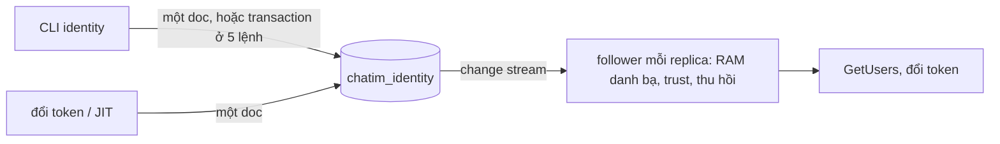

# M6 phase PM: `identity` chuyển sang MongoDB, follower bằng change stream — tóm tắt

> Ngày: 2026-11-02 · Nhánh `feat/m6` · Trạng thái: **chờ owner duyệt** · Dựa trên: D244 (owner 2026-11-02 "chuyển sang mongodb"), brainstorm PM owner "ok" 2026-11-02 (change stream thay `NOTIFY`), owner 2026-11-02 "bỏ Feed HTTP", owner 2026-11-02 "cắt đứt postgres", "bỏ luôn tools/poc/postgresbench", một phase kiểm một lần ở cuối ("ok")
> **Các phase của M6:** (PA) gỡ đăng nhập, đổi tên, đổi token ✅ · **(PM) MongoDB + change stream + gỡ Postgres** · (PB) server API theo lô, khoá user, thu hồi theo giờ

## Scope và ranh giới

| Việc | Trong PM? | Thuộc về |
|---|---|---|
| Store MongoDB `apps/identity/internal/store/mongostore` thay `pgstore` | Có | `identity` |
| Follower (RAM mỗi replica) đọc bằng change stream | Có | `identity` |
| Gỡ feed HTTP `/internal/v1/directory/changes` (không app nào dùng) | Có | làm lại khi app đầu tiên cần (3b, M8 hoặc M9) |
| Gỡ hết Postgres: `pgstore` (xoá lúc chuyển app sang MongoDB, vì port mới không còn khớp), compose `postgres`/`postgres-init`, `make pg-up`/`pg-down`, `PG_URI`, `CHATIM_IT_PG_URI`, `scripts/wait-postgres.sh`, khoá `PG_*` trong `.env.example` và `.env`, pgx trong `go.mod`, luật depguard và tài liệu | Có | repo |
| Metric và alert mới; đo đổi token, tải stream | Có | `identity`, `deploy/prometheus` |
| Hợp đồng node ↔ `identity` (JWKS, danh sách thu hồi, `pkg/identitysync`) | Không đổi | — |
| Audit (`audit_events`): bỏ ở PM vì `actor` luôn là `admin-cli` (`admincmd/run.go:18`) và không chỗ nào đọc; làm lại ở PB, suy từ change stream, có người gọi thật và cách đọc (owner "ok" 2026-11-02) | Không | PB |
| Server API theo lô, khoá user, thu hồi theo giờ | Không | PB |
| Đọc dữ liệu của core | Không bao giờ | core |

## Tính năng → lớp dữ liệu (architecture §4)

| Tính năng | Lớp | Ghi | Báo thay đổi | Phục hồi |
|---|---|---|---|---|
| Tenant, issuer, khoá tin cậy, khoá ký | Cấu hình tin cậy | Lệnh CLI ghi một doc; kích hoạt khoá ký = một transaction | Change stream đánh thức nạp lại trust và thu hồi | Nạp lại định kỳ vẫn giữ |
| User, nhóm, thành viên | Danh bạ identity | JIT và lệnh CLI một doc = ghi một doc; lệnh cây nhóm và gán nhóm = một transaction | Change stream: follower | Nạp lại toàn bộ khi mất vị trí |
| Suất nạp danh bạ (D231) | Ephemeral: doc thuê tự hết hạn | Ghi có điều kiện theo giờ DB | Không | Hết hạn là nhả |

## 1. Thuật ngữ

| Từ | Nghĩa |
|---|---|
| Change stream | MongoDB báo từng thay đổi đã ghi chắc chắn (majority), theo đúng thứ tự commit, kèm bản doc hiện tại; thay `NOTIFY`, `directory_changes` và mốc `xmin` của Postgres |
| Resume token | Vị trí trong change stream; đọc tiếp từ đó không sót. Token quá cũ (oplog đã quay vòng) thì không đọc tiếp được |
| Database `chatim_identity` | Database riêng trên replica set của core, user `identity` chỉ có quyền `readWrite` trên đó |
| Doc nhận chỗ | Doc có `_id` cố định để chỉ một bên thắng, ví dụ `_id: "active"` cho khoá ký đang dùng |
| `ver` | Phiên bản của user hoặc nhóm, chỉ tăng khi field hiện ra ngoài đổi (tên, ảnh, trạng thái, nhóm, cha, `mentionable`) |
| Giờ DB | `$$NOW` của MongoDB (D221, D224) |

## 2. Bức tranh chung



Ví dụ: admin đổi tên Bình bằng `user-set` → ghi doc `acme│binh` (`ver` 8) → follower mọi replica nhận event, RAM có tên mới → `GetUsers` trả tên mới ngay.

## 3. Dữ liệu (`│` là U+2502, ngoài bộ ký tự của id tenant, user, nhóm và issuer)

| Collection | Field | Ví dụ | Dùng làm gì |
|---|---|---|---|
| `tenants` (clustered) | `_id`, `name`, `state`, `ver`, `sessions_revoked_at` (giờ DB), `group_tree_ver`, `created_at`, `updated_at`, `updated_by` | `acme` | Khoá tenant → thu hồi; `group_tree_ver` cho hai lệnh ghi cây cùng tenant xung đột |
| `users` (clustered) | `_id` = tenant│user, `tenant_id`, `id`, `display_name`, `avatar_url`, `state`, `groups` (nhóm trực tiếp, đã sắp), `ver`, `created_at`, `updated_at`, `updated_by` | `acme│ha`, `groups: ["kinh-doanh-hcm"]` | Danh bạ; một doc đủ thông tin một người (thay `user_groups`, `directory_changes`) |
| `groups` (clustered) | `_id` = tenant│group, `tenant_id`, `id`, `name`, `parent_id`, `ancestors`, `mentionable`, `state`, `ver`, `members_ver`, `created_at`, `updated_at`, `updated_by` | `acme│kinh-doanh-hcm`, `ancestors: ["kinh-doanh"]` | Cây nhóm; `members_ver` cho gán nhóm và xoá nhóm xung đột |
| `trusted_issuers` (clustered) | `_id` = issuer, `tenant_id`, `state`, `ver`, `created_at`, `updated_at`, `updated_by` | `acme-backend` | Tenant lấy từ đây |
| `trusted_keys` (clustered) | `_id` = issuer│kid, `issuer`, `key_id`, `algorithm`, `public_key`, `state`, `created_at`, `created_by` | `acme-backend│k1` | Kiểm chữ ký token tenant |
| `signing_keys` (clustered) | `_id` = kid, `state`, `public_key`, `private_key_sealed`, `created_at`, `activated_at`, `retired_at` (giờ DB) | | Ký token chat, JWKS |
| `signing_key_claims` (clustered) | `_id: "active"`, `key_id`, `ver` | | Một khoá đang dùng duy nhất, unique qua `_id` |
| `revoked_sessions` (clustered) | `_id` = session id, `tenant_id`, `revoked_at`, `expires_at` | | Hợp đồng với node; vòng dọn như cũ |
| `slots` (clustered) | `_id` = mục đích│số suất, `purpose`, `holder`, `expires_at` (giờ DB) | `directory_load│2` | Chia suất chung: tối đa N replica làm cùng một việc; người dùng đầu tiên là nạp danh bạ (`directory_load`, N = `IDENTITY_DIRECTORY_LOAD_SLOTS`). Việc khác cần chia suất chỉ thêm tên mục đích (owner 2026-11-02) |

**Kiểm lược đồ như core** (owner "ok" 2026-11-02, thay số phiên bản lược đồ): danh sách collection và index khai báo trong code qua `pkg/mongoindex`; `migrate` chạy thử mặc định, `-apply` tạo collection và index còn thiếu, không xoá. Lúc khởi động, thiếu collection hay index → `/readyz` false kèm log thiếu gì và lệnh cần chạy; index lệch tuỳ chọn → log `warn` và gauge `chatim_identity_index_outdated{collection}` = 1, như core (`docs/apps/core.md:116`). Index ngoài `_id`: `users {tenant_id, groups}`, `groups {tenant_id, ancestors}`, `groups {tenant_id, parent_id, state}`, `revoked_sessions {expires_at}`. Không index unique nào ngoài `_id`.

**Env đổi:** `IDENTITY_PG_URI`, `IDENTITY_PG_PASSWORD`, `IDENTITY_PG_MAX_CONNS` → `IDENTITY_MONGO_URI` (bắt buộc, không kèm credential), `IDENTITY_MONGO_DB` (`chatim_identity`), `IDENTITY_MONGO_USER`, `IDENTITY_MONGO_PASSWORD`/`_FILE`, `IDENTITY_MONGO_AUTH_SOURCE` (mặc định bằng `IDENTITY_MONGO_DB`), như core (D46). Luật cũ "`LOAD_SLOTS` + 2 ≤ `PG_MAX_CONNS`" bỏ. Compose: container khởi tạo tạo user `identity` (mật khẩu từ secret của `IDENTITY_MONGO_PASSWORD`); `.env` đổi khoá `IDENTITY_PG_PASSWORD` thành `IDENTITY_MONGO_PASSWORD` và xoá `PG_*` bằng `sed`, không in giá trị.

## 4. Luồng xử lý

### 4.1 Ghi

Transaction chỉ ở **5 lệnh phải đổi nhiều doc cùng lúc**: `group-create`, `group-update` đổi cha, `group-delete` (bước đánh dấu), `user-groups`, kích hoạt khoá ký (`key-activate`, `bootstrap` khi chưa có khoá, lần tự kích hoạt định kỳ). Mở/commit bằng tay (`StartTransaction` → ghi → `CommitTransaction`) như `apps/core/internal/store/mongostore/owner_changes.go`; một lần, không `WithTransaction` (driver tự thử lại tới 120s). Xung đột hay lỗi tạm thời → `unavailable`. Mọi lệnh khác ghi một doc, không transaction.

| Use case | Đọc / ghi | Lỗi |
|---|---|---|
| JIT lúc đổi token | User mới: `insertOne` `ver: 1`. User có: `updateOne` lọc `_id` + tên/ảnh đã thấy, `$set` + `$inc ver`. Không transaction, `w: majority`, không audit | Trùng `_id` (hai replica cùng tạo, hoặc driver tự gửi lại) hay lọc không khớp → không ghi, vẫn cấp token |
| `user-set`, `user-disable/enable` | Một doc: user (`$inc ver` khi field đổi) | Không có user → `not_found` |
| `tenant-*` | Một doc: tenant; khoá tenant đặt `sessions_revoked_at = $$NOW` | Trùng → `already_exists` |
| `issuer-*`, `issuer-key-*` | Kiểm tenant/issuer có rồi ghi một doc (thay khoá ngoại; tenant và issuer không bao giờ bị xoá nên kiểm trước rồi ghi là đủ) | CLI đã từ chối issuer ngoài ASCII; store kiểm lại `│` → `invalid_argument` |
| `group-create` | Transaction: `$inc group_tree_ver`; đọc cha (sống); `ancestors` = cha.ancestors + cha; insert | Cha lạ/đã xoá → `not_found` (như hiện nay) |
| `group-update` | Đổi tên/`mentionable`: một doc. Đổi cha: transaction: `$inc group_tree_ver`; chặn vòng; sửa nhóm và cây con bằng một `updateMany` pipeline; cây con chỉ đổi `ancestors`, không tăng `ver` | Vòng → `failed_precondition` |
| `group-delete` | Transaction: nhóm con sống → từ chối; nhóm → đã xoá, `$inc ver`, `members_ver`, `group_tree_ver`. Sau commit gỡ id nhóm khỏi user theo lô 500 (`$pull`, `$inc ver`); gọi lại trên nhóm đã xoá = gỡ tiếp | Nhóm con sống → `failed_precondition` |
| `user-groups` | Transaction: đọc nhóm (sống, cùng tenant) qua `mongobound.StringIDs`; `$inc members_ver` trên mỗi nhóm của tập mới; đặt `groups` | Nhóm lạ/đã xoá → như hiện nay |
| Khoá ký: tạo (`key-rotate`) một doc; kích hoạt | Transaction: đọc `active`; khoá chờ đủ hạn (`created_at + lead ≤ $$NOW`); khoá cũ → nghỉ, khoá mới → đang dùng, `active.key_id` đổi | Sớm → `failed_precondition` kèm giờ; hai replica cùng bật → một thua, tick sau thấy đã bật |
| Suất (`slots`, mục đích `directory_load`) | `findOneAndUpdate` suất của mục đích có `expires_at < $$NOW` → `holder`, `expires_at = $$NOW + 30s`; gia hạn mỗi 10s; nhả khi xong hay lỗi | Không suất trống → chờ |

### 4.2 Follower trong mỗi replica

```mermaid
sequenceDiagram
  participant F as follower
  participant DB as MongoDB
  F->>DB: lấy suất nạp
  F->>DB: mở change stream, ghi resume token T0, đóng
  F->>DB: nạp user theo trang 5.000 vào RAM mới
  F->>F: đổi RAM, ready
  F->>DB: mở change stream từ T0 (users, tenants, trusted_issuers, trusted_keys, revoked_sessions)
  loop
    DB-->>F: event (doc hiện tại)
    F->>F: user: nhận nếu ver lớn hơn; tenant/issuer/khoá: đánh thức nạp lại trust; tenant/thu hồi: nạp lại danh sách thu hồi
  end
```

- Event trong lúc nạp được đọc lại từ T0; `ver` làm việc đọc lại an toàn.
- Lỗi stream: mở lại từ token cuối sau 1s→30s ±20% (vòng chạy nền, như vòng nối lại `LISTEN` hiện nay; driver tự nối lại một lần). Token quá cũ hoặc event `invalidate` → nạp lại toàn bộ, lấy suất như lúc khởi động.
- Thêm/gỡ khoá tin cậy, tắt issuer: có hiệu lực ngay ở mọi replica (PA: ≤ 10s). Nạp lại định kỳ giữ làm lưới an toàn.
- Bỏ: đọc lại 2s, mốc `xmin`, `LISTEN`, gộp thông báo.

### 4.3 Feed HTTP: gỡ

Owner 2026-11-02 "bỏ Feed HTTP" (đảo D227): `GET /internal/v1/directory/changes` không app nào dùng (chỉ e2e và test gọi), nên PM gỡ endpoint, `IDENTITY_FEED_WAIT_MAX`, metric `directory_feed_*`, phần feed của e2e 15 và `docs/events.md` §8. Làm lại khi app đầu tiên cần (sớm nhất 3b hoặc M8), thiết kế theo nhu cầu của app đó, dạng request thường trả ngay trên một kết nối keep-alive, không giữ request (owner làm rõ 2026-11-02); change stream của §4.2 là nền sẵn có. Cổng nội bộ và `IDENTITY_NODE_SECRET` vẫn giữ cho danh sách thu hồi của node.

## 5. Cơ chế đúng đắn và các ca chạy đua

| Ca | Kết quả |
|---|---|
| Thay đổi commit theo thứ tự khác lúc bắt đầu | Change stream trả theo thứ tự commit và chỉ phần đã majority, không sót (thay mốc `xmin`) |
| Hai replica JIT tạo cùng user; driver tự gửi lại lần ghi | Một bên thắng; bên kia trùng `_id` → không ghi, vẫn cấp token; server không `$inc` hai lần |
| Gán Bình vào G song song với xoá G | Cả hai ghi doc G (`members_ver`) → một transaction thua → `unavailable` |
| Hai lệnh đổi cha cùng tenant (A dưới B, B dưới A) | Cả hai `$inc group_tree_ver` → một thua; không tạo vòng |
| Xoá nhóm đứt giữa lúc gỡ | Nhóm đã xoá; user còn id cho tới khi chạy lại lệnh; bên đọc bỏ qua |
| Pod chết khi giữ suất nạp | Suất tự hết sau ≤ 30s |
| Event tới khi đang nạp | Đọc lại từ T0, `ver` lọc bản cũ |
| `updateLookup` trả doc mới hơn event | Bản ghi mang `ver` mới hơn; bên đọc lấy `ver` lớn nhất |
| Đồng hồ máy lệch | Mốc thu hồi, khoá ký, suất nạp đều là giờ DB |

**Chỗ xếp hàng:** gán nhiều user vào cùng một nhóm cùng lúc (`members_ver`), ghi cây cùng tenant (`group_tree_ver`) và kích hoạt khoá ký (`active`) → lệnh thứ hai báo `unavailable` ngay (Postgres hiện chờ tới 5s). Đổi token không chạm chỗ nào trong số này.

## 6. Event và subject

Không có subject NATS (D219). Change stream là cơ chế đọc nội bộ của `identity`. Feed HTTP gỡ (§4.3).

## 7. Thư viện và hạ tầng

- `go.mongodb.org/mongo-driver/v2` (đã có), `pkg/mongoindex`, `pkg/mongobound`. Bỏ `github.com/jackc/pgx/v5`.
- MongoDB 8.2 replica set `rs0` của compose (oplog 4.096 MB). User `identity` quyền `readWrite` trên `chatim_identity`.
- itest dùng `CHATIM_IT_MONGO_URI`, database tạm `identity_it_<ngẫu nhiên>` mỗi lần chạy.

## 8. Quyết định và phương án bị loại

| Chọn | Bỏ | Vì sao |
|---|---|---|
| Change stream | Cờ `_state` + NATS + sweeper như core | Đảo D219/D227; thêm bit, sweeper, hàm dựng lại cho ~100K doc (owner "ok" 2026-11-02) |
| Change stream | Số thứ tự cấp trước commit; `$$CLUSTER_TIME` ghi vào doc | Commit đảo thứ tự thì đọc sót; giờ ghi vào doc chưa chắc bằng giờ commit |
| Nhóm trực tiếp trong doc user | Collection `user_groups` | Một doc đủ thông tin của một người; app đọc thay đổi sau này nhận một event |
| `members_ver` trên doc nhóm | Bộ đếm theo tenant | Chỉ lệnh chạm cùng nhóm mới xung đột |
| Doc nhận chỗ `active` | Index unique một phần | Design checklist: unique chỉ qua `_id` |
| Xoá nhóm gỡ theo lô | Một transaction cho mọi user | 50K doc gần giới hạn 60s |
| Transaction mở/commit bằng tay, chỉ ở 5 lệnh | `WithTransaction`; transaction ở mọi lệnh CLI | Driver tự thử lại tới 120s; lệnh một doc không cần |
| Bỏ `audit_events` ở PM, làm lại ở PB suy từ change stream | Ghi audit kèm transaction; ghi audit sau và có thể mất | `actor` luôn là `admin-cli`, không ai đọc; ở PB có người gọi thật (owner "ok" 2026-11-02) |
| Một phase, kiểm một lần ở cuối | Hai phase PM1/PM2 | Owner 2026-11-02 |
| Gỡ hết Postgres, kể cả `postgresbench` | Giữ service hoặc công cụ | Owner 2026-11-02 |

## 9. Chi phí và tải

- JIT: một lần ghi một doc `w: majority`, không transaction (Postgres: commit kèm trigger và `NOTIFY` xếp hàng một khoá, ~560/s).
- Mỗi stream tự đọc oplog chung với core; mỗi event `update` tốn thêm một lần đọc `_id` (`updateLookup`) cho mỗi stream. Số stream = số replica `identity`.
- Lệnh CLI: một doc, hoặc transaction vài doc ở 5 lệnh; tần suất thấp. Xoá nhóm 50K người: 100 lô.
- `GetUsers` đọc RAM, không chạm store; số ~1,1 core cho 1.700 lần/giây (3a) không đổi.

## 10. Rủi ro và giới hạn

- **Tải stream lên primary** chưa đo: đo khi corebench 2K tin/s; nặng thì chuyển stream sang secondary.
- Ghi cây và gán nhóm cùng nhóm báo `unavailable` ngay; batch API ở PB gặp nhiều lần thử lại hơn khi nhiều lô cùng vào một nhóm.
- Volume Postgres trên dev (`chatim_iam`, dữ liệu thử, ~84K user bench) bị xoá; hỏi owner lúc làm.

## 11. Điểm đội tự chọn, mời owner phản biện

1. Nhóm trực tiếp nằm trong doc user.
2. Doc nhận chỗ `active` cho khoá ký.
3. Xoá nhóm gỡ theo lô 500, chạy lại lệnh để gỡ tiếp.
4. Suất nạp thuê 30s, gia hạn 10s.
5. Giữ vòng dọn thu hồi thay vì TTL index.
6. Env MongoDB của `identity` đặt tên như core (`IDENTITY_MONGO_*`).

## 12. Kiểm thử

Viết theo TDD cùng code (chỉ chạy gói đang sửa); kiểm đủ một lần ở cuối phase.

| Kiểm | Chứng minh |
|---|---|
| itest `migrate`: chạy thử không ghi; chạy thật tạo đủ collection và index; chạy lại không đổi; thiếu index → `/readyz` false, lệch → gauge | §3 |
| itest JIT: tạo, sửa khi khác, không ghi khi giống, CAS thua, hai bên cùng tạo | §4.1, §5 |
| itest tenant, user, issuer, khoá tin cậy: tạo, trùng, không có, issuer chứa `│` | Thay khoá ngoại |
| itest cây: tạo có cha, đổi cha sửa cây con, vòng bị chặn, hai lệnh đổi cha song song → một `unavailable`, cây con không tăng `ver` | §5 |
| itest nhóm: xoá còn con bị từ chối; gán song song với xoá → một thua; xoá 1.200 người gỡ qua 3 lô; chạy lại sau khi đứt | Review C1 |
| itest khoá ký, thu hồi, suất nạp: giờ DB, một khoá đang dùng, suất hết hạn tự trống | D224, D231 |
| itest follower: event trong lúc nạp không mất; thêm khoá tin cậy → trust nạp lại không chờ chu kỳ; token quá cũ → nạp lại toàn bộ | §4.2 |
| test `api`: `GET /internal/v1/directory/changes` → 404; e2e 15 bỏ phần feed, giữ `GetUsers`, khoá user, restart | §4.3 |
| `make fmt-check`, `vet`, `lint`, `test`, `make itest ITEST_ARGS="-race -count=1 ./apps/identity/... ./pkg/identitysync/..."` | Xanh một lần ở cuối |
| `make alerts-check` | 38 luật (bỏ `FeedStuck`, đổi `ListenDown` → `StreamDown`; metric `directory_feed_*` không có alert) |
| `make core-up && make e2e` | 14 phase PASS trên MongoDB, không còn container Postgres |
| `git grep -iE 'postgres\|pgx\|PG_URI\|pg-up'` (trừ tài liệu lịch sử) | Postgres đã gỡ hết |
| `exchangebench` lạnh và ấm, ES256 và RS256 | User mới ≥ 1.700/s, 0 lỗi 5xx (owner 2026-11-02); không đạt thì dừng và báo |
| corebench 2K tin/s có và không có `identity` (2 replica) | Ack p99 và CPU Mongo lệch ≤ 10% (chưa có nguồn số; nếu vượt thì báo) |
| `BenchmarkLoad100K` trên MongoDB | Thời gian nạp 100K so với 0,73s của Postgres (3a) |
| Một reviewer đọc toàn bộ diff ở cuối | Ngân sách review cho việc rủi ro |

## Bảng phủ

| Yêu cầu | Thành phần | Test | Bằng chứng |
|---|---|---|---|
| D244 store MongoDB, database riêng | `mongostore`, `migrate`, compose | itest `migrate`; e2e | |
| M1 change stream thay `NOTIFY`/`xmin` | follower | itest follower | |
| M2, M3 doc, `_id`, `ver` | §3 | itest ghi, itest cây | |
| M4 follower, trust có hiệu lực ngay | follower | itest follower; e2e 13 | |
| M15 gỡ feed HTTP | `api`, config, e2e 15, `docs/events.md` §8 | test `api` 404; e2e 15 | |
| M6 gán nhóm vs xoá nhóm | `SetUserGroups`, `DeleteGroup` | itest nhóm | |
| M7 cây không vòng | `group_tree_ver` | itest cây | |
| M8 transaction một lần, chỉ ở 5 lệnh | 5 lệnh nhóm và khoá ký | itest lỗi | |
| Bỏ audit ở PM | lược đồ, `admincmd` | itest `migrate` không có `audit_events` | |
| M9 giờ DB, một khoá ký | khoá ký, thu hồi | itest khoá ký | |
| M10 suất nạp thuê | `TryLoadSlot` | itest suất nạp | |
| M11 gỡ hết Postgres | compose, Makefile, `.env`, `go.mod` | `git grep`; `core-up` + `e2e` | |
| M12 metric, alert | `directory_stream_up`, `StreamDown` | `alerts-check` 38 | |
| M13 tải | toàn đường | `exchangebench`, corebench, `BenchmarkLoad100K` | |
| D230 cache đổi ngay | follower | itest follower; e2e 15 | |
| D231 chống bão khởi động | suất nạp, nạp theo trang | itest suất nạp | |
