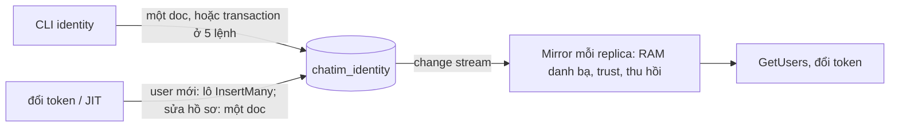

# M6 phase PM: `identity` chạy trên MongoDB, follower bằng change stream — tóm tắt

> Ngày: 2026-11-02 (duyệt) → 2026-11-04 (xây xong) · Nhánh `feat/m6` · Trạng thái: **đã xây, `dev-done` trên `feat/m6`** (commit `f23a58c` → `77abf88`) · Quyết định: D245–D259 (`docs/decision-log.md` §17.19) · Dựa trên: D244 (owner 2026-11-02 "chuyển sang mongodb"), owner 2026-11-02 "ok" change stream thay `NOTIFY`, "bỏ Feed HTTP", "cắt đứt postgres", một phase kiểm một lần ở cuối; owner 2026-11-03 và 2026-11-04 trong lúc làm (§8)
> **Các phase của M6:** (PA) gỡ đăng nhập, đổi tên, đổi token ✅ · **(PM) MongoDB + change stream + gỡ Postgres ✅** · (PB) server API theo lô, khoá user, thu hồi theo giờ — dời tới khi tenant đầu tiên tích hợp, trước go-live (D260); M6 đóng ở PA + PM

## Scope và ranh giới

| Việc | Trong PM? | Thuộc về |
|---|---|---|
| Store MongoDB `apps/identity/internal/store/mongostore` thay `pgstore` | Có, đã xây | `identity` |
| Follower `directory.Mirror` trong mỗi replica: nạp theo trang rồi đọc change stream | Có, đã xây | `identity` |
| Gỡ feed HTTP `/internal/v1/directory/changes` (không app nào dùng) | Có, đã gỡ (trả 404) | làm lại khi app đầu tiên cần (3b, M8 hoặc M9) |
| Gỡ hết Postgres: `pgstore`, compose `postgres`/`postgres-init`, `make pg-up`/`pg-down`, `PG_URI`, `CHATIM_IT_PG_URI`, `scripts/wait-postgres.sh`, `PG_*` trong `.env.example` và `.env`, pgx trong `go.mod`, depguard, volume dev `chatim_postgres_data` | Có, đã gỡ | repo |
| Metric, alert mới; đo đổi token, tải stream, nạp 100K | Có | `identity`, `deploy/prometheus` |
| Gom ghi user mới (JIT) thành lô (thêm trong lúc làm, owner 2026-11-04) | Có | `identity` |
| Hợp đồng node ↔ `identity` (JWKS, danh sách thu hồi, `pkg/identitysync`) | Không đổi | — |
| Audit (`audit_events`) | Không (bỏ, D256) | PB, suy từ change stream |
| Server API theo lô, khoá user, thu hồi theo giờ | Không | PB |
| Đọc dữ liệu của core | Không bao giờ | core |

## Tính năng → lớp dữ liệu (architecture §4)

| Tính năng | Lớp | Ghi | Báo thay đổi | Phục hồi |
|---|---|---|---|---|
| Tenant, issuer, khoá tin cậy, khoá ký | Cấu hình tin cậy | Lệnh CLI ghi một doc; kích hoạt khoá ký = một transaction | Change stream đánh thức nạp lại trust và danh sách thu hồi | Nạp lại mỗi `IDENTITY_TRUST_RELOAD` (10s) |
| User, nhóm, thành viên | Danh bạ identity | JIT: lô `InsertMany` (user mới) hoặc một doc (sửa hồ sơ); CLI một doc; 4 lệnh nhóm = một transaction | Change stream → follower | Mất vị trí stream → nạp lại toàn bộ, bản RAM cũ vẫn phục vụ |
| Suất (`slots`, mục đích `directory_load`) | Ephemeral, tự hết hạn | Upsert có điều kiện theo giờ DB | Không | Hết hạn ≤ 30s là nhả |

## 1. Thuật ngữ

| Từ | Nghĩa |
|---|---|
| Change stream | MongoDB báo từng thay đổi đã ghi chắc (majority), đúng thứ tự commit, kèm bản doc hiện tại; thay `NOTIFY`, bảng `directory_changes` và mốc `xmin` của Postgres |
| Resume token | Vị trí trong change stream. Token quá cũ (oplog đã quay vòng) thì không đọc tiếp được → nạp lại toàn bộ |
| Database `chatim_identity` | Database riêng trên replica set của core; user `identity` chỉ có `readWrite` trên đó |
| Doc nhận chỗ | Doc có `_id` cố định để chỉ một bên thắng, ví dụ `signing_key_claims {_id: "active"}` |
| `ver` | Phiên bản của tenant, user, nhóm; chỉ tăng khi field hiện ra ngoài đổi |
| Giờ DB | `$$NOW` của MongoDB (D221, D224) |
| Gom lô JIT | Nhiều user mới trong vài ms được ghi chung một `InsertMany`, một lần chờ majority |

## 2. Bức tranh chung



Ví dụ: admin chạy `user-set` đổi tên Bình → ghi doc `acme│binh` (`ver` 8) → `Mirror` của `identity-1` và `identity-2` nhận event, RAM có tên mới → `GetUsers` trả tên mới. e2e 15 đo được tối đa 118 ms sau khi lệnh xong (`bin/pm-verify/e2e.txt`).

## 3. Dữ liệu (`│` là U+2502, ngoài bộ ký tự của mọi id)

| Collection (clustered, zstd) | Field | Ví dụ | Dùng làm gì |
|---|---|---|---|
| `tenants` | `_id`, `name`, `state`, `ver`, `sessions_revoked_at`, `group_tree_ver`, `created_at`, `updated_at`, `updated_by` | `acme` | Khoá tenant → thu hồi; `group_tree_ver` cho hai lệnh ghi cây cùng tenant xung đột |
| `users` | `_id` = tenant│user, `tenant_id`, `id`, `display_name`, `avatar_url`, `state`, `groups` (nhóm trực tiếp, đã sắp), `ver`, `created_at`, `updated_at`, `updated_by` | `acme│ha` | Danh bạ; một doc đủ thông tin một người |
| `groups` | `_id` = tenant│group, `tenant_id`, `id`, `name`, `parent_id`, `ancestors`, `mentionable`, `state`, `ver`, `members_ver`, … | `acme│kinh-doanh-hcm` | Cây nhóm; `members_ver` cho gán nhóm và xoá nhóm xung đột |
| `trusted_issuers`, `trusted_keys` | `_id` = issuer; `_id` = issuer│kid, `algorithm`, `public_key`, `state` | `acme-backend│k1` | Tenant lấy từ issuer; kiểm chữ ký token tenant |
| `signing_keys`, `signing_key_claims` | `_id` = kid, `state`, khoá, `created_at`/`activated_at`/`retired_at` (giờ DB); claim `_id: "active"`, `key_id`, `ver` | | Ký token chat, JWKS; một khoá đang dùng duy nhất |
| `revoked_sessions` | `_id` = session id, `tenant_id`, `revoked_at`, `expires_at` | | Hợp đồng với node; vòng dọn như cũ |
| `slots` | `_id` = mục đích│số suất, `purpose`, `holder`, `expires_at` | `directory_load│2` | Tối đa N replica cùng làm một việc |

- Index ngoài `_id`: `users {tenant_id, groups}`, `groups {tenant_id, ancestors}`, `groups {tenant_id, parent_id, state}`, `revoked_sessions {expires_at}`; không index unique nào ngoài `_id` (`mongostore/schema.go`).
- **Kiểm lược đồ như core** (D258): `migrate` chạy thử mặc định, `-apply` tạo phần thiếu, không xoá. Thiếu collection hay index → `/readyz` false, log "run /app migrate -apply", và replica không ghi gì (không `Mirror`, không tự kích hoạt khoá, không dọn thu hồi); lệnh CLI ghi thoát 1. Index lệch → `warn` + gauge `chatim_identity_index_outdated{collection}`.
- **Env:** `IDENTITY_MONGO_URI` (bắt buộc, không kèm credential), `IDENTITY_MONGO_DB` (`chatim_identity`), `IDENTITY_MONGO_USER`, `IDENTITY_MONGO_PASSWORD`/`_FILE`, `IDENTITY_MONGO_AUTH_SOURCE`; `IDENTITY_JIT_WRITERS` 4, `_WINDOW` 2ms, `_MAX_BATCH` 256, `_QUEUE` 1024, `_INSERT_TIMEOUT` 1s (`config/config.go:104-114`). Bỏ `IDENTITY_PG_*`, `IDENTITY_FEED_WAIT_MAX`.
- Compose: `identity-mongo-init` tạo user `identity` (hoặc đổi mật khẩu theo secret), `identity-1` (`:8084`) và `identity-2` (`:8085`); không còn container Postgres. `.env` đổi khoá bằng `sed`, không in giá trị.

## 4. Luồng xử lý

### 4.1 Ghi

Transaction chỉ ở **5 lệnh** đổi nhiều doc: `group-create`, `group-update` đổi cha, `group-delete` (bước đánh dấu), `user-groups`, kích hoạt khoá ký (`key-activate`, `bootstrap`, tự kích hoạt). Mở/commit bằng tay một lần (`mongostore/transaction.go`), không `WithTransaction`. Xung đột → `unavailable` ngay.

| Use case | Đọc / ghi | Lỗi |
|---|---|---|
| JIT user mới | Vào hàng của một trong 4 writer (chọn theo hash `_id`); lô đóng khi đủ 256 hoặc 2ms sau doc đầu; `InsertMany` `ordered:false`, `w:majority` | Trùng `_id` → không ghi, vẫn cấp token; lỗi khác hoặc hàng đầy → `unavailable` (503) ngay, không thử lại |
| JIT sửa hồ sơ | `updateOne` lọc `_id` + tên/ảnh đã thấy (CAS, D242) | Thua CAS → không ghi, vẫn cấp token |
| `user-set`, `user-disable/enable`, `tenant-*`, `issuer-*`, `issuer-key-*` | Một doc; `ver` chỉ tăng khi giá trị đổi; khoá tenant lần đầu đặt `sessions_revoked_at = $$NOW` | Không có → `not_found`; trùng → `already_exists`; issuer chứa `│` → `invalid_argument` |
| `group-create`, `group-update` đổi cha | Transaction: `$inc group_tree_ver`; cha phải sống; chặn vòng; cây con chỉ đổi `ancestors` (một `updateMany`), không tăng `ver` | Cha lạ/đã xoá → `not_found`; vòng → `failed_precondition` |
| `group-delete` | Transaction đánh dấu xoá; sau commit gỡ id nhóm khỏi user theo lô 500; chạy lại = gỡ tiếp, in "N users updated" | Còn nhóm con sống → `failed_precondition` |
| `user-groups` | Transaction: đọc nhóm qua `mongobound.StringIDs`, `$inc members_ver`, đặt `groups` | Nhóm lạ/đã xoá → `not_found` |
| Kích hoạt khoá ký | Transaction: claim `active`, khoá đủ hạn (`created_at + lead ≤ $$NOW`), khoá cũ nghỉ | Sớm → `failed_precondition` kèm giờ; hai replica cùng bật → một `unavailable` |
| Lấy suất | `findOneAndUpdate` lọc `_id`, upsert, pipeline `$cond`: suất hết hạn thì đặt `holder` mình và `expires_at = $$NOW + 30s`; gia hạn mỗi 10s, nhả khi xong | Doc trả về mang `holder` khác → thử suất kế; hết suất → chờ 0,5–2s |

### 4.2 Follower (`directory.Mirror`) trong mỗi replica

```mermaid
sequenceDiagram
  participant F as Mirror
  participant DB as MongoDB
  F->>DB: lấy suất directory_load
  F->>DB: mở stream, lấy resume token T0, đóng
  F->>DB: nạp user theo trang 5.000 vào map mới, nạp thu hồi
  F->>F: đổi RAM một lần, ready, nhả suất
  F->>DB: mở stream từ T0 (users, tenants, trusted_issuers, trusted_keys, revoked_sessions)
  loop
    DB-->>F: event hoặc "không có gì trong 1s" (token vẫn tiến)
    F->>F: user: nhận nếu ver lớn hơn; trust: Reloader.Wake; thu hồi: nạp lại danh sách
  end
```

- Chỉ nhận event `update` của `users`/`tenants` khi `ver` đổi, nên đổi `ancestors` hay `group_tree_ver` không đánh thức gì.
- Lỗi stream → mở lại từ token cuối sau 1s→30s ±20%. Mất vị trí (286/280, `invalidate`, `dropDatabase`) → chờ cũng theo nấc 1s→30s rồi nạp lại toàn bộ; bản RAM cũ vẫn phục vụ và vẫn ready (review, `cd38812`).
- Token tiến cả lúc rảnh, nên replica nằm yên nhiều giờ vẫn mở lại được mà không quét lại oplog cũ.

### 4.3 Feed HTTP: đã gỡ

`GET /internal/v1/directory/changes` trả 404 (e2e 15). Làm lại khi app đầu tiên cần, dạng request thường trả ngay trên một kết nối keep-alive, không giữ request (D257). Cổng nội bộ và `IDENTITY_NODE_SECRET` giữ cho danh sách thu hồi.

## 5. Cơ chế đúng đắn và các ca chạy đua

| Ca | Kết quả |
|---|---|
| Commit đảo thứ tự với lúc bắt đầu | Change stream trả theo thứ tự commit, chỉ phần majority, không sót |
| Hai replica JIT tạo cùng user; hai doc cùng `_id` trong một lô | Một bên ghi; bên kia trùng `_id` → không ghi, vẫn cấp token |
| Gán Bình vào G song song với xoá G | Cả hai ghi doc G → một transaction `unavailable` (itest) |
| Hai lệnh đổi cha cùng tenant (A dưới B, B dưới A) | Một `unavailable`, không tạo vòng (itest) |
| Xoá nhóm đứt giữa lúc gỡ | Nhóm đã xoá; chạy lại gỡ nốt (itest 1.200 user, đứt sau lô đầu) |
| Pod chết khi giữ suất | Suất hết hạn sau ≤ 30s |
| Event tới khi đang nạp | Đọc lại từ T0, `ver` lọc bản cũ |
| Đồng hồ máy lệch | Mốc thu hồi, khoá ký, suất đều là giờ DB |
| Database chưa `migrate -apply` | Không replica nào ghi (ghi trước sẽ tạo collection không clustered) |

**Chỗ xếp hàng:** gán nhiều user vào cùng nhóm, ghi cây cùng tenant, kích hoạt khoá ký → lệnh thứ hai `unavailable` ngay. Đổi token không chạm chỗ nào trong số này.

## 6. Event và subject

Không có subject NATS (D219). Change stream là cơ chế đọc nội bộ của `identity`; `docs/events.md` §8 ghi feed đã gỡ.

## 7. Thư viện và hạ tầng

`go.mongodb.org/mongo-driver/v2`, `pkg/mongoindex`, `pkg/mongobound`; pgx đã rời `go.mod`. MongoDB 8.2 replica set `rs0` của compose. itest dùng `CHATIM_IT_MONGO_URI`, database tạm `identity_it_<hex>` mỗi lần chạy.

## 8. Quyết định, phương án bị loại, lệch so với plan

| Chọn | Bỏ | Vì sao |
|---|---|---|
| Change stream (D245) | Cờ `_state` + NATS + sweeper; số thứ tự cấp trước commit; `$$CLUSTER_TIME` ghi vào doc | Đảo D219; commit đảo thứ tự thì đọc sót |
| Nhóm trực tiếp trong doc user, `members_ver` trên nhóm (D247, D248) | Collection `user_groups`; bộ đếm theo tenant | Một doc đủ một người; chỉ lệnh chạm cùng nhóm mới xung đột |
| Transaction mở/commit tay, chỉ 5 lệnh (D250) | `WithTransaction`; transaction mọi lệnh | Driver tự thử lại tới 120s |
| Claim `active` (D251) | Index unique một phần | Unique chỉ qua `_id` |
| Bỏ audit ở PM (D256) | Ghi audit kèm transaction | `actor` luôn `admin-cli`, không ai đọc |
| Gom lô JIT (D259) | `w:1`; chỉ nới pool | `w:1` mất user khi failover; nới pool vẫn 0,15s mỗi user |

Lệnh owner và lệch trong lúc làm:
- 2026-11-03: Mongo 8.2 từ chối `$expr` trong bộ lọc upsert, nên lấy suất lọc theo `_id` và đổi `holder` bằng pipeline `$cond` (owner "ok").
- 2026-11-03: bỏ itest 286 thật (oplog dev không quay vòng; unit ánh xạ 286/280 ở `stream_decode_test.go:113-117`); kiểm 286 thật mang sang M5. Xoá volume `chatim_postgres_data` (owner "ok", đã xoá).
- 2026-11-04: lượt ES256 lạnh đầu tiên 849/s → owner chọn gom lô (D259, `71e8bed`).
- Theo review plan: việc chuyển app tách hai commit (`490e657` chuyển app, `1bc0782` xoá Postgres); token tiến lúc rảnh; không ghi trước khi lược đồ đủ; `ver` tenant chỉ tăng khi `state` đổi; khoá tenant lần hai không dời `sessions_revoked_at` (Postgres luôn dời); `group-delete` lần hai thoát 0.

## 9. Chi phí và số đo (dev, [docs/poc/README.md](../poc/README.md) mục M6 PM)

| Đo | Kết quả | File |
|---|---|---|
| Đổi token, user đã có, ES256 / RS256 | 1.700/s, 0 lỗi, p99 1,97 / 1,88 ms, 0,57 / 0,45 core | `docs/poc/results/exchange-261104-pm/es256-warm.txt`, `rs256-warm.txt` |
| User mới ES256, ghi từng doc, 2026-11-03 | 849/s, client bỏ 51.075, ngay sau đợt 93K user; nguyên nhân chưa tìm ra | `es256-cold-261103.txt` |
| User mới ES256 / RS256, ghi từng doc, 2026-11-04 | 1.700/s, 0 bỏ, p50/p99 5,7/36 và 6,3/72 ms | `es256-cold-261104.txt`, `rs256-cold.txt` |
| User mới ES256, gom lô, lượt A và lượt B (ngay sau 100K) | 1.700/s, 0 bỏ, 0 5xx, p50 13,3–14,9 ms, p99 72,6–86,8 ms; ~4,5 user mỗi `InsertMany`; lượt B hạ xung nên độ trễ không tin | `es256-cold-batched-a.txt`, `-b.txt` |
| corebench 2K tin/s, `identity` tắt / bật | CPU Mongo 1,87 → 2,07 core (+11,2%); mỗi replica ~1,5% core; độ trễ lệch hai chiều (một ô mỗi bên, nhiễu dev) | `stream-off.txt`, `stream-on.txt` |
| `BenchmarkLoad100K` | 0,578 s/lần (Postgres 0,73s) | `load100k.txt` |
| `BenchmarkGetUsersHTTP50` | 115,6 µs/lần | `getusers-http50.txt` |

## 10. Rủi ro và giới hạn

- Gom lô làm p50 user mới tăng từ ~6 ms lên ~14 ms trên dev; chưa đo tách nguyên nhân.
- Ngưỡng "tải stream lệch ≤ 10%" không có nguồn; +11,2% chỉ từ một ô mỗi bên.
- Chưa thấy lỗi 286 thật: nếu một replica vắng lâu hơn cửa sổ oplog, đường nạp lại toàn bộ mới chỉ được chứng minh qua `dropDatabase` và unit.
- Event không giải mã được bị đọc lại mãi (alert `StreamDown`/`DirectoryStale` báo, không tự khỏi).
- Ghi cây và gán nhóm cùng nhóm báo `unavailable` ngay; batch API ở PB sẽ gặp nhiều lần thử lại hơn khi nhiều lô cùng vào một nhóm.

## 11. Câu hỏi đã chốt (controller 2026-11-02, owner duyệt plan)

1. Cha nhóm lạ hay đã xoá → `not_found`, như trước.
2. `pgstore` bị xoá cùng lúc chuyển app (port mới không còn khớp), không đợi phần hạ tầng.
3. Compose có thêm `identity-2` để thử hai replica thật (suất nạp, tự kích hoạt khoá).
4. User Mongo `identity` do container `identity-mongo-init` tạo, để `make infra-up` không cần secret của `identity`.
5. Bench lượt ấm lấy danh sách user bằng mongosh (thay `psql`).
6. `user-set`, `user-disable`, `issuer-*` không tăng `ver` khi giá trị không đổi.
7. Danh sách thu hồi trong RAM nạp lại mỗi 10s dù không có event (lưới an toàn), không thêm env.
8. e2e 13 chờ tối đa 2s cho gỡ khoá tin cậy và khoá tenant (đo được 0s và 4 ms).
9. Giới hạn 1.024 byte của con trỏ feed không còn cần (feed đã gỡ).
10. Hai replica cùng tự kích hoạt khoá: bên thua log Warn một dòng mỗi lần xoay, giữ nguyên.

## 12. Kiểm thử và Minor

| Kiểm | Kết quả |
|---|---|
| `make fmt-check`, `vet`, `lint` | sạch, `0 issues.` (`bin/pm-verify/static-261104.txt`) |
| `make test` | 105 package `ok` (`bin/pm-verify/test.txt`); sau gom lô `./apps/identity/...` `ok` (`bin/pm-verify/test-after-t11c.txt`) |
| itest `./apps/identity/... ./pkg/identitysync/...` | 13 package `ok` (`bin/pm-verify/itest.txt`); sau gom lô `mongostore`, `exchange` `ok` (`bin/pm-verify/itest-after-t11c.txt`) |
| `make alerts-check` | `SUCCESS: 38 rules found` |
| `make core-up && make e2e` | PASS 14 phase, 13 và 15 trên MongoDB, không container Postgres (`bin/pm-verify/e2e.txt`) |
| Review độc lập toàn diff | 0 Critical; 1 Important sửa ở `cd38812`; review gom lô: APPROVE |

Minor (mang sang M5 hoặc PB, không chặn): `beforeCommit`/`afterBatch` là biến toàn package dùng cho test; mật khẩu Mongo chưa đưa vào bộ che log (URI không kèm credential nên chưa lộ); mất suất bị phát hiện muộn nếu một trang đọc > ~20s (chỉ làm trùng việc); `key-activate` theo id có thể bật khoá chờ cũ hơn (cố ý, như Postgres); hash `int(h.Sum32()) % n` âm trên int 32-bit; `Close` huỷ `InsertMany` đang chạy (vô hại, idempotent); histogram lô dừng ở 512; e2e 13 còn thử lại mỗi 1s trong `keyRemoved`/`tenantDisabled`; e2e 15 chỉ hỏi `GetUsers` ở `identity-1`; lần kiểm lược đồ trước lần ready đầu chờ tới `IDENTITY_KEY_RELOAD`; dữ liệu bench (tenant `pmes256`, `pmrs256`, 542.649 user) đã xoá khỏi `chatim_identity` dev khi đóng M6 (2026-11-04).

## Bảng phủ

| Yêu cầu | Thành phần | Test | Bằng chứng |
|---|---|---|---|
| D244 store MongoDB, database và user riêng | `mongostore`, `identity-mongo-init`, config | itest `store`, `schema`; e2e chạy bằng user `identity` | `f23a58c`, `783bffe`, `03c80e6`; `itest.txt`, `e2e.txt` |
| D245 change stream thay `NOTIFY`/`xmin` | `mongostore/stream.go` | itest stream, `stream_position` (token tiến lúc rảnh) | `89b0ba1`; `itest.txt` |
| D246 Mirror, trust và thu hồi có hiệu lực ngay | `directory/mirror*.go` | unit `mirror_test`; itest `TestTrustedKeyAddWakesTrustAtOnce`; e2e 13 | `b481729`, `cd38812`; e2e 13: gỡ khoá 0s, khoá tenant 4 ms |
| D247 doc, `_id`, `ver` | `mongostore` | itest `ver` giữ khi cùng giá trị, cây con không tăng `ver` | `c583f23`, `8be3861`, `2bcdf67` |
| D248 gán nhóm vs xoá nhóm, xoá theo lô | `group_members.go` | itest song song → một `unavailable`; 1.200 user 3 lô | `6f59de3`; `itest.txt` |
| D249 cây không vòng | `group_tree_ver` | itest đổi cha song song | `2bcdf67` |
| D250 transaction một lần, 5 lệnh | `transaction.go` | unit `mapErr`; itest xung đột | `f23a58c` |
| D251 giờ DB, một khoá đang dùng | `keys.go`, `revocations.go` | itest khoá ký, `ActivateDue` song song | `4566df9` |
| D252 suất chung `slots` | `slots.go`, Mirror | itest suất; `TestTenLoadersFinish` | `89b0ba1`, `b481729` |
| D253 gỡ hết Postgres | compose, Makefile, `.env*`, `go.mod`, depguard | `git grep`; `core-up` + e2e | `1bc0782`, `03c80e6`; `e2e.txt` |
| D254 metric, alert | `directory_stream_up`, `StreamDown` | `alerts-check` | `e907de5`; 38 luật |
| D255 đo tải | toàn đường | exchangebench, corebench, `Load100K`, `GetUsersHTTP50` | `7ab650e`, `77abf88`; §9 |
| D256 bỏ audit | ports, `admincmd`, lược đồ | itest migrate không `audit_events` | `783bffe`, `1bc0782` |
| D257 gỡ feed HTTP | `api`, config, e2e 15, `events.md` §8 | unit 404; e2e 15 404 | `00bffba`, `3eb8da0` |
| D258 kiểm lược đồ như core | `schema.go`, health, `migrate` | itest dry-run không ghi; unit health | `783bffe`, `490e657` |
| D259 gom lô JIT | `profile_batch.go` | unit lô/hàng đầy/`Close`; itest 2.000 user | `71e8bed`; `es256-cold-batched-*.txt` |
| D230 cache đổi ngay khi DB đổi | Mirror | e2e 15 | tên mới ≤ 118 ms, khoá user ≤ 3 ms |
| D231 chống bão khởi động | Mirror, `slots`, `LoadPage` | unit chờ suất/backoff; app "DB chết vẫn sống" | `b481729`, `490e657`; e2e restart ready 0s |
| D242 JIT CAS | `profile_write.go` | itest CAS thua, hai bên cùng tạo | `c583f23`, `71e8bed` |
| Owner: không retry nội bộ | `transaction.go`, `DeleteGroup`, bộ gom | itest xung đột, unit hàng đầy | `f23a58c`, `6f59de3`, `71e8bed` |
