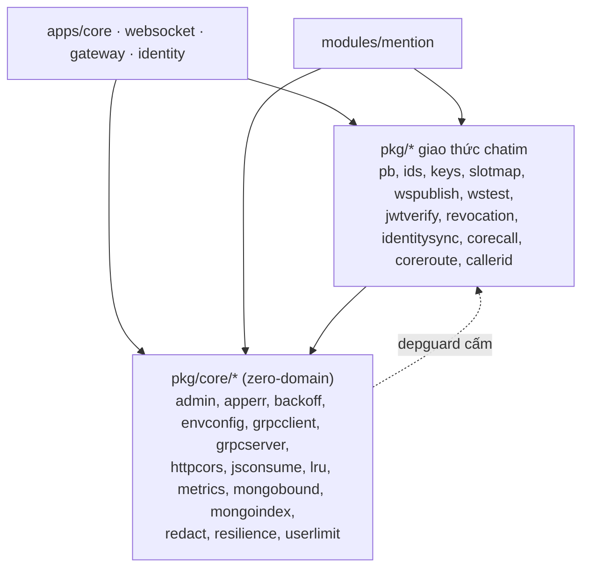

# M6 RF1 — `pkg/core`: tách hạ tầng không biết `chatim` (tóm tắt)

> Ngày 2026-11-04 · Nhánh `feat/m6` · Trạng thái: **chờ owner duyệt** · Phase 1/3 của đợt refactor trước M7 (RF1 `pkg/core` → RF2 `pkg/auth` + `pkg/chatrpc` → RF3 đổi `core` → `chat`), cùng PR M6 (owner 2026-11-04). Không đổi hành vi, không đổi tên metric, không đổi dữ liệu.

## 1. Scope và ranh giới

| Việc | Trong scope | Ai giữ |
| :- | :- | :- |
| Chuyển 15 package hạ tầng vào `pkg/core/*` | Có | `pkg/core` |
| Bỏ chuỗi `chatim` cứng trong `metrics` và `grpcclient` | Có | `pkg/core/metrics`, `pkg/core/grpcclient`; app truyền tên |
| Luật depguard giữ `pkg/core` sạch nghiệp vụ | Có | `.golangci.yaml` |
| Sửa path trong doc đang dùng và `INDEXES.csv` | Có | doc |
| Gộp `jwtverify`/`revocation`/`identitysync`, `corecall`/`coreroute`/`callerid` | Không | RF2 |
| Đổi `core` → `chat` (app, proto, env, metric, Redis key) | Không | RF3 |
| Đồng bộ sang repo `go-core`, chatim import `go-core` | Không | repo `go-core`, sau này |
| Lịch sử (D1–D260, summary cũ) | Không sửa | giữ nguyên path cũ |

Lớp dữ liệu (thiết kế §4), event, subject, field DB: **không áp dụng** — không có tính năng, không ghi dữ liệu mới.

## 2. Thuật ngữ

- **Zero-domain**: package không biết `chatim` là gì: không import `pkg/pb`, `ids`, `keys`, `slotmap`, không import `apps/*`, `modules/*`, không có chuỗi `chatim` cứng.
- **depguard**: linter chặn import theo luật trong `.golangci.yaml`; `make lint` đỏ khi vi phạm.
- **Kiểm âm**: cố tình viết một import cấm trong file nháp (không commit) để chắc luật thật sự bắt.

## 3. Bức tranh

Ví dụ: `apps/core` hôm nay import `github.com/ivannguyendev/chatim/pkg/jsconsume`; sau RF1 là `.../pkg/core/jsconsume`, code bên trong giữ nguyên. Nếu sau này ai đó cho `pkg/core/mongobound` import `pkg/keys`, `make lint` đỏ.

## 4. Thay đổi

| # | Việc | Chi tiết | Nguồn |
| :- | :- | :- | :- |
| 1 | Chuyển 15 package | `git mv pkg/
 pkg/core/
`; sửa import trong 466 file Go (`apps/core` 268, `apps/identity` 66, `modules/mention` 43, `apps/websocket` 21, `tools/corecli` 13, `apps/gateway` 9, còn lại trong `pkg/`); `gofmt` lại thứ tự import | decision log #1; `git grep` 2026-11-04 |
| 2 | Bỏ phụ thuộc test | `pkg/mongobound/binary_ids_test.go` thôi dùng `pkg/keys`, tự dựng khoá nhị phân trong test | decision log #1 |
| 3 | Namespace metric thành tham số | `metrics.Handler` nhận thêm namespace; 4 nơi gọi (`apps/core/internal/app/wiring.go:185`, `apps/websocket/internal/app/run.go:132`, `apps/gateway/internal/app/wiring.go:101`, `apps/identity/internal/app/wiring.go:127`) truyền `chatim` → tên metric xuất ra **không đổi** | decision log #2; `pkg/metrics/registry.go:14` |
| 4 | Scheme gRPC trung tính | `chatim-static:///cores` → `static:///targets`; resolver gắn riêng từng kết nối qua `grpc.WithResolvers`, không đụng resolver toàn cục, nên không cần tham số | decision log #2; `pkg/grpcclient/static_targets.go:13,29` |
| 5 | Chuỗi trung tính | Code: `mongoindex` báo "`members absent, core creates it at startup`" → "`... the app creates it at startup`" (thư viện không được nhắc tên app; hôm nay chỉ core in dòng này; không script nào khớp chuỗi này). Test của 15 package: bỏ `chatim_core_*`, `/chatim.v1.CoreService/...`, `CHATIM_EVT`, user `chatim`... trong fixture, giữ nguyên ý nghĩa từng ca; giữ `CHATIM_IT_MONGO_URI` (biến itest chung của repo) | decision log #2; `pkg/mongoindex/report.go:53` |
| 6 | depguard `pkg-core-zero-domain` | file `**/pkg/core/**`, `list-mode: lax` như luật `event-layer-tests` có sẵn: allow `chatim/pkg/core`, deny `chatim/pkg` (mục dài hơn thắng), deny `chatim/apps`, `chatim/modules` (đã có trong `pkg-shared-only`) | decision log #3 |
| 7 | Path lint đã chuyển | exclusion `^pkg/backoff/backoff\.go$` (`.golangci.yaml:317`), `^pkg/envconfig/secret\.go$` (`:323`) → `^pkg/core/...` | decision log #13 |
| 8 | Doc đang dùng | `INDEXES.csv` (15 dòng), CLAUDE.md, `docs/apps/core.md`, `docs/apps/identity.md`, `docs/modules/02`, `10`, `11`, phần hiện hành của `docs/roadmap.md`; không sửa `docs/decision-log.md` và `docs/plans/*` cũ | decision log #8 |

## 5. Tính đúng

- Chỉ đổi path import, một tham số và một hằng nội bộ; không đổi logic, nên bộ test sẵn có của 15 package và mọi app là bằng chứng chính.
- Tên metric giữ nguyên nhờ app truyền `chatim` → `deploy/prometheus/alerts.yml` không đổi, `make alerts-check` không cần chạy.
- Scheme gRPC chỉ là tên resolver cục bộ của một kết nối. Phần `targets` đi vào header `:authority` core nhận từ gateway (và ServerName TLS khi có mTLS ở M5); hôm nay core không đọc header này.
- Không có hàng đợi, khoá hay goroutine mới.

## 6. Quyết định và phương án bị loại

| Quyết định | Loại | Lý do loại |
| :- | :- | :- |
| Namespace là tham số `metrics.Handler` | Biến môi trường, hoặc hằng chung trong `pkg/` | env thêm cấu hình vô ích; hằng chung trong `pkg/core` lại dính `chatim` |
| Scheme hằng trung tính | Tham số cho scheme | resolver cục bộ từng kết nối, không thể đụng nhau (YAGNI) |
| Một luật depguard allow + deny | Liệt kê từng package `pkg/*` bị cấm | thêm package mới vào `pkg/` sẽ lọt nếu quên cập nhật danh sách |
| Giữ path cũ trong lịch sử | Sửa D1–D260 và summary cũ | lịch sử ghi đúng lúc đó; diff vô ích |

## 7. Chi phí và tải

Không đổi chi phí chạy: cùng binary, cùng tên metric, cùng hành vi. Diff lớn nhưng cơ học (~470 file Go); commit `git mv` tách riêng để `git diff -M` thấy rename.

## 8. Rủi ro thật

- Luật lint trỏ path cũ không còn tồn tại vẫn qua lint nhưng mất tác dụng → mục 7 + kiểm âm depguard.
- Sót path trong doc đang dùng → grep cuối phase: không còn `chatim/pkg/<15 tên>` cũ ngoài `docs/decision-log.md` và `docs/plans/*` cũ.

## 9. Điểm đội tự chọn (owner phản biện)

- Tên `pkg/core` cho thư viện hạ tầng (từ change request 2026-10-31); RF3 sẽ bỏ chữ `core` khỏi app nên không nhầm lâu dài. Trong khoảng RF1–RF2, `apps/core` và `pkg/core` cùng tồn tại.
- 2 commit: (1) `refactor(pkg): move infrastructure packages into pkg/core` — chỉ `git mv`, import, path lint, doc; (2) `refactor(pkg/core): drop hard-coded chatim names and guard zero-domain imports` — tham số, hằng, test, luật depguard.

## 10. Kiểm thử

| Kiểm | Chứng minh |
| :- | :- |
| `make fmt-check`, `make vet`, `make lint` | import đúng thứ tự, không còn path cũ, depguard mới không bắt nhầm code hiện có |
| `make test` | 15 package và mọi app chạy như cũ sau khi đổi path |
| Test `pkg/core/metrics`: namespace truyền vào xuất hiện trong tên metric | tham số thay được hằng `chatim` |
| Test `pkg/core/grpcclient` `static_targets` sẵn có, chạy với scheme mới | kết nối round robin vẫn tới đủ địa chỉ, bỏ qua node chết |
| Lifecycle test gateway, websocket, identity (`make test`) và itest core scrape cổng admin (`make itest`) | tên metric xuất ra của 4 app không đổi |
| `make itest` một lần | adapter `jsconsume`, `mongobound`, `mongoindex` vẫn chạy với Mongo/NATS thật |
| Kiểm âm depguard (file nháp, không commit): `pkg/core/mongobound` import `pkg/keys`, `pkg/core/lru` import `modules/mention/mentionapp` | luật mới thật sự đỏ |
| `git grep` path cũ ngoài lịch sử | không sót |

## 11. Bảng phủ

| Yêu cầu | Thành phần | Task | Test | Bằng chứng |
| :- | :- | :- | :- | :- |
| DL#1 chuyển 15 package | `pkg/core/*`, mọi importer | §4.1, §4.2 | `make test`, `make lint`, `make itest` | (sau thực thi) |
| DL#2 bỏ `chatim` cứng | `pkg/core/metrics`, `pkg/core/grpcclient`, 4 app | §4.3–§4.5 | test namespace, test `NewStatic` | (sau thực thi) |
| DL#3 depguard zero-domain | `.golangci.yaml` | §4.6 | `make lint` + kiểm âm | (sau thực thi) |
| DL#13 path lint đã chuyển | `.golangci.yaml:317,323` | §4.7 | `make lint` | (sau thực thi) |
| DL#8 doc đang dùng (phần path `pkg/core`) | `INDEXES.csv`, CLAUDE.md, docs | §4.8 | grep path cũ | (sau thực thi) |
