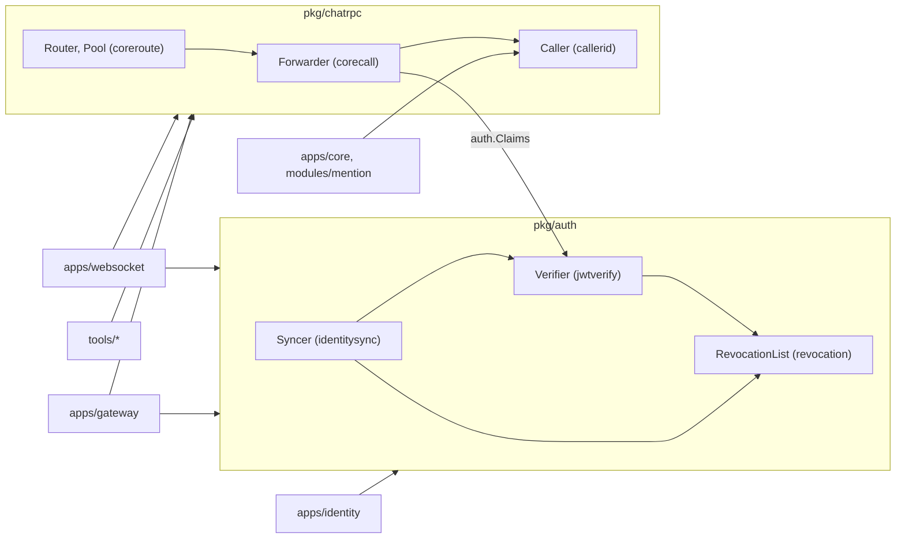

# M6 RF2 — gộp `pkg/auth` và `pkg/chatrpc` (tóm tắt)

> Ngày 2026-11-04 · Nhánh `feat/m6` · Trạng thái: **owner duyệt 2026-11-05**, chưa xây · Phase 2/3 của đợt refactor trước M7 (RF1 `pkg/core` ✅ → **RF2** → RF3 đổi `core` → `chat`), cùng PR M6 (owner 2026-11-04). Không đổi hành vi, không đổi metric, env, wire hay dữ liệu.

## 1. Scope và ranh giới

| Việc | Trong scope | Ai giữ |
| :- | :- | :- |
| `pkg/jwtverify` + `pkg/revocation` + `pkg/identitysync` → `pkg/auth`; `identitysync/identitysynctest` → `pkg/auth/authtest` | Có | `pkg/auth` |
| `pkg/corecall` + `pkg/coreroute` + `pkg/callerid` → `pkg/chatrpc` | Có | `pkg/chatrpc` |
| Đổi tên trùng và tên mơ hồ sau khi gộp (bảng §4) | Có | hai package mới |
| Luật lint trỏ path cũ, `INDEXES.csv`, doc đang dùng, `.memory/` | Có | `.golangci.yaml`, doc |
| Hàm `auth.Authenticate` (verify + kiểm thu hồi một lần gọi) | Không | đổi hành vi, cân nhắc riêng (decision log §5) |
| Đổi `Core` → `Chat` trong tên field/kiểu (`Clients.Core`, `CoreServiceClient`) | Không | RF3 |
| Lịch sử (D1–D260, summary cũ, `docs/poc/results/`) | Không sửa | giữ tên cũ |

Lớp dữ liệu §4, event, subject, field DB: **không áp dụng**.

## 2. Thuật ngữ

- **Gộp package**: chuyển file của nhiều package vào một thư mục, một tên package; code bên trong giữ nguyên, chỉ đổi tên khi hai package có cùng tên.
- **Syncer**: phần node (websocket, gateway) tải danh sách thu hồi và JWKS từ `identity` qua HTTPS, giữ bản chung trong Redis.
- **Forwarder / Router / Pool**: chuyển lệnh client sang core; chọn kết nối core theo slot của room; giữ một kết nối gRPC mỗi địa chỉ core.

## 3. Bức tranh

Ví dụ: websocket hôm nay import 3 package (`jwtverify`, `revocation`, `identitysync`) để nhận token và kiểm thu hồi; sau RF2 chỉ import `pkg/auth`. Gateway hôm nay import `corecall` và `callerid`; sau RF2 là `pkg/chatrpc`. Đổi import ở 94 file Go.

## 4. Bảng đổi tên

Chỉ đổi tên trùng nhau sau khi gộp hoặc mất nghĩa khi đứng sau tên package mới (`auth.New`, `auth.List`, `chatrpc.Of`). Mọi tên khác giữ nguyên (`Verifier`, `Claims`, `ReasonOf`, `KeyIDOf`, `Verdict`, `Syncer`, `Shared`, `NewRedisShared`, `Forwarder`, `Command`, `Realtime`, `Request`, `Pool`, `NewPool`, `Router`, `ErrNoRoute`, `Caller`, `WithCaller`...).

| Cũ | Mới | Lý do |
| :- | :- | :- |
| `jwtverify.Config`, `jwtverify.New`, `jwtverify.LoadFile` | `auth.VerifierConfig`, `auth.NewVerifier`, `auth.LoadVerifier` | `Config`/`New` trùng ở cả 3 package; `auth.LoadFile` không nói nạp gì |
| `revocation.Config`, `revocation.New`, `revocation.List` | `auth.RevocationListConfig`, `auth.NewRevocationList`, `auth.RevocationList` | trùng `Config`/`New`; `auth.List` mơ hồ |
| `revocation.Session`, `Tenant`, `Snapshot`, `Added`; `identitysync.SharedKey` | `auth.RevokedSession`, `RevokedTenant`, `RevocationSnapshot`, `RevocationsAdded`, `SharedRevocationsKey` | `auth.Session`/`auth.Tenant` dễ nhầm với field `Claims.Session`/`Claims.Tenant`; `auth.SharedKey` đọc như khoá bí mật, thật ra là key Redis |
| `identitysync.Config`, `New`, `Defaults`, `FromEnv`, `NewList` | `auth.SyncConfig`, `NewSyncer`, `SyncDefaults`, `SyncConfigFromEnv`, `NewNodeRevocationList` | trùng `Config`/`New`; `auth.FromEnv`/`auth.NewList` không nói của phần nào |
| `identitysynctest.Config`, `Accepting`, `Refusing` | `authtest.SyncConfig`, `Accepting`, `Refusing` | theo tên mới |
| `corecall.Conn{Core, Mention}` | `chatrpc.Clients{Core, Mention}` | trùng `coreroute.Conn` |
| `coreroute.Conn{Addr, Core, Mention}` | `chatrpc.PoolConn{Addr, Clients}` (nhúng `Clients`) | trùng tên; nhúng thì `.Core`/`.Mention` vẫn đọc như cũ và bỏ được hàm chép field ở `apps/websocket/internal/command/executor.go:103-107` |
| `corecall.New`, `corecall.Options` | `chatrpc.NewForwarder`, `chatrpc.ForwarderOptions` | `chatrpc.New` không nói tạo gì |
| `coreroute.Config`, `coreroute.Open` | `chatrpc.RouterConfig`, `chatrpc.OpenRouter` | như trên |
| `callerid.Of` | `chatrpc.CallerOf` | `chatrpc.Of` mất nghĩa |

Test: `TestNewRejectsBadConfig` (có ở `revocation` và `identitysync`), helper `testConfig` (có ở `jwtverify` và `identitysync`) đổi tên theo phần. File đổi tên có tiền tố theo phần khi đứng chung thư mục dễ nhầm (ví dụ `jwtverify/config_test.go` → `verifier_config_test.go` cạnh `sync_config.go`).

## 5. Luật lint và doc

- `.golangci.yaml`: `wstest-tests-only` deny `pkg/identitysync/identitysynctest` → `pkg/auth/authtest`; `identity-sync-no-nats` (files `pkg/identitysync`, `pkg/revocation`) → `auth-no-nats`, files `**/pkg/auth/**` (giữ desc owner 2026-10-27); exclusion gosec G101 `^pkg/identitysync/identitysynctest/` → `^pkg/auth/authtest/`.
- `INDEXES.csv`: 7 dòng cũ → 3 dòng `pkg/auth`, `pkg/auth/authtest`, `pkg/chatrpc`; cột `used_by` của dòng khác đổi theo.
- Doc đang dùng: CLAUDE.md, `docs/apps/gateway.md`, `docs/apps/identity.md`, `docs/modules/02`, `09`, `11`, `docs/modules/README.md`, dòng M6 của roadmap (PB nhắc `pkg/revocation`), `.memory/` 3 file. Không sửa lịch sử.
- `deploy/prometheus/alerts.yml` chỉ có chữ "revocation" trong câu mô tả, không phải tên package → không đổi.

## 6. Tính đúng

- Chỉ đổi path, tên kiểu/hàm và một lần nhúng struct; không đổi logic, không đổi metric (`identitysync` vẫn khai `Sources()` như cũ), env (`<prefix>_IDENTITY_*`), đường HTTP hay key Redis (`chatim:identity:revocations`).
- `PoolConn` nhúng `Clients`: mọi chỗ đọc `.Core`, `.Mention`, `.Addr` giữ nguyên; chỉ composite literal đổi dạng.
- `chatrpc` import `auth` (`Forward` nhận `auth.Claims`, `pkg/corecall/forwarder.go:84`). Core và Mention import `chatrpc` chỉ để đọc caller nên binary core link thêm verifier, syncer, router, forwarder: to hơn, không đổi hạ tầng, đúng chiều phụ thuộc.
- Chuỗi lỗi đổi tiền tố `corecall:`/`coreroute:`/`identitysync:`/`revocation:` → `chatrpc:`/`auth:`; không test hay script nào khớp các tiền tố này.
- Gateway sẽ link phần định tuyến (`Router`, `Pool`, go-redis qua `pkg/slotmap`) dù không dùng; gateway đã dùng Redis (`GW_SHARED_REDIS_*`), binary to hơn một chút, không đổi hạ tầng.
- Không có hàng đợi, khoá hay goroutine mới.

## 7. Quyết định và phương án bị loại

| Quyết định | Loại | Lý do loại |
| :- | :- | :- |
| Đổi chỉ tên trùng và tên mơ hồ | Giữ nguyên mọi tên rồi thêm alias | alias là hai tên cho một thứ |
| Đổi chỉ tên trùng và tên mơ hồ | Đặt lại toàn bộ API theo `auth.*` mới | diff lớn hơn, không thêm giá trị cho refactor |
| `PoolConn` nhúng `Clients` | Hai struct độc lập như cũ | giữ hàm chép field; nhúng gọn hơn và không đổi chỗ đọc |
| `callerid` vào `chatrpc` | Giữ `callerid` riêng | change request gộp: cùng giao thức gọi chat; core và Mention import `chatrpc` chỉ để đọc caller, vẫn đúng chiều phụ thuộc (`pkg` không import `apps`) |

## 8. Chi phí và tải

Không đổi chi phí chạy. Diff cơ học (121 file Go + ~12 doc); một commit, vì đổi tên kiểu và gộp phải đi cùng nhau mới biên dịch được.

## 9. Rủi ro thật

- Luật lint trỏ path cũ vẫn qua lint nhưng mất tác dụng (`wstest-tests-only`, `identity-sync-no-nats`) → §5 + kiểm âm: code chạy import `pkg/auth/authtest` và `pkg/auth` import `nats-io` đều phải làm lint đỏ.
- Sót tên cũ trong doc → grep cuối phase không còn `jwtverify|revocation\.|identitysync|corecall|coreroute|callerid` ngoài lịch sử.

## 10. Điểm đội tự chọn (owner phản biện)

- Bảng đổi tên §4, nhất là `NewNodeRevocationList`, `SyncConfigFromEnv`, `CallerOf`, `RevokedSession`/`RevokedTenant`, `PoolConn` nhúng `Clients`.
- Tên giữ nguyên dù hơi chung khi đứng sau `auth.`: `Shared`, `NewRedisShared`, `RedisClient`, `Doer`, `KeySink`, `Default*` (mặc định của syncer), `ErrInvalidConfig` (chỉ của verifier), `chatrpc.All()`. Giữ để diff nhỏ; đổi được sau nếu owner muốn.
- Một commit `refactor(pkg): merge auth and chat rpc packages`.

## 11. Kiểm thử

| Kiểm | Chứng minh |
| :- | :- |
| `make fmt-check`, `make vet`, `make lint` | import và tên mới đúng, luật lint trỏ path mới |
| `make test` (105 package trước RF2; sau RF2 là 101: bỏ 7 package cũ gồm `identitysynctest`, thêm `auth`, `auth/authtest`, `chatrpc`) | mọi test cũ của 6 package và các app chạy như cũ |
| `make itest` một lần | wiring websocket, gateway, identity với Redis/Mongo/NATS thật (`identitysync` dùng Redis, `coreroute` dùng slot table) |
| Kiểm âm (file nháp blank import, không commit): code chạy trong `apps/gateway` import `pkg/auth/authtest`; `pkg/auth` import `github.com/nats-io/nats.go` | hai luật đã chuyển path vẫn đỏ |
| `git grep -P` tên package cũ ngoài lịch sử | không sót |

Không chạy `e2e`, `alerts-check`, corebench, R5 (bảng ngân sách; e2e chạy ở RF3).

## 12. Bảng phủ

| Yêu cầu | Thành phần | Task | Test | Bằng chứng |
| :- | :- | :- | :- | :- |
| DL#4 gộp `pkg/auth` + `authtest` | `pkg/auth`, websocket, gateway, identity | §4 phần auth | `make test`, `make itest` | (sau thực thi) |
| DL#5 gộp `pkg/chatrpc` | `pkg/chatrpc`, websocket, gateway, core, mention, tools | §4 phần chatrpc | `make test`, `make itest` | (sau thực thi) |
| DL#6 giữ package giao thức ở `pkg/` | `pkg/` còn `pb`, `auth`, `chatrpc`, `ids`, `keys`, `slotmap`, `wspublish`, `wstest`, `core/` | toàn phase | `ls pkg` | (sau thực thi) |
| DL#13 luật lint theo path mới | `.golangci.yaml` | §5 | `make lint` + kiểm âm | (sau thực thi) |
| DL#8 doc đang dùng (phần package gộp) | CLAUDE.md, `INDEXES.csv`, docs, `.memory/` | §5 | grep tên cũ | (sau thực thi) |
