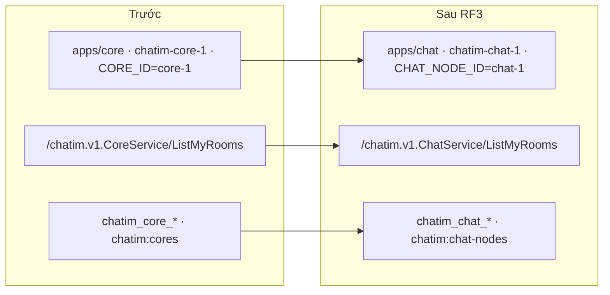

# M6 RF3 — đổi tên app `core` thành `chat` (tóm tắt)

> Ngày 2026-11-05 · Nhánh `feat/m6` · Trạng thái: **chờ owner duyệt** · Phase 3/3 của đợt refactor trước M7 (RF1 `pkg/core` ✅ → RF2 `pkg/auth` + `pkg/chatrpc` ✅ → **RF3**), cùng PR M6 (owner 2026-11-04). Không đổi hành vi nghiệp vụ, dữ liệu Mongo hay subject NATS; đổi tên mà người vận hành và client nhìn thấy (URL gateway, env, metric, alert, Redis key, container).

## 1. Scope và ranh giới

| Việc | Trong scope | Ai giữ |
| :- | :- | :- |
| `apps/core` → `apps/chat` (886 file, chỉ chuyển chỗ + đổi import) | Có | app `chat` |
| Proto `CoreService` → `ChatService`, `core.proto` → `chat.proto`, `core_service.proto` → `chat_service.proto`, sinh lại `pkg/pb` | Có (owner 2026-11-04 câu 1a) | `proto/`, `pkg/pb` |
| Env, metric, alert, Redis key, tên client Mongo/Redis/NATS, compose, Makefile, scripts, tools, symbol Go, chuỗi log/lỗi (bảng §4) | Có | mọi app, `pkg/slotmap`, `pkg/chatrpc`, `modules/mention`, `tools/`, `deploy/` |
| `.golangci.yaml` (73 chỗ `apps/core`), `INDEXES.csv`, doc đang dùng, `.memory/` | Có | luật lint, doc |
| Một D mới ở `docs/decision-log.md` gom quyết định RF1–RF3 và bảng đổi tên | Có | decision log |
| `pkg/core` (thư viện hạ tầng, RF1) và chữ "core" không phải tên app: "core NATS" (NATS không JetStream, 28 chỗ), `score`, `ZRANGEBYSCORE`, `underscore` | Không đổi | giữ nguyên |
| Lịch sử: D1–D260, `docs/plans/*-summary.md`, `docs/poc/results/` | Không sửa chữ | chỉ sửa link trỏ tới `docs/apps/core.md` (1 file) để link không gãy |
| Database Mongo `chatim`, collection, stream `CHATIM_*`, durable `projections`, subject `evt.*`/`eph.*`, frame websocket | Không đổi (không chứa chữ `core`) | — |
| Repo client SDK sinh lại từ proto mới | Không | repo client (D206) |

Lớp dữ liệu §4, event, field DB: **không áp dụng**.

## 2. Thuật ngữ

- **App chat**: chương trình hôm nay tên `core` (room, member, message, seq, event).
- **Node chat**: một bản đang chạy của app chat (`chat-1`, `chat-2`), giống "node websocket" (`WS_NODE_ID`).
- **Đổi theo danh sách**: chỉ đổi những tên có trong bảng §4 và danh sách của plan, không `sed core→chat` toàn repo (decision log #9).

## 3. Bức tranh

Hôm nay người vận hành gõ `make core-up`, thấy container `chatim-core-1`, đặt `CORE_ID=core-1`, xem metric `chatim_core_counter_repaired_total`, alert nhóm `chatim-core-guarantees`; client gọi `POST /chatim.v1.CoreService/ListMyRooms`. Sau RF3:

Một quy tắc đặt tên: chữ `core` chỉ **app** → `chat`; chữ `core` chỉ **một bản đang chạy** → `chat node`/`Node`. Lý do: trong sản phẩm chat, `chatim:chats`, `CHAT_ID=chat-1` hay cờ `-chats 2` đọc như "danh sách cuộc chat", "id của một cuộc chat" (ví dụ dễ nhầm: `CHAT_ID` cạnh `room_id` trong log).

## 4. Bảng đổi tên

| Nhóm | Cũ → mới |
| :- | :- |
| Path | `apps/core` → `apps/chat`; `docs/apps/core.md` → `docs/apps/chat.md`; `scripts/wait-core-healthy.sh` → `scripts/wait-healthy.sh` (đã chờ cả identity, websocket, gateway) |
| Proto, URL | `CoreService` → `ChatService`; gateway `POST /chatim.v1.ChatService/{Lệnh}`; gRPC websocket/gateway → chat theo tên mới. Frame websocket không đổi (`ws.proto` không chứa tên service) |
| Env app chat | `CORE_*` → `CHAT_*` (`CHAT_GRPC_ADDR`, `CHAT_ADMIN_ADDR`, `CHAT_SHUTDOWN_BUDGET`...); riêng `CORE_ID` → `CHAT_NODE_ID` |
| Env app khác | `CORE_REQUEST_DEADLINE` (websocket, gateway) → `CHAT_REQUEST_DEADLINE`; `GW_CORE_ADDRS` → `GW_CHAT_ADDRS` |
| `.env.example`, Makefile | `CORE_GOGC` → `CHAT_GOGC`, `CORE1/2_GRPC_PORT` → `CHAT1/2_GRPC_PORT`, `CORE_WAIT_SECONDS` → `HEALTHY_WAIT_SECONDS` (theo `wait-healthy.sh`), `CORE_COMPOSE` → `APP_COMPOSE` (bật cả profile `app`), `CORES` → `CHAT_NODES`, `CORECLI_IMAGE` → `CHATCLI_IMAGE`; `make core-up/core-down` → `make app-up/app-down` (bật cả 4 app, không chỉ chat) |
| Compose | image `chatim/chat:dev`, anchor `x-chat`/`x-chat-env`, service `chat-1/2`, container `chatim-chat-1/2` |
| Metric | `chatim_core_*` → `chatim_chat_*`; `chatim_{websocket,gateway}_core_call_seconds` → `..._chat_call_seconds` (28 tên). `chatim_mention_*` giữ |
| Alert | nhóm `chatim-core-guarantees` → `chatim-chat-guarantees`, `ChatimGatewayCoreUnavailable` → `ChatimGatewayChatUnavailable`, biểu thức theo metric mới |
| Redis | `chatim:cores` → `chatim:chat-nodes`, `chatim:core:<id>` → `chatim:chat-node:<id>` (bảng node sống, `pkg/slotmap/redis_keys.go:10,12`) |
| Tên client | Mongo/Redis/NATS `chatim-core`, `chatim-core-slots-<id>`, `chatim-core-dedupe-<id>` → `chatim-chat...`; `chatim-corecli`/`chatim-corebench` → `chatim-chatcli`/`chatim-chatbench` |
| Tools | `tools/corecli` → `tools/chatcli`, `tools/poc/corebench` → `tools/poc/chatbench` (`make poc TOOL=chatbench`); cờ `-cores` → `-nodes`; `E2E_KILL=chat-1\|chat-2` |
| Symbol Go (app) | `ChatServiceClient`, `chatrpc.Clients{Chat, Mention}`, `ChatAddrs`, `ChatCallLatency`, `mentionapp.ChatReader`, fake/helper test `fakeChat`, `startChat`, `dialChat`... |
| Symbol Go (node) | `CoreID` → `NodeID`, `slotmap.Route.Core` → `Route.Node`, `CoreKey`/`CoreRegistryKey`/`CoreExpiryScore` → `NodeKey`/`NodeRegistryKey`/`NodeExpiryScore`, `MaxCores` → `MaxNodes`, `cores` (test) → `nodes` |
| Chuỗi | log `core ready` → `chat ready`, lỗi `core returned no result` → `chat returned no result`, thông điệp client `core did not answer in time` → `chat did not answer in time`; DB/stream của itest `chatim_it_core_`/`IT_CORE_` → `chatim_it_chat_`/`IT_CHAT_` |
| Doc | app viết là `chat`; câu dễ nhầm với "cuộc chat" viết "app chat" hoặc "node chat" |

## 5. Tính đúng

- Không đổi logic: chỉ đổi path, tên và chuỗi. Key `_id`, collection, field, subject, stream, consumer không chứa chữ `core` nên không đổi; dữ liệu Mongo cũ đọc được như cũ.
- Mã gRPC và hợp đồng lệnh giữ nguyên; client chỉ đổi URL (tên service). Thông điệp lỗi cho client đổi chữ, client không được so chuỗi (mã là hợp đồng, module 09 §11).
- Redis key bảng node đổi: websocket và chat phải chạy cùng bản (cùng image tag, đúng quy ước release). Dev: `make infra-reset` xoá lease cũ trước e2e.
- Luật lint trỏ path không còn tồn tại vẫn qua lint nhưng hết bảo vệ ranh giới → đổi cả 73 chỗ trong cùng commit, kiểm âm.
- Không có hàng đợi, khoá, goroutine mới.

## 6. Event, thư viện, hạ tầng

Không đổi event, subject, thư viện. Hạ tầng dev: container, image, Make target và tên metric đổi; Prometheus dev mất nối tiếp lịch sử metric cũ (chưa có production).

## 7. Quyết định và phương án bị loại

| Quyết định | Loại | Lý do loại |
| :- | :- | :- |
| `chat` cho app, `chat node`/`Node` cho bản chạy | `chat` cho mọi thứ (`chatim:chats`, `CHAT_ID`, `-chats`, như decision log #7 bản đầu) | đọc như danh sách/id cuộc chat; websocket đã dùng `WS_NODE_ID` |
| `make app-up/app-down` | `chat-up/chat-down` (decision log #7) | target bật cả identity, chat, websocket, gateway; tên `chat-up` nói sai |
| Đổi theo danh sách + grep allowlist | `sed core→chat` toàn repo | phá `pkg/core`, "core NATS", `score`, lịch sử |
| Lịch sử giữ chữ, chỉ sửa link gãy | Viết lại D1–D260 và summary cũ | sửa lịch sử, diff lớn vô ích; link gãy thì sửa vì là đường dẫn, không phải nội dung |
| Đổi key Redis, `make infra-reset` | Đọc cả key cũ và mới một thời gian | chưa go-live, không có dữ liệu cần giữ (decision log §4) |

## 8. Chi phí và tải

Không đổi chi phí chạy, không đổi hiệu năng (không chạy chatbench). Diff khoảng 1.100 file (886 chỉ chuyển chỗ), 3 commit để `git diff -M` thấy rename sạch:

1. `refactor(chat): move apps/core to apps/chat` — `git mv`, sửa import, `.golangci.yaml` path, Dockerfile/Makefile target, `INDEXES.csv` path, `docs/apps/core.md` → `chat.md`.
2. `refactor(chat): rename core to chat in names, env, metrics and keys` — proto + `make proto`, symbol, env, metric, alert, Redis key, compose, Makefile, scripts, tools, `docs/apps/*`, `INDEXES.csv` nội dung.
3. `docs(m6): rename core to chat in current docs` — CLAUDE.md, README, architecture, modules, events, e2e, roadmap phần hiện hành, `.memory/` (đổi cả tên file `no-sharding-in-core.md`), D mới, grep cuối.

## 9. Rủi ro thật

- Sót tên trong script, compose, alert, e2e → bắt bằng `make app-up && make e2e`, `make alerts-check`, grep allowlist cuối phase.
- Đổi nhầm chữ "core" không phải tên app ("core NATS", `pkg/core`) → đổi theo danh sách, grep allowlist kiểm cả hai chiều.
- Repo client SDK phải sinh lại từ proto mới trước khi gọi gateway (owner đã chấp nhận 2026-11-04).

## 10. Điểm đội tự chọn (owner phản biện)

- Quy tắc app/node §3 và các tên `CHAT_NODE_ID`, `chatim:chat-nodes`, `Route.Node`, cờ `-nodes`.
- `make app-up/app-down`, `APP_COMPOSE`, `HEALTHY_WAIT_SECONDS` thay vì giữ chữ `chat` ở các tên chung cho mọi app.
- Doc viết app là `chat`; chỗ dễ nhầm viết "app chat"/"node chat".
- Tên file `.memory/no-sharding-in-core.md` → `no-sharding-in-chat.md` (sửa link `[[...]]` theo).

## 11. Kiểm thử

| Kiểm | Chứng minh |
| :- | :- |
| `make proto`, `make buf-lint` | proto mới sinh đúng, `pkg/pb` khớp |
| `make fmt-check`, `make vet`, `make lint` | import, tên, luật lint trỏ path mới |
| `make test` | mọi test unit chạy như cũ dưới tên mới |
| `make itest` | wiring chat, websocket, gateway với Mongo/Redis/NATS thật, key Redis mới |
| R5 một lần (`test -race -count=20 ./apps/chat/internal/platform/slot/`) | slot và `pkg/slotmap` đổi tên vẫn đúng (bảng ngân sách) |
| `make alerts-check` | alert trỏ metric mới |
| `make infra-reset`, `make app-up && make e2e` | compose, Makefile, scripts, URL gateway, key Redis, kill node `chat-1` chạy hết 14 phase |
| Kiểm âm depguard (file nháp blank import, không commit): websocket import `apps/chat/...`; domain `message` import `apps/chat/internal/api` | luật ranh giới theo path mới vẫn đỏ |
| `git grep -P` chữ `core` (tự kiểm trên cây cũ trước) | chỉ còn allowlist: lịch sử, `pkg/core`, "core NATS", `score`, D mới |

## 12. Bảng phủ

| Yêu cầu | Thành phần | Task | Test | Bằng chứng |
| :- | :- | :- | :- | :- |
| DL#7 đổi app, proto, env, metric, Redis, compose, tools | mọi app, `pkg/slotmap`, `pkg/chatrpc`, `deploy/`, `tools/` | commit 1, 2 | `test`, `itest`, `e2e`, `alerts-check` | điền sau khi thực thi |
| DL#8 doc đang dùng đổi, lịch sử giữ, D mới | doc, `.memory/`, `docs/decision-log.md` | commit 3 | grep allowlist | điền sau khi thực thi |
| DL#9 không sed hàng loạt | toàn phase | commit 1–3 | grep allowlist hai chiều | điền sau khi thực thi |
| DL#11 symbol Go `Core*` | Go | commit 2 | `vet`, `lint`, `test` | điền sau khi thực thi |
| DL#12 `wait-healthy.sh` | `scripts/`, Makefile | commit 1 | `make app-up` | điền sau khi thực thi |
| DL#13 luật lint theo `apps/chat` | `.golangci.yaml` | commit 1 | `make lint` + kiểm âm | điền sau khi thực thi |
| `pkg/slotmap` đổi → R5 | `apps/chat/internal/platform/slot` | commit 2 | R5 | điền sau khi thực thi |
