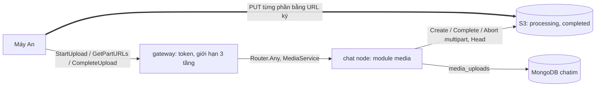
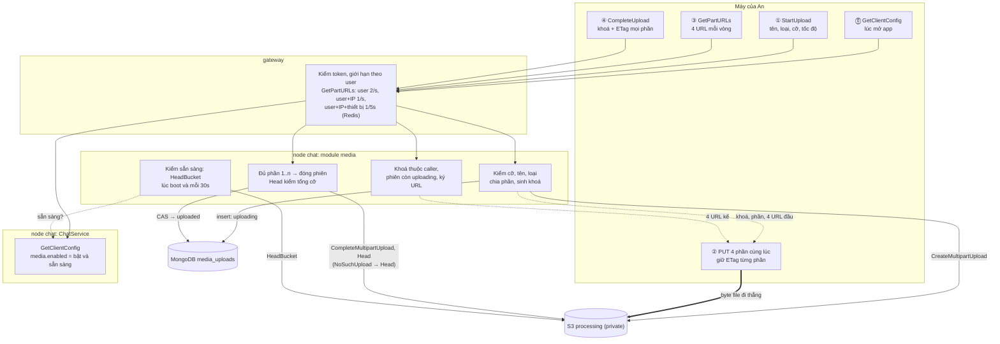

# M7 phase P1: upload nhiều phần qua module `media` — tóm tắt

> Ngày: 2026-11-06 · Nhánh `feat/m7` · Trạng thái: **đã xây, `dev-done` trên `feat/m7`** (2026-11-07, commit `a162977` → `bd8b5cf`) · Dựa trên: D207 (media qua presigned URL, gateway); owner 2026-11-06: file vài GB, có dọn file, chưa quét mã độc, module nhúng, chia P1–P3, API config chung, 2 bucket, 16–128 MiB/phần, ≤ 2.000 phần, 4 luồng, máy gửi ETag, S3 lỗi không làm hỏng chat, code không tạo bucket, giới hạn `GetPartURLs` 3 tầng, dev dùng Garage hoặc versitygw
> **Các phase của M7:** **(P1) upload nhiều phần** · (P2) đính kèm trong tin, URL tải · (P3) chuyển và dọn file

## Scope và ranh giới

| Việc | Trong P1? | Thuộc về |
|---|---|---|
| Spike: ký URL từng phần ghim cỡ, đóng phiên bằng ETag máy gửi, trên Garage và versitygw; chọn server dev và SDK | Có, task đầu | `tools/poc/mediaspike` |
| S3 cho dev (Garage hoặc versitygw theo spike) và script tạo bucket chạy ngoài | Có | deploy, `scripts/` |
| Module `modules/media` (public `mediaapp`), collection `media_uploads`, 4 lệnh upload, kiểm sẵn sàng | Có | module media, nhúng trong chat |
| `ChatService.GetClientConfig`: API config chung cho máy | Có | chat (`apps/chat/internal/app` dựng, chỉ `app` đọc config) |
| Gateway: chuyển `MediaService`, giới hạn `GetPartURLs` 3 tầng, đọc IP máy | Có | `pkg/chatrpc`, `apps/gateway` |
| Tạo bucket, luật lifecycle, CORS ở production | Không | hạ tầng (tạo sẵn trước khi bật media) |
| Field `attachments` trong tin, URL tải, ép tải xuống | Không | P2 |
| Chuyển `processing` → `completed`, sổ tin dùng file, đánh dấu file mất tham chiếu | Không | P3 |
| Quét mã độc, xử lý ảnh/video, CDN, quota tenant | Không | sau go-live |
| Byte file đi qua server | Không bao giờ | máy ↔ S3 trực tiếp |

## Tính năng → lớp dữ liệu (architecture §4)

| Tính năng | Lớp | Ghi | Báo thay đổi | Phục hồi |
|---|---|---|---|---|
| Phiên upload (`media_uploads`) | **Mới: Phiên upload** | Một doc mỗi object; `StartUpload` insert, `CompleteUpload`/`AbortUpload` CAS `{_id, state, ver}` | Không NATS ở P1 | Gọi lại `CompleteUpload` an toàn (kiểm object thật); phiên dở bị luật bucket huỷ sau 1 ngày |
| Object trong bucket | **Mới: Object ghi một lần** | Máy PUT phần qua URL ký; server đóng phiên | Không | Không có giá trị dẫn xuất |

## 1. Thuật ngữ

| Từ | Nghĩa |
|---|---|
| Multipart upload | S3 nhận file thành nhiều phần rồi ghép lại khi "đóng phiên" (`CompleteMultipartUpload`). S3 cho phép ≤ 10.000 phần ≥ 5 MiB; chatim: ≤ 2.000 phần, mỗi phần 16–128 MiB trừ phần cuối |
| Presigned URL | URL có chữ ký SigV4 và hạn dùng; ai cầm URL làm đúng một việc đã ký (PUT phần số 3 của phiên X, đúng 16 MiB) |
| ETag | Mã S3 trả trong header khi nhận một phần; lệnh đóng phiên phải kèm `{số phần, ETag}` của mọi phần |
| Khoá object | `{tenant}/{user}/{yyyymmdd}/{random}`, ví dụ `acme/an/20261106/k3v9q2…`; tenant lấy từ token |
| Media sẵn sàng | Config bật và cả hai bucket trả lời `HeadBucket` |

## 2. Bức tranh chung

Ví dụ: An upload video 2 GiB → `StartUpload` trả 64 phần × 32 MiB và URL 4 phần đầu → máy PUT 4 phần cùng lúc, giữ ETag, mỗi vòng xin 4 URL kế → `CompleteUpload` kèm 64 ETag → doc `uploaded`. Byte video không qua gateway hay chat.

## 3. Dữ liệu: `media_uploads` (clustered `_id` chuỗi, zstd, DB của chat như Mention)

| Field | Nghĩa | Ví dụ |
|---|---|---|
| `_id` | Khoá object | `acme/an/20261106/k3v9q2` |
| `tenant_id`, `user_id` | Chủ file | `acme`, `an` |
| `file_name`, `content_type`, `size` | Lời máy khai; `size` được kiểm lúc đóng | `clip.mp4`, `video/mp4`, `2147483648` |
| `part_size`, `part_count` | Server tính từ `size` | `33554432`, `64` |
| `upload_id` | Id phiên multipart của S3, không trả cho máy | `2~abc…` |
| `state` | 1 `uploading`, 2 `uploaded`, 3 `aborted` (P3 thêm `attached_at`, `retired_at`, vị trí bucket) | `1` |
| `ver` | Tăng mỗi lần đổi trạng thái (CAS) | `1` |
| `created_at`, `completed_at`, `updated_at` | Giờ server | |

Không index phụ ở P1 (P3 thêm khi cần).

## 4. Luồng

Đọc theo số: ⓪ máy hỏi config, `media.enabled = false` thì ẩn nút đính kèm → ① mở phiên (một insert, một lệnh S3) → ② máy đẩy byte thẳng lên S3 → ③ mỗi vòng xin 4 URL kế → ④ đóng phiên kèm ETag, doc thành `uploaded`. Đường đậm là đường duy nhất có byte file.

| Lệnh | Kiểm | Lỗi |
|---|---|---|
| `GetClientConfig` (ChatService) | Chỉ cần token; trả `message` {`max_text_bytes` 16384, `max_meta_bytes` 8192, `max_mentions` (từ `MENTION_TARGETS_MAX`), `max_attachments` 10} (A6), `mention` {`enabled`}, `media` {`enabled`, `max_file_bytes`, `max_parallel_uploads`}. `media.enabled` = config bật **và** node đang thấy hai bucket; không gọi S3 hay Mongo lúc trả | Không có lỗi riêng |
| `StartUpload` | `upload_bytes_per_second` tuỳ chọn; cỡ 1..`MEDIA_MAX_FILE_BYTES` (4 GiB), tên 1..255 byte UTF-8, `content_type` dạng `type/subtype`; giới hạn theo user sẵn có của gateway | `INVALID_ARGUMENT`; chưa sẵn sàng hoặc S3 lỗi → `UNAVAILABLE` |
| `GetPartURLs` | Giới hạn 3 tầng ở gateway; khoá thuộc `{tenant}/{caller}/`, `state = uploading`, số phần trong 1..`part_count`, ≤ `max_parallel_uploads` phần mỗi lần | `RESOURCE_EXHAUSTED`, `NOT_FOUND` (khoá người khác cũng vậy), `FAILED_PRECONDITION`, `INVALID_ARGUMENT` |
| `CompleteUpload` | Khoá của caller; đã `uploaded` → ok; `parts` có đủ 1..`part_count`, mỗi số một lần → đóng phiên; S3 báo ETag sai → từ chối; `NoSuchUpload` → `Head`; `Head` lệch cỡ khai → xoá object, `aborted` | `FAILED_PRECONDITION`, `INVALID_ARGUMENT`; thua CAS → `UNAVAILABLE` |
| `AbortUpload` | Khoá của caller, `uploading` → huỷ phiên S3 → CAS `aborted`; phiên đã bị đóng xong (object có) → từ chối, không đổi trạng thái | `FAILED_PRECONDITION` |

`MediaService` luôn đăng ký trên mọi node chat. `MEDIA_ENABLED=false` → 4 lệnh trả `FAILED_PRECONDITION`; bật mà chưa sẵn sàng → `UNAVAILABLE`.

**Response của `StartUpload`** (file 40 MiB, 4 luồng):

| Field | Nghĩa | Ví dụ |
|---|---|---|
| `key` | Khoá object; dùng cho mọi lệnh sau và khi gửi tin (P2) | `acme/an/20261106/k3v9q2` |
| `part_size` | Cỡ mỗi phần, phần cuối là phần dư | `16777216` |
| `parts` | **Mọi phần**: `{part_number, size}` | `{1, 16777216}`, `{2, 16777216}`, `{3, 8388608}` |
| `urls` | URL dùng được ngay, tối đa `max_parallel_uploads` phần đầu: `{part_number, url}` | 3 URL |
| `expires_at` | Lúc các URL trong `urls` hết hạn (15 phút) | `2026-11-06T10:15:00Z` |

`GetPartURLs{key, part_numbers}` trả `urls` + `expires_at` cùng dạng, ≤ `max_parallel_uploads` phần. `CompleteUpload{key, parts: [{part_number, etag}]}`.

**Chia phần** (server quyết; owner 2026-11-06: 16–128 MiB trừ phần cuối, ≤ 2.000 phần, 4 luồng). Mục tiêu: 4 luồng luôn bận và xong cùng lúc; mỗi phần ~8 giây (phí mỗi phần ~0,2 s chỉ ~2–3%, rớt mạng giữa phần chỉ mất vài giây làm lại).

1. Cỡ nhắm = `upload_bytes_per_second` (tốc độ một luồng máy đo lần trước) × 8 s, kẹp 16–128 MiB; không báo → 32 MiB.
2. Số vòng = round(cỡ file / (4 × cỡ nhắm)), không ít hơn ceil(cỡ file / (4 × 128 MiB)) và 1, không nhiều hơn 500.
3. Cỡ phần = ceil(cỡ file / (4 × số vòng)) làm tròn lên bội 1 MiB, kẹp 16–128 MiB.
4. Số phần = ceil(cỡ file / cỡ phần) ≤ 2.000.

| File | Kết quả |
|---|---|
| 40 MiB | 16 + 16 + 8 (dưới 64 MiB không đủ 4 phần ≥ 16 MiB) |
| 100 MiB | 4 × 25 MiB (một vòng, 4 luồng xong cùng lúc) |
| 4 GiB, không báo tốc độ | 128 × 32 MiB |
| 4 GiB, máy báo 20 MB/s mỗi luồng | 32 × 128 MiB |
| 100 GiB | 1.970 × 52 MiB (32 MiB cần 3.200 phần, vượt 2.000) |
| 250 GiB | 2.000 × 128 MiB (trần) |

**Máy xin URL theo vòng:** một `GetPartURLs` cho 4 phần kế, gọi khi bắt đầu vòng hiện tại để không phải chờ. Giới hạn thiết bị 1 lần/5 giây → tối đa 4 phần mỗi 5 giây: ≈ 25 MiB/s với phần 32 MiB, ≈ 100 MiB/s với phần 128 MiB.

**Giới hạn `GetPartURLs`** (owner 2026-11-06) ở gateway, đếm chung mọi node trong Redis chung `chatim-redis-presence` (`GW_SHARED_REDIS_*`; Redis state chỉ dành cho slot manager):

| Khoá | Mức |
|---|---|
| user | 2 lần/giây |
| user + IP | 1 lần/giây |
| user + IP + thiết bị (`sid` của token chat) | 1 lần/5 giây |

IP lấy từ `GW_CLIENT_IP_HEADER` (mặc định `X-Forwarded-For`) chỉ khi kết nối đến từ `GW_TRUSTED_PROXIES`. Redis chung rỗng hoặc lỗi → đếm riêng trên từng node, vẫn đủ ba tầng (owner 2026-11-07), log và `command_rate_limit_fallbacks_total`.

## 5. Tính đúng và chạy đua

- **Không vượt cỡ khai:** server chỉ ký phần 1..`part_count`, mỗi URL ghim `Content-Length`; sau khi đóng, `Head` kiểm tổng cỡ, lệch thì xoá object và `aborted`.
- **Không ghi đè sau khi đóng:** URL phần gắn `uploadId`; đóng phiên xong `uploadId` hết hiệu lực.
- **ETag do máy gửi:** S3 tự so ETag với phần đã nhận và từ chối nếu sai; server chỉ kiểm đủ số phần.
- **Đóng phiên quá 5 giây:** gateway trả `DEADLINE_EXCEEDED` (hạn `CHAT_REQUEST_DEADLINE`) trong khi S3 vẫn ghép xong; máy gọi lại → `NoSuchUpload` → `Head` đúng cỡ → `uploaded`. Spike đo thời gian đóng 2.000 phần.
- **Hai `CompleteUpload` cùng lúc:** một bên đóng, bên kia gặp `NoSuchUpload` → `Head` → CAS; bên thua CAS đọc lại thấy `uploaded` → ok.
- **`AbortUpload` đua `CompleteUpload` đã xong:** `NoSuchUpload` → `Head` thấy object → từ chối, doc giữ `uploaded`.
- **Insert doc hỏng sau khi mở phiên S3:** phiên dở không doc → luật bucket huỷ sau 1 ngày.
- **S3 hay bucket lỗi:** chat vẫn chạy; media thành chưa sẵn sàng tới lần kiểm sau thành công.
- **Không retry nội bộ;** không chỗ nào xếp hàng (mỗi phiên một doc).

## 6. Event: không có ở P1 (P2 thêm `attachments` vào `msg_created`).

## 7. Thư viện và hạ tầng

- S3 cho dev và itest: spike chọn Garage hoặc versitygw (MinIO bản cộng đồng chỉ còn mã nguồn từ 10/2025, không image chính thức; LocalStack cần auth token từ 2026.03; RustFS còn alpha/beta). Production: AWS S3.
- SDK: spike chọn `minio-go/v7` hoặc `aws-sdk-go-v2`; chỉ dùng giao thức S3 chuẩn.
- Bucket: code không tạo bucket, không đặt luật. Dev: `scripts/media-buckets.sh` tạo `processing`, `completed`, CORS (cho PUT và đọc header `ETag`), luật lifecycle nếu server dev hỗ trợ. Production: hạ tầng tạo sẵn hai bucket, luật `processing` (huỷ phiên dở 1 ngày, xoá object 30 ngày), CORS, key chỉ có quyền trên hai bucket.
- Config chat: `MEDIA_ENABLED`, `MEDIA_S3_ENDPOINT`, `MEDIA_S3_PUBLIC_ENDPOINT` (host trong URL ký), `MEDIA_S3_REGION` (bắt buộc, để ký không phải hỏi vùng), `MEDIA_S3_BUCKET_PROCESSING`, `MEDIA_S3_BUCKET_COMPLETED`, `MEDIA_S3_ACCESS_KEY`, `MEDIA_S3_SECRET_KEY[_FILE]`, `MEDIA_MAX_FILE_BYTES` (4 GiB), `MEDIA_MIN_PART_BYTES` (16 MiB), `MEDIA_MAX_PART_BYTES` (128 MiB), `MEDIA_MAX_PARTS` (2000), `MEDIA_MAX_PARALLEL_UPLOADS` (4), `MEDIA_PART_URL_TTL` (15m), `MEDIA_READY_CHECK_INTERVAL` (30s). Số cấu hình sai (vd. cỡ phần tối thiểu > tối đa) → media không sẵn sàng, log lý do; chat vẫn chạy.
- Config gateway: ba mức giới hạn `GetPartURLs`, header IP và dải proxy tin cậy.
- Metric: `media_ready` (0/1), `media_storage_operations_total{operation, result}`, `media_uploads_started_total`, `media_uploads_completed_total`, gateway: `command_rate_limited_total{command, tier}`, `command_rate_limit_fallbacks_total`. Alert: `ChatimMediaNotReady`, `ChatimMediaStorageErrors`.

## 8. Quyết định và phương án bị loại

| Quyết định | Bị loại và lý do |
|---|---|
| Module nhúng `modules/media` trong chat | App riêng: thêm container, DB user, đường gateway → media → chat khi chưa có nhu cầu (quét) |
| Máy gửi ETag lúc đóng phiên (owner 2026-11-06) | Server gọi `ListParts`: thêm lệnh S3, phải đọc 2 trang với 2.000 phần |
| S3/bucket lỗi chỉ làm media chưa sẵn sàng (owner 2026-11-06) | Chặn boot: S3 lỗi làm mất cả nhắn tin |
| Code không tạo bucket (owner 2026-11-06) | Lệnh `/app media-bucket` trong chat: key của chat phải có quyền tạo bucket, thừa ở production |
| Giới hạn `GetPartURLs` ở gateway, đếm trong Redis chung `chatim-redis-presence` | Đếm trong RAM từng node: N node gateway nới giới hạn gấp N. Redis state: chỉ dành cho slot manager. Đặt trong module: module không thấy IP và thiết bị |
| Hai bucket `processing`/`completed` (owner, sau review chi phí) | Bucket thứ ba cho file tin đã xoá: owner chọn chỉ đánh dấu |
| Phiên dở do luật bucket huỷ sau 1 ngày | Worker tự huỷ: luật bucket đủ cho phiên mất doc |

## 9. Chi phí và tải

Mỗi file: 1 insert + 1 CAS Mongo; lệnh S3: mở phiên, đóng phiên, `Head`. File 4 GiB = 128 phần = 31 lần `GetPartURLs` (mỗi lần một đọc doc, 4 lần ký HMAC trong RAM, 3 lệnh Redis ở gateway). Kiểm sẵn sàng: 2 `HeadBucket` mỗi 30 s mỗi node. Không thêm gì vào đường gửi tin.

## 10. Rủi ro thật

- Spike thấy server dev hay SDK không ghim được `Content-Length` → phải dừng chọn lại; nếu cả hai server hỏng thì phần sai cỡ chỉ bị bắt ở `Head` sau khi đóng (tốn chỗ tới lúc xoá).
- Server dev khác AWS S3 về chữ ký → khác biệt chỉ lộ khi lên prod-like (owner 2026-11-06 chọn không thử AWS thật ở P1).
- `MEDIA_S3_PUBLIC_ENDPOINT` sai → mọi URL ký hỏng (chữ ký gồm host); e2e bắt được.
- Giới hạn thiết bị 1 lần/5 giây trần tốc độ một thiết bị ≈ 25–100 MiB/s.
- Mỗi node tự kiểm sẵn sàng → trong ≤ 30 s các node có thể trả `media.enabled` khác nhau.
- Từ P1 tới khi P3 xong, file đã gửi vẫn ở `processing` nên bị luật 30 ngày xoá (chỉ dev; go-live cần P3).

## 11. Điểm đội tự chọn (owner phản biện)

Nhắm mỗi phần ~8 giây, mặc định 32 MiB khi máy không báo tốc độ (hằng số, chỉnh sau khi đo); URL phần hạn 15 phút; tên file ≤ 255 byte; kiểm sẵn sàng mỗi 30 s; `media_uploads` chung DB chat; `MEDIA_ENABLED` mặc định bật; Redis chung lỗi thì giới hạn 3 tầng đếm theo từng node.

## 12. Kiểm thử

| Test | Chứng minh |
|---|---|
| Spike `make poc TOOL=mediaspike` trên Garage và versitygw | Ký URL ghim cỡ (đúng cỡ qua, sai cỡ bị từ chối), đóng phiên bằng ETag máy gửi, ETag sai bị từ chối, URL chết sau đóng, đóng lần hai → `NoSuchUpload` + `Head` đúng, thời gian đóng 2.000 phần, URL với endpoint public, CORS từ trình duyệt |
| Unit `modules/media` | Chia phần (bảng trên, 250 GiB + 1 byte bị từ chối, fuzz: tổng đúng, ≤ 2.000, 16–128 MiB trừ phần cuối, bội của 4); khoá và chủ khoá; mọi ca lỗi của 4 lệnh; `NoSuchUpload` → `Head`; đua `Complete`/`Abort`; chưa sẵn sàng → `UNAVAILABLE`; config sai → chưa sẵn sàng |
| Unit gateway | 3 tầng giới hạn với Redis giả và đồng hồ giả; IP chỉ tin từ proxy khai; Redis lỗi → cho qua + metric |
| Itest S3 dev + Mongo | Đủ vòng đời, hai `CompleteUpload` cùng lúc, bucket thiếu → chưa sẵn sàng rồi sẵn sàng khi tạo bucket, module tắt qua gRPC thật → `FAILED_PRECONDITION` |
| Kiểm âm depguard | Luật module media đỏ đúng chỗ |
| e2e phase mới | Qua gateway: `GetClientConfig` bật; file 3 phần tới `uploaded`; đóng lần hai ok; khoá người khác `NOT_FOUND`; gọi `GetPartURLs` dồn dập → `RESOURCE_EXHAUSTED` |

## 13. Bảng phủ

| Yêu cầu (nguồn) | Thành phần | Task | Test | Bằng chứng |
|---|---|---|---|---|
| Presigned URL qua gateway (D207) | `MediaService`, `pkg/chatrpc` | proto, chatrpc, module | e2e || `make test` 111 package; e2e phase 16 bước 2–4 |
| File vài GB, 16–128 MiB/phần, ≤ 2.000 phần, 4 luồng (owner 2026-11-06) | chia phần, `max_parallel_uploads` | domain, module | unit + fuzz, spike || unit `TestPlanPartsKeepsFourStreamsBusy`; fuzz 30s 2,2 triệu lần; spike (d) |
| Không vượt cỡ khai (review 2026-11-06) | ký ghim cỡ, `Head` sau đóng | spike, module | spike, itest || spike (b) 403; itest `TestMultipartLifecycleOnS3` PUT +1 byte 403; unit cỡ lệch → `aborted` |
| Máy gửi ETag (owner 2026-11-06) | `CompleteUpload.parts` | proto, module | unit, spike, e2e || spike (c); itest ETag sai `ErrInvalidPart`; e2e phase 16 bước 4 |
| Đóng phiên gọi lại an toàn | `NoSuchUpload` → `Head` | module | unit, itest hai `Complete` || unit `TestConcurrentCompletesBothSucceed` `-count=5`; e2e phase 16 bước 5 |
| S3 lỗi không làm hỏng chat; code không tạo bucket (owner 2026-11-06) | kiểm sẵn sàng, script ngoài | module, deploy | unit, itest bucket thiếu || synctest `readiness` `-count=5`; itest `TestCheckBucketsTellsWhyStorageIsNotReady`; unit `TestBrokenMediaConfigDoesNotStopChat`, `TestEnabledMediaRefusesWhileStorageIsNotReady` |
| Giới hạn `GetPartURLs` 3 tầng (owner 2026-11-06) | gateway + Redis | gateway | unit gateway, e2e || unit miniredis `ratelimit`; unit `TestPartURLsAreLimitedByUserIPAndDevice`; e2e phase 16 bước 8 |
| API config chung (owner 2026-11-06) | `GetClientConfig` | proto, chat | unit, e2e || unit `TestClientConfigFollowsSettingsAndMediaReadiness`; e2e phase 16 bước 1 |
| Prefix tenant (roadmap M7) | khoá object | domain, module | unit, e2e || unit `TestObjectKeys`; e2e phase 16 bước 7 |
| Đấu nối module (D182) | `Clients.Media`, depguard, bản tắt | chatrpc, lint, wiring | kiểm âm, itest tắt || kiểm âm depguard đỏ 2 luật (`1237b26`); unit `TestDisabledMediaStillServesAClearRefusal` |
| S3 dev thay MinIO (owner 2026-11-06) | Garage hoặc versitygw | spike, deploy | spike || [kết quả spike](../poc/results/m7-mediaspike/run.md): Garage qua (a)–(k) |
| Guarantee mới có metric + alert (CLAUDE.md) | `media_ready`, alert | module, deploy | `make alerts-check` || `make alerts-check` 40 luật; `chatim_media_ready` có trên chat-1 |

## 14. Như đã xây (2026-11-07)

**Kiểm cuối phase:** `make fmt-check`/`vet`/`lint` sạch; `make test` 111 package; `make itest` 111 package; `make alerts-check` 40 luật; `make app-up` mọi container healthy, chat log `media storage ready`; `make e2e` PASS 16 phase (phase 16 media mới, các phase cũ không đổi). Không chạy chatbench (đường gửi tin không đổi ở P1).

**Lệch so với plan, đã chấp nhận khi làm:**
- Bộ đếm giới hạn `GetPartURLs` nằm ở Redis chung `chatim-redis-presence` thay vì Redis state, vì Redis state chỉ dành cho slot manager (`docs/apps/chat.md`).
- Spike: S3 (cả Garage, versitygw) cho đóng phiên với một tập con các phần → module tự kiểm đủ 1..n và tổng cỡ (đã có trong plan); versitygw trả thành công khi đóng lần hai, Garage trả `NoSuchUpload` → module xử lý cả hai. Chọn Garage v2.4.1 + `minio-go/v7` v7.4.1.
- `minio-go` mặc định tự thử lại tới 10 lần → đặt `MaxRetries: 1` (không retry nội bộ).
- Config media sai không chặn chat boot (chỉ lỗi parse chặn); field `PartSignatureTTL` (biến `MEDIA_PART_URL_TTL`) đổi tên vì test redaction coi chữ "url" là bí mật; log che cả `MEDIA_S3_ACCESS_KEY`.
- Số trong `client_config.proto` là `int64`; T3 và T4 gộp một commit (`7d27805`) để không có commit làm đỏ test gateway; một commit sửa lint (`3446151`).
- Đổi cách tính bất biến fuzz: số phần là bội của 4 chỉ đúng khi không làm tròn lên MiB; bất biến đúng là "file ≥ 64 MiB có ≥ 4 phần".

**Minor từ review (không mở vòng sửa):**
- Khoá Redis giới hạn nối bằng `:` nên địa chỉ IPv6 có thể trùng khoá trong cùng tenant (rất hiếm) → đổi dấu nối khi cần.
- Hop `X-Forwarded-For` dạng `ip:port` rơi về IP proxy → mọi máy dùng chung tầng (user, IP).
- Lỗi parse endpoint S3 in chuỗi endpoint vào log (nguy cơ chỉ khi ai đó đặt credential trong URL).
- Xoá object sai cỡ bỏ qua lỗi → object ở lại tới luật 30 ngày.
- `sign` lỗi sau `Insert` để lại doc `uploading`; doc `media_uploads` chưa có hạn (P3 xem lại).
- `Abort` trả `UNAVAILABLE` khi S3 chưa sẵn sàng.
- Compose dùng `chatim-s3:3900` làm endpoint public: trình duyệt trên host không tới được (chỉ e2e trong mạng); CORS dev `*`.
- Redis chung lỗi: owner 2026-11-07 chọn đếm theo từng node (N node gateway nới giới hạn gấp N trong lúc lỗi) thay vì cho qua; đã sửa sau review.
