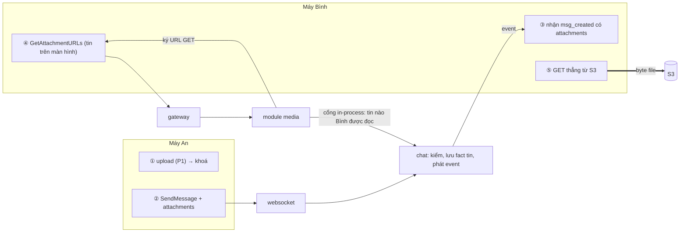
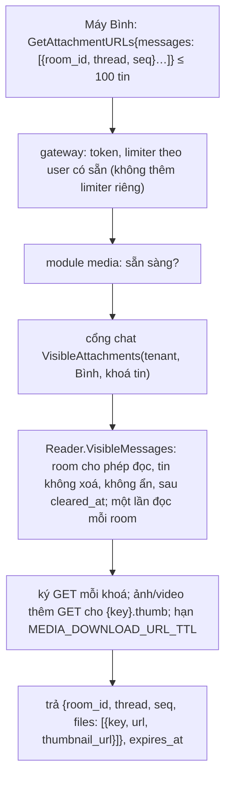
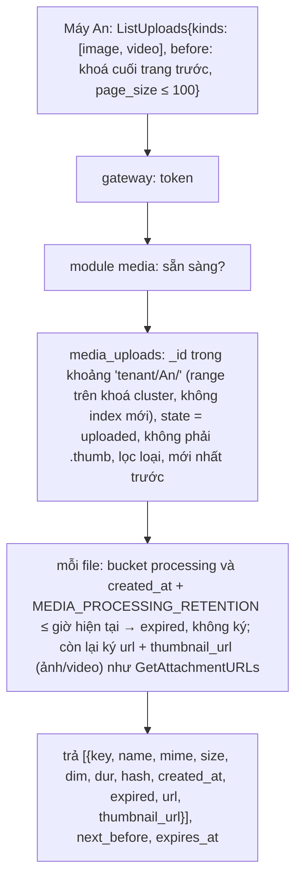

# M7 phase P2: đính kèm trong tin và URL tải — tóm tắt

> Ngày: 2026-11-07 · Nhánh `feat/m7` · Trạng thái: **owner duyệt 2026-11-07** · Dựa trên: D207 (field đính kèm trong chat, URL GET cấp sau khi chat kiểm quyền), A6 (≤ 10 tham chiếu), D262–D265; owner 2026-11-06: forward ảnh là forward cả ảnh, tin forward vẫn xem được khi tin gốc bị xoá, ép tải xuống loại không phải ảnh/mp4
> **Các phase của M7:** (P1) upload nhiều phần ✅ · **(P2) đính kèm trong tin, URL tải** · (P3) chuyển và dọn file

## Scope và ranh giới

| Việc | Trong P2? | Thuộc về |
|---|---|---|
| Field `attachments` trong tin (proto, `domain.Message`, doc `messages`), kiểm lúc gửi | Có | chat |
| Upload ảnh nhỏ gắn với một file: `StartUpload{thumbnail_of}` cấp khoá `{khoá file}.thumb` | Có | module media |
| Gửi tin chỉ có đính kèm (text rỗng) | Có | chat |
| Forward chép đính kèm của tin nguồn | Có | chat |
| Xoá cho mọi người bỏ đính kèm; ẩn/clear che đính kèm **và `meta`** (sửa lỗi có sẵn) | Có | chat (view) |
| Preview danh sách hội thoại biết tin có đính kèm loại gì | Có | chat (`LastPreview`) |
| Cổng đọc in-process "đính kèm của các tin người này được đọc" | Có | chat cài, module media gọi |
| `MediaService.GetAttachmentURLs`: ký URL tải, ép tải xuống loại nguy hiểm | Có | module media |
| Event `msg_created`/`msg_edited`/`msg_deleted` mang đính kèm | Có (tự đi theo `Message`) | chat |
| Sửa tin để thêm/bỏ file | Không | không làm (D263 giữ đính kèm bất biến) |
| Chuyển file (và ảnh nhỏ của nó) sang `completed`, sổ tham chiếu, `retired_at` | Không | P3 |
| Gallery "file tôi đã upload": `MediaService.ListUploads` đọc `media_uploads` của chính caller | Có | module media |
| Khoá object sắp theo thời gian (đổi cách sinh phần ngẫu nhiên của P1, chưa có dữ liệu thật) | Có | module media |
| Tab "Ảnh/Video/File" của room | Không | search engine (owner 2026-11-07), sau M7 |
| Server tự làm ảnh nhỏ hay đo kích thước ảnh | Không | máy làm, server chỉ lưu lời khai |

## Tính năng → lớp dữ liệu (architecture §4)

| Tính năng | Lớp | Ghi | Event | Phục hồi |
|---|---|---|---|---|
| Đính kèm của tin | Fact bất biến (`messages`) | Cùng lệnh insert của tin; không đổi khi sửa; xoá `$unset` cùng text | Đi trong `Message` của `msg_created`/`msg_edited`/`msg_deleted` (xoá: rỗng) | Như tin (cờ `_state`, sweeper) |
| Che đính kèm khi ẩn/clear | Giá trị theo người đọc | Không lưu, tính lúc đọc | `message_hidden`, `history_cleared` (có sẵn) | Không cần |
| URL tải | Không lưu | Ký lúc gọi | Không | Không cần |
| Gallery của tôi | Đọc phiên upload (`media_uploads`, lớp "Phiên upload" của P1) | Không ghi mới | Không | Không cần |

## 1. Thuật ngữ

| Từ | Nghĩa |
|---|---|
| Đính kèm | Tham chiếu tới một object trong kho: khoá, tên, loại, cỡ, kích thước (ảnh, video), thời lượng (video), hash. Không chứa byte file |
| Ảnh nhỏ | Object riêng do máy làm và upload, khoá luôn là `{khoá file}.thumb` (vd. `acme/an/20261107/k3v9q2….thumb`); tin không lưu gì thêm cho nó |
| URL tải | URL GET ký sẵn, hạn ngắn, ép kiểu và cách hiển thị trả về |

## 2. Bức tranh chung

Ví dụ: An upload 2 ảnh (P1) được khoá `acme/an/20261107/k1…`, `…/k2…`, gửi tin text rỗng kèm 2 đính kèm. Bình nhận `msg_created` có 2 đính kèm (chỉ khoá, tên, loại, cỡ), gọi `GetAttachmentURLs` một lần cho cả màn hình, nhận URL tải ảnh và URL ảnh nhỏ (suy từ khoá), tải thẳng từ S3.

## 3. Dữ liệu

**Proto** `Attachment {string key, string name, string mime, int64 size, repeated int32 dim, int64 dur, string hash}` (`dim` rỗng hoặc `[rộng, cao]`, cùng dạng với doc và JSON `"dim":[1920,1080]`; server kiểm đúng 0 hoặc 2 số); `StartUploadRequest.thumbnail_of` (tag mới); `SendMessageRequest.attachments` (tag 11), `Message.attachments` (tag 26), `LastPreview.file_mimes` (tag 8).

**Doc `messages`** thêm field `files: [{key, name, mime, size, dim: [w, h], dur, hash}]` (`omitempty`). Field mới của `messages` dùng tên ngắn nhưng đọc được, không viết tắt 1–2 ký tự; field cũ giữ tên cũ (owner 2026-11-07):

| Field con | Nghĩa | Ví dụ |
|---|---|---|
| `key` | Khoá object | `acme/an/20261107/k3v9q2…` |
| `name` | Tên file | `hoa-don.pdf` |
| `mime` | Loại (lời máy khai) | `application/pdf` |
| `size` | Cỡ (byte) | `183204` |
| `dim` | `[rộng, cao]` (ảnh/video; không có thì bỏ field) | `[1920, 1080]` |
| `hash` | `sha256:` + 64 ký tự hex thường, SHA-256 của cả file do máy gửi tính (không có thì bỏ field) | `sha256:9f86d081…` |
| `dur` | Thời lượng video/audio, mili giây (lời máy khai; không có thì bỏ field) | `95400` |

Không lưu khoá ảnh nhỏ: nó luôn là `{key}.thumb`.

10 đính kèm lớn nhất ≈ 10 × (512 + 255 + 255 + vài số) ≈ 11 KB; tin lớn nhất (text 16 KB + meta 8 KB + đính kèm) ≈ 35 KB, dưới `WS_FRAME_MAX` 128 KB và `GW_BODY_MAX` 128 KB.

## 4. Luồng

**Gửi** (`SendMessage` qua websocket, đường cũ):

| Kiểm | Lỗi |
|---|---|
| ≤ `MaxAttachments` (10, A6) đính kèm | `INVALID_ARGUMENT` |
| Mỗi khoá có dạng `{tenant}/{người gửi}/{yyyymmdd}/{26 ký tự}` (khoá `.thumb` bị từ chối) và khoá không cũ hơn 24h: tính chính xác từ mốc mili giây nằm trong khoá (khoá P2 sắp theo thời gian), ngày trong khoá phải khớp mốc đó | `INVALID_ARGUMENT` |
| Không trùng khoá trong một tin; tên 1..255 byte UTF-8 in được; loại dạng `type/subtype` ≤ 255 byte; cỡ ≥ 1; `dim` rỗng hoặc đúng 2 số ≥ 1; `dur` ≥ 0; `hash` rỗng hoặc đúng dạng `sha256:<64 hex>` | `INVALID_ARGUMENT` |
| Text: được rỗng **chỉ khi** có ≥ 1 đính kèm (trước đây luôn bắt buộc) | `INVALID_ARGUMENT` |

Chat không gọi S3 hay module media khi gửi: ack vẫn ≤ 30 ms (A1). Khoá giả hoặc file chưa upload xong chỉ làm hỏng tin của chính người gửi (URL tải trả lỗi từ S3). Tin hệ thống được kèm đính kèm như tin thường (backend của tenant upload dưới user của nó).

**Forward:** đính kèm chép từ tin nguồn, đính kèm máy gửi kèm bị bỏ im lặng (như mention, D116); không kiểm chủ khoá và tuổi khoá (khoá là của người gửi gốc, có thể cũ), chỉ kiểm dạng. Khoá giữ nguyên → hai tin trỏ cùng object.

**Sửa:** không đổi đính kèm. Text khi sửa vẫn phải khác rỗng (thêm chú thích cho tin chỉ có ảnh được, xoá hết chú thích thì không).

**Xoá cho mọi người:** `$unset` `files` cùng text; event `msg_deleted` không còn đính kèm. Object không bị xoá (D264).

**Ẩn / clear (theo người đọc):** `HideForViewer` che đính kèm và `meta` (lỗi có sẵn: `meta` lộ khi tin bị ẩn, `apps/chat/internal/message/view/masks.go:15-22`).

**Hash (owner 2026-11-07: để biết file tải về đúng hay đã bị đổi):** máy gửi tính SHA-256 của file lúc upload và gửi trong đính kèm; máy nhận tải xong tự tính lại và so, lệch thì báo "file đã bị thay đổi". Hash đi đường chat (Mongo, event), byte đi đường S3, nên đổi object trong kho hay hỏng trên đường tải đều lộ ra. Server không đọc byte, không kiểm hash khớp file (như `size`, `dim`). Forward chép nguyên hash. Ảnh nhỏ không có hash.

**Upload ghi thêm vào `media_uploads`** (doc phiên upload của P1). Field mới dùng cùng tên ngắn với đính kèm trong `messages` (owner 2026-11-07); field cũ của P1 (`file_name`, `content_type`…) giữ nguyên:

| Field mới | Ghi lúc | Nguồn | Ví dụ |
|---|---|---|---|
| `dim` | `StartUpload` | máy khai (ảnh/video; không có thì bỏ) | `[1920, 1080]` |
| `dur` | `StartUpload` | máy khai (video/audio; không có thì bỏ) | `95400` |
| `hash` | `CompleteUpload` (cùng lệnh CAS sang `uploaded`) | máy tính SHA-256 trong lúc upload, không phải đọc file hai lần | `sha256:9f86d081…` |

Phiên ảnh nhỏ không cần field mới: `_id` `{khoá file}.thumb` đã nói nó là ảnh nhỏ của file nào. Lúc gửi tin chat **không** đọc `media_uploads` (ack 30 ms), nên máy vẫn gửi lại các giá trị này trong đính kèm. Dùng ở P3: consumer `msg_created` so đính kèm của tin với doc upload (cỡ thật đã `HeadObject`, hash, loại) và đếm tin khai lệch.

**Upload ảnh nhỏ** (module media, sau khi đã có khoá file): `StartUpload{thumbnail_of: khoá file, mime, size, …}`. Module kiểm khoá file là của caller và phiên của nó còn `uploading` hoặc `uploaded`; loại phải là `image/png|jpeg|gif|webp`; khoá cấp ra là `{khoá file}.thumb`, rồi upload như mọi file (thường một phần). Mỗi file một ảnh nhỏ: mở lần hai (kể cả sau khi phiên ảnh nhỏ bị huỷ) → `FAILED_PRECONDITION`, máy gửi tin không có ảnh nhỏ; mất response thì máy tự suy khoá `{key}.thumb` và gọi `GetPartURLs`. URL tải ảnh nhỏ luôn ép `application/octet-stream` + `attachment`: URL upload không ghim Content-Type nên byte ảnh nhỏ có thể là HTML; thẻ `` và app vẫn hiển thị được. Loại file (`mime`) được chuẩn hoá chữ thường khi upload và khi gửi tin. Máy upload ảnh nhỏ trước khi gửi tin; không có ảnh nhỏ thì thôi.

**Preview danh sách hội thoại:** `LastPreview.file_mimes` (vd. `["image/jpeg","image/jpeg"]`) để máy hiện "📷 2 ảnh" khi text rỗng; cache đuôi room chỉ giữ loại, không giữ khoá.

**URL tải** (`MediaService.GetAttachmentURLs` qua gateway):

- Máy không bao giờ gửi khoá object; chỉ gửi khoá tin. Tin không được đọc thì im lặng không có trong kết quả (không lộ tin tồn tại).
- Một lần gọi cho cả màn hình (≤ 100 tin, `maxPage` của chat); máy cache URL tới `expires_at`.
- Ép cách hiển thị bằng tham số ký `response-content-type` / `response-content-disposition`: `image/png`, `image/jpeg`, `image/gif`, `image/webp`, `video/mp4` → trả đúng loại, `inline`; mọi loại khác (cả SVG, HTML) → `application/octet-stream`, `attachment; filename*=UTF-8''<tên>`.
- `thumbnail_url` chỉ có khi loại là `image/*` hoặc `video/*`; ký không cần kiểm object tồn tại, máy không upload ảnh nhỏ thì URL trả 404 và máy hiện ảnh gốc hoặc biểu tượng.
- P2 ký từ bucket `processing` (file chưa được chuyển); P3 thêm vị trí bucket.

| Lỗi | Khi nào |
|---|---|
| `INVALID_ARGUMENT` | 0 hoặc > 100 tin, room id hay seq sai |
| `FAILED_PRECONDITION` | Media tắt |
| `UNAVAILABLE` | Media chưa sẵn sàng |

**Gallery "file tôi đã upload"** (`MediaService.ListUploads` qua gateway; owner 2026-11-07):

- Chỉ thấy file của chính mình: khoảng `_id` dựng từ tenant và user của token, máy không gửi prefix.
- Trả **mọi** file đã upload xong, không phân biệt đã gắn tin hay chưa (owner 2026-11-07).
- **Nhãn `expired`** (owner 2026-11-07): module tính từ doc, không gọi S3: file nằm ở bucket `processing` và `created_at + MEDIA_PROCESSING_RETENTION` (30 ngày, phải bằng luật lifecycle của `processing`) đã qua → `expired = true`, không có `url`/`thumbnail_url`. Tính từ `created_at` (lúc mở multipart, S3 tính tuổi object multipart từ lúc này) và S3 làm tròn lên nửa đêm UTC, nên nhãn có thể bật sớm hơn lúc object thật sự mất, không bao giờ trễ hơn. P2 mọi file còn ở `processing`; P3 chuyển file đã gắn tin sang `completed` (không hết hạn) và thêm vị trí bucket vào doc.
- `kinds`: `image` = `image/*`, `video` = `video/*`, `file` = còn lại; rỗng = tất cả.
- **Sắp theo thời gian:** khoá của P1 là `{yyyymmdd}/{26 ký tự ngẫu nhiên}`, trong một ngày thứ tự ngẫu nhiên. Đổi 26 ký tự thành 6 byte mili giây + 10 byte ngẫu nhiên, mã base32hex chữ thường (giữ thứ tự byte; `StdEncoding` hiện tại thì không). Vẫn 26 ký tự nên kiểm khoá ở chat không đổi; 80 bit ngẫu nhiên đủ để không đoán khoá (khoá cũng không phải bí mật: quyền đi theo token và tin). Cần sửa câu "{ngẫu nhiên}" của D263 lúc đóng phase.

| Lỗi | Khi nào |
|---|---|
| `INVALID_ARGUMENT` | `page_size` ngoài 1..100, `before` không phải khoá của caller, `kinds` lạ |
| `FAILED_PRECONDITION` | Media tắt |
| `UNAVAILABLE` | Media chưa sẵn sàng |

## 5. Tính đúng và chạy đua

- **Quyền đi theo tin, không theo khoá:** URL chỉ được ký cho khoá nằm trong tin người hỏi đọc được, qua đúng pipeline đọc lịch sử (`Authorize(ReadHistory)` + view). Forward sang room khác thì người trong room đó tải được qua tin forward.
- **Không đính file người khác:** khoá phải mang `{tenant}/{người gửi}/`, user id không chứa `/` (`pkg/ids/ident.go`).
- **Khoá ≤ 24h (chính xác tới mili giây):** giới hạn cửa sổ dùng lại khoá cũ, chuẩn bị cho P3 dọn file theo ngày.
- **Xoá/ẩn sau khi đã cấp URL:** URL đã cấp còn dùng tới hết hạn (giới hạn đã chấp nhận ở D264); lần hỏi sau không còn URL.
- **Không retry nội bộ; không thêm lệnh xếp hàng:** gửi tin chỉ thêm kiểm trong RAM; `GetAttachmentURLs` là đọc theo khoá có giới hạn (D139, `mongobound`).

## 6. Event

Không có event hay subject mới. `msg_created`, `msg_edited`, `msg_deleted` mang `Message` đầy đủ nên có `attachments`; `docs/events.md` ghi thêm field. Consumer hiện có (projection, Mention) bỏ qua field này.

## 7. Thư viện và hạ tầng

- Không thư viện mới. Ký URL GET dùng client ký sẵn của P1 (`minio-go`, endpoint public).
- Config mới: `MEDIA_DOWNLOAD_URL_TTL` (mặc định 1h), `MEDIA_PROCESSING_RETENTION` (mặc định 720h, bằng luật lifecycle của `processing`).
- `StartUpload` thêm `thumbnail_of`, `dim`, `dur`; `CompleteUpload` thêm `hash`; `media_uploads` thêm 3 field (§3).
- Port mới trong `mediaapp`: `ChatReader.VisibleAttachments`; chat cài adapter trên `message.Reader.VisibleMessages` (khuôn của Mention).

## 8. Quyết định và phương án bị loại

| Quyết định | Bị loại và lý do |
|---|---|
| Đính kèm là field của fact tin, bất biến khi sửa | Cho sửa thêm/bỏ file: phải ghi lịch sử sửa cho file và đổi quyền tải theo phiên bản |
| Chat chỉ kiểm dạng khoá, không gọi S3 lúc gửi | Kiểm object tồn tại lúc gửi: thêm lệnh mạng vào đường ack 30 ms |
| URL tải ký trong module media, hỏi quyền qua cổng in-process | Chat ký URL trong `GetHistory`: chat cầm khoá S3, URL hết hạn trong cache, event không mang được |
| Máy hỏi URL theo khoá tin | Máy gửi khoá object: phải kiểm khoá thuộc tin nào, dễ thành ký URL cho file không được xem |
| Ép `attachment` cho mọi loại ngoài danh sách ảnh/mp4 | Tin loại do máy khai: HTML/SVG chạy script trên domain bucket |
| Text được rỗng khi có đính kèm | Bắt máy gửi text giả cho tin chỉ có ảnh |
| Hash SHA-256 của cả file do máy gửi tính, máy nhận so (owner 2026-11-07) | S3 kiểm hash từng phần: đổi hợp đồng P1, hash S3 trả là hash của các hash phần, không phải SHA-256 của file. Server tự tính: phải đọc lại vài GB mỗi file |
| Gallery của tôi đọc `media_uploads` theo khoảng `_id`, trả mọi file đã xong, gắn nhãn `expired` theo luật 30 ngày (owner 2026-11-07) | Ẩn file hết hạn: người dùng không biết file đã mất. `HeadObject` từng file: thêm một lệnh S3 mỗi mục. Đọc từ `messages`: không có index theo người gửi (D148) và không thấy file chưa gửi. Thêm index `{tenant_id, user_id, created_at}`: thừa vì `_id` đã bắt đầu bằng tenant/user |
| Phần ngẫu nhiên của khoá sắp theo thời gian (owner 2026-11-07) | Giữ khoá, thêm index `{tenant_id, user_id, created_at, _id}`: thêm một index phải cập nhật mỗi lần ghi và cursor hai phần, trong khi đổi khoá lúc chưa có dữ liệu thật không tốn gì |
| Khoá ảnh nhỏ suy từ khoá file `{key}.thumb` (owner 2026-11-07) | Lưu khoá ảnh nhỏ trong tin: thêm byte mỗi đính kèm và thêm một khoá phải kiểm lúc gửi |

## 9. Chi phí và tải

- Gửi tin: thêm kiểm trong RAM; doc tin có ảnh lớn thêm ~100–1.000 B mỗi đính kèm (đa số khoá ~45 B, tên ngắn). Tin không đính kèm không đổi byte (`omitempty`).
- `GetAttachmentURLs` 50 tin: một lần `VisibleMessages` (đọc theo khoá, đã có cho Mention) + ký HMAC trong RAM. Tin có ảnh trong room 1.000 người → tới 1.000 lần gọi, mỗi lần một đọc theo khoá.
- Đo: chatbench 2K tin/s trước/sau để xác nhận đường gửi không chậm đi (D207: thay đổi chat phải xong trước lần đo PoC cuối).

## 10. Rủi ro thật

- Khoá trỏ tới file chưa upload xong hoặc đã bị luật 30 ngày xoá (chưa có P3) → URL tải trả 404 từ S3; máy hiện "file không còn".
- Rộng, cao, thời lượng, cỡ, loại là lời máy khai; chỉ để hiển thị. Loại khai sai không chạy được script nhờ ép `attachment`.
- Gallery lọc loại sau khi đọc theo khoảng `_id`: người upload nhiều file loại khác thì một trang quét nhiều doc hơn số trả về (chỉ trong file của chính người đó).
- Hash là lời máy gửi: máy gửi khai sai thì chỉ tin của chính nó bị báo "đã thay đổi". Hash là tuỳ chọn để máy cũ và tin hệ thống vẫn gửi được; tin không có hash thì máy nhận không kiểm được.
- Ảnh/video gửi không kèm ảnh nhỏ vẫn có `thumbnail_url`, tải về 404; máy phải xử lý.
- URL tải là bearer trong `MEDIA_DOWNLOAD_URL_TTL`: ai có URL tải được dù không ở trong room.

## 11. Điểm đội tự chọn (owner phản biện)

`MEDIA_DOWNLOAD_URL_TTL` 1h; ≤ 100 tin mỗi `GetAttachmentURLs`; danh sách hiển thị trực tiếp png/jpeg/gif/webp/mp4; tin hệ thống được kèm file; sửa tin không xoá hết chú thích; preview giữ loại file, không giữ khoá; tên `dim` (owner viết `dime`); hậu tố `.thumb`; ảnh nhỏ chỉ png/jpeg/gif/webp, mỗi file một ảnh nhỏ; `thumbnail_url` chỉ cấp cho `image/*`, `video/*`; gallery vẫn hiện file của tin đã xoá (file của mình, object chưa bị xoá), `page_size` ≤ 100.

## 12. Kiểm thử

| Test | Chứng minh |
|---|---|
| Unit domain chat | Kiểm đính kèm (số lượng, khoá người khác, khoá cũ hơn 24h, trùng, tên, loại, `dim`, `dur`, `hash`); text rỗng chỉ khi có đính kèm |
| Unit codec + contract store | Round trip field `files`; tin không đính kèm không có `files`; xoá `$unset` `files`; sửa giữ `files` |
| Unit view / pbconv / roomcache | Ẩn/clear che `attachments` và `meta`; xoá trả rỗng; `LastPreview.file_mimes` |
| Unit forward | Chép đính kèm nguồn (cả hash), bỏ đính kèm máy gửi, khoá nguồn cũ vẫn được |
| Unit module media | `StartUpload` lưu `dim`, `dur`; `CompleteUpload` lưu `hash` (kiểm dạng, gọi lại an toàn); `StartUpload{thumbnail_of}`: khoá `.thumb`, file của người khác, loại không phải ảnh, mở lần hai; `GetAttachmentURLs`: chỉ tin được đọc, ép loại và cách hiển thị, `thumbnail_url` chỉ cho ảnh/video, giới hạn 100, chưa sẵn sàng |
| Unit module media gallery | `ListUploads`: chỉ khoá của caller, bỏ `.thumb`, bỏ chưa xong/huỷ, quá 30 ngày vẫn trả với `expired` và không URL, đúng mốc ngày 30, lọc `kinds`, mới nhất trước qua nhiều trang, `before` của người khác bị từ chối; khoá mới sắp đúng theo thời gian (cùng mili giây vẫn khác nhau) |
| Itest | Cổng `VisibleAttachments` trên Mongo thật; `ListUploads` trên khoảng `_id` clustered thật; URL ký tải đúng byte với header `Content-Disposition` đúng trên Garage; ảnh nhỏ upload và tải qua `{key}.thumb` |
| e2e phase 16 mở rộng | Upload ảnh và ảnh nhỏ, gửi tin có ảnh qua websocket, B nhận event có đính kèm, A thấy ảnh vừa upload đứng đầu `ListUploads` với `thumbnail_url`; B lấy URL qua gateway, tải cả ảnh lẫn ảnh nhỏ, SHA-256 của file tải về khớp `hash`; file HTML tải về dạng `attachment`; tin bị ẩn/xoá không cấp URL; forward sang room khác vẫn tải được; preview có loại |
| chatbench 2K tin/s trước/sau | Đường gửi không chậm đi |

## 13. Bảng phủ

| Yêu cầu (nguồn) | Thành phần | Task | Test | Bằng chứng |
|---|---|---|---|---|
| Field đính kèm trong chat (D207), ≤ 10 (A6) | proto, domain, codec | proto; domain + kiểm; codec + store | unit, e2e | |
| Khoá thuộc người gửi, tenant từ token (D263) | kiểm khoá lúc gửi | domain + kiểm | unit | |
| Tin chỉ có đính kèm | `ValidateText` có điều kiện | domain + kiểm; actor | unit, e2e | |
| Forward chép đính kèm (owner 2026-11-06) | forward | forward | unit, e2e | |
| Xoá bỏ đính kèm; ẩn/clear che đính kèm và `meta` | store, view | codec + store; view | unit, e2e | |
| URL tải sau khi chat kiểm quyền (D207) | `GetAttachmentURLs` + cổng | cổng chat; module media URL tải | unit, itest, e2e | |
| Ép tải xuống loại không phải ảnh/mp4 (owner 2026-11-06) | ký URL | module media URL tải | unit, itest, e2e | |
| Preview biết tin có đính kèm | `LastPreview` | preview + cache đuôi | unit, e2e | |
| `media_uploads` lưu `dim`, `dur`, `hash` (owner 2026-11-07) | module media upload | module media upload | unit, itest | |
| Hash để biết file đúng hay đã bị đổi (owner 2026-11-07) | field `hash`, kiểm dạng | domain + kiểm; codec + store; forward | unit, e2e | |
| Gallery file tôi đã upload (owner 2026-11-07) | `ListUploads`, khoá sắp theo thời gian | module media gallery; khoá theo thời gian | unit, itest, e2e | |
| Ảnh nhỏ suy từ khoá (owner 2026-11-07) | `StartUpload{thumbnail_of}`, ký `thumbnail_url` | module media ảnh nhỏ; module media URL tải | unit, itest, e2e | |
| Đường gửi không chậm đi (A1, D207) | — | đo cuối phase | chatbench | |
