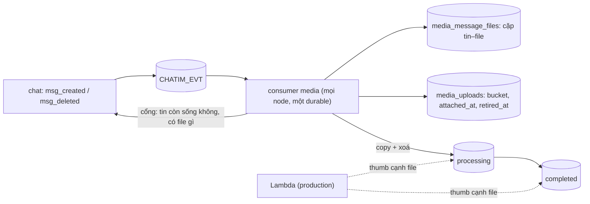

# M7 phase P3: chuyển file đã gắn tin sang `completed` — tóm tắt

> Ngày: 2026-11-08 · Nhánh `feat/m7` · Trạng thái: **đã xây, `dev-done` 2026-11-08** (`5516939` → `6628979`) · Dựa trên: D264 (hai bucket, `processing` có luật xoá 30 ngày, file mất tham chiếu chỉ đánh dấu), D266–D267, roadmap M7 P3; owner 2026-11-06: tin forward vẫn xem được file khi tin gốc bị xoá; owner 2026-11-08: file ở đâu thì thumb sinh ở đó, collection trung gian tin–file, xoá mềm, doc tin giữ đủ thông tin file (tránh 1+N)
> **Các phase của M7:** (P1) upload nhiều phần ✅ · (P2) đính kèm trong tin, URL tải, gallery ✅ · (P3) chuyển và dọn file ✅

## Scope và ranh giới

| Việc | Trong P3? | Thuộc về |
|---|---|---|
| Consumer `msg_created` (cả `message` lẫn `mention`, D170) và `msg_deleted` | Có | module media, chạy trên mọi node chat như Mention |
| Collection trung gian `media_message_files` (một doc mỗi cặp tin–file, xoá mềm) | Có | module media |
| Cổng chat: tin còn sống không, có file gì | Có | chat cài, module media gọi |
| Doc upload thêm `bucket`, `attached_at`, `retired_at` | Có | module media |
| Chuyển file và thumb `processing` → `completed` (copy rồi xoá bản cũ) | Có | module media |
| Ký URL tải và gallery theo `bucket` | Có | module media |
| Metric + alert trễ consumer (bảo đảm mới MD2) | Có | module media, `deploy/prometheus` |
| Doc tin và đường xoá tin của chat | Không đổi | P2 giữ nguyên (đủ thông tin file trong tin, xoá tin `$unset files`) |
| Lambda sinh thumb ở cả hai bucket | Không | hạ tầng; repo cập nhật hợp đồng ở `docs/features/12` §7 |
| Chính sách xoá file đã `retired` | Không | sau (D264) |
| Backfill file của tin cũ | Không | chưa có dữ liệu production; nếu cần dùng `/app resync` |

## Tính năng → lớp dữ liệu (architecture §4)

| Tính năng | Lớp | Ghi | Báo thay đổi | Phục hồi |
|---|---|---|---|---|
| Tin nào dùng file nào | Tập theo event của module (khuôn `mentions`, D115: `state` 1 còn, 2 đã gỡ) | Upsert `$setOnInsert` theo `_id` cặp; xoá tin → `updateMany` `state = 2` | Không | `/app resync` phát lại `msg_created`; mọi lệnh idempotent |
| Vị trí file, `attached_at`, `retired_at` | Phiên upload (P1) | CAS `{_id, ver}` | Không | Chạy lại consumer |
| Object trong `completed` | Object ghi một lần | Copy server-side, cùng khoá | Không | Copy lại ghi đè cùng byte |

## 1. Thuật ngữ

| Từ | Nghĩa |
|---|---|
| Chuyển file | Copy object từ `processing` sang `completed` cùng khoá, đổi `bucket` trong doc upload, rồi xoá bản ở `processing` |
| Cặp tin–file | Một doc trong `media_message_files`: tin này có file này |
| Xoá mềm | Tin bị xoá thì cặp chuyển `state = 2` và ghi `deleted_at`, doc vẫn giữ để biết lịch sử |
| `retired_at` | File không còn cặp `state = 1` nào; chỉ đánh dấu, chưa xoá |

## 2. Bức tranh chung

Ví dụ: An gửi R/42 kèm X, Y. Consumer hỏi chat: R/42 còn sống, file `[X, Y]`. Ghi hai cặp (R/42, X), (R/42, Y); copy X, Y (và thumb nếu Lambda đã sinh) sang `completed`, đặt `bucket = completed`, xoá bản ở `processing`. Bình forward sang S/7: thêm cặp (S/7, X), (S/7, Y), không copy lại. An xoá R/42: hai cặp của R/42 thành `state = 2`; X, Y còn cặp sống của S/7 nên giữ nguyên. Bình xoá S/7: không còn cặp sống → X, Y được đặt `retired_at`.

## 3. Dữ liệu

**Doc tin không đổi** (P2): `files` giữ đủ khoá, tên, loại, cỡ, `dim`, `dur`, `hash` để mọi màn hình và event đọc một lần, không phải tra thêm (tránh 1+N ở chat và ở app). Xoá tin vẫn `$unset files`.

**`media_message_files`** (mới, chỉ module ghi):

| Field | Nghĩa | Ví dụ |
|---|---|---|
| `_id` | Khoá cặp `{khoá tin}|{khoá file}`, chống ghi trùng | `8812-0-42|acme/an/20261108/0f9a…` |
| `message_key` | Khoá tin | `8812-0-42` |
| `file_key` | Khoá file | `acme/an/20261108/0f9a…` |
| `tenant_id` | Tenant | `acme` |
| `state` | 1 tin còn dùng, 2 tin đã bị xoá | `1` |
| `created_at`, `deleted_at` | Lúc ghi, lúc tin bị xoá | |

Index `{tenant_id, message_key, state}` (tìm cặp của một tin) và `{file_key, state, message_key}` (đếm tin khác còn dùng file, chỉ đọc index); tra cứu luôn bằng phép bằng trên field. Tạo qua `/app indexes` (D191).

**`media_uploads`** thêm `bucket` (`processing` | `completed`, thiếu = `processing`), `attached_at` (lần đầu gắn tin), `retired_at` (không còn cặp sống; gỡ khi có cặp mới).

## 4. Luồng

**Mỗi event:** `msg_created` không có file → bỏ qua ngay, không đọc gì (tin không bao giờ có thêm file khi sửa). `msg_created` có file → hỏi chat trạng thái hiện tại của tin (đọc doc tin theo `_id`). `msg_deleted` → đi thẳng nhánh xoá theo các cặp đã ghi. Event tới theo thứ tự nào cũng ra cùng kết quả.

**Tin còn sống, có file** (≤ 10 file, gom lô):
1. Đọc lô doc upload của các khoá. Không có hoặc `aborted` → bỏ, đếm `dropped`. `uploading` → Nak, chờ upload xong (bậc lùi 5s…10m, không tính là kẹt); phiên `uploading` quá 24h (luật huỷ phiên dở) → bỏ.
2. Ghi lô các cặp bằng upsert `$setOnInsert`: cặp đã có (kể cả đã xoá mềm) giữ nguyên.
3. File đang `retired_at` → gỡ.
4. File còn ở `processing`: copy sang `completed` (≤ 5 GiB một lệnh `CopyObject`; lớn hơn copy nhiều phần, mỗi phần 1 GiB; đặt Content-Type từ doc upload, kiểm cỡ đích), copy `{key}{hậu tố thumb}` nếu có; CAS `bucket = completed`, `attached_at`; xoá bản ở `processing`. Xoá lỗi thì để luật 30 ngày dọn.

**Tin đã xoá:**
1. Đọc các cặp `state = 1` của tin (index `message_key`).
2. `updateMany` các cặp đó → `state = 2`, `deleted_at`.
3. Một aggregate đếm cho cả lô khoá file: khoá nào không còn cặp `state = 1` → đặt `retired_at`.

**Lỗi:** S3 lỗi, CAS thua, chat chưa trả lời → Nak (không retry nội bộ). Event hỏng dạng → Term.

**Ký URL** (`GetAttachmentURLs`, `ListUploads`): đọc `bucket` của các doc upload theo lô khoá (`mongobound.IDs`, D139), ký từ đúng bucket; thumb ký cùng bucket với file. Nhãn `expired` chỉ cho file còn ở `processing`.

**Thumb** (owner 2026-11-08): file ở đâu thì thumb sinh ở đó. Lambda chạy trên cả `processing` và `completed`, bỏ qua khoá có hậu tố thumb và khoá đã có thumb. Thumb sinh muộn sau khi file đã chuyển thì Lambda sinh lại ở `completed`; thumb cũ ở `processing` bị luật 30 ngày dọn.

## 5. Tính đúng và chạy đua

- **Event lệch thứ tự:** xoá xử lý trước tạo → chưa có cặp nào để xoá; tạo tới sau hỏi chat thấy tin đã xoá → không ghi cặp, không chuyển file. `msg_created` cũ tới lại sau khi cặp đã xoá mềm → `$setOnInsert` giữ `state = 2`.
- **Tin bị xoá đúng lúc đang ghi cặp** (owner 2026-11-08: vẫn cho ghi): thừa một cặp `state = 1`, file không được đặt `retired_at`. Người dùng không thấy gì khác vì mọi đường đọc đã che; chính sách xoá file sau này đếm lại.
- **Copy rồi mới đổi `bucket`, đổi `bucket` rồi mới xoá bản cũ:** URL ký trước khi đổi vẫn tải được tới lúc xoá; app tải lỗi 404 trong khoảnh khắc chuyển thì xin URL lại.
- **File lớn:** copy 4 GiB server-side cỡ vài chục giây; consumer gửi InProgress mỗi `AckWait/3` như Mention.

## 6. Event

Không event hay subject mới, không đổi nội dung event. Consumer mới `media` trên `CHATIM_EVT` lọc `{root}.*.message.*.msg_created`, `{root}.*.mention.*.msg_created`, `{root}.*.message.*.msg_deleted`; thêm dòng vào bảng consumer của `docs/events.md`.

## 7. Thư viện và hạ tầng

- Không thư viện mới (`minio-go`: `CopyObject`, copy nhiều phần qua `minio.Core`).
- `mediaapp` thêm JetStream, `Run`/`Close` như Mention; consumer chờ media sẵn sàng.
- Hợp đồng Lambda (`docs/features/12` §7): trigger cả hai bucket, bỏ qua hậu tố thumb và khoá đã có thumb.
- Quyền key S3 của chat: đọc `processing`, ghi và xoá ở cả hai bucket.

## 8. Quyết định và phương án bị loại

| Quyết định | Bị loại và lý do |
|---|---|
| Doc tin giữ đủ thông tin file (P2) | Tin chỉ giữ khoá file: mỗi trang lịch sử, preview và event phải tra thêm `media_uploads` (1+N, hoặc chat đọc collection của module, ngược chiều D182) |
| Collection trung gian cặp tin–file, xoá mềm bằng `state` (owner 2026-11-08) | Mảng tin trong doc upload: phình theo số lần forward. Xoá cứng: mất lịch sử file từng nằm ở tin nào và không chặn được `msg_created` cũ tới muộn |
| Hỏi chat trạng thái hiện tại của tin | Tin nội dung event: event tới lệch thứ tự làm sai tham chiếu |
| Copy trong consumer, InProgress giữ event | Worker chuyển file riêng ở slot 0: thêm hàng đợi và một node gánh mọi copy |
| Thumb theo vị trí file (owner 2026-11-08) | Lambda ghi thẳng `completed`: thumb của file không gửi nằm mãi; ký thumb thử hai bucket: app nhận 404 |

## 9. Chi phí và tải

- Tin có ≤ 10 file: một đọc tin (cổng trong tiến trình), một đọc lô doc upload, một ghi lô cặp, một copy S3 mỗi file lần đầu gắn, một xoá S3. Forward file đã chuyển: một đọc tin, một ghi lô cặp.
- Xoá tin: một đọc cặp, một `updateMany`, một aggregate đếm cho cả lô.
- `media_message_files` tăng một doc nhỏ mỗi cặp tin–file từng có (xoá mềm không thu nhỏ), cùng nhịp với số tin có file.
- AWS: copy cùng region không tính phí truyền, chỉ tính lệnh; xoá miễn phí.
- Đo: thời gian chuyển file 100 MiB và 4 GiB trên Garage; chatbench không đổi (consumer không nằm trên đường ack).

## 10. Rủi ro thật

- Consumer trễ quá 30 ngày (S3 lỗi kéo dài) → luật lifecycle xoá file đã gắn tin. Alert trễ bắt sớm hơn nhiều.
- `retired_at` có thể sai trong hai chạy đua hẹp: thiếu dấu (tin bị xoá đúng lúc ghi cặp, owner chấp nhận) hoặc thừa dấu (forward mới ghi cặp đúng lúc tin cuối bị xoá). Chỉ là dấu; chính sách xoá file sau này phải đếm lại.
- Tin gửi trước `CompleteUpload` mà phiên bị huỷ → tin trỏ tới file không tồn tại (tải về 404), như P2.
- Garage chưa thử copy nhiều phần → itest đầu tiên của P3 kiểm.

## 11. Điểm đội tự chọn (owner phản biện)

Consumer chạy trên mọi node; ngưỡng alert trễ (đề xuất lag > 10 phút trong 15 phút, vì copy file lớn làm lag tăng hợp lệ); tin trỏ file chưa upload xong thì Nak chờ, huỷ thì bỏ; khoá cặp `_id` = `{khoá tin}|{khoá file}`.

## 12. Kiểm thử

| Test | Chứng minh |
|---|---|
| Unit consumer (store trong bộ nhớ, S3 và cổng chat giả) | Gửi → chuyển; forward không copy lại; xoá tin gốc giữ file; xoá tin cuối → `retired_at`; forward mới gỡ `retired_at`; xoá xử lý trước tạo → không cặp, không chuyển; `msg_created` cũ sau khi cặp đã xoá mềm → vẫn `state = 2`; phát lại idempotent; `uploading` → Nak; `aborted`/không có → bỏ; S3 lỗi → Nak, không đổi doc |
| Storetest `media_message_files` + `media_uploads` | Upsert `$setOnInsert`, xoá mềm lô, đếm lô theo `file_key`, CAS `bucket` trên memstore và Mongo |
| Unit cổng chat | Trả đúng tin còn sống / đã xoá và khoá file |
| Itest Garage | Copy một lệnh và nhiều phần (cỡ phần nhỏ để ép nhánh nhiều phần) giữ nguyên byte và loại; xoá bản cũ |
| Itest Mongo | Index `{tenant_id, message_key, state}`, `{file_key, state, message_key}` được dùng (`explain`); kiểm IDOR theo rule (owner 2026-11-08) |
| e2e phase 16 mở rộng | Gửi ảnh → file sang `completed`, vẫn tải đúng byte; forward rồi xoá tin gốc → vẫn tải; xoá tin cuối → `retired_at`; file không gửi vẫn ở `processing`; gallery `expired` chỉ cho file ở `processing` |
| `make alerts-check` | Luật mới |

## 13. Bảng phủ

| Yêu cầu (nguồn) | Thành phần | Task | Test | Bằng chứng |
|---|---|---|---|---|
| File đã gắn tin chuyển sang `completed` (D264, roadmap P3) | consumer, objectstore copy | consumer; copy | unit, itest, e2e | `062db86`, `e8bc32b`; itest node chat thật: file sang `completed`, không còn ở `processing`; e2e 16: URL trỏ `completed` trong 30 s |
| Biết tin nào dùng file nào (roadmap P3) | `media_message_files`, cổng chat | store; cổng; consumer | storetest, unit | `a4c501f`, `495a46a`; storetest memstore + Mongo; itest cổng xoá thật `$unset files` |
| Không 1+N khi đọc tin và khi xử lý event (owner 2026-11-08) | doc tin giữ đủ thông tin; lệnh lô | consumer | unit, itest `explain` | `a4c501f`, `4f701a0`: `GetMany` 451 khoá = 3 lệnh; `explain` IXSCAN / DISTINCT_SCAN covered; tin không file 0 lệnh (fake đếm) |
| Forward vẫn xem được khi tin gốc bị xoá (owner 2026-11-06) | đếm cặp sống | consumer | unit, e2e | itest: xoá tin gốc → file giữ ở `completed`; e2e 16 bước forward tải từ `completed` |
| File mất tham chiếu chỉ đánh dấu (D264) | `retired_at`, xoá mềm | consumer | unit, itest | itest: xoá tin cuối → `retired_at` (không lộ qua API nên không ở e2e) |
| Event lệch thứ tự không làm sai kết quả | hỏi chat trạng thái tin, `$setOnInsert`, thứ tự theo tin | consumer | unit | `6b58e2a`: tạo + xoá cùng tin trong một lần nhận → không cặp sống; `msg_created` cũ sau xoá mềm giữ `state 2` |
| Ký URL đúng bucket; `expired` chỉ ở `processing` | download, gallery | ký URL | unit, e2e | `4f701a0`; e2e 16: file đã gửi ký từ `completed`, file chưa gửi từ `processing`, không `expired` |
| Thumb theo vị trí file (owner 2026-11-08) | copy thumb, hợp đồng Lambda | copy; docs | unit, itest | `062db86` (copy thumb theo loại S3 báo); `docs/features/12` §7 |
| Metric + alert trễ consumer (roadmap P3, MD2) | probes, alerts | metrics | `make alerts-check` | `270f441`; `make alerts-check` 42 luật |
| File lớn hơn 5 GiB copy được | copy nhiều phần | copy | itest | `5516939`: itest Garage 12 MiB qua 3 dải `x-amz-copy-source-range`, giữ byte, cỡ, loại; lỗi giữa chừng huỷ phiên |
| Media không nhận tin không có file (owner 2026-11-08) | loại data `media` | định tuyến | unit, e2e | `6628979`; bảng định tuyến; e2e 16: B nhận `msg_created` tin có file qua websocket; A/B chatbench CPU NATS như nhau |
| Tin hệ thống không kèm file (owner 2026-11-08) | `ValidateSystemMessage` | kiểm | unit | `6628979`: actor và grpcsrv trả `INVALID_ARGUMENT` |

## 14. Như đã xây

**Kiểm cuối phase** (trên code cuối): `make fmt-check`/`vet`/`lint` sạch, `make test` 115 package, `make itest` 115 package, `make alerts-check` 42 luật, `make e2e` PASS 16 phase. Chatbench 2K tin/s A/B (cùng điều kiện, `bin/bench/m7p3-ab/`): tắt media p50/p95/p99 21,9/730/1.365 ms (máy chậm đầu lượt, pacer lag p99 78 ms), bật media 18,6/107/296 ms; CPU NATS 41–62% và 49–60%; hàng chờ `media` 0. Review: T4+T5 một reviewer, không Critical; 4 Important sửa ở `6b58e2a`.

**Lệch so với bản duyệt:**
- **Consumer kéo liên tục** (owner 2026-11-08, `c9e1276`): bỏ lối kéo theo lô có chờ 250 ms (đo được chỉ ~1.400 event/s, thấp hơn 2.000 tin/s); nay mỗi event một goroutine, chỉ giới hạn số event đang dở (`MEDIA_CONSUMER_MAX_PENDING` 1.024), event cùng tin chạy lần lượt, copy file lớn chỉ chiếm một chỗ.
- **Loại data `media`** (owner 2026-11-08, `6628979`): `msg_created` của tin có file và không mention đi `evt.{t}.media.{room}.msg_created`; consumer media chỉ nghe `media`, `mention` và `msg_deleted`. Websocket phải triển khai trước chat.
- **Tin hệ thống không kèm file** (owner 2026-11-08, `6628979`): thay điểm P2 "tin hệ thống được kèm file".
- **Durable `media` tạo lần đầu chỉ nhận event mới** (`25e45b1`): phát lại 7 ngày stream không bao giờ đuổi kịp 2K tin/s; trước module media không tin nào có file.
- **Thứ tự xoá:** đếm file còn tin khác dùng → `retired_at` → xoá mềm cặp, để lần giao lại vẫn ra đúng; index đếm là `{file_key, state, message_key}`.
- **Copy nhiều phần tự viết** bằng `minio.Core` (không `ComposeObject`: không chỉnh được cỡ phần, đường nhiều phần làm mất Content-Type); ngưỡng `MEDIA_COPY_SINGLE_MAX`, cỡ phần `MEDIA_COPY_PART_BYTES`.
- **Bucket `completed` cần luật huỷ phiên multipart dở sau 1 ngày** (node chết giữa lúc copy file > 5 GiB), đã thêm vào script dev (`7acd3f5`); production cần cùng luật.
- `retired_at` kiểm ở itest, không ở e2e (không lộ qua API).

**Mang sang sau:**
- Consumer `mention` và `projections` vẫn kéo theo lô có chờ 250 ms; chưa nghẽn nhờ lô 512, nhưng cùng kiểu tự giới hạn → roadmap "Mục mang sang M5".
- Chưa đo thời gian chuyển file 100 MiB và 4 GiB trên Garage → đo ở prod-like.
- Hai chạy đua hẹp có thể làm sai dấu `retired_at` (thiếu hoặc thừa); chính sách xoá file sau này phải đếm lại từ doc tin.
- Lệnh `StatObject` kiểm cỡ sau copy chưa vào `storage_operations_total`; lỗi `InvalidRange` đang đếm là lỗi kho.
