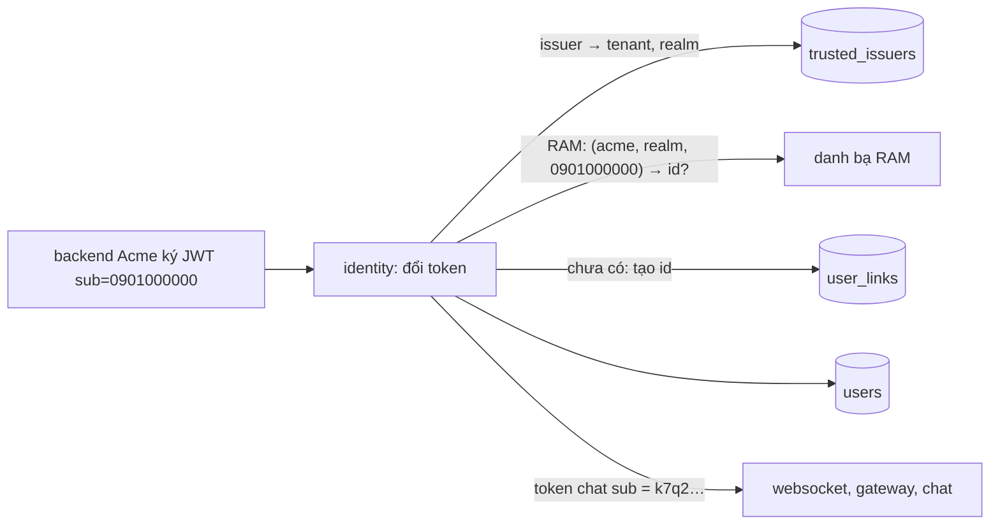
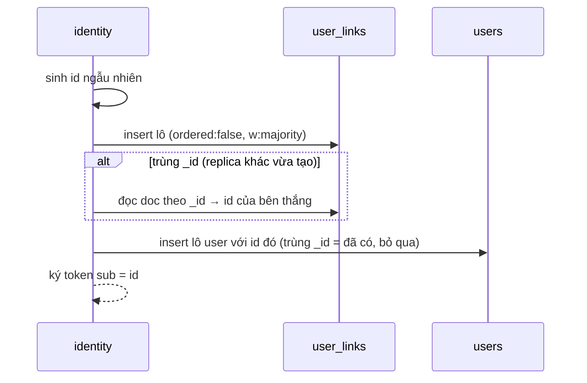

# M6.1 phase P1: `identity` tự cấp id user — tóm tắt

> Ngày: 2026-11-09 · Nhánh `feat/m6-1` · Trạng thái: **đã xây, `dev-done` 2026-11-09** (`5fe3d60` → `34db89f`) · Dựa trên: owner 2026-11-08 ("quá phụ thuộc IAM ngoài", "identity tự làm chủ id", "tìm người chat qua search engine riêng"), owner 2026-11-09 (realm mặc định = issuer; chưa làm lệnh đổi `sub` → id cho backend tenant), D239–D242, D259, D260
> **Các phase của M6.1:** (P1) id ngẫu nhiên lúc đổi token · (P2) `GetUsers` bỏ `state`, metric + alert tra trượt, docs

## Scope và ranh giới

| Việc | Trong P1? | Thuộc về |
|---|---|---|
| Id user ngẫu nhiên lúc đổi token lần đầu; token chat mang id này | Có | `identity` |
| Realm của issuer (`issuer-add -realm`), liên kết `(tenant, realm, sub) → id` | Có | `identity` |
| User đã có đổi token chỉ đọc RAM | Có | `identity` (danh bạ trong RAM) |
| Lệnh admin `user-*` nhận `-user <id>` hoặc `-issuer I -sub S`; lệnh mới `user-find` | Có | `identity` |
| `sub` nhận chuỗi OIDC (ASCII in được 1–255 byte) | Có | `identity` |
| Metric ghi liên kết; e2e 13 viết lại; e2e 15 và phase token giả sửa cho id mới | Có | `identity`, `tools/chatcli` |
| chat, websocket, gateway | Không đổi | chỉ đọc `sub` của token chat |
| `GetUsers` bỏ `state`, metric tra trượt | Không | P2 |
| Lệnh đổi `sub` → id cho backend tenant | Không | PB (D260), owner 2026-11-09: chưa làm |
| Tìm người theo tên | Không | M9 search app; cần feed danh bạ (D257) |

## Tính năng → lớp dữ liệu (architecture §4)

| Tính năng | Lớp | Ghi | Phục hồi |
|---|---|---|---|
| Liên kết `(tenant, realm, sub) → id` | Sổ nhận chỗ (khuôn `room_dms`, D117) | Insert theo `_id`; trùng khoá = đọc id của bên thắng | Lần đổi sau ghi nốt user còn thiếu |
| User mới | Danh bạ identity | Insert lô JIT (D259), thêm `realm`, `sub` ghi một lần | Như trên |
| Realm của issuer | Cấu hình tin cậy | `issuer-add` ghi một doc; không đổi sau đó | — |

## 1. Thuật ngữ

| Từ | Nghĩa |
|---|---|
| `sub` | Mã user do backend tenant ký trong JWT, ví dụ `0901000000`. Chỉ `identity` thấy |
| Id user | Id ngẫu nhiên `identity` cấp, ví dụ `k7q2m9x4b3c5d6e7f2g3h4j5k6`. Chat, websocket, gateway, `GetUsers` chỉ thấy id này |
| Realm | Tập `sub` mà tenant bảo đảm không trùng. Mỗi issuer thuộc một realm; mặc định realm = tên issuer |
| Liên kết | Doc nói "`sub` này trong realm này là id này" |

## 2. Bức tranh chung

Ví dụ: Lan đăng nhập web Acme lần đầu. Backend Acme ký `iss=api.acme`, `sub=0901000000`. `identity` thấy issuer `api.acme` thuộc tenant `acme`, realm `api.acme`; trong RAM chưa có, nên tạo id `k7q2…`, ghi liên kết và user, rồi ký token chat `sub=k7q2…`. Lần sau Lan đổi token: RAM có sẵn, không chạm MongoDB. Bình cùng room thấy Lan là `k7q2…`, không bao giờ thấy số điện thoại.

## 3. Dữ liệu

**`user_links`** (mới, clustered `_id`, không index phụ):

| Field | Nghĩa | Ví dụ |
|---|---|---|
| `_id` | `tenant│realm│sub` (`│` không phải ASCII, `sub` và realm là ASCII nên không lẫn) | `acme│api.acme│0901000000` |
| `tenant_id`, `realm`, `sub` | Ba phần của khoá | |
| `user_id` | Id user đã cấp | `k7q2…` |
| `created_at`, `created_by` | Lúc tạo, `jit:<issuer>` | |

**`users`** thêm `realm`, `sub` (ghi lúc tạo, không đổi, không tăng `ver`); `_id` vẫn `tenant│id`, `id` nay là id ngẫu nhiên. **`trusted_issuers`** thêm `realm`; doc cũ không có field này coi như realm = issuer.

Id user: 16 byte ngẫu nhiên (`crypto/rand`), base32 chữ thường không đệm, 26 ký tự, hợp `ids.ValidUser`.

## 4. Luồng

**Đổi token, user đã có:** kiểm JWT → issuer cho tenant và realm → RAM tra `(tenant, realm, sub)` → bị khoá thì `400 invalid_grant` → hồ sơ đổi thì ghi như hiện nay → ký token `sub` = id. Không có lần đọc MongoDB nào; MongoDB chết vẫn cấp token.

**Đổi token, user mới:**

Ghi lỗi → `503 temporarily_unavailable` + `Retry-After: 1`, không thử lại bên trong. Chết giữa hai lệnh: liên kết có mà user chưa có; lần đổi sau RAM không thấy, insert liên kết trùng, đọc id, ghi nốt user (kết quả `healed`, cũng là kết quả của bên thua khi hai replica cùng đăng nhập lần đầu). Trùng khoá mà đọc (majority) chưa thấy liên kết của bên thắng (bên thắng còn chờ ghi bền trên replica set 3 node) → `503` ngay (kết quả `pending`), không bao giờ dùng id tự sinh, vì như vậy một người sẽ thành hai id; máy gửi lại sau `Retry-After` là ra id đúng.

**Lệnh admin:** `issuer-add -issuer I -tenant T [-realm R]`: R phải là realm của một issuer khác cùng tenant (gõ sai không lặng lẽ tạo realm mới); in `issuer I trusted for tenant T, realm R`. `user-disable|user-enable|user-set|user-groups` nhận đúng một cặp `-tenant T -user <id>` hoặc `-issuer I -sub S` (thiếu hay cả hai → thoát 2; issuer hay `sub` không có → thoát 1, log không chứa `sub`). `user-find -issuer I -sub S` in `T <id>` (vận hành, e2e, dev).

## 5. Đúng đắn và chạy đua

- Hai replica cùng đổi token lần đầu cho một `sub`: chỉ một insert liên kết thắng nhờ `_id`; bên thua đọc id của bên thắng; cả hai ký cùng id.
- Tenant và realm luôn lấy từ cấu hình issuer, không từ claim (D240); một issuer thuộc đúng một tenant.
- Đổi realm của issuer sau khi đã có user: không có lệnh (cố ý).
- RAM chưa theo kịp (vài giây sau khi user được tạo hay bị khoá ở replica khác): đổi token đi đường user mới, liên kết trùng, ra đúng id cũ; nếu user vừa bị khoá thì token vẫn được ký lần đó, giống hệt hôm nay.

## 6. Event

Không có. `identity` không dùng NATS (`docs/events.md` §8). Change stream của `users` mang thêm `realm`, `sub` để follower dựng map RAM.

## 7. Thư viện và hạ tầng

Không thêm thư viện hay hạ tầng. Thêm collection thứ 10: `migrate -apply` tạo nó; `/readyz` kiểm đủ 10 collection.

## 8. Quyết định và phương án bị loại

| Quyết định | Bị loại, vì sao |
|---|---|
| Id ngẫu nhiên do `identity` cấp | Giữ `sub` + quy định tenant: phụ thuộc tenant làm đúng. HMAC của `sub`: ai biết `sub` tính ra id, lỗ dò còn nguyên |
| Realm theo issuer, mặc định = issuer | `(tenant, sub)`: gộp nhầm hai hệ thống user. `(issuer, sub)` cố định: đổi IdP mất lịch sử. Realm trong claim: tenant tự khai |
| Liên kết là doc nhận chỗ theo `_id` | Index unique phụ: trái luật chỉ chống trùng qua `_id` |
| User đã có chỉ đọc RAM | Tra liên kết trên MongoDB mỗi lần: thêm truy vấn vào đường 1,7K/s, mất khả năng cấp token khi MongoDB chết |
| `sub` theo chuẩn OIDC | Giữ `ids.ValidUser`: từ chối IdP thật có `sub` dạng `auth0|abc` |

## 9. Chi phí và tải (đo 2026-11-09, dev, ES256, 1.700 lần đổi/giây, 60 giây, 100K user; `CPU_Speed_Limit` 100)

| Lần đo | p50 / p99 | CPU `identity` | Ghi | M6 PM |
|---|---|---|---|---|
| User đã có | 0,78 / 2,53 ms | 0,83 core | 0 liên kết, 0 user | 0,78 / 1,97 ms, 0,57 core |
| User mới | 23,1 / 233 ms | 1,27 core | 100.001 liên kết `created`; `existing`, `healed`, `pending`, `error`, `store_errors_total` +0 | 13,3 / 72,6 ms, 1,31 core |

User mới chậm hơn rõ (p50 gấp 1,7, p99 gấp 3,2): mỗi user mới chờ hai lô ghi nối tiếp (liên kết rồi user). Lần đo này có pacer lag p99.9 98 ms nên máy dev có lúc khựng; số chỉ để so hướng. Chỉ lần đăng nhập đầu của mỗi người đi đường này. User đã có chậm và tốn CPU hơn PM chưa rõ vì sao (chưa có nguồn). Nạp danh bạ 100K user: cấp phát +10% (559 → 616 MB mỗi lần nạp), thời gian +0,1 giây. Kết quả: `docs/poc/README.md` mục M6.1 P1, `docs/poc/results/exchange-261109-p1/`.

## 10. Rủi ro và giới hạn

- Tới M9, web chỉ mời được người đã ở chung room (owner 2026-11-09 chấp nhận). Dev và e2e lấy id bằng `user-find` hoặc từ token.
- Vận hành quên `-realm` khi tenant đổi IdP: người đăng nhập qua issuer mới nhận id mới, không thấy lịch sử cũ; checklist "Thêm tenant" ở `docs/apps/identity.md` hỏi "issuer này thay issuer nào".
- Web/SDK đang xây trên id = mã tenant: id trong chat nay là id do `identity` cấp; user không có claim `name` có tên rỗng.
- Lần đăng nhập đầu chậm hơn (mục 9).
- Dữ liệu dev cũ (user id = `sub`, không `realm`): reset, không migration (chưa có production).

## 11. Đã xây khác plan

- Lọc realm hẹp hơn: nhánh `_id` chỉ khớp doc issuer cũ chưa có field `realm`, để không nhận nhầm tên một issuer đang nằm trong realm khác. Lấy realm của issuer đã tắt vẫn được (ca đổi IdP).
- Liên kết vừa tạo luôn là `created`, kể cả khi bên thua đã kịp ghi user (bên thua ra `healed`).
- Bộ ghi theo lô: lô có lỗi ghi bền thì mọi dòng `unavailable`, kể cả dòng trùng khoá (trước đây dòng trùng coi như xong). Sửa hồ sơ trong ca đó nay trả `unavailable` thay vì `conflict`.
- Lỗi ghi theo lô chỉ còn câu cố định kèm mã lỗi: thông báo gốc của MongoDB chứa khoá `tenant│realm│sub` của cả user khác trong lô và lọt vào log Warn (review T4).
- Id hỏng trong liên kết có dòng log riêng `user link corrupt` (tenant, realm).
- e2e 13 thêm bước `user-enable` cho đổi lại được với cùng id; phase 15 kiểm `binh` (không `name`) có tên rỗng.

## 12. Kiểm thử (đã chạy)

| Test | Chứng minh |
|---|---|
| Unit `trust`: `auth0|abc`, 255 byte nhận; 256 byte, dấu cách, ngoài ASCII, rỗng từ chối; issuer không realm → realm = issuer | P9, R4 |
| Unit `exchange` (bộ kiểm token thật, hai issuer): user mới id 26 ký tự ≠ `sub`; RAM có thì không ghi; realm riêng ra user riêng, cùng realm ra cùng user; tenant khác cùng `sub` không nhận id tenant này; `pending` → 503, không tăng `store_errors_total`; lần thành công không ghi log | P1–P3, IDOR |
| Unit `directory`: tra theo `(tenant, realm, sub)` từ lần nạp và change stream; tenant khác không thấy | P8, IDOR |
| Itest `mongostore`: hai "replica" giành một liên kết ra một id, đúng một `created`; liên kết thiếu user → `healed`; `explain` đọc ≤ 1 doc; `ResolveUser`; lỗi lô không chứa `sub` | P2, phục hồi |
| Itest `admincmd`: `-realm` tenant khác thoát 1; `user-*` theo issuer + `sub`; `user-find`; cờ sai thoát 2 | P6 |
| e2e 13, 15 PASS (`E2E_ONLY=13`, `E2E_ONLY=15`) | P1, P2, P5, P6 |

Lệnh: `make -s go ARGS="test -race -shuffle=on ./apps/identity/..."` xanh; `make itest ITEST_ARGS="-race -count=1 ./apps/identity/..."` xanh 12 package (2026-11-09); `fmt-check`, `vet`, `lint` sạch mỗi commit. Review: plan (skill `mongo`, IDOR đạt), T3 và T4 mỗi task một reviewer, không Critical.

## Mục mang sang

- `exchangebench` chưa đọc `user_links_total` nên không tự báo số user tạo (`tools/poc/exchangebench/metrics.go`).
- `scripts/bench-sample.sh stop` không dừng vòng `mongosh` trong container MongoDB.
- `Cache.Replace` nhận map `subjects` rỗng (`nil`) thì lần thêm sau sẽ panic; chỉ test truyền `nil`.
- `ResolveUser` (lệnh admin) đọc liên kết không đặt read concern majority.

## Bảng phủ

| Yêu cầu / quyết định | Thành phần | Task | Test | Bằng chứng |
|---|---|---|---|---|
| R1 id không đoán được, không là dữ liệu cá nhân (P1, P3) | `exchange`, `signing` | T4 | Unit `exchange`, e2e 13 | `7591cc5`; e2e 13 PASS (id `gcaam7t3…` ≠ `ha`) |
| R2 không gộp người hai issuer (P2) | `trust`, `mongostore`, `exchange`, `admincmd` | T1, T3, T4, T5 | Unit, itest, e2e 13 | `5fe3d60`, `0074c38`; e2e 13 realm riêng ra `m4rym6ec…`, realm chung ra `gcaam7t3…` |
| R4 tenant và realm từ cấu hình | `trust`, `exchange` | T1, T4 | Unit `trust`, `exchange` | itest `./apps/identity/...` xanh |
| R5 bớt phụ thuộc IAM ngoài (P9) | `trust` | T4, T6 | Unit `trust`, e2e token giả | e2e 13: `auth0|abc` đổi được, 256 byte bị từ chối |
| P5 tên mặc định rỗng | `exchange` | T4 | Unit, e2e 15 | e2e 15: `binh` tên rỗng |
| P6 lệnh admin theo issuer + `sub` | `admincmd` | T5, T6 | Test `admincmd`, e2e 13, 15 | `97cd7bb`; e2e 13 `user-find`, `user-disable -issuer -sub` |
| P8 user đã có chỉ đọc RAM | `directory`, `exchange` | T2, T4 | Unit, đo | `bd7a8da`; exchangebench user đã có: 0 ghi |
| P12 metric + alert | `exchange`, `mongostore` | T3, T4 | Unit, itest; alert có sẵn | `user_links_total` đo lạnh: 100.001 `created`, `error` +0 |
| IDOR: tenant khác không thấy gì | `directory`, `exchange`, `mongostore` | T2–T4 | Unit, `explain` | review plan và T4: đạt |
| Phục hồi, chạy đua replica | `mongostore` | T3 | Itest | itest giành liên kết: một id, một `created` |
| Log không lộ `sub` | `mongostore` | sửa sau review T4 | Unit | `178d685` |
