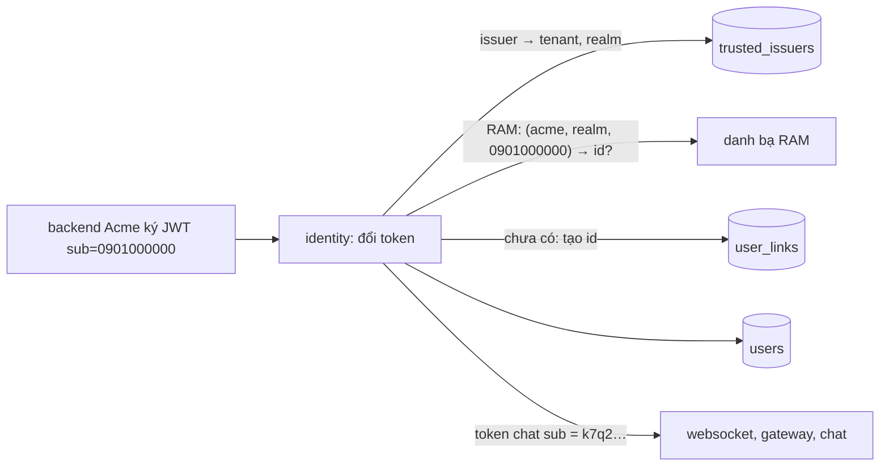
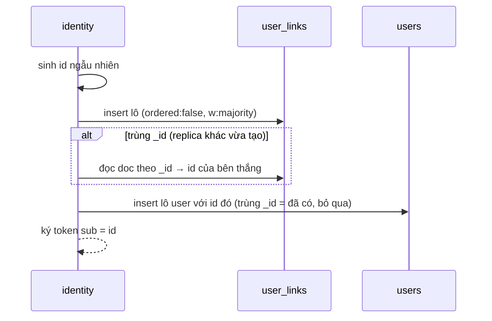

# M6.1 phase P1: `identity` tự cấp id user — tóm tắt

> Ngày: 2026-11-09 · Nhánh `feat/m6-1` · Trạng thái: **chờ owner duyệt** · Dựa trên: owner 2026-11-08 ("quá phụ thuộc IAM ngoài", "identity tự làm chủ id", "tìm người chat qua search engine riêng"), owner 2026-11-09 (realm mặc định = issuer; chưa làm lệnh đổi `sub` → id cho backend tenant), D239–D242, D259, D260
> **Các phase của M6.1:** (P1) id ngẫu nhiên lúc đổi token · (P2) `GetUsers` bỏ `state`, metric + alert tra trượt, docs

## Scope và ranh giới

| Việc | Trong P1? | Thuộc về |
|---|---|---|
| Id user ngẫu nhiên lúc đổi token lần đầu; token chat mang id này | Có | `identity` |
| Realm của issuer (`issuer-add -realm`), liên kết `(tenant, realm, sub) → id` | Có | `identity` |
| User đã có đổi token chỉ đọc RAM | Có | `identity` (danh bạ trong RAM) |
| Lệnh admin `user-*` nhận `-user <id>` hoặc `-issuer I -sub S`; lệnh mới `user-find` | Có | `identity` |
| `sub` nhận chuỗi OIDC (ASCII in được 1–255 byte) | Có | `identity` |
| Metric ghi liên kết; e2e 13 viết lại; e2e 15 và phase token giả sửa cho id mới | Có | `identity`, `tools/chatcli` |
| chat, websocket, gateway | Không đổi | chỉ đọc `sub` của token chat |
| `GetUsers` bỏ `state`, metric tra trượt | Không | P2 |
| Lệnh đổi `sub` → id cho backend tenant | Không | PB (D260), owner 2026-11-09: chưa làm |
| Tìm người theo tên | Không | M9 search app; cần feed danh bạ (D257) |

## Tính năng → lớp dữ liệu (architecture §4)

| Tính năng | Lớp | Ghi | Phục hồi |
|---|---|---|---|
| Liên kết `(tenant, realm, sub) → id` | Sổ nhận chỗ (khuôn `room_dms`, D117) | Insert theo `_id`; trùng khoá = đọc id của bên thắng | Lần đổi sau ghi nốt user còn thiếu |
| User mới | Danh bạ identity | Insert lô JIT (D259), thêm `realm`, `sub` ghi một lần | Như trên |
| Realm của issuer | Cấu hình tin cậy | `issuer-add` ghi một doc; không đổi sau đó | — |

## 1. Thuật ngữ

| Từ | Nghĩa |
|---|---|
| `sub` | Mã user do backend tenant ký trong JWT, ví dụ `0901000000`. Chỉ `identity` thấy |
| Id user | Id ngẫu nhiên `identity` cấp, ví dụ `k7q2m9x4b3c5d6e7f2g3h4j5k6`. Chat, websocket, gateway, `GetUsers` chỉ thấy id này |
| Realm | Tập `sub` mà tenant bảo đảm không trùng. Mỗi issuer thuộc một realm; mặc định realm = tên issuer |
| Liên kết | Doc nói "`sub` này trong realm này là id này" |

## 2. Bức tranh chung

Ví dụ: Lan đăng nhập web Acme lần đầu. Backend Acme ký `iss=api.acme`, `sub=0901000000`. `identity` thấy issuer `api.acme` thuộc tenant `acme`, realm `api.acme`; trong RAM chưa có, nên tạo id `k7q2…`, ghi liên kết và user, rồi ký token chat `sub=k7q2…`. Lần sau Lan đổi token: RAM có sẵn, không chạm MongoDB. Bình cùng room thấy Lan là `k7q2…`, không bao giờ thấy số điện thoại.

## 3. Dữ liệu

**`user_links`** (mới, clustered `_id`, không index phụ):

| Field | Nghĩa | Ví dụ |
|---|---|---|
| `_id` | `tenant│realm│sub` (`│` không phải ASCII, `sub` và realm là ASCII nên không lẫn) | `acme│api.acme│0901000000` |
| `tenant_id`, `realm`, `sub` | Ba phần của khoá | |
| `user_id` | Id user đã cấp | `k7q2…` |
| `created_at`, `created_by` | Lúc tạo, `jit:<issuer>` | |

**`users`** thêm `realm`, `sub` (ghi lúc tạo, không đổi, không tăng `ver`); `_id` vẫn `tenant│id`, `id` nay là id ngẫu nhiên. **`trusted_issuers`** thêm `realm`; doc cũ không có field này coi như realm = issuer.

Id user: 16 byte ngẫu nhiên (`crypto/rand`), base32 chữ thường không đệm, 26 ký tự, hợp `ids.ValidUser`.

## 4. Luồng

**Đổi token, user đã có:** kiểm JWT → issuer cho tenant và realm → RAM tra `(tenant, realm, sub)` → bị khoá thì `400 invalid_grant` → hồ sơ đổi thì ghi như hiện nay → ký token `sub` = id. Không có lần đọc MongoDB nào; MongoDB chết vẫn cấp token.

**Đổi token, user mới:**

Ghi lỗi → `503 temporarily_unavailable` + `Retry-After: 1`, không thử lại bên trong. Chết giữa hai lệnh: liên kết có mà user chưa có; lần đổi sau RAM không thấy, insert liên kết trùng, đọc id, ghi nốt user (kết quả `healed`, cũng là kết quả của bên thua khi hai replica cùng đăng nhập lần đầu). Trùng khoá mà đọc (majority) chưa thấy liên kết của bên thắng (bên thắng còn chờ ghi bền trên replica set 3 node) → `503` ngay (kết quả `pending`), không bao giờ dùng id tự sinh, vì như vậy một người sẽ thành hai id; máy gửi lại sau `Retry-After` là ra id đúng.

**Lệnh admin:** `issuer-add -issuer I -tenant T [-realm R]`: R phải là realm của một issuer khác cùng tenant (gõ sai không lặng lẽ tạo realm mới); in realm đang dùng. `user-disable|user-enable|user-set|user-groups` nhận `-user <id>` hoặc `-issuer I -sub S` (tra liên kết). `user-find -issuer I -sub S` in id (vận hành, e2e, dev).

## 5. Đúng đắn và chạy đua

- Hai replica cùng đổi token lần đầu cho một `sub`: chỉ một insert liên kết thắng nhờ `_id`; bên thua đọc id của bên thắng; cả hai ký cùng id.
- Tenant và realm luôn lấy từ cấu hình issuer, không từ claim (D240); một issuer thuộc đúng một tenant.
- Đổi realm của issuer sau khi đã có user: không có lệnh (cố ý).
- RAM chưa theo kịp (vài giây sau khi user được tạo hay bị khoá ở replica khác): đổi token đi đường user mới, liên kết trùng, ra đúng id cũ; nếu user vừa bị khoá thì token vẫn được ký lần đó, giống hệt hôm nay.

## 6. Event

Không có. `identity` không dùng NATS (`docs/events.md` §8). Change stream của `users` mang thêm `realm`, `sub` để follower dựng map RAM.

## 7. Thư viện và hạ tầng

Không thêm thư viện hay hạ tầng. Thêm collection thứ 10: `migrate -apply` tạo nó; `/readyz` kiểm đủ 10 collection.

## 8. Quyết định và phương án bị loại

| Quyết định | Bị loại, vì sao |
|---|---|
| Id ngẫu nhiên do `identity` cấp | Giữ `sub` + quy định tenant: phụ thuộc tenant làm đúng. HMAC của `sub`: ai biết `sub` tính ra id, lỗ dò còn nguyên |
| Realm theo issuer, mặc định = issuer | `(tenant, sub)`: gộp nhầm hai hệ thống user. `(issuer, sub)` cố định: đổi IdP mất lịch sử. Realm trong claim: tenant tự khai |
| Liên kết là doc nhận chỗ theo `_id` | Index unique phụ: trái luật chỉ chống trùng qua `_id` |
| User đã có chỉ đọc RAM | Tra liên kết trên MongoDB mỗi lần: thêm truy vấn vào đường 1,7K/s, mất khả năng cấp token khi MongoDB chết |
| `sub` theo chuẩn OIDC | Giữ `ids.ValidUser`: từ chối IdP thật có `sub` dạng `auth0|abc` |

## 9. Chi phí và tải

User đã có: 0 lệnh MongoDB (như hiện nay khi hồ sơ không đổi). User mới: thêm 1 insert liên kết mỗi user, chung lô JIT; thêm một cửa sổ gom lô (2ms) trước khi ghi user. Đọc liên kết chỉ khi trùng khoá hoặc phục hồi. RAM: thêm một map mỗi user.

## 10. Rủi ro và giới hạn

- Tới M9, web chỉ mời được người đã ở chung room (owner 2026-11-09 chấp nhận). Dev và e2e lấy id bằng `user-find` hoặc từ token.
- Vận hành quên `-realm` khi tenant đổi IdP: người đăng nhập qua issuer mới nhận id mới, không thấy lịch sử cũ; checklist nhận tenant hỏi "issuer này thay issuer nào".
- Web/SDK đang xây trên id = mã tenant: báo web khi P1 xong.
- Dữ liệu dev cũ (user id = `sub`, không `realm`): reset, không migration (chưa có production).

## 11. Điểm đội tự chọn để owner phản biện

- Id không tiền tố (`k7q2…`, không `u_k7q2…`).
- Thêm lệnh `user-find` cho vận hành và dev.
- `-realm` chỉ nhận realm của issuer đã có cùng tenant.
- Đo một lần exchangebench (user mới, user đã có) so với số của M6 PM, vì đường ghi user mới đổi.

## 12. Kiểm thử

| Test | Chứng minh |
|---|---|
| Unit `trust`: `sub` `auth0|abc` nhận, 256 byte hay ký tự ngoài ASCII từ chối | P9 |
| Unit `exchange`: user mới nhận id ≠ `sub`; cùng `sub` hai lần một id; hai issuer realm mặc định hai id; cùng realm một id; user bị khoá từ chối; log thành công không chứa `sub` | P1, P2, P3 |
| Unit `directory`: map `(tenant, realm, sub)` dựng từ lần nạp và change stream; tenant khác cùng realm và `sub` không trả user của tenant này | P8, IDOR |
| Itest `mongostore`: hai goroutine giành cùng liên kết ra một id; liên kết thiếu user được ghi nốt; migrate tạo `user_links` | P2, phục hồi |
| Itest `admincmd`: `-realm` sai bị từ chối; `user-*` theo issuer + `sub`; `user-find` | P6 |
| e2e 13 viết lại: `sub` token chat ≠ `sub` tenant; đổi lại ra cùng id; hai issuer, một realm chung; `user-disable -issuer -sub` chặn lần đổi kế | P1, P2, P6 |
| Metric `user_links_total{created, existing, healed, pending, error}`; lỗi liên kết tăng `store_errors_total` nên alert `ChatimIdentityStoreErrors` đang có báo, không thêm alert mới; `pending` không báo | P12 |
| Đo một lần bộ nhớ danh bạ (load bench) và exchangebench user mới, user đã có | P8, chi phí |

Liên kết và tra RAM có phần tử IDOR (lọc theo tenant, realm): reviewer độc lập ở bước review plan theo Design checklist.

## Bảng phủ

| Yêu cầu / quyết định | Thành phần | Task (plan chi tiết) | Test | Bằng chứng |
|---|---|---|---|---|
| R1 id không đoán được, không là dữ liệu cá nhân (P1, P3) | `exchange`, `signing` | Cấp id, ký token | Unit `exchange`, e2e 13 | sau khi chạy |
| R2 không gộp người hai issuer (P2) | `trust`, `mongostore`, `admincmd` | Realm của issuer, `user_links` | Unit `exchange`, itest, e2e 13 | sau khi chạy |
| R4 tenant và realm từ cấu hình | `trust` | Issuer mang realm | Unit `trust`, `exchange` | sau khi chạy |
| R5 bớt phụ thuộc IAM ngoài (P9) | `trust` | Kiểm `sub` theo OIDC | Unit `trust` | sau khi chạy |
| P5 tên mặc định rỗng | `exchange` | Hồ sơ JIT | Unit `exchange` | sau khi chạy |
| P6 lệnh admin theo issuer + `sub` | `admincmd` | `user-*`, `user-find`, `-realm` | Itest `admincmd`, e2e 13 | sau khi chạy |
| P8 user đã có chỉ đọc RAM | `directory`, `exchange` | Map RAM, change stream | Unit `directory`, `exchange` | sau khi chạy |
| P12 metric + alert | `exchange`, `mongostore` | Đếm kết quả, lỗi vào `store_errors_total` | Unit, itest; alert có sẵn | sau khi chạy |
| IDOR: tenant khác không thấy gì | `directory`, `exchange`, `mongostore` | Khoá bắt đầu bằng tenant | Unit, `explain` trong itest | sau khi chạy |
