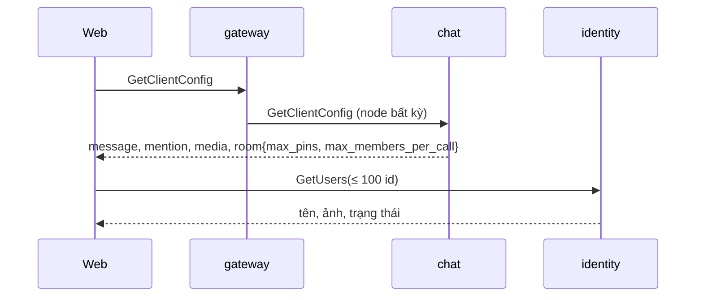

# M7.1 phase 1: giới hạn cho client — tóm tắt

> Ngày: 2026-11-10 → 2026-11-11 · Nhánh `feat/m7-1` · Trạng thái: **`dev-done` 2026-11-11** (`76c9eef` → `ac78e07`), viết lại theo cái đã xây · Dựa trên: yêu cầu web 2026-11-08 (`PIN_LIMIT` 1–1000, `MEMBER_BATCH_MAX` 2–1000 cho client), owner 2026-11-10 (`GetUsers` tối đa 100 id mỗi lần, một giới hạn body mỗi app), D229, D265, D271
> **Các phase của M7.1:** (1) giới hạn cho client ← phase này · (2) tệp của room · (3) id 4 member đầu · (4) ảnh nhóm

## Scope và ranh giới

| Việc | Trong phase 1? | Thuộc về |
|---|---|---|
| `GetClientConfig` trả số tin ghim tối đa mỗi room và số người tối đa mỗi lệnh tạo room / thêm member | Có | chat |
| `GetUsers` nhận tối đa 100 id mỗi lần (trước 500) | Có | `identity` |
| Docs vận hành, tính năng và e2e cho các giới hạn trên | Có | `docs/apps/chat.md`, `identity.md`, `gateway.md`, `docs/features/04`, `05`, `11`, `docs/e2e.md` |
| Giới hạn body: một biến chung `APP_BODY_SIZE_MAX` thay `GW_BODY_MAX` và `IDENTITY_BODY_MAX`, mỗi app một giới hạn cho mọi API | Có | gateway, `identity` (config); mức riêng cho từng app đặt ở env của container |
| Route gateway, websocket | Không đổi | gateway đã chuyển `GetClientConfig` tới chat (`pkg/chatrpc/command_table.go:183`); websocket không dùng hai lệnh này và không có giới hạn body |
| Cách client chia lô `GetUsers`, cache tên/ảnh | Không | client |
| `ListRoomFiles`, `avatar_users`, ảnh nhóm | Không | phase 2, 3, 4 |

## Tính năng → lớp dữ liệu (architecture §4)

| Tính năng | Lớp | Ghi | Phục hồi |
|---|---|---|---|
| Giới hạn trong `GetClientConfig` | Không lưu dữ liệu: đọc config lúc khởi động | — | — |
| Trần 100 id của `GetUsers` | Không lưu dữ liệu: kiểm request, đọc danh bạ trong RAM | — | — |

Không event, không bit `_state`, không index, không query MongoDB mới.

## 1. Thuật ngữ

| Từ | Nghĩa |
|---|---|
| `GetClientConfig` | Lệnh chat cho máy hỏi giới hạn và tính năng đang bật (D265); chỉ cần token |
| `PIN_LIMIT` | Biến môi trường của chat: số tin ghim tối đa mỗi room, 1–1000, mặc định 50 (`docs/apps/chat.md:47`) |
| `MEMBER_BATCH_MAX` | Biến môi trường của chat: số người tối đa mỗi lệnh `CreateRoom` hoặc `AddMembers` sau khi bỏ trùng, 2–1000, mặc định 500 (`docs/apps/chat.md:48`) |
| `GetUsers` | Lệnh danh bạ của `identity`: nhận id user, trả tên, ảnh, trạng thái từ RAM (D229) |

## 2. Bức tranh chung

Ví dụ: tenant đặt `PIN_LIMIT=20`. Web đọc `room.max_pins = 20`, ẩn nút ghim khi room đã có 20 tin ghim, thay vì viết cứng 50. Danh sách chat 20 nhóm cần ảnh 80 người: web gọi `GetUsers` một lần; 150 người thì hai lần (100 + 50).

## 3. Dữ liệu (field API)

| Field | Nghĩa | Ví dụ | Dùng để |
|---|---|---|---|
| `GetClientConfigResponse.room.max_pins` | Giá trị `PIN_LIMIT` của node trả lời | `50` | Ẩn hoặc khoá nút ghim khi đủ |
| `GetClientConfigResponse.room.max_members_per_call` | Giá trị `MEMBER_BATCH_MAX` | `500` | Chia danh sách người khi tạo nhóm hoặc thêm người |
| `GetUsersRequest.user_ids` | 1–100 id, đếm trước khi gộp id trùng như hiện nay (`directory.go:136`) | 80 id | Lấy tên và ảnh theo lô |

Message proto mới `RoomLimits { max_pins, max_members_per_call }` (kiểu số nguyên như `MessageLimits`), field thứ 4 của `GetClientConfigResponse`. Chỉ thêm field, client cũ không vỡ.

## 4. Luồng

**`GetClientConfig`.** Chat dựng phần `room` một lần lúc khởi động từ đúng hai giá trị config đã đọc (`cfg.Interactions.PinLimit`, `cfg.Members.MemberBatch`), cùng chỗ dựng `message` và `mention` (`app/client_config_wiring.go`); `grpcsrv` trả nguyên kết quả, không đổi. Không đọc DB, không lỗi mới; mã lỗi như hiện nay (chỉ lỗi token).

**`GetUsers`.** Thứ tự kiểm giữ nguyên; chỉ đổi trần: 0 id hoặc hơn 100 id → `INVALID_ARGUMENT` "user_ids must hold 1 to 100 ids", không chạm danh bạ. Body quá `APP_BODY_SIZE_MAX` → `RESOURCE_EXHAUSTED` trước khi đọc id: handler Connect của danh bạ và giới hạn body theo request của server dùng cùng một giá trị (`apps/identity/internal/api/server.go`); mức 64 KiB riêng và hàm chọn giới hạn theo đường dẫn đã bỏ.

## 5. Đúng đắn và chạy đua

- Các node chat có thể chạy env khác nhau trong lúc rollout: mỗi node trả giá trị của chính nó, và chính node đó kiểm khi ghim hoặc thêm người. Client nhận số lớn hơn thực tế ở node khác thì vẫn bị từ chối đúng (`INVALID_ARGUMENT` hoặc `FAILED_PRECONDITION` như hiện nay). Không xếp hàng, không khoá.
- `GetUsers`: không có trạng thái mới.

## 6. Event

Không có.

## 7. Thư viện và hạ tầng

Không thêm thư viện, không đổi hạ tầng. `make proto` sinh lại `pkg/pb`.

## 8. Quyết định và phương án bị loại

| Quyết định | Lý do | Phương án bị loại |
|---|---|---|
| Nhóm `room { max_pins, max_members_per_call }` trong `GetClientConfig` | D265: một API config cho máy; env đổi được nên client không viết cứng | Mỗi lệnh trả giới hạn riêng: rải rác. Đặt trong `MessageLimits`: ghim và thêm người không phải giới hạn của tin |
| `GetUsers` 1–100 id: D271, thay một phần D229 (1–500 id) | Owner 2026-11-10; đánh giá 2026-11-10: lộ dữ liệu như 500 (id 128 bit ngẫu nhiên, D269), băng thông xấu nhất mỗi lời gọi giảm 5 lần (500 × link ảnh 2.048 byte ≈ 1 MB → 100 ≈ 220 KB) | Giữ 500. Hạ 50: danh sách chat 20 nhóm cần hai lần gọi |
| Trần 100 là hằng trong code, không thành biến env | Chưa có yêu cầu tenant đổi (A6); đổi trần là đổi hợp đồng với client | Biến env: client không biết trần nếu tenant đổi |
| Một biến `APP_BODY_SIZE_MAX`, mặc định 128 KiB, đọc bởi gateway và `identity`; tên và mặc định là hằng ở `pkg/core/envconfig` (`BodySizeMaxKey`, `DefaultBodySizeMax`), mỗi app đọc bằng parser config sẵn có; áp cho mọi API của app, không đặt riêng cho từng API: bỏ mức 64 KiB riêng của danh bạ ở cả giới hạn body theo request và giới hạn đọc của handler Connect; bỏ tên cũ `GW_BODY_MAX`, `IDENTITY_BODY_MAX` (đặt vào cũng bị bỏ qua; chưa có production, compose và `.env.example` chưa đặt) | Owner 2026-11-10: một tên chung, muốn mức riêng thì đặt ở env của container. Mặc định 128 KiB vì gateway cần: `AddMembers` 1.000 id dài 64 ký tự ≈ 67 KB; `GetUsers` 100 id ≈ 7 KB | Giữ hai tên theo app: hai chỗ cho cùng một ý. Giữ mức riêng cho danh bạ: thêm một nhánh code |

## 9. Chi phí và tải

`GetClientConfig` trả thêm hai số, không đọc gì thêm. `GetUsers` ít việc hơn mỗi lời gọi; client cần nhiều id hơn 100 thì gọi nhiều lần (ví dụ trang 100 nhóm của `ListMyRooms` ở phase 3 cần tới 400 id, tức 4 lần; trang mặc định 20 nhóm vừa một lần), vẫn trong giới hạn `IDENTITY_USER_RATE` 50/giây, burst 100 (`docs/apps/identity.md`).

## 10. Rủi ro và giới hạn

- **Đổi hợp đồng `GetUsers`:** màn hình nào của web đang gửi hơn 100 id một lần sẽ nhận `INVALID_ARGUMENT` cho tới khi web chia lô. Báo web trước khi triển khai `identity`.
- `identity` nhận body tới 128 KiB thay vì 16 KiB (danh bạ 64 KiB) nếu container không đặt `APP_BODY_SIZE_MAX`; RAM xấu nhất mỗi request tăng theo, vẫn bị chặn bởi số lời gọi chạy cùng lúc (`IDENTITY_INFLIGHT_MAX`, `IDENTITY_USER_INFLIGHT`).
- Đặt `APP_BODY_SIZE_MAX` dưới khoảng 7 KB ở container `identity` thì `GetUsers` 100 id bị từ chối, dưới khoảng 67 KB ở gateway thì `AddMembers` 1.000 người bị từ chối; docs ghi mức tối thiểu mỗi app.

## 11. Điểm đội tự chọn (owner phản biện)

- Giữ cách đếm id trước khi gộp trùng như hiện nay (gửi 101 id trong đó có trùng vẫn bị từ chối): đơn giản, client biết trước.

## 12. Kiểm thử (như đã chạy)

| Test | Chứng minh |
|---|---|
| Unit `app`: `TestClientConfigFollowsSettingsAndMediaReadiness` thêm `PinLimit = 7`, `MemberBatch = 9`, có và không có media | `room` lấy đúng config, không lấy mặc định |
| Unit `identity/api`: `TestMoreThan100IdsIsInvalid` (101 id → `INVALID_ARGUMENT` có "1 to 100 ids", 0 id → `INVALID_ARGUMENT`, 100 id dài 64 ký tự → ok) | Trần mới; 100 id lọt dưới giới hạn body 16 KiB của harness |
| Unit `identity/api`: `TestDirectoryBodyOverAppLimitIsResourceExhausted` (id 20 KiB → `RESOURCE_EXHAUSTED`, không tới danh bạ) | Danh bạ dùng giới hạn body chung của app |
| Unit `envconfig`: `TestBodySizeMaxIsOneSharedKeyWithA128KiBDefault` | Một tên, một mặc định |
| Unit config gateway: đọc `APP_BODY_SIZE_MAX`, `0` → không khởi động, `TestOldBodyMaxNameIsNotRead` | Tên mới, tên cũ bị bỏ qua |
| Unit config `identity`: mặc định 128 KiB, `TestBodySizeComesFromTheSharedSetting`, `0` → không khởi động, `IDENTITY_BODY_MAX` trong danh sách tên cũ bị bỏ qua | như trên |
| e2e 16: `GetClientConfig` qua gateway có `room.max_pins = 50`, `room.max_members_per_call = 500` | Field tới client qua gateway |
| e2e 15: `GetUsers` 100 id ok, 101 id → `invalid_argument` | Trần qua cổng thật |

Review: rủi ro thấp (config, giới hạn request), controller kiểm diff, không reviewer subagent (CLAUDE.md §Verification). Plan chi tiết có một vòng review độc lập: không Critical; hai Important (test 500 id cũ, cách đọc mã lỗi ở e2e) đã gộp trước khi code.

Lệch so với plan: plan định thêm hàm `envconfig.BodySizeMax()`; khi nối vào hai app thấy parser config sẵn có đã gom lỗi, nên `envconfig` chỉ giữ tên và mặc định. Cột `purpose` của `INDEXES.csv` không ghi tên env (sửa ở `ac78e07`).

## Bảng phủ

| Yêu cầu / quyết định | Thành phần | Task | Test | Bằng chứng |
|---|---|---|---|---|
| P1 web biết `PIN_LIMIT` (yêu cầu web 2026-11-08) | proto `client_config`, `app/client_config_wiring.go` | T1 | Unit `app`, e2e 16 | `1671df2`; unit `app` ok; `E2E_ONLY=16` PASS |
| P1 web biết `MEMBER_BATCH_MAX` (yêu cầu web 2026-11-08) | như trên | T1 | Unit `app`, e2e 16 | như trên |
| P9 `GetUsers` ≤ 100 id (owner 2026-11-10, D271) | `identity/api/directory.go` | T2 | Unit `identity/api`, e2e 15 | `b3e6ca0`; unit ok; `E2E_ONLY=15` PASS: "GetUsers took 100 ids and refused 101 with invalid_argument" |
| Một giới hạn body mỗi app, không theo API (owner 2026-11-10) | `identity/api/directory.go`, `server.go` | T2 | Unit `identity/api` | `b3e6ca0`; unit ok |
| Một tên `APP_BODY_SIZE_MAX` cho gateway và `identity` (owner 2026-11-10) | `pkg/core/envconfig`, config gateway và `identity`, help metric `body_too_large_total` | T3 | Unit `envconfig`, config hai app | `53f3816`; unit ok |
| Docs: config, hợp đồng `GetUsers`, phase e2e, `INDEXES.csv` | `docs/apps/chat.md`, `identity.md`, `gateway.md`, `docs/features/04`, `05`, `11`, `12`, `docs/e2e.md`, `INDEXES.csv` | T4 | Controller đọc, grep tên cũ | `8a3fb02`, `ac78e07` |

Kiểm cuối (2026-11-11): `make fmt-check`, `vet`, `lint` (0 issues), `buf-lint` sạch; `test -race -shuffle=on` 20 package đã chạm ok; `make app-up` image mới; `E2E_ONLY=15` PASS; `E2E_ONLY=16` PASS. Không chạy `make itest` (không đổi adapter) và chatbench (không đổi đường ghi).

## Mục mang sang

- Báo web: `GetUsers` nhận tối đa 100 id mỗi lần, cần chia lô trước khi triển khai `identity` bản này.
- RF5 (trước P2): gộp các biến env cùng nghĩa giữa các app về một tên chung, rule config vào CLAUDE.md khi RF5 xong.
